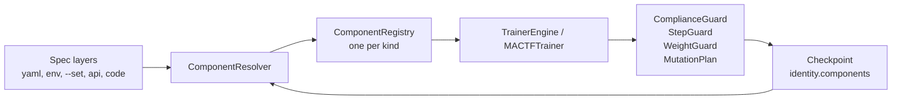

# 17. Component Customization

`mactf` already ships one trainer (`MACTFTrainer`), one scoring pipeline, five peer
strategies, six weight-update strategies, twelve families of RL functions and four
optimizer backends. Most of them can be *selected*. Very few can be *extended*, none
can be *removed*, none can be *swapped while a run is in flight*, and the two settings
that look like selectors for peer coordination (`TRAINER.PEER_STRATEGY`,
`TRAINER.WEIGHT_UPDATE`) are validated and then ignored.

This document specifies one mechanism that fixes all of that at once: a **unified
component model** (`mactf/components/`) in which every pluggable part of training is a
*component* of a declared *kind*, registered under a name, with an *origin*, a
*mutability class* and a *fingerprint*; resolved from a layered *spec*; wrapped in
*guards* that make it impossible for a customization to weaken the compliance
guarantees; and persisted in checkpoints so a run can be resumed with exactly the parts
it was started with.

It is documentation only. No file in `mactf/` changes in this phase. Every code block
below is the code that will be written, with the file it goes in named above it; nothing
is deferred to "TBD". Where this document adds a tunable that did not exist, the table
that introduces it states the default and the range.

## 0. Decisions fixed before writing

| # | Decision | Choice | Consequence |
|---|---|---|---|
| D1 | Customizable engine | **`MACTFTrainer`**, reached from `RunDriver`/`RunManager` through a new `TrainerEngine` adapter selected by `ORCHESTRATOR.ENGINE = "trainer"` | `Orchestrator` stays the default and the frozen equivalence oracle (section 13). It is not extended. |
| D2 | Compliance | **Customization never weakens compliance, and this is enforced by guards, not convention** | `ComplianceGuard` (section 6), `StepGuard` (section 7), `WeightGuard` (section 10), `MutationPlan` validation (section 12). A guard violation is an error, never a clamp, except where this document says "projected". |
| D3 | Opt-in | **Extension is explicit.** Nothing is registered by importing a module unless that module is named in `COMPONENTS.MODULES` or exposed through the `mactf.components` entry-point group | Defaults are byte-identical when nothing is customized, including checkpoint v2 content hashes (section 14). |
| D4 | Back-compat | **Existing dicts stay importable and mutable** | `SCORER_TYPES`, `PEER_STRATEGIES`, `WEIGHT_STRATEGIES` and `FUNCTION_TYPES[family]` become live views of the new registries (section 3.6). Code that writes to them keeps working and now gets origin tracking and collision rules. |
| D5 | Specs | **One spec shape for every kind**: `{type | import, params}` | Section 5. A string is shorthand for `{type: <string>}`. |
| D6 | No silent fallback | A typo must fail loudly | Unknown names and unknown parameter keys raise with the accepted set. The one documented fallback (a custom weight strategy that fails falls back to `kappa_softmax`) is recorded in `AggregationReport.adjustments`, as it is today. |

## Table of contents

1. [Purpose, non-goals, glossary, invariants](#1-purpose-non-goals-glossary-invariants)
2. [Current-state audit](#2-current-state-audit)
3. [The unified component model](#3-the-unified-component-model)
4. [Origins, mutability, locking](#4-origins-mutability-locking)
5. [Uniform spec and resolution order](#5-uniform-spec-and-resolution-order)
6. [Scoring functions](#6-scoring-functions)
7. [Training policies](#7-training-policies)
8. [RL functions](#8-rl-functions)
9. [Optimizers and schedulers](#9-optimizers-and-schedulers)
10. [Weight update, aggregation, temperature](#10-weight-update-aggregation-temperature)
11. [Peer training strategies](#11-peer-training-strategies)
12. [Peers and tree mutation](#12-peers-and-tree-mutation)
13. [Engine integration](#13-engine-integration)
14. [Persistence and compatibility](#14-persistence-and-compatibility)
15. [Configuration surface](#15-configuration-surface)
16. [CLI and API](#16-cli-and-api)
17. [System checks and error taxonomy](#17-system-checks-and-error-taxonomy)
18. [Worked examples](#18-worked-examples)
19. [Test matrix](#19-test-matrix)
20. [Phased rollout with acceptance gates](#20-phased-rollout-with-acceptance-gates)
21. [Risk register and open questions](#21-risk-register-and-open-questions)

Citations are `path:line` relative to the repository root
(`Multi-Agent-Coopetition-Training-Framework/`). They were checked against the tree on
the `last_reviewed` date; section 20 lists the line anchors a phase must re-check if the
file moved.

---

## 1. Purpose, non-goals, glossary, invariants

### 1.1 Purpose

A researcher or an operator must be able to do each of the following without editing
the framework, and without being able to break a compliance guarantee while doing it:

1. **Add** a scoring stage, a reward term, a training policy, an optimizer, a scheduler,
   a weight-update rule, a peer strategy, an RL function or a peer.
2. **Modify** the parameters of any of them, in a spec file, on the command line, over
   the API, or in code, at the granularity the component's mutability class allows.
3. **Create** new component types and register them by decorator, by module, by entry
   point or by import path.
4. **Replace** a registered component, subject to origin and lock rules.
5. **Delete** a registered component, a running peer's optimizer, or a peer.
6. **Inspect** exactly which components a run used, from a terminal, from the API and
   from a checkpoint.

### 1.2 Non-goals

| Not in scope | Why |
|---|---|
| Changing the precedence tiers, the rule catalog (`P1`..`P23`, `R*`), or `compliance.constrain` | These *are* the compliance guarantees. A component is allowed to compute *more* penalty, never less. |
| Changing `Orchestrator` | It is the frozen oracle (D1). |
| Sandboxing arbitrary plugin code | Importing a module executes it. The import allow-list (section 5.4) controls *which* modules may be imported from untrusted surfaces; it is not a sandbox. |
| Customizing the points engine's guards and bindings (`mactf/scoring/guards.py`) | They encode the framework.md clause for each rule. A plugin that redefined them would redefine what a rule means. Points *weights* stay configurable. |
| Hot-reloading source files | A component is swapped by name and spec, not by re-importing code. |
| A GUI | The API in section 16 is the surface a GUI would use. |

### 1.3 Glossary

| Term | Meaning |
|---|---|
| **Kind** | The category of a component: `scorer`, `reward_term`, `rl_function.<family>`, `optimizer`, `scheduler`, `peer_strategy`, `weight_update`, `aggregator`, `trainer_policy`, `peer_factory`. A kind owns one `ComponentRegistry`. |
| **Component** | A registered, named, versioned factory of one kind, with an origin and a mutability class (`Component`, section 3.3). |
| **Slot** | A place in a run where one component is used: `TRAINER.POLICY`, `SCORING.CHAIN[1]`, `TRAINER.OPTIMIZER.default`, `TRAINER.WEIGHT_UPDATE_OVERRIDES["root/team-a"]`. A slot has a kind, a name and a lock state. |
| **Spec** | The serializable description of a slot's component: `{type: "x", params: {...}}` or `{import: "pkg.mod:Class", params: {...}}` (section 5). |
| **Origin** | Where a component came from: `builtin`, `plugin`, `project`, `runtime`. Decides replaceability (section 4). |
| **Mutability class** | `static` (fixed for the life of a run), `episode` (may change at an episode boundary), `step` (may change between optimizer steps). |
| **Overlay** | A per-run, per-thread layer of registrations stacked over the process-wide registry; discarded when the run ends (section 3.5). |
| **Hub** | The process singleton `HUB` owning one registry per kind, the policy, and the overlay stack. |
| **Guard** | A wrapper that validates a component's *output* against an invariant. |
| **Fingerprint** | `{kind, name, origin, version, spec_hash, source_digest}`; what a checkpoint records about a component. |
| **Topology epoch** | A counter in the trainer that increments on every committed peer-tree mutation. |
| **Reference floor** | The recomputed lower bound on a peer's penalty for non-offsettable rules: `m_k * max(lambda_k, MIN_FLOOR_LAMBDA)` (section 6). |

### 1.4 Design invariants

Every later section cites these by number. Each one has at least one test in section 19.

| ID | Invariant | Enforced by |
|---|---|---|
| **I1** | *Default identity.* With no `COMPONENTS` configuration and no registration, every score, weight, parameter update, scorecard and checkpoint content hash is bit-identical to the pre-change framework. | `test_default_identity` (section 19.4); a built-in component never goes through a guard that can alter its output. |
| **I2** | *Compliance monotonicity.* For every peer and episode, a non-offsettable breach lowers `final_score` by at least the reference floor `sum_k m_k * max(lambda_k, MIN_FLOOR_LAMBDA)`, whatever the rewards are; an offsettable penalty is amplified by at least the reference Omega; and a peer that is void stays void. A reward stage may change *how much* reward is paid (it is bounded by `COMPLIANCE.REWARD_CEILING`), never what a breach costs. | `ComplianceGuard` (6.4). |
| **I3** | *Simplex validity.* Weights are non-negative, sum to 1 over eligible peers, respect `WEIGHT_FLOOR` and `WEIGHT_CAP`, and give a void or ineligible peer exactly 0. | `WeightGuard` (10.3) over `_project_bounded` (`mactf/coopetition/aggregation.py:366`). |
| **I4** | *Atomic mutation.* A tree mutation either commits completely or leaves the trainer unchanged. | `MutationPlan.apply` (12.4). |
| **I5** | *Explicit opt-in.* A component is available only if it is built in or is named by `COMPONENTS.MODULES`, a plugin entry point, a spec `import`, or a direct `register_*` call. | Section 4.2. |
| **I6** | *Reproducibility.* A checkpoint records the fingerprint of every non-built-in component in use, and restore refuses a missing one. | Section 14. |
| **I7** | *Mutability honored.* A component is never swapped more often than its class permits. | `Slot.swap` (4.4). |
| **I8** | *No silent fallback.* Unknown names and unknown params raise. | `ComponentRegistry.build` (3.4). |
| **I9** | *Per-run isolation.* Two runs in one process (the API runs several) never see each other's overlays. | `contextvars` overlay stack (3.5). |
| **I10** | *Built-ins are immutable by default.* Replacing a built-in needs `COMPONENTS.ALLOW_BUILTIN_OVERRIDE` and is logged as `W001`. | `ComponentRegistry.register` (3.4). |

---

## 2. Current-state audit

Everything below was read in the tree, not inferred.

### 2.1 Extension points

| Extension point | Location | Open? | Gap |
|---|---|---|---|
| Scorer types | `mactf/scoring/registry.py:26-50` (`SCORER_TYPES`, `register_scorer`) | Add only | No `unregister`, no origin, no scoping, no output guard. A custom stage is trusted: `_compose` reads its `amounts`, `omega` and `void_rules` as given (`mactf/scoring/pipeline.py:499-550`). |
| Scorer chain | `mactf/scoring/pipeline.py:73-146` (`__init__`, add/remove) | Yes | One stage per `ScoringKind`; `REQUIRED_KINDS` fixes REWARD, PENALTY, WARNING. Nothing checks a replacement stage against the floor. |
| Non-offsettable set | `mactf/scoring/pipeline.py:329`, `mactf/scoring/penalty.py:52-56`, `mactf/conf.py:672-678` | Configurable | `PenaltyScorer.non_offsettable` returns the configured set verbatim; `conf.py` rejects a missing rule at config load, but a programmatic `score_config` bypasses it. `HierarchicalScorer.__init__` (`mactf/scoring/hierarchy.py:145-172`, `_own_void` at `296-317`) lets a non-empty custom set *narrow* the catalog default. |
| Penalty lambdas | `mactf/conf.py` (`PENALTY_LAMBDAS`), `mactf/scoring/penalty.py:70-118` | Configurable | Only negatives are rejected. A lambda of `0` zeroes a non-offsettable floor. |
| RL functions | `mactf/rl/functions/registry.py:28-90` (`FUNCTION_TYPES`, `register_function`) | Add only | 12 families. No `unregister`, no decorator form, no per-peer override, no contract probe. `build_from_kwargs` (`mactf/rl/functions/_spec.py`) rejects unknown keys, which is correct and is kept. |
| Rollup strategies | `mactf/scoring/hierarchy.py:97-106` (`ROLLUP_STRATEGIES`, `ROLLUP_TYPES`), `build_rollup` at `109-` | **Closed** (second table) | `build_rollup` checks its *own* dict, so a rollup registered through `register_function("rollup", ...)` is rejected by `HIERARCHY.ROLLUP`. The dict also holds a `kappa_weighted` alias the `rl_function.rollup` registry lacks. Section 8.6 merges the two. |
| Points guards and bindings | `mactf/scoring/guards.py:474-515` (`GUARDS`), `603` (`BINDINGS`) | Closed on purpose | The points engine is a pure projection of the ledger that encodes framework.md clauses rule by rule. Customizing it would let a plugin redefine what a rule *means*, so it stays built in (non-goal in section 1.2, open question Q1). Its weights remain configuration (`SCORING.POINTS`). |
| Peer strategies | `mactf/coopetition/strategy.py:376-422` (`PEER_STRATEGIES`, `build_peer_strategy`) | **Closed** | Plain dict, no `register_*`. `mactf/conf.py:706-712` hard-codes `_PEER_STRATEGY_NAMES`; serializers use `choices=[...]`. |
| Weight updates | `mactf/coopetition/weights.py:464-521` (`WEIGHT_STRATEGIES`, `build_weight_update`) | **Closed** | Same. `_WEIGHT_STRATEGY_NAMES` in `mactf/conf.py:706-712`. |
| Aggregator | `mactf/coopetition/aggregation.py:44-298` | Constructor only | No name-based selection. `Aggregator.aggregate` does **not** project weights; only `compute_weights` does, so a custom strategy that bypasses it can hand `aggregate` an invalid simplex. |
| Optimizers | `mactf/training/optimizer.py:66-92` (`OptimizerBackend`), `1129-1193` (`from_spec`, `from_block`) | Callable only | Three backends are chosen by `if` chains in `from_spec`; a fourth means editing the file. Routing (`Route`, `ParamGroupRouter`, `649-845`) is configurable but cannot be hot-swapped. |
| Schedulers | `mactf/training/optimizer.py:929-948` (`attach_scheduler`) | Closed | A fixed set of names. |
| Training policy | `mactf/training/trainer.py:349`, `1506-1541` (`train_step`), `1543-1605` (`_builtin_step`), `1613-1631` (`_apply_custom_loss`) | Yes (callable/protocol) | A custom `train_step` is trusted: no finite check, no required compliance term, no quarantine. |
| Tree | `mactf/coopetition/tree.py:571-640` (`add_node`, `remove_node`) | Structural only | The tree can be edited, but the trainer's optimizers, controllers, weights and group aggregators are not rebound. |
| Engine | `mactf/management/driver.py:162-190`, `mactf/orchestration/live.py:436-781` | **Closed** | `RunDriver` and `RunManager` drive `Orchestrator` only. `MACTFTrainer` is reachable only from code. |
| Checkpoint | `mactf/training/trainer.py:1921-1947` (`_observe`), `mactf/orchestration/checkpoint_v2.py:56-114` | Gap | The periodic checkpoint is saved with a `CheckpointContext` that carries no `identity_extra`, so trainer-owned state is missing from periodic checkpoints. |

### 2.2 Dead settings

`TRAINER.PEER_STRATEGY` and `TRAINER.WEIGHT_UPDATE` are validated by
`mactf/conf.py:739-745` and declared in `TRAINER_DEFAULTS` (`mactf/conf.py:37-56`), but:

- `MACTFTrainer.build` takes the strategy from its **constructor argument**
  (`self._peer_strategy_spec`, `self._weight_update_spec`, `mactf/training/trainer.py:611-615`)
  and never reads the settings, and
- `Orchestrator` has no strategy slot at all.

A user who sets `TRAINER.PEER_STRATEGY: cooperative` in YAML gets `independent` or
`kappa_softmax` and no warning. Section 11.5 makes the setting real; section 17 adds
check `mactf.components.W002` for the transition window.

### 2.3 The four compliance holes this document closes

| # | Hole | Where | Fix | Section |
|---|---|---|---|---|
| H1 | `SCORING.NON_OFFSETTABLE` can be a subset | `penalty.py:52-56` returns the configured set verbatim | `PenaltyScorer` and `HierarchicalScorer` always use `configured | catalog` | 6.6 |
| H2 | A lambda of `0` zeroes a floor | `conf.py` rejects only negatives | `PENALTY_LAMBDAS[rule] >= COMPLIANCE.MIN_FLOOR_LAMBDA` for every non-offsettable rule | 6.6 |
| H3 | A custom stage's output is trusted | `_compose` copies `amounts`, `omega`, `rules` | `ComplianceGuard` recomputes the reference floor and compares | 6.4 |
| H4 | A custom `train_step` is trusted | `train_step` accepts any `StepResult` | `StepGuard` | 7.4 |

### 2.4 What stays untouched

`ScoringPipeline._walk` (`pipeline.py:472-492`), `compliance.constrain`
(`mactf/compliance.py:108-183`), `_INHERITED_VOID_FLOOR = 1000.0`
(`mactf/compliance.py:35`), `PeerTree.branch_void` (`tree.py:1013-1029`), the precedence
resolver and the points engine are not modified. The guards sit *around* them.

