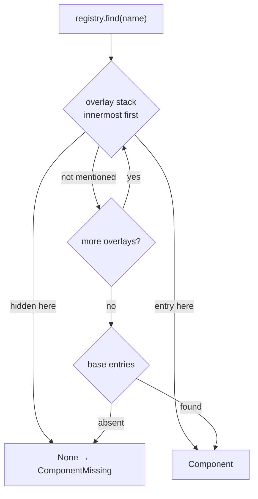

---

## 3. The unified component model

### 3.1 Package layout

```text
mactf/components/
    __init__.py        public surface: HUB, register_*, unregister, get_component, Origin, ...
    kinds.py           ComponentKind, Origin, Mutability, KindSpec, KIND_SPECS
    reflect.py         constructor_keys, source_digest, canonical_json, spec_hash
    params.py          ParamSpec
    registry.py        Component, Overlay, HubPolicy, ComponentRegistry, Hub, HUB
    legacy.py          LegacyTable (MutableMapping view over a registry)
    decorators.py      register_scorer, register_function, register_optimizer, ...
    contracts.py       one contract function per kind (register-time and instance-time)
    resolver.py        ComponentSpec, ComponentResolver, import allow-list      (section 5)
    slots.py           Slot, SlotTable, swap rules                                (section 4)
    guards/
        compliance.py  ComplianceGuard, ReadOnlyLedger                           (section 6)
        step.py        StepGuard, VoidProbe, GuardedPolicy                       (section 7)
        weights.py     WeightGuard                                               (section 10)
    plugins.py         entry-point discovery, COMPONENTS.MODULES loading         (section 4.2)
    fingerprint.py     fingerprint(), diff()                                     (section 14)
```

`mactf/components/` imports from `mactf.exceptions` and the standard library only at
module import time. Contracts import `Scorer`, `PeerStrategy` and the rest lazily, inside
the contract function, so that `mactf.scoring`, `mactf.coopetition` and
`mactf.rl.functions` can import `mactf.components` without a cycle.

### 3.2 Kinds, origins, mutability (`mactf/components/kinds.py`)

```python
from __future__ import annotations

import enum
from dataclasses import dataclass, field
from typing import Any, Callable, Mapping

from ..exceptions import ValidationError

#: The twelve RL function families, in the order ``CAPABILITY_ORDER`` fixes
#: (``mactf/rl/functions/registry.py:56-70``).
RL_FAMILIES: tuple[str, ...] = (
    "value", "advantage", "loss", "rollup", "return", "reward",
    "regularization", "objective", "gradient", "metric", "action", "synthesis",
)


class Origin(str, enum.Enum):
    """Where a component came from. The rank decides who may replace whom."""

    BUILTIN = "builtin"
    PLUGIN = "plugin"
    PROJECT = "project"
    RUNTIME = "runtime"

    @property
    def rank(self) -> int:
        return _ORIGIN_RANK[self]


_ORIGIN_RANK: dict[Origin, int] = {
    Origin.BUILTIN: 0,
    Origin.PLUGIN: 1,
    Origin.PROJECT: 2,
    Origin.RUNTIME: 3,
}


class Mutability(str, enum.Enum):
    """How often the slot holding this component may be swapped."""

    STATIC = "static"      # fixed for the life of a run
    EPISODE = "episode"    # may change at an episode boundary
    STEP = "step"          # may change between optimizer steps

    @property
    def rank(self) -> int:
        return _MUTABILITY_RANK[self]


_MUTABILITY_RANK: dict[Mutability, int] = {
    Mutability.STATIC: 0,
    Mutability.EPISODE: 1,
    Mutability.STEP: 2,
}


class Boundary(str, enum.Enum):
    """The moment at which a swap is attempted. Same ordering as ``Mutability``."""

    RUN_START = "run_start"
    EPISODE = "episode"
    STEP = "step"

    @property
    def rank(self) -> int:
        return {"run_start": 0, "episode": 1, "step": 2}[self.value]


class ComponentKind(str, enum.Enum):
    SCORER = "scorer"
    REWARD_TERM = "reward_term"
    RL_FUNCTION = "rl_function"
    OPTIMIZER = "optimizer"
    SCHEDULER = "scheduler"
    PEER_STRATEGY = "peer_strategy"
    WEIGHT_UPDATE = "weight_update"
    AGGREGATOR = "aggregator"
    TRAINER_POLICY = "trainer_policy"
    PEER_FACTORY = "peer_factory"

    def kind_id(self, family: str | None = None) -> str:
        """``"scorer"``, ``"rl_function.loss"``, ... The registry key."""
        if self is ComponentKind.RL_FUNCTION:
            if family not in RL_FAMILIES:
                raise ValidationError(
                    f"rl_function needs a family, one of: {', '.join(RL_FAMILIES)}; got {family!r}"
                )
            return f"rl_function.{family}"
        if family is not None:
            raise ValidationError(f"kind {self.value!r} takes no family; got {family!r}")
        return self.value


def parse_kind_id(text: str) -> tuple[ComponentKind, str | None]:
    """Inverse of :meth:`ComponentKind.kind_id`."""
    head, _, family = str(text).partition(".")
    try:
        kind = ComponentKind(head)
    except ValueError:
        raise ValidationError(
            f"unknown component kind {text!r}; kinds: "
            + ", ".join(sorted(all_kind_ids()))
        ) from None
    if kind is ComponentKind.RL_FUNCTION:
        kind.kind_id(family or None)  # raises ValidationError for a missing or unknown family
        return kind, family
    if family:
        raise ValidationError(f"kind {head!r} takes no family; got {text!r}")
    return kind, None


@dataclass(frozen=True)
class KindSpec:
    """Static facts about one kind. ``contract`` and ``instance_contract`` return
    a list of problems (empty = fine); they live in :mod:`mactf.components.contracts`.
    """

    kind_id: str
    kind: ComponentKind
    family: str | None
    #: The root name used by ``COMPONENTS.LOCKED``: ``scorer``, ``weight_update``, ...
    slot: str
    default_mutability: Mutability
    contract: Callable[[Any], list[str]]
    instance_contract: Callable[[Any], list[str]]
    #: Dotted path of the legacy dict this kind mirrors, informational only.
    legacy_table: str | None = None
    description: str = ""
    #: ``builder(component, values, injected) -> instance``. ``None`` means "call the
    #: factory with ``**values, **injected``". A kind whose registered factories are not
    #: all directly callable (an optimizer may be a ``torch.optim.Optimizer`` subclass that
    #: needs parameters first) supplies one. Resolved in ``mactf.components.contracts``.
    builder: Callable[[Any, dict[str, Any], dict[str, Any]], Any] | None = None


# Filled by ``mactf.components.contracts`` at import; see section 3.7.
KIND_SPECS: dict[str, KindSpec] = {}


def all_kind_ids() -> tuple[str, ...]:
    ids = [k.value for k in ComponentKind if k is not ComponentKind.RL_FUNCTION]
    ids.extend(f"rl_function.{family}" for family in RL_FAMILIES)
    return tuple(ids)
```

`parse_kind_id` for an RL kind returns `(ComponentKind.RL_FUNCTION, family)`, running
the family check on the way.

Default mutability per kind (`KIND_DEFAULTS` in `contracts.py`):

| Kind | Default | Why |
|---|---|---|
| `scorer`, `reward_term` | `episode` | A scorer is read once per episode, in `score()`; changing it mid-episode would make two peers in one episode be judged by different rules. |
| `rl_function.loss`, `.regularization`, `.gradient`, `.metric` | `step` | Read on every step and carry no cross-step state beyond what they declare. |
| other `rl_function.*` | `episode` | Advantage, value, return, reward and rollup shape one episode's batch. |
| `optimizer` | `episode` | Swapping optimizers between steps of one episode mixes two update rules into one rollout; the swap also needs a state-migration policy (section 9.5). |
| `scheduler` | `episode` | Same reasoning, and the scheduler's step counter must line up with episodes. |
| `weight_update`, `peer_strategy` | `episode` | They run at epoch end. |
| `aggregator`, `trainer_policy` | `static` | They own controller state (`AdaptiveKappa`) or distillation state; a swap would orphan it. |
| `peer_factory` | `episode` | Only called when a tree mutation commits, which is an episode-boundary action. |

A component may declare a **stricter** class than its kind's default (a policy that
cannot be hot-swapped declares `static`) but never a looser one; `register` rejects a
`mutability` whose rank exceeds the kind default's rank.

### 3.3 Params, reflection, `Component` (`params.py`, `reflect.py`, `registry.py`)

```python
# mactf/components/params.py
from __future__ import annotations

from dataclasses import dataclass
from typing import Any

MISSING: Any = object()


@dataclass(frozen=True)
class ParamSpec:
    """Optional, declarative description of one constructor parameter.

    A component that supplies a ``params_schema`` gets typed validation *before* its
    constructor runs. A component that does not still gets unknown-key rejection from
    constructor reflection.
    """

    type: type | tuple[type, ...] | None = None
    default: Any = MISSING
    required: bool = False
    choices: tuple[Any, ...] = ()
    minimum: float | None = None
    maximum: float | None = None
    doc: str = ""

    def problems(self, name: str, value: Any) -> list[str]:
        found: list[str] = []
        if self.type is not None:
            allowed = self.type if isinstance(self.type, tuple) else (self.type,)
            numeric_only = all(t in (int, float) for t in allowed)
            if isinstance(value, bool) and numeric_only:
                found.append(f"{name}: expected a number, got bool")
            elif not isinstance(value, allowed):
                names = "/".join(t.__name__ for t in allowed)
                found.append(f"{name}: expected {names}, got {type(value).__name__}")
        if self.choices and value not in self.choices:
            found.append(f"{name}: {value!r} is not one of {list(self.choices)}")
        if isinstance(value, (int, float)) and not isinstance(value, bool):
            if self.minimum is not None and value < self.minimum:
                found.append(f"{name}: {value} is below the minimum {self.minimum}")
            if self.maximum is not None and value > self.maximum:
                found.append(f"{name}: {value} is above the maximum {self.maximum}")
        return found

    def describe(self) -> dict[str, Any]:
        payload: dict[str, Any] = {"required": self.required, "doc": self.doc}
        if self.type is not None:
            allowed = self.type if isinstance(self.type, tuple) else (self.type,)
            payload["type"] = "/".join(t.__name__ for t in allowed)
        if self.default is not MISSING:
            payload["default"] = self.default
        if self.choices:
            payload["choices"] = list(self.choices)
        if self.minimum is not None:
            payload["minimum"] = self.minimum
        if self.maximum is not None:
            payload["maximum"] = self.maximum
        return payload
```

```python
# mactf/components/reflect.py
from __future__ import annotations

import functools
import hashlib
import inspect
import json
from dataclasses import dataclass
from typing import Any, Mapping


@dataclass(frozen=True)
class Reflection:
    keys: frozenset[str]
    required: frozenset[str]
    var_keyword: bool


def reflect(factory: Any) -> Reflection:
    """Constructor keyword reflection for a class, function or ``functools.partial``.

    For a class, ``__init__`` signatures are read along the MRO. A base class is
    consulted only while the class before it takes ``**kwargs`` (it forwards), which is
    the rule ``mactf.scoring.base._constructor_keys`` and
    ``mactf.rl.functions._spec.constructor_keys`` already apply, so the three agree.
    ``var_keyword`` is true when the chain is still forwarding ``**kwargs`` after the
    last real ``__init__``: the factory then accepts arbitrary keys.
    """
    bound: frozenset[str] = frozenset()
    target = factory
    if isinstance(target, functools.partial):
        bound = frozenset(target.keywords)
        target = target.func
    keys: set[str] = set()
    required: set[str] = set()
    var_keyword = False
    named = (inspect.Parameter.POSITIONAL_OR_KEYWORD, inspect.Parameter.KEYWORD_ONLY)
    if inspect.isclass(target):
        forwarding = False
        for klass in target.__mro__:
            if klass is object:
                continue
            init = klass.__dict__.get("__init__")
            if init is None:
                continue
            forwarding = False
            for parameter in list(inspect.signature(init).parameters.values())[1:]:
                if parameter.kind is inspect.Parameter.VAR_KEYWORD:
                    forwarding = True
                elif parameter.kind in named and parameter.name not in keys:
                    keys.add(parameter.name)
                    if parameter.default is inspect.Parameter.empty:
                        required.add(parameter.name)
            if not forwarding:
                break
        var_keyword = forwarding
    else:
        for parameter in inspect.signature(target).parameters.values():
            if parameter.kind is inspect.Parameter.VAR_KEYWORD:
                var_keyword = True
            elif parameter.kind in named:
                keys.add(parameter.name)
                if parameter.default is inspect.Parameter.empty:
                    required.add(parameter.name)
    return Reflection(
        keys=frozenset(keys) - bound,
        required=frozenset(required) - bound,
        var_keyword=var_keyword,
    )

def constructor_keys(factory: Any) -> frozenset[str]:
    return reflect(factory).keys


def canonical_json(value: Any) -> str:
    """Stable JSON: sorted keys, no whitespace, floats via ``repr``."""
    return json.dumps(value, sort_keys=True, separators=(",", ":"), default=_default)


def _default(value: Any) -> Any:
    if isinstance(value, (set, frozenset)):
        return sorted(value, key=repr)
    if hasattr(value, "value") and hasattr(value, "name"):  # enum
        return value.value
    return repr(value)


def spec_hash(spec: Mapping[str, Any]) -> str:
    return hashlib.sha256(canonical_json(dict(spec)).encode("utf-8")).hexdigest()[:16]


def source_digest(factory: Any) -> str | None:
    """sha256 of the factory's source text, or ``None`` when it is not available
    (built-in extension, REPL, ``exec``). Only computed for non-built-in components.
    """
    target = factory.func if isinstance(factory, functools.partial) else factory
    try:
        text = inspect.getsource(target)
    except (OSError, TypeError):
        return None
    return hashlib.sha256(text.encode("utf-8")).hexdigest()[:16]
```

`Reflection.var_keyword` is `True` when the factory accepts arbitrary keywords (a function
with `**kwargs`, or a class whose whole `__init__` chain forwards `**kwargs` up to
`object`). Unknown-key rejection is then skipped for that component, and it should supply
a `params_schema` to get any validation. A class that names its keywords and forwards
`**kwargs` only to a base class that does not take them is validated against the union
of both sets of names, which is what the MRO walk computes.

```python
# mactf/components/registry.py  (part 1: data types)
from __future__ import annotations

import contextlib
import contextvars
import fnmatch
import itertools
import logging
import threading
from dataclasses import dataclass, field
from typing import Any, Callable, Generic, Iterator, Mapping, TypeVar

from ..exceptions import (
    ComponentBuildError,
    ComponentCollision,
    ComponentContractError,
    ComponentLocked,
    ComponentMissing,
    ComponentParamError,
    ValidationError,
)
from .kinds import KIND_SPECS, KindSpec, Mutability, Origin, RL_FAMILIES, all_kind_ids
from .params import ParamSpec
from .reflect import reflect, source_digest

log = logging.getLogger("mactf.components")
T = TypeVar("T")

#: Kinds whose names ``mactf/conf.py`` lower-cases before comparing (``conf.py:739-745``).
_LOWERCASE_KINDS = frozenset({"peer_strategy", "weight_update"})


@dataclass(frozen=True)
class Component:
    """One registered, named factory. Immutable: replacing means registering a new one."""

    kind: str
    name: str
    factory: Any
    origin: Origin
    mutability: Mutability
    version: str = "0"
    module: str = ""
    qualname: str = ""
    description: str = ""
    params_schema: Mapping[str, ParamSpec] | None = None
    capabilities: Mapping[str, Any] = field(default_factory=dict)
    #: Names of other components of any kind this one needs, as ``"kind:name"``.
    requires: frozenset[str] = frozenset()
    overrides_builtin: bool = False
    seq: int = 0

    # -- reflection ------------------------------------------------------
    def accepted_params(self) -> frozenset[str]:
        if self.params_schema is not None:
            return frozenset(self.params_schema)
        return reflect(self.factory).keys

    def check_params(self, params: Mapping[str, Any], *, ignore: frozenset[str] = frozenset()) -> list[str]:
        """Problems with ``params``, empty when fine. ``ignore`` names keys the
        resolver injects (for example ``config`` for a scorer) and are not user params."""
        problems: list[str] = []
        reflection = reflect(self.factory)
        accepted = self.accepted_params() | ignore
        schema = self.params_schema
        if not (reflection.var_keyword and schema is None):
            for key in sorted(params):
                if key not in accepted:
                    problems.append(
                        f"{self.name} does not accept {key!r}; accepted keys: {sorted(accepted - ignore)}"
                    )
        if schema is not None:
            for key, spec in schema.items():
                if key in params:
                    problems.extend(spec.problems(key, params[key]))
                elif spec.required:
                    problems.append(f"missing required parameter {key!r}")
        else:
            for key in sorted(reflection.required - ignore):
                if key not in params:
                    problems.append(f"missing required parameter {key!r}")
        return problems

    # -- reporting -------------------------------------------------------
    def fingerprint(self, *, spec_hash: str | None = None, with_source: bool = True) -> dict[str, Any]:
        payload: dict[str, Any] = {
            "kind": self.kind,
            "name": self.name,
            "origin": self.origin.value,
            "version": self.version,
        }
        if spec_hash is not None:
            payload["spec_hash"] = spec_hash
        if self.origin is not Origin.BUILTIN and with_source:
            payload["source_digest"] = source_digest(self.factory)
        if self.overrides_builtin:
            payload["overrides_builtin"] = True
        return payload

    def describe(self) -> dict[str, Any]:
        payload: dict[str, Any] = {
            "kind": self.kind,
            "name": self.name,
            "origin": self.origin.value,
            "mutability": self.mutability.value,
            "version": self.version,
            "class": self.qualname or getattr(self.factory, "__name__", repr(self.factory)),
            "module": self.module,
            "description": self.description,
            "kwargs": sorted(self.accepted_params()),
            "requires": sorted(self.requires),
            "overrides_builtin": self.overrides_builtin,
        }
        if self.params_schema is not None:
            payload["params"] = {k: v.describe() for k, v in self.params_schema.items()}
        if self.capabilities:
            payload["capabilities"] = dict(self.capabilities)
        return payload


class Overlay:
    """A per-run layer of registrations and hidden names, stacked over the base."""

    __slots__ = ("label", "_entries", "_hidden", "_lock")

    def __init__(self, label: str) -> None:
        self.label = label
        self._entries: dict[str, dict[str, Component]] = {}
        self._hidden: dict[str, set[str]] = {}
        self._lock = threading.RLock()

    def put(self, component: Component) -> None:
        with self._lock:
            self._entries.setdefault(component.kind, {})[component.name] = component
            self._hidden.get(component.kind, set()).discard(component.name)

    def hide(self, kind: str, name: str) -> None:
        with self._lock:
            self._entries.get(kind, {}).pop(name, None)
            self._hidden.setdefault(kind, set()).add(name)

    def entry(self, kind: str, name: str) -> Component | None:
        return self._entries.get(kind, {}).get(name)

    def is_hidden(self, kind: str, name: str) -> bool:
        return name in self._hidden.get(kind, ())

    def entries(self, kind: str) -> Mapping[str, Component]:
        return dict(self._entries.get(kind, {}))

    def hidden(self, kind: str) -> frozenset[str]:
        return frozenset(self._hidden.get(kind, ()))

    def is_empty(self) -> bool:
        return not any(self._entries.values()) and not any(self._hidden.values())


@dataclass(frozen=True)
class HubPolicy:
    """What the hub enforces. Resolved from ``COMPONENTS`` (section 15)."""

    allow_builtin_override: bool = False
    #: ``"kind:name"`` patterns (``fnmatch``); ``"scorer:*"`` locks a whole kind.
    locked: frozenset[str] = frozenset()
    strict_legacy: bool = False
    allow_import: bool = False
    import_allowlist: tuple[str, ...] = ()
    max_components_per_kind: int = 512

    def is_locked(self, kind: str, name: str) -> bool:
        key = f"{kind}:{name}"
        return any(fnmatch.fnmatchcase(key, pattern) for pattern in self.locked)
```

### 3.4 `ComponentRegistry`

```python
# mactf/components/registry.py  (part 2: the registry)
class ComponentRegistry(Generic[T]):
    """Name -> :class:`Component` for one kind. Thread-safe; overlay-aware."""

    def __init__(self, spec: KindSpec, hub: "Hub") -> None:
        self.spec = spec
        self._hub = hub
        self._entries: dict[str, Component] = {}
        self._lock = threading.RLock()
        self._frozen = False
        self._mirror: dict[str, Any] | None = None
        self._seq = itertools.count(1)

    @property
    def kind(self) -> str:
        return self.spec.kind_id

    # -- mirror (section 3.6) --------------------------------------------
    def attach_mirror(self, table: dict[str, Any]) -> None:
        """Keep ``table`` equal to the base layer's ``name -> factory``."""
        with self._lock:
            self._mirror = table
            dict.clear(table)
            for name, component in self._entries.items():
                dict.__setitem__(table, name, component.factory)

    # -- lookup ----------------------------------------------------------
    def find(self, name: str) -> Component | None:
        for overlay in reversed(self._hub.active_overlays()):
            if overlay.is_hidden(self.kind, name):
                return None
            found = overlay.entry(self.kind, name)
            if found is not None:
                return found
        return self._entries.get(name)

    def get(self, name: str) -> Component:
        found = self.find(str(name))
        if found is None:
            raise ComponentMissing(self.kind, str(name), self.names())
        return found

    def has(self, name: str) -> bool:
        return self.find(str(name)) is not None

    def names(self) -> list[str]:
        visible = dict.fromkeys(self._entries)
        for overlay in self._hub.active_overlays():
            for name in overlay.hidden(self.kind):
                visible.pop(name, None)
            for name in overlay.entries(self.kind):
                visible[name] = None
        return sorted(visible)

    def components(self) -> list[Component]:
        return [self.get(name) for name in self.names()]

    def capabilities(self) -> list[dict[str, Any]]:
        return [component.describe() for component in self.components()]

    # -- registration ----------------------------------------------------
    def register(
        self,
        name: str,
        factory: Any,
        *,
        origin: Origin | None = None,
        mutability: Mutability | None = None,
        version: str = "0",
        description: str = "",
        params_schema: Mapping[str, ParamSpec] | None = None,
        capabilities: Mapping[str, Any] | None = None,
        requires: Any = (),
        replace: bool = False,
        scope: str = "global",
        via: str = "api",
    ) -> Component:
        origin = origin or self._hub.default_origin()
        name = self._check_name(name)
        problems = self.spec.contract(factory)
        if problems:
            raise ComponentContractError(self.kind, name, problems)
        default = self.spec.default_mutability
        chosen = mutability or default
        if chosen.rank > default.rank:
            raise ComponentContractError(
                self.kind, name,
                [f"mutability {chosen.value!r} is looser than the kind default {default.value!r}"],
            )
        policy = self._hub.effective_policy()
        if policy.is_locked(self.kind, name):
            raise ComponentLocked(self.kind, name, "the slot is locked by COMPONENTS.LOCKED")
        with self._lock:
            if scope == "run":
                overlay = self._hub.current_overlay(required=True)
                existing = self.find(name)
            else:
                if self._frozen:
                    raise ComponentLocked(self.kind, name, "the registry is frozen")
                if len(self._entries) >= policy.max_components_per_kind and name not in self._entries:
                    raise ComponentContractError(
                        self.kind, name,
                        [f"registry is full ({policy.max_components_per_kind} components)"],
                    )
                overlay = None
                existing = self._entries.get(name)
            overrides = self._check_replace(name, existing, origin, replace, policy, via)
            component = Component(
                kind=self.kind,
                name=name,
                factory=factory,
                origin=origin,
                mutability=chosen,
                version=str(version),
                module=getattr(factory, "__module__", "") or "",
                qualname=getattr(factory, "__qualname__", "") or "",
                description=description or (getattr(factory, "__doc__", "") or "").strip().split("\n")[0],
                params_schema=dict(params_schema) if params_schema is not None else None,
                capabilities=dict(capabilities or {}),
                requires=frozenset(requires or ()),
                overrides_builtin=overrides,
                seq=next(self._seq),
            )
            if overlay is not None:
                overlay.put(component)
            else:
                self._entries[name] = component
                self._mirror_set(name, factory)
                self._hub._bump()
        if overrides:
            log.warning("W001 %s:%s replaces a built-in component (origin=%s)", self.kind, name, origin.value)
        return component

    def _check_replace(
        self, name: str, existing: Component | None, origin: Origin,
        replace: bool, policy: HubPolicy, via: str,
    ) -> bool:
        if existing is None:
            return False
        if not replace:
            raise ComponentCollision(
                self.kind, name,
                f"already registered by origin {existing.origin.value} "
                f"({existing.module}.{existing.qualname}); pass replace=True to override",
            )
        if existing.origin is Origin.BUILTIN:
            legacy_ok = via == "legacy" and not policy.strict_legacy
            if not (policy.allow_builtin_override or legacy_ok):
                raise ComponentCollision(
                    self.kind, name,
                    "is built in; replacing it needs COMPONENTS.ALLOW_BUILTIN_OVERRIDE",
                )
            if via == "legacy":
                log.warning("W005 %s:%s replaced through a legacy registry write", self.kind, name)
            return True
        if origin.rank < existing.origin.rank:
            raise ComponentCollision(
                self.kind, name,
                f"origin {origin.value} cannot replace a component from origin {existing.origin.value}",
            )
        return False

    def unregister(self, name: str, *, scope: str = "global", via: str = "api") -> Component:
        policy = self._hub.effective_policy()
        if policy.is_locked(self.kind, name):
            raise ComponentLocked(self.kind, name, "the slot is locked by COMPONENTS.LOCKED")
        with self._lock:
            if scope == "run":
                overlay = self._hub.current_overlay(required=True)
                existing = self.find(name)
                if existing is None:
                    raise ComponentMissing(self.kind, name, self.names())
                self._check_unregister(existing, policy, via)
                overlay.hide(self.kind, name)
                return existing
            if self._frozen:
                raise ComponentLocked(self.kind, name, "the registry is frozen")
            existing = self._entries.get(name)
            if existing is None:
                raise ComponentMissing(self.kind, name, self.names())
            self._check_unregister(existing, policy, via)
            del self._entries[name]
            self._mirror_del(name)
            self._hub._bump()
            return existing

    def _check_unregister(self, existing: Component, policy: HubPolicy, via: str) -> None:
        if existing.origin is Origin.BUILTIN:
            legacy_ok = via == "legacy" and not policy.strict_legacy
            if not (policy.allow_builtin_override or legacy_ok):
                raise ComponentLocked(
                    self.kind, existing.name,
                    "is built in; removing it needs COMPONENTS.ALLOW_BUILTIN_OVERRIDE",
                )

    def freeze(self) -> None:
        with self._lock:
            self._frozen = True

    def unfreeze(self) -> None:
        with self._lock:
            self._frozen = False

    @property
    def frozen(self) -> bool:
        return self._frozen

    # -- construction ----------------------------------------------------
    def build(
        self,
        name: str,
        params: Mapping[str, Any] | None = None,
        *,
        inject: Mapping[str, Any] | None = None,
    ) -> T:
        """Validate ``params``, call the factory, check the instance contract.

        ``inject`` carries keys the framework offers (a scorer's ``config``, a warning
        stage's ``warning_policy``); the factory receives those it declares, and a spec may
        not set them.
        """
        component = self.get(name)
        values = dict(params or {})
        reflection = reflect(component.factory)
        accepted = component.accepted_params()
        takes_any = reflection.var_keyword and component.params_schema is None
        # Injection is an offer: the factory receives only the keys it declares.
        extra = {
            key: value for key, value in dict(inject or {}).items()
            if key in accepted or takes_any
        }
        clash = sorted(set(values) & set(extra))
        if clash:
            raise ComponentParamError(
                self.kind, component.name,
                [f"parameter {key!r} is supplied by the framework and cannot be set in a spec"
                 for key in clash],
            )
        problems = component.check_params(values, ignore=frozenset(extra))
        if problems:
            raise ComponentParamError(self.kind, component.name, problems)
        try:
            builder = self.spec.builder
            if builder is not None:
                instance = builder(component, values, extra)
            else:
                instance = component.factory(**values, **extra)
        except (TypeError, ValueError) as error:
            raise ComponentBuildError(self.kind, component.name, error) from error
        bad = self.spec.instance_contract(instance)
        if bad:
            raise ComponentContractError(self.kind, component.name, bad)
        return instance

    # -- helpers ---------------------------------------------------------
    def _check_name(self, name: str) -> str:
        """The rule every ``register_*`` already applies: ``name.replace("_", "").isalnum()``."""
        text = str(name)
        if not text or not text.replace("_", "").isalnum():
            noun = "function" if self.spec.family else self.kind
            raise ComponentContractError(
                self.kind, text,
                [f"invalid {noun} type name {text!r}: letters, digits and underscores only"],
            )
        if self.kind in _LOWERCASE_KINDS and text != text.lower():
            raise ComponentContractError(
                self.kind, text,
                ["names of this kind are lower-case: the configuration layer lower-cases them"],
            )
        return text

    def _mirror_set(self, name: str, factory: Any) -> None:
        if self._mirror is not None:
            dict.__setitem__(self._mirror, name, factory)

    def _mirror_del(self, name: str) -> None:
        if self._mirror is not None:
            dict.pop(self._mirror, name, None)
```

`ComponentBuildError` wraps only `TypeError`/`ValueError` from the factory. A
`ValidationError` or `ImproperlyConfigured` raised by the component's own constructor
is a better message than anything this layer can write and propagates unchanged
(invariant I8: the user sees the component's own reason).

### 3.5 `Hub`, overlays and per-run activation

```python
# mactf/components/registry.py  (part 3: the hub)
_OVERLAYS: contextvars.ContextVar[tuple[Overlay, ...]] = contextvars.ContextVar(
    "mactf_component_overlays", default=()
)
_POLICY: contextvars.ContextVar[HubPolicy | None] = contextvars.ContextVar(
    "mactf_component_policy", default=None
)
_DEFAULT_ORIGIN: contextvars.ContextVar[Origin] = contextvars.ContextVar(
    "mactf_component_default_origin", default=Origin.PROJECT
)


class Hub:
    """Process singleton: one registry per kind, a policy and an overlay stack."""

    def __init__(self) -> None:
        self._registries: dict[str, ComponentRegistry[Any]] = {}
        self._policy = HubPolicy()
        self._lock = threading.RLock()
        self._generation = 0

    # -- registries ------------------------------------------------------
    def registry(self, kind_id: str) -> ComponentRegistry[Any]:
        with self._lock:
            found = self._registries.get(kind_id)
            if found is None:
                spec = KIND_SPECS.get(kind_id)
                if spec is None:
                    raise ValidationError(
                        f"unknown component kind {kind_id!r}; kinds: "
                        + ", ".join(all_kind_ids())
                    )
                found = ComponentRegistry(spec, self)
                self._registries[kind_id] = found
            return found

    def kinds(self) -> tuple[str, ...]:
        return all_kind_ids()

    # -- policy ----------------------------------------------------------
    @property
    def policy(self) -> HubPolicy:
        return self._policy

    def configure(self, policy: HubPolicy) -> None:
        with self._lock:
            self._policy = policy

    def effective_policy(self) -> HubPolicy:
        return _POLICY.get() or self._policy

    # -- default origin --------------------------------------------------
    def default_origin(self) -> Origin:
        """The origin a ``register_*`` call gets when it names none: ``PROJECT`` unless
        a loader (plugin discovery, a runtime spec import) has scoped another one."""
        return _DEFAULT_ORIGIN.get()

    @contextlib.contextmanager
    def loading(self, origin: Origin) -> Iterator[None]:
        token = _DEFAULT_ORIGIN.set(origin)
        try:
            yield
        finally:
            _DEFAULT_ORIGIN.reset(token)

    # -- overlays --------------------------------------------------------
    def active_overlays(self) -> tuple[Overlay, ...]:
        return _OVERLAYS.get()

    def current_overlay(self, *, required: bool = False) -> Overlay | None:
        stack = _OVERLAYS.get()
        if stack:
            return stack[-1]
        if required:
            raise ComponentLocked("overlay", "-", "no run scope is active; use HUB.scoped()")
        return None

    @contextlib.contextmanager
    def scoped(self, label: str = "run", *, policy: HubPolicy | None = None) -> Iterator[Overlay]:
        """Activate a fresh overlay for the current thread/task; discard it on exit."""
        overlay = Overlay(label)
        stack_token = _OVERLAYS.set(_OVERLAYS.get() + (overlay,))
        policy_token = _POLICY.set(policy) if policy is not None else None
        try:
            yield overlay
        finally:
            if policy_token is not None:
                _POLICY.reset(policy_token)
            _OVERLAYS.reset(stack_token)

    def activate(self, overlay: Overlay) -> contextvars.Token:
        """Re-enter an existing overlay (a worker thread that must see a run's parts)."""
        return _OVERLAYS.set(_OVERLAYS.get() + (overlay,))

    def deactivate(self, token: contextvars.Token) -> None:
        _OVERLAYS.reset(token)

    # -- generation, snapshots -------------------------------------------
    def _bump(self) -> None:
        self._generation += 1

    @property
    def generation(self) -> int:
        return self._generation

    def freeze_all(self) -> None:
        for kind_id in all_kind_ids():
            self.registry(kind_id).freeze()

    def snapshot(self) -> dict[str, dict[str, dict[str, Any]]]:
        """Every visible component of every kind: the data behind ``mactf components list``."""
        return {kind_id: {c.name: c.describe() for c in self.registry(kind_id).components()}
                for kind_id in all_kind_ids()}


HUB = Hub()
```

**Threads.** `contextvars` propagate into `asyncio` tasks and into
`contextvars.copy_context().run`, but a plain `threading.Thread` starts with an empty
context. `RunManager._run` therefore captures `ctx = contextvars.copy_context()` on the
request thread and starts its worker as `Thread(target=ctx.run, args=(self._run, ...))`
(section 13.4). Without that, a run would silently lose its overlay.



### 3.6 Backward-compatible views (`mactf/components/legacy.py`)

The dicts the rest of the code and the tests already import stay as objects with the same
names. Each becomes a `LegacyTable`: a real `dict` subclass (so `isinstance(x, dict)`,
`json.dumps`, `sorted(x)` and `dict(x)` keep working) whose **reads** are plain dict reads
of a mirror kept in step by the registry, and whose **writes** are routed through the
registry so they get origin tracking, collision rules and lock checks.

```python
# mactf/components/legacy.py
from __future__ import annotations

from typing import Any, Iterable, Mapping

from .kinds import Origin
from .registry import HUB, ComponentRegistry

_UNSET: Any = object()


class LegacyTable(dict):
    """``name -> factory`` view of the *base layer* of one registry.

    Overlays are deliberately invisible here: this object is shared, process-wide state
    and a run's private parts must not leak into it. Framework code reads the registry
    (``HUB.registry(kind).get``); only third-party code that still holds the dict sees
    this view.
    """

    __slots__ = ("_kind",)

    def __init__(self, kind_id: str, builtins: Mapping[str, Any] | None = None) -> None:
        super().__init__()
        self._kind = kind_id
        registry = self._registry()
        registry.attach_mirror(self)
        for name, factory in (builtins or {}).items():
            registry.register(name, factory, origin=Origin.BUILTIN)

    def _registry(self) -> ComponentRegistry[Any]:
        return HUB.registry(self._kind)

    # -- writes route through the registry --------------------------------
    def __setitem__(self, name: str, factory: Any) -> None:
        self._registry().register(
            name, factory, origin=Origin.RUNTIME, replace=name in self, via="legacy"
        )

    def __delitem__(self, name: str) -> None:
        if name not in self:
            raise KeyError(name)
        self._registry().unregister(name, via="legacy")

    def pop(self, name: str, default: Any = _UNSET) -> Any:
        if name not in self:
            if default is _UNSET:
                raise KeyError(name)
            return default
        factory = dict.__getitem__(self, name)
        self._registry().unregister(name, via="legacy")
        return factory

    def popitem(self) -> tuple[str, Any]:
        if not self:
            raise KeyError("popitem(): table is empty")
        name = next(reversed(list(self)))
        return name, self.pop(name)

    def clear(self) -> None:
        for name in list(self):
            self._registry().unregister(name, via="legacy")

    def setdefault(self, name: str, default: Any = None) -> Any:
        if name not in self:
            self[name] = default
        return dict.__getitem__(self, name)

    def update(self, *args: Any, **kwargs: Any) -> None:
        merged: dict[str, Any] = dict(*args, **kwargs)
        for name, factory in merged.items():
            self[name] = factory

    def __ior__(self, other: Mapping[str, Any]) -> "LegacyTable":
        self.update(other)
        return self

    def __reduce__(self) -> tuple[Any, ...]:
        # Pickle as a plain snapshot; a table cannot be re-attached in another process.
        return (dict, (dict(self),))

    def copy(self) -> dict[str, Any]:
        return dict(self)
```

Registry writes to the mirror use `dict.__setitem__` / `dict.pop` directly
(`ComponentRegistry._mirror_set`, `_mirror_del`), which bypass the overrides above and so
cannot recurse.

**Where the views are installed (Phase P0).**

| Today | After |
|---|---|
| `SCORER_TYPES = {...}` (`mactf/scoring/registry.py:26`) | `SCORER_TYPES = LegacyTable("scorer", {...})` |
| `PEER_STRATEGIES = {...}` (`mactf/coopetition/strategy.py:376`) | `LegacyTable("peer_strategy", {...})` |
| `WEIGHT_STRATEGIES = {...}` (`mactf/coopetition/weights.py:464`) | `LegacyTable("weight_update", {...})` |
| `VALUE_FUNCTION_TYPES`, `ADVANTAGE_FUNCTION_TYPES`, `LOSS_FUNCTION_TYPES` in their modules; the `rollup` dict in `registry.py:32-39`; the eight `*_TYPES` dicts in `rl/functions/support.py:759-805` | `LegacyTable("rl_function.<family>", {...})` at the same definition site, so the aliases in `registry.py:43-52` (`VALUE_TYPES = VALUE_FUNCTION_TYPES`, ...) stay the same object |
| `FUNCTION_TYPES: dict[str, dict[str, type]]` (`registry.py:28-40`) | Unchanged: a plain outer dict whose values are now `LegacyTable`s |

`register_scorer(name, cls, replace=...)` and `register_function(family, name, cls, replace=...)`
keep their signatures. Called with a positional class they run with `via="legacy"` (so
the legacy built-in-replacement tolerance in `_check_replace` applies and `W005` is
logged); called as decorators they run with `via="api"`. Section 3.8 defines them.

**Ordering constraint.** `LegacyTable(...)` registers the built-ins immediately, which runs
each kind's `contract`, which imports the base class it checks (`Scorer`, `PeerStrategy`,
`Aggregator`). The table must therefore be constructed at the *bottom* of the module that
defines the classes it lists, where the dict literal already sits today. For
`SCORER_TYPES` the `hierarchy` entry is a built-in whose `kind` is
`ScoringKind.HIERARCHY`; `scorer_contract` accepts that kind and
`ScoringPipeline._validate_chain` continues to reject it anywhere but the root.

Behavior that is **not** preserved, and why it is safe: a legacy write that replaced a
built-in used to be silent; it now logs `W001`/`W005`. A legacy write of an invalid
factory (not a `Scorer` subclass, abstract) used to fail later at build time; it now fails
at write time with `ComponentContractError`. Both are strictly earlier failures of the
same wrong input.

### 3.7 Contracts per kind (`mactf/components/contracts.py`)

A contract has two functions: `contract(factory)` at registration and
`instance_contract(instance)` after construction. Both return a list of problem strings.
They import framework classes lazily.

```python
# mactf/components/contracts.py
from __future__ import annotations

import inspect
from typing import Any, Callable

from .kinds import (
    KIND_SPECS, RL_FAMILIES, ComponentKind, KindSpec, Mutability, all_kind_ids,
)
from .reflect import reflect


def _is_class(factory: Any) -> bool:
    return inspect.isclass(factory)


def _callable_problems(factory: Any, what: str) -> list[str]:
    if not callable(factory):
        return [f"{what} must be a class or a callable factory, got {type(factory).__name__}"]
    return []


def _method_problems(cls: Any, methods: tuple[str, ...]) -> list[str]:
    found: list[str] = []
    for method in methods:
        attr = getattr(cls, method, None)
        if not callable(attr):
            found.append(f"missing method {method}()")
        elif getattr(attr, "__isabstractmethod__", False):
            found.append(f"abstract method {method}() is not implemented")
    return found


# -- scorer -----------------------------------------------------------------
def scorer_contract(factory: Any) -> list[str]:
    from ..scoring.base import Scorer, ScoringKind

    if not _is_class(factory) or not issubclass(factory, Scorer):
        return [f"{factory!r} is not a Scorer subclass (mactf.scoring.base.Scorer)"]
    problems: list[str] = []
    if inspect.isabstract(factory):
        problems.append(f"abstract methods not implemented: {sorted(factory.__abstractmethods__)}")
    kind = getattr(factory, "kind", None)
    if not isinstance(kind, ScoringKind):
        problems.append("class attribute 'kind' must be a ScoringKind")
    elif kind is ScoringKind.PIPELINE:
        problems.append(
            "kind PIPELINE is reserved for the built-in pipeline; a custom stage is "
            "REWARD, PENALTY or WARNING (HIERARCHY is accepted but is root-only, "
            "as `ScoringPipeline._validate_chain` already enforces)"
        )
    order = getattr(factory, "order", None)
    if not isinstance(order, int) or isinstance(order, bool) or order < 0:
        problems.append("class attribute 'order' must be a non-negative int")
    return problems


def scorer_instance_contract(instance: Any) -> list[str]:
    from ..scoring.base import Scorer

    return [] if isinstance(instance, Scorer) else [f"built {type(instance).__name__}, not a Scorer"]


# -- reward term -------------------------------------------------------------
def reward_term_contract(factory: Any) -> list[str]:
    if not _is_class(factory):
        return ["a reward term must be a class"]
    problems = _method_problems(factory, ("contribution",))
    rules = getattr(factory, "rule_ids", None)
    if not isinstance(rules, (frozenset, set, tuple, list)) or not rules:
        problems.append("class attribute 'rule_ids' must be a non-empty collection of rule ids")
    return problems


def reward_term_instance_contract(instance: Any) -> list[str]:
    return [] if callable(getattr(instance, "contribution", None)) else ["no contribution() method"]


# -- rl functions -------------------------------------------------------------
#: The entry method each family's protocol defines (verified against
#: ``rl/functions/{value,advantage,loss,rollup,support}.py``).
RL_ENTRY: dict[str, str] = {
    "value": "__call__", "advantage": "__call__", "loss": "compute", "rollup": "rollup",
    "return": "__call__", "reward": "__call__", "regularization": "__call__",
    "objective": "__call__", "gradient": "__call__", "metric": "__call__",
    "action": "__call__", "synthesis": "__call__",
}


def rl_function_contract(family: str) -> Callable[[Any], list[str]]:
    def contract(factory: Any) -> list[str]:
        if not _is_class(factory):
            return [f"{factory!r} is not a class"]
        entry = RL_ENTRY[family]
        problems = _method_problems(factory, (entry,))
        if family == "loss":
            required = getattr(factory, "required_fields", None)
            if not isinstance(required, (frozenset, set)):
                problems.append("a loss declares required_fields as a frozenset of batch keys")
        return problems

    return contract


def rl_function_instance_contract(family: str) -> Callable[[Any], list[str]]:
    entry = RL_ENTRY[family]

    def contract(instance: Any) -> list[str]:
        return [] if callable(getattr(instance, entry, None)) else [f"no {entry}() method"]

    return contract


# -- optimizer / scheduler -----------------------------------------------------
def optimizer_contract(factory: Any) -> list[str]:
    """Two registrable forms, both classes: a ``BackendBase`` subclass (the shared base of
    ``TorchOptimizer``, ``ScipyOptimizer``, ``CallableOptimizer`` and ``ParamGroupRouter``,
    exported by section 9.1) or a ``torch.optim.Optimizer`` subclass, which the builder
    wraps in a ``TorchOptimizer``. ``OptimizerBackend`` is a structural ``Protocol`` with
    property members, so ``issubclass`` cannot be used against it."""
    import torch

    from ..training.optimizer import BackendBase

    if not _is_class(factory):
        return [f"{factory!r} is not a class"]
    if issubclass(factory, BackendBase) or issubclass(factory, torch.optim.Optimizer):
        return []
    return [
        f"{factory!r} is neither a subclass of mactf.training.optimizer.BackendBase "
        "nor of torch.optim.Optimizer"
    ]


#: Names under which a torch optimizer receives its parameters. ``MACTFOptimizer`` binds
#: parameters after construction, so the resolver offers a placeholder under these names.
BIND_KEYS: frozenset[str] = frozenset({"params", "parameters"})


def optimizer_builder(component: Any, values: dict[str, Any], injected: dict[str, Any]) -> Any:
    """Instantiate a registered optimizer factory into a ``BackendBase``."""
    import torch

    from ..training.optimizer import BackendBase, TorchOptimizer

    factory = component.factory
    if issubclass(factory, torch.optim.Optimizer):
        # A torch optimizer takes its parameters as the first argument, named ``params``
        # (or ``parameters``). The facade binds them later, so the resolver offers a
        # placeholder under both names only to let constructor reflection treat the
        # argument as framework-supplied (section 9.2.1); it never reaches the class here.
        injected = {k: v for k, v in injected.items() if k not in BIND_KEYS}
        lr = values.pop("lr", None)
        weight_decay = float(values.pop("weight_decay", 0.0))
        return TorchOptimizer(factory, lr=lr, weight_decay=weight_decay, **values, **injected)
    return factory(**values, **{k: v for k, v in injected.items() if k not in BIND_KEYS})


def optimizer_instance_contract(instance: Any) -> list[str]:
    from ..training.optimizer import BackendBase

    return [] if isinstance(instance, BackendBase) else [f"built {type(instance).__name__}"]


def scheduler_contract(factory: Any) -> list[str]:
    problems = _callable_problems(factory, "a scheduler factory")
    if problems:
        return problems
    keys = reflect(factory)
    if "optimizer" not in keys.keys and not keys.var_keyword:
        problems.append("a scheduler factory takes the torch optimizer as its 'optimizer' argument")
    return problems


def scheduler_instance_contract(instance: Any) -> list[str]:
    return [] if callable(getattr(instance, "step", None)) else ["no step() method"]


# -- strategies, weights, aggregator, policy, peer factory ----------------------
def peer_strategy_contract(factory: Any) -> list[str]:
    from ..coopetition.strategy import PeerStrategy

    if not _is_class(factory) or not issubclass(factory, PeerStrategy):
        return [f"{factory!r} is not a subclass of mactf.coopetition.strategy.PeerStrategy"]
    problems: list[str] = []
    if inspect.isabstract(factory):
        problems.append(f"abstract methods not implemented: {sorted(factory.__abstractmethods__)}")
    if not isinstance(getattr(factory, "name", None), str):
        problems.append("class attribute 'name' must be a str")
    return problems


def peer_strategy_instance_contract(instance: Any) -> list[str]:
    from ..coopetition.strategy import PeerStrategy

    return [] if isinstance(instance, PeerStrategy) else [f"built {type(instance).__name__}"]


def weight_update_contract(factory: Any) -> list[str]:
    if not _is_class(factory):
        return [f"{factory!r} is not a class"]
    problems = _method_problems(factory, ("apply", "describe", "from_spec"))
    if not isinstance(getattr(factory, "name", None), str):
        problems.append("class attribute 'name' must be a str")
    return problems


def weight_update_instance_contract(instance: Any) -> list[str]:
    return [] if callable(getattr(instance, "apply", None)) else ["no apply() method"]


def aggregator_contract(factory: Any) -> list[str]:
    from ..coopetition.aggregation import Aggregator

    if not _is_class(factory) or not issubclass(factory, Aggregator):
        return [f"{factory!r} is not a subclass of mactf.coopetition.aggregation.Aggregator"]
    return []


def aggregator_instance_contract(instance: Any) -> list[str]:
    from ..coopetition.aggregation import Aggregator

    return [] if isinstance(instance, Aggregator) else [f"built {type(instance).__name__}"]


def trainer_policy_contract(factory: Any) -> list[str]:
    if not _is_class(factory):
        return ["a trainer policy must be a class"]
    return _method_problems(factory, ("train_step",))


def trainer_policy_instance_contract(instance: Any) -> list[str]:
    return [] if callable(getattr(instance, "train_step", None)) else ["no train_step() method"]


def peer_factory_contract(factory: Any) -> list[str]:
    problems = _callable_problems(factory, "a peer factory")
    if problems:
        return problems
    keys = reflect(factory)
    if "spec" not in keys.keys and not keys.var_keyword:
        problems.append("a peer factory takes a 'spec' (PeerSpec) argument")
    return problems


def peer_factory_instance_contract(instance: Any) -> list[str]:
    import torch.nn as nn

    return [] if isinstance(instance, nn.Module) else [f"a peer factory returns an nn.Module, not {type(instance).__name__}"]


def _spec(
    kind: ComponentKind, family: str | None, contract: Callable[[Any], list[str]],
    instance_contract: Callable[[Any], list[str]], mutability: Mutability,
    legacy: str | None, description: str,
    builder: Callable[[Any, dict[str, Any], dict[str, Any]], Any] | None = None,
) -> KindSpec:
    kind_id = kind.kind_id(family)
    return KindSpec(
        kind_id=kind_id, kind=kind, family=family,
        slot=kind.value if family is None else f"rl_function.{family}",
        default_mutability=mutability, contract=contract,
        instance_contract=instance_contract, legacy_table=legacy, description=description,
        builder=builder,
    )


_STEP_FAMILIES = frozenset({"loss", "regularization", "gradient", "metric"})


def install() -> None:
    """Populate ``KIND_SPECS``. Called once, from ``mactf/components/__init__.py``."""
    table = [
        _spec(ComponentKind.SCORER, None, scorer_contract, scorer_instance_contract,
              Mutability.EPISODE, "mactf.scoring.registry.SCORER_TYPES", "A scoring stage."),
        _spec(ComponentKind.REWARD_TERM, None, reward_term_contract, reward_term_instance_contract,
              Mutability.EPISODE, None, "A per-rule reward reshaping term."),
        _spec(ComponentKind.OPTIMIZER, None, optimizer_contract, optimizer_instance_contract,
              Mutability.EPISODE, None, "An optimizer backend.", builder=optimizer_builder),
        _spec(ComponentKind.SCHEDULER, None, scheduler_contract, scheduler_instance_contract,
              Mutability.EPISODE, None, "A learning-rate scheduler factory."),
        _spec(ComponentKind.PEER_STRATEGY, None, peer_strategy_contract, peer_strategy_instance_contract,
              Mutability.EPISODE, "mactf.coopetition.strategy.PEER_STRATEGIES", "A coordination policy."),
        _spec(ComponentKind.WEIGHT_UPDATE, None, weight_update_contract, weight_update_instance_contract,
              Mutability.EPISODE, "mactf.coopetition.weights.WEIGHT_STRATEGIES", "A weight-update rule."),
        _spec(ComponentKind.AGGREGATOR, None, aggregator_contract, aggregator_instance_contract,
              Mutability.STATIC, None, "A parameter aggregator."),
        _spec(ComponentKind.TRAINER_POLICY, None, trainer_policy_contract, trainer_policy_instance_contract,
              Mutability.STATIC, None, "A training step policy."),
        _spec(ComponentKind.PEER_FACTORY, None, peer_factory_contract, peer_factory_instance_contract,
              Mutability.EPISODE, None, "A peer module factory."),
    ]
    for family in RL_FAMILIES:
        table.append(
            _spec(
                ComponentKind.RL_FUNCTION, family, rl_function_contract(family),
                rl_function_instance_contract(family),
                Mutability.STEP if family in _STEP_FAMILIES else Mutability.EPISODE,
                f"mactf.rl.functions.registry.FUNCTION_TYPES[{family!r}]",
                f"An RL {family} function.",
            )
        )
    for entry in table:
        KIND_SPECS[entry.kind_id] = entry
    missing = set(all_kind_ids()) - set(KIND_SPECS)
    if missing:  # pragma: no cover - guards a future kind added without a contract
        raise RuntimeError(f"kinds without a contract: {sorted(missing)}")
```

**`reward_term`.** A reward term is not a `Scorer`. It is the unit by which a custom
reward is expressed without replacing the REWARD stage; section 6.3 defines
`RewardTerm` and the `composed_reward` scorer that consumes them.

### 3.8 Decorators and the generic API (`mactf/components/decorators.py`)

```python
# mactf/components/decorators.py
from __future__ import annotations

from typing import Any, Callable, Mapping

from .kinds import ComponentKind, Mutability, Origin
from .params import ParamSpec
from .registry import HUB, Component


def register(
    kind: ComponentKind | str,
    name: str,
    obj: Any = None,
    *,
    family: str | None = None,
    origin: Origin | None = None,
    mutability: Mutability | None = None,
    version: str = "0",
    description: str = "",
    params_schema: Mapping[str, ParamSpec] | None = None,
    capabilities: Mapping[str, Any] | None = None,
    requires: Any = (),
    replace: bool = False,
    scope: str = "global",
    via: str | None = None,
) -> Any:
    """Register ``obj`` under ``kind``/``name``; or return a decorator when ``obj`` is None.

    Called with an object it returns that object's :class:`Component`. Used as
    ``@register(ComponentKind.SCORER, "x")`` it returns the decorated class unchanged.
    """
    kind_enum = ComponentKind(kind) if not isinstance(kind, ComponentKind) else kind
    kind_id = kind_enum.kind_id(family)
    registry = HUB.registry(kind_id)

    def apply(target: Any, resolved_via: str) -> Component:
        return registry.register(
            name, target, origin=origin, mutability=mutability, version=version,
            description=description, params_schema=params_schema, capabilities=capabilities,
            requires=requires, replace=replace, scope=scope, via=resolved_via,
        )

    if obj is not None:
        return apply(obj, via or "api")

    def decorator(target: Any) -> Any:
        apply(target, via or "api")
        return target

    return decorator


def unregister(
    kind: ComponentKind | str, name: str, *, family: str | None = None,
    scope: str = "global", via: str = "api",
) -> Component:
    kind_enum = ComponentKind(kind) if not isinstance(kind, ComponentKind) else kind
    return HUB.registry(kind_enum.kind_id(family)).unregister(name, scope=scope, via=via)


def get_component(kind: ComponentKind | str, name: str, *, family: str | None = None) -> Component:
    kind_enum = ComponentKind(kind) if not isinstance(kind, ComponentKind) else kind
    return HUB.registry(kind_enum.kind_id(family)).get(name)


def _kind_decorator(kind: ComponentKind) -> Callable[..., Any]:
    def register_kind(name: str, obj: Any = None, **options: Any) -> Any:
        return register(kind, name, obj, **options)

    register_kind.__name__ = f"register_{kind.value}"
    register_kind.__doc__ = f"Register a {kind.value} component. See ``register``."
    return register_kind


register_reward_term = _kind_decorator(ComponentKind.REWARD_TERM)
register_optimizer = _kind_decorator(ComponentKind.OPTIMIZER)
register_scheduler = _kind_decorator(ComponentKind.SCHEDULER)
register_peer_strategy = _kind_decorator(ComponentKind.PEER_STRATEGY)
register_weight_update = _kind_decorator(ComponentKind.WEIGHT_UPDATE)
register_aggregator = _kind_decorator(ComponentKind.AGGREGATOR)
register_policy = _kind_decorator(ComponentKind.TRAINER_POLICY)
register_peer_factory = _kind_decorator(ComponentKind.PEER_FACTORY)


def register_scorer(name: str, scorer: Any = None, *, replace: bool = False, **options: Any) -> Any:
    """``register_scorer("n", Cls, replace=...)`` (legacy, returns ``None``) or ``@register_scorer("n")``."""
    if scorer is not None:
        register(ComponentKind.SCORER, name, scorer, replace=replace, via="legacy", **options)
        return None
    return register(ComponentKind.SCORER, name, None, replace=replace, **options)


def register_function(family: str, name: str, cls: Any = None, *, replace: bool = False, **options: Any) -> Any:
    """``register_function("loss", "n", Cls)`` (legacy, returns ``None``) or ``@register_function("loss", "n")``."""
    if cls is not None:
        register(ComponentKind.RL_FUNCTION, name, cls, family=family, replace=replace,
                 via="legacy", **options)
        return None
    return register(ComponentKind.RL_FUNCTION, name, None, family=family, replace=replace, **options)
```

`mactf.scoring.registry.register_scorer` and
`mactf.rl.functions.registry.register_function` become re-exports of the two functions
above, keeping their import paths. The legacy forms keep returning `None`.
`register_function`'s existing `ValidationError` for an unknown family is preserved:
`ComponentKind.kind_id` raises `ValidationError` with the same accepted-families text.

| Decorator | Kind | Applies to | Returns |
|---|---|---|---|
| `@register_scorer("n")` | `scorer` | `Scorer` subclass | the class |
| `@register_reward_term("n")` | `reward_term` | `RewardTerm` class | the class |
| `@register_function("loss", "n")` | `rl_function.loss` | class with `compute` | the class |
| `@register_optimizer("n")` | `optimizer` | `OptimizerBackend` subclass | the class |
| `@register_scheduler("n")` | `scheduler` | factory taking `optimizer` | the callable |
| `@register_peer_strategy("n")` | `peer_strategy` | `PeerStrategy` subclass | the class |
| `@register_weight_update("n")` | `weight_update` | class with `apply` | the class |
| `@register_aggregator("n")` | `aggregator` | `Aggregator` subclass | the class |
| `@register_policy("n")` | `trainer_policy` | class with `train_step` | the class |
| `@register_peer_factory("n")` | `peer_factory` | factory taking `spec` | the callable |

Every decorator accepts `origin`, `mutability`, `version`, `description`,
`params_schema`, `capabilities`, `requires`, `replace`, `scope` (`"global"` or `"run"`).
`scope="run"` registers into the innermost active overlay and raises `ComponentLocked`
when none is active.

### 3.9 Invariants of the model

1. `registry.names()` is sorted, so a listing and a hash are stable.
2. A `LegacyTable` equals `{name: component.factory}` for the base layer at all times.
3. `register` is atomic: a contract failure, a collision or a lock leaves both the
   registry and its mirror untouched.
4. A `frozen` registry rejects base-layer `register` and `unregister` and still accepts
   `scope="run"` overlay writes, except for locked slots. Freezing is how a deployment
   says "no new global components after startup" while still letting a run bring its own.
5. Registration performs no I/O and does not import anything except the contract's
   lazy imports.

