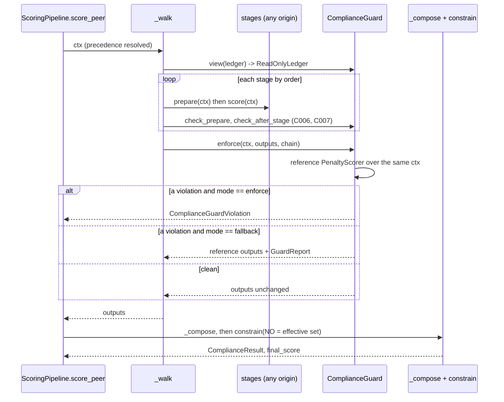

---

## 6. Scoring functions

A scoring *stage* is a `Scorer` (`mactf/scoring/base.py:190-290`). The pipeline owns three
of them per node, one per kind, in a fixed order, and everything else (precedence, the
floor, the scorecard, the points projection) is computed by the pipeline from what the
stages return. That split is what makes customization safe to open: a custom stage
returns *numbers*, and the pipeline decides what they are allowed to mean.

### 6.1 What each stage controls, and what the pipeline still owns

| Stage | `kind` / `order` | Reads | Returns | `ScoringPipeline` uses it for |
|---|---|---|---|---|
| `WarningScorer` | `WARNING` / 5 | ledger, `warning_policy`, `severity_weights` | `prepare()` returns a new context carrying `warning_total`, `warning_events`, `escalated_rules`, `extras["warning_mutations"]`; `score()` reports them | `ctx.warning_only_rules` (the W1 exclusion), `ContinuousScore.warning`, `warnings_issued`, `warnings_escalated` |
| `RewardScorer` | `REWARD` / 10 | reward events, `REWARD_WEIGHTS`, severity table | `breakdown` keys `r_task`, `r_epi`, `r_collab`, `r_align`, `weights`, `by_rule`; `rules` | `_compose` builds `RewardBreakdown` from exactly those keys (`pipeline.py:511-523`) |
| `PenaltyScorer` | `PENALTY` / 20 | penalty events, `PENALTY_LAMBDAS`, `OMEGA_*`, `NON_OFFSETTABLE`, `allowed_rules`, `warning_only_rules` | `breakdown` keys `amounts`, `omega`, `omega_rules`, `rules`; `void_rules` | `_compose` builds `PenaltyBreakdown` (`pipeline.py:525-531`); `ScoringPipeline.score` reads `void_rules` (`pipeline.py:590-594`) |
| the pipeline | `PIPELINE` / 0 | the three outputs | `ContinuousScore`, `ComplianceResult` (through `compliance.constrain`), `PeerScorecard`, the points breakdown | owns precedence (`resolve`, `pipeline.py:308-311`), strict-mode reward suppression (`pipeline.py:532-541`), the floor (`pipeline.py:329-334`) and `void_rules` (`pipeline.py:352-359`) |

Three facts from the code decide the design of the guard:

1. `constrain` computes the non-offsettable floor as `-sum(amounts[k] for k in NO)`
   (`mactf/compliance.py:129-139`). It trusts `penalty.amounts` entirely. A custom penalty
   stage that leaves `P1` out of `amounts` removes the floor, and nothing else in the
   pipeline would notice, because `void_rule_ids` is also derived from `amounts`
   (`mactf/compliance.py:198-203`).
2. `_compose` copies `omega` and `rules` from the stage as given (`pipeline.py:528-530`).
3. The points engine (`mactf/scoring/guards.py:700-933`) reads the **ledger**, not the stage
   outputs. A custom stage therefore cannot change the 0-100 points breakdown, and the
   points projection is not a customization surface (section 1.2).

### 6.2 Selecting, adding, replacing and removing stages

**Names.** The scorer registry's built-ins are `reward`, `penalty`, `warning` and
`hierarchy` (`mactf/scoring/registry.py:26-31`). This document adds four built-in
names, each defined in this section: `composed_reward` (6.3), `zero_reward` and
`no_warnings` (6.8), and nothing for the penalty stage, because there is no safe way to
write a weaker one (6.4).

**Selecting.** A new `SCORING.STAGES` mapping assigns a spec to each per-node kind. A
missing entry means the built-in of that kind, so `STAGES: {}` (the default) is today's
behaviour exactly:

```yaml
SCORING:
  STAGES:
    reward:
      type: composed_reward
      params:
        terms:
          - {type: severity_scaled, weight: 1.0}
          - {type: capped, weight: 0.5, params: {limit: 2.0, rules: [R10, R11]}}
    penalty: penalty                    # a string is {type: penalty}
    warning: {import: "acme.scoring:StrictWarnings", params: {grace_episodes: 1}}
```

**Adding.** Register a class with `@register_scorer("name")` (3.8). The contract
(3.7) requires a concrete `Scorer` subclass with a `ScoringKind` and a non-negative
integer `order`; a `WARNING` stage must also subclass `WarningScorer`, because the
pipeline, the engine and the checkpoint all reach the warning state through its
`registries` (`pipeline.py:216-233`). The contract function in 3.7 gains that line:

```python
# mactf/components/contracts.py  (addition inside scorer_contract, after the `order` check)
    if kind is ScoringKind.WARNING:
        from ..scoring.warning_scorer import WarningScorer

        if not issubclass(factory, WarningScorer):
            problems.append(
                "a WARNING stage subclasses WarningScorer: the pipeline, the engine and "
                "checkpoints reach warning state through its registries"
            )
```

**Replacing and removing.** The chain admits exactly one stage per kind and requires all
three (`pipeline.py:155-192`). So the verbs map as follows:

| Verb | Meaning for scoring | How |
|---|---|---|
| Add a stage | Not possible beyond the three kinds | Extra *behaviour* is added as reward terms (6.3), not as stages |
| Modify | Change a stage's parameters | `SCORING.STAGES.<kind>.params`, or `PATCH /runs/{id}/components` |
| Replace | Use another stage for a kind | `SCORING.STAGES.<kind>`; `ScoringPipeline.replace` (6.8) at an episode boundary |
| Delete | Turn a kind off | Replace it with a null stage: `zero_reward` and `no_warnings` exist (6.8); **no** null penalty stage exists, because zero penalty is exactly what the guard forbids (6.4) |

**Resolution.** `build_stages` is the one construction site (`pipeline.py:681-697`). The
new version keeps the old body as its fast path, so a settings file with no
`SCORING.STAGES` builds the same three objects as before:

```python
# mactf/scoring/pipeline.py  (replaces build_stages, lines 681-697)
STAGE_KINDS: tuple[str, ...] = ("warning", "reward", "penalty")


def build_stages(
    *,
    score_config: Mapping[str, Any] | None = None,
    severity_weights: Mapping[str, Any] | None = None,
    warning_policy: WarningPolicy | None = None,
    registries: dict[str, WarningRegistry] | None = None,
    specs: Mapping[str, Any] | None = None,
    slots: Any = None,
    trusted: bool = True,
) -> list[Scorer]:
    """The three stages, in the order document 07 mandates.

    ``specs`` is ``SCORING.STAGES``. When it is empty the three built-ins are built
    directly, exactly as before. When it is not, each stage is installed into
    ``slots`` (a ``SlotTable``) under ``scoring.<kind>``, so it can be swapped and
    fingerprinted later; ``trusted`` is false for stages named by an untrusted
    surface (the API), which refuses ``import:`` specs outside the allow-list.
    """
    config = dict(score_config or {})
    policy = warning_policy or WarningPolicy.from_settings(dict(config.get("WARNINGS", {})))
    if not specs:
        return [
            WarningScorer(config=config, policy=policy, registries=registries),
            RewardScorer(config=config),
            PenaltyScorer(config=config),
        ]

    unknown = sorted(set(specs) - set(STAGE_KINDS))
    if unknown:
        raise ImproperlyConfigured(
            f"SCORING.STAGES has unknown kind(s) {unknown}; per-node stages are "
            f"{list(STAGE_KINDS)} (a hierarchy is selected by HIERARCHY.ROLLUP)"
        )
    if slots is None:
        from ..components.resolver import ComponentResolver
        from ..components.slots import SlotTable

        slots = SlotTable(ComponentResolver(), trusted=trusted)
    inject = {
        "config": config,
        "policy": policy,
        "registries": registries,
        "trusted": trusted,
    }
    stages: list[Scorer] = []
    for kind in STAGE_KINDS:
        slot = slots.install(f"scoring.{kind}", "scorer", specs.get(kind, kind), inject=inject)
        stage = slot.instance
        if stage.kind.value != kind:
            raise ImproperlyConfigured(
                f"SCORING.STAGES.{kind} resolves to {type(stage).__name__}, whose kind is "
                f"{stage.kind.value!r}, not {kind!r}"
            )
        stages.append(stage)
    return stages
```

`inject` is an *offer*: `ComponentRegistry.build` (3.4) hands a factory only the keys its
`__init__` declares, so `WarningScorer` receives `policy` and `registries`,
`PenaltyScorer` receives only `config`, and a plugin stage that declares none of them
receives none. A spec may not set an injected key (it would be silently overridden), so
that is rejected as `E011`.

`Scorer.from_spec` (`mactf/scoring/base.py:222-253`) and `register_scorer`
(`mactf/scoring/registry.py:34-49`) become thin wrappers over the registry, keeping
their messages, because tests match on them (`tests/scoring/test_pipeline_validation.py:203-253`):

```python
# mactf/scoring/base.py  (replaces Scorer.from_spec and Scorer._build_from_kwargs)
    @classmethod
    def from_spec(cls, spec: Mapping[str, Any]) -> "Scorer":
        """Build a stage from ``{"type": <registry key>, **kwargs}``.

        Resolved through the ``scorer`` component registry, so a stage registered by a
        plugin or a project is addressable here exactly like a built-in one.
        """
        from ..components import HUB
        from ..components.resolver import ComponentResolver, ComponentSpec

        payload = dict(spec or {})
        if payload.get("type") is None and payload.get("import") is None:
            raise ValidationError(
                f"{cls.__name__}.from_spec requires a 'type' key; accepted types: "
                + ", ".join(HUB.registry("scorer").names())
            )
        resolved = ComponentResolver().resolve(
            ComponentSpec.parse("scorer", payload), trusted=True
        )
        stage = resolved.instance
        if not isinstance(stage, cls) and cls is not Scorer:
            raise ValidationError(
                f"spec type {resolved.component.name!r} resolves to {type(stage).__name__}, "
                f"which is not a {cls.__name__}"
            )
        return stage

    @classmethod
    def _build_from_kwargs(cls, kwargs: Mapping[str, Any]) -> "Scorer":
        """Construct ``cls`` with ``kwargs``, rejecting anything ``__init__`` cannot take."""
        from ..components.reflect import reflect

        accepted = reflect(cls).keys
        unknown = sorted(set(kwargs) - accepted)
        if unknown:
            raise ValidationError(
                f"{cls.__name__} does not accept {', '.join(repr(key) for key in unknown)}; "
                f"accepted keys: {', '.join(sorted(accepted)) or '(none)'}"
            )
        return cls(**dict(kwargs))
```

`_constructor_keys` (`base.py:310-331`) stays, as a deprecated alias of
`reflect(cls).keys`, because `reflect` implements the same MRO walk (3.3).

### 6.3 Reward terms and `composed_reward`

The reward stage is the one stage where a researcher legitimately wants different
*numbers*: a different shape for credit (diminishing returns, caps, bonuses for specific
rules). A whole replacement stage is too much surface for that. A **reward term** is the
unit: it answers one question, "how much does this one reward event contribute to its
bucket?", and a `composed_reward` stage sums the terms.

A term cannot move a rule into another bucket, cannot touch penalties, and cannot change
the bucket weights. It sees one event and the read-only context, and returns a finite,
non-negative number.

```python
# mactf/scoring/reward_terms.py
"""Reward terms and the stage that composes them (document 17 section 6.3)."""

from __future__ import annotations

import math
from abc import ABC, abstractmethod
from typing import Any, ClassVar, Iterable, Mapping, Sequence

from ..components import register_reward_term, register_scorer
from ..exceptions import ComplianceError, ImproperlyConfigured, ValidationError
from ..rules.catalog import REWARDS
from .base import ScoreContext, ScorerDiagnostic, ScorerOutput, ScoringKind, severity_fraction
from .ledger import RuleEvent
from .reward_scorer import RewardScorer

#: Every reward rule id: the default ``rule_ids`` of a term that applies everywhere.
REWARD_IDS: frozenset[str] = frozenset(rule.id for rule in REWARDS)


class RewardTerm(ABC):
    """One factor of a reward: ``contribution(event, ctx) -> float >= 0``.

    ``rule_ids`` names the reward rules the term applies to. The contract (3.7) needs
    a non-empty ``rule_ids`` and a ``contribution`` method; subclassing this class is a
    convenience, not a requirement.
    """

    #: Registry-facing name; the decorator's name wins when they differ.
    name: ClassVar[str] = ""
    rule_ids: ClassVar[frozenset[str]] = REWARD_IDS

    @abstractmethod
    def contribution(self, event: RuleEvent, ctx: ScoreContext) -> float:
        """The event's contribution before the term's weight. Finite and non-negative."""

    def describe(self) -> dict[str, Any]:
        return {"name": self.name or type(self).__name__, "rule_ids": sorted(self.rule_ids)}


def _severity_table(ctx: ScoreContext) -> Mapping[str, Any]:
    return ctx.severity_weights or ctx.config.get("SEVERITY_WEIGHTS") or {}


def _rules(rules: Iterable[str] | None, *, owner: str) -> frozenset[str]:
    if rules is None:
        return REWARD_IDS
    chosen = frozenset(str(rule) for rule in rules)
    unknown = sorted(chosen - REWARD_IDS)
    if unknown:
        raise ValidationError(
            f"{owner}: {unknown} are not reward rules; reward terms apply to {sorted(REWARD_IDS)}"
        )
    if not chosen:
        raise ValidationError(f"{owner}: 'rules' is empty; omit it to apply to every reward rule")
    return chosen


@register_reward_term("severity_scaled")
class SeverityScaledTerm(RewardTerm):
    """``magnitude * severity_fraction``: the term the built-in ``RewardScorer`` embodies.

    ``composed_reward`` with this one term at weight 1 returns the same breakdown as
    ``RewardScorer`` for every ledger (test ``test_composed_matches_builtin``).
    """

    name = "severity_scaled"

    def __init__(self, *, rules: Sequence[str] | None = None) -> None:
        self.rule_ids = _rules(rules, owner="severity_scaled")

    def contribution(self, event: RuleEvent, ctx: ScoreContext) -> float:
        scale = severity_fraction(event.resolved_severity(), _severity_table(ctx), default=1.0)
        return event.magnitude * scale


@register_reward_term("capped")
class CappedTerm(RewardTerm):
    """``min(magnitude, limit) * severity_fraction``: stops one noisy rule dominating."""

    name = "capped"

    def __init__(self, *, limit: float, rules: Sequence[str] | None = None) -> None:
        number = float(limit)
        if not math.isfinite(number) or number < 0.0:
            raise ValidationError(f"capped: 'limit' must be finite and >= 0, got {limit!r}")
        self.limit = number
        self.rule_ids = _rules(rules, owner="capped")

    def contribution(self, event: RuleEvent, ctx: ScoreContext) -> float:
        scale = severity_fraction(event.resolved_severity(), _severity_table(ctx), default=1.0)
        return min(event.magnitude, self.limit) * scale


@register_scorer("composed_reward")
class ComposedRewardScorer(RewardScorer):
    """A reward stage whose contribution per event is a weighted sum of terms.

    ``terms`` is a list of ``{type | import, params, weight}`` mappings (or built
    ``RewardTerm`` instances). The weight multiplies the term's contribution and must
    be finite and non-negative: a negative weight would let a reward event reduce a
    score, which the reward stage may not do (``reward_scorer.py:120-131``).

    Output shape is the ``RewardScorer`` shape plus ``terms`` (per-term totals), because
    ``ScoringPipeline._compose`` reads ``r_task``, ``r_epi``, ``r_collab``, ``r_align``,
    ``weights`` and ``by_rule`` and nothing else (``pipeline.py:511-523``).
    """

    def __init__(
        self,
        *,
        config: Mapping[str, Any] | None = None,
        terms: Sequence[Any] | None = None,
        admitted_only: bool = False,
        trusted: bool = False,
    ) -> None:
        super().__init__(config=config)
        self.admitted_only = bool(admitted_only)
        self._trusted = bool(trusted)
        self.terms: list[tuple[str, float, Any]] = self._build_terms(
            [{"type": "severity_scaled"}] if terms is None else list(terms)
        )
        if not self.terms:
            raise ImproperlyConfigured("composed_reward needs at least one term")

    # -- construction ----------------------------------------------------
    def _build_terms(self, raw_terms: Sequence[Any]) -> list[tuple[str, float, Any]]:
        from ..components.resolver import ComponentResolver, ComponentSpec

        resolver = ComponentResolver()
        built: list[tuple[str, float, Any]] = []
        seen: dict[str, int] = {}
        for index, raw in enumerate(raw_terms):
            weight = 1.0
            if isinstance(raw, Mapping):
                entry = dict(raw)
                weight = self._weight(entry.pop("weight", 1.0), index)
                term = resolver.resolve(
                    ComponentSpec.parse("reward_term", entry), trusted=self._trusted
                ).instance
            else:
                term = raw
                if not callable(getattr(term, "contribution", None)) or not getattr(
                    term, "rule_ids", None
                ):
                    raise ImproperlyConfigured(
                        f"composed_reward term #{index} is neither a spec nor a RewardTerm"
                    )
            label = str(getattr(term, "name", "") or type(term).__name__)
            count = seen.get(label, 0)
            seen[label] = count + 1
            built.append((label if count == 0 else f"{label}#{count + 1}", weight, term))
        return built

    @staticmethod
    def _weight(value: Any, index: int) -> float:
        try:
            weight = float(value)
        except (TypeError, ValueError):
            raise ImproperlyConfigured(
                f"composed_reward term #{index}: weight {value!r} is not numeric"
            ) from None
        if not math.isfinite(weight) or weight < 0.0:
            raise ImproperlyConfigured(
                f"composed_reward term #{index}: weight must be finite and >= 0, got {weight!r}"
            )
        return weight

    # -- scoring ---------------------------------------------------------
    def score(self, ctx: ScoreContext) -> ScorerOutput:
        weights = self.bucket_weights()
        buckets = dict.fromkeys(self.BUCKETS, 0.0)
        by_rule: dict[str, float] = {}
        term_totals = {label: 0.0 for label, _weight, _term in self.terms}
        fired: list[str] = []
        ignored: list[str] = []
        skipped: list[str] = []
        allowed = ctx.allowed_rules if self.admitted_only else None

        for event in ctx.ledger.rewards():
            bucket = event.rule.bucket
            if bucket not in buckets:
                ignored.append(event.rule_id)
                continue
            if allowed is not None and event.rule_id not in allowed:
                skipped.append(event.rule_id)
                continue
            paid = 0.0
            matched = False
            for label, weight, term in self.terms:
                if event.rule_id not in term.rule_ids:
                    continue
                matched = True
                value = float(term.contribution(event, ctx))
                if not math.isfinite(value) or value < 0.0:
                    raise ComplianceError(
                        f"reward term {label!r} returned {value!r} for {event.rule_id}; a reward "
                        "contribution is finite and non-negative"
                    )
                amount = weight * value
                term_totals[label] += amount
                paid += amount
            if not matched:
                continue
            buckets[bucket] += paid
            by_rule[event.rule_id] = by_rule.get(event.rule_id, 0.0) + weights[bucket] * paid
            fired.append(event.rule_id)

        total = sum(weights[bucket] * buckets[bucket] for bucket in self.BUCKETS)
        rules = tuple(dict.fromkeys(fired))
        breakdown = {
            **buckets,
            "weights": dict(weights),
            "rules": list(rules),
            "by_rule": dict(by_rule),
            "ignored_rules": list(dict.fromkeys(ignored)),
            "total": total,
            "terms": dict(term_totals),
        }
        return ScorerOutput(
            kind=self.kind,
            amount=total,
            breakdown=breakdown,
            rules=rules,
            metadata={
                "ignored_rules": tuple(dict.fromkeys(ignored)),
                "skipped_not_admitted": tuple(dict.fromkeys(skipped)),
                "terms": [label for label, _weight, _term in self.terms],
            },
        )

    # -- introspection ---------------------------------------------------
    def validate(self, settings: Mapping[str, Any]) -> list[ScorerDiagnostic]:
        diagnostics = super().validate(settings)
        covered: set[str] = set()
        for _label, _weight, term in self.terms:
            covered |= set(term.rule_ids)
        if not covered:
            diagnostics.append(
                ScorerDiagnostic(
                    level="error",
                    code="rewards.no_rules_covered",
                    message="no term applies to any reward rule, so every reward would be zero",
                )
            )
        if all(weight == 0.0 for _label, weight, _term in self.terms):
            diagnostics.append(
                ScorerDiagnostic(
                    level="warning",
                    code="rewards.all_terms_zero_weight",
                    message="every term has weight 0, so every reward is zero",
                    hint="use the 'zero_reward' stage to say so on purpose",
                )
            )
        return diagnostics

    def describe(self) -> dict[str, Any]:
        payload = super().describe()
        payload["terms"] = [
            {"label": label, "weight": weight, **_describe_term(term)}
            for label, weight, term in self.terms
        ]
        payload["admitted_only"] = self.admitted_only
        return payload


def _describe_term(term: Any) -> dict[str, Any]:
    """``describe()`` when the term has one, else a derived description. A term that
    satisfies the contract without subclassing ``RewardTerm`` need not define it."""
    describe = getattr(term, "describe", None)
    if callable(describe):
        return dict(describe())
    return {"name": type(term).__name__, "rule_ids": sorted(term.rule_ids)}
```

`mactf.components` imports nothing from `mactf.scoring`, so importing `register_scorer` at
the top of this module is cycle-free. The registration itself is the
`@register_scorer("composed_reward")` decorator on the class above.

`admitted_only` is the one switch that differs from the built-in on purpose. The built-in
reward stage pays an event whether or not the controlling tier admitted it; only the
all-or-nothing strict suppression in `_compose` zeroes it (`pipeline.py:532-541`). With
`admitted_only: true` a composed stage skips events whose rule is not in
`ctx.allowed_rules`, which is the stricter reading. It is off by default so that
`composed_reward` with one `severity_scaled` term is numerically identical to
`RewardScorer`.

### 6.4 `ComplianceGuard`

#### 6.4.1 What it proves

For every stage output, per node and per episode, the guard establishes:

| Code | Violation | Applies to | Check |
|---|---|---|---|
| **C001** | A non-finite or negative number | every stage | `amount`, every bucket, every weight, every `amounts[k]`, `omega` must be finite and `>= 0` (`omega >= 1`) |
| **C002** | Floor below reference | PENALTY | For every `k` in `NO` (the effective non-offsettable set) with a reference amount: `amounts[k] >= m_k * max(lambda_k, MIN_FLOOR_LAMBDA)` within tolerance, where `m_k` is the sum of the magnitudes of the admitted events of rule `k` |
| **C003** | Omega below reference | PENALTY | `omega >= 1.0` and `omega >= omega_ref`, where `omega_ref` is the reference stage's bounded product |
| **C004** | `void_rules` too small | PENALTY | `void_rules` is a superset of `{k in NO : reference amount exists}` |
| **C005** | Warning-first violation | WARNING | `ctx.warning_only_rules` contains no rule in `NEVER_WARNING_FIRST` or `NO` (framework.md W9) |
| **C006** | Out-of-role output | every stage | A REWARD or PENALTY stage returned `mutations`, `void_rules` (REWARD) or changed a protected context field in `prepare` |
| **C007** | Ledger tampering | every stage | The ledger's event tuple changed during the walk, or `prepare` replaced the ledger |
| **C008** | Reward above ceiling | REWARD | `sum(weights[b] * bucket[b]) <= COMPLIANCE.REWARD_CEILING` |
| **C009** | Amount for an event not admitted | REWARD, PENALTY | `by_rule` / `amounts` keys are within the ledger's rules for that side; a penalty key must also be tier-admitted and not warning-only |

`NO` is `NON_OFFSETTABLE | configured`, never the configured set alone (6.6). The
reference amounts come from running a **reference `PenaltyScorer`** over the same
prepared context, with `NO` forced to its superset and the lambda of every
non-offsettable rule raised to at least `MIN_FLOOR_LAMBDA`. The guard does not
re-implement the penalty arithmetic; it reuses the one implementation and compares.

The guarantee is one-sided on purpose. A custom penalty stage may charge **more** than the
reference for any rule, and may charge a different amount for an *offsettable* rule;
that is configuration (`PENALTY_LAMBDAS` is already free). It may not charge less for a
non-offsettable one, and it may not hide that one applied.

#### 6.4.2 Modes

`COMPLIANCE.GUARD_MODE` has two values:

- `enforce` (default): any REWARD or PENALTY violation raises `ComplianceGuardViolation`
  with every violation attached. The episode is not scored.
- `fallback`: a REWARD or PENALTY violation is replaced by the reference stage's output
  (`RewardScorer`, or the hardened `PenaltyScorer`), the violation is written to
  `card.metadata["compliance_guard"]`, and scoring continues. A WARNING violation, a C006
  or a C007 always raises, because there is no reference to substitute for them (warning
  state cannot be recomputed without mutating registries).

`fallback` exists so a long run is not lost to a plugin bug; it never lets a weakened score
through. `W003` (section 17) is emitted when a run starts in `fallback`.

#### 6.4.3 Code

```python
# mactf/components/guards/compliance.py
"""ComplianceGuard and ReadOnlyLedger (document 17 section 6.4)."""

from __future__ import annotations

import math
from dataclasses import dataclass, field
from typing import Any, Iterable, Mapping, Sequence

from ...compliance import DEFAULT_MIN_FLOOR_LAMBDA, effective_non_offsettable
from ...exceptions import ComplianceGuardViolation, ImproperlyConfigured, LedgerReadOnlyError
from ...rules.catalog import NEVER_WARNING_FIRST
from ...scoring.base import ScoreContext, Scorer, ScorerOutput, ScoringKind
from ...scoring.ledger import Ledger, RuleEvent
from ...scoring.penalty import PenaltyScorer
from ...scoring.reward_scorer import BUCKETS, RewardScorer
from ...scoring.warning_scorer import WarningScorer

GUARD_MODES: tuple[str, ...] = ("enforce", "fallback")

#: Context fields no stage may change in ``prepare``, except the ones named per kind.
_PROTECTED_FIELDS: tuple[str, ...] = (
    "peer", "episode", "node_path", "depth", "config", "severity_weights",
    "warning_policy", "known_rules", "branch_void",
)
_PROTECTED_EXTRAS: tuple[str, ...] = ("allowed_rules", "precedence")
_WARNING_OWNED_FIELDS: tuple[str, ...] = ("warning_total", "warning_events", "escalated_rules")
_WARNING_OWNED_EXTRAS: tuple[str, ...] = ("warning_mutations",)

_BUILTIN_STAGES: tuple[type, ...] = (PenaltyScorer, RewardScorer, WarningScorer)


def _number(value: Any) -> float | None:
    """``value`` as a finite float, or ``None``. Booleans are not numbers here."""
    if isinstance(value, bool):
        return None
    try:
        number = float(value)
    except (TypeError, ValueError):
        return None
    return number if math.isfinite(number) else None


def _non_negative(value: Any) -> float | None:
    number = _number(value)
    return number if number is not None and number >= 0.0 else None


@dataclass(frozen=True)
class GuardPolicy:
    """Tunables of the guard. ``from_settings`` reads the ``COMPLIANCE`` block."""

    mode: str = "enforce"
    min_floor_lambda: float = DEFAULT_MIN_FLOOR_LAMBDA
    reward_ceiling: float = 1.0e4
    tolerance: float = 1.0e-9
    trust_builtin: bool = True

    def __post_init__(self) -> None:
        if self.mode not in GUARD_MODES:
            raise ImproperlyConfigured(
                f"COMPLIANCE.GUARD_MODE must be one of {list(GUARD_MODES)}, got {self.mode!r}"
            )
        if not math.isfinite(self.min_floor_lambda) or self.min_floor_lambda <= 0.0:
            raise ImproperlyConfigured(
                f"COMPLIANCE.MIN_FLOOR_LAMBDA must be finite and > 0, got {self.min_floor_lambda!r}"
            )
        if not math.isfinite(self.reward_ceiling) or self.reward_ceiling <= 0.0:
            raise ImproperlyConfigured(
                f"COMPLIANCE.REWARD_CEILING must be finite and > 0, got {self.reward_ceiling!r}"
            )
        if not math.isfinite(self.tolerance) or not 0.0 <= self.tolerance <= 1.0e-3:
            raise ImproperlyConfigured(
                f"COMPLIANCE.TOLERANCE must be within [0, 1e-3], got {self.tolerance!r}"
            )

    @classmethod
    def from_settings(cls, settings: Any) -> "GuardPolicy":
        block: Mapping[str, Any] = {}
        if hasattr(settings, "get"):
            block = settings.get("COMPLIANCE") or {}
        return cls(
            mode=str(block.get("GUARD_MODE", "enforce")).lower(),
            min_floor_lambda=float(block.get("MIN_FLOOR_LAMBDA", DEFAULT_MIN_FLOOR_LAMBDA)),
            reward_ceiling=float(block.get("REWARD_CEILING", 1.0e4)),
            tolerance=float(block.get("TOLERANCE", 1.0e-9)),
            trust_builtin=bool(block.get("TRUST_BUILTIN", True)),
        )


@dataclass(frozen=True)
class GuardViolation:
    code: str
    stage: str
    kind: str
    message: str
    rule_id: str | None = None
    observed: float | None = None
    required: float | None = None

    def as_dict(self) -> dict[str, Any]:
        return {
            "code": self.code, "stage": self.stage, "kind": self.kind,
            "rule_id": self.rule_id, "message": self.message,
            "observed": self.observed, "required": self.required,
        }


@dataclass(frozen=True)
class GuardReport:
    mode: str
    violations: tuple[GuardViolation, ...] = ()
    substituted: tuple[str, ...] = ()

    def as_dict(self) -> dict[str, Any]:
        return {
            "mode": self.mode,
            "violations": [item.as_dict() for item in self.violations],
            "substituted": list(self.substituted),
        }


class ReadOnlyLedger(Ledger):
    """A live, read-only view of a ledger.

    It *is a* ``Ledger`` (so ``isinstance`` checks and every query method in stages
    keep working) that shares the source's event list and refuses to change it. The
    guard additionally compares the event tuple before and after every stage (C007), so
    a stage reaching for ``_events`` is caught rather than trusted.
    """

    def __init__(self, source: Ledger) -> None:
        super().__init__(peer=source.peer)
        self._events = source._events  # shared on purpose: a view, not a copy
        self._source = source

    def unwrap(self) -> Ledger:
        return self._source

    def record(self, *args: Any, **kwargs: Any) -> RuleEvent:
        raise LedgerReadOnlyError("record")

    def extend(self, events: Iterable[RuleEvent]) -> None:
        raise LedgerReadOnlyError("extend")

    def clear(self) -> None:
        raise LedgerReadOnlyError("clear")


class ComplianceGuard:
    """Checks every stage's output against the reference floor. See 6.4.1."""

    def __init__(self, policy: GuardPolicy | None = None) -> None:
        self.policy = policy or GuardPolicy()

    # -- ledger ----------------------------------------------------------
    @staticmethod
    def view(ledger: Ledger) -> ReadOnlyLedger:
        return ledger if isinstance(ledger, ReadOnlyLedger) else ReadOnlyLedger(ledger)

    @staticmethod
    def snapshot(ledger: Ledger) -> tuple[RuleEvent, ...]:
        source = ledger.unwrap() if isinstance(ledger, ReadOnlyLedger) else ledger
        return tuple(source.events)

    def _trusted(self, stage: Scorer) -> bool:
        return self.policy.trust_builtin and type(stage) in _BUILTIN_STAGES

    # -- structural checks (never substitutable) -------------------------
    def check_prepare(
        self, stage: Scorer, before: ScoreContext, after: ScoreContext, source: Ledger
    ) -> list[GuardViolation]:
        name, kind = type(stage).__name__, stage.kind.value
        found: list[GuardViolation] = []
        if not isinstance(after.ledger, ReadOnlyLedger) or after.ledger.unwrap() is not source:
            found.append(GuardViolation(
                "C007", name, kind, "prepare() replaced the ledger it was given"))
        fields = list(_PROTECTED_FIELDS)
        extras = list(_PROTECTED_EXTRAS)
        if stage.kind is not ScoringKind.WARNING:
            fields += _WARNING_OWNED_FIELDS
            extras += _WARNING_OWNED_EXTRAS
        for field_name in fields:
            if getattr(before, field_name) != getattr(after, field_name):
                found.append(GuardViolation(
                    "C006", name, kind,
                    f"prepare() changed ScoreContext.{field_name}, which this stage does not own"))
        for key in extras:
            if before.extras.get(key) != after.extras.get(key):
                found.append(GuardViolation(
                    "C006", name, kind,
                    f"prepare() changed ScoreContext.extras[{key!r}], which this stage does not own"))
        return found

    def check_after_stage(
        self, stage: Scorer, source: Ledger, snapshot: tuple[RuleEvent, ...]
    ) -> list[GuardViolation]:
        if tuple(source.events) != snapshot:
            return [GuardViolation(
                "C007", type(stage).__name__, stage.kind.value,
                f"the ledger changed while {type(stage).__name__} ran "
                f"({len(snapshot)} -> {len(source.events)} events)")]
        return []

    # -- the reference ---------------------------------------------------
    def reference_penalty(self, ctx: ScoreContext, config: Mapping[str, Any]) -> ScorerOutput:
        """The built-in penalty stage over ``ctx``, with the floor forced to its minimum."""
        hardened = dict(config)
        hardened["NON_OFFSETTABLE"] = sorted(
            effective_non_offsettable(config.get("NON_OFFSETTABLE"))
        )
        hardened["MIN_FLOOR_LAMBDA"] = max(
            self.policy.min_floor_lambda,
            float(config.get("MIN_FLOOR_LAMBDA", self.policy.min_floor_lambda)),
        )
        return PenaltyScorer(config=hardened).score(ctx)

    # -- per-kind inspection --------------------------------------------
    def _inspect_penalty(
        self, stage: Scorer, output: ScorerOutput, ctx: ScoreContext,
        config: Mapping[str, Any], reference: ScorerOutput,
    ) -> list[GuardViolation]:
        name, kind, tol = type(stage).__name__, stage.kind.value, self.policy.tolerance
        found: list[GuardViolation] = []
        breakdown = output.breakdown
        raw_amounts = breakdown.get("amounts", {})
        amounts: dict[str, float] = {}
        if not isinstance(raw_amounts, Mapping):
            found.append(GuardViolation("C001", name, kind, "breakdown['amounts'] is not a mapping"))
            raw_amounts = {}
        for rule_id, value in raw_amounts.items():
            number = _non_negative(value)
            if number is None:
                found.append(GuardViolation(
                    "C001", name, kind,
                    f"amounts[{rule_id!r}] is {value!r}; a penalty is finite and non-negative",
                    rule_id=str(rule_id)))
            else:
                amounts[str(rule_id)] = number
        if _non_negative(output.amount) is None:
            found.append(GuardViolation(
                "C001", name, kind, f"amount is {output.amount!r}; expected finite and >= 0"))
        if output.mutations:
            found.append(GuardViolation(
                "C006", name, kind, "a PENALTY stage returned warning mutations"))

        ref_amounts: Mapping[str, float] = reference.breakdown["amounts"]
        for rule_id in sorted(set(amounts) - set(ref_amounts)):
            found.append(GuardViolation(
                "C009", name, kind,
                f"amount for {rule_id}, which is not an admitted penalty event of this ledger "
                "(absent, outside the controlling tier, or warning-only)", rule_id=rule_id))

        no = effective_non_offsettable(config.get("NON_OFFSETTABLE"))
        for rule_id in sorted(no & set(ref_amounts)):
            required = float(ref_amounts[rule_id])
            observed = amounts.get(rule_id, 0.0)
            if observed + tol < required:
                found.append(GuardViolation(
                    "C002", name, kind,
                    f"{rule_id} is non-offsettable and its floor is {required:g}; the stage "
                    f"charged {observed:g}", rule_id=rule_id, observed=observed, required=required))

        omega = _number(breakdown.get("omega", 1.0))
        omega_ref = float(reference.breakdown["omega"])
        if omega is None or omega < 1.0 - tol:
            found.append(GuardViolation(
                "C003", name, kind,
                f"omega is {breakdown.get('omega')!r}; Omega is an amplifier and is >= 1",
                observed=omega, required=1.0))
        elif omega + tol < omega_ref:
            found.append(GuardViolation(
                "C003", name, kind,
                f"omega {omega:g} is below the reference {omega_ref:g} for the same rules",
                observed=omega, required=omega_ref))

        missing = sorted((no & set(ref_amounts)) - set(output.void_rules))
        if missing:
            found.append(GuardViolation(
                "C004", name, kind,
                f"void_rules omits {missing}; a non-offsettable breach must void the episode"))
        return found

    def _inspect_reward(
        self, stage: Scorer, output: ScorerOutput, ctx: ScoreContext
    ) -> list[GuardViolation]:
        name, kind, tol = type(stage).__name__, stage.kind.value, self.policy.tolerance
        found: list[GuardViolation] = []
        breakdown = output.breakdown
        if output.mutations or output.void_rules:
            found.append(GuardViolation(
                "C006", name, kind, "a REWARD stage returned mutations or void_rules"))
        if _non_negative(output.amount) is None:
            found.append(GuardViolation(
                "C001", name, kind, f"amount is {output.amount!r}; expected finite and >= 0"))
        weights = breakdown.get("weights", {})
        if not isinstance(weights, Mapping):
            found.append(GuardViolation("C001", name, kind, "breakdown['weights'] is not a mapping"))
            weights = {}
        values: dict[str, float] = {}
        for bucket in BUCKETS:
            number = _non_negative(breakdown.get(bucket, 0.0))
            if number is None:
                found.append(GuardViolation(
                    "C001", name, kind,
                    f"bucket {bucket} is {breakdown.get(bucket)!r}; expected finite and >= 0"))
                number = 0.0
            values[bucket] = number
        total = 0.0
        for bucket in BUCKETS:
            weight = _non_negative(weights.get(bucket, 1.0))
            if weight is None:
                found.append(GuardViolation(
                    "C001", name, kind,
                    f"weights[{bucket!r}] is {weights.get(bucket)!r}; expected finite and >= 0"))
                weight = 0.0
            total += weight * values[bucket]
        if total > self.policy.reward_ceiling + tol:
            found.append(GuardViolation(
                "C008", name, kind,
                f"reward total {total:g} exceeds COMPLIANCE.REWARD_CEILING "
                f"{self.policy.reward_ceiling:g}", observed=total,
                required=self.policy.reward_ceiling))
        rewarded = {event.rule_id for event in ctx.ledger.rewards()}
        by_rule = breakdown.get("by_rule", {})
        for rule_id, value in (by_rule.items() if isinstance(by_rule, Mapping) else ()):
            if rule_id not in rewarded:
                found.append(GuardViolation(
                    "C009", name, kind,
                    f"by_rule pays {rule_id}, which has no reward event in this ledger",
                    rule_id=str(rule_id)))
            if _non_negative(value) is None:
                found.append(GuardViolation(
                    "C001", name, kind, f"by_rule[{rule_id!r}] is {value!r}",
                    rule_id=str(rule_id)))
        return found

    def _inspect_warning(
        self, stage: Scorer, output: ScorerOutput, ctx: ScoreContext, config: Mapping[str, Any]
    ) -> list[GuardViolation]:
        name, kind = type(stage).__name__, stage.kind.value
        found: list[GuardViolation] = []
        if _non_negative(output.amount) is None:
            found.append(GuardViolation(
                "C001", name, kind, f"amount is {output.amount!r}; expected finite and >= 0"))
        banned = NEVER_WARNING_FIRST | effective_non_offsettable(config.get("NON_OFFSETTABLE"))
        for rule_id in sorted(ctx.warning_only_rules & banned):
            found.append(GuardViolation(
                "C005", name, kind,
                f"{rule_id} was scored as warning-only, but it is never warning-first "
                "(framework.md W9)", rule_id=rule_id))
        return found

    # -- the entry point -------------------------------------------------
    def enforce(
        self,
        ctx: ScoreContext,
        outputs: Mapping[ScoringKind, ScorerOutput],
        chain: Sequence[Scorer],
    ) -> tuple[dict[ScoringKind, ScorerOutput], GuardReport]:
        """Return the outputs the pipeline may use, and what the guard did."""
        config = dict(ctx.config)
        result = dict(outputs)
        cached: dict[str, ScorerOutput] = {}

        def reference() -> ScorerOutput:
            if "penalty" not in cached:
                cached["penalty"] = self.reference_penalty(ctx, config)
            return cached["penalty"]

        found: list[GuardViolation] = []
        by_kind: dict[ScoringKind, list[GuardViolation]] = {}
        for stage in chain:
            output = outputs.get(stage.kind)
            if output is None or self._trusted(stage):
                continue
            if stage.kind is ScoringKind.PENALTY:
                items = self._inspect_penalty(stage, output, ctx, config, reference())
            elif stage.kind is ScoringKind.REWARD:
                items = self._inspect_reward(stage, output, ctx)
            elif stage.kind is ScoringKind.WARNING:
                items = self._inspect_warning(stage, output, ctx, config)
            else:
                items = []
            if items:
                by_kind[stage.kind] = items
                found.extend(items)

        if not found:
            return result, GuardReport(self.policy.mode)
        if self.policy.mode == "enforce" or ScoringKind.WARNING in by_kind:
            raise ComplianceGuardViolation([item.as_dict() for item in found])

        substituted: list[str] = []
        if ScoringKind.PENALTY in by_kind:
            result[ScoringKind.PENALTY] = reference()
            substituted.append("penalty")
        if ScoringKind.REWARD in by_kind:
            result[ScoringKind.REWARD] = RewardScorer(config=config).score(ctx)
            substituted.append("reward")
        return result, GuardReport(self.policy.mode, tuple(found), tuple(substituted))
```



### 6.5 Pipeline changes

Only `ScoringPipeline` changes; `_compose`, `constrain` and the points projection do not.
All edits are additive: with the built-in stages, the guard trusts them
(`trust_builtin`), the ledger view is read-only but the stages never write, and no new
key reaches `metadata` unless a violation was recorded. The test
`test_default_pipeline_is_byte_identical` (section 19) pins that.

```python
# mactf/scoring/pipeline.py  (constructor: new keyword, new attributes)
    def __init__(
        self,
        scorers: Sequence[Scorer] | None = None,
        *,
        score_config: Mapping[str, Any] | None = None,
        severity_weights: Mapping[str, Any] | None = None,
        warning_policy: WarningPolicy | None = None,
        registries: dict[str, WarningRegistry] | None = None,
        pool: CooperativePool | None = None,
        engine_config: Mapping[str, Any] | None = None,
        points_engine: Any = None,
        guard: Any = None,
    ) -> None:
        # ... existing body unchanged, then, before ``self._validate_chain()``:
        self._guard: Any = guard
        #: What the guard did for the most recent ``_walk`` (set even when clean).
        self._last_guard_report: Any = None
```

```python
# mactf/scoring/pipeline.py  (new members, after ``_validate_chain``)
    @property
    def guard(self) -> Any:
        """The compliance guard, built lazily so importing the pipeline never imports it."""
        if self._guard is None:
            from ..components.guards.compliance import ComplianceGuard, GuardPolicy

            self._guard = ComplianceGuard(
                GuardPolicy(
                    min_floor_lambda=float(
                        self.score_config.get("MIN_FLOOR_LAMBDA", DEFAULT_MIN_FLOOR_LAMBDA)
                    )
                )
            )
        return self._guard

    @guard.setter
    def guard(self, value: Any) -> None:
        self._guard = value

    def replace(
        self, scorer: Scorer, *, migrate: Callable[[Scorer, Scorer], None] | None = None
    ) -> Scorer:
        """Swap the stage of ``scorer.kind`` for ``scorer`` and return the old one.

        Atomic: ``migrate(old, new)`` runs first and may only write to ``new``; the chain is
        then validated, and a failure restores the old stage, so a rejected swap leaves the
        pipeline exactly as it was.
        """
        if not isinstance(scorer, _ScorerABC):
            raise ImproperlyConfigured(
                f"a scoring stage must be a Scorer subclass, got {type(scorer).__name__}"
            )
        old = self.get(scorer.kind)
        index = self._chain.index(old)
        if migrate is not None:
            migrate(old, scorer)
        self._chain[index] = scorer
        try:
            self._validate_chain()
        except ImproperlyConfigured:
            self._chain[index] = old
            raise
        return old

    def stage_inject(self, *, trusted: bool = True) -> dict[str, Any]:
        """The offer ``SlotTable.swap`` makes to a stage factory (see ``build_stages``)."""
        return {
            "config": dict(self.score_config),
            "policy": self.warning_policy,
            "trusted": trusted,
        }

    def sync_from_slots(self, slots: Any) -> list[ScoringKind]:
        """Make the chain match ``scoring.<kind>`` slots. Call at an episode boundary,
        after ``slots.apply_pending(Boundary.EPISODE, inject=self.stage_inject())``."""
        changed: list[ScoringKind] = []
        for kind in self.REQUIRED_KINDS:
            stage = slots.get(f"scoring.{kind.value}").instance
            if stage is not self.get(kind):
                self.replace(stage, migrate=migrate_stage_state)
                changed.append(kind)
        return changed
```

```python
# mactf/scoring/pipeline.py  (replaces _walk, lines 472-492)
    def _walk(self, ctx: ScoreContext) -> dict[ScoringKind, ScorerOutput]:
        """Run every stage in ascending order, threading the context through.

        Stages see a read-only ledger. ``prepare`` may change only the fields its kind
        owns. After the walk the guard checks every non-built-in output (6.4).
        """
        guard = self.guard
        source = ctx.ledger.unwrap() if hasattr(ctx.ledger, "unwrap") else ctx.ledger
        snapshot = guard.snapshot(source)
        ctx = ctx.evolve(ledger=guard.view(source))
        structural: list[Any] = []
        outputs: dict[ScoringKind, ScorerOutput] = {}
        for stage in self.chain:
            prepared = stage.prepare(ctx)
            if not isinstance(prepared, ScoreContext):
                raise ImproperlyConfigured(
                    f"{type(stage).__name__}.prepare() returned "
                    f"{type(prepared).__name__}, not a ScoreContext"
                )
            if type(stage) not in _BUILTIN_STAGE_TYPES:
                structural.extend(guard.check_prepare(stage, ctx, prepared, source))
            ctx = prepared
            output = stage.score(ctx)
            output = stage.finalize(ctx, output)
            if not isinstance(output, ScorerOutput):
                raise ImproperlyConfigured(
                    f"{type(stage).__name__}.score() returned "
                    f"{type(output).__name__}, not a ScorerOutput"
                )
            if type(stage) not in _BUILTIN_STAGE_TYPES:
                structural.extend(guard.check_after_stage(stage, source, snapshot))
            outputs[stage.kind] = output
        if structural:
            raise ComplianceGuardViolation([item.as_dict() for item in structural])
        outputs, report = guard.enforce(ctx, outputs, self.chain)
        self._last_guard_report = report
        # Stash the prepared context so callers and the pipeline can read it.
        self._last_context = ctx
        return outputs
```

`_BUILTIN_STAGE_TYPES` is `(WarningScorer, RewardScorer, PenaltyScorer)`, defined at module
level in `pipeline.py` beside the imports it already has. It is a performance shortcut
only: the guard's own `_trusted` applies the same rule and `COMPLIANCE.TRUST_BUILTIN =
false` makes `guard.enforce` inspect built-ins too (the structural checks are cheap and
stay on for custom stages).

```python
# mactf/scoring/pipeline.py  (score_peer: the three edits)
# 1. line 329: the effective set is a superset of the catalog set, always.
        non_offsettable = effective_non_offsettable(self.score_config.get("NON_OFFSETTABLE"))

# 2. in the PeerScorecard(...) call, replace ``metadata={"compliance": result.as_dict()}`` with:
            metadata=self._card_metadata(result),

# 3. new helper next to _mutations:
    def _card_metadata(self, result: ComplianceResult) -> dict[str, Any]:
        metadata: dict[str, Any] = {"compliance": result.as_dict()}
        report = self._last_guard_report
        if report is not None and report.violations:
            metadata["compliance_guard"] = report.as_dict()
        return metadata
```

`ScoringPipeline.score` (`pipeline.py:551-594`) needs no edit: it reaches `_walk`, so the
guard runs, and the `void_rules` it returns is already the guard-checked superset.

```python
# mactf/scoring/pipeline.py  (module level, next to the other helpers)
def migrate_stage_state(old: Scorer, new: Scorer) -> None:
    """Carry state from ``old`` to ``new`` for a same-kind swap. Writes only to ``new``.

    Only the warning stage has state worth keeping: its registries hold every peer's
    warnings, clean streaks and expiry, which framework.md W1-W9 require to survive.
    The reward and penalty stages are stateless, so for them this is a kind check.
    """
    from ..exceptions import ComponentContractError

    if old.kind is not new.kind:
        raise ComponentContractError(
            "scorer", type(new).__name__,
            [f"cannot replace a {old.kind.value} stage with a {new.kind.value} stage"],
        )
    if old.kind is ScoringKind.WARNING:
        registries = getattr(old, "registries", None)
        if registries is None or not hasattr(new, "registries"):
            raise ComponentContractError(
                "scorer", type(new).__name__,
                ["a replacement WARNING stage exposes `registries` so warning state survives"],
            )
        new.registries = registries  # the live dict moves; ``new`` owns it from now on
        if hasattr(old, "policy") and hasattr(new, "policy"):
            new.policy = old.policy
```

### 6.6 Closing H1 and H2: configuration hardening

**H1: the non-offsettable set is a superset, always.** One helper, in the module that
already owns the catalog default:

```python
# mactf/compliance.py  (additions, after _INHERITED_VOID_FLOOR)
#: ``COMPLIANCE.MIN_FLOOR_LAMBDA``'s default. 1.0 equals ``SCORING.DEFAULT_LAMBDA``, and
#: every built-in lambda of a non-offsettable rule is >= 5, so the default changes nothing.
DEFAULT_MIN_FLOOR_LAMBDA = 1.0


def effective_non_offsettable(configured: Iterable[str] | None = None) -> frozenset[str]:
    """The non-offsettable set in force: the catalog's, plus anything configured.

    A configuration may *widen* the set (make another rule non-offsettable); it can never
    narrow it. This is the one place that rule is written; ``PenaltyScorer``,
    ``ScoringPipeline`` and ``HierarchicalScorer`` all call it.
    """
    return NON_OFFSETTABLE | frozenset(str(rule_id) for rule_id in (configured or ()))
```

(`from typing import Iterable` joins the existing `typing` import in that module.)

```python
# mactf/scoring/penalty.py  (replaces lines 52-56, and the lambda line in score())
    @property
    def non_offsettable(self) -> frozenset[str]:
        return effective_non_offsettable(self.config.get("NON_OFFSETTABLE"))

    @property
    def min_floor_lambda(self) -> float:
        return float(self.config.get("MIN_FLOOR_LAMBDA", DEFAULT_MIN_FLOOR_LAMBDA))

# in score(), before the loop:
        non_offsettable = self.non_offsettable
        floor_lambda = self.min_floor_lambda
# ... and replacing ``lam = float(lambdas.get(event.rule_id, default_lambda))``:
            lam = float(lambdas.get(event.rule_id, default_lambda))
            if event.rule_id in non_offsettable:
                lam = max(lam, floor_lambda)  # H2: a floor can never be configured to zero
# ... and ``void_rules = tuple(sorted(self.non_offsettable & set(amounts)))`` is unchanged,
# because ``self.non_offsettable`` is now the superset.
```

`PenaltyScorer.validate` (`penalty.py:134-184`) reports both problems *before* a run, so
a bad configuration is an error message and not a silently corrected number:

```python
# mactf/scoring/penalty.py  (appended inside validate(), before ``return diagnostics``)
        configured = settings.get("NON_OFFSETTABLE", self.config.get("NON_OFFSETTABLE"))
        if configured is not None:
            narrowed = sorted(NON_OFFSETTABLE - frozenset(configured))
            if narrowed:
                diagnostics.append(
                    ScorerDiagnostic(
                        level="error",
                        code="penalties.non_offsettable_narrowed",
                        message=f"NON_OFFSETTABLE omits {narrowed}; it may only add rules",
                        hint="remove the key to use the catalog set, or list a superset of it",
                    )
                )
        floor = float(settings.get("MIN_FLOOR_LAMBDA", self.config.get("MIN_FLOOR_LAMBDA",
                                                                      DEFAULT_MIN_FLOOR_LAMBDA)))
        default = float(settings.get("DEFAULT_LAMBDA", self.default_lambda))
        for rule_id in sorted(effective_non_offsettable(configured)):
            effective = float((raw or {}).get(rule_id, default))
            if effective < floor:
                diagnostics.append(
                    ScorerDiagnostic(
                        level="error",
                        code="penalties.floor_lambda_below_minimum",
                        message=(
                            f"PENALTY_LAMBDAS[{rule_id!r}] resolves to {effective:g}, below "
                            f"MIN_FLOOR_LAMBDA {floor:g}; a non-offsettable floor cannot be "
                            "weakened"
                        ),
                        hint=f"raise the lambda to at least {floor:g}",
                    )
                )
```

(`raw` is the `PENALTY_LAMBDAS` mapping the method already binds at its top.)

```python
# mactf/scoring/hierarchy.py  (line 172 and _own_void, lines 296-317)
        self.non_offsettable: frozenset[str] = effective_non_offsettable(non_offsettable)

    def _own_void(
        self,
        tree: PeerTree,
        ledgers: Mapping[str, Ledger],
        *,
        non_offsettable: frozenset[str],
    ) -> dict[str, frozenset[str]]:
        """Each node's own non-offsettable rule ids, from its own ledger only.

        ``non_offsettable`` is the effective superset, so a custom set can add rules but
        can no longer narrow the catalog default (the old ``catalog_defaults`` branch let a
        non-empty set do exactly that).
        """
        result: dict[str, frozenset[str]] = {}
        for node in tree.walk("leaves-first"):
            ledger = ledgers.get(node.path)
            if ledger is None:
                result[node.path] = frozenset()
                continue
            result[node.path] = frozenset(
                event.rule_id for event in ledger.events if event.rule_id in non_offsettable
            )
        return result
```

**H2 at configuration load.** `conf.py` gains the `COMPLIANCE` defaults and a validator
beside the existing check at `conf.py:671-678`:

```python
# mactf/conf.py  (new default block, beside "SCORING")
    "COMPLIANCE": {
        "MIN_FLOOR_LAMBDA": 1.0,      # lambda floor for every non-offsettable rule; > 0
        "GUARD_MODE": "enforce",      # "enforce" | "fallback"  (6.4.2)
        "REWARD_CEILING": 10000.0,    # matches compliance.constrain's value_cap
        "TOLERANCE": 1e-9,            # floating-point slack in guard comparisons; [0, 1e-3]
        "TRUST_BUILTIN": True,        # skip inspection of the three built-in stage classes
    },

# mactf/conf.py  (called right after the NON_OFFSETTABLE check, before _validate_points)
def _validate_compliance(settings: Any) -> None:
    block = dict(settings.get("COMPLIANCE") or {})
    mode = str(block.get("GUARD_MODE", "enforce")).lower()
    if mode not in {"enforce", "fallback"}:
        raise ImproperlyConfigured("COMPLIANCE.GUARD_MODE must be 'enforce' or 'fallback'")
    # (key, default, lowest allowed, highest allowed, lowest is inclusive)
    for key, default_value, low, high, inclusive in (
        ("MIN_FLOOR_LAMBDA", 1.0, 0.0, math.inf, False),  # a zero floor would erase a penalty
        ("REWARD_CEILING", 1e4, 0.0, math.inf, False),
        ("TOLERANCE", 1e-9, 0.0, 1e-3, True),
    ):
        try:
            value = float(block.get(key, default_value))
        except (TypeError, ValueError):
            raise ImproperlyConfigured(f"COMPLIANCE.{key} must be a number") from None
        too_low = value < low if inclusive else value <= low
        if not math.isfinite(value) or too_low or value > high:
            raise ImproperlyConfigured(f"COMPLIANCE.{key} is out of range: {value!r}")
    scoring = settings["SCORING"]
    floor = float(block.get("MIN_FLOOR_LAMBDA", 1.0))
    lambdas = dict(scoring.get("PENALTY_LAMBDAS") or {})
    default = float(scoring.get("DEFAULT_LAMBDA", 1.0))
    for rule_id in sorted(set(scoring["NON_OFFSETTABLE"]) | {"P1", "P2", "P17", "P20", "P21", "P22"}):
        effective = float(lambdas.get(rule_id, default))
        if effective < floor:
            raise ImproperlyConfigured(
                f"SCORING.PENALTY_LAMBDAS.{rule_id} is {effective:g}, below "
                f"COMPLIANCE.MIN_FLOOR_LAMBDA {floor:g}; a non-offsettable floor cannot be weakened"
            )
```

`build_scorer` hands the floor to the stages and the guard (`pipeline.py:700-722`):

```python
# mactf/scoring/pipeline.py  (build_scorer gains two keyword parameters, and the body after ``policy = ...`` is replaced)
# def build_scorer(settings, *, scorers=None, slots=None, trusted=True) -> ScoringPipeline:
    from ..components.guards.compliance import ComplianceGuard, GuardPolicy

    score_config = dict(settings["SCORING"])
    guard_policy = GuardPolicy.from_settings(settings)
    if guard_policy.min_floor_lambda != DEFAULT_MIN_FLOOR_LAMBDA:
        # Recorded in the pipeline's config (and so its state dict) on purpose: the floor a
        # run was scored under is part of the run's identity. The default leaves it out,
        # which keeps default checkpoints byte-identical.
        score_config["MIN_FLOOR_LAMBDA"] = guard_policy.min_floor_lambda
    severity_weights = dict(settings["SEVERITY"]["WEIGHTS"])
    pool = build_pool(settings)
    stage_specs = dict(score_config.get("STAGES") or {})
    stages = scorers
    if stages is None and stage_specs:
        stages = build_stages(
            score_config=score_config,
            severity_weights=severity_weights,
            warning_policy=policy,
            specs=stage_specs,
            slots=slots,
            trusted=trusted,
        )
    return ScoringPipeline(
        stages,
        score_config=score_config,
        severity_weights=severity_weights,
        warning_policy=policy,
        pool=pool,
        engine_config=dict(settings["ENGINE"]) if "ENGINE" in settings else {},
        guard=ComplianceGuard(guard_policy),
    )
```

`SCORING.STAGES` lives under `SCORING`, so it is part of `score_config`, which
`ScoringPipeline.state_dict` serializes. That is wanted (a checkpoint records which stages
scored the run) and costs nothing by default, because the default is the key being absent
(`DEFAULTS["SCORING"]` does not list it).

### 6.7 Diagnostics: validate a chain before a run

`ScoringPipeline._validate_chain` raises on the first problem. A caller assembling a
chain from user input (the API, `mactf components validate`) wants *all* the problems, each
with a code and a hint. `validate_stage_chain` collects them with the same rules, and adds
the guard's static checks:

```python
# mactf/scoring/chain_validation.py
"""Collect every problem in a stage chain without raising (document 17 section 6.7)."""

from __future__ import annotations

from typing import Any, Mapping, Sequence

from ..compliance import DEFAULT_MIN_FLOOR_LAMBDA, effective_non_offsettable
from .base import Scorer, ScorerDiagnostic, ScoringKind

#: Context keys a stage may name in ``requires``: the ``ScoreContext`` fields plus the
#: hierarchical inputs. Anything else is a typo or an input nobody supplies.
PROVIDED_CONTEXT_KEYS: frozenset[str] = frozenset({
    "ledger", "config", "severity_weights", "warning_policy", "known_rules",
    "warning_total", "warning_events", "escalated_rules", "children", "branch_void",
    "extras", "allowed_rules", "tree", "ledgers", "peer", "episode", "node_path", "depth",
})

REQUIRED_KINDS = (ScoringKind.WARNING, ScoringKind.REWARD, ScoringKind.PENALTY)


def _error(code: str, message: str, hint: str = "") -> ScorerDiagnostic:
    return ScorerDiagnostic(level="error", code=code, message=message, hint=hint)


def validate_stage_chain(
    stages: Sequence[Scorer], settings: Mapping[str, Any] | None = None
) -> list[ScorerDiagnostic]:
    """Every problem in ``stages`` under ``settings``, in a stable order."""
    settings = dict(settings or {})
    found: list[ScorerDiagnostic] = []
    by_kind: dict[ScoringKind, list[Scorer]] = {}
    for stage in stages:
        if not isinstance(stage, Scorer):
            found.append(_error("chain.not_a_scorer", f"{type(stage).__name__} is not a Scorer"))
            continue
        by_kind.setdefault(stage.kind, []).append(stage)
        if stage.order < 0:
            found.append(_error(
                "chain.negative_order", f"{type(stage).__name__} declares order={stage.order}"))
        if stage.kind is ScoringKind.HIERARCHY:
            found.append(_error(
                "chain.hierarchy_nested",
                f"{type(stage).__name__} scores a whole tree and cannot be a per-node stage",
                "build a HierarchicalScorer around the pipeline"))
        if stage.kind is ScoringKind.PIPELINE:
            found.append(_error(
                "chain.pipeline_nested", "a ScoringPipeline cannot be a stage of another"))
        unknown = sorted(set(stage.requires) - PROVIDED_CONTEXT_KEYS)
        if unknown:
            found.append(ScorerDiagnostic(
                level="warning", code="chain.unknown_requirement",
                message=f"{type(stage).__name__}.requires names {unknown}, which no pipeline supplies",
                hint=f"known keys: {sorted(PROVIDED_CONTEXT_KEYS)}"))
        found.extend(stage.validate(settings))

    for kind, group in by_kind.items():
        if len(group) > 1:
            found.append(_error(
                "chain.duplicate_kind",
                f"{len(group)} stages of kind {kind.value!r}: "
                + ", ".join(type(item).__name__ for item in group)))
    orders: dict[int, Scorer] = {}
    for stage in (item for group in by_kind.values() for item in group):
        clash = orders.get(stage.order)
        if clash is not None:
            found.append(_error(
                "chain.order_collision",
                f"{type(stage).__name__} and {type(clash).__name__} both declare order={stage.order}",
                "set an explicit order on one of them"))
        orders[stage.order] = stage
    for kind in REQUIRED_KINDS:
        if kind not in by_kind:
            found.append(_error(
                "chain.missing_stage", f"no {kind.value} stage",
                "use 'zero_reward' or 'no_warnings' to turn a kind off on purpose"))
    warning = (by_kind.get(ScoringKind.WARNING) or [None])[0]
    if warning is not None:
        for kind in (ScoringKind.REWARD, ScoringKind.PENALTY):
            for stage in by_kind.get(kind, []):
                if stage.order <= warning.order:
                    found.append(_error(
                        "chain.warning_order",
                        f"{type(warning).__name__} (order {warning.order}) must run before "
                        f"{type(stage).__name__} (order {stage.order})",
                        "an escalated rule would be excluded from P and counted twice"))

    scoring = dict(settings.get("SCORING", settings) or {})
    floor = float(settings.get("COMPLIANCE", {}).get("MIN_FLOOR_LAMBDA", DEFAULT_MIN_FLOOR_LAMBDA))
    lambdas = dict(scoring.get("PENALTY_LAMBDAS") or {})
    default = float(scoring.get("DEFAULT_LAMBDA", 1.0))
    for rule_id in sorted(effective_non_offsettable(scoring.get("NON_OFFSETTABLE"))):
        if float(lambdas.get(rule_id, default)) < floor:
            found.append(_error(
                "chain.floor_lambda",
                f"the lambda of non-offsettable {rule_id} is below MIN_FLOOR_LAMBDA {floor:g}"))
    return found
```

`ScoringPipeline._validate_chain` keeps raising (its messages are asserted by
`tests/scoring/test_pipeline_validation.py:55-179`); the two share no code on purpose, and
`test_chain_validation_agrees` (section 19) asserts that for every chain the first error
`validate_stage_chain` reports corresponds to the exception `_validate_chain` raises.

### 6.8 Mid-run swap, and turning a stage off

A stage is an `episode`-mutability component: it is read once per episode, so it may be
changed only at an episode boundary, and all peers in one episode are judged by the same
stage. The flow:

1. `PATCH /runs/{id}/components` or the engine API calls
   `slots.request("scoring.reward", spec, migrate=migrate_stage_state)`. The spec is parsed
   and built eagerly, so a bad spec fails the request, not the next episode (4.4).
2. At the next episode boundary the engine runs
   `slots.apply_pending(Boundary.EPISODE, inject=pipeline.stage_inject())`, then
   `pipeline.sync_from_slots(slots)`, which calls `replace` for each changed kind.
3. `replace` validates the chain; a failure restores the old stage and the swap is
   reported as failed in `SwapRecord` history. The run continues with the old stage.
4. The next `score_peer` runs the new stage under the same guard.

Swapping the WARNING stage moves the live registries (`migrate_stage_state`), so no peer's
warning count, clean streak or expiry is lost. That is invariant I6.

Two built-in null stages exist so that "turn it off" is a first-class, guarded choice
rather than a stage that returns zeros and hopes:

```python
# mactf/scoring/null_stages.py
"""Stages that switch a kind off on purpose (document 17 section 6.8)."""

from __future__ import annotations

from typing import Any

from ..components import register_scorer
from .base import ScoreContext, ScorerOutput
from .reward_scorer import RewardScorer
from .warning_scorer import WarningScorer


@register_scorer("zero_reward")
class ZeroRewardScorer(RewardScorer):
    """Every reward is zero: training on penalties alone, or an ablation of the reward side.

    Zero is a legal reward, so the guard accepts it. The breakdown keeps the weights so
    ``RewardBreakdown`` renders as it does when strict precedence suppresses the reward
    (``pipeline.py:532-537``).
    """

    def score(self, ctx: ScoreContext) -> ScorerOutput:
        weights = self.bucket_weights()
        breakdown: dict[str, Any] = {
            **dict.fromkeys(self.BUCKETS, 0.0),
            "weights": dict(weights),
            "rules": [],
            "by_rule": {},
            "ignored_rules": [],
            "total": 0.0,
        }
        return ScorerOutput(kind=self.kind, amount=0.0, breakdown=breakdown, rules=())


@register_scorer("no_warnings")
class NoWarningScorer(WarningScorer):
    """The warning-first regime off: every offence is scored at full penalty.

    This only ever *raises* a score's penalty side (a rule that would have been
    warning-only now scores), so it cannot weaken compliance. It subclasses
    ``WarningScorer`` so the registries, ``begin_episode`` and the checkpoint keep working;
    its registries stay empty.
    """

    def prepare(self, ctx: ScoreContext) -> ScoreContext:
        return ctx.evolve(
            warning_total=0.0,
            warning_events=(),
            escalated_rules=frozenset(),
            extras={**dict(ctx.extras), "warning_mutations": ()},
        )
```

There is deliberately no `zero_penalty` and no way to write one that passes: it fails C002
the first time a non-offsettable rule fires, and the hardened built-in already
exposes every legitimate lever (`PENALTY_LAMBDAS`, `OMEGA_RULES`, `SANDBOX_MULTIPLIER`).

### 6.9 Scoring: what each verb does

| Part | Add | Modify | Replace | Delete |
|---|---|---|---|---|
| Reward stage | `@register_scorer`, kind REWARD | `SCORING.STAGES.reward.params`, `REWARD_WEIGHTS` | `SCORING.STAGES.reward`, `replace` at an episode boundary | `zero_reward` |
| Reward term | `@register_reward_term` | `terms[i].params`, `weight` | change `type` | remove the entry (at least one must remain) |
| Penalty stage | `@register_scorer`, kind PENALTY, guarded | `PENALTY_LAMBDAS`, `OMEGA_*`, `SANDBOX_MULTIPLIER` (within the floor) | same as reward; the guard compares against the reference | not allowed |
| Warning stage | `@register_scorer`, kind WARNING, must subclass `WarningScorer` | `WARNINGS.*` | same; registries migrate | `no_warnings` |
| Non-offsettable set | widen only | `SCORING.NON_OFFSETTABLE` (superset) | not allowed | not allowed |
| Hierarchy rollup | `register_function("rollup", ...)` (8.6) | `HIERARCHY.ROLLUP` | same | n/a |
