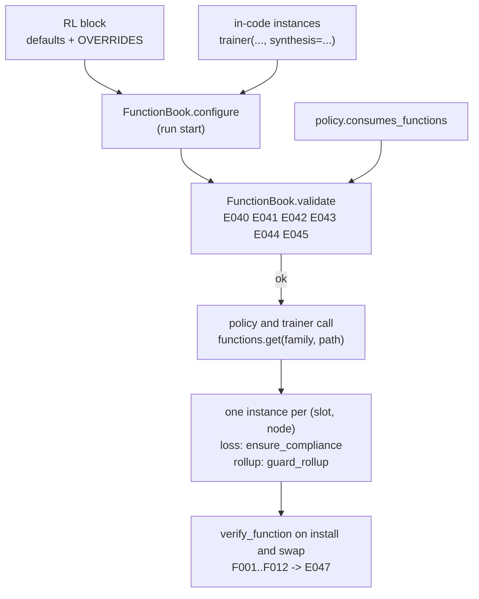

### 8.5 The `RL` block, and the rule that every configured family has a consumer

#### 8.5.1 Shape

`RL` is a new top-level settings block. Its keys are the twelve family names (each takes a
spec, section 5.1), `OVERRIDES`, and three switches. It is optional: **an absent or empty
`RL` block changes nothing** (invariant I1).

| Key | Value | Default | Meaning |
|---|---|---|---|
| `RL.<FAMILY>` | spec: `"name"`, `{type, params}` or `{import, params}` | unset | The default function of that family for every node. `ADVANTAGE`, `LOSS`, `ROLLUP`, ... |
| `RL.OVERRIDES.<FAMILY>` | mapping `glob -> spec` | unset | A different function for the nodes whose path matches `glob` (8.4). **Not allowed for `ROLLUP`** (`E042`): one rollup serves the whole tree. |
| `RL.UNCONSUMED` | `"error"` or `"warn"` | `"error"` | What to do when a family is configured that no active consumer reads (8.5.3). |
| `RL.STRICT_GLOBS` | bool | `true` | An override glob that matches no node at build time is an error (`E044`). After a tree mutation it is a warning (`W011`) whatever this says. |
| `RL.VERIFY` | `"custom"`, `"all"`, `"off"` | `"custom"` | Which functions the contract probe runs on (8.3). |
| `RL.MIGRATE` | mapping `FAMILY -> reset \| carry \| fail` | per-family defaults (8.8.1) | What a mid-run swap does with the old function's state (8.8.2). |

```yaml
# conf/rl.yaml
RL:
  ADVANTAGE:                       # default for every node
    type: clipped
    params: {clip: 3.0}
  REGULARIZATION:
    type: elastic_net
    params: {coefficient: 0.0005, l1_ratio: 0.3}
  OVERRIDES:
    ADVANTAGE:
      "peer-b*": {type: clipped, params: {clip: 1.0}}   # a tighter clip for the b peers
      "peer-b-reviewer": {type: gae}                    # exact name beats the glob (8.4)
  STRICT_GLOBS: true
  VERIFY: custom
```

`conf/rl.yaml` joins the `conf/` layout of document 15 (section 15.2). `LOSS` keeps its
meaning and its place; `RL.LOSS` is the form that supports overrides, and setting both is
`E040` (the loss has one default slot).

#### 8.5.2 Validation at load: `conf.py`

`conf.py` validates settings without importing torch (`conf.py:700-701`), so it checks the
**shape** of the block here and leaves names to resolution time, when plugins and project
modules have registered what they will register (4.2). `mactf.components.kinds` imports
`mactf.exceptions` and the standard library only (3.1), so reading `RL_FAMILIES` from it keeps
that property.

```python
# mactf/conf.py  (new default block, beside "SCORING")
    "RL": {
        "UNCONSUMED": "error",
        "STRICT_GLOBS": True,
        "VERIFY": "custom",
    },

# mactf/conf.py  (new function; called from _validate_blocks after the LOSS block, line 777)
_RL_RESERVED = frozenset({"OVERRIDES", "UNCONSUMED", "STRICT_GLOBS", "VERIFY", "MIGRATE"})


def _spec_shape_problem(raw: Any) -> str | None:
    """``None`` if ``raw`` can be a component spec, else why not. Names are not checked here."""
    if raw is None or isinstance(raw, str):
        return None if raw is None or raw.strip() else "an empty string is not a type name"
    if not isinstance(raw, dict):
        return f"a spec is a string or a mapping, not {type(raw).__name__}"
    has_type, has_import = "type" in raw, "import" in raw
    if has_type == has_import:
        return "a spec needs exactly one of 'type' and 'import'"
    params = raw.get("params")
    if params is not None and not isinstance(params, dict):
        return "'params' must be a mapping"
    return None


def _validate_rl(settings: Any) -> None:
    block = settings.get("RL")
    if block is None:
        return
    if not isinstance(block, dict):
        raise ImproperlyConfigured("RL must be a mapping")
    from .components.kinds import RL_FAMILIES

    families = {name.upper(): name for name in RL_FAMILIES}
    unknown = sorted(
        str(key) for key in block
        if str(key).upper() not in _RL_RESERVED and str(key).upper() not in families
    )
    if unknown:
        raise ImproperlyConfigured(
            f"RL has unknown key(s) {unknown}; accepted: {sorted(_RL_RESERVED)} and {sorted(families)}"
        )
    if str(block.get("UNCONSUMED", "error")).lower() not in {"error", "warn"}:
        raise ImproperlyConfigured("RL.UNCONSUMED must be 'error' or 'warn'")
    if str(block.get("VERIFY", "custom")).lower() not in {"custom", "all", "off"}:
        raise ImproperlyConfigured("RL.VERIFY must be 'custom', 'all' or 'off'")
    if not isinstance(block.get("STRICT_GLOBS", True), bool):
        raise ImproperlyConfigured("RL.STRICT_GLOBS must be a boolean")
    for key, raw in block.items():
        if str(key).upper() in families:
            problem = _spec_shape_problem(raw)
            if problem is not None:
                raise ImproperlyConfigured(f"RL.{key}: {problem}")
    overrides = block.get("OVERRIDES")
    if overrides is None:
        return
    if not isinstance(overrides, dict):
        raise ImproperlyConfigured("RL.OVERRIDES must map FAMILY -> {glob: spec}")
    for family_key, table in overrides.items():
        family = str(family_key).upper()
        if family not in families:
            raise ImproperlyConfigured(
                f"RL.OVERRIDES.{family_key}: unknown family; accepted: {sorted(families)}"
            )
        if family == "ROLLUP":
            raise ImproperlyConfigured(
                "E042: 'rollup' is served by one global object; RL.OVERRIDES.ROLLUP cannot target "
                "nodes. Use RL.ROLLUP."
            )
        if not isinstance(table, dict):
            raise ImproperlyConfigured(f"RL.OVERRIDES.{family_key} must map glob -> spec")
        for glob, raw in table.items():
            if not str(glob).strip():
                raise ImproperlyConfigured(f"RL.OVERRIDES.{family_key}: a glob cannot be empty")
            problem = _spec_shape_problem(raw)
            if problem is not None:
                raise ImproperlyConfigured(f"RL.OVERRIDES.{family_key}.{glob}: {problem}")
```

`"RL"` is added to `_NEW_BLOCKS` (`conf.py:714-717`) so `RL: 3` is rejected by the generic
mapping check before `_validate_rl` runs. The per-key checks above are the whole of what a
settings load can know; everything else is `FunctionBook.configure` and `validate` (8.4).

#### 8.5.3 Consumers: who reads each family

A family is **consumed** when an active component calls it. The policy declares what it
reads with the class attribute `consumes_functions` (7.2). The trainer itself consumes the
two hierarchy families whenever there is a hierarchy.

| Family | Read by | Where it is read | When the family is unset |
|---|---|---|---|
| `loss` | the policy, through `host.loss_for(path)` (7.4) | `DefaultTrainPolicy.train_step`, `evaluate()` | the trainer's `loss_function` (`LOSS` block) |
| `advantage` | `DefaultTrainPolicy` hook | replaces `penalise_void_advantage(signal, void)`; the void floor is re-applied after it (7.3 rule 1) | the original expression |
| `action` | `DefaultTrainPolicy` hook | replaces `argmax` (7.3) | `argmax` |
| `regularization` | `DefaultTrainPolicy` hook | added inside `evaluate()` (7.3) | none |
| `metric` | `DefaultTrainPolicy` hook | `StepResult.metrics["metric.<key>"]` (7.3) | none |
| `rollup` | the trainer, through `HierarchicalScorer.rollup_source` (8.6) | every `score_tree` call, once per parent | `KappaWeightedRollup` |
| `synthesis` | the trainer, through `synthesis_for(path)` (8.7) | step 3 of every hierarchical episode | `ConsensusSynthesis` |
| `value`, `return`, `reward`, `objective`, `gradient` | **only a custom policy that lists them** in `consumes_functions` | the policy's own `train_step`, through `host.functions.get(family, path)` | the policy's own behaviour |

`DefaultTrainPolicy.consumes_functions` is `{"loss", "advantage", "action", "regularization",
"metric"}`. `co_distill` (7.5) declares `{"loss"}`. A plain callable policy declares nothing
and is treated as `{"loss"}`. The set the check uses is therefore:

```text
consumed = policy.consumes_functions (default {"loss"})  ∪  {"rollup", "synthesis"} if hierarchy
```

The consequence is the point of the rule: **`RL.GRADIENT: {type: clip}` under the default
policy is `E041`**, because nothing would ever call it. Before this document that exact
configuration was accepted and silently did nothing, which is how `TRAINER.PEER_STRATEGY`
became a dead setting (2.2). `RL.UNCONSUMED: warn` downgrades it to `W010` for a team that
is mid-migration. A policy author makes the family live by listing it:

```python
class MyPolicy:
    name = "mine"
    consumes_functions = frozenset({"loss", "gradient", "return"})
    ...
    def train_step(self, node, batch):
        host = self._host
        clip = host.functions.get("gradient", node.name)      # None when unset: do your default
        ...
```

`GuardedPolicy` (7.6) forwards `consumes_functions` to the policy it wraps, so wrapping a
policy in a `StepGuard` does not change what it consumes.

#### 8.5.4 Wiring: building, validating and the legacy-conflict rule

`E040` is generalized from "both `LOSS` and `RL.LOSS`" to "a configured default and its
in-code equivalent are both set". A caller that passes `synthesis=` or `hierarchical_scorer=`
to the constructor has already chosen that default; an `RL.SYNTHESIS` or `RL.ROLLUP` next to it
would be a second, silently losing, source of truth. The two **cannot** both be honoured, so
the combination is refused. A per-node override (`RL.OVERRIDES.SYNTHESIS.<glob>`) is not a
default and is allowed on top of an in-code one.

``The alidate signature and its E040 loop are the ones given in 8.4 (in_code parameter); the
rest of alidate (E045, E044, E043, E041/W010) is as listed there.

The trainer builds the book next to the slot table and validates it after the policy exists:

```python
# mactf/training/trainer.py  (in __init__, where 7.4 creates ``self.slots``)
        guard_policy = GuardPolicy.from_settings(self.settings)
        self.functions = FunctionBook.from_settings(
            self.slots,
            self.settings.get("RL"),
            loss_compliance=str(self.settings.get("TRAINER", {}).get("LOSS_COMPLIANCE", "require")),
            compliance_coefficient=float(self.settings.get("TRAINER", {}).get("COMPLIANCE_COEFFICIENT", 1.0)),
            guard_mode=guard_policy.mode,
            trusted=self._components_trusted,
        )
        self.functions.configure(self.settings.get("RL"))

# mactf/training/trainer.py  (in build(), immediately after self._attach_policy())
        in_code = [
            name for name, supplied in (
                ("synthesis", self._synthesis_spec is not None),
                ("rollup", self._hierarchical_scorer is not None),
            ) if supplied
        ]
        self._function_warnings = self.functions.validate(
            self.node_paths,
            policy=self._trainer_policy,
            hierarchy=self._hierarchy is not None,
            loss_block_authored=is_authored(self.settings, "LOSS"),
            in_code=in_code,
        )
```

`TRAINER.LOSS_COMPLIANCE` and `TRAINER.COMPLIANCE_COEFFICIENT` are the two keys section 7.8
introduced for `ensure_compliance`; they are read here only to hand to the book.
`_components_trusted` is `True` for a run started by the CLI or from code and `False` for a
run created through the API without `COMPONENTS.API_ALLOW_IMPORT` (5.4), so an HTTP caller's
`{import: ...}` spec is refused by the resolver, not by this wiring.



### 8.6 Rollup unification and the `RollupGuard`

#### 8.6.1 The two tables

`rollup` is the one family with a second hand-written registry: `ROLLUP_STRATEGIES` in
`mactf/scoring/hierarchy.py:97-106` (seven keys, including `kappa_weighted`) next to
`FUNCTION_TYPES["rollup"]` in `rl/functions/registry.py:32-39` (six keys, no
`kappa_weighted`). A rollup registered through `register_function("rollup", ...)` was
invisible to `build_rollup`, and a key added to `ROLLUP_STRATEGIES` was invisible to every
spec. After 8.2 there is one registry: `FUNCTION_TYPES["rollup"]` is a `LegacyTable` over
`rl_function.rollup` and carries `kappa_weighted` as a flagged alias. `ROLLUP_STRATEGIES`
becomes **the same object**:

```python
# mactf/scoring/hierarchy.py  (imports; replaces lines 97-127)
from ..components import HUB
from ..components.guards.rollup import guard_rollup
from ..rl.functions.registry import FUNCTION_TYPES, build_function

#: Registry keys used by ``RL.ROLLUP`` and by spec resolution: the same live object as
#: ``rl.functions.registry.ROLLUP_TYPES`` (a ``LegacyTable`` over ``rl_function.rollup``),
#: so a rollup registered anywhere is available everywhere.
ROLLUP_STRATEGIES = FUNCTION_TYPES["rollup"]
ROLLUP_TYPES = ROLLUP_STRATEGIES


def build_rollup(spec: Any, *, guard_mode: str = "enforce") -> Any:
    """Resolve a rollup from a strategy, a name, or a spec mapping.

    A rollup that is not one of the six built-in classes is wrapped in a ``RollupGuard``
    (8.6.2). The built-ins are returned as they are, ``ExplicitRollup`` included: an
    ``ExplicitRollup(fn)`` constructed in code is the documented "I own the whole output"
    exception (``rl/functions/rollup.py:293-301``). The ``RL.ROLLUP`` path is stricter and
    guards it too (``FunctionBook``, 8.4).
    """
    if spec is None:
        return KappaWeightedRollup()
    if isinstance(spec, RollupStrategy) or hasattr(spec, "rollup"):
        return guard_rollup(spec, mode=guard_mode, include_explicit=False)
    payload: dict[str, Any] = {"type": spec} if isinstance(spec, str) else dict(spec)
    if "import" not in payload:
        payload.setdefault("type", "kappa_weighted")
        registry = HUB.registry("rl_function.rollup")
        if not registry.has(str(payload["type"])):
            raise ValidationError(
                f"unknown rollup {payload['type']!r}; accepted: " + ", ".join(registry.names())
            )
    built = build_function(payload, family="rollup")
    return guard_rollup(built, mode=guard_mode, include_explicit=False)
```

Three compatibility facts, each tied to an existing test:

* `tests/hierarchy/test_rollup.py:131-142` builds every key and asserts
  `isinstance(built, ROLLUP_STRATEGIES[name])`. The six built-ins come back unwrapped, so it
  holds, and iterating the table still yields `kappa_weighted`.
* `tests/hierarchy/test_rollup.py:145-147` expects `requires an 'fn'` from
  `build_rollup("explicit")`. `build_function` constructs `ExplicitRollup()`, whose own
  `ValidationError` propagates unchanged.
* `tests/hierarchy/test_rollup.py:150-153` expects `unknown rollup` for `"median"`. The
  explicit registry check above produces that exact prefix, and now lists the registered
  names (a custom `median` registered earlier makes the same call succeed, which is the
  feature).

`HierarchicalScorer` gains one constructor argument and turns `rollup` into a property, so a
swap of the rollup slot takes effect without rebuilding the scorer:

```python
# mactf/scoring/hierarchy.py  (HierarchicalScorer: constructor and one property; line 146 onward)
    def __init__(
        self,
        pipeline_factory: Callable[[str], ScoringPipeline] | ScoringPipeline | None = None,
        *,
        rollup: Any = None,
        attribution: str = "rollup",
        non_offsettable: Iterable[str] | None = None,
        rollup_source: Callable[[], Any] | None = None,
    ) -> None:
        super().__init__()
        # ... pipeline_factory handling unchanged (lines 153-164)
        self._rollup: Any = build_rollup(rollup)
        self._rollup_source = rollup_source
        # ... attribution and non_offsettable unchanged (lines 166-173)

    @property
    def rollup(self) -> Any:
        """The strategy in force now: the source's choice when it has one, else the default."""
        if self._rollup_source is not None:
            chosen = self._rollup_source()
            if chosen is not None:
                return chosen
        return self._rollup

    @rollup.setter
    def rollup(self, value: Any) -> None:
        self._rollup = build_rollup(value)
```

Every reader of `self.rollup` (`score`, line 372; `describe`, line 383; the `score_tree`
metadata, line 289; the clone at line 882) goes through the property and needs no change.
`rollup_source` is `None` for every existing caller, so the property returns `_rollup`, which
is what the attribute held (invariant I1). The trainer passes the book:

```python
# mactf/training/trainer.py  (_build_scorer, lines 1001-1010)
    def _build_scorer(self) -> Any:
        if self._hierarchical_scorer is not None:
            return self._hierarchical_scorer
        if self._scorers_spec is not None:
            pipeline = build_scorer(self.settings, scorers=_as_scorers(self._scorers_spec))
        else:
            pipeline = build_scorer(self.settings)
        if self._hierarchy is not None:
            return HierarchicalScorer(pipeline, rollup_source=self._rollup_choice)
        return pipeline

    def _rollup_choice(self) -> Any:
        """The book's guarded rollup, or ``None`` so the scorer keeps its default."""
        return self.functions.get("rollup", "")
```

`self.functions` exists before `_build_scorer` runs because 8.5.4 creates it in
`__init__`. With `RL.ROLLUP` unset, `get` returns `None` and the scorer uses the
`KappaWeightedRollup` it always did.

#### 8.6.2 What the guard proves, and what it does not

A rollup's job is arithmetic over its children's amounts. Its *obligation*, from
`rl/functions/rollup.py:1-8` and `scoring/hierarchy.py:10-15`, is that it never launders a
void: the output's `void_rules` contain every child's. Every built-in except `ExplicitRollup`
meets that by construction through `_void_union` (`rollup.py:64-70`). A custom one can forget.

Two independent mechanisms protect the run:

1. `branch_void(tree, own_void)` (`coopetition/tree.py:1013-1029`) computes the void union from
   the **ledgers**, not from the rollup output, and `score_tree` passes it to every node's
   `score_peer` (`hierarchy.py:238-254`), which hands it to `constrain`. A node whose
   descendant breached a non-offsettable rule **takes the floor whatever the rollup says.**
   A custom rollup cannot change this.
2. The `RollupGuard` makes the *rollup's own output* honest, because that output is what the
   stage interface returns (`HierarchicalScorer.score`, `hierarchy.py:368-376`) and what a
   scorecard decomposition shows. Without it a plugin could report `void_rules=()` for a branch
   that is in fact void, and every dashboard reading that output would say the branch was
   clean.

| Code | Violation | Detected by |
|---|---|---|
| **C010** | `output.void_rules` is missing a rule that a child reported | set difference against the union of the children's `void_rules` |
| **C011** | The rollup raised, returned something other than a `ScorerOutput`, or returned a non-finite or non-numeric `amount` | exception, `isinstance`, `math.isfinite` |
| **C012** | The output carries `mutations` | `output.mutations` is non-empty; only the warning stage may emit them (6.4.1) |

`COMPLIANCE.GUARD_MODE` (6.4.2) selects the response, so one setting governs every guard:
`enforce` raises `ComplianceGuardViolation`; `fallback` returns what the reference
`KappaWeightedRollup` produces from the same inputs and records the substitution in
`RollupGuard.reports`. Neither mode lets a flawed output through, and `fallback` can only
**add** voids (the reference output carries the full union).

What the guard does **not** claim: that the rollup's *number* is a good aggregate. That is the
author's property and the contract probe (F001..F012) checks its shape and determinism.
A rollup that returns a large positive amount for a void branch changes the amount carried in
the `HIERARCHY` output; the node's `final_score` still comes from `constrain` with the full
`branch_void`, so the compliance floor holds.

```python
# mactf/components/guards/rollup.py
"""RollupGuard (document 17 section 8.6)."""

from __future__ import annotations

import logging
import math
from collections import deque
from typing import Any, Mapping, Sequence

from ...exceptions import ComplianceGuardViolation, ImproperlyConfigured
from ...rl.functions.rollup import (
    ExplicitRollup,
    KappaWeightedRollup,
    MeanRollup,
    MinimumRollup,
    SumRollup,
    WorstCaseRollup,
)
from ...scoring.base import ScorerOutput
from .compliance import GUARD_MODES, GuardReport, GuardViolation

log = logging.getLogger("mactf.components")

#: The built-in strategies that union their children's voids by construction
#: (``rl/functions/rollup.py:111-143`` ``_output`` and ``_void_union``).
UNION_BY_CONSTRUCTION: tuple[type, ...] = (
    KappaWeightedRollup, MeanRollup, MinimumRollup, SumRollup, WorstCaseRollup,
)


def _finite_number(value: Any) -> float | None:
    if isinstance(value, bool):
        return None
    try:
        number = float(value)
    except (TypeError, ValueError):
        return None
    return number if math.isfinite(number) else None


class RollupGuard:
    """Wraps a rollup and checks every output it produces.

    The wrapper answers to the same name as the strategy it wraps, so
    ``HierarchicalScorer.describe`` and the scorecard's ``rollup`` metadata read as before.
    """

    spec_family = "rollup"

    def __init__(self, inner: Any, *, mode: str = "enforce", label: str | None = None) -> None:
        if mode not in GUARD_MODES:
            raise ImproperlyConfigured(
                f"COMPLIANCE.GUARD_MODE must be one of {list(GUARD_MODES)}, got {mode!r}"
            )
        if not callable(getattr(inner, "rollup", None)):
            raise ImproperlyConfigured(
                f"RollupGuard needs an object with rollup(), got {type(inner).__name__}"
            )
        self.inner = inner
        self.mode = mode
        self.name = str(getattr(inner, "name", None) or type(inner).__name__)
        self.label = label or self.name
        self._reference = KappaWeightedRollup()
        #: The last 64 reports with a violation, newest last; empty on a clean run.
        self.reports: deque[GuardReport] = deque(maxlen=64)

    # -- the protocol method ------------------------------------------------------
    def rollup(
        self,
        parent: str,
        children: Sequence[ScorerOutput],
        *,
        weights: Mapping[str, float] | None = None,
        scores: Mapping[str, float] | None = None,
    ) -> ScorerOutput:
        failure: Exception | None = None
        try:
            produced = self.inner.rollup(parent, children, weights=weights, scores=scores)
        except Exception as error:  # noqa: BLE001 - a plugin's failure is a violation, not a crash
            failure = error
            produced = None
            violations = [self._violation(
                "C011", f"raised {type(error).__name__}: {error}", parent,
            )]
        else:
            violations = self._check(parent, children, produced)
        if not violations:
            return produced
        return self._resolve(parent, children, weights, scores, violations, failure)

    # -- checks ----------------------------------------------------------------
    def _violation(self, code: str, message: str, parent: str) -> GuardViolation:
        return GuardViolation(
            code=code, stage=f"rollup:{self.label}", kind="hierarchy",
            message=f"{message} (parent {parent!r})",
        )

    def _check(
        self, parent: str, children: Sequence[ScorerOutput], produced: Any,
    ) -> list[GuardViolation]:
        if not isinstance(produced, ScorerOutput):
            return [self._violation(
                "C011", f"returned {type(produced).__name__}; a rollup returns a ScorerOutput", parent,
            )]
        found: list[GuardViolation] = []
        if _finite_number(produced.amount) is None:
            found.append(self._violation(
                "C011", f"amount {produced.amount!r} is not a finite number", parent,
            ))
        required = {rule for child in children for rule in child.void_rules}
        missing = sorted(required - set(produced.void_rules))
        if missing:
            found.append(self._violation(
                "C010",
                f"void_rules is missing {missing} reported by the children; a rollup must carry "
                "every child's void set upward",
                parent,
            ))
        if produced.mutations:
            found.append(self._violation(
                "C012", "emitted warning mutations; only the warning stage may", parent,
            ))
        return found

    def _resolve(
        self,
        parent: str,
        children: Sequence[ScorerOutput],
        weights: Mapping[str, float] | None,
        scores: Mapping[str, float] | None,
        violations: list[GuardViolation],
        failure: Exception | None,
    ) -> ScorerOutput:
        report = GuardReport(
            mode=self.mode,
            violations=tuple(violations),
            substituted=(self.label,) if self.mode == "fallback" else (),
        )
        self.reports.append(report)
        if self.mode == "enforce":
            raise ComplianceGuardViolation([item.as_dict() for item in violations]) from failure
        log.warning(
            "rollup %s violated %s at %s; using the reference kappa rollup",
            self.label, [item.code for item in violations], parent,
        )
        return self._reference.rollup(parent, children, weights=weights, scores=scores)

    # -- reporting ------------------------------------------------------------------
    def describe(self) -> dict[str, Any]:
        inner = self.inner.describe() if callable(getattr(self.inner, "describe", None)) else {}
        return {
            "type": "guarded", "guard": "rollup", "mode": self.mode,
            "name": self.name, "inner": inner,
        }

    def __repr__(self) -> str:
        return f"<RollupGuard {self.label} mode={self.mode}>"


def guard_rollup(instance: Any, *, mode: str = "enforce", include_explicit: bool = True) -> Any:
    """Return ``instance`` unchanged if it is trusted, else wrapped in a ``RollupGuard``.

    ``None`` stays ``None`` (the caller reads it as "use the default"); an existing guard is
    not wrapped twice. ``include_explicit=False`` is the legacy ``build_rollup`` behaviour,
    where an in-code ``ExplicitRollup`` is the documented exception.
    """
    if instance is None or isinstance(instance, RollupGuard):
        return instance
    trusted = UNION_BY_CONSTRUCTION + (() if include_explicit else (ExplicitRollup,))
    if type(instance) in trusted:  # exact type: a subclass may override rollup()
        return instance
    return RollupGuard(instance, mode=mode)
```

`guard_rollup` tests `type(instance) in trusted`, not `isinstance`, because a subclass of
`MeanRollup` may override `rollup` and drop the union; an exact-type check keeps the fast path
for precisely the classes whose code the framework controls. `GuardViolation` and
`GuardReport` are the dataclasses of 6.4.3; the guard module imports them from the compliance
guard so a violation looks the same in every report.

`NestedValueFunction` (`rl/functions/value.py:351-390`) takes its own rollup argument and is
**not** guarded: it rolls *value estimates* up a tree, which shapes learning and never touches
a score or a void set. The `StepGuard` bounds what a bad value does to a step.

### 8.7 Synthesis unification and the `TensorSynthesisAdapter`

#### 8.7.1 Two layers, one name

`synthesis` has two protocols that share names and nothing else:

| | Tensor level | Node level |
|---|---|---|
| File | `rl/functions/support.py:600-610`, `630-750` | `coopetition/synthesis.py:82-107`, `110-325` |
| Call | `__call__(proposals, *, weights=None) -> Tensor` | `synthesize(node, proposals, *, scores, weights, task) -> Tensor` |
| Knows about | tensors | a `PeerNode`, child scores, kappa weights, the task |
| Registry | `FUNCTION_TYPES["synthesis"]` (5 built-ins) | `SYNTHESIS_TYPES` in `coopetition/synthesis.py:331-338` (6 built-ins, adds `concat`) |
| Who calls it | nothing in the engine | `MACTFTrainer` (`trainer.py:626`, `:1373`) |

The node-level built-ins already *delegate* to the tensor-level ones for the arithmetic
(`synthesis.py:122`, `:143`, `:211`), so the two layers agree on the maths today. What is
missing is any way for a **custom** tensor-level function to be used by the trainer, which is
the thing a researcher writing a new aggregation actually has.

The decision (recorded in D6's spirit, no silent fallback): **keep both layers and bridge them.**
The node-level table stays where it is and keeps its six built-ins, so `build_synthesis`,
`SYNTHESIS_TYPES` and every test that uses them are untouched. A function registered under
`rl_function.synthesis` that is *not* in the node-level table is wrapped in a
`TensorSynthesisAdapter` that supplies the node-level call. A **node-aware custom function**
(a class with `synthesize`) is also registered under `rl_function.synthesis`, because
the contract (below) accepts either entry method; it needs no adapter.

```python
# mactf/coopetition/synthesis.py  (imports; one new class attribute; new class and helper)
import inspect

# ConcatSynthesis (line 291) declares its own shape contract, so the probe must not demand
# the proposals' trailing shape back:
#     output_shape_rule = "free"          # new class attribute on ConcatSynthesis
# Every other built-in keeps the default, "same".


_ADAPTER_KEYWORDS = ("weights", "scores", "node", "task")


def _accepted_keywords(function: Any) -> tuple[frozenset[str], bool]:
    """The keyword names ``function`` declares among the four the adapter can offer, and
    whether it takes ``**kwargs``. Unknown signatures (builtins) are treated as ``weights``
    only, the protocol's one keyword."""
    try:
        signature = inspect.signature(function)
    except (TypeError, ValueError):
        return frozenset({"weights"}), False
    names: set[str] = set()
    var_keyword = False
    for name, parameter in signature.parameters.items():
        if parameter.kind is inspect.Parameter.VAR_KEYWORD:
            var_keyword = True
        elif parameter.kind in (inspect.Parameter.KEYWORD_ONLY, inspect.Parameter.POSITIONAL_OR_KEYWORD):
            if name in _ADAPTER_KEYWORDS:
                names.add(name)
    return frozenset(names), var_keyword


class TensorSynthesisAdapter(SynthesisFunction):
    """A tensor-level function (``__call__(proposals, *, weights=None)``) as a node-level one.

    Offered to the function, by keyword, when it declares them: ``weights`` (always, if it
    takes ``weights`` or ``**kwargs``), ``scores``, ``node`` and ``task``. A function that
    declares only ``proposals`` and ``weights`` is the common case and gets exactly the
    protocol call. ``weights`` is the kappa weight map when the trainer has one, else the
    child scores: a tensor-level function has one weight argument, and "how much to trust each
    child" is what both of them mean.
    """

    name = "tensor"

    def __init__(self, function: Any, *, name: str | None = None) -> None:
        if not callable(function):
            raise ValidationError(f"TensorSynthesisAdapter needs a callable, got {function!r}")
        rule = str(getattr(function, "output_shape_rule", "same"))
        if rule not in ("same", "free"):
            raise ValidationError(
                f"output_shape_rule must be 'same' or 'free', got {rule!r} on {type(function).__name__}"
            )
        self.function = function
        self.name = str(name or getattr(function, "name", None) or type(function).__name__)
        self.output_shape_rule = rule
        self._keywords, self._var_keyword = _accepted_keywords(function)

    def synthesize(self, node, proposals, *, scores=None, weights=None, task=None):
        if not proposals:
            raise ContractError(f"no proposals to synthesize for {node.path}")
        if self.output_shape_rule == "same":
            check_aligned(proposals, node=node.path)
        else:
            batch = None
            for path, tensor in proposals.items():
                if not torch.is_tensor(tensor):
                    raise ContractError(
                        f"synthesis at {node.path}: proposal from {path!r} is a "
                        f"{type(tensor).__name__}, not a tensor"
                    )
                size = int(tensor.shape[0]) if tensor.dim() else -1
                if batch is None:
                    batch = size
                elif size != batch:
                    raise ContractError(
                        f"synthesis at {node.path}: proposal from {path!r} has batch {size}, "
                        f"expected {batch}"
                    )
        offered: dict[str, Any] = {}
        if "weights" in self._keywords or self._var_keyword:
            merged = dict(weights) if weights else (dict(scores) if scores else None)
            offered["weights"] = merged
        if "scores" in self._keywords:
            offered["scores"] = dict(scores or {})
        if "node" in self._keywords:
            offered["node"] = node
        if "task" in self._keywords:
            offered["task"] = task
        result = self.function(dict(proposals), **offered)
        if not torch.is_tensor(result):
            raise ContractError(
                f"synthesis {self.name!r} returned {type(result).__name__}, expected a tensor"
            )
        first = next(iter(proposals.values()))
        if result.dim() == 0 or int(result.shape[0]) != int(first.shape[0]):
            raise ContractError(
                f"synthesis {self.name!r} at {node.path} returned shape {tuple(result.shape)}; "
                f"the leading dimension must be the batch ({int(first.shape[0])})"
            )
        if self.output_shape_rule == "same" and tuple(result.shape) != tuple(first.shape):
            raise ContractError(
                f"synthesis {self.name!r} at {node.path} returned shape {tuple(result.shape)}; "
                f"expected {tuple(first.shape)} (declare output_shape_rule = 'free' to change it)"
            )
        if not bool(torch.isfinite(result).all()):
            raise ContractError(f"synthesis {self.name!r} at {node.path} returned a non-finite value")
        return result

    # A learned tensor-level function owns parameters; expose them the way
    # ``LearnedSynthesizer`` (this module, line 221) does.
    def parameters(self):
        getter = getattr(self.function, "parameters", None)
        return tuple(getter()) if callable(getter) else ()

    def train(self, mode: bool = True):
        setter = getattr(self.function, "train", None)
        if callable(setter):
            setter(mode)
        return self

    def describe(self) -> dict[str, Any]:
        return {
            **super().describe(),
            "type": self.name,
            "function": type(self.function).__name__,
            "output_shape_rule": self.output_shape_rule,
        }


def adapt_synthesis(candidate: Any, *, name: str | None = None) -> SynthesisFunction:
    """Return a node-level function for ``candidate`` (a node-level object, or a tensor-level one)."""
    if isinstance(candidate, SynthesisFunction) or callable(getattr(candidate, "synthesize", None)):
        return candidate
    if inspect.isfunction(candidate) or inspect.ismethod(candidate) or inspect.isbuiltin(candidate):
        raise ValidationError(
            "a bare function is ambiguous between the tensor-level and node-level synthesis "
            "protocols; wrap it with ExplicitSynthesis(fn) for the node-level call, or register "
            "a class under rl_function.synthesis"
        )
    if callable(candidate):
        return TensorSynthesisAdapter(candidate, name=name)
    raise ContractError(f"{type(candidate).__name__} is not a synthesis function")
```

`ConcatSynthesis` is the only built-in that legitimately changes the trailing shape, which is
why it gets `output_shape_rule = "free"`. With `RL.VERIFY: all` the probe runs on built-ins
too (8.3); without that attribute it would report `F012` against a class that is correct.

#### 8.7.2 `build_synthesis`

The existing function (`synthesis.py:345-377`) resolves a name against the node-level table
only. It keeps doing exactly that first, and then consults the registry:

```python
# mactf/coopetition/synthesis.py  (replaces build_synthesis, lines 345-377)
def build_synthesis(spec: Mapping[str, Any] | str | SynthesisFunction | Any | None) -> SynthesisFunction:
    """Resolve a function from a name, a ``{"type": ..., **kwargs}`` spec, or an instance.

    Order: the node-level built-ins, then ``rl_function.synthesis`` (tensor-level or
    node-aware custom components), then an error that lists both. A custom component whose
    name equals a node-level built-in is refused (``E046``) instead of being silently
    shadowed.
    """
    from ..components import HUB
    from ..components.kinds import Origin

    if spec is None:
        return ConsensusSynthesis()
    if isinstance(spec, str):
        payload: dict[str, Any] = {"type": spec}
    elif isinstance(spec, Mapping):
        payload = dict(spec)
    else:
        return adapt_synthesis(spec)
    registry = HUB.registry("rl_function.synthesis")

    if "import" in payload:
        from ..rl.functions.registry import build_function

        return adapt_synthesis(build_function(payload, family="synthesis"), name=str(payload["import"]))

    type_name = payload.pop("type", None)
    if type_name is None:
        raise ValidationError(
            "a synthesis spec requires a 'type' key; accepted types: "
            + ", ".join(sorted(set(SYNTHESIS_TYPES) | set(registry.names())))
        )
    type_name = _ALIASES.get(str(type_name), str(type_name))
    registered = registry.find(type_name)

    if type_name in SYNTHESIS_TYPES:
        if registered is not None and registered.origin is not Origin.BUILTIN:
            raise ValidationError(
                f"E046: synthesis type {type_name!r} names both a node-level built-in and a "
                f"custom rl_function.synthesis component ({registered.origin.value}); the "
                "built-in would silently win. Register the custom function under another name."
            )
        cls = SYNTHESIS_TYPES[type_name]
        accepted = _constructor_keys(cls)
        unknown = sorted(set(payload) - accepted)
        if unknown:
            raise ValidationError(
                f"{cls.__name__} does not accept "
                + ", ".join(repr(key) for key in unknown)
                + f"; accepted keys: {', '.join(sorted(accepted)) or '(none)'}"
            )
        return cls(**payload)

    if registered is not None:
        return adapt_synthesis(registry.build(type_name, payload), name=type_name)
    raise ValidationError(
        f"unknown synthesis type {type_name!r}; accepted types: "
        + ", ".join(sorted(set(SYNTHESIS_TYPES) | set(registry.names())))
    )


# synthesis_capabilities() (line 381): node-level entries gain "level": "node"; one entry per
# registered component that is not already a node-level name is appended:
def synthesis_capabilities() -> list[dict[str, Any]]:
    from ..components import HUB

    entries: list[dict[str, Any]] = []
    for name in sorted(SYNTHESIS_TYPES):
        cls = SYNTHESIS_TYPES[name]
        entries.append({
            "type": name, "class": cls.__name__, "kwargs": sorted(_constructor_keys(cls)),
            "level": "node", "origin": "builtin",
        })
    for component in HUB.registry("rl_function.synthesis").components():
        if component.name in SYNTHESIS_TYPES:
            continue
        node_aware = callable(getattr(component.factory, "synthesize", None))
        entries.append({
            "type": component.name,
            "class": getattr(component.factory, "__name__", component.qualname),
            "kwargs": sorted(component.accepted_params()),
            "level": "node" if node_aware else "tensor",
            "origin": component.origin.value,
        })
    return entries
```

Existing behaviour is preserved case by case: the unknown-key text (`does not accept ...;
accepted keys: ...`) is the one at `synthesis.py:372-378`; `synthesis_capabilities()` keeps
the keys `type`, `class` and `kwargs` and adds `level` and `origin`. The `"best"` and
`"consensus"` names resolve to the node-level classes even though the tensor-level registry
also holds entries with those names, because those entries are `builtin` and the E046 check
exempts them: two built-ins that share a name were *already* the case and are intended to be
the same arithmetic.

#### 8.7.3 The contract accepts either entry method

The structural contract of 3.7 (`rl_function_contract`) required `__call__` for every family.
Synthesis alone has two legal entry methods, so its contract is replaced:

```python
# mactf/components/contracts.py  (new helpers; rl_function_contract and
# rl_function_instance_contract return these two for family == "synthesis")
def _defines(cls: Any, name: str) -> bool:
    """True if ``cls`` or a base other than ``object`` defines ``name`` in its own namespace.

    ``getattr(cls, "__call__")`` is *always* callable (it is ``type.__call__``), so asking the
    attribute proves nothing; the class dictionaries are what say whether the author wrote one.
    """
    return any(name in vars(klass) for klass in cls.__mro__ if klass is not object)


def synthesis_contract(factory: Any) -> list[str]:
    if not _is_class(factory):
        return [f"{factory!r} is not a class"]
    problems: list[str] = []
    if inspect.isabstract(factory):
        problems.append(f"abstract methods not implemented: {sorted(factory.__abstractmethods__)}")
    node_level = _defines(factory, "synthesize")
    tensor_level = _defines(factory, "__call__")
    if not node_level and not tensor_level:
        problems.append(
            "define synthesize(node, proposals, *, scores, weights, task) (node-aware) or "
            "__call__(proposals, *, weights=None) (tensor-level)"
        )
    if node_level:
        try:
            names = [
                name for name, parameter in inspect.signature(factory.synthesize).parameters.items()
                if name != "self" and parameter.kind in (
                    inspect.Parameter.POSITIONAL_ONLY, inspect.Parameter.POSITIONAL_OR_KEYWORD,
                )
            ]
        except (TypeError, ValueError):
            names = []
        if names[:2] != ["node", "proposals"]:
            problems.append(
                f"synthesize() must take (node, proposals, ...), found {names[:2] or 'no positional parameters'}"
            )
    rule = getattr(factory, "output_shape_rule", "same")
    if rule not in ("same", "free"):
        problems.append("class attribute 'output_shape_rule' must be 'same' or 'free'")
    return problems


def synthesis_instance_contract(instance: Any) -> list[str]:
    if callable(getattr(instance, "synthesize", None)) or callable(instance):
        return []
    return ["no synthesize() method and the instance is not callable"]


# in rl_function_contract(family) and rl_function_instance_contract(family), first line:
#     if family == "synthesis":
#         return synthesis_contract            # / synthesis_instance_contract
```

Rule `E046` and the contract together mean there is exactly one way to be a synthesis function
and no way to be one that the trainer cannot use.

#### 8.7.4 The trainer reads synthesis per node

```python
# mactf/training/trainer.py  (new method beside loss_for, section 7.4)
    def synthesis_for(self, path: str) -> Any:
        """The synthesis function in force for the parent ``path``: an ``RL.SYNTHESIS``
        override or default, else the one built from ``synthesis=`` (``ConsensusSynthesis``
        when that is unset)."""
        chosen = self.functions.get("synthesis", path)
        return chosen if chosen is not None else self.synthesis_function


# mactf/training/trainer.py  (step 3 of the episode, lines 1356-1381; the two edited lines marked)
        if self.synthesis_function is not None:
            for node in tree.walk("leaves-first"):
                # ... unchanged: skip leaves and failed nodes, build ``proposals`` (lines 1358-1371)
                synthesizer = self.synthesis_for(node.path)                    # new
                try:
                    synthesized = synthesizer.synthesize(                      # was self.synthesis_function.synthesize
                        node,
                        proposals,
                        scores=dict(self.signal_by_peer),
                        weights=dict(self._last_weights),
                        task=task,
                    )
                except Exception as error:  # noqa: BLE001
                    failed[node.path] = f"{type(error).__name__}: {error}"
                    self._fail_node(episode, node, failed[node.path])
                    continue
                # ... unchanged: replace the parent's logits when the shape matches (lines 1384-1390)
```

Two properties of the surrounding code carry the compliance argument, and neither changes.
Synthesis builds a **proposal**; the verifiable-rules judge (`TaskJudge`, `trainer.py:1392`)
runs *after* every synthesis and records rule events from the parent's own output, so a custom
function cannot pre-empt a rule. And a synthesis that raises fails **that node** through
`_fail_node` (a recorded, penalised failure, the same path a failed rollout takes), so a bad
plugin degrades one parent and does not abort the episode.

`self.synthesis_function` is still built from `synthesis=` at `trainer.py:626` and is now
resolved by the extended `build_synthesis`, so `MACTFTrainer(..., synthesis="median")` works
for a registered `median`, and `synthesis=MedianSynthesis()` (an instance) is adapted.
