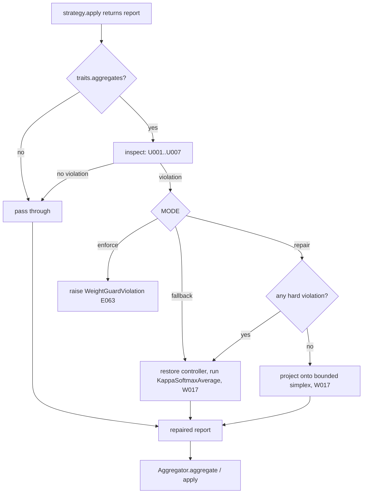

## 10. Weight update, aggregation and temperature

Sections 6 to 9 made the *inputs* of aggregation customizable (scores, losses, functions,
optimizers). This section makes the *combination rule* customizable: which strategy turns
peer scores into weights, which `Aggregator` blends the parameter vectors, and how the
softmax temperature (`kappa`) is controlled, per aggregation group. It also makes
`TRAINER.WEIGHT_UPDATE` real: today it is validated and then ignored (section 2.3).

The design has one idea. **A custom strategy proposes; the framework disposes.** A strategy
returns an `AggregationReport`; a `WeightGuard` checks it against the invariants the
framework owns (finite, non-negative, sums to one, zero on void peers, floor and cap on
every participant) and either lets it through, repairs it by projection onto the bounded
simplex, or rejects it. Weights that reach `Aggregator.aggregate` are therefore always legal,
whoever wrote the strategy.

### 10.1 What exists, and what is missing

| Piece | Where | State today |
|---|---|---|
| `WeightUpdateStrategy` protocol: `apply`, `describe`, `from_spec` | `coopetition/weights.py:38-58` | Structural, runtime-checkable. Any object with `apply` and `describe` is accepted (`weights.py:519-520`) |
| Six strategies | `weights.py:86-452` | `kappa_softmax`, `uniform`, `score_weighted`, `reference_only`, `none`, `explicit` |
| `WEIGHT_STRATEGIES` | `weights.py:464-471` | A plain `dict`; no `register_*` |
| `build_weight_update` | `weights.py:474-524` | Names, mappings, instances. An `isinstance` tuple of the six built-ins decides what is "already a strategy" |
| `_WEIGHT_STRATEGY_NAMES` | `conf.py:710-712` | A hard-coded frozenset; the validator at `conf.py:743-745` rejects any other name and, because it calls `str(...)`, any mapping |
| `Aggregator` | `coopetition/aggregation.py:44-345` | `compute_weights` (the default rule), `aggregate`, `apply`, `from_settings` |
| `feasible_bounds`, `_project_bounded` | `aggregation.py:347-410` | Exact projection onto `{w: sum(w) = 1, floor <= w <= cap}` |
| `AdaptiveKappa` | `coopetition/temperature.py:53-248` | Entropy-targeting controller; `from_settings` builds it from one `COOPETITION` dict |
| Trainer wiring | `training/trainer.py:610-613` (build), `:989-999` (`_build_controllers`), `:1671-1697` (`_group_aggregator`), `:1699-1751` (`_weights_for`), `:1753-1769` (`update_weights`, `_group_strategy`) | One strategy for the whole tree; per-group aggregators are copied field by field |

The gaps, each of which the design below closes:

| ID | Gap | Evidence |
|---|---|---|
| **W-G1** | The set of strategies is closed | `WEIGHT_STRATEGIES` is a dict; `_WEIGHT_STRATEGY_NAMES` is a frozenset; the serializer uses `choices=[...]` |
| **W-G2** | A mapping spec silently ignores unknown keys | `build_weight_update` calls `target.from_spec(payload)`, and every built-in `from_spec` reads only the keys it knows (`weights.py:268-270`, `:326-330`). `{"type": "uniform", "tolrance": 1}` is accepted |
| **W-G3** | One strategy instance serves every group | `_group_strategy` returns `self.weight_strategy` itself for anything but the default (`trainer.py:1766-1769`), so a stateful strategy shares state across groups, and `explicit` weights naming root peers fail at every child group |
| **W-G4** | Nothing validates a custom strategy's output | `Aggregator.aggregate` multiplies by `report.weights` as given and skips only `weight <= 0.0` (`aggregation.py:270-290`). Weights summing to 3 scale the parameters by 3; a `NaN` passes `nan <= 0.0` and poisons every peer. `_write` tests only `positive` (`trainer.py:1781-1786`) |
| **W-G5** | An intentional fallback is masked | `ReferenceOnlyAverage` returns `fallback=True` by design (`weights.py:307-315`). `_weights_for` treats any `report.fallback` from a non-default strategy as a failure and replaces the report with `kappa_softmax` (`trainer.py:1738-1744`). `reference_only` therefore never runs |
| **W-G6** | A custom strategy cannot hold state across a resume | `_trainer_state` (`trainer.py:2190-2199`) writes the peer strategy, callbacks and distillation, never the weight strategy |
| **W-G7** | Every group shares one temperature configuration | `_build_controllers` passes one `coopetition` dict to every group (`trainer.py:994-998`), and `AdaptiveKappa.load_state_dict` does not restore `num_peers` (`temperature.py:184-197`), so an entropy target computed for a shrunk participant set is paired with a stale arity |
| **W-G8** | `TRAINER.WEIGHT_UPDATE` is dead | Validated (`conf.py:743`), never read by `Orchestrator`; `MACTFTrainer` reads only its constructor argument (`trainer.py:354`, `:611`) |
| **W-G9** | A custom `Aggregator` is downcast for child groups | `_group_aggregator` rebuilds `Aggregator(...)` from eight named fields (`trainer.py:1686-1695`); a subclass, and any state it carries, is lost for every group except the root |
| **W-G10** | A saved controller state can land in the wrong controller | `checkpoint_v2.restore` loads `controllers.get(name, root_controller)` (`checkpoint_v2.py:1081-1088`): a stored label with no live group is loaded into the **root** controller |
| **W-G11** | A raising custom strategy ends the run | `_weights_for` catches only `ComplianceError` and `NotImplementedError` (`trainer.py:1731-1734`); a `KeyError` or `RuntimeError` from third-party code propagates out of `run_epoch` |

### 10.2 Invariants

| ID | Invariant | Enforced by | Test |
|---|---|---|---|
| **A1** | *Default identity.* With nothing configured the built-ins, the per-group controllers and every report are bit-identical to today's (
eference_only excepted: 10.12, change 1) | The guard never covers a built-in under `SCOPE: custom`; `build_weight_update` returns the same classes | `test_weights_default_identity` |
| **A2** | *Legal weights.* For every group that a custom strategy serves, the weights written are finite, non-negative, sum to 1 (within `TOLERANCE`), are 0 on ineligible and trimmed peers, and lie in `[floor, cap]` on every other participant; or the report is an intentional reset (`fallback=True` with `may_fallback`) | `WeightGuard.check` | `test_guard_property_*` (Hypothesis) |
| **A3** | *The framework owns the bounds.* `WEIGHT_FLOOR`, `WEIGHT_CAP`, `CONFIDENCE_FLOOR`, `TRIM_FRACTION` and the rest come from `COOPETITION` only; a spec cannot set them | `ComponentRegistry.build` rejects a spec key the resolver injects (`ComponentParamError`, section 3.3) | `test_spec_cannot_set_floor` |
| **A4** | *One instance per (slot, group).* State never crosses groups | `WeightPlan.strategy_for` | `test_group_state_isolated` |
| **A5** | *Deterministic selection.* Exact label, else the strictly most specific matching glob, else the default; a tie is an error at build | `pick_glob`, `WeightPlan.validate` (`E061`) | `test_override_specificity_*` |
| **A6** | *Atomic, episode-bounded swap.* A swap that fails at any step leaves the old strategy, its state and its cache untouched | `WeightPlan.set` ordering (10.6) | `test_swap_atomic` |
| **A7** | *A rejected proposal costs nothing.* If a strategy's output is rejected, the controller is restored to its pre-call state before the fallback runs, so `kappa` is never advanced twice for one epoch | `AdaptiveKappa.snapshot` / `restore` in `_weights_for` | `test_fallback_does_not_double_step` |
| **A8** | *Restore is exact or loud.* Persisted plan and state are restored exactly, or dropped with a code; never half-loaded, never into another group | `WeightPlan.load_state_dict`, `checkpoint_v2` label fix | `test_resume_*` |
| **A9** | *Fail at build.* An unknown name, an unaccepted parameter, a failed `validate`, a failed probe and an ambiguous glob are all raised from `build()`, before epoch 1 | `WeightPlan.validate`, `verify_weight_update` | `test_bad_spec_fails_at_build` |

### 10.3 Strategy contract, traits and registration

The protocol is unchanged. Three additions make a custom strategy easy to write and safe to
run: a `WeightTraits` declaration, an optional base class that supplies `describe` and
`from_spec`, and two report helpers. All are additive.

```python
# mactf/coopetition/weights.py   (additions; the six built-in bodies are unchanged)
from __future__ import annotations

from dataclasses import dataclass
from typing import Any, ClassVar, Mapping, Sequence

import torch

from ..exceptions import ComplianceError, ValidationError
from .aggregation import Aggregator
from .report import AggregationReport


@dataclass(frozen=True)
class WeightTraits:
    """What a strategy promises about its output. Read by ``WeightGuard``."""

    #: ``False`` for a strategy that deliberately writes nothing (``NoAggregation``).
    #: The guard skips it entirely.
    aggregates: bool = True
    #: ``True`` when ``report.fallback = True`` is the *intended* outcome: a reset to the
    #: reference peer. ``Aggregator.aggregate`` then copies the reference parameters and
    #: the weights are informational. Without this declaration a fallback report is read as
    #: the strategy failing, which is the rule the trainer has always applied (W-G5).
    may_fallback: bool = False


def traits_of(strategy: Any) -> WeightTraits:
    """The declared traits of ``strategy``; the default (aggregates, no reset) otherwise."""
    found = getattr(strategy, "traits", None)
    return found if isinstance(found, WeightTraits) else WeightTraits()


@dataclass(frozen=True)
class GroupView:
    """One aggregation group, as a strategy's optional ``validate`` sees it."""

    label: str                       # "root", or the parent node's path
    parent: str | None
    members: tuple[str, ...]
    level: int                       # 0 for the root group, the parent's depth otherwise
    floor: float
    cap: float


class WeightStrategy:
    """Optional base class for custom strategies.

    It supplies ``describe`` and ``from_spec`` so that a subclass has to write ``apply``
    and nothing else. A subclass may also define:

    * ``validate(group: GroupView) -> Sequence[str]``: problems with serving ``group``
      (``E064`` at build, and again after a tree mutation);
    * ``state_dict() -> dict`` / ``load_state_dict(payload) -> None``: JSON-serializable
      state carried across a resume;
    * ``clone() -> WeightStrategy``: only for an in-code *instance* that must not be shared
      between groups (a strategy built from a spec is built once per group anyway);
    * ``traits``: a ``WeightTraits``.
    """

    name: ClassVar[str] = ""
    traits: ClassVar[WeightTraits] = WeightTraits()

    def apply(
        self,
        vectors: Mapping[str, torch.Tensor],
        scores: Mapping[str, float],
        *,
        kappa: float,
        level: int = 0,
        eligible: Mapping[str, bool] | None = None,
        confidence: Mapping[str, float] | None = None,
    ) -> AggregationReport:
        raise NotImplementedError(f"{type(self).__name__} must implement apply()")

    def describe(self) -> dict[str, Any]:
        return {"name": self.name or type(self).__name__, "class": type(self).__name__}

    @classmethod
    def from_spec(cls, spec: Any) -> "WeightStrategy":
        if isinstance(spec, Mapping):
            return cls(**{k: v for k, v in spec.items() if k not in ("type", "name")})
        return cls()


def make_report(
    weights: Mapping[str, float],
    names: Sequence[str],
    *,
    kappa: float,
    eligible: Mapping[str, bool] | None = None,
    raw: Mapping[str, float] | None = None,
    adjustments: Sequence[str] = (),
    trimmed: Sequence[str] = (),
    fallback: bool = False,
    entropy: float | None = None,
) -> AggregationReport:
    """Build an ``AggregationReport`` for ``names`` from partial ``weights``.

    Peers absent from ``weights`` get 0. ``gated_peers`` is derived from ``eligible`` so a
    custom strategy cannot forget to list the peers it zeroed. ``entropy`` defaults to the
    Shannon entropy (nats) of the positive weights.
    """
    ordered = _ordered(names)
    full = {name: float(weights.get(name, 0.0)) for name in ordered}
    source = raw if raw is not None else weights
    gated = tuple(
        name for name in ordered if eligible is not None and not bool(eligible.get(name, True))
    )
    measured = entropy if entropy is not None else _entropy([v for v in full.values() if v > 0.0])
    return AggregationReport(
        weights=full,
        raw_weights={name: float(source.get(name, 0.0)) for name in ordered},
        kappa=float(kappa),
        entropy=float(measured),
        adjustments=list(adjustments),
        fallback=bool(fallback),
        gated_peers=gated,
        trimmed_peers=tuple(trimmed),
        order=tuple(ordered),
    )


# Declared after the class bodies, so the built-ins need no edit beyond one line each.
NoAggregation.traits = WeightTraits(aggregates=False)
ReferenceOnlyAverage.traits = WeightTraits(may_fallback=True)
```

**Registration.** The module-level dict becomes a view of the `weight_update` registry
(section 3.9), and the set of built-in classes is remembered so the guard can tell a framework
strategy from anyone else's:

```python
# mactf/coopetition/weights.py   (replaces lines 463-471; the import sits at the bottom of the
#                                 module because components.legacy imports nothing from here)
from ..components.legacy import LegacyTable        # noqa: E402

#: Every strategy addressable by name. A view of ``HUB.registry("weight_update")``: writes
#: route through the registry, so ``register_weight_update`` and a legacy
#: ``WEIGHT_STRATEGIES["mine"] = Mine`` are the same act.
WEIGHT_STRATEGIES = LegacyTable("weight_update", {
    "kappa_softmax": KappaSoftmaxAverage,
    "uniform": UniformAverage,
    "score_weighted": ScoreWeightedAverage,
    "reference_only": ReferenceOnlyAverage,
    "none": NoAggregation,
    "explicit": ExplicitWeightStrategy,
})

#: The framework's own classes: what ``WeightGuard`` leaves alone under ``SCOPE: custom``.
BUILTIN_WEIGHT_TYPES: frozenset[type] = frozenset(dict.values(WEIGHT_STRATEGIES))
```

The registry's `weight_update` contract (3.7) accepts a class that defines `apply`,
`describe`, `from_spec` and a string `name`; a subclass of `WeightStrategy` satisfies it by
inheritance. Names are lower-case (the registry rejects an upper-case name, because the
configuration layer lower-cases them; section 3.3).

**`build_weight_update`.** It becomes a thin adapter over the resolver. Its signature gains
two optional keywords and its documented behaviour is kept (a bad name still raises
`ValidationError` naming the accepted set, because `ComponentMissing` derives from
`ValidationError`, section 17.1):

```python
# mactf/coopetition/weights.py   (replaces lines 474-524)
def _split_spec(
    spec: Any, aggregator: Aggregator | None
) -> tuple[Any, dict[str, Any]]:
    """The raw spec the resolver wants, plus what the framework injects.

    ``aggregator`` is *injected*, never a spec key: a built-in that wants one declares an
    ``aggregator`` parameter and receives it, and a custom class that declares none does not.
    The legacy form ``{"type": "kappa_softmax", "aggregator": <Aggregator>}`` is still read.
    """
    inject: dict[str, Any] = {"aggregator": aggregator} if aggregator is not None else {}
    if isinstance(spec, str):
        return spec.strip().lower(), inject
    if isinstance(spec, Mapping):
        payload = dict(spec)
        nested = payload.pop("aggregator", None)
        if isinstance(nested, Aggregator):
            inject["aggregator"] = nested
        written = payload.pop("name", None)
        if "type" not in payload and "import" not in payload:
            payload["type"] = str(written or "kappa_softmax")
        if "type" in payload:
            payload["type"] = str(payload["type"]).strip().lower()
        return payload, inject
    return spec, inject          # an already-parsed ComponentSpec


def build_weight_update(
    spec: "WeightUpdateStrategy | str | Mapping[str, Any] | None",
    *,
    aggregator: Aggregator | None = None,
    resolver: Any | None = None,
    trusted: bool = True,
) -> WeightUpdateStrategy:
    """Resolve a strategy from an instance, a name, a spec, or ``None``.

    ``None`` returns ``KappaSoftmaxAverage`` bound to ``aggregator``, the documented default.
    A name or mapping goes through the component registry, so it may name a built-in, a
    project component or a plugin, and an unknown name or an unaccepted key raises at
    construction (``ComponentMissing`` / ``ComponentParamError``, both ``ValidationError``)
    with the accepted list, never at epoch 4. A mapping may use flat keys
    (``{"type": "explicit", "weights": {...}}``) or ``params``.
    """
    from ..components.resolver import ComponentResolver, ComponentSpec

    if spec is None:
        return KappaSoftmaxAverage(aggregator)
    if isinstance(spec, (str, Mapping, ComponentSpec)):
        raw, inject = _split_spec(spec, aggregator)
        parsed = ComponentSpec.parse("weight_update", raw)
        return (resolver or ComponentResolver()).resolve(
            parsed, trusted=trusted, inject=inject
        ).instance
    if isinstance(spec, KappaSoftmaxAverage):
        if spec.aggregator is None and aggregator is not None:
            return KappaSoftmaxAverage(aggregator)
        return spec
    if callable(getattr(spec, "apply", None)) and callable(getattr(spec, "describe", None)):
        return spec  # an instance: structural, any class
    raise ValidationError(
        f"weight_update must be a strategy, a name, or a mapping; got {type(spec).__name__}"
    )
```

Two deliberate behaviour changes, both toward I8 (nothing is silently ignored):

1. A mapping with an unaccepted key is now an error (W-G2). Every previously valid spec of
   the six built-ins keeps its meaning, because each reads exactly its constructor's keywords.
2. The `isinstance` tuple of built-ins is gone: any instance with `apply` and `describe` is
   returned as is, which is what the structural branch did for everyone but the six.

### 10.4 `WeightGuard`: the compliance boundary



Violation codes. *Hard* violations cannot be repaired without guessing what the strategy meant;
*soft* ones have exactly one lawful repair.

| Code | Class | Meaning | Repair in `repair` mode |
|---|---|---|---|
| `U001` | hard | A weight is not a finite number | none: fall back |
| `U002` | hard | A weight is negative (below `-TOLERANCE`) | none: fall back |
| `U003` | hard | `report.weights` does not name exactly the peers of the group | none: fall back |
| `U004` | soft | An ineligible or trimmed peer carries weight above `TOLERANCE` | zero it, renormalize |
| `U005` | soft | A participant is outside `[floor, cap]`, or the weights do not sum to 1 within `TOLERANCE` | project (`_project_bounded`) |
| `U006` | hard | `fallback=True` without `WeightTraits.may_fallback` (the strategy did not mean to reset) | none: fall back |
| `U007` | hard | `apply()` raised | none: fall back |

*Participants* are the eligible peers that the strategy did not list in `report.trimmed_peers`.
A strategy that wants an eligible peer at weight 0 says so by trimming it, exactly as
`Aggregator.compute_weights` does (`aggregation.py:160-181`). An eligible peer at weight 0 that
is *not* trimmed is a `U005` violation: framework.md 10.1.2 gives every participant the floor,
including a peer whose softmax mass rounded to zero (`aggregation.py:184-195`).

```python
# mactf/exceptions.py   (new; section 17.1 lists it with the others)
class WeightGuardViolation(ComplianceError):
    """``E063``: a weight strategy's output broke a framework invariant under MODE=enforce."""

    code = "E063"

    def __init__(self, strategy: str, violations: "Sequence[Any]") -> None:
        self.strategy = strategy
        self.violations = tuple(violations)
        listed = "; ".join(str(item) for item in self.violations)
        super().__init__(f"E063: weight_update {strategy!r} broke the weight contract: {listed}")
```

```python
# mactf/coopetition/weight_guard.py   (new)
from __future__ import annotations

import dataclasses
import logging
import math
from dataclasses import dataclass
from typing import Any, Callable, Mapping, Sequence

from ..exceptions import ComplianceError, ImproperlyConfigured, WeightGuardViolation
from .aggregation import Aggregator, _project_bounded
from .report import AggregationReport
from .weights import (
    BUILTIN_WEIGHT_TYPES,
    KappaSoftmaxAverage,
    WeightTraits,
    traits_of,
)

log = logging.getLogger("mactf.weights")

GUARD_MODES = ("repair", "fallback", "enforce")
GUARD_SCOPES = ("custom", "all", "off")
_GUARD_KEYS = frozenset({"MODE", "SCOPE", "TOLERANCE", "PROBE"})

CODES: dict[str, str] = {
    "U001": "a weight is not a finite number",
    "U002": "a weight is negative",
    "U003": "the weights do not name exactly the peers of the group",
    "U004": "an ineligible or trimmed peer carries weight",
    "U005": "a participant is outside [floor, cap], or the weights do not sum to 1",
    "U006": "the strategy reported fallback without declaring may_fallback",
    "U007": "apply() raised",
}
_HARD = frozenset({"U001", "U002", "U003", "U006", "U007"})


@dataclass(frozen=True)
class Violation:
    code: str
    peer: str | None
    detail: str

    @property
    def hard(self) -> bool:
        return self.code in _HARD

    def __str__(self) -> str:
        where = "" if self.peer is None else f" [{self.peer}]"
        return f"{self.code}{where}: {self.detail}"


@dataclass
class GuardOutcome:
    #: The report to use; ``None`` when ``action == "fallback"`` (the caller runs the fallback).
    report: AggregationReport | None
    violations: tuple[Violation, ...]
    action: str                       # "pass" | "repaired" | "fallback"


class WeightGuard:
    """Checks, and under ``repair`` fixes, what a weight strategy returned."""

    def __init__(
        self,
        *,
        mode: str = "repair",
        scope: str = "custom",
        tolerance: float = 1e-6,
        probe: bool = True,
    ) -> None:
        if mode not in GUARD_MODES:
            raise ImproperlyConfigured(
                f"E060: TRAINER.WEIGHT_GUARD.MODE must be one of {list(GUARD_MODES)}, got {mode!r}"
            )
        if scope not in GUARD_SCOPES:
            raise ImproperlyConfigured(
                f"E060: TRAINER.WEIGHT_GUARD.SCOPE must be one of {list(GUARD_SCOPES)}, got {scope!r}"
            )
        if not (isinstance(tolerance, (int, float)) and math.isfinite(tolerance) and 0.0 < tolerance < 0.1):
            raise ImproperlyConfigured(
                f"E060: TRAINER.WEIGHT_GUARD.TOLERANCE must be in (0, 0.1), got {tolerance!r}"
            )
        self.mode = mode
        self.scope = scope
        self.tolerance = float(tolerance)
        self.probe = bool(probe)

    # -- construction ----------------------------------------------------
    @classmethod
    def from_settings(cls, block: Mapping[str, Any] | None) -> "WeightGuard":
        raw = {str(key).upper(): value for key, value in dict(block or {}).items()}
        unknown = sorted(set(raw) - _GUARD_KEYS)
        if unknown:
            raise ImproperlyConfigured(
                f"E060: TRAINER.WEIGHT_GUARD has unknown keys {unknown}; accepted: {sorted(_GUARD_KEYS)}"
            )
        return cls(
            mode=str(raw.get("MODE", "repair")).lower(),
            scope=str(raw.get("SCOPE", "custom")).lower(),
            tolerance=raw.get("TOLERANCE", 1e-6),
            probe=bool(raw.get("PROBE", True)),
        )

    def describe(self) -> dict[str, Any]:
        return {
            "mode": self.mode,
            "scope": self.scope,
            "tolerance": self.tolerance,
            "probe": self.probe,
        }

    # -- scope -----------------------------------------------------------
    def covers(self, strategy: Any, aggregator: Aggregator | None = None) -> bool:
        """Whether ``strategy``'s output is checked.

        Under ``custom`` that is everything the framework did not write, **and** the default
        strategy when the aggregator it delegates to is a subclass: a custom
        ``Aggregator.compute_weights`` is custom code on the default path.
        """
        if self.scope == "off" or not traits_of(strategy).aggregates:
            return False
        if self.scope == "all":
            return True
        if type(strategy) not in BUILTIN_WEIGHT_TYPES:
            return True
        if isinstance(strategy, KappaSoftmaxAverage):
            bound = strategy.aggregator if strategy.aggregator is not None else aggregator
            return bound is not None and type(bound) is not Aggregator
        return False

    # -- the check -------------------------------------------------------
    @staticmethod
    def participants(
        report: AggregationReport, names: Sequence[str], eligible: Mapping[str, bool]
    ) -> list[str]:
        trimmed = set(report.trimmed_peers)
        return [
            name for name in sorted(names)
            if bool(eligible.get(name, True)) and name not in trimmed
        ]

    def inspect(
        self,
        report: AggregationReport,
        *,
        names: Sequence[str],
        eligible: Mapping[str, bool],
        floor: float,
        cap: float,
        traits: WeightTraits,
    ) -> list[Violation]:
        """Every violation in ``report``. Pure: nothing is changed."""
        tol = self.tolerance
        found: list[Violation] = []
        expected, got = set(names), set(report.weights)
        if got != expected:
            found.append(Violation(
                "U003", None,
                f"missing {sorted(expected - got)}, unexpected {sorted(got - expected)}",
            ))
            return found                         # nothing else is meaningful
        for name in sorted(names):
            value = report.weights[name]
            if isinstance(value, bool) or not isinstance(value, (int, float)) or not math.isfinite(value):
                found.append(Violation("U001", name, f"weight is {value!r}"))
        if found:
            return found
        for name in sorted(names):
            if report.weights[name] < -tol:
                found.append(Violation("U002", name, f"weight is {report.weights[name]:.6g}"))
        if found:
            return found
        if report.fallback and not traits.may_fallback:
            found.append(Violation("U006", None, "report.fallback is True"))
            return found
        if report.fallback:
            return found                         # an intended reset: weights are informational
        participants = self.participants(report, names, eligible)
        chosen = set(participants)
        for name in sorted(names):
            if name not in chosen and report.weights[name] > tol:
                found.append(Violation(
                    "U004", name,
                    f"carries weight {report.weights[name]:.6g} but is ineligible or trimmed",
                ))
        if participants:
            for name in participants:
                value = report.weights[name]
                if value < floor - tol or value > cap + tol:
                    found.append(Violation(
                        "U005", name,
                        f"weight {value:.6g} is outside [{floor:g}, {cap:g}]",
                    ))
            total = sum(report.weights.values())
            if abs(total - 1.0) > max(tol, 1e-9) * max(1, len(names)):
                found.append(Violation("U005", None, f"weights sum to {total:.9g}, not 1"))
        return found

    def repair(
        self,
        report: AggregationReport,
        violations: Sequence[Violation],
        *,
        names: Sequence[str],
        eligible: Mapping[str, bool],
        floor: float,
        cap: float,
    ) -> AggregationReport:
        """The one lawful repair of soft violations: project onto the bounded simplex.

        Order: zero everyone who is not a participant; renormalize the participants'
        proposed weights (uniform when they sum to 0); project with ``_project_bounded``.
        Raises ``ComplianceError`` when the bounds are infeasible for this participant count;
        the caller then falls back.
        """
        participants = self.participants(report, names, eligible)
        if not participants:
            weights = {name: 0.0 for name in names}
        else:
            proposed = {name: max(0.0, float(report.weights[name])) for name in participants}
            total = sum(proposed.values())
            if total <= 0.0:
                proposed = {name: 1.0 / len(participants) for name in participants}
            else:
                proposed = {name: value / total for name, value in proposed.items()}
            projected = _project_bounded(proposed, floor=floor, cap=cap)
            weights = {name: float(projected.get(name, 0.0)) for name in names}
        codes = ",".join(sorted({item.code for item in violations}))
        gated = set(report.gated_peers) | {
            name for name in names if not bool(eligible.get(name, True))
        }
        return dataclasses.replace(
            report,
            weights=weights,
            adjustments=[*report.adjustments, f"weight_guard repaired weights ({codes})"],
            gated_peers=tuple(sorted(gated)),
        )

    def check(
        self,
        strategy: Any,
        report: AggregationReport,
        *,
        names: Sequence[str],
        eligible: Mapping[str, bool],
        floor: float,
        cap: float,
    ) -> GuardOutcome:
        label = getattr(strategy, "name", None) or type(strategy).__name__
        found = self.inspect(
            report, names=names, eligible=eligible, floor=floor, cap=cap,
            traits=traits_of(strategy),
        )
        if not found:
            return GuardOutcome(report, (), "pass")
        if self.mode == "enforce":
            raise WeightGuardViolation(label, found)
        if self.mode == "fallback" or any(item.hard for item in found):
            log.warning("W017: weight_update %r rejected (%s); falling back to kappa_softmax",
                        label, "; ".join(str(item) for item in found))
            return GuardOutcome(None, tuple(found), "fallback")
        try:
            repaired = self.repair(
                report, found, names=names, eligible=eligible, floor=floor, cap=cap
            )
        except ComplianceError as error:
            found.append(Violation("U005", None, f"repair impossible: {error}"))
            log.warning("W017: weight_update %r could not be repaired (%s); falling back", label, error)
            return GuardOutcome(None, tuple(found), "fallback")
        log.warning("W017: weight_update %r repaired (%s)", label,
                    "; ".join(str(item) for item in found))
        return GuardOutcome(repaired, tuple(found), "repaired")

    def run(
        self,
        strategy: Any,
        call: Callable[[Any], AggregationReport],
        *,
        names: Sequence[str],
        eligible: Mapping[str, bool],
        floor: float,
        cap: float,
    ) -> GuardOutcome:
        """Call the strategy and check what it returns. Covers ``apply`` raising (W-G11)."""
        label = getattr(strategy, "name", None) or type(strategy).__name__
        try:
            report = call(strategy)
        except Exception as error:  # noqa: BLE001 - third-party code; reported, never fatal
            found = Violation("U007", None, f"{type(error).__name__}: {error}")
            if self.mode == "enforce":
                raise WeightGuardViolation(label, [found]) from error
            log.warning("W017: weight_update %r raised (%s); falling back to kappa_softmax", label, found)
            return GuardOutcome(None, (found,), "fallback")
        return self.check(strategy, report, names=names, eligible=eligible, floor=floor, cap=cap)
```

Why `repair` is the default and not `enforce`: a research strategy that is *almost* right
(weights that sum to 0.999 after rounding, a peer at 0.01 when the floor is 0.02) should
produce a legal run and a `W017` in the log, not a stopped one. `enforce` is for CI and for
authors debugging a strategy; `fallback` for a run that must never use weights a strategy
did not produce exactly.

### 10.5 `WeightPlan`: per-group strategies, overrides and live changes

`WeightPlan` owns the `weight_update` slots. It answers one question, "which strategy
instance serves aggregation group *g* now?", and it is the only code that changes the answer.

**Group labels.** A group is labelled `"root"` when its members are the tree's roots
(`parent is None`) and by the parent's node path otherwise. These are the labels
`MACTFTrainer.controllers` already uses (`trainer.py:601-604`), so strategies, temperatures
and checkpoints agree on one vocabulary.

**Slots.**

| Slot path | Holds |
|---|---|
| `TRAINER.WEIGHT_UPDATE` | The default strategy (a *prototype*: see below) |
| `TRAINER.WEIGHT_UPDATE_OVERRIDES.<glob>` | A strategy for every group whose label matches `<glob>` |

**Selection** is the rule 8.4 and 9.5 already use: an override whose glob equals the label;
else the matching glob with the highest *specificity* (count of non-wildcard characters,
`specificity` in `components/function_book.py`); else the default. Two different matching
globs of equal specificity are `E061`, raised at build. `*` crosses `/`.

**Instances.** The slot stores a *prototype* built at install time with the run's aggregator
injected. That instance is what `describe()`, `verify` and the API show. A group never uses
the prototype: `strategy_for(label, aggregator)` builds a private instance from the slot's spec
with the *group's* aggregator injected, and caches it against the slot's `Resolved` object, so
a swap invalidates every affected group without bookkeeping. Two exceptions, both for
in-code instances (`weight_update=MyStrategy()` or `swap_weight_update(None, instance)`),
which the framework cannot rebuild:

* a `KappaSoftmaxAverage` instance is rebound to each group's aggregator (what
  `_group_strategy` does today, `trainer.py:1766-1769`);
* any other instance is **shared** by every group it serves unless it defines `clone()`, in
  which case each group gets a clone. This is documented, not hidden: pass a spec instead of
  an instance to get per-group state for free.

```python
# mactf/components/weight_plan.py   (new)
from __future__ import annotations

import copy
import fnmatch
import logging
import threading
from dataclasses import dataclass
from typing import Any, Mapping, Sequence

from ..coopetition.aggregation import Aggregator
from ..coopetition.weight_guard import WeightGuard
from ..coopetition.weight_probe import verify_weight_update
from ..coopetition.weights import GroupView, KappaSoftmaxAverage, traits_of
from ..exceptions import (
    ComponentLocked,
    ComponentMissing,
    ImproperlyConfigured,
)
from .function_book import specificity
from .kinds import Boundary
from .resolver import ComponentResolver, ComponentSpec, Resolved
from .slots import Slot, SlotTable, SwapRecord

log = logging.getLogger("mactf.weights")

KIND = "weight_update"
DEFAULT_PATH = "TRAINER.WEIGHT_UPDATE"
OVERRIDE_PREFIX = "TRAINER.WEIGHT_UPDATE_OVERRIDES."
ROOT_LABEL = "root"
MIGRATE_MODES = ("reset", "carry", "fail")
_REMOVE = object()


def group_label(parent: str | None) -> str:
    return ROOT_LABEL if parent is None else parent


def pick_glob(label: str, globs: Sequence[str], *, what: str, code: str) -> str | None:
    """Exact label, else the strictly most specific matching glob, else ``None``.

    Shared by ``WeightPlan`` (``E061``) and ``KappaPlan`` (``E062``); it is the rule of
    8.4 and 9.5 with the error code as a parameter.
    """
    if label in globs:
        return label
    best_score, best, tied = -1, None, []
    for glob in sorted(globs):
        if not fnmatch.fnmatchcase(label, glob):
            continue
        score = specificity(glob)
        if score > best_score:
            best_score, best, tied = score, glob, []
        elif score == best_score:
            tied.append(glob)
    if tied:
        raise ImproperlyConfigured(
            f"{code}: group {label!r} is matched by equally specific {what} "
            f"{sorted([best, *tied])}"
        )
    return best


@dataclass
class _Built:
    slot_path: str
    resolved: Resolved
    aggregator: Aggregator
    instance: Any


class WeightPlan:
    """The ``weight_update`` slots of one run and the rules that choose and change them."""

    def __init__(
        self,
        slots: SlotTable,
        *,
        resolver: ComponentResolver | None = None,
        trusted: bool = True,
        guard: WeightGuard | None = None,
        strict_globs: bool = True,
        migrate: str = "reset",
        strict_restore: bool = False,
    ) -> None:
        if migrate not in MIGRATE_MODES:
            raise ImproperlyConfigured(
                f"E060: TRAINER.WEIGHT_OPTIONS.MIGRATE must be one of {list(MIGRATE_MODES)}, got {migrate!r}"
            )
        self._slots = slots
        self._resolver = resolver or ComponentResolver()
        self._trusted = trusted
        self.guard = guard or WeightGuard()
        self.strict_globs = bool(strict_globs)
        self.migrate = migrate
        self.strict_restore = bool(strict_restore)
        self._aggregator: Aggregator | None = None
        self._adopted: dict[str, Any] = {}
        self._cache: dict[str, _Built] = {}
        self._pending: dict[str, tuple[Any, str | None]] = {}
        self._carry: dict[str, dict[str, Any]] = {}
        self._restore: dict[str, Mapping[str, Any]] = {}
        self._lock = threading.RLock()

    # -- construction ----------------------------------------------------
    @classmethod
    def from_settings(
        cls,
        settings: Mapping[str, Any],
        slots: SlotTable,
        *,
        aggregator: Aggregator,
        code_spec: Any = None,
        resolver: ComponentResolver | None = None,
        trusted: bool = True,
    ) -> "WeightPlan":
        """Install the default and every override.

        Precedence for the default, highest first: the ``weight_update=`` constructor
        argument (an instance is *adopted*, a name or mapping is a spec), then
        ``TRAINER.WEIGHT_UPDATE``, then ``kappa_softmax``.
        """
        trainer = dict(settings.get("TRAINER") or {})
        options = {str(k).upper(): v for k, v in dict(trainer.get("WEIGHT_OPTIONS") or {}).items()}
        unknown = sorted(set(options) - {"STRICT_GLOBS", "MIGRATE"})
        if unknown:
            raise ImproperlyConfigured(
                f"E060: TRAINER.WEIGHT_OPTIONS has unknown keys {unknown}; accepted: MIGRATE, STRICT_GLOBS"
            )
        components = dict(settings.get("COMPONENTS") or {})
        plan = cls(
            slots,
            resolver=resolver,
            trusted=trusted,
            guard=WeightGuard.from_settings(trainer.get("WEIGHT_GUARD")),
            strict_globs=bool(options.get("STRICT_GLOBS", True)),
            migrate=str(options.get("MIGRATE", "reset")).lower(),
            strict_restore=bool(components.get("STRICT_RESTORE", False)),
        )
        plan.bind(aggregator)
        if code_spec is not None and not isinstance(code_spec, (str, Mapping, ComponentSpec)):
            plan.adopt_default(code_spec)
        else:
            plan.install_default(code_spec if code_spec is not None
                                 else trainer.get("WEIGHT_UPDATE", "kappa_softmax"))
        overrides = trainer.get("WEIGHT_UPDATE_OVERRIDES") or {}
        if not isinstance(overrides, Mapping):
            raise ImproperlyConfigured("E060: TRAINER.WEIGHT_UPDATE_OVERRIDES must be a mapping of glob to spec")
        for glob, raw in overrides.items():
            plan.install_override(str(glob), raw)
        return plan

    def bind(self, aggregator: Aggregator) -> None:
        """The aggregator prototypes are built with (the root's)."""
        self._aggregator = aggregator

    def _inject(self) -> dict[str, Any]:
        return {"aggregator": self._aggregator} if self._aggregator is not None else {}

    def install_default(self, raw: Any) -> Slot:
        return self._slots.install(DEFAULT_PATH, KIND, raw, inject=self._inject())

    def adopt_default(self, instance: Any) -> Slot:
        slot = self._slots.adopt(DEFAULT_PATH, KIND, instance, name=type(instance).__name__)
        self._adopted[DEFAULT_PATH] = instance
        return slot

    def install_override(self, glob: str, raw: Any) -> Slot:
        if not glob or glob != glob.strip():
            raise ImproperlyConfigured(f"E060: invalid override glob {glob!r}")
        path = OVERRIDE_PREFIX + glob
        if isinstance(raw, (str, Mapping, ComponentSpec)):
            return self._slots.install(path, KIND, raw, inject=self._inject())
        slot = self._slots.adopt(path, KIND, raw, name=type(raw).__name__)
        self._adopted[path] = raw
        return slot

    # -- reading ---------------------------------------------------------
    def override_globs(self) -> list[str]:
        return sorted(p[len(OVERRIDE_PREFIX):] for p in self._slots.paths()
                      if p.startswith(OVERRIDE_PREFIX))

    def select(self, label: str) -> str:
        """The slot path serving ``label``. ``E061`` on an ambiguous tie."""
        glob = pick_glob(label, self.override_globs(), what="weight_update overrides", code="E061")
        return DEFAULT_PATH if glob is None else OVERRIDE_PREFIX + glob

    def customized(self) -> bool:
        """Whether anything here differs from the built-in default (decides what is persisted)."""
        if any(p.startswith(OVERRIDE_PREFIX) for p in self._slots.paths()):
            return True
        if DEFAULT_PATH in self._adopted:
            return True
        slot = self._slots.get(DEFAULT_PATH)
        return not (slot.resolved.spec.type == "kappa_softmax" and not slot.resolved.spec.params
                    and slot.resolved.spec.import_path is None)

    def history(self) -> list[SwapRecord]:
        return [r for r in self._slots.history if r.slot.startswith(DEFAULT_PATH)]

    def strategy_for(self, label: str, aggregator: Aggregator) -> Any:
        """The instance serving group ``label``, built on first use. Never the prototype."""
        with self._lock:
            path = self.select(label)
            slot = self._slots.get(path)
            built = self._cache.get(label)
            if (built is not None and built.resolved is slot.resolved
                    and built.aggregator is aggregator):
                return built.instance
            instance = self._build_group(label, path, slot, aggregator)
            self._cache[label] = _Built(path, slot.resolved, aggregator, instance)
            return instance

    def _build_group(self, label: str, path: str, slot: Slot, aggregator: Aggregator) -> Any:
        if path in self._adopted:
            proto = self._adopted[path]
            if isinstance(proto, KappaSoftmaxAverage):
                instance = KappaSoftmaxAverage(aggregator)
            else:
                clone = getattr(proto, "clone", None)
                instance = clone() if callable(clone) else proto
        else:
            instance = self._resolver.resolve(
                slot.resolved.spec, trusted=self._trusted, inject={"aggregator": aggregator}
            ).instance
        self._seed_state(label, path, instance)
        return instance

    def _seed_state(self, label: str, path: str, instance: Any) -> None:
        entry = self._restore.pop(label, None) or self._carry.pop(label, None)
        if entry is None:
            return
        load = getattr(instance, "load_state_dict", None)
        if (not callable(load) or entry.get("class") != type(instance).__name__
                or entry.get("slot") != path):
            if entry.get("state"):
                log.warning(
                    "W021: state saved for group %r (%s) does not fit %s at %s; dropped",
                    label, entry.get("class"), type(instance).__name__, path,
                )
            return
        load(copy.deepcopy(entry["state"]))

    def _scratch(self, path: str) -> Any:
        """A throwaway instance of slot ``path`` for probing and validation."""
        if path in self._adopted:
            proto = self._adopted[path]
            clone = getattr(proto, "clone", None)
            if callable(clone):
                return clone()
            try:
                return copy.deepcopy(proto)
            except Exception:  # noqa: BLE001 - a user object that cannot be copied is probed as is
                return proto
        slot = self._slots.get(path)
        return self._resolver.resolve(
            slot.resolved.spec, trusted=self._trusted, inject=self._inject()
        ).instance

    # -- validation ------------------------------------------------------
    def validate(self, views: Sequence[GroupView], *, initial: bool) -> list[str]:
        """Check the plan against the groups that exist. Returns warnings; raises on errors.

        ``E060`` an override matches no group, or two groups share a label;
        ``E061`` ambiguous overrides; ``E064`` a strategy's ``validate`` or probe failed.
        """
        labels = [view.label for view in views]
        if len(set(labels)) != len(labels):
            duplicates = sorted({label for label in labels if labels.count(label) > 1})
            raise ImproperlyConfigured(
                f"E060: aggregation group labels collide: {duplicates}; the label {ROOT_LABEL!r} is "
                "reserved for the top group and cannot also be a node path with children"
            )
        notes: list[str] = []
        for glob in self.override_globs():
            if any(label == glob or fnmatch.fnmatchcase(label, glob) for label in labels):
                continue
            message = f"override {glob!r} matches no aggregation group; groups are {labels}"
            if initial and self.strict_globs:
                raise ImproperlyConfigured(f"E060: TRAINER.WEIGHT_UPDATE_OVERRIDES: {message}")
            notes.append(f"W022: {message}")
        probed: set[str] = set()
        for view in views:
            path = self.select(view.label)                     # E061
            self._check_group(path, view)
            if initial and path not in probed:
                probed.add(path)
                self._probe(path)
        for note in notes:
            log.warning(note)
        return notes

    def _check_group(self, path: str, view: GroupView, instance: Any | None = None) -> None:
        strategy = instance if instance is not None else self._scratch(path)
        check = getattr(strategy, "validate", None)
        if not callable(check):
            return
        problems = [str(item) for item in (check(view) or ())]
        if problems:
            raise ImproperlyConfigured(
                f"E064: {path} cannot serve group {view.label!r}: " + "; ".join(problems)
            )

    def _probe(self, path: str, instance_factory: Any | None = None) -> None:
        if not self.guard.probe or self._aggregator is None:
            return
        slot = self._slots.get(path)
        if not self.guard.covers(slot.instance, self._aggregator):
            return
        verify_weight_update(
            instance_factory or (lambda: self._scratch(path)),
            floor=self._aggregator.weight_floor,
            cap=self._aggregator.weight_cap,
            tolerance=self.guard.tolerance,
            slot=path,
        )

    # -- live changes ----------------------------------------------------
    def _selected_after(self, label: str, globs: Sequence[str]) -> str:
        glob = pick_glob(label, globs, what="weight_update overrides", code="E061")
        return DEFAULT_PATH if glob is None else OVERRIDE_PREFIX + glob

    def _mode(self, mode: str | None) -> str:
        chosen = (mode or self.migrate).lower()
        if chosen not in MIGRATE_MODES:
            raise ImproperlyConfigured(f"E064: migrate must be one of {list(MIGRATE_MODES)}, got {mode!r}")
        return chosen

    def set(
        self,
        glob: str | None,
        raw: Any,
        *,
        views: Sequence[GroupView],
        boundary: Boundary = Boundary.EPISODE,
        mode: str | None = None,
    ) -> SwapRecord | None:
        """Replace the default (``glob=None``), replace one override, or add an override. Now.

        Order is the atomicity argument: everything that can fail (parse, build, probe,
        per-group ``validate``, ambiguity, state migration, lock, boundary) happens first;
        the slot write is the single mutation; cache invalidation after it cannot fail.
        """
        chosen_mode = self._mode(mode)
        path = DEFAULT_PATH if glob is None else OVERRIDE_PREFIX + glob
        with self._lock:
            adding = path not in self._slots.paths()
            if glob is not None and (not glob or glob != glob.strip()):
                raise ImproperlyConfigured(f"E060: invalid override glob {glob!r}")
            if boundary.rank > Boundary.EPISODE.rank:
                raise ComponentLocked(KIND, path, "weight_update may only change at episode boundaries")
            if self._slots._slot_locked(path):
                raise ComponentLocked(KIND, path, "the slot is locked by COMPONENTS.LOCKED")
            adopted = not isinstance(raw, (str, Mapping, ComponentSpec))
            if adopted:
                candidate_instance, spec = raw, None
            else:
                spec = ComponentSpec.parse(KIND, raw)
                candidate_instance = self._resolver.resolve(
                    spec, trusted=self._trusted, inject=self._inject()
                ).instance
            globs = sorted(set(self.override_globs()) | ({glob} if glob is not None else set()))
            affected = [view for view in views if self._selected_after(view.label, globs) == path]
            for view in affected:
                self._check_group(path, view, candidate_instance)
            if self.guard.probe and self._aggregator is not None and self.guard.covers(
                candidate_instance, self._aggregator
            ):
                verify_weight_update(
                    (lambda: self._clone_for_probe(candidate_instance, spec)),
                    floor=self._aggregator.weight_floor, cap=self._aggregator.weight_cap,
                    tolerance=self.guard.tolerance, slot=path,
                )
            carried = self._collect_state(path, [v.label for v in affected], chosen_mode,
                                          candidate_instance)
            # -- the single mutation ---------------------------------------
            if adding:
                if adopted:
                    self._slots.adopt(path, KIND, raw, name=type(raw).__name__)
                else:
                    self._slots.install(path, KIND, spec, inject=self._inject())
                record = None
            elif adopted:
                self._slots.adopt(path, KIND, raw, name=type(raw).__name__)
                record = None
            else:
                record = self._slots.swap(path, spec, boundary=boundary, inject=self._inject())
            # -- cannot fail beyond this line ------------------------------
            if adopted:
                self._adopted[path] = raw
            else:
                self._adopted.pop(path, None)
            for view in views:
                if self._selected_after(view.label, globs) == path:
                    self._cache.pop(view.label, None)
            self._carry.update(carried)
            return record

    def _clone_for_probe(self, instance: Any, spec: ComponentSpec | None) -> Any:
        if spec is not None:
            return self._resolver.resolve(spec, trusted=self._trusted, inject=self._inject()).instance
        clone = getattr(instance, "clone", None)
        if callable(clone):
            return clone()
        try:
            return copy.deepcopy(instance)
        except Exception:  # noqa: BLE001
            return instance

    def _collect_state(
        self, path: str, labels: Sequence[str], mode: str, candidate: Any
    ) -> dict[str, dict[str, Any]]:
        carried: dict[str, dict[str, Any]] = {}
        for label in sorted(labels):
            built = self._cache.get(label)
            if built is None:
                continue
            read = getattr(built.instance, "state_dict", None)
            state = dict(read()) if callable(read) else {}
            if not state:
                continue
            if mode == "fail":
                raise ImproperlyConfigured(
                    f"E064: group {label!r} holds {type(built.instance).__name__} state and "
                    "migrate is 'fail'"
                )
            if mode == "carry" and type(built.instance) is type(candidate):
                carried[label] = {
                    "slot": path, "class": type(candidate).__name__,
                    "state": copy.deepcopy(state),
                }
            else:
                log.info("weight_update state of group %r is discarded by the swap (mode=%s)", label, mode)
        return carried

    def remove(
        self, glob: str, *, views: Sequence[GroupView], boundary: Boundary = Boundary.EPISODE
    ) -> SwapRecord:
        """Delete one override; its groups fall back to the next most specific, or the default."""
        path = OVERRIDE_PREFIX + glob
        with self._lock:
            if path not in self._slots.paths():
                raise ComponentMissing("slot", path, self._slots.paths())
            if self._slots._slot_locked(path):
                raise ComponentLocked(KIND, path, "the slot is locked by COMPONENTS.LOCKED")
            if boundary.rank > Boundary.EPISODE.rank:
                raise ComponentLocked(KIND, path, "weight_update may only change at episode boundaries")
            before = self.override_globs()
            after = [g for g in before if g != glob]
            moved = [v for v in views if self._selected_after(v.label, before) == path]
            for view in moved:
                target = self._selected_after(view.label, after)          # E061 if it now ties
                self._check_group(target, view)
            record = self._slots.remove(path, boundary=boundary)
            self._adopted.pop(path, None)
            for view in moved:
                self._cache.pop(view.label, None)
            return record

    def request(self, glob: str | None, raw: Any, *, mode: str | None = None) -> None:
        """Queue a replacement for the next episode boundary. Validated eagerly."""
        self._mode(mode)
        path = DEFAULT_PATH if glob is None else OVERRIDE_PREFIX + glob
        if isinstance(raw, (str, Mapping, ComponentSpec)):
            self._resolver.validate(ComponentSpec.parse(KIND, raw), trusted=self._trusted)
        with self._lock:
            self._pending[path] = (raw, mode)

    def request_remove(self, glob: str) -> None:
        path = OVERRIDE_PREFIX + glob
        if path not in self._slots.paths():
            raise ComponentMissing("slot", path, self._slots.paths())
        with self._lock:
            self._pending[path] = (_REMOVE, None)

    def pending(self) -> dict[str, str]:
        with self._lock:
            return {path: ("remove" if value is _REMOVE else "set")
                    for path, (value, _mode) in self._pending.items()}

    def take_pending(self) -> list[tuple[str | None, Any, str | None]]:
        """Drain the queue as ``(glob, raw_or__REMOVE, mode)``, defaults first."""
        with self._lock:
            items = sorted(self._pending.items(), key=lambda kv: (kv[0] != DEFAULT_PATH, kv[0]))
            self._pending.clear()
        out: list[tuple[str | None, Any, str | None]] = []
        for path, (value, mode) in items:
            glob = None if path == DEFAULT_PATH else path[len(OVERRIDE_PREFIX):]
            out.append((glob, value, mode))
        return out

    @staticmethod
    def is_removal(value: Any) -> bool:
        return value is _REMOVE

    # -- persistence -----------------------------------------------------
    def state_dict(self) -> dict[str, Any]:
        slots: dict[str, Any] = {}
        for path in self._slots.paths():
            if not (path == DEFAULT_PATH or path.startswith(OVERRIDE_PREFIX)):
                continue
            resolved = self._slots.get(path).resolved
            if path in self._adopted:
                comp = resolved.component
                slots[path] = {"adopted": f"{comp.module}.{comp.qualname}"}
            else:
                slots[path] = {"spec": resolved.spec.canonical(), "hash": resolved.spec_hash}
        groups: dict[str, Any] = {}
        for label, built in sorted(self._cache.items()):
            read = getattr(built.instance, "state_dict", None)
            state = dict(read()) if callable(read) else {}
            if state:
                groups[label] = {
                    "slot": built.slot_path,
                    "class": type(built.instance).__name__,
                    "state": state,
                }
        return {
            "version": 1,
            "slots": slots,
            "groups": groups,
            "history": [r.as_dict() for r in self.history()][-64:],
        }

    def load_state_dict(self, payload: Mapping[str, Any], *, strict: bool = False) -> list[str]:
        """Reconcile the live plan with a saved one. The saved plan wins (``W021``); under
        ``strict`` (``COMPONENTS.STRICT_RESTORE``) any difference is ``E066``."""
        notes: list[str] = []
        saved = dict(payload.get("slots") or {})
        with self._lock:
            for path, entry in sorted(saved.items()):
                if "spec" not in entry:
                    notes.append(
                        f"W021: {path} held an in-code instance ({entry.get('adopted')}) when saved; "
                        "the configured strategy is kept"
                    )
                    continue
                live = self._slots.get(path) if path in self._slots.paths() else None
                if live is not None and path not in self._adopted and live.resolved.spec_hash == entry.get("hash"):
                    continue
                message = f"{path}: the saved run used {entry['spec']}, this run is configured differently"
                if strict:
                    raise ImproperlyConfigured(f"E066: {message}; COMPONENTS.STRICT_RESTORE is on")
                self._slots.install(path, KIND, entry["spec"], inject=self._inject())
                self._adopted.pop(path, None)
                notes.append(f"W021: {message}; the saved plan wins")
            for path in [p for p in self._slots.paths()
                         if p.startswith(OVERRIDE_PREFIX) and p not in saved]:
                message = f"{path} exists now but not in the saved run (it had been removed)"
                if strict:
                    raise ImproperlyConfigured(f"E066: {message}; COMPONENTS.STRICT_RESTORE is on")
                self._slots.remove(path, boundary=Boundary.RUN_START)
                self._adopted.pop(path, None)
                notes.append(f"W021: {message}; the saved plan wins")
            self._cache.clear()
            self._restore = {label: dict(entry) for label, entry in dict(payload.get("groups") or {}).items()}
        for note in notes:
            log.warning(note)
        return notes

    # -- reporting -------------------------------------------------------
    def describe(self, labels: Sequence[str] = ()) -> dict[str, Any]:
        slots = {
            path: self._slots.get(path).resolved.fingerprint()
            for path in self._slots.paths()
            if path == DEFAULT_PATH or path.startswith(OVERRIDE_PREFIX)
        }
        return {
            "slots": slots,
            "serving": {label: self.select(label) for label in labels},
            "guard": self.guard.describe(),
            "pending": self.pending(),
        }
```

`SlotTable.remove(path, *, boundary)` is the slot-removal method specified in 8.9 and used
unchanged here.

### 10.6 The probe: a strategy proves itself before it runs

A strategy that raises on a four-peer group where one peer is void, or that returns weights
summing to 3, should not wait for epoch 4 to say so (invariant A9). `verify_weight_update`
runs a fresh instance of the candidate through a fixed set of synthetic groups and applies
the *same* `inspect` the runtime guard uses, so a probe pass is a promise about the guard.

```python
# mactf/coopetition/weight_probe.py   (new)
from __future__ import annotations

import json
from typing import Any, Callable

import torch

from ..exceptions import ComplianceError, ImproperlyConfigured
from .report import AggregationReport
from .weight_guard import CODES, Violation, WeightGuard
from .weights import traits_of

_NAMES = ("p0", "p1", "p2", "p3")
_SPREAD = {"p0": 0.9, "p1": 0.1, "p2": -0.4, "p3": 0.3}
_TIES = {name: 5.0 for name in _NAMES}
_NEGATIVE = {name: -3.0 for name in _NAMES}

#: ``(label, scores, eligible)``. Chosen to cover: spread, exact ties, all-negative scores,
#: one void peer, two void peers.
_CASES: tuple[tuple[str, dict[str, float], dict[str, bool]], ...] = (
    ("spread", _SPREAD, {n: True for n in _NAMES}),
    ("ties", _TIES, {n: True for n in _NAMES}),
    ("negative", _NEGATIVE, {n: True for n in _NAMES}),
    ("one_void", _SPREAD, {"p0": True, "p1": False, "p2": True, "p3": True}),
    ("two_void", _SPREAD, {"p0": True, "p1": False, "p2": False, "p3": True}),
)


def verify_weight_update(
    make: Callable[[], Any],
    *,
    floor: float,
    cap: float,
    tolerance: float,
    slot: str,
) -> None:
    """Probe ``make()``'s strategy; raise ``E064`` (output) or ``E067`` (state) with every finding.

    ``make`` returns a *fresh* instance each call, so a stateful strategy starts clean in
    every case and the probe leaves nothing behind. A case whose bounds are infeasible for its
    participant count (``cap * n < 1`` or ``floor * n > 1``) is skipped: the aggregator
    itself refuses those, and the strategy is not at fault.
    """
    inspector = WeightGuard(mode="fallback", scope="all", tolerance=tolerance)
    findings: list[str] = []
    vectors = {name: torch.full((8,), float(index)) for index, name in enumerate(_NAMES)}
    for label, scores, eligible in _CASES:
        participants = [name for name in _NAMES if eligible[name]]
        if cap * len(participants) < 1.0 - 1e-9 or floor * len(participants) > 1.0 + 1e-9:
            continue
        strategy = make()
        traits = traits_of(strategy)
        if not traits.aggregates:
            return
        try:
            report = strategy.apply(
                vectors, scores, kappa=1.0, level=0, eligible=eligible, confidence=None
            )
        except ComplianceError:
            continue                    # refusing a case it cannot serve is allowed
        except Exception as error:  # noqa: BLE001 - reported as a finding
            findings.append(f"{label}: {Violation('U007', None, f'{type(error).__name__}: {error}')}")
            continue
        if not isinstance(report, AggregationReport):
            findings.append(f"{label}: apply() returned {type(report).__name__}, not an AggregationReport")
            continue
        for item in inspector.inspect(
            report, names=_NAMES, eligible=eligible, floor=floor, cap=cap, traits=traits
        ):
            findings.append(f"{label}: {item} ({CODES[item.code]})")
    if findings:
        raise ImproperlyConfigured(f"E064: {slot} failed its probe: " + "; ".join(findings))
    _verify_state(make, slot=slot, vectors=vectors)


def _verify_state(make: Callable[[], Any], *, slot: str, vectors: dict[str, torch.Tensor]) -> None:
    """A strategy with ``state_dict`` must serialise to JSON and reload to the same state."""
    probe = make()
    read = getattr(probe, "state_dict", None)
    if not callable(read):
        return
    problems: list[str] = []
    try:
        probe.apply(
            vectors, _SPREAD, kappa=1.0, level=0,
            eligible={name: True for name in _NAMES}, confidence=None,
        )
    except Exception:  # noqa: BLE001 - output problems were reported above
        pass
    try:
        text = json.dumps(read(), sort_keys=True, allow_nan=False)
    except (TypeError, ValueError) as error:
        raise ImproperlyConfigured(
            f"E067: {slot}: state_dict() is not JSON-serialisable ({error}); checkpoints store it as JSON"
        ) from error
    fresh = make()
    load = getattr(fresh, "load_state_dict", None)
    if not callable(load):
        problems.append("defines state_dict() but no load_state_dict()")
    else:
        try:
            load(json.loads(text))
            again = json.dumps(fresh.state_dict(), sort_keys=True, allow_nan=False)
        except Exception as error:  # noqa: BLE001
            problems.append(f"load_state_dict() rejected its own state_dict(): {error}")
        else:
            if again != text:
                problems.append("state_dict() changed across a load_state_dict() round trip")
    if problems:
        raise ImproperlyConfigured(f"E067: {slot}: " + "; ".join(problems))
```

### 10.7 Aggregators and the temperature

**Aggregator.** `Aggregator` becomes a registered kind (`aggregator`, `static`: it owns a
controller, and swapping it mid-run would orphan that controller's state). Three additions make
it subclassable without silent loss (W-G9):

```python
# mactf/coopetition/aggregation.py   (new methods on Aggregator, after ``__init__``)
    def options(self) -> dict[str, Any]:
        """The constructor keywords other than ``controller``.

        A subclass with extra constructor state overrides this, returning
        ``{**super().options(), "my_arg": self.my_arg}``. ``clone_with`` and ``pristine``
        rely on it, and ``verify_aggregator`` checks it round-trips.
        """
        return {
            "weight_floor": self.weight_floor,
            "weight_cap": self.weight_cap,
            "confidence_floor": self.confidence_floor,
            "trim_fraction": self.trim_fraction,
            "disagreement_max": self.disagreement_max,
            "fallback_to_reference": self.fallback_to_reference,
            "aggregate_buffers": self.aggregate_buffers,
        }

    def clone_with(self, controller: AdaptiveKappa) -> "Aggregator":
        """A sibling for another aggregation group: same class, same bounds, own controller."""
        return type(self)(controller=controller, **self.options())

    def pristine(self) -> "Aggregator":
        """The framework's own ``Aggregator`` with this one's bounds and controller.

        What the guard falls back to when a custom ``compute_weights`` is the thing that
        failed: the fallback must not run the code that just misbehaved.
        """
        return Aggregator(controller=self.controller, **self.options())
```

```python
# mactf/coopetition/aggregation.py   (new function and registration, end of module)
def build_aggregator(
    spec: Any,
    coopetition: dict[str, Any],
    *,
    num_peers: int,
    resolver: Any | None = None,
    trusted: bool = True,
) -> Aggregator:
    """``TRAINER.AGGREGATOR`` to an ``Aggregator``.

    ``None`` is the built-in, built exactly as ``Aggregator.from_settings`` does. A name or
    mapping goes through the ``aggregator`` registry with the controller and every bound
    (``weight_floor``, ``weight_cap``, ...) *injected*, so a spec carries only the class's own
    extra parameters and can never loosen a bound (invariant A3).
    """
    from ..components.resolver import ComponentResolver, ComponentSpec

    if isinstance(spec, Aggregator):
        return spec
    if spec is None:
        return Aggregator.from_settings(dict(coopetition), num_peers=num_peers)
    controller = AdaptiveKappa.from_settings(dict(coopetition), num_peers=num_peers)
    injected = {
        "controller": controller,
        "weight_floor": float(coopetition.get("WEIGHT_FLOOR", 0.02)),
        "weight_cap": float(coopetition.get("WEIGHT_CAP", 0.60)),
        "confidence_floor": float(coopetition.get("CONFIDENCE_FLOOR", 0.10)),
        "trim_fraction": float(coopetition.get("TRIM_FRACTION", 0.0)),
        "disagreement_max": float(coopetition.get("DISAGREEMENT_MAX", 0.75)),
        "fallback_to_reference": bool(coopetition.get("FALLBACK_TO_REFERENCE", True)),
        "aggregate_buffers": str(coopetition.get("AGGREGATE_BUFFERS", "top")),
    }
    parsed = ComponentSpec.parse("aggregator", spec)
    built = (resolver or ComponentResolver()).resolve(parsed, trusted=trusted, inject=injected).instance
    verify_aggregator(built)
    return built


def verify_aggregator(aggregator: Aggregator) -> None:
    """``E065`` unless ``clone_with`` returns the same class with the same options."""
    from ..exceptions import ImproperlyConfigured

    probe = AdaptiveKappa(num_peers=2)
    try:
        sibling = aggregator.clone_with(probe)
    except Exception as error:  # noqa: BLE001 - reported with the cure
        raise ImproperlyConfigured(
            f"E065: {type(aggregator).__name__}.clone_with() failed ({error}); a subclass with "
            "extra constructor arguments must override options() to return them"
        ) from error
    if type(sibling) is not type(aggregator) or sibling.options() != aggregator.options():
        raise ImproperlyConfigured(
            f"E065: {type(aggregator).__name__}.clone_with() does not reproduce the class and "
            f"options (got {type(sibling).__name__} / {sibling.options()!r}); override options()"
        )
    if sibling.controller is not probe:
        raise ImproperlyConfigured(
            f"E065: {type(aggregator).__name__}.clone_with() must use the controller it is given"
        )


from ..components.kinds import Origin                      # noqa: E402
from ..components.registry import HUB                      # noqa: E402

HUB.registry("aggregator").register("default", Aggregator, origin=Origin.BUILTIN)
```

Only `compute_weights`, `aggregate` and `apply` are meant to be overridden. The guard
covers the *weights* a subclass produces on the default path (10.4, `covers`); it does not
cover a subclass's `aggregate` or `apply`, which write parameters. That is the one place where
this section trusts a component: an `Aggregator` subclass is `static`, `origin`-recorded in
the checkpoint (14.2), subject to `COMPONENTS.IMPORT_ALLOWLIST` when it comes from a spec, and
is the documented "I know what I am doing" extension point for parameter blending. A policy
that must not trust it sets `COMPONENTS.LOCKED: ["slot:TRAINER.AGGREGATOR"]`.

**Temperature.** `AdaptiveKappa` gains three small methods and one fix:

```python
# mactf/coopetition/temperature.py   (additions to AdaptiveKappa; ``import copy`` at the top)
    def snapshot(self) -> dict[str, Any]:
        """A deep copy of everything ``step`` mutates, for ``restore`` (invariant A7)."""
        return {"state": copy.deepcopy(self.state), "num_peers": self.num_peers}

    def restore(self, snapshot: dict[str, Any]) -> None:
        """Put the controller back exactly as ``snapshot`` found it.

        Fields are copied *into* the existing ``TemperatureState`` so a caller that holds a
        reference to ``controller.state`` still sees the controller's state.
        """
        saved = copy.deepcopy(snapshot["state"])
        for key, value in vars(saved).items():
            setattr(self.state, key, value)
        self.num_peers = int(snapshot["num_peers"])

    def resize(self, num_peers: int) -> None:
        """Re-target the entropy for a group that gained or lost members (section 12)."""
        if num_peers < 1:
            raise ValueError("num_peers must be >= 1")
        self.num_peers = int(num_peers)
        max_entropy = math.log(self.num_peers) if self.num_peers > 1 else 0.0
        self.state.target_entropy = max_entropy * self.target_ratio
```

```python
# mactf/coopetition/temperature.py   (load_state_dict, first statement; fixes W-G7's resume half)
        saved_peers = payload.get("num_peers")
        if isinstance(saved_peers, int) and not isinstance(saved_peers, bool) and saved_peers >= 1:
            # The saved target_entropy was computed for this arity; restoring one without the
            # other makes ``step`` skip its recompute (numel == num_peers) and keep a stale target.
            self.num_peers = saved_peers
```

`state_dict()` is not changed, so a default run's `kappa` checkpoint section is byte-identical (A1).
`load_state_dict` of a payload without `num_peers` (an older checkpoint) behaves as before.

**Per-group temperature.** `COOPETITION.KAPPA_OVERRIDES` maps a group-label glob to a partial
`COOPETITION` temperature block. Only the six controller keys may appear; the bounds
(`WEIGHT_FLOOR`, `WEIGHT_CAP`, ...) and `SIGNAL_SOURCE` may not, because a per-group bound
would break the invariant that the floor is one number for the run (A3) and a per-group signal
source would put two score ranges in one tree.

```python
# mactf/components/kappa_plan.py   (new)
from __future__ import annotations

import math
from typing import Any, Mapping, Sequence

from ..coopetition.temperature import AdaptiveKappa
from ..exceptions import ImproperlyConfigured
from .weight_plan import ROOT_LABEL, pick_glob

KAPPA_KEYS = (
    "KAPPA_INIT", "KAPPA_MIN", "KAPPA_MAX",
    "TARGET_ENTROPY_RATIO", "BETA_MOMENTUM", "ETA_KAPPA",
)
_FORBIDDEN = {
    "SIGNAL_SOURCE": "one score range per tree",
    "WEIGHT_FLOOR": "the floor is one number for the run",
    "WEIGHT_CAP": "the cap is one number for the run",
}


def _number(value: Any, where: str) -> float:
    if isinstance(value, bool) or not isinstance(value, (int, float)) or not math.isfinite(value):
        raise ImproperlyConfigured(f"E062: {where} must be a finite number, got {value!r}")
    return float(value)


class KappaPlan:
    """Per-group ``AdaptiveKappa`` settings: the base block plus the most specific override."""

    def __init__(
        self, overrides: Mapping[str, Mapping[str, Any]] | None = None, *, strict_globs: bool = True
    ) -> None:
        self.strict_globs = bool(strict_globs)
        self._overrides: dict[str, dict[str, float]] = {}
        for glob, block in dict(overrides or {}).items():
            self._overrides[str(glob)] = self._check(str(glob), block)

    @classmethod
    def from_settings(cls, coopetition: Mapping[str, Any]) -> "KappaPlan":
        raw = coopetition.get("KAPPA_OVERRIDES") or {}
        if not isinstance(raw, Mapping):
            raise ImproperlyConfigured("E062: COOPETITION.KAPPA_OVERRIDES must be a mapping of glob to block")
        return cls(raw, strict_globs=bool(coopetition.get("KAPPA_STRICT_GLOBS", True)))

    @staticmethod
    def _check(glob: str, block: Any) -> dict[str, float]:
        where = f"COOPETITION.KAPPA_OVERRIDES[{glob!r}]"
        if not glob or glob != glob.strip():
            raise ImproperlyConfigured(f"E062: invalid glob {glob!r} in COOPETITION.KAPPA_OVERRIDES")
        if not isinstance(block, Mapping) or not block:
            raise ImproperlyConfigured(f"E062: {where} must be a non-empty mapping")
        clean: dict[str, float] = {}
        for key, value in block.items():
            name = str(key).upper()
            if name in _FORBIDDEN:
                raise ImproperlyConfigured(f"E062: {where} may not set {name} ({_FORBIDDEN[name]})")
            if name not in KAPPA_KEYS:
                raise ImproperlyConfigured(f"E062: {where} has unknown key {name}; accepted: {list(KAPPA_KEYS)}")
            clean[name] = _number(value, f"{where}.{name}")
        return clean

    @property
    def overrides(self) -> dict[str, dict[str, float]]:
        return {glob: dict(block) for glob, block in self._overrides.items()}

    def settings_for(self, label: str, base: Mapping[str, Any]) -> dict[str, Any]:
        """``base`` with the winning override applied (``E062`` on a tie or a bad merge)."""
        merged = dict(base)
        glob = pick_glob(label, list(self._overrides), what="KAPPA_OVERRIDES", code="E062")
        if glob is not None:
            merged.update(self._overrides[glob])
        low, high = float(merged.get("KAPPA_MIN", 0.1)), float(merged.get("KAPPA_MAX", 10.0))
        if low <= 0 or high < low:
            raise ImproperlyConfigured(
                f"E062: group {label!r}: need 0 < KAPPA_MIN <= KAPPA_MAX, got {low:g} and {high:g}"
            )
        ratio = float(merged.get("TARGET_ENTROPY_RATIO", 0.8))
        if not 0.0 < ratio <= 1.0:
            raise ImproperlyConfigured(f"E062: group {label!r}: TARGET_ENTROPY_RATIO must be in (0, 1], got {ratio:g}")
        beta = float(merged.get("BETA_MOMENTUM", 0.9))
        if not 0.0 <= beta < 1.0:
            raise ImproperlyConfigured(f"E062: group {label!r}: BETA_MOMENTUM must be in [0, 1), got {beta:g}")
        return merged

    def build(
        self,
        label: str,
        base: Mapping[str, Any],
        *,
        num_peers: int,
        mean_abs_reference_signal: float | None = None,
    ) -> AdaptiveKappa:
        """The controller of group ``label``: ``AdaptiveKappa.from_settings`` on its merged block."""
        return AdaptiveKappa.from_settings(
            self.settings_for(label, base),
            num_peers=max(1, int(num_peers)),
            mean_abs_reference_signal=mean_abs_reference_signal,
        )

    def validate(self, labels: Sequence[str], *, initial: bool) -> list[str]:
        """``E062`` for a tie or an unmatched glob at build; ``W022`` for an unmatched glob later."""
        import fnmatch

        notes: list[str] = []
        for label in labels:
            self.settings_for(label, {})                      # E062 on ties and bad merges
        for glob in self._overrides:
            if any(label == glob or fnmatch.fnmatchcase(label, glob) for label in labels):
                continue
            message = f"KAPPA_OVERRIDES {glob!r} matches no aggregation group; groups are {list(labels)}"
            if initial and self.strict_globs:
                raise ImproperlyConfigured(f"E062: {message}")
            notes.append(f"W022: {message}")
        return notes
```

`KAPPA_STRICT_GLOBS` is a `COOPETITION` key with default `True`; both plans share the rule
"an unmatched glob is an error at build and a warning after a tree mutation".

### 10.8 Trainer integration

The trainer stops owning strategy construction, aggregator construction and group-controller
construction, and asks the plans. Every edit is local; the loop's order is unchanged.

| Site | Today | After |
|---|---|---|
| `__init__` (`trainer.py:354`, `:390`, `:440-441`) | `_weight_update_spec`, `weight_strategy`, `_group_aggregators`, `_level_controllers` | adds `weight_plan`, `weight_guard`, `kappa_plan`, `weight_warnings: list[str]`, `_aggregator_spec_value`; reuses `self.resolver` and `self.slots` from section 7 |
| `build()` (`trainer.py:588-613`) | controllers from one dict; `build_weight_update` | the plans (below) |
| `_build_controllers` (`trainer.py:989-999`) | one dict for every group | `kappa_plan.build(label, ...)` |
| `_group_aggregator` (`trainer.py:1671-1697`) | field-by-field `Aggregator(...)` | `self.aggregator.clone_with(controller)` |
| `_weights_for` (`trainer.py:1699-1751`) | fallback on two exception types, masks `reference_only` | guard-aware (10.4); honours `may_fallback`; restores the controller |
| `update_weights`, `_group_strategy`, `aggregate_group` (`trainer.py:1753-1769`, `:1824-1841`) | `self.weight_strategy` / `_group_strategy` | `weight_plan.strategy_for(label, aggregator)` |
| `_trainer_state` / `load_state_dict` (`trainer.py:2190-2199`, `:2227-2255`) | no weight state | persists and restores the plan (10.9) |
| `run_epoch` top (`trainer.py:1864`) | | `self._apply_pending_weights()` beside the other `apply_pending` calls |

```python
# mactf/training/trainer.py   (imports added at the top of the module)
from ..coopetition.aggregation import build_aggregator
from ..components.kappa_plan import KappaPlan
from ..components.weight_plan import ROOT_LABEL, WeightPlan, group_label
from ..coopetition.weight_guard import WeightGuard
from ..exceptions import WeightGuardViolation
from ..coopetition.weights import GroupView, traits_of
```

```python
# mactf/training/trainer.py   (build(), replacing lines 588-613)
        # Temperature, aggregator, strategies.
        roots = len(tree.root_paths)
        trainer_block = _trainer_block(self.settings)
        self.kappa_plan = KappaPlan.from_settings(coopetition)
        root_settings = self.kappa_plan.settings_for(ROOT_LABEL, coopetition)
        # One owner of the temperature: the aggregator's controller *is* the root
        # controller, so the checkpointed kappa is the kappa that was used.
        self.aggregator = self._aggregator or build_aggregator(
            trainer_block.get("AGGREGATOR"),
            root_settings,
            num_peers=max(1, roots),
            resolver=self.resolver,
            trusted=self._components_trusted,
        )
        if self._kappa is not None:
            self.aggregator.controller = self._kappa
        self.controller = self.aggregator.controller
        levels = self._build_controllers(coopetition)
        levels[None] = self.controller
        self._level_controllers = levels
        self.controllers = {
            (ROOT_LABEL if parent is None else parent): controller
            for parent, controller in levels.items()
        }
        for _parent, members in aggregation_groups(tree):
            feasible_bounds(
                max(1, len(members)),
                floor=float(coopetition.get("WEIGHT_FLOOR", 0.02)),
                cap=float(coopetition.get("WEIGHT_CAP", 0.6)),
            )
        self.weight_plan = WeightPlan.from_settings(
            self.settings, self.slots,
            aggregator=self.aggregator,
            code_spec=self._weight_update_spec,
            resolver=self.resolver,
            trusted=self._components_trusted,
        )
        self.weight_guard = self.weight_plan.guard
        self.weight_strategy = self.weight_plan.strategy_for(ROOT_LABEL, self.aggregator)
        self._validate_weight_plan(initial=True)
        # ``self.strategy = build_peer_strategy(...)`` continues unchanged (11.9 replaces it).
```

```python
# mactf/training/trainer.py   (new helpers; the group views feed ``validate`` and the swap checks)
    def _group_views(self) -> list[GroupView]:
        coopetition = self._coopetition_settings()
        floor = float(coopetition.get("WEIGHT_FLOOR", 0.02))
        cap = float(coopetition.get("WEIGHT_CAP", 0.6))
        views: list[GroupView] = []
        for parent, members in aggregation_groups(self.tree):
            views.append(GroupView(
                label=group_label(parent), parent=parent, members=tuple(members),
                level=0 if parent is None else int(self.tree[parent].depth),
                floor=floor, cap=cap,
            ))
        return views

    def _validate_weight_plan(self, *, initial: bool) -> None:
        views = self._group_views()
        labels = [view.label for view in views]
        notes = self.weight_plan.validate(views, initial=initial)
        notes += self.kappa_plan.validate(labels, initial=initial)
        self.weight_warnings = notes
        self.failures.extend(note for note in notes if note.startswith("W022"))
```

```python
# mactf/training/trainer.py   (_build_controllers, replacing lines 989-999)
    def _build_controllers(
        self, coopetition: Mapping[str, Any]
    ) -> dict[str | None, AdaptiveKappa]:
        if self._kappa is not None:
            return {None: self._kappa}
        controllers: dict[str | None, AdaptiveKappa] = {}
        for parent, members in aggregation_groups(self.tree):
            controllers[parent] = self.kappa_plan.build(
                group_label(parent), coopetition, num_peers=max(1, len(members))
            )
        return controllers
```

```python
# mactf/training/trainer.py   (_group_aggregator, replacing lines 1671-1697)
    def _group_aggregator(self, parent: str | None) -> Aggregator:
        if parent is None:
            return self.aggregator
        cached = self._group_aggregators.get(parent)
        if cached is not None:
            return cached
        controller = self._level_controllers.get(parent)
        if controller is None:
            children = len(self.tree[parent].children)
            controller = self.kappa_plan.build(
                parent, dict(self._coopetition_settings()), num_peers=max(1, children)
            )
            self._level_controllers[parent] = controller
            self.controllers[parent] = controller
        aggregator = self.aggregator.clone_with(controller)
        self._group_aggregators[parent] = aggregator
        return aggregator
```

```python
# mactf/training/trainer.py   (_weights_for, replacing lines 1699-1751)
    def _weights_for(
        self,
        parent: str | None,
        members: Sequence[str],
        aggregator: Aggregator,
        strategy: WeightUpdateStrategy,
        external_eligible: Mapping[str, bool] | None,
    ) -> AggregationReport:
        vectors = {name: self.peers[name].export_parameters() for name in members}
        scores = {name: float(self.signal_by_peer.get(name, 0.0)) for name in members}
        eligible = {
            name: (not self._void(name))
            and bool((external_eligible or {}).get(name, True))
            for name in members
        }
        confidence = {name: self._confidence(name) for name in members}
        level = 0 if parent is None else int(self.tree[parent].depth)
        controller = aggregator.controller

        def run(chosen: WeightUpdateStrategy) -> AggregationReport:
            return chosen.apply(
                vectors,
                scores,
                kappa=float(controller.kappa),
                level=level,
                eligible=eligible,
                confidence=confidence,
            )

        reason: str | None = None
        report: AggregationReport | None = None
        is_default = isinstance(strategy, KappaSoftmaxAverage)
        guard = self.weight_guard
        if guard.covers(strategy, aggregator):
            snapshot = controller.snapshot()
            outcome = guard.run(
                strategy, run,
                names=sorted(members), eligible=eligible,
                floor=aggregator.weight_floor, cap=aggregator.weight_cap,
            )
            if outcome.action == "fallback":
                controller.restore(snapshot)                       # invariant A7
                reason = "; ".join(str(item) for item in outcome.violations)
            else:
                report = outcome.report
        else:
            try:
                report = run(strategy)
            except (ComplianceError, NotImplementedError) as error:
                if is_default:
                    raise
                reason = str(error) or type(error).__name__
            # An intentional reset (``reference_only``) is not a failure (W-G5).
            if (report is not None and report.fallback and not is_default
                    and not traits_of(strategy).may_fallback):
                reason = "it reported fallback"
        if reason is not None:
            name = getattr(strategy, "name", type(strategy).__name__)
            trusted = aggregator if type(aggregator) is Aggregator else aggregator.pristine()
            report = run(KappaSoftmaxAverage(trusted))
            report.adjustments.append(
                f"weight_update {name!r} failed: {reason}; fell back to kappa_softmax"
            )
        assert report is not None
        report.signal_source = self.signal_source
        report.normalization = (
            self._normalization if self.signal_source == "points" else None
        )
        self._last_weights = dict(report.weights) if parent is None else self._last_weights
        return report
```

```python
# mactf/training/trainer.py   (update_weights and aggregate_group; _group_strategy is deleted)
    def update_weights(
        self, eligible: Mapping[str, bool] | None = None
    ) -> AggregationReport:
        """Step 6a: the root group's weights, with the documented fallback rule."""
        self._require_built()
        members = tuple(self.tree.root_paths)
        strategy = self.weight_plan.strategy_for(ROOT_LABEL, self.aggregator)
        self.weight_strategy = strategy
        report = self._weights_for(None, members, self.aggregator, strategy, eligible)
        self.reports.append(report)
        self._epoch_report = report
        return report

    def aggregate_group(
        self, parent: str | None, members: Sequence[str]
    ) -> AggregationReport:
        """Aggregate one child group. The reference is never touched here."""
        self._require_built()
        aggregator = self._group_aggregator(parent)
        strategy = self.weight_plan.strategy_for(group_label(parent), aggregator)
        report = self._weights_for(parent, tuple(members), aggregator, strategy, None)
        self.reports.append(report)
        self._write(
            aggregator, tuple(members), report, reference=None, reference_ema=0.0
        )
        self._dispatch_many("on_aggregate", self, report)
        return report
```

Public live-change methods, the same pattern as `swap_optimizer` (9.7):

```python
# mactf/training/trainer.py   (new methods)
    def swap_weight_update(
        self,
        glob: str | None,
        spec: Any,
        *,
        boundary: Boundary = Boundary.EPISODE,
        mode: str | None = None,
    ) -> SwapRecord | None:
        """Replace the default strategy (``glob=None``), replace an override, or add one. Now.

        ``spec`` is a name, a mapping, a ``ComponentSpec`` or an in-code instance. Atomic: on
        any failure the old strategy, its per-group state and the cache are untouched.
        """
        self._require_built()
        record = self.weight_plan.set(
            glob, spec, views=self._group_views(), boundary=boundary, mode=mode
        )
        self.weight_strategy = self.weight_plan.strategy_for(ROOT_LABEL, self.aggregator)
        self._validate_weight_plan(initial=False)
        return record

    def remove_weight_override(
        self, glob: str, *, boundary: Boundary = Boundary.EPISODE
    ) -> SwapRecord:
        self._require_built()
        record = self.weight_plan.remove(glob, views=self._group_views(), boundary=boundary)
        self.weight_strategy = self.weight_plan.strategy_for(ROOT_LABEL, self.aggregator)
        self._validate_weight_plan(initial=False)
        return record

    def request_weight_update(self, glob: str | None, spec: Any, *, mode: str | None = None) -> None:
        """Queue a replacement for the next episode boundary; an invalid spec fails *now*."""
        self._require_built()
        self.weight_plan.request(glob, spec, mode=mode)

    def request_remove_weight_override(self, glob: str) -> None:
        self._require_built()
        self.weight_plan.request_remove(glob)

    def _apply_pending_weights(self) -> None:
        for glob, value, mode in self.weight_plan.take_pending():
            try:
                if self.weight_plan.is_removal(value):
                    self.remove_weight_override(str(glob))
                else:
                    self.swap_weight_update(glob, value, mode=mode)
            except Exception as error:  # noqa: BLE001 - a failed queued swap must not end the run
                self.failures.append(f"queued weight_update change {glob!r} failed: {error}")
                log.error("queued weight_update change %r failed: %s", glob, error)
```

`swap_weight_update` is allowed only at `episode` (or run-start) boundaries because the
`weight_update` kind is `episode` mutable (3.4); `Boundary.STEP` raises `ComponentLocked`
naming the boundary the swap needs. `aggregator` and `controller` are `static`: there is no
swap method for them, and `COMPONENTS.LOCKED` is not needed to protect them.

### 10.9 Checkpoint and resume

| What | Where | Change |
|---|---|---|
| Per-group controller state | `kappa[label]` (`checkpoint_v2.py:662-674`) | unchanged bytes (`AdaptiveKappa.state_dict` is unchanged) |
| The weight plan: slots, per-group strategy state, swap history | `identity["trainer"]["weight_plan"]` via `_trainer_state()` | New. Written only when `plan.customized()` or the plan has history (A1) |
| Fingerprints of the strategy and aggregator | `identity["components"]["weight_update"]`, `["aggregator"]` (14.2) | New; absent for an all-built-in run |

```python
# mactf/training/trainer.py   (_trainer_state: one entry added)
    def _trainer_state(self) -> dict[str, Any]:
        state = {
            "spec": self.spec.as_dict() if self.spec is not None else {},
            "strategy": self.strategy.state_dict() if self.strategy else {},
            "callbacks": self.callbacks.state_dict(),
            "history": [item.as_dict() for item in self.history],
            "epoch": self._epoch,
            "signal_source": self.signal_source,
            "distillation": self._distillation_state(),
        }
        plan = self.weight_plan
        if plan is not None and (plan.customized() or plan.history()):
            state["weight_plan"] = plan.state_dict()
        return state
```

```python
# mactf/training/trainer.py   (MACTFTrainer.load_state_dict, after the optimizer-plan block of 9.8
#                              and before ``checkpoint.restore``)
        saved_weights = extra.get("weight_plan")
        if saved_weights and self.weight_plan is not None:
            notes = self.weight_plan.load_state_dict(saved_weights, strict=self._strict_restore)
            self.weight_warnings.extend(notes)
            self.weight_strategy = self.weight_plan.strategy_for(ROOT_LABEL, self.aggregator)
            self._validate_weight_plan(initial=False)
```

Controller states are restored by `checkpoint.restore`, which runs after this block, so the
group controllers exist and carry the right arity (`AdaptiveKappa.load_state_dict` now restores
`num_peers`). Per-group strategy state is applied lazily, at the moment `strategy_for` first
builds that group's instance (`_seed_state`), because the instance does not exist before.

The label bug (W-G10) is fixed where it lives:

```python
# mactf/orchestration/checkpoint_v2.py   (restore step 8, replacing lines 1079-1089)
            controllers = dict(getattr(trainer, "controllers", {}) or {})
            root_controller = getattr(trainer, "controller", None)
            for name, state in sorted((stored.kappa or {}).items()):
                controller = root_controller if name == "root" else controllers.get(name)
                if controller is None:
                    # A stored group with no live group (it was pruned, or the tree differs):
                    # loading it into the root controller would corrupt the root's temperature.
                    restored.append(f"kappa:{name}:dropped")
                    log.warning("W021: stored temperature of group %r has no live group; dropped", name)
                    continue
                if hasattr(controller, "load_state_dict"):
                    controller.load_state_dict(state)
                    restored.append(f"kappa:{name}")
```

| Checkpoint | Run now | Outcome |
|---|---|---|
| no `weight_plan` (legacy or all built-in) | all built-in | identical to today |
| no `weight_plan` | an override on `team-a` | the override is used; `team-a` has no saved state, so the strategy starts clean |
| `weight_plan`, same specs | same | slots equal; per-group state restored on first use |
| `weight_plan`, default changed in config | edited `TRAINER.WEIGHT_UPDATE` | `W021`, the saved plan wins so the run continues under what produced its state; `E066` under `STRICT_RESTORE` |
| written after `swap_weight_update` | same file, no swap | as above: the swapped strategy wins |
| saved group state, class changed | | `W021`, state dropped, strategy starts clean |
| saved override removed from config | | `W021` (override dropped), or `E066` under `STRICT_RESTORE` |
| stored group label with no live group | | controller state dropped with `W021`; the root controller is untouched (W-G10) |

### 10.10 Configuration

```yaml
# conf/trainer.yaml   (every key is optional; a project that writes none of them is unchanged)
TRAINER:
  WEIGHT_UPDATE:                       # the default strategy for every group
    type: ema_softmax                  # a project component, registered with @register_weight_update
    params: {alpha: 0.3, clip: 3.0}
  WEIGHT_UPDATE_OVERRIDES:             # glob over group labels ("root", or the parent node's path)
    "team-a": uniform                  # a name
    "team-*":                          # a spec; less specific than "team-a", so team-a keeps uniform
      type: score_weighted
      params: {epsilon: 1.0e-6}
    "root":
      type: explicit
      params: {weights: {team-a: 0.5, team-b: 0.5}}
  WEIGHT_GUARD:
    MODE: repair                       # repair (default) | fallback | enforce
    SCOPE: custom                      # custom (default) | all | off
    TOLERANCE: 1.0e-6
    PROBE: true                        # run verify_weight_update on a custom strategy at build
  WEIGHT_OPTIONS:
    STRICT_GLOBS: true                 # an override that matches no group is E060
    MIGRATE: reset                     # reset (default) | carry | fail, for a live swap
  AGGREGATOR:                          # optional; a registered Aggregator subclass
    type: softclip_aggregator
    params: {clip: 4.0}

COOPETITION:
  KAPPA_INIT: 1.0                      # the base block, as before
  KAPPA_OVERRIDES:
    "root": {ETA_KAPPA: 0.02}
    "team-*": {KAPPA_INIT: 3.0, TARGET_ENTROPY_RATIO: 0.95}
```

`mactf run --set TRAINER.WEIGHT_UPDATE.type=uniform` and the environment form
`MACTF_TRAINER__WEIGHT_UPDATE__TYPE=uniform` address the same keys (doc 15 layering; the dotted
override of a mapping key whose value was a string replaces the string with a mapping, which
`ComponentSpec.parse` accepts).

```python
# mactf/conf.py   (TRAINER_DEFAULTS gains four keys; the validator replaces lines 743-745)
TRAINER_DEFAULTS: dict[str, Any] = {
    # ... EPOCHS .. WATCHDOG_EVERY_EPOCHS unchanged (conf.py:37-56) ...
    "WEIGHT_UPDATE_OVERRIDES": {},
    "WEIGHT_GUARD": {"MODE": "repair", "SCOPE": "custom", "TOLERANCE": 1e-6, "PROBE": True},
    "WEIGHT_OPTIONS": {"STRICT_GLOBS": True, "MIGRATE": "reset"},
    "AGGREGATOR": None,
}


def _names_may_be_extended(settings: Mapping[str, Any]) -> bool:
    """Whether a component name the framework does not ship could legitimately exist.

    True when ``COMPONENTS.MODULES`` names a module or a ``mactf.components`` entry point is
    installed. Both checks are free of torch. When it is False, an unknown string is a typo
    and is rejected here, as it has always been; when True, the registry (at build) decides.
    """
    if dict(settings.get("COMPONENTS") or {}).get("MODULES"):
        return True
    from importlib.metadata import entry_points

    return bool(entry_points(group="mactf.components"))


def _validate_component_ref(
    where: str, value: Any, *, builtins: frozenset[str], settings: Mapping[str, Any]
) -> None:
    """Shape of a component reference: a name, or a mapping with ``type`` or ``import``."""
    if isinstance(value, str):
        text = value.strip().lower()
        if not text or not text.replace("_", "").isalnum():
            raise ImproperlyConfigured(f"{where}: {value!r} is not a component name")
        if text not in builtins and not _names_may_be_extended(settings):
            raise ImproperlyConfigured(f"{where} must be one of " + ", ".join(sorted(builtins)))
        return
    if isinstance(value, Mapping):
        if not ({"type", "name", "import"} & {str(key) for key in value}):
            raise ImproperlyConfigured(f"{where}: a spec mapping needs 'type' (or 'import')")
        return
    raise ImproperlyConfigured(f"{where} must be a name or a mapping, got {type(value).__name__}")


def _validate_weight_blocks(settings: Mapping[str, Any]) -> None:
    trainer = dict(settings.get("TRAINER") or {})
    if not trainer:
        return
    _validate_component_ref(
        "TRAINER.WEIGHT_UPDATE", trainer.get("WEIGHT_UPDATE", "kappa_softmax"),
        builtins=_WEIGHT_STRATEGY_NAMES, settings=settings,
    )
    overrides = trainer.get("WEIGHT_UPDATE_OVERRIDES") or {}
    if not isinstance(overrides, Mapping):
        raise ImproperlyConfigured("TRAINER.WEIGHT_UPDATE_OVERRIDES must be a mapping of glob to spec")
    for glob, value in overrides.items():
        _validate_component_ref(
            f"TRAINER.WEIGHT_UPDATE_OVERRIDES[{glob!r}]", value,
            builtins=_WEIGHT_STRATEGY_NAMES, settings=settings,
        )
    for key in ("WEIGHT_GUARD", "WEIGHT_OPTIONS"):
        if not isinstance(trainer.get(key) or {}, Mapping):
            raise ImproperlyConfigured(f"TRAINER.{key} must be a mapping")
    aggregator = trainer.get("AGGREGATOR")
    if aggregator is not None:
        _validate_component_ref(
            "TRAINER.AGGREGATOR", aggregator, builtins=frozenset({"default"}), settings=settings,
        )
```

`_WEIGHT_STRATEGY_NAMES` stays: it is the torch-free mirror of the built-ins that
`tests/cli/test_conf_mirrors.py` keeps equal to `WEIGHT_STRATEGIES` *as of import* (the test
reads the `LegacyTable` before any plugin loads). The deeper checks (accepted parameters,
`validate`, probe, ambiguity) are the plans', at build; the API serializer's `choices` become
the registry's names (16.3).

### 10.11 Worked example: a stateful, per-group strategy

A strategy that smooths each peer's score with an exponential moving average, centres the
scores on their median, clips the deviation, and applies a softmax at the controller's
temperature. It has parameters, state, and a `validate`.

```python
# myproject/components/ema_softmax.py
from __future__ import annotations

import math
import statistics
from typing import Any, Mapping

import torch

from mactf.components import register_weight_update
from mactf.coopetition.report import AggregationReport
from mactf.coopetition.weights import GroupView, WeightStrategy, WeightTraits, make_report
from mactf.exceptions import ComplianceError


@register_weight_update("ema_softmax")
class EmaSoftmax(WeightStrategy):
    """Softmax over EMA-smoothed, median-centred, clipped scores.

    The EMA lives per peer, per group (the plan builds one instance per group), so a peer
    that moves between groups after a tree mutation starts a fresh average there.
    """

    name = "ema_softmax"
    traits = WeightTraits()

    def __init__(self, *, alpha: float = 0.3, clip: float = 3.0) -> None:
        if not 0.0 < alpha <= 1.0:
            raise ValueError("alpha must be in (0, 1]")
        if not clip > 0.0:
            raise ValueError("clip must be > 0")
        self.alpha = float(alpha)
        self.clip = float(clip)
        self._ema: dict[str, float] = {}

    def validate(self, group: GroupView) -> list[str]:
        if len(group.members) < 2:
            return [f"needs at least two peers, group {group.label!r} has {len(group.members)}"]
        return []

    def apply(
        self,
        vectors: Mapping[str, torch.Tensor],
        scores: Mapping[str, float],
        *,
        kappa: float,
        level: int = 0,
        eligible: Mapping[str, bool] | None = None,
        confidence: Mapping[str, float] | None = None,
    ) -> AggregationReport:
        names = sorted(vectors)
        if not names:
            raise ComplianceError("cannot aggregate an empty peer set")
        flags = {name: bool(eligible.get(name, True)) if eligible else True for name in names}
        for name in names:
            if flags[name]:
                current = float(scores.get(name, 0.0))
                prior = self._ema.get(name, current)
                self._ema[name] = (1.0 - self.alpha) * prior + self.alpha * current
        active = [name for name in names if flags[name]]
        if not active:
            return make_report(
                {}, names, kappa=kappa, eligible=flags, fallback=True,
                adjustments=["no eligible peers; nothing to aggregate"],
            )
        values = [self._ema[name] for name in active]
        centre = statistics.median(values)
        deviations = [max(-self.clip, min(self.clip, value - centre)) for value in values]
        top = max(deviations)
        exps = [math.exp(float(kappa) * (value - top)) for value in deviations]
        total = sum(exps)
        weights = {name: exp / total for name, exp in zip(active, exps)}
        return make_report(
            weights, names, kappa=kappa, eligible=flags,
            adjustments=[f"ema_softmax alpha={self.alpha:g} clip={self.clip:g}"],
        )

    def describe(self) -> dict[str, Any]:
        return {"name": self.name, "class": type(self).__name__,
                "alpha": self.alpha, "clip": self.clip}

    def state_dict(self) -> dict[str, Any]:
        return {"ema": dict(sorted(self._ema.items()))}

    def load_state_dict(self, payload: Mapping[str, Any]) -> None:
        self._ema = {str(k): float(v) for k, v in dict(payload.get("ema", {})).items()}
```

What each framework step does with it:

| Step | Behaviour |
|---|---|
| Build | `ComponentSpec` `{type: ema_softmax, params: {alpha: 0.3}}` is resolved; unknown key `alhpa` is `ComponentParamError`. `validate(GroupView)` runs for every group that selects it (`E064` for a one-peer group). The probe runs five synthetic groups and applies `WeightGuard.inspect` to each report |
| Epoch | `strategy_for("team-a", aggregator)` builds an `EmaSoftmax` private to `team-a`. The guard checks the report; at weights that round outside `[0.02, 0.6]` it projects (`W017`) |
| Controller | This strategy ignores the entropy controller's *advance*: it reads `kappa` but never calls `compute_weights`, so `kappa` stays at `KAPPA_INIT`. A strategy that wants the adaptive temperature calls `aggregator.compute_weights(..., advance=True)` itself, or composes `KappaSoftmaxAverage` |
| Checkpoint | `identity["trainer"]["weight_plan"]` holds the slot spec and, per group, `{"slot", "class": "EmaSoftmax", "state": {"ema": ...}}` |
| Resume | Same spec: state restored on first use. Edited `alpha`: `W021`, the saved spec wins |
| `swap_weight_update("team-a", "uniform")` | Probe and validate pass; `mode=reset` drops `team-a`'s EMA (log line); the slot is swapped at the episode boundary; `team-a`'s cache is invalidated; other groups are untouched |

Python and API forms:

```python
trainer = MACTFTrainer(settings=settings, weight_update={"type": "ema_softmax", "params": {"alpha": 0.5}})
trainer.build()
trainer.fit()                                                      # EmaSoftmax for every group
trainer.request_weight_update("team-a", "uniform")                 # validated now, applied at the next episode
trainer.swap_weight_update("team-*", {"type": "score_weighted"})   # at an episode boundary, now
trainer.remove_weight_override("team-*")
```

### 10.12 Errors, warnings and files touched

| Code | Severity | Raised by | Meaning |
|---|---|---|---|
| `E060` | error | `WeightGuard`, `WeightPlan`, `conf` | Bad `WEIGHT_GUARD` / `WEIGHT_OPTIONS` / `WEIGHT_UPDATE_OVERRIDES` shape, an override glob that matches no group at build, or colliding group labels |
| `E061` | error | `pick_glob`, `WeightPlan.select` | Two weight overrides of equal specificity match one group |
| `E062` | error | `KappaPlan` | A bad `KAPPA_OVERRIDES` entry: unknown or forbidden key, non-finite value, bad merged bounds, tie, unmatched glob at build |
| `E063` | error | `WeightGuard.check` / `run` | A strategy broke the weight contract under `MODE: enforce` (`WeightGuardViolation`) |
| `E064` | error | `WeightPlan`, `verify_weight_update` | A strategy's `validate` rejected a group, its probe failed, or a swap under `MIGRATE: fail` would discard state |
| `E065` | error | `verify_aggregator` | An `Aggregator` subclass cannot be cloned for a child group (`options()` not overridden) |
| `E066` | error | `WeightPlan.load_state_dict` | The saved plan differs from the configured one and `COMPONENTS.STRICT_RESTORE` is on |
| `E067` | error | `verify_weight_update` | A strategy's `state_dict` is not JSON-serialisable, has no `load_state_dict`, or does not round-trip |
| `W017` | warning | `WeightGuard.check` / `run` | A custom strategy's output was repaired or replaced by `kappa_softmax` |
| `W021` | warning | `WeightPlan`, `checkpoint_v2.restore` | The saved plan won over the configured one, saved group state did not fit and was dropped, or a stored temperature had no live group |
| `W022` | warning | `WeightPlan.validate`, `KappaPlan.validate` | An override matches no group after a tree mutation |
| `U001`..`U007` | finding | `WeightGuard.inspect` | The seven violation classes of 10.4; carried inside `E063`, `E064`, `W017` and the report's `adjustments` |

| File | Change |
|---|---|
| `coopetition/weights.py` | `WeightTraits`, `GroupView`, `WeightStrategy`, `make_report`, `traits_of`; `WEIGHT_STRATEGIES` as a `LegacyTable`; `BUILTIN_WEIGHT_TYPES`; `build_weight_update` over the resolver |
| `coopetition/weight_guard.py` (new) | `WeightGuard`, `Violation`, `GuardOutcome`, `CODES` |
| `coopetition/weight_probe.py` (new) | `verify_weight_update` |
| `coopetition/aggregation.py` | `Aggregator.options`, `clone_with`, `pristine`; `build_aggregator`, `verify_aggregator`; builtin registration |
| `coopetition/temperature.py` | `snapshot`, `restore`, `resize`; `load_state_dict` restores `num_peers` |
| `components/weight_plan.py` (new) | `WeightPlan`, `pick_glob`, `group_label` |
| `components/kappa_plan.py` (new) | `KappaPlan` |
| `exceptions.py` | `WeightGuardViolation` |
| `training/trainer.py` | the sites in the 10.8 table, plus `swap_weight_update`, `remove_weight_override`, `request_*`, `_apply_pending_weights`, `_group_views`, `_validate_weight_plan`, and the `weight_plan` entry of `_trainer_state` / `load_state_dict` |
| `orchestration/checkpoint_v2.py` | restore step 8 no longer loads an unknown group's state into the root controller |
| `conf.py` | `TRAINER_DEFAULTS` four keys; `_validate_component_ref`, `_validate_weight_blocks`; `COOPETITION.KAPPA_OVERRIDES` shape check |

Behaviour changes that are not additive, collected so none is a surprise:

1. `reference_only` now resets to the reference instead of being replaced by `kappa_softmax` (W-G5). Anyone who passed it to `MACTFTrainer` was getting `kappa_softmax`.
2. A strategy spec with an unaccepted key is an error (W-G2).
3. `TRAINER.WEIGHT_UPDATE` and `TRAINER.PEER_STRATEGY` written in a project are honoured by `MACTFTrainer` and `TrainerEngine`; `Orchestrator` keeps ignoring them and `mactf check` reports `W002` for each (17.3).
4. A stored temperature for a group that no longer exists is dropped instead of being loaded into the root controller (W-G10).
5. A custom strategy that raises any `Exception` no longer ends the run under `MODE: repair` or `fallback`; it falls back with `W017` (W-G11).

The built-in strategies' numerical behaviour is unchanged (A1), and `WEIGHT_STRATEGIES`,
`build_weight_update` and `_WEIGHT_STRATEGY_NAMES` keep their names and meaning.

