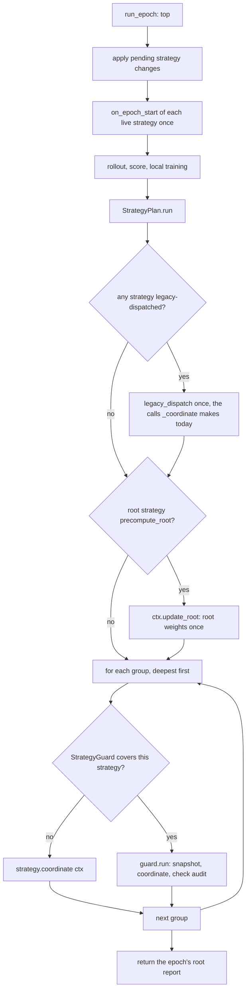

## 11. Peer training strategies

A peer strategy is the *coordination policy* of a run: whether peers mix parameters at all, in
which groups, in what order, and which peers sit out. It never does arithmetic. Weights come
from section 10 and parameters are written by `MACTFTrainer._write`. This section makes the
set of strategies open, lets different parts of the tree use different strategies, gives
"frozen" a single meaning that the training loop and aggregation both honour, and makes
`TRAINER.PEER_STRATEGY` real instead of dead (section 2.3).

The design has one idea, the dual of section 10's. **A strategy decides; the framework
executes.** A strategy never sees an adapter, a tensor or a tree it can edit. It is handed a
`CoordinationContext` whose few verbs (compute the root weights, aggregate a group, skip a
group, freeze a peer) are the only ways to change anything, every verb is recorded in an audit
trail, and a `StrategyGuard` checks the trail against invariants the framework owns: legal
reports, no write to a void group, one write per group per epoch, children before parents,
frozen peers untouched, the tree's shape untouched.

### 11.1 What exists, and what is missing

| Piece | Where | State today |
|---|---|---|
| `PeerStrategy` ABC | `coopetition/strategy.py:55-95` | `on_epoch_start`, `on_peer_step`, abstract `on_epoch_end`, `should_aggregate`, `describe`, `state_dict`, `load_state_dict`, `from_spec` |
| Five strategies | `strategy.py:97-373` | `independent`, `cooperative`, `kappa_softmax`, `frozen_peer`, `hierarchical` |
| `PEER_STRATEGIES` | `strategy.py:376-382` | A plain `dict`; no `register_*` |
| `build_peer_strategy` | `strategy.py:385-422` | Instances, names, mappings; `None` is `hierarchical` with a hierarchy, `independent` without |
| `_PEER_STRATEGY_NAMES` | `conf.py:707-709` | A hard-coded frozenset; the validator at `conf.py:739-742` rejects any other name and, because it calls `str(...)`, any mapping |
| Trainer wiring | `training/trainer.py:353` (`_peer_strategy_spec`), `:614-621` (build), `:1646-1668` (`_train_epoch`), `:1843-1859` (`_coordinate`), `:1879` (`on_epoch_start`) | One strategy for the whole tree; `_coordinate` dispatches on `isinstance` of three built-in classes |
| Tree status | `coopetition/tree.py:58` (`NODE_STATUSES`), `:955-961` (`mark`) | `active`, `failed`, `frozen`, `pruned`; `frozen` is a label and nothing reads it |

The gaps, each of which the design below closes:

| ID | Gap | Evidence |
|---|---|---|
| **P-G1** | The set of strategies is closed | `PEER_STRATEGIES` is a dict; `_PEER_STRATEGY_NAMES` is a frozenset; the serializer uses `choices=[...]` |
| **P-G2** | `TRAINER.PEER_STRATEGY` is dead, and naively reading it would change every hierarchy run | Validated (`conf.py:739`), never read by `Orchestrator`; `MACTFTrainer` reads only its constructor argument (`trainer.py:353`, `:614-615`). `TRAINER_DEFAULTS["PEER_STRATEGY"]` is `"kappa_softmax"` (`conf.py:46`), but a hierarchy's real default is `hierarchical` (`strategy.py:395-396`): a reader that cannot tell an *authored* value from the framework default would silently replace the hierarchical sweep with root-only mixing |
| **P-G3** | A custom strategy cannot act on a group | `_coordinate` (`trainer.py:1843-1859`) gives an unknown strategy `update_weights()` + `aggregate()` on the root group and nothing else; `aggregate_group` is reachable only by the string `"hierarchical"`. There is no per-group assignment at all |
| **P-G4** | A frozen peer still trains | `_train_epoch` skips only `status == "failed"` (`trainer.py:1651`); `FrozenPeerStrategy.on_epoch_start` only sets `status = "frozen"` (`strategy.py:194-206`) |
| **P-G5** | A frozen peer is overwritten | `_write` imports the blend into every adapter of the group (`trainer.py:1780`, `:1792-1802`; `aggregation.py:312-313`), whatever its weight. "Excluded from weight updates" means "does not contribute", not "keeps its parameters" |
| **P-G6** | A frozen peer below the root is never excluded | `FrozenPeerStrategy._eligibility` builds names from `trainer.peer_names` (`strategy.py:226-231`), which holds root paths only (`trainer.py:1152-1155`); a frozen `team-a/x` is validated and marked (`strategy.py:199-205`) but `aggregate_group` passes `eligible=None` (`trainer.py:1829-1833`) |
| **P-G7** | A mutable status makes a checkpoint unresumable | `_topology` stores `status` (`checkpoint_v2.py:1553-1561`) and the restore step raises `ContractMismatch` on any difference (`checkpoint_v2.py:995-999`). A `frozen` status set by the strategy at epoch start is still set when the epoch-end checkpoint is written; a freshly built trainer has `active` everywhere, so resuming a run that used `frozen_peer` fails. The same holds for `failed`, which `run_epoch` only resets on the next epoch (`trainer.py:1875-1877`) |
| **P-G8** | `HierarchicalStrategy.update_reference` is stored, persisted, described and read by nothing | `strategy.py:286-289`, `:353`; `_coordinate` calls `aggregate(report)`, which always passes `reference_ema` (`trainer.py:1811-1819`) |
| **P-G9** | A raising custom strategy ends the run half-written | Nothing in `_coordinate` catches; an exception from `on_epoch_end` after `aggregate_group` has written two groups propagates out of `run_epoch` with no record of what was written |
| **P-G10** | A custom strategy cannot hold state across a resume | `_trainer_state` writes the strategy's `state_dict()` (`trainer.py:2190-2199`) but `load_state_dict` of the trainer never passes it back to a *rebuilt* strategy of another class, and nothing reports the mismatch |

### 11.2 Invariants

| ID | Invariant | Enforced by | Test |
|---|---|---|---|
| **T1** | *Default identity.* With nothing configured, the five built-ins run the same calls in the same order as `_coordinate` does today, so reports, parameters and checkpoints are bit-identical (exceptions: 11.12, changes 1 to 4) | `StrategyPlan.run` reproduces the legacy dispatch for any strategy that does not define `coordinate`; the built-ins' `coordinate` bodies make the same calls in the same order | `test_strategy_default_identity` |
| **T2** | *Strategies decide, they do not compute.* A strategy cannot write a parameter, build a report, or edit the tree; the only mutating verbs are on `CoordinationContext` | The context's surface; `StrategyGuard` `Y005`, `Y006` | `test_strategy_cannot_write` |
| **T3** | *Eligibility can only shrink.* A strategy may exclude a peer from a group's weights; it cannot add one, and an excluded peer gets exactly 0 | `WeightGuard` `U004` on the report the context returns | `test_ineligible_gets_zero` |
| **T4** | *Children before parents.* A group is never written after a group that contains one of its members' ancestors | `StrategyPlan.run` order; context pre-check `Y004` | `test_parent_after_child` |
| **T5** | *One write per group per epoch, and the root weights are computed once.* The temperature never advances twice for one epoch | Context pre-check `Y003` | `test_group_written_once` |
| **T6** | *A void group is never blended.* A custom strategy cannot aggregate a group whose every member was voided | Context pre-check `Y002` | `test_void_group_not_mixed` |
| **T7** | *Frozen means frozen.* Under `TRAINER.FREEZE_MODE: strict` a frozen peer takes no training step, receives no write-back, and has weight 0; it still rolls out and is scored. Under `legacy` (the default) nothing changes except the reason bookkeeping | `FreezeSet`, `_train_epoch`, `_write` | `test_strict_freeze_*` |
| **T8** | *Reasons are tracked.* A peer is frozen by a *set of reasons*; thawing a reason removes only that reason's entries | `FreezeSet.discard`, `clear_reason` | `test_freeze_reasons_are_independent` |
| **T9** | *Somebody can learn.* A run in which no node would train is refused at build and at every change | `FreezeSet.check_learners` (`E075`) | `test_all_frozen_is_refused` |
| **T10** | *Atomic, episode-bounded swap.* A swap that fails at any step leaves the old strategy, its state and the freeze set untouched | `StrategyPlan.set` ordering (11.5) | `test_strategy_swap_atomic` |
| **T11** | *Restore is exact or loud.* Saved plan, strategy state and freeze set come back exactly, or are dropped with a code | `StrategyPlan.load_state_dict`, `FreezeSet.load_state_dict`, the `_topology` normalisation (11.10) | `test_resume_*` |
| **T12** | *No dead settings.* Every key under `TRAINER.PEER_STRATEGY*`, `TRAINER.STRATEGY_GUARD` and `TRAINER.FREEZE_MODE` is read by exactly one function, and `describe()` shows the resolved value | `StrategyPlan.from_settings`, the trainer's `build()` | `test_no_dead_strategy_settings` |

### 11.3 Strategy contract, traits and registration

The ABC keeps every method it has. Three things change, all additive for a strategy that
exists today:

1. `on_epoch_end` stops being abstract. A new-style strategy implements `coordinate(ctx)` and
   does not need to implement a method it does not use.
2. `coordinate(ctx)`, `attach(host)`, `detach(host)` and `validate(view)` are new, with no-op
   defaults.
3. `traits` declares what the strategy promises.

**Which entry point runs.** A strategy runs through `coordinate` when the class that defines
`coordinate` is the same as, or more derived than, the class that defines `on_epoch_end`
(`coordinates_via_context`). Everything else is *legacy-dispatched*, with exactly the calls
`_coordinate` makes today. A subclass of `HierarchicalStrategy` that overrides only
`on_epoch_end` is therefore still honoured, as it is today.

```python
# mactf/coopetition/strategy.py   (additions and changes; the five built-in classes keep their lines
#                                  except where marked)
from __future__ import annotations

from dataclasses import dataclass
from typing import Any, ClassVar, Mapping, Sequence

from ..exceptions import ContractError, ValidationError
from .tree import PeerNode, PeerTree, aggregation_groups

WALK_MODES = ("root", "tree")
ROOT_LABEL = "root"


@dataclass(frozen=True)
class StrategyTraits:
    """What a strategy promises. Read by ``StrategyPlan`` and ``StrategyGuard``."""

    #: The strategy mixes parameters (``should_aggregate`` for a legacy strategy).
    aggregates: bool = False
    #: The strategy adds entries to the freeze set; it must then release them in ``detach``.
    freezes: bool = False
    #: How far the strategy reaches when it is the *default*: ``"root"`` serves the root group
    #: only (the five built-ins' behaviour today, except ``hierarchical``); ``"tree"`` serves
    #: every group that no override claims. An *override* always serves exactly the groups
    #: its glob matches, whatever ``walk`` says.
    walk: str = "root"
    #: The root group's weights are computed before any child group is written, as
    #: ``_coordinate`` does for ``hierarchical`` (``trainer.py:1846-1848``). This fixes the
    #: order of ``trainer.reports`` and of the controllers' updates.
    precompute_root: bool = False
    #: One instance per group instead of one per slot. State then never crosses groups.
    per_group: bool = False

    def __post_init__(self) -> None:
        if self.walk not in WALK_MODES:
            raise ValidationError(f"StrategyTraits.walk must be one of {list(WALK_MODES)}, got {self.walk!r}")


@dataclass(frozen=True)
class GroupRef:
    """One aggregation group. ``label`` is ``"root"`` or the parent node's path."""

    label: str
    parent: str | None
    members: tuple[str, ...]
    level: int

    @property
    def is_root(self) -> bool:
        return self.parent is None


@dataclass(frozen=True)
class TreeView:
    """The tree as a strategy's ``validate`` sees it: groups in ``aggregation_groups`` order."""

    groups: tuple[GroupRef, ...]
    paths: tuple[str, ...]
    hierarchy: bool

    def group(self, label: str) -> GroupRef:
        for item in self.groups:
            if item.label == label:
                return item
        raise ValidationError(f"no aggregation group {label!r}; groups are {[g.label for g in self.groups]}")

    def labels(self) -> tuple[str, ...]:
        return tuple(item.label for item in self.groups)


def tree_view(tree: PeerTree, *, hierarchy: bool) -> TreeView:
    groups = tuple(
        GroupRef(
            label=ROOT_LABEL if parent is None else parent,
            parent=parent,
            members=tuple(members),
            level=0 if parent is None else int(tree[parent].depth),
        )
        for parent, members in aggregation_groups(tree)
    )
    return TreeView(groups=groups, paths=tuple(node.path for node in tree.walk("root-first")),
                    hierarchy=bool(hierarchy))


class PeerStrategy(ABC):
    """Coordination policy for a set of peers."""

    name: ClassVar[str]
    traits: ClassVar[StrategyTraits] = StrategyTraits()

    def on_epoch_start(self, trainer: Any, epoch: int) -> None:
        """Called at the top of every epoch. The default is a no-op."""

    def on_peer_step(self, trainer: Any, node: PeerNode, result: "StepResult") -> None:
        """Called after each node's training step. The default is a no-op."""

    # -- new -------------------------------------------------------------
    def coordinate(self, ctx: "CoordinationContext") -> None:
        """New-style entry point. Called once per group the strategy serves, deepest first.

        ``ctx.groups`` holds the group(s) of *this* call. The default is a no-op.
        """

    def attach(self, host: Any) -> None:
        """Called once when the strategy becomes live (build, swap-in, restore). No-op."""

    def detach(self, host: Any) -> None:
        """Called once when the strategy stops being live (swap-out, removal). A strategy
        that froze peers releases them here. No-op."""

    def validate(self, view: TreeView) -> Sequence[str]:
        """Problems with serving ``view`` (a missing frozen path, a hierarchy it needs and the
        tree lacks). Reported as ``E074`` at build and after every tree mutation."""
        return ()

    # -- legacy entry point (no longer abstract) ----------------------------
    def on_epoch_end(
        self, trainer: Any, epoch: int, report: "AggregationReport | None"
    ) -> None:
        """Called after every node has stepped, before logging. The default is a no-op."""

    def should_aggregate(self) -> bool:
        """Whether this strategy mixes parameters at all."""
        return self.traits.aggregates

    # describe / state_dict / load_state_dict / from_spec: unchanged (strategy.py:75-92)


def traits_of(strategy: Any) -> StrategyTraits:
    """The declared traits; for an object that declares none, derived from ``should_aggregate``."""
    found = getattr(strategy, "traits", None)
    if isinstance(found, StrategyTraits):
        return found
    probe = getattr(strategy, "should_aggregate", None)
    aggregates = False
    if callable(probe):
        try:
            aggregates = bool(probe())
        except Exception:  # noqa: BLE001 - a structural strategy that cannot answer is "no"
            aggregates = False
    return StrategyTraits(aggregates=aggregates)


def _owner(cls: type, attribute: str) -> type:
    for klass in cls.__mro__:
        if attribute in vars(klass):
            return klass
    return PeerStrategy  # pragma: no cover - PeerStrategy defines both


def coordinates_via_context(strategy: Any) -> bool:
    """Whether ``strategy`` is driven through ``coordinate(ctx)`` (else: legacy dispatch)."""
    if not isinstance(strategy, PeerStrategy):
        return False
    cls = type(strategy)
    by_context, by_epoch_end = _owner(cls, "coordinate"), _owner(cls, "on_epoch_end")
    if by_context is PeerStrategy:
        return False
    if by_epoch_end is PeerStrategy:
        return True
    mro = cls.__mro__
    return mro.index(by_context) <= mro.index(by_epoch_end)


def defines_nothing(strategy: Any) -> bool:
    """A ``PeerStrategy`` subclass that defines neither entry point (it would do nothing)."""
    if not isinstance(strategy, PeerStrategy):
        return False
    cls = type(strategy)
    return _owner(cls, "coordinate") is PeerStrategy and _owner(cls, "on_epoch_end") is PeerStrategy
```

The five built-ins gain a `traits` declaration and a `coordinate` body. Each body makes the same
calls, in the same order, as the matching `on_epoch_end` does today (T1); the existing
`on_epoch_end` bodies stay, because they are the legacy surface a subclass may extend.

```python
# mactf/coopetition/strategy.py   (additions inside the built-in classes)

class IndependentStrategy(PeerStrategy):
    name = "independent"
    traits = StrategyTraits(aggregates=False, walk="root")

    def coordinate(self, ctx: "CoordinationContext") -> None:
        for group in ctx.groups:
            ctx.skip(group, "peers train independently and are never mixed")


class CooperativeStrategy(PeerStrategy):
    name = "cooperative"
    traits = StrategyTraits(aggregates=False, walk="root")

    def coordinate(self, ctx: "CoordinationContext") -> None:
        for group in ctx.groups:
            signals = ctx.signals
            if not group.is_root:
                signals = {path: signals[path] for path in group.members if path in signals}
            ctx.record_signal_sharing(signals)


class KappaSoftmaxStrategy(PeerStrategy):
    name = "kappa_softmax"
    traits = StrategyTraits(aggregates=True, walk="root")

    def coordinate(self, ctx: "CoordinationContext") -> None:
        for group in ctx.groups:
            if group.is_root:
                ctx.aggregate_root(ctx.update_root())
            else:
                ctx.aggregate_group(group)


class FrozenPeerStrategy(PeerStrategy):
    name = "frozen_peer"
    traits = StrategyTraits(aggregates=True, freezes=True, walk="root")
    REASON = "strategy:frozen_peer"

    # on_epoch_start replaces strategy.py:194-206: the freeze set is the one place that
    # records the freeze, and it mirrors the status onto the tree.
    def on_epoch_start(self, trainer: Any, epoch: int) -> None:
        tree = getattr(trainer, "tree", None)
        if tree is None or not self.frozen:
            return
        freeze = getattr(trainer, "freeze", None)
        if freeze is not None:
            freeze.clear_reason(self.REASON)          # the set equals self.frozen, always
        self._marked = []
        for path in self.frozen:
            node = tree.get(path) if isinstance(tree, PeerTree) else None
            if node is None:
                raise ContractError(
                    f"FrozenPeerStrategy names {path!r}, which is not a node in this tree"
                )
            if freeze is not None:
                freeze.add(path, self.REASON)
            else:                                      # a duck-typed trainer without a freeze set
                tree.mark(path, "frozen")
            self._marked.append(path)

    def detach(self, host: Any) -> None:
        freeze = getattr(host, "freeze", None)
        if freeze is not None:
            freeze.clear_reason(self.REASON)

    def validate(self, view: TreeView) -> list[str]:
        known = set(view.paths)
        return [f"frozen path {path!r} is not a node in the tree" for path in self.frozen
                if path not in known]

    def coordinate(self, ctx: "CoordinationContext") -> None:
        for group in ctx.groups:
            eligible = ctx.eligible_for(group.members) if self.frozen else None
            if eligible is not None and not any(eligible.values()):
                ctx.skip(group, "every member is frozen")
                continue
            if group.is_root:
                ctx.aggregate_root(ctx.update_root(eligible=eligible))
            else:
                ctx.aggregate_group(group, eligible=eligible)


class HierarchicalStrategy(PeerStrategy):
    name = "hierarchical"
    traits = StrategyTraits(aggregates=True, walk="tree", precompute_root=True)

    def on_epoch_start(self, trainer: Any, epoch: int) -> None:
        self.last_reports = {}

    def coordinate(self, ctx: "CoordinationContext") -> None:
        for group in ctx.groups:
            if group.is_root:
                report = ctx.update_root()
                ctx.aggregate_root(report, update_reference=self.update_reference)
                self.last_reports[None] = report
                continue
            if not group.members:
                continue
            if self.skip_void_levels and ctx.peers_void(group.members):
                ctx.skip(group, "every member was voided this epoch")
                continue
            self.last_reports[group.parent] = ctx.aggregate_group(group)
```

`FrozenPeerStrategy.eligible(names)` and `_eligibility` stay for a subclass that overrides
them. `HierarchicalStrategy.update_reference` now has a reader (P-G8, 11.12 change 3).

**Registration.** `PEER_STRATEGIES` becomes a view of the `peer_strategy` registry, the set of
built-in classes is remembered so the guard can tell the framework's strategies from anyone
else's, and `build_peer_strategy` becomes an adapter over the resolver:

```python
# mactf/coopetition/strategy.py   (replaces lines 375-422; the import sits at the bottom of the module)
from ..components.legacy import LegacyTable        # noqa: E402

#: Every strategy addressable by name; a view of ``HUB.registry("peer_strategy")``.
PEER_STRATEGIES = LegacyTable("peer_strategy", {
    "independent": IndependentStrategy,
    "cooperative": CooperativeStrategy,
    "kappa_softmax": KappaSoftmaxStrategy,
    "frozen_peer": FrozenPeerStrategy,
    "hierarchical": HierarchicalStrategy,
})

#: The framework's own classes: what ``StrategyGuard`` leaves alone under ``SCOPE: custom``.
BUILTIN_STRATEGY_TYPES: frozenset[type] = frozenset(dict.values(PEER_STRATEGIES))


def build_peer_strategy(
    spec: "PeerStrategy | str | Mapping[str, Any] | None",
    *,
    hierarchy: bool = False,
    resolver: Any | None = None,
    trusted: bool = True,
) -> PeerStrategy:
    """Resolve a strategy from an instance, a name, a spec, or ``None``.

    ``None`` is ``hierarchical`` with a hierarchy and ``independent`` without, as before. A name
    or mapping goes through the component registry, so it may name a built-in, a project
    component or a plugin; an unknown name or unaccepted key raises here, with the accepted
    list (``ComponentMissing`` / ``ComponentParamError`` are ``ValidationError``, 17.1).
    """
    from ..components.resolver import ComponentResolver, ComponentSpec

    if spec is None:
        return HierarchicalStrategy() if hierarchy else IndependentStrategy()
    if isinstance(spec, PeerStrategy):
        return spec
    if isinstance(spec, (str, Mapping, ComponentSpec)):
        raw: Any = spec
        if isinstance(spec, str):
            raw = spec.strip().lower()
        elif isinstance(spec, Mapping):
            payload = dict(spec)
            written = payload.pop("name", None)
            if "type" not in payload and "import" not in payload and written is not None:
                payload["type"] = written
            if "type" in payload:
                payload["type"] = str(payload["type"]).strip().lower()
            raw = payload
        parsed = ComponentSpec.parse("peer_strategy", raw)
        return (resolver or ComponentResolver()).resolve(parsed, trusted=trusted).instance
    if hasattr(spec, "on_epoch_end") and hasattr(spec, "should_aggregate"):
        return spec  # structural custom strategy: legacy-dispatched
    raise ValidationError(
        f"peer_strategy must be a PeerStrategy, a name, or a mapping; got {type(spec).__name__}"
    )
```

Two things are deliberately different. A mapping with an unaccepted key is an error (the
legacy `from_spec` of each built-in read only the keys it knew, so
`{"type": "hierarchical", "skip_void": false}` was accepted and ignored: the same W-G2 hole
as section 10). The alias `path` for `frozen` that `FrozenPeerStrategy.from_spec` accepted
(`strategy.py:261-264`) is kept: the registry builds the class through its constructor, so the
alias moves to a declared parameter:

```python
# mactf/coopetition/strategy.py   (FrozenPeerStrategy.__init__, replacing lines 187-192)
    def __init__(
        self,
        frozen: str | Sequence[str] = (),
        *,
        still_scores: bool = True,
        path: str | Sequence[str] | None = None,     # legacy alias of ``frozen``
    ) -> None:
        if path is not None and frozen:
            raise ValidationError("FrozenPeerStrategy takes 'frozen' or its alias 'path', not both")
        chosen = path if path is not None else frozen
        if isinstance(chosen, str):
            chosen = (chosen,)
        self.frozen: tuple[str, ...] = tuple(str(item) for item in chosen)
        self.still_scores = bool(still_scores)
        self._marked: list[str] = []
```

The `peer_strategy` contract of 3.7 (`peer_strategy_contract`) keeps its checks; the one it
drops is `inspect.isabstract`, which can no longer fire for `on_epoch_end`. The check moves to
the probe (`defines_nothing`, 11.8), where it is an `E074` with a message that says what to
implement.

### 11.4 The freeze set

Four things today say "this peer is frozen": a status string set by `FrozenPeerStrategy`, the
optimizer plan's `null` entry (9.3), the retire operation of section 12, and a user who sets
`requires_grad_(False)`. None agrees with another and the loop reads none. `FreezeSet` is the
single record. A peer is frozen by a set of **reasons**; the loop and aggregation read the set.

| Reason | Owner | Added when | Removed when |
|---|---|---|---|
| `strategy:<name>` | a strategy, through `ctx.freeze_peer` or directly | the strategy's `on_epoch_start` | the strategy's `detach`, or the next `on_epoch_start` that no longer lists the peer |
| `optimizer:null` | `OptimizerPlan` (9.7) | build, swap, restore | the `null` entry is replaced or removed |
| `mutation:retired` | `MutationPlan` (12.6) | `retire` | `revive`, or `purge` (the node is gone) |

**Modes.** `TRAINER.FREEZE_MODE` is `legacy` (default) or `strict`. The table is the whole
behavioural difference; every other part of this section behaves the same in both.

| Effect | `legacy` | `strict` |
|---|---|---|
| Tree status mirrors the set (`frozen`; `pruned` for a retired peer) | yes | yes |
| A frozen peer rolls out and is scored | yes | yes |
| Weight 0 in its group's report | reason `strategy:*` or `mutation:*` | every reason |
| Takes training steps | yes (P-G4 kept); never when retired | no |
| Receives write-back from aggregation | yes (P-G5 kept); never when retired | no |

`legacy` exists so that a run that already uses `frozen_peer` keeps its numbers; `strict` is
what the strategy's documentation always implied. A `W034` at build tells a run that freezes
peers under `legacy` which two behaviours it is not getting.

```python
# mactf/training/freeze.py   (new)
from __future__ import annotations

import logging
import threading
from typing import Any, Iterable, Iterator, Mapping, Sequence

from ..exceptions import ImproperlyConfigured

log = logging.getLogger("mactf.freeze")

FREEZE_MODES = ("legacy", "strict")
RETIRED = "mutation:retired"
_KNOWN_PREFIXES = ("strategy:", "optimizer:", "mutation:")


def _check_reason(reason: str) -> str:
    if not isinstance(reason, str) or not reason.startswith(_KNOWN_PREFIXES) or reason.endswith(":"):
        raise ImproperlyConfigured(
            f"E075: freeze reason {reason!r} must look like one of "
            f"{[prefix + '<name>' for prefix in _KNOWN_PREFIXES]}"
        )
    return reason


class FreezeSet:
    """Which peers are frozen, and why. The training loop and ``_write`` read it."""

    def __init__(self, mode: str = "legacy") -> None:
        self._mode = "legacy"
        self.set_mode(mode)
        self._tree: Any = None
        self._by_path: dict[str, set[str]] = {}
        self._lock = threading.RLock()

    # -- configuration ---------------------------------------------------
    @property
    def mode(self) -> str:
        return self._mode

    def set_mode(self, mode: str) -> None:
        text = str(mode).lower()
        if text not in FREEZE_MODES:
            raise ImproperlyConfigured(
                f"E070: TRAINER.FREEZE_MODE must be one of {list(FREEZE_MODES)}, got {mode!r}"
            )
        self._mode = text

    def bind(self, tree: Any) -> None:
        """Attach the tree whose node statuses this set mirrors."""
        self._tree = tree

    # -- reading ---------------------------------------------------------
    def reasons(self, path: str) -> tuple[str, ...]:
        with self._lock:
            return tuple(sorted(self._by_path.get(path, ())))

    def paths(self, reason: str | None = None) -> list[str]:
        with self._lock:
            return sorted(
                path for path, held in self._by_path.items() if reason is None or reason in held
            )

    def __contains__(self, path: object) -> bool:
        return path in self._by_path

    def __len__(self) -> int:
        return len(self._by_path)

    def __iter__(self) -> Iterator[str]:
        return iter(self.paths())

    def _counts(self, path: str, *, legacy: tuple[str, ...]) -> bool:
        held = self._by_path.get(path)
        if not held:
            return False
        if self._mode == "strict":
            return True
        return any(reason.startswith(legacy) for reason in held)

    def excludes(self, path: str) -> bool:
        """Weight 0 in the group's report."""
        return self._counts(path, legacy=("strategy:", "mutation:"))

    def skips_training(self, path: str) -> bool:
        return self._counts(path, legacy=(RETIRED,))

    def skips_write(self, path: str) -> bool:
        return self._counts(path, legacy=(RETIRED,))

    def eligible_for(self, members: Sequence[str]) -> dict[str, bool] | None:
        """The eligibility mapping a weight update takes, or ``None`` when nobody is excluded.

        ``None`` (not an all-true mapping) keeps the call identical to the one made when no
        freeze exists, which is what the default-identity invariant needs.
        """
        with self._lock:
            excluded = {path for path in members if self.excludes(path)}
        if not excluded:
            return None
        return {path: path not in excluded for path in members}

    def learners(self, paths: Iterable[str]) -> list[str]:
        with self._lock:
            return [path for path in paths if not self.skips_training(path)]

    def check_learners(self, paths: Iterable[str]) -> None:
        """``E075`` when no node would take a training step."""
        everyone = list(paths)
        if everyone and not self.learners(everyone):
            raise ImproperlyConfigured(
                f"E075: every node ({len(everyone)}) is frozen under TRAINER.FREEZE_MODE={self._mode}, "
                f"so nothing could learn; reasons: "
                f"{ {path: list(self.reasons(path)) for path in sorted(everyone)} }"
            )

    # -- changing --------------------------------------------------------
    def _known(self, path: str) -> bool:
        return self._tree is None or path in self._tree

    def add(self, path: str, reason: str) -> bool:
        """Freeze ``path`` for ``reason``. ``True`` when the peer was not frozen before."""
        _check_reason(reason)
        with self._lock:
            if not self._known(path):
                raise ImproperlyConfigured(f"E075: cannot freeze {path!r} ({reason}): not a node in the tree")
            held = self._by_path.setdefault(path, set())
            fresh = not held
            held.add(reason)
            self._sync(path)
            return fresh

    def discard(self, path: str, reason: str) -> bool:
        """Remove one reason. ``True`` when the peer is no longer frozen by anything."""
        with self._lock:
            held = self._by_path.get(path)
            if not held or reason not in held:
                return False
            held.discard(reason)
            if not held:
                del self._by_path[path]
            self._sync(path)
            return path not in self._by_path

    def clear_reason(self, reason: str) -> list[str]:
        """Remove ``reason`` from every peer; the paths that became thawed."""
        with self._lock:
            return [path for path in self.paths(reason) if self.discard(path, reason)]

    def forget(self, path: str) -> None:
        """The node left the tree: drop every reason without touching a status."""
        with self._lock:
            self._by_path.pop(path, None)

    def _sync(self, path: str) -> None:
        node = self._tree.get(path) if self._tree is not None else None
        if node is None:
            return
        held = self._by_path.get(path)
        if held:
            if node.status in ("active", "frozen", "pruned"):
                self._tree.mark(path, "pruned" if RETIRED in held else "frozen")
        elif node.status in ("frozen", "pruned"):
            self._tree.mark(path, "active")

    def sync(self) -> None:
        """Re-mirror every status. ``run_epoch`` resets ``failed`` to ``active`` at its top and
        calls this straight after, so a frozen peer that failed stays frozen."""
        with self._lock:
            for path in list(self._by_path):
                self._sync(path)

    # -- persistence -----------------------------------------------------
    def state_dict(self) -> dict[str, Any]:
        with self._lock:
            return {
                "version": 1,
                "mode": self._mode,
                "entries": {path: sorted(held) for path, held in sorted(self._by_path.items())},
            }

    def load_state_dict(self, payload: Mapping[str, Any]) -> list[str]:
        """Restore the part of the set that cannot be re-derived: ``mutation:*`` reasons.

        ``strategy:*`` reasons are re-added by the strategy's ``on_epoch_start`` and
        ``optimizer:*`` reasons by the optimizer plan, from the configuration this run was
        built with, so a saved copy of either would only fight a changed configuration.
        Paths that are not in the tree are dropped with ``W036``. The saved *mode* is not
        applied: configuration wins, and a difference is reported (``W034``)."""
        notes: list[str] = []
        entries = dict(payload.get("entries") or {})
        with self._lock:
            for path in list(self._by_path):
                for reason in [item for item in self.reasons(path) if item.startswith("mutation:")]:
                    self.discard(path, reason)
            for path, reasons in sorted(entries.items()):
                kept = [str(item) for item in reasons if str(item).startswith("mutation:")]
                if not kept:
                    continue
                if not self._known(path):
                    notes.append(f"W036: saved freeze entry {path!r} {kept} has no node; dropped")
                    continue
                for reason in kept:
                    self.add(path, reason)
        saved_mode = str(payload.get("mode", self._mode))
        if saved_mode != self._mode:
            notes.append(
                f"W034: the saved run used TRAINER.FREEZE_MODE={saved_mode!r}; this run uses {self._mode!r}"
            )
        for note in notes:
            log.warning(note)
        return notes
```

`load_state_dict` restores only what cannot be re-derived, so a changed configuration is never
fought by a stale copy of what it now decides.

**The loop and the write-back read it.** The two edits are the whole of T7:

```python
# mactf/training/trainer.py   (_train_epoch, replacing line 1651)
            if node.peer is None or node.status == "failed" or self.freeze.skips_training(node.path):
                continue
```

```python
# mactf/training/trainer.py   (_write, replacing lines 1780-1802; the early returns keep their text)
        adapters = {name: self.peers[name].adapter for name in members}
        targets = {name: adapter for name, adapter in adapters.items()
                   if not self.freeze.skips_write(name)}
        if not targets:
            report.adjustments.append("every member is frozen; nothing was written")
            log.warning("W032: group %s skipped: every member is frozen", sorted(members))
            first = next(iter(adapters.values()))
            return AggregateResult(parameters=first.export_parameters(), report=report)
        positive = any(weight > 0.0 for weight in report.weights.values())
        if not positive and not report.fallback:
            first = next(iter(adapters.values()))
            return AggregateResult(parameters=first.export_parameters(), report=report)
        if report.fallback and reference is None:
            report.adjustments.append(
                "group fell back with no reference to restore; parameters unchanged"
            )
            first = next(iter(adapters.values()))
            return AggregateResult(parameters=first.export_parameters(), report=report)
        reference_adapter = reference.adapter if reference is not None else None
        result = aggregator.aggregate(
            adapters, report, reference=reference_adapter, device=self._runtime.device
        )
        aggregator.apply(
            targets,                     # readers are every member; writers are the non-frozen ones
            result,
            reference=reference_adapter,
            reference_ema=reference_ema if reference is not None else 0.0,
            reset_optimizers=False,
            optimizers=None,
        )
        if bool(self._coopetition_settings().get("RESET_OPTIMIZERS", True)):
            for name in targets:
                _clear_optimizer_state(self.optimizers.get(name))
        return result
```

Readers and writers are different sets on purpose. A frozen peer with weight 0 contributes
nothing to `result`; a frozen peer with weight above 0 (possible only under `legacy`, where an
`optimizer:null` peer is not excluded) still contributes, and in `strict` it is excluded from
the weights *and* the write-back, so it is neither read nor written.

### 11.5 `StrategyPlan`: default, overrides and live changes

`StrategyPlan` owns the `peer_strategy` slots. It answers "which strategy instance serves
group *g*?", runs the sweep of one epoch, and is the only code that changes the answer. It
shares the vocabulary of `WeightPlan` (10.5): group labels, `pick_glob`, the swap boundary
rule, `reset | carry | fail` migration.

**Slots.**

| Slot path | Holds |
|---|---|
| `TRAINER.PEER_STRATEGY` | The default strategy |
| `TRAINER.PEER_STRATEGY_OVERRIDES.<glob>` | A strategy for every group whose label matches `<glob>` |

**What the default is.** In order, highest first:

1. the `peer_strategy=` constructor argument (an instance is *adopted*; a name or mapping is a spec);
2. `TRAINER.PEER_STRATEGY` **if the project authored it** (`authored_keys(settings, "TRAINER")`,
   `conf_files.py:195`). `TRAINER_DEFAULTS` always carries the key (P-G2), so presence proves
   nothing. When the settings object has no authorship record (a plain mapping built by a test or
   a caller) a value other than the framework default `"kappa_softmax"` counts as authored, and
   `"kappa_softmax"` does not; the consequence is that `kappa_softmax` on a *hierarchy* needs a
   real `settings.py` / `conf/` write to take effect, which is how a hierarchy run has always
   behaved;
3. `hierarchical` for a hierarchy, `kappa_softmax` for a flat tree: the two defaults of
   `trainer.py:614-621`.

**Reach.** A slot's strategy serves:

* an **override**: exactly the groups whose label it is the most specific match for;
* the **default**: with `traits.walk == "tree"` every group no override claims; with
  `walk == "root"` the root group only. The groups the default does not reach are simply not
  coordinated, which is what `kappa_softmax` on a hierarchy does today.

**Order.** One sweep per epoch over `reversed(aggregation_groups(tree))`: deepest groups first,
the root group last, the order `HierarchicalStrategy` uses today and the order that makes a
parent blend already-blended children (T4). If the root group is served by a strategy with
`traits.precompute_root`, its weights are computed before the sweep (T1).



**Instances.** A non-`per_group` slot has one instance, `slot.instance`, shared by every group
the slot serves. A `per_group` strategy gets one instance per group, built from the slot's spec
(or `clone()`d for an in-code instance, else shared and documented as such). This differs from
`WeightPlan`, where state is per group by default, because a strategy's configuration (which
peers are frozen, how many rounds) is a property of the policy; a numeric state that must not
cross groups sets `per_group`.

```python
# mactf/components/strategy_plan.py   (new)
from __future__ import annotations

import copy
import fnmatch
import logging
import threading
from typing import Any, Mapping, Sequence

from ..coopetition.strategy import (
    BUILTIN_STRATEGY_TYPES,
    GroupRef,
    HierarchicalStrategy,
    KappaSoftmaxStrategy,
    FrozenPeerStrategy,
    PeerStrategy,
    TreeView,
    coordinates_via_context,
    defines_nothing,
    traits_of,
)
from ..exceptions import (
    ComponentLocked,
    ComponentMissing,
    ImproperlyConfigured,
)
from .kinds import Boundary
from .resolver import ComponentResolver, ComponentSpec, Resolved
from .slots import Slot, SlotTable, SwapRecord
from .weight_plan import ROOT_LABEL, group_label, pick_glob

log = logging.getLogger("mactf.strategy")

KIND = "peer_strategy"
DEFAULT_PATH = "TRAINER.PEER_STRATEGY"
OVERRIDE_PREFIX = "TRAINER.PEER_STRATEGY_OVERRIDES."
MIGRATE_MODES = ("reset", "carry", "fail")
FRAMEWORK_DEFAULT = "kappa_softmax"                     # TRAINER_DEFAULTS["PEER_STRATEGY"]
_REMOVE = object()


def legacy_dispatch(trainer: Any, epoch: int, strategy: Any) -> None:
    """The calls ``MACTFTrainer._coordinate`` made (``trainer.py:1843-1859``), unchanged.

    Used for a strategy that does not define ``coordinate``: a structural object, a
    subclass that overrides only ``on_epoch_end``, or a pre-existing custom class.
    """
    if isinstance(strategy, HierarchicalStrategy):
        report = trainer.update_weights()
        strategy.on_epoch_end(trainer, epoch, report)
    elif isinstance(strategy, (KappaSoftmaxStrategy, FrozenPeerStrategy)):
        strategy.on_epoch_end(trainer, epoch, None)
    elif strategy.should_aggregate():
        report = trainer.update_weights()
        trainer.aggregate(report)
        strategy.on_epoch_end(trainer, epoch, report)
    else:
        strategy.on_epoch_end(trainer, epoch, None)


def default_authored(settings: Mapping[str, Any]) -> bool:
    """Whether the project wrote ``TRAINER.PEER_STRATEGY`` (see 11.5, "What the default is")."""
    from ..conf_files import authored_keys

    written = authored_keys(settings, "TRAINER")
    if written is not None:
        return "PEER_STRATEGY" in written
    value = dict(settings.get("TRAINER") or {}).get("PEER_STRATEGY")
    if isinstance(value, str):
        return value.strip().lower() != FRAMEWORK_DEFAULT
    return value is not None


class StrategyPlan:
    """The ``peer_strategy`` slots of one run and the rules that choose and change them."""

    def __init__(
        self,
        slots: SlotTable,
        *,
        resolver: ComponentResolver | None = None,
        trusted: bool = True,
        guard: Any = None,
        strict_globs: bool = True,
        migrate: str = "reset",
        strict_restore: bool = False,
        hierarchy: bool = False,
    ) -> None:
        from ..components.guards.strategy import StrategyGuard

        if migrate not in MIGRATE_MODES:
            raise ImproperlyConfigured(
                f"E070: TRAINER.PEER_STRATEGY_OPTIONS.MIGRATE must be one of {list(MIGRATE_MODES)}, got {migrate!r}"
            )
        self._slots = slots
        self._resolver = resolver or ComponentResolver()
        self._trusted = trusted
        self.guard = guard or StrategyGuard()
        self.strict_globs = bool(strict_globs)
        self.migrate = migrate
        self.strict_restore = bool(strict_restore)
        self.hierarchy = bool(hierarchy)
        self._adopted: dict[str, Any] = {}
        self._pending: dict[str, tuple[Any, str | None]] = {}
        self._group_cache: dict[tuple[str, str], tuple[Resolved, Any]] = {}
        self._restore: dict[str, Mapping[str, Any]] = {}
        self._lock = threading.RLock()
        self.last_audit: list[Any] = []

    # -- construction ----------------------------------------------------
    @classmethod
    def from_settings(
        cls,
        settings: Mapping[str, Any],
        slots: SlotTable,
        *,
        code_spec: Any = None,
        hierarchy: bool = False,
        resolver: ComponentResolver | None = None,
        trusted: bool = True,
    ) -> "StrategyPlan":
        from ..components.guards.strategy import StrategyGuard

        trainer = dict(settings.get("TRAINER") or {})
        options = {str(k).upper(): v for k, v in dict(trainer.get("PEER_STRATEGY_OPTIONS") or {}).items()}
        unknown = sorted(set(options) - {"STRICT_GLOBS", "MIGRATE"})
        if unknown:
            raise ImproperlyConfigured(
                f"E070: TRAINER.PEER_STRATEGY_OPTIONS has unknown keys {unknown}; accepted: MIGRATE, STRICT_GLOBS"
            )
        components = dict(settings.get("COMPONENTS") or {})
        plan = cls(
            slots,
            resolver=resolver,
            trusted=trusted,
            guard=StrategyGuard.from_settings(trainer.get("STRATEGY_GUARD")),
            strict_globs=bool(options.get("STRICT_GLOBS", True)),
            migrate=str(options.get("MIGRATE", "reset")).lower(),
            strict_restore=bool(components.get("STRICT_RESTORE", False)),
            hierarchy=hierarchy,
        )
        if code_spec is not None and not isinstance(code_spec, (str, Mapping, ComponentSpec)):
            plan.adopt_default(code_spec)
        elif code_spec is not None:
            plan.install_default(code_spec)
        elif default_authored(settings):
            plan.install_default(trainer.get("PEER_STRATEGY"))
        else:
            plan.install_default("hierarchical" if hierarchy else FRAMEWORK_DEFAULT)
        overrides = trainer.get("PEER_STRATEGY_OVERRIDES") or {}
        if not isinstance(overrides, Mapping):
            raise ImproperlyConfigured("E070: TRAINER.PEER_STRATEGY_OVERRIDES must be a mapping of glob to spec")
        for glob, raw in overrides.items():
            plan.install_override(str(glob), raw)
        return plan

    def install_default(self, raw: Any) -> Slot:
        return self._slots.install(DEFAULT_PATH, KIND, raw)

    def adopt_default(self, instance: Any) -> Slot:
        slot = self._slots.adopt(DEFAULT_PATH, KIND, instance, name=type(instance).__name__)
        self._adopted[DEFAULT_PATH] = instance
        return slot

    def install_override(self, glob: str, raw: Any) -> Slot:
        if not glob or glob != glob.strip():
            raise ImproperlyConfigured(f"E070: invalid override glob {glob!r}")
        path = OVERRIDE_PREFIX + glob
        if isinstance(raw, (str, Mapping, ComponentSpec)):
            return self._slots.install(path, KIND, raw)
        slot = self._slots.adopt(path, KIND, raw, name=type(raw).__name__)
        self._adopted[path] = raw
        return slot

    # -- reading ---------------------------------------------------------
    def override_globs(self) -> list[str]:
        return sorted(p[len(OVERRIDE_PREFIX):] for p in self._slots.paths()
                      if p.startswith(OVERRIDE_PREFIX))

    def select(self, label: str) -> str:
        """The slot path serving ``label``. ``E071`` on an ambiguous tie."""
        glob = pick_glob(label, self.override_globs(), what="peer_strategy overrides", code="E071")
        return DEFAULT_PATH if glob is None else OVERRIDE_PREFIX + glob

    def default_instance(self) -> Any:
        return self._slots.get(DEFAULT_PATH).instance

    def customized(self) -> bool:
        """Whether anything differs from what a legacy run would have built."""
        if any(p.startswith(OVERRIDE_PREFIX) for p in self._slots.paths()) or self.history():
            return True
        if DEFAULT_PATH in self._adopted:
            return type(self._adopted[DEFAULT_PATH]) not in BUILTIN_STRATEGY_TYPES
        resolved = self._slots.get(DEFAULT_PATH).resolved
        return resolved.component.origin.value != "builtin"

    def history(self) -> list[SwapRecord]:
        return [r for r in self._slots.history if r.slot.startswith(DEFAULT_PATH)]

    def instance_for(self, label: str) -> Any:
        """The instance serving ``label``. One per slot, or one per group for ``per_group``."""
        with self._lock:
            path = self.select(label)
            slot = self._slots.get(path)
            if not traits_of(slot.instance).per_group:
                return slot.instance
            key = (path, label)
            cached = self._group_cache.get(key)
            if cached is not None and cached[0] is slot.resolved:
                return cached[1]
            if path in self._adopted:
                clone = getattr(self._adopted[path], "clone", None)
                instance = clone() if callable(clone) else self._adopted[path]
            else:
                instance = self._resolver.resolve(slot.resolved.spec, trusted=self._trusted).instance
            self._seed_state(label, path, instance)
            self._group_cache[key] = (slot.resolved, instance)
            return instance

    def live_instances(self) -> list[Any]:
        """Every distinct live instance, default first, then overrides by glob."""
        seen: set[int] = set()
        out: list[Any] = []
        paths = [DEFAULT_PATH] + [OVERRIDE_PREFIX + g for g in self.override_globs()]
        with self._lock:
            for path in paths:
                instances = [self._slots.get(path).instance]
                instances += [inst for (p, _l), (_r, inst) in sorted(self._group_cache.items()) if p == path]
                for instance in instances:
                    if id(instance) not in seen:
                        seen.add(id(instance))
                        out.append(instance)
        return out

    def reaches(self, path: str, instance: Any, group: GroupRef) -> bool:
        """The reach rule of 11.5."""
        if path != DEFAULT_PATH:
            return True
        return group.is_root or traits_of(instance).walk == "tree"

    def _seed_state(self, label: str, path: str, instance: Any) -> None:
        entry = self._restore.pop(f"{path}|{label}", None)
        if entry is None:
            return
        load = getattr(instance, "load_state_dict", None)
        if not callable(load) or entry.get("class") != type(instance).__name__:
            if entry.get("state"):
                log.warning("W031: state saved for %s at %s does not fit %s; dropped",
                            label, path, type(instance).__name__)
            return
        load(copy.deepcopy(entry["state"]))

    # -- the epoch -------------------------------------------------------
    def epoch_start(self, trainer: Any, epoch: int) -> None:
        for instance in self.live_instances():
            instance.on_epoch_start(trainer, epoch)

    def on_peer_step(self, trainer: Any, node: Any, result: Any) -> None:
        label = group_label(node.parent)
        self.instance_for(label).on_peer_step(trainer, node, result)

    def run(self, trainer: Any, epoch: int, view: TreeView) -> Any:
        """Step 6 of ``run_epoch``: coordinate every group. Returns the epoch's root report."""
        from ..training.coordination import CoordinationContext, CoordinationState

        trainer._epoch_report = None
        state = CoordinationState(epoch)
        served: list[tuple[GroupRef, str, Any]] = []
        for group in reversed(view.groups):
            path = self.select(group.label)
            instance = self.instance_for(group.label)
            if self.reaches(path, instance, group):
                served.append((group, path, instance))

        done: set[int] = set()
        for _group, _path, instance in served:
            if not coordinates_via_context(instance) and id(instance) not in done:
                done.add(id(instance))
                legacy_dispatch(trainer, epoch, instance)

        root = next((entry for entry in served if entry[0].is_root), None)
        if root is not None and coordinates_via_context(root[2]) and traits_of(root[2]).precompute_root:
            CoordinationContext(trainer, state, (root[0],), owner=self._owner(root[1], root[2]),
                                checks=False).update_root()

        for group, path, instance in served:
            if not coordinates_via_context(instance):
                continue
            owner = self._owner(path, instance)
            covered = self.guard.covers(instance)
            ctx = CoordinationContext(trainer, state, (group,), owner=owner, checks=covered)
            if covered:
                self.guard.run(owner, instance, ctx, state, backend=trainer)
            else:
                instance.coordinate(ctx)
        self.last_audit = list(state.events)
        return trainer._epoch_report

    @staticmethod
    def _owner(path: str, instance: Any) -> str:
        return str(getattr(instance, "name", None) or type(instance).__name__)

    # -- validation ------------------------------------------------------
    def validate(self, view: TreeView, *, initial: bool) -> list[str]:
        """Check the plan against the groups that exist. Returns warnings; raises on errors.

        ``E070`` an override matches no group at build, or two groups share a label;
        ``E071`` ambiguous overrides; ``E072`` a legacy strategy used where only a context-driven
        one can work; ``E074`` a strategy's ``validate`` rejected the tree, or it defines no entry point.
        """
        labels = list(view.labels())
        if len(set(labels)) != len(labels):
            duplicates = sorted({label for label in labels if labels.count(label) > 1})
            raise ImproperlyConfigured(
                f"E070: aggregation group labels collide: {duplicates}; the label {ROOT_LABEL!r} is "
                "reserved for the top group and cannot also be a node path with children"
            )
        notes: list[str] = []
        for glob in self.override_globs():
            if any(label == glob or fnmatch.fnmatchcase(label, glob) for label in labels):
                continue
            message = f"override {glob!r} matches no aggregation group; groups are {labels}"
            if initial and self.strict_globs:
                raise ImproperlyConfigured(f"E070: TRAINER.PEER_STRATEGY_OVERRIDES: {message}")
            notes.append(f"W033: {message}")
        for group in view.groups:
            self.select(group.label)                                       # E071
        self._check_legacy_placement()
        for path in [DEFAULT_PATH] + [OVERRIDE_PREFIX + g for g in self.override_globs()]:
            self._check_instance(path, self._slots.get(path).instance, view)
            if initial:
                self.probe(path, view=view)
        for note in notes:
            log.warning(note)
        return notes

    def _check_legacy_placement(self, candidate: Any = None, path: str | None = None) -> None:
        overrides = bool(self.override_globs()) or (path is not None and path != DEFAULT_PATH)
        for slot_path in [DEFAULT_PATH] + [OVERRIDE_PREFIX + g for g in self.override_globs()]:
            instance = candidate if (candidate is not None and slot_path == path) else self._slots.get(slot_path).instance
            if coordinates_via_context(instance):
                continue
            if slot_path != DEFAULT_PATH:
                raise ImproperlyConfigured(
                    f"E072: {slot_path} holds {type(instance).__name__}, which does not define coordinate(ctx); "
                    "a strategy that serves one group needs the context API (legacy strategies drive the whole trainer)"
                )
            if overrides:
                raise ImproperlyConfigured(
                    f"E072: {DEFAULT_PATH} holds {type(instance).__name__}, which does not define coordinate(ctx), "
                    "and overrides exist; a legacy strategy cannot share a tree with per-group strategies"
                )

    def _check_instance(self, path: str, instance: Any, view: TreeView) -> None:
        if defines_nothing(instance):
            raise ImproperlyConfigured(
                f"E074: {path}: {type(instance).__name__} defines neither coordinate(ctx) nor on_epoch_end(); "
                "it would do nothing"
            )
        check = getattr(instance, "validate", None)
        if not callable(check):
            return
        problems = [str(item) for item in (check(view) or ())]
        if problems:
            raise ImproperlyConfigured(f"E074: {path}: " + "; ".join(problems))

    def probe(self, path: str | None = None, *, view: TreeView, instance: Any = None,
              spec: ComponentSpec | None = None) -> None:
        """Run the section 11.8 probe on a slot's strategy (or a candidate), over the real tree's shape."""
        from ..coopetition.strategy_probe import verify_peer_strategy

        if not self.guard.probe:
            return
        target = path or DEFAULT_PATH
        live = instance if instance is not None else self._slots.get(target).instance
        if not self.guard.covers(live):
            return
        verify_peer_strategy(lambda: self._scratch(target, instance, spec), slot=target, view=view)

    def _scratch(self, path: str, instance: Any = None, spec: ComponentSpec | None = None) -> Any:
        if instance is not None and spec is None:
            clone = getattr(instance, "clone", None)
            if callable(clone):
                return clone()
            try:
                return copy.deepcopy(instance)
            except Exception:  # noqa: BLE001 - a user object that cannot be copied is probed as is
                return instance
        if spec is not None:
            return self._resolver.resolve(spec, trusted=self._trusted).instance
        if path in self._adopted:
            return self._scratch(path, self._adopted[path])
        return self._resolver.resolve(self._slots.get(path).resolved.spec, trusted=self._trusted).instance

    # -- live changes ----------------------------------------------------
    def _mode(self, mode: str | None) -> str:
        chosen = (mode or self.migrate).lower()
        if chosen not in MIGRATE_MODES:
            raise ImproperlyConfigured(f"E074: migrate must be one of {list(MIGRATE_MODES)}, got {mode!r}")
        return chosen

    def set(
        self,
        glob: str | None,
        raw: Any,
        *,
        view: TreeView,
        host: Any = None,
        boundary: Boundary = Boundary.EPISODE,
        mode: str | None = None,
    ) -> SwapRecord | None:
        """Replace the default (``glob=None``), replace one override, or add an override. Now.

        Order is the atomicity argument (T10): everything that can fail (parse, build, contract,
        ``validate``, placement, probe, ambiguity, lock, boundary, migration) happens before
        the slot write; the slot write is the single mutation; ``detach`` and ``attach`` after
        it cannot fail the swap (a raising ``detach`` is logged).
        """
        chosen = self._mode(mode)
        path = DEFAULT_PATH if glob is None else OVERRIDE_PREFIX + glob
        with self._lock:
            adding = path not in self._slots.paths()
            if glob is not None and (not glob or glob != glob.strip()):
                raise ImproperlyConfigured(f"E070: invalid override glob {glob!r}")
            if boundary.rank > Boundary.EPISODE.rank:
                raise ComponentLocked(KIND, path, "peer_strategy may only change at episode boundaries")
            if self._slots._slot_locked(path):
                raise ComponentLocked(KIND, path, "the slot is locked by COMPONENTS.LOCKED")
            adopted = not isinstance(raw, (str, Mapping, ComponentSpec))
            spec = None if adopted else ComponentSpec.parse(KIND, raw)
            candidate = raw if adopted else self._resolver.resolve(spec, trusted=self._trusted).instance
            if not adopted and not coordinates_via_context(candidate) and glob is not None:
                raise ImproperlyConfigured(f"E072: {path}: {type(candidate).__name__} does not define coordinate(ctx)")
            self._check_legacy_placement(candidate, path)
            self._check_instance(path, candidate, view)
            self.probe(path, view=view, instance=candidate, spec=spec)
            old = None if adding else self._slots.get(path).instance
            carried = self._collect_state(old, candidate, chosen, path)
            # -- the single mutation -----------------------------------------
            if adding:
                if adopted:
                    self._slots.adopt(path, KIND, raw, name=type(raw).__name__)
                else:
                    self._slots.install(path, KIND, spec)
                record = None
            elif adopted:
                self._slots.adopt(path, KIND, raw, name=type(raw).__name__)
                record = None
            else:
                record = self._slots.swap(path, spec, boundary=boundary)
            if adopted:
                self._adopted[path] = raw
            else:
                self._adopted.pop(path, None)
            for key in [k for k in self._group_cache if k[0] == path]:
                del self._group_cache[key]
            live = self._slots.get(path).instance
            if carried is not None:
                live.load_state_dict(copy.deepcopy(carried))
        self._after_change(old, live, host)
        return record

    def _collect_state(self, old: Any, new: Any, mode: str, path: str) -> dict[str, Any] | None:
        read = getattr(old, "state_dict", None) if old is not None else None
        state = dict(read()) if callable(read) else {}
        meaningful = {k: v for k, v in state.items() if k not in ("class", "name")}
        if not meaningful:
            return None
        if mode == "fail":
            raise ImproperlyConfigured(
                f"E074: replacing {type(old).__name__} at {path} would discard its state "
                f"({sorted(meaningful)}); TRAINER.PEER_STRATEGY_OPTIONS.MIGRATE is 'fail'"
            )
        if mode == "reset":
            return None
        if type(old) is not type(new) or not callable(getattr(new, "load_state_dict", None)):
            log.warning("W031: carry from %s to %s is impossible (different classes); state dropped",
                        type(old).__name__, type(new).__name__)
            return None
        return state

    def _after_change(self, old: Any, new: Any, host: Any) -> None:
        if host is None:
            return
        if old is not None and old is not new:
            try:
                old.detach(host)
            except Exception as error:  # noqa: BLE001 - the swap is done; report, do not undo
                log.error("detach of %s raised: %s", type(old).__name__, error)
        new.attach(host)

    def remove(
        self, glob: str, *, view: TreeView, host: Any = None, boundary: Boundary = Boundary.EPISODE
    ) -> SwapRecord:
        """Delete one override; its groups fall back to the next most specific, or the default."""
        path = OVERRIDE_PREFIX + glob
        with self._lock:
            if path not in self._slots.paths():
                raise ComponentMissing("slot", path, self._slots.paths())
            if self._slots._slot_locked(path):
                raise ComponentLocked(KIND, path, "the slot is locked by COMPONENTS.LOCKED")
            if boundary.rank > Boundary.EPISODE.rank:
                raise ComponentLocked(KIND, path, "peer_strategy may only change at episode boundaries")
            before = self.override_globs()
            after = [g for g in before if g != glob]
            for group in view.groups:                               # E071 if a tie appears
                pick_glob(group.label, after, what="peer_strategy overrides", code="E071")
            old = self._slots.get(path).instance
            record = self._slots.remove(path, boundary=boundary)
            self._adopted.pop(path, None)
            for key in [k for k in self._group_cache if k[0] == path]:
                del self._group_cache[key]
        self._after_change(old, self.default_instance(), host)
        return record

    def request(self, glob: str | None, raw: Any, *, mode: str | None = None) -> None:
        """Queue a replacement for the next episode boundary. Validated eagerly."""
        self._mode(mode)
        path = DEFAULT_PATH if glob is None else OVERRIDE_PREFIX + glob
        if isinstance(raw, (str, Mapping, ComponentSpec)):
            self._resolver.validate(ComponentSpec.parse(KIND, raw), trusted=self._trusted)
        with self._lock:
            self._pending[path] = (raw, mode)

    def request_remove(self, glob: str) -> None:
        path = OVERRIDE_PREFIX + glob
        if path not in self._slots.paths():
            raise ComponentMissing("slot", path, self._slots.paths())
        with self._lock:
            self._pending[path] = (_REMOVE, None)

    def pending(self) -> dict[str, str]:
        with self._lock:
            return {path: ("remove" if value is _REMOVE else "set")
                    for path, (value, _mode) in self._pending.items()}

    def take_pending(self) -> list[tuple[str | None, Any, str | None]]:
        with self._lock:
            items = sorted(self._pending.items(), key=lambda kv: (kv[0] != DEFAULT_PATH, kv[0]))
            self._pending.clear()
        out: list[tuple[str | None, Any, str | None]] = []
        for path, (value, mode) in items:
            glob = None if path == DEFAULT_PATH else path[len(OVERRIDE_PREFIX):]
            out.append((glob, value, mode))
        return out

    @staticmethod
    def is_removal(value: Any) -> bool:
        return value is _REMOVE

    # -- persistence -----------------------------------------------------
    def state_dict(self) -> dict[str, Any]:
        slots: dict[str, Any] = {}
        state: dict[str, Any] = {}
        for path in [DEFAULT_PATH] + [OVERRIDE_PREFIX + g for g in self.override_globs()]:
            resolved = self._slots.get(path).resolved
            if path in self._adopted:
                comp = resolved.component
                slots[path] = {"adopted": f"{comp.module}.{comp.qualname}"}
            else:
                slots[path] = {"spec": resolved.spec.canonical(), "hash": resolved.spec_hash}
            instance = self._slots.get(path).instance
            read = getattr(instance, "state_dict", None)
            body = dict(read()) if callable(read) else {}
            if {k for k in body} - {"class", "name"}:
                state[f"{path}|*"] = {"class": type(instance).__name__, "state": body}
        for (path, label), (_resolved, instance) in sorted(self._group_cache.items()):
            read = getattr(instance, "state_dict", None)
            body = dict(read()) if callable(read) else {}
            if {k for k in body} - {"class", "name"}:
                state[f"{path}|{label}"] = {"class": type(instance).__name__, "state": body}
        return {
            "version": 1,
            "slots": slots,
            "state": state,
            "history": [r.as_dict() for r in self.history()][-64:],
        }

    def load_state_dict(self, payload: Mapping[str, Any], *, strict: bool = False) -> list[str]:
        """Reconcile the live plan with a saved one. The saved plan wins (``W031``); under
        ``strict`` (``COMPONENTS.STRICT_RESTORE``) any difference is ``E076``."""
        notes: list[str] = []
        saved = dict(payload.get("slots") or {})
        with self._lock:
            for path, entry in sorted(saved.items()):
                if "spec" not in entry:
                    notes.append(
                        f"W031: {path} held an in-code instance ({entry.get('adopted')}) when saved; "
                        "the configured strategy is kept"
                    )
                    continue
                live = self._slots.get(path) if path in self._slots.paths() else None
                if live is not None and path not in self._adopted and live.resolved.spec_hash == entry.get("hash"):
                    continue
                message = f"{path}: the saved run used {entry['spec']}, this run is configured differently"
                if strict:
                    raise ImproperlyConfigured(f"E076: {message}; COMPONENTS.STRICT_RESTORE is on")
                self._slots.install(path, KIND, entry["spec"])
                self._adopted.pop(path, None)
                notes.append(f"W031: {message}; the saved plan wins")
            for path in [p for p in self._slots.paths()
                         if p.startswith(OVERRIDE_PREFIX) and p not in saved]:
                message = f"{path} exists now but not in the saved run (it had been removed)"
                if strict:
                    raise ImproperlyConfigured(f"E076: {message}; COMPONENTS.STRICT_RESTORE is on")
                self._slots.remove(path, boundary=Boundary.RUN_START)
                self._adopted.pop(path, None)
                notes.append(f"W031: {message}; the saved plan wins")
            self._group_cache.clear()
            self._restore = {}
            for key, entry in dict(payload.get("state") or {}).items():
                path, _, label = key.partition("|")
                if label == "*":
                    instance = self._slots.get(path).instance if path in self._slots.paths() else None
                    load = getattr(instance, "load_state_dict", None)
                    if instance is not None and callable(load) and entry.get("class") == type(instance).__name__:
                        load(copy.deepcopy(entry["state"]))
                    else:
                        notes.append(f"W031: state saved for {path} does not fit the live strategy; dropped")
                else:
                    self._restore[key] = dict(entry)
        for note in notes:
            log.warning(note)
        return notes

    # -- reporting -------------------------------------------------------
    def describe(self, labels: Sequence[str] = ()) -> dict[str, Any]:
        slots = {
            path: self._slots.get(path).resolved.fingerprint()
            for path in self._slots.paths()
            if path == DEFAULT_PATH or path.startswith(OVERRIDE_PREFIX)
        }
        return {
            "slots": slots,
            "serving": {label: self.select(label) for label in labels},
            "guard": self.guard.describe(),
            "pending": self.pending(),
        }
```

Three details that are easy to get wrong:

* `set` on an override *adds* the slot when it does not exist, and then `record` is `None`
  because `SlotTable.swap` records a *change* and an addition has no predecessor; the API
  reports additions through the plan's `describe()` instead.
* `request` validates by *resolving the spec*, never by building: the candidate's `validate` and
  probe need the live tree and so run at the boundary, inside `set`. A queued change that then
  fails is logged as a failure and does not end the run (`_apply_pending_strategies`, 11.9).
* `load_state_dict` restores per-slot state immediately, but per-group state lazily, in
  `instance_for` through `_seed_state`, because a `per_group` instance does not exist before its
  group is first coordinated.

### 11.6 `CoordinationContext`: the only verbs a strategy has

The context is a facade over the trainer (the *backend*). It is constructed once per group call
by `StrategyPlan.run`. It exposes reading verbs (groups, members, signals, void and eligibility
questions) and five mutating verbs. Each mutating verb appends an `AuditEvent` to the epoch's
`CoordinationState`, which is what `StrategyGuard` reads after the call.

| Verb | Effect | Audit kind | Pre-condition when `checks` is on |
|---|---|---|---|
| `update_root(eligible=None)` | Compute the root group's report. Memoised: it runs once per epoch, a second call returns the same report | `update_root` | A second call with a different `eligible` is `Y003` |
| `aggregate_root(report=None, *, update_reference=True)` | Write the root group's blend; `update_reference=False` leaves the reference peer alone | `aggregate_root` | group in scope (`Y008`); not written yet (`Y003`); no ancestor group written yet (`Y004`); a report the context did not produce must be legal (`Y001`) |
| `aggregate_group(group, *, eligible=None)` | Compute and write one child group's blend; the reference is never touched | `aggregate_group` | in scope (`Y008`); not void (`Y002`); not written (`Y003`); no ancestor group written (`Y004`) |
| `skip(group, reason)` | Record that the group was deliberately left alone | `skip` | in scope (`Y008`) |
| `freeze_peer(path)` / `thaw_peer(path)` | Add or remove the reason `strategy:<owner>` | `freeze` / `thaw` | `path` is a member of the group in scope (`Y008`) |
| `record_signal_sharing(signals)` | Record that signals were shared (the `cooperative` verb) | `signals` | none |

`Y004` is the ordering rule of T4: a group may not be written after the group that *contains
its parent node as a member* (or any group above that one). The context computes the chain of
ancestor group labels from the tree, so the rule needs no state from the strategy.

```python
# mactf/training/coordination.py   (new)
from __future__ import annotations

from dataclasses import dataclass, field
from typing import Any, Mapping, Protocol, Sequence

from ..coopetition.strategy import GroupRef
from ..exceptions import ContractError

ROOT_LABEL = "root"


class CoordinationBackend(Protocol):
    """What ``MACTFTrainer`` provides to the context (and what the probe's synthetic trainer fakes)."""

    tree: Any
    freeze: Any
    signal_by_peer: Mapping[str, float]
    #: Parameter writes performed so far (``_write`` increments it). The guard compares its
    #: delta over one call with the number of writes the context audited (``Y003``).
    write_count: int

    def update_weights(self, eligible: Mapping[str, bool] | None = None) -> Any: ...
    def aggregate(self, report: Any = None, *, update_reference: bool = True) -> Any: ...
    def aggregate_group(self, parent: str | None, members: Sequence[str], *,
                        eligible: Mapping[str, bool] | None = None) -> Any: ...
    def peers_void(self, members: Sequence[str]) -> bool: ...
    def legal_report(self, report: Any, parent: str | None, members: Sequence[str]) -> list[str]: ...
    def record_signal_sharing(self, signals_map: Mapping[str, float], *, epoch: int) -> None: ...
    def peer_digest(self, path: str) -> str: ...


class CoordinationError(ContractError):
    """A verb's pre-condition failed. ``code`` is a ``Y`` code (11.7); nothing was written."""

    def __init__(self, code: str, detail: str, *, peer: str | None = None) -> None:
        self.code = code
        self.detail = detail
        self.peer = peer
        super().__init__(f"{code}: {detail}")


@dataclass(frozen=True)
class AuditEvent:
    seq: int
    kind: str
    group: str | None
    members: tuple[str, ...] = ()
    detail: Mapping[str, Any] = field(default_factory=dict)


class CoordinationState:
    """What happened during one epoch's sweep; shared by every context of that sweep."""

    def __init__(self, epoch: int) -> None:
        self.epoch = int(epoch)
        self.events: list[AuditEvent] = []
        self.written: dict[str, int] = {}
        self.root_report: Any = None
        self.root_eligible: dict[str, bool] | None = None
        self.produced: set[int] = set()

    def record(self, kind: str, group: str | None, members: Sequence[str] = (), **detail: Any) -> AuditEvent:
        event = AuditEvent(len(self.events), kind, group, tuple(members), dict(detail))
        self.events.append(event)
        return event


class CoordinationContext:
    """The verbs of one group call. See the table in 11.6."""

    def __init__(
        self,
        backend: CoordinationBackend,
        state: CoordinationState,
        groups: Sequence[GroupRef],
        *,
        owner: str,
        checks: bool,
    ) -> None:
        self._backend = backend
        self.state = state
        self.groups: tuple[GroupRef, ...] = tuple(groups)
        self.owner = owner
        self.checks = bool(checks)

    # -- reading ---------------------------------------------------------
    @property
    def epoch(self) -> int:
        return self.state.epoch

    @property
    def group(self) -> GroupRef:
        return self.groups[0]

    @property
    def includes_root(self) -> bool:
        return any(group.is_root for group in self.groups)

    @property
    def tree(self) -> Any:
        return self._backend.tree

    @property
    def signals(self) -> dict[str, float]:
        return dict(self._backend.signal_by_peer or {})

    @property
    def freeze_mode(self) -> str:
        return self._backend.freeze.mode

    def peers_void(self, members: Sequence[str]) -> bool:
        return bool(self._backend.peers_void(list(members)))

    def eligible_for(self, members: Sequence[str]) -> dict[str, bool] | None:
        """Who may carry weight in a group of ``members``; ``None`` when everyone may."""
        return self._backend.freeze.eligible_for(list(members))

    def unchecked(self) -> "CoordinationContext":
        """The same context without pre-conditions (the guard's fallback uses it)."""
        return CoordinationContext(self._backend, self.state, self.groups, owner=self.owner, checks=False)

    # -- checks ----------------------------------------------------------
    def _in_scope(self, group: GroupRef) -> None:
        if self.checks and group.label not in {item.label for item in self.groups}:
            raise CoordinationError(
                "Y008", f"group {group.label!r} is outside the scope of this call "
                        f"({[item.label for item in self.groups]})",
            )

    def _ancestor_labels(self, group: GroupRef) -> list[str]:
        labels: list[str] = []
        node = group.parent
        tree = self._backend.tree
        while node is not None:
            above = tree.parent(node)
            labels.append(ROOT_LABEL if above is None else above)
            node = above
        return labels

    def _precheck_write(self, group: GroupRef) -> None:
        if not self.checks:
            return
        self._in_scope(group)
        if self.state.written.get(group.label):
            raise CoordinationError("Y003", f"group {group.label!r} was already written this epoch")
        for label in self._ancestor_labels(group):
            if self.state.written.get(label):
                raise CoordinationError(
                    "Y004", f"group {group.label!r} would be written after its ancestor group {label!r}"
                )

    # -- mutating verbs --------------------------------------------------
    def update_root(self, eligible: Mapping[str, bool] | None = None) -> Any:
        if self.state.root_report is not None:
            if eligible is not None and self.checks and dict(eligible) != (self.state.root_eligible or {}):
                raise CoordinationError("Y003", "the root weights were already computed with a different eligibility")
            return self.state.root_report
        report = self._backend.update_weights(eligible=eligible)
        self.state.root_report = report
        self.state.root_eligible = None if eligible is None else dict(eligible)
        self.state.produced.add(id(report))
        self.state.record("update_root", ROOT_LABEL, entries=len(getattr(report, "weights", {}) or {}))
        return report

    def aggregate_root(self, report: Any = None, *, update_reference: bool = True) -> Any:
        root = next((g for g in self.groups if g.is_root), None)
        if root is None:
            raise CoordinationError("Y008", "aggregate_root was called from a call that does not serve the root group")
        self._precheck_write(root)
        if report is None:
            report = self.update_root()
        if self.checks and id(report) not in self.state.produced:
            problems = self._backend.legal_report(report, None, root.members)
            if problems:
                raise CoordinationError("Y001", "the report is not legal: " + "; ".join(problems))
        result = self._backend.aggregate(report, update_reference=bool(update_reference))
        self.state.written[ROOT_LABEL] = self.state.written.get(ROOT_LABEL, 0) + 1
        self.state.record("aggregate_root", ROOT_LABEL, root.members, update_reference=bool(update_reference))
        return result

    def aggregate_group(self, group: GroupRef, *, eligible: Mapping[str, bool] | None = None) -> Any:
        if group.is_root:
            raise CoordinationError("Y008", "aggregate_group serves child groups; use aggregate_root for the root group")
        self._precheck_write(group)
        if self.checks and self._backend.peers_void(list(group.members)):
            raise CoordinationError("Y002", f"every member of group {group.label!r} was voided; it is never blended")
        report = self._backend.aggregate_group(group.parent, list(group.members), eligible=eligible)
        self.state.produced.add(id(report))
        self.state.written[group.label] = self.state.written.get(group.label, 0) + 1
        self.state.record("aggregate_group", group.label, group.members)
        return report

    def skip(self, group: GroupRef, reason: str) -> None:
        self._in_scope(group)
        self.state.record("skip", group.label, group.members, reason=str(reason))

    def freeze_peer(self, path: str) -> bool:
        self._member(path)
        fresh = self._backend.freeze.add(path, f"strategy:{self.owner}")
        self.state.record("freeze", self.group.label, (path,))
        return fresh

    def thaw_peer(self, path: str) -> bool:
        self._member(path)
        gone = self._backend.freeze.discard(path, f"strategy:{self.owner}")
        self.state.record("thaw", self.group.label, (path,))
        return gone

    def _member(self, path: str) -> None:
        if self.checks and not any(path in group.members for group in self.groups):
            raise CoordinationError("Y008", f"{path!r} is not a member of the group(s) of this call", peer=path)

    def record_signal_sharing(self, signals: Mapping[str, float]) -> None:
        self._backend.record_signal_sharing(dict(signals), epoch=self.state.epoch)
        self.state.record("signals", self.group.label, tuple(signals), count=len(signals))
```

`peers_void` is read through the backend on purpose: voidness is computed from the epoch's
scorecards (`trainer.py:1250-1262`) and a strategy has no business computing it.
