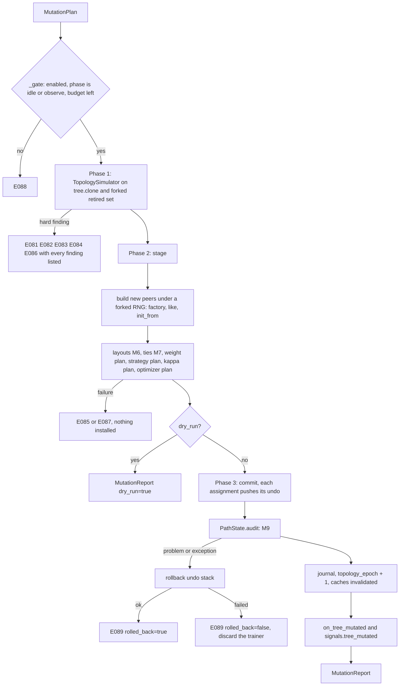
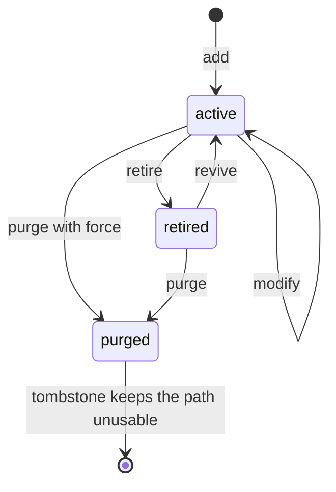

### 12.5 `MutationPlan` execution: simulate, stage, commit

The engine is one class, `MutationEngine`, owned by the trainer (`trainer.mutation`). It has
three phases, and the line between the second and the third is the whole safety argument:



Phase 1 touches nothing, because it works on a clone. Phase 2 touches nothing either: it
*builds* every object the plan needs (new peers, new optimizer facades) and keeps them in a
`Staged` record. Phase 3 only assigns. A fault in phase 1 or 2 is a plain exception with a
clean trainer behind it; a fault in phase 3 (which should not happen, and is why the audit is
inside it) runs the undo stack.

#### 12.5.1 The simulator and its results

The simulator is pure Python. It runs on a structural clone of the tree and on plain sets of
paths, so every structural rule can be tested without a model, and `mactf components validate`
and the API can check a plan against a tree description with it.

```python
# mactf/training/mutation.py   (part 2: results and the simulator)
from typing import Callable

from ..coopetition.tree import (
    PeerTree, TreeTooLargeError, TreeValidationError, aggregation_groups, validate_path,
)
from ..exceptions import ComplianceError

ROOT = "root"          # == components.weight_plan.ROOT_LABEL (a test pins the equality)


def label_of(parent: str | None) -> str:
    return ROOT if parent is None else parent


def parent_of(path: str) -> str | None:
    head, _, _ = path.rpartition("/")
    return head or None


def structure_digest(tree: PeerTree, retired: Iterable[str]) -> str:
    """What a replay must reproduce: which nodes exist, their roles, and which are retired."""
    gone = set(retired)
    rows = [[node.path, node.role, node.path in gone] for node in tree.walk("root-first")]
    return digest_of(rows)


@dataclass(frozen=True)
class GroupChange:
    """One aggregation group whose members, or whose active members, differ after a plan."""

    label: str
    parent: str | None
    before: tuple[str, ...]
    after: tuple[str, ...]
    active_before: tuple[str, ...]
    active_after: tuple[str, ...]

    @property
    def appeared(self) -> bool:
        return not self.before and bool(self.after)

    @property
    def vanished(self) -> bool:
        return bool(self.before) and not self.after


@dataclass(frozen=True)
class Simulation:
    """The tree a plan would produce, and everything the engine needs to build it."""

    tree: PeerTree                       # the final structure; peers of existing nodes are shared
    retired: frozenset[str]
    tombstones: frozenset[str]
    added: tuple[str, ...]
    purged: tuple[str, ...]
    retired_now: tuple[str, ...]
    revived_now: tuple[str, ...]
    modified: tuple[str, ...]
    changes: tuple[GroupChange, ...]
    findings: tuple[Finding, ...]
    before_digest: str
    after_digest: str

    @property
    def hard(self) -> tuple[Finding, ...]:
        return tuple(item for item in self.findings if item.hard)

    @property
    def soft(self) -> tuple[Finding, ...]:
        return tuple(item for item in self.findings if not item.hard)

    @property
    def ok(self) -> bool:
        return not self.hard

    def raise_for_findings(self) -> None:
        """``MutationError`` carrying the first hard finding's code and every finding's text."""
        hard = self.hard
        if hard:
            raise MutationError(
                hard[0].code, hard[0].message, findings=[item.render() for item in self.findings]
            )

    def changed_labels(self) -> tuple[str, ...]:
        return tuple(change.label for change in self.changes)

    def active_paths(self) -> tuple[str, ...]:
        return tuple(node.path for node in self.tree.walk("root-first") if node.path not in self.retired)


@dataclass(frozen=True)
class MutationReport:
    """What a plan did (or, for a dry run, would do)."""

    plan_digest: str
    label: str
    reason: str
    source: str
    dry_run: bool
    epoch: int
    topology_epoch: int
    added: tuple[str, ...]
    retired: tuple[str, ...]
    revived: tuple[str, ...]
    purged: tuple[str, ...]
    modified: tuple[str, ...]
    rebuilt: tuple[str, ...]
    optimizers_rebuilt: tuple[str, ...]
    groups: tuple[str, ...]
    active_nodes: int
    retired_nodes: int
    before_digest: str
    after_digest: str
    warnings: tuple[str, ...]
    seconds: float

    def as_dict(self) -> dict[str, Any]:
        return {key: (list(value) if isinstance(value, tuple) else value) for key, value in vars(self).items()}

    @property
    def changed(self) -> bool:
        return bool(self.added or self.retired or self.revived or self.purged or self.modified)


class _Work:
    """The mutable state of one simulation."""

    def __init__(self, tree: PeerTree, retired: set[str], tombstones: set[str]) -> None:
        self.tree = tree
        self.retired = retired
        self.tomb = tombstones
        self.added: list[str] = []
        self.purged: list[str] = []
        self.retired_now: list[str] = []
        self.revived_now: list[str] = []
        self.modified: list[str] = []
        self.findings: list[Finding] = []

    @property
    def failed(self) -> bool:
        return any(item.hard for item in self.findings)

    def fail(self, code: str, message: str, path: str | None = None) -> None:
        self.findings.append(Finding(code, message, path, hard=True))

    def warn(self, code: str, message: str, path: str | None = None) -> None:
        self.findings.append(Finding(code, message, path, hard=False))

    def drop(self, path: str) -> None:
        for bucket in (self.modified, self.retired_now, self.revived_now):
            if path in bucket:
                bucket.remove(path)


def _groups(tree: PeerTree, retired: set[str] | frozenset[str]) -> dict[str, tuple[str | None, tuple[str, ...], tuple[str, ...]]]:
    """``label -> (parent, members, active members)`` in ``aggregation_groups`` order."""
    result: dict[str, tuple[str | None, tuple[str, ...], tuple[str, ...]]] = {}
    for parent, members in aggregation_groups(tree):
        result[label_of(parent)] = (
            parent, tuple(members), tuple(name for name in members if name not in retired)
        )
    return result


class TopologySimulator:
    """Apply a plan to a clone and judge the result. Never raises for a bad plan: it reports."""

    def __init__(
        self,
        tree: PeerTree,
        *,
        retired: Iterable[str],
        tombstones: Iterable[str],
        limits: MutationLimits,
        feasible: Callable[[int], None],
    ) -> None:
        self.tree = tree
        self.retired = frozenset(retired)
        self.tombstones = frozenset(tombstones)
        self.limits = limits
        #: ``feasible(n)`` raises ``ComplianceError`` when ``WEIGHT_FLOOR``/``WEIGHT_CAP`` admit no
        #: weight vector for ``n`` active members: ``feasible_bounds`` with the run's bounds.
        self.feasible = feasible

    # -- entry point -----------------------------------------------------
    def run(self, plan: MutationPlan) -> Simulation:
        work = _Work(self.tree.clone(), set(self.retired), set(self.tombstones))
        before_groups = _groups(self.tree, self.retired)
        if len(plan.ops) > self.limits.max_ops_per_plan:
            work.fail(
                "E084",
                f"the plan has {len(plan.ops)} operations; TRAINER.MUTATION.MAX_OPS_PER_PLAN is "
                f"{self.limits.max_ops_per_plan}",
            )
        for op in plan.ops:
            if work.failed:
                break      # later operations are defined only on the tree the failed one would have made
            getattr(self, f"_{op.kind.value}")(op, work)
        changes: tuple[GroupChange, ...] = ()
        if not work.failed:
            changes = self._finalize(work, before_groups)
        return Simulation(
            tree=work.tree,
            retired=frozenset(work.retired),
            tombstones=frozenset(work.tomb),
            added=tuple(work.added),
            purged=tuple(work.purged),
            retired_now=tuple(work.retired_now),
            revived_now=tuple(work.revived_now),
            modified=tuple(work.modified),
            changes=changes,
            findings=tuple(work.findings),
            before_digest=structure_digest(self.tree, self.retired),
            after_digest=structure_digest(work.tree, work.retired),
        )

    # -- operations ------------------------------------------------------
    def _check_reference(self, work: _Work, path: str, field_name: str, ref: str | None) -> bool:
        if ref is None or ref == REFERENCE_TOKEN:
            return True
        if ref not in work.tree:
            work.fail("E083", f"`{field_name}` names {ref!r}, which is not a node of the tree", path)
            return False
        if ref == path:
            work.fail("E083", f"`{field_name}` names the node itself", path)
            return False
        return True

    def _add(self, op: Op, work: _Work) -> None:
        spec = op.spec
        assert spec is not None
        path = spec.path
        try:
            validate_path(path)
        except TreeValidationError as error:
            return work.fail("E081", str(error), path)
        if path in work.tree:
            return work.fail("E081", "the node already exists", path)
        if path in work.tomb:
            return work.fail(
                "E081",
                "the path was purged earlier in this run and cannot be reused "
                "(TRAINER.MUTATION.TOMBSTONE); its warning and escalation history must stay attached "
                "to one peer",
                path,
            )
        parent = parent_of(path)
        if parent is not None:
            if parent not in work.tree:
                return work.fail("E081", f"the parent {parent!r} does not exist", path)
            if parent in work.retired:
                return work.fail("E081", f"the parent {parent!r} is retired; revive it first", path)
        for name, ref in (("like", spec.like), ("init_from", spec.init_from)):
            if not self._check_reference(work, path, name, ref):
                return None
        try:
            work.tree.add_node(path, role=spec.role, metadata=dict(spec.metadata))
        except TreeTooLargeError as error:
            return work.fail("E084", str(error), path)
        except TreeValidationError as error:
            return work.fail("E081", str(error), path)
        work.added.append(path)
        return None

    def _modify(self, op: Op, work: _Work) -> None:
        path, changes = op.path, op.changes
        if path not in work.tree:
            return work.fail("E081", "no such node", path)
        if path in work.retired:
            return work.fail("E081", "the node is retired; revive it first", path)
        rebuild = changes.get("rebuild") or {}
        for name, ref in (
            ("init_from", changes.get("init_from")),
            ("rebuild.like", rebuild.get("like")),
            ("rebuild.init_from", rebuild.get("init_from")),
        ):
            if not self._check_reference(work, path, name, ref):
                return None
        if "rebuild" in changes and self.limits.is_protected(path):
            return work.fail("E082", "the node matches TRAINER.MUTATION.PROTECTED and cannot be rebuilt", path)
        node = work.tree[path]
        if "role" in changes:
            node.role = changes["role"]
        if "metadata" in changes:
            merged = dict(node.metadata)
            for key, value in changes["metadata"].items():
                if value is None:
                    merged.pop(key, None)
                else:
                    merged[key] = value
            node.metadata = merged
        if path not in work.modified:
            work.modified.append(path)
        return None

    def _targets(self, work: _Work, path: str, *, recursive: bool) -> list[str]:
        return [path, *work.tree.descendants(path)] if recursive else [path]

    def _retire(self, op: Op, work: _Work) -> None:
        path = op.path
        if path not in work.tree:
            return work.fail("E081", "no such node", path)
        targets = self._targets(work, path, recursive=op.recursive)
        for target in targets:
            if self.limits.is_protected(target):
                return work.fail("E082", "the node matches TRAINER.MUTATION.PROTECTED and cannot be retired", target)
        if not op.recursive:
            live = [child for child in work.tree[path].children if child not in work.retired]
            if live:
                return work.fail(
                    "E082",
                    f"{len(live)} child(ren) are still active ({live[:4]}); retire the branch with "
                    "`recursive: true`, or retire the children first",
                    path,
                )
        fresh = [target for target in targets if target not in work.retired]
        if not fresh:
            return work.warn("W040", "already retired; nothing to do", path)
        for target in fresh:
            work.retired.add(target)
            work.tree.mark(target, "pruned")
            work.retired_now.append(target)
            if target in work.revived_now:
                work.revived_now.remove(target)
        return None

    def _revive(self, op: Op, work: _Work) -> None:
        path = op.path
        if path not in work.tree:
            return work.fail("E081", "no such node", path)
        targets = self._targets(work, path, recursive=op.recursive)
        fresh = [target for target in targets if target in work.retired]
        if not fresh:
            return work.warn("W041", "not retired; nothing to do", path)
        for target in fresh:
            parent = work.tree[target].parent
            if parent is not None and parent in work.retired and parent not in fresh:
                return work.fail(
                    "E081", f"the parent {parent!r} is retired; revive it too (`recursive: true`) or first", target
                )
        for target in fresh:
            work.retired.discard(target)
            work.tree.mark(target, "active")
            work.revived_now.append(target)
            if target in work.retired_now:
                work.retired_now.remove(target)
        return None

    def _purge(self, op: Op, work: _Work) -> None:
        path = op.path
        if not self.limits.allow_purge:
            return work.fail("E082", "TRAINER.MUTATION.ALLOW_PURGE is false; retire the node instead", path)
        if path not in work.tree:
            return work.fail("E081", "no such node", path)
        targets = self._targets(work, path, recursive=True)
        if len(targets) > 1 and not op.recursive:
            return work.fail("E082", f"the node has {len(targets) - 1} descendant(s); pass `recursive: true`", path)
        for target in targets:
            if self.limits.is_protected(target):
                return work.fail("E082", "the node matches TRAINER.MUTATION.PROTECTED and cannot be purged", target)
        live = [target for target in targets if target not in work.retired]
        if live and not op.force:
            return work.fail(
                "E082",
                f"{len(live)} node(s) are active ({live[:4]}); retire first, or pass `force: true` "
                "to delete without the retire step",
                path,
            )
        work.tree.remove_node(path, recursive=True)
        for target in targets:
            work.retired.discard(target)
            work.drop(target)
            if target in work.added:
                work.added.remove(target)       # never existed outside this plan: no tombstone
                continue
            work.purged.append(target)
            if self.limits.tombstone == "run":
                work.tomb.add(target)
        return None

    # -- the checks that need the final tree -----------------------------
    def _finalize(
        self, work: _Work, before: dict[str, tuple[str | None, tuple[str, ...], tuple[str, ...]]]
    ) -> tuple[GroupChange, ...]:
        tree, retired = work.tree, work.retired
        roots = [path for path in tree.root_paths if path not in retired]
        if len(roots) < self.limits.min_active_roots:
            work.fail(
                "E082",
                f"{len(roots)} active root(s) would remain; TRAINER.MUTATION.MIN_ACTIVE_ROOTS is "
                f"{self.limits.min_active_roots}",
            )
            return ()
        for node in tree.walk("root-first"):
            if node.path in retired:
                continue
            if node.parent is not None and node.parent in retired:
                work.fail(
                    "E082",
                    f"an active node sits under the retired {node.parent!r}; retire it too, or revive the parent",
                    node.path,
                )
                return ()
            if node.children and all(child in retired for child in node.children):
                work.fail(
                    "E082",
                    "every child is retired, which leaves a branch that cannot be averaged; retire the "
                    "branch itself (`recursive: true`) instead",
                    node.path,
                )
                return ()
        after = _groups(tree, retired)
        changes: list[GroupChange] = []
        for label, (parent, members, active) in after.items():
            old = before.get(label)
            if old is not None and old[1] == members and old[2] == active:
                continue
            old_members, old_active = (old[1], old[2]) if old is not None else ((), ())
            changes.append(GroupChange(label, parent, old_members, members, old_active, active))
        for label, (parent, members, active) in before.items():
            if label not in after:
                changes.append(GroupChange(label, parent, members, (), active, ()))
        for change in changes:
            if change.vanished or (change.parent is not None and change.parent in retired):
                continue
            try:
                self.feasible(len(change.active_after))
            except ComplianceError as error:
                work.fail(
                    "E086",
                    f"group {change.label!r} would have {len(change.active_after)} active member(s): {error}",
                    change.label,
                )
                return ()
        return tuple(changes)
```

Two consequences of the rules above are worth stating, because both are visible to a user
who tries the obvious thing:

* **One new child under a leaf is refused, and two are accepted.** The leaf becomes a parent
  and its group has one member. With the default `WEIGHT_CAP` of `0.6` the cap is below
  `1/1`, so `feasible_bounds(1, ...)` raises and the simulator reports `E086`. A plan that
  adds `team-a/x` and `team-a/y` in one operation list produces a group of two, for which
  `1/2 = 0.5 <= 0.6` holds. The same rule is why the default `MIN_ACTIVE_ROOTS` is 2 and not 1
  (M5): a root group of one active peer is infeasible under the default bounds, so the
  simulator would refuse it anyway, and the setting exists to give the refusal a name.
* **Operations are applied to the clone in order.** `add_peer("a/x"), add_peer("a/y")` sees `a`
  as an active leaf when it starts and as a parent with two children when it ends, and only
  the end state is checked for feasibility. That is why a plan, not a single operation, is the
  unit of mutation.

#### 12.5.2 Additions to `PeerTree` and `FreezeSet`

The commit has to swap a tree in place (the trainer, the freeze set and the watchdog context
all hold the same `PeerTree` object) and has to be undoable. Three small methods on `PeerTree`
and three on `FreezeSet` give it that; none changes existing behaviour.

```python
# mactf/coopetition/tree.py   (additions to PeerTree, after ``clone``; ``import dataclasses`` at the top)
    def adopt(self, other: "PeerTree") -> dict[str, PeerNode]:
        """Take ``other``'s nodes as this tree's own. Returns the old mapping for ``restore``.

        The old node objects are left untouched, so ``restore`` puts the tree back exactly: the
        same objects, the same ``children`` tuples, the same statuses.
        """
        previous = self._nodes
        self._nodes = other._nodes
        return previous

    def restore(self, previous: dict[str, PeerNode]) -> None:
        self._nodes = previous

    def without(self, paths: Iterable[str]) -> "PeerTree":
        """A read-only view without ``paths`` and their descendants.

        Kept nodes are the *same objects* (so a status read is live), except an ancestor that
        loses a child, which is a copy with a shorter ``children`` tuple. Used for the active
        view that rollout, scoring and strategy validation walk (12.7). Do not add to it.
        """
        dropped: set[str] = set()
        for path in paths:
            if path in self._nodes and path not in dropped:
                dropped.add(path)
                dropped.update(self.descendants(path))
        if not dropped:
            return self
        view = PeerTree(max_depth=self.max_depth, max_nodes=self.max_nodes)
        for path, node in self._nodes.items():
            if path in dropped:
                continue
            kept = tuple(child for child in node.children if child not in dropped)
            view._nodes[path] = node if kept == node.children else dataclasses.replace(node, children=kept)
        return view
```

```python
# mactf/training/freeze.py   (additions to FreezeSet)
    def is_retired(self, path: str) -> bool:
        with self._lock:
            return RETIRED in self._by_path.get(path, ())

    def retired(self) -> frozenset[str]:
        with self._lock:
            return frozenset(path for path, held in self._by_path.items() if RETIRED in held)

    def snapshot(self) -> dict[str, frozenset[str]]:
        with self._lock:
            return {path: frozenset(held) for path, held in self._by_path.items()}

    def restore(self, snapshot: Mapping[str, frozenset[str]]) -> None:
        """Put the reasons back exactly. Statuses follow the (separately restored) tree."""
        with self._lock:
            self._by_path = {path: set(held) for path, held in snapshot.items()}
```

`without` returns `self` when nothing is dropped, which is what makes the active view free in
a run that never retires anything (I1).

#### 12.5.3 Optimizer staging for a changed topology

`OptimizerPlan.stage` (9.5) stages one *slot* change. A topology change is a different shape
(new nodes, removed nodes, per-node override slots), so it gets its own staged form, built from
the same pieces.

```python
# mactf/training/optimizer_plan.py   (additions: StagedTopology, stage_topology, commit_topology)
@dataclass
class StagedTopology:
    entries: dict[str, OptimizerEntry]
    previous: dict[str, OptimizerEntry]
    optimizers: dict[str, MACTFOptimizer] = field(default_factory=dict)
    frozen: set[str] = field(default_factory=set)
    thawed: set[str] = field(default_factory=set)
    dropped: list[str] = field(default_factory=list)
    records: list[SwapRecord] = field(default_factory=list)
    warnings: list[str] = field(default_factory=list)
```

```python
# mactf/training/optimizer_plan.py   (methods of OptimizerPlan)
    def stage_topology(
        self,
        *,
        set_blocks: Mapping[str, Mapping[str, Any] | None],
        build: Sequence[str],
        drop: Sequence[str],
        active: Sequence[str],
        live: Mapping[str, MACTFOptimizer],
        make: Callable[[str, OptimizerEntry], MACTFOptimizer],
    ) -> StagedTopology:
        """Stage the optimizer side of a mutation. Mutates nothing that is live.

        ``set_blocks`` maps a node path to its new per-node block (the slot ``OPTIMIZER.<path>``),
        or to ``None`` to remove that override. ``build`` lists nodes that need a fresh facade
        regardless (new or rebuilt peers: their old state, if any, is meaningless). ``drop``
        lists purged nodes, whose per-node slot is removed. ``active`` is every node that will
        be able to learn afterwards. ``make(path, entry)`` is ``_make_optimizer`` bound to the
        staged peer.
        """
        with self._lock:
            previous = dict(self._entries)
            entries = dict(previous)
            for path in drop:
                entries.pop(f"{DEFAULT_SLOT}.{path}", None)
            for path, block in set_blocks.items():
                slot = f"{DEFAULT_SLOT}.{path}"
                if block is None:
                    entries.pop(slot, None)
                else:
                    entries[slot] = self._compile_for(slot, block, None)
            staged = StagedTopology(entries=entries, previous=previous, dropped=list(drop))
            fresh_paths = [path for path in dict.fromkeys([*build, *set_blocks]) if path in set(active) | set(build)]
            for path in fresh_paths:
                old_entry = self.select(path) if path not in build else None
                new_entry = self.select(path, entries)                     # may raise E051
                is_new = path in build
                if not is_new and old_entry is not None and (
                    old_entry.spec_hash == new_entry.spec_hash and old_entry.slot == new_entry.slot
                ):
                    continue
                old = live.get(path)
                fresh = make(path, new_entry)
                if old is not None and not is_new:
                    migration_for(new_entry.migrate)(old, fresh)
                staged.optimizers[path] = fresh
                if new_entry.frozen and (is_new or old_entry is None or not old_entry.frozen):
                    staged.frozen.add(path)
                if not new_entry.frozen and old_entry is not None and old_entry.frozen:
                    staged.thawed.add(path)
                staged.records.append(
                    SwapRecord(
                        slot=new_entry.slot, kind_id="optimizer",
                        from_name=old.describe().get("class", "none") if old is not None else "none",
                        to_name=fresh.describe().get("class", "none"),
                        from_spec_hash=getattr(old, "spec_hash", "") if old is not None else "",
                        to_spec_hash=new_entry.spec_hash, boundary=Boundary.EPISODE.value,
                        episode=self.episode, at=time.time(),
                    )
                )
            learners = [
                path for path in active
                if not self.select(path, entries).frozen
            ]
            if active and not learners:
                raise ImproperlyConfigured("E054: the topology change would leave no node able to learn")
            prefix = DEFAULT_SLOT + "."
            for slot in sorted(entries):
                if not slot.startswith(prefix):
                    continue
                glob = slot[len(prefix):]
                if not any(path == glob or fnmatch.fnmatchcase(path, glob) for path in active):
                    staged.warnings.append(
                        f"W011: optimizer override {glob!r} matches no node after the mutation"
                    )
            return staged

    def commit_topology(self, staged: StagedTopology) -> Callable[[], None]:
        """Make a staged topology change the plan's truth. Returns the function that undoes it."""
        with self._lock:
            history_length = len(self._history)
            previous = dict(self._entries)
            self._entries = dict(staged.entries)
            self._history.extend(staged.records)

        def undo() -> None:
            with self._lock:
                self._entries = previous
                del self._history[history_length:]

        return undo
```

`_make_optimizer` gains an optional `peer` argument so that it can bind a facade to a peer the
trainer has not installed yet (the one edit in 12.7):
`def _make_optimizer(self, path, entry, runtime, peer=None)` with `peer = peer or self.peers[path]`.

#### 12.5.4 The engine

```python
# mactf/training/mutation_engine.py   (new)
from __future__ import annotations

import copy
import dataclasses
import logging
import threading
import time
from dataclasses import dataclass, field
from typing import Any, Callable, Iterable, Mapping

import torch

from ..components.catalog import ComponentSpec
from ..components.weight_plan import ROOT_LABEL
from ..coopetition.aggregation import feasible_bounds
from ..coopetition.peer import Peer
from ..coopetition.strategy import group_layouts
from ..coopetition.tree import PeerTree, node_seed
from ..exceptions import ComplianceError, ContractError, ImproperlyConfigured, MutationError
from .freeze import RETIRED
from .mutation import (
    BUILD_TOKEN, INTERNAL_SOURCES, REFERENCE_TOKEN, Finding, GroupChange, MutationLimits, MutationPlan, MutationReport, Op, OpKind,
    PeerSpec, Simulation, TopologySimulator, _groups, digest_of, label_of, manifest_spec,
)

log = logging.getLogger("mactf.mutation")

PHASES_ALLOWED = ("idle", "observe")
# ``INTERNAL_SOURCES = ("watchdog", "replay")`` (the sources that are not the user asking: the
# watchdog's prune of 12.8 and the checkpoint reconciliation of 12.9) lives in ``mutation.py``
# with the other pure constants, because ``mutation_reconcile.py`` needs it without torch.


class Undo:
    """A stack of inverses. ``push`` before you mutate; ``rollback`` runs them newest first."""

    def __init__(self) -> None:
        self._steps: list[tuple[str, Callable[[], None]]] = []

    def push(self, label: str, inverse: Callable[[], None]) -> None:
        self._steps.append((label, inverse))

    def restore_dict(self, label: str, container: dict[Any, Any]) -> None:
        """Snapshot a dict (keeping its order) and register the restore."""
        saved = dict(container)

        def inverse() -> None:
            container.clear()
            container.update(saved)

        self.push(label, inverse)

    def restore_set(self, label: str, container: set[Any]) -> None:
        saved = set(container)

        def inverse() -> None:
            container.clear()
            container.update(saved)

        self.push(label, inverse)

    def restore_list(self, label: str, container: list[Any]) -> None:
        saved = list(container)

        def inverse() -> None:
            container[:] = saved

        self.push(label, inverse)

    def restore_attr(self, label: str, owner: Any, name: str) -> None:
        saved = getattr(owner, name)
        self.push(label, lambda: setattr(owner, name, saved))

    def rollback(self) -> list[str]:
        """Run every inverse. Returns the failures (empty when the rollback was complete)."""
        failures: list[str] = []
        while self._steps:
            label, inverse = self._steps.pop()
            try:
                inverse()
            except Exception as error:  # noqa: BLE001 - a failed inverse is reported, never raised
                failures.append(f"{label}: {type(error).__name__}: {error}")
        return failures


@dataclass
class Staged:
    """Everything a plan needs, built and checked, installed nowhere."""

    peers: dict[str, Peer] = field(default_factory=dict)          # new, and rebuilt, by path
    rebuilt: list[str] = field(default_factory=list)              # existing nodes whose peer is replaced
    reweighted: dict[str, torch.Tensor] = field(default_factory=dict)   # init_from on a live peer
    optimizer: Any = None                                         # StagedTopology
    notes: list[str] = field(default_factory=list)
```

```python
# mactf/training/mutation_engine.py   (class MutationEngine, part 1: gate, simulate, build)
class MutationEngine:
    """Owns the rules of changing a built trainer's peer tree."""

    def __init__(self, trainer: Any) -> None:
        self.trainer = trainer
        self._lock = threading.RLock()
        self._queue: list[tuple[MutationPlan, str]] = []

    # -- gate ------------------------------------------------------------
    def _gate(self, source: str) -> None:
        t = self.trainer
        if not t.built:
            raise MutationError("E088", "the trainer is not built; call build() or fit() first")
        internal = source in INTERNAL_SOURCES
        if not t.mutation_limits.enabled and not internal:
            raise MutationError(
                "E088",
                "tree mutation is off; set TRAINER.MUTATION.ENABLED: true (a run that never "
                "mutates keeps the topology it was built with, and the checkpoint it always wrote)",
            )
        if t._phase not in PHASES_ALLOWED:
            raise MutationError(
                "E088",
                f"a plan cannot run while the trainer is in phase {t._phase!r}; mutate between epochs, "
                "from an on_epoch_end callback, or queue it with request_mutation()",
            )
        blockers = t.mutation_blockers()
        if blockers:
            raise MutationError("E088", "this trainer cannot be mutated: " + "; ".join(blockers))
        if source != "replay" and t._mutations_in_cycle >= t.mutation_limits.max_plans_per_epoch:
            raise MutationError(
                "E088",
                f"{t._mutations_in_cycle} plans already ran this epoch; "
                f"TRAINER.MUTATION.MAX_PLANS_PER_EPOCH is {t.mutation_limits.max_plans_per_epoch}",
            )

    # -- simulate --------------------------------------------------------
    def _floor_cap(self) -> tuple[float, float]:
        coopetition = self.trainer._coopetition_settings()
        return float(coopetition.get("WEIGHT_FLOOR", 0.02)), float(coopetition.get("WEIGHT_CAP", 0.6))

    def _replay_limits(self) -> MutationLimits:
        """What a reconciliation may do (12.9): reproduce a structure that already existed.

        The structure came from plans that were valid under the limits of their day, and a
        configuration edited since must not make a checkpoint unloadable, so the *policy* limits
        are lifted (a root may be the last, a protected path may be purged, purge is allowed, a
        plan may be long, a purged path may come back). Every *structural* rule of the simulator
        (paths, parents, uniqueness, references, feasible weight bounds) still applies.
        """
        return dataclasses.replace(
            self.trainer.mutation_limits,
            min_active_roots=1,
            max_ops_per_plan=10_000,
            protected=(),
            allow_purge=True,
            tombstone="off",
        )

    def simulator(self, source: str = "api") -> TopologySimulator:
        t = self.trainer
        floor, cap = self._floor_cap()
        replay = source == "replay"
        return TopologySimulator(
            t.tree,
            retired=t.freeze.retired(),
            tombstones=() if replay else t._tombstones,
            limits=self._replay_limits() if replay else t.mutation_limits,
            feasible=lambda count: feasible_bounds(count, floor=floor, cap=cap),
        )

    def simulate(self, plan: MutationPlan, source: str = "api") -> Simulation:
        simulation = self.simulator(source).run(plan)
        simulation.raise_for_findings()
        return simulation

    # -- peers -----------------------------------------------------------
    def _factory_module(
        self, spec: PeerSpec, source: Peer | None, seed: int
    ) -> tuple[torch.nn.Module, bool]:
        t = self.trainer
        resolved = t.resolver.resolve(
            ComponentSpec.parse("peer_factory", spec.factory),
            trusted=t._components_trusted,
            inject={
                "spec": spec,
                "source": copy.deepcopy(source.module) if source is not None else None,
                "runtime": t._runtime,
                "settings": t.settings,
                "seed": seed,
            },
        )
        module = resolved.instance
        if not isinstance(module, torch.nn.Module):
            raise MutationError("E085", f"{spec.path}: the factory returned {type(module).__name__}, not an nn.Module")
        return module, bool(resolved.component.capabilities.get("finetuned", False))

    def _build_peer(
        self,
        spec: PeerSpec,
        *,
        tree: PeerTree,
        peers: Mapping[str, Peer],
        topology_epoch: int,
    ) -> Peer:
        """Steps 1-6 of 12.3, under a private RNG stream (M4)."""
        t = self.trainer
        runtime = t._runtime
        path = spec.path
        node = tree[path]
        seed = node_seed(int(runtime.seed), path, topology_epoch)
        sharing = str(getattr(t._hierarchy, "sharing", "independent"))
        if sharing == "shared_trunk" and node.depth > 1 and spec.like is not None:
            raise MutationError(
                "E085",
                f"{path}: `like` copies the module, trunk included, which would unshare it; in a "
                "shared_trunk run a new child uses a factory or the level's model source",
            )
        source = peers.get(spec.like) if spec.like is not None else None
        if spec.like is not None and source is None:
            raise MutationError("E083", f"{path}: `like` names {spec.like!r}, which has no peer", findings=[])
        devices = [runtime.device] if torch.device(runtime.device).type == "cuda" else []
        previous_tree = getattr(t, "_tree_in_build", None)
        t._tree_in_build = tree
        try:
            with torch.random.fork_rng(devices=devices):
                torch.manual_seed(seed)
                finetuned = False
                if spec.factory == BUILD_TOKEN:
                    module = t._module_for(path)          # step 3 of 12.3, chosen explicitly
                elif spec.factory is not None:
                    module, finetuned = self._factory_module(spec, source, seed)
                elif source is not None:
                    module, finetuned = copy.deepcopy(source.module), True
                else:
                    module = t._module_for(path)
                if sharing == "shared_trunk" and node.depth > 1 and t._shared_trunk is not None:
                    from .trainer import _with_shared_trunk

                    module = _with_shared_trunk(t._shared_trunk, module)
                peer = t._assemble_peer(path, node.depth, module, runtime, finetuned=finetuned)
        except MutationError:
            raise
        except Exception as error:  # noqa: BLE001 - any construction failure is a refusal, not a crash
            raise MutationError("E085", f"{path}: building the peer failed: {type(error).__name__}: {error}") from error
        finally:
            t._tree_in_build = previous_tree
        if spec.init_from is not None:
            self._copy_weights(path, peer, spec.init_from, peers)
        return peer

    def _weights_of(self, path: str, ref: str, peers: Mapping[str, Peer]) -> torch.Tensor:
        t = self.trainer
        source = t.reference if ref == REFERENCE_TOKEN else peers.get(ref)
        if source is None:
            raise MutationError("E083", f"{path}: `init_from` {ref!r} has no peer to read weights from")
        return source.export_parameters().detach().clone()

    def _copy_weights(self, path: str, target: Peer, ref: str, peers: Mapping[str, Peer]) -> None:
        source = self.trainer.reference if ref == REFERENCE_TOKEN else peers.get(ref)
        vector = self._weights_of(path, ref, peers)
        if source is not None and source.adapter.parameter_shapes() != target.adapter.parameter_shapes():
            raise MutationError("E085", f"{path}: `init_from` {ref!r} has a different parameter layout")
        if vector.numel() != target.export_parameters().numel():
            raise MutationError("E085", f"{path}: `init_from` {ref!r} has {vector.numel()} parameters, expected "
                                f"{target.export_parameters().numel()}")
        target.import_parameters(vector)
```

`_factory_module` deep-copies the source module before handing it over, so a factory that
edits `source` in place cannot damage the live peer. A factory that returns a module sharing
tensors with another peer is caught by the tie check in the next step.

```python
# mactf/training/mutation_engine.py   (class MutationEngine, part 2: stage)
    # -- stage -----------------------------------------------------------
    def _stage(self, plan: MutationPlan, simulation: Simulation) -> Staged:
        t = self.trainer
        epoch_next = t.topology_epoch + 1
        tree = simulation.tree
        staged = Staged()
        peers: dict[str, Peer] = {
            path: peer for path, peer in t.peers.items() if path not in simulation.purged
        }
        set_blocks: dict[str, Mapping[str, Any] | None] = {}
        survivors = set(simulation.added)
        for op in plan.ops:
            if op.kind is OpKind.ADD:
                spec = op.spec
                if spec.path not in survivors:
                    continue                      # added and then purged in the same plan
                peer = self._build_peer(spec, tree=tree, peers=peers, topology_epoch=epoch_next)
                staged.peers[spec.path] = peers[spec.path] = peer
                if spec.optimizer is not None:
                    set_blocks[spec.path] = dict(spec.optimizer)
            elif op.kind is OpKind.MODIFY:
                if op.path not in tree:
                    continue                      # purged later in the same plan
                changes = op.changes
                if "rebuild" in changes:
                    spec = PeerSpec.parse(changes["rebuild"], path=op.path)
                    peer = self._build_peer(spec, tree=tree, peers=peers, topology_epoch=epoch_next)
                    staged.peers[op.path] = peers[op.path] = peer
                    if op.path not in survivors and op.path not in staged.rebuilt:
                        staged.rebuilt.append(op.path)
                if "init_from" in changes:
                    vector = self._weights_of(op.path, changes["init_from"], peers)
                    target = peers[op.path]
                    if vector.numel() != target.export_parameters().numel():
                        raise MutationError("E085", f"{op.path}: `init_from` has a different parameter count")
                    if op.path in staged.peers:
                        staged.peers[op.path].import_parameters(vector)
                    else:
                        staged.reweighted[op.path] = vector
                if "optimizer" in changes:
                    set_blocks[op.path] = changes["optimizer"]
        self._check_layouts(simulation, peers)
        self._check_plans(simulation)
        build = [path for path in staged.peers]
        active = list(simulation.active_paths())
        runtime = t._runtime
        staged.optimizer = t.optimizer_plan.stage_topology(
            set_blocks={path: block for path, block in set_blocks.items() if path in tree},
            build=build,
            drop=list(simulation.purged),
            active=active,
            live=t.optimizers,
            make=lambda path, entry: t._make_optimizer(path, entry, runtime, peers.get(path)),
        )
        staged.notes.extend(staged.optimizer.warnings)
        return staged

    def _check_layouts(self, simulation: Simulation, peers: Mapping[str, Peer]) -> None:
        """M6 and M7 on the final tree, over active peers."""
        t = self.trainer
        for change in simulation.changes:
            if len(change.active_after) < 2:
                continue
            try:
                group_layouts(peers, change.active_after)
            except ContractError as error:
                raise MutationError("E085", f"group {change.label!r}: {error}") from error
        try:
            t._validate_tied_parameters(tree=simulation.tree, peers=peers, skip=simulation.retired)
        except ContractError as error:
            raise MutationError("E085", str(error)) from error

    def _check_plans(self, simulation: Simulation) -> None:
        """M-G3's second half: every plan that keys on groups accepts the final groups (E087)."""
        from ..components.weight_plan import GroupView
        from ..components.strategy_plan import tree_view

        t = self.trainer
        floor, cap = self._floor_cap()
        groups = _groups(simulation.tree, simulation.retired)
        views = [
            GroupView(
                label=label, parent=parent, members=active,
                level=0 if parent is None else int(simulation.tree[parent].depth),
                floor=floor, cap=cap,
            )
            for label, (parent, _members, active) in groups.items()
            if active and (parent is None or parent not in simulation.retired)
        ]
        active_tree = simulation.tree.without(simulation.retired)
        try:
            t.weight_plan.validate(views, initial=False)
            t.strategy_plan.validate(tree_view(active_tree, hierarchy=t._hierarchy is not None), initial=False)
            t.kappa_plan.validate([view.label for view in views], initial=False)
        except ImproperlyConfigured as error:
            raise MutationError("E087", f"a plan refused the new topology: {error}") from error
```

```python
# mactf/training/mutation_engine.py   (class MutationEngine, part 3: commit, journal, apply)
    # -- commit ----------------------------------------------------------
    def _commit(self, plan: MutationPlan, simulation: Simulation, staged: Staged, source: str, undo: Undo) -> None:
        """Phase 3. ``undo`` is owned by ``apply`` so its ``except`` clause can always reach it."""
        t = self.trainer
        tree = simulation.tree
        purged = list(simulation.purged)

        # 1. The tree, in place: every holder of ``trainer.tree`` (freeze set, watchdog) sees it.
        previous_nodes = t.tree.adopt(tree)
        undo.push("tree", lambda: t.tree.restore(previous_nodes))

        # 2. Peers.
        undo.restore_dict("peers", t.peers)
        for path in purged:
            t.peers.pop(path, None)
        for path, peer in staged.peers.items():
            t.peers[path] = peer
            t.tree[path].peer = peer
        for path, vector in staged.reweighted.items():
            before = t.peers[path].export_parameters().detach().clone()
            t.peers[path].import_parameters(vector)
            undo.push(f"weights:{path}", lambda p=path, b=before: t.peers[p].import_parameters(b))

        # 3. Optimizers.
        undo.restore_dict("optimizers", t.optimizers)
        for path in purged:
            t.optimizers.pop(path, None)
        for path, facade in staged.optimizer.optimizers.items():
            peer = t.peers[path]
            old_facade = peer.optimizer
            undo.push(f"peer.optimizer:{path}", lambda p=peer, o=old_facade: setattr(p, "optimizer", o))
            t._install_optimizer(path, facade)
        undo.push("optimizer_plan", t.optimizer_plan.commit_topology(staged.optimizer))

        # 4. The freeze set: retired, revived, purged, and the optimizer:null reasons.
        saved_freeze = t.freeze.snapshot()
        undo.push("freeze", lambda: t.freeze.restore(saved_freeze))
        for path in purged:
            t.freeze.forget(path)
        for path in simulation.revived_now:
            t.freeze.discard(path, RETIRED)
        for path in simulation.retired_now:
            t.freeze.add(path, RETIRED)
        for path in staged.optimizer.frozen:
            t.freeze.add(path, "optimizer:null")
        for path in staged.optimizer.thawed:
            t.freeze.discard(path, "optimizer:null")
        t.freeze.sync()

        # 5. Controllers and aggregators of the groups that changed.
        self._rebind_groups(simulation, undo)

        # 6. Caches keyed by group label or node path, through the registry (M9).
        t.path_state.forget(
            paths=purged + list(staged.peers) + list(staged.reweighted),
            labels=simulation.changed_labels(),
            undo=undo,
            dropped_paths=purged,
        )

        # 7. Scalars and the journal.
        undo.restore_set("tombstones", t._tombstones)
        t._tombstones.clear()
        t._tombstones.update(simulation.tombstones)
        self._record_manifest(plan, simulation, undo)
        undo.restore_attr("topology_epoch", t, "topology_epoch")
        t.topology_epoch += 1
        undo.restore_list("journal", t.mutation_journal)
        t.mutation_journal.append(
            {
                "seq": len(t.mutation_journal),
                "epoch": int(t._epoch),
                "topology_epoch": int(t.topology_epoch),
                "source": source,
                "plan": plan.canonical(),
                "plan_digest": plan.digest(),
                "before": simulation.before_digest,
                "after": simulation.after_digest,
            }
        )
        undo.restore_attr("active_view", t, "_active_view")
        t._active_view = None
        undo.restore_attr("budget", t, "_mutations_in_cycle")
        t._mutations_in_cycle += 1

        # 8. The audit (M9). A problem here is a bug, and it is rolled back like any other fault.
        problems = t.path_state.audit()
        if problems:
            raise MutationError("E089", "the post-commit audit found: " + "; ".join(problems))

    def _record_manifest(self, plan: MutationPlan, simulation: Simulation, undo: Undo) -> None:
        """What a checkpoint needs to rebuild this structure on another trainer (12.9.2).

        ``_node_specs`` holds the effective spec of every node a plan created or rebuilt, so a
        reconciliation can build the same architecture; ``_node_meta`` holds the final metadata of
        every node a plan created or touched, because the tree section of a checkpoint carries no
        metadata. A node built from the configuration and never touched has no entry in either,
        and that absence is what "built from the configuration" means.
        """
        t = self.trainer
        undo.restore_dict("node_specs", t._node_specs)
        undo.restore_dict("node_meta", t._node_meta)
        for path in simulation.purged:
            t._node_specs.pop(path, None)
            t._node_meta.pop(path, None)
        survivors = set(simulation.added)
        tree = simulation.tree
        for op in plan.ops:
            if op.kind is OpKind.ADD and op.spec.path in survivors:
                t._node_specs[op.spec.path] = manifest_spec(op.spec)
            elif op.kind is OpKind.MODIFY and op.path in tree and "rebuild" in op.changes:
                # A rebuild replaces the architecture (``factory`` / ``like``) and nothing else: the
                # optimizer block and the role the node was created with stay in its spec.
                renewed = manifest_spec(PeerSpec.parse(op.changes["rebuild"], path=op.path))
                prior = t._node_specs.get(op.path, {"path": op.path})
                kept = {key: value for key, value in prior.items() if key not in ("factory", "like")}
                t._node_specs[op.path] = {**kept, **renewed}
        for path in dict.fromkeys((*simulation.added, *simulation.modified)):
            if path not in tree:
                continue
            metadata = dict(tree[path].metadata)
            if metadata or path in t._node_meta:
                t._node_meta[path] = metadata

    def _rebind_groups(self, simulation: Simulation, undo: Undo) -> None:
        t = self.trainer
        undo.restore_dict("controllers", t.controllers)
        undo.restore_dict("level_controllers", t._level_controllers)
        undo.restore_dict("group_aggregators", t._group_aggregators)
        base = dict(t._coopetition_settings())
        for change in simulation.changes:
            label, parent = change.label, change.parent
            t._group_aggregators.pop(label, None)
            key = "root" if parent is None else parent
            if change.vanished:
                t.controllers.pop(key, None)
                t._level_controllers.pop(parent, None)
                continue
            if parent is not None and parent in simulation.retired:
                continue                                  # the whole group is out of play: leave its controller
            count = max(1, len(change.active_after))
            controller = t._level_controllers.get(parent)
            if controller is None:
                controller = t.kappa_plan.build(label, base, num_peers=count)
                t._level_controllers[parent] = controller
                t.controllers[key] = controller
                continue
            saved = controller.snapshot()
            undo.push(f"kappa:{label}", lambda c=controller, s=saved: c.restore(s))
            controller.resize(count)

    # -- apply -----------------------------------------------------------
    def apply(
        self, plan: "MutationPlan | Mapping[str, Any] | list[Any]", *, dry_run: bool = False, source: str = "api"
    ) -> MutationReport:
        started = time.monotonic()
        plan = MutationPlan.parse(plan)
        with self._lock:
            self._gate(source)
            simulation = self.simulate(plan, source)
            staged = self._stage(plan, simulation)
            if dry_run:
                return self._report(plan, simulation, staged, source, dry_run=True, started=started)
            undo = Undo()
            try:
                self._commit(plan, simulation, staged, source, undo)
            except Exception as error:  # noqa: BLE001 - phase 3 must either finish or be undone
                problems = undo.rollback()
                if problems:
                    raise MutationError(
                        "E089",
                        f"the commit failed ({error}) and the rollback did not complete: {problems}; "
                        "this trainer's state is unreliable and must be discarded",
                        rolled_back=False,
                    ) from error
                code = error.code if isinstance(error, MutationError) else "E089"
                raise MutationError(
                    code,
                    f"the commit failed and was rolled back: {error}",
                    findings=getattr(error, "findings", ()),
                    rolled_back=True,
                ) from error
            report = self._report(plan, simulation, staged, source, dry_run=False, started=started)
        self._finish(report)
        return report

    def _report(
        self, plan: MutationPlan, simulation: Simulation, staged: Staged, source: str, *, dry_run: bool, started: float
    ) -> MutationReport:
        t = self.trainer
        return MutationReport(
            plan_digest=plan.digest(), label=plan.label, reason=plan.reason, source=source,
            dry_run=dry_run, epoch=int(t._epoch),
            topology_epoch=int(t.topology_epoch),
            added=simulation.added, retired=simulation.retired_now, revived=simulation.revived_now,
            purged=simulation.purged, modified=simulation.modified, rebuilt=tuple(staged.rebuilt),
            optimizers_rebuilt=tuple(staged.optimizer.optimizers) if staged.optimizer is not None else (),
            groups=simulation.changed_labels(),
            active_nodes=len(simulation.active_paths()), retired_nodes=len(simulation.retired),
            before_digest=simulation.before_digest, after_digest=simulation.after_digest,
            warnings=tuple(item.render() for item in simulation.soft) + tuple(staged.notes),
            seconds=time.monotonic() - started,
        )

    def _finish(self, report: MutationReport) -> None:
        """After the commit: observers. An observer's failure never undoes a committed mutation."""
        from .. import signals

        t = self.trainer
        if report.source == "replay":
            # A reconciliation (12.9) restores a structure that already happened. It rebases the
            # health baselines itself, once, after the last plan; no callback or signal hears about
            # a topology change that the checkpoint says was already announced.
            return
        if len(t.mutation_journal) == t.mutation_limits.journal_warn:
            log.warning(
                "W045: the mutation journal reached %d entries; every checkpoint carries all of it "
                "(TRAINER.MUTATION.JOURNAL_WARN)",
                len(t.mutation_journal),
            )
        for note in report.warnings:
            log.warning("%s", note)
        for hook in (
            lambda: t._after_mutation(report),
            lambda: t._dispatch_many("on_tree_mutated", t, report),
            lambda: signals.tree_mutated.send(sender=t, report=report),
        ):
            try:
                hook()
            except Exception as error:  # noqa: BLE001 - observers are not part of the transaction
                log.error("an on_tree_mutated observer failed: %s", error)
                t.failures.append(f"on_tree_mutated observer: {error}")

    # -- deferred plans --------------------------------------------------
    def request(self, plan: "MutationPlan | Mapping[str, Any] | list[Any]", *, source: str = "request") -> MutationPlan:
        """Queue a plan for the top of the next epoch (the form a callback or a strategy uses)."""
        parsed = MutationPlan.parse(plan)
        with self._lock:
            self._queue.append((parsed, source))
        return parsed

    def pending(self) -> list[dict[str, Any]]:
        with self._lock:
            return [{"source": source, "plan": plan.canonical()} for plan, source in self._queue]

    def restore_pending(self, rows: "Iterable[Mapping[str, Any]]") -> int:
        """Replace the queue with what a checkpoint recorded (12.9). Returns how many plans were queued."""
        parsed = [(MutationPlan.parse(row["plan"]), str(row.get("source", "request"))) for row in rows]
        with self._lock:
            self._queue[:] = parsed
        return len(parsed)

    def discard_pending(self) -> int:
        with self._lock:
            count = len(self._queue)
            self._queue.clear()
            return count

    def apply_pending(self, epoch: int) -> list[MutationReport]:
        """Called at the top of ``run_epoch``: queued plans, then this epoch's schedule entries."""
        t = self.trainer
        due: list[tuple[MutationPlan, str]] = []
        with self._lock:
            due.extend(self._queue)
            self._queue.clear()
        done = {entry["plan_digest"] for entry in t.mutation_journal if entry.get("source") == "schedule"}
        for at_epoch, plan in t.mutation_limits.schedule:
            if at_epoch == int(epoch) and plan.digest() not in done:
                due.append((plan, "schedule"))
        reports: list[MutationReport] = []
        for plan, source in due:
            try:
                reports.append(self.apply(plan, source=source))
            except MutationError as error:
                # A queued or scheduled plan that is no longer valid must not end the run.
                t.failures.append(f"mutation {plan.label or plan.digest()} ({source}) refused: {error}")
                log.error("mutation %s (%s) refused: %s", plan.label or plan.digest(), source, error)
        return reports
```

Every `undo.push` in `_commit` precedes the mutation it inverts, so a fault between the push and the mutation runs an inverse that restores a value the mutation had not yet changed, which is harmless. `apply` creates the undo stack, so its `except` clause can always reach it even when `_commit` raised before returning.

`ComponentSpec` is imported from the module of section 5 that defines it
(`mactf/components/resolver.py` in the layout of 3.1); `group_layouts` is
`mactf/coopetition/strategy.py:425`. The engine reads the following trainer members, all of
which 12.7 adds or already exist: `built`, `tree`, `peers`, `optimizers`, `controllers`,
`_level_controllers`, `_group_aggregators`, `reference`, `freeze`, `resolver`,
`_components_trusted`, `_runtime`, `settings`, `_hierarchy`, `_epoch`, `failures`,
`optimizer_plan`, `weight_plan`, `strategy_plan`, `kappa_plan`, `mutation_limits`,
`mutation_journal`, `topology_epoch`, `_tombstones`, `_phase`, `_mutations_in_cycle`,
`_active_view`, `_shared_trunk`, `path_state`, and the methods `_module_for`,
`_assemble_peer`, `_make_optimizer`, `_install_optimizer`, `_validate_tied_parameters`,
`_coopetition_settings`, `_dispatch_many`.

### 12.6 Lifecycle: retire, revive, purge, and the `PathState` registry

#### 12.6.1 The three states of a node



| | active | retired | purged |
|---|---|---|---|
| In `PeerTree` | yes, status `active` (or `failed`/`frozen` for a moment) | yes, status `pruned` | no |
| In `trainer.peers` | yes | **yes** (parameters, module, optimizer state kept) | no |
| Freeze reasons | none, or `strategy:*` / `optimizer:null` | `mutation:retired` plus whatever else | none (`forget`) |
| Rolled out, scored, delegated to | yes | **no** (active view, 12.7) | no |
| Trains, is written back to | yes | **no** (`skips_training`, `skips_write`) | no |
| Weight in its group | per scores | **0** (`excludes`; `mutation:` prefix, both freeze modes) | n/a |
| Counted in `tree_nodes` and `M8` | yes | no | no |
| Past scorecards, history, warnings | kept | **kept** | **kept** (episodes and scorecards are never rewritten) |
| Path reusable | n/a | n/a | **no** while `TOMBSTONE: run` (M3) |
| Checkpointed | peer, optimizer, freeze entry | peer, optimizer, freeze entry | not at all; the journal records the purge |

Retire is the default way out because it loses nothing: the peer keeps its weights, so a
later `revive` brings back a working peer, and a purge is available once the decision is
final. A retired peer is also the right answer to the watchdog's `prune_branch` when the
branch might recover (12.8).

**Compliance across the transitions (M3).** What each transition does to the three things a
compliance reviewer asks about:

| Question | retire | revive | purge |
|---|---|---|---|
| Can it erase a void? | No. `branch_void` is computed per episode from that episode's ledgers; a retired node produces no ledger, so it contributes no void, and it has never been able to remove one that was already recorded in `episodes` | No | No. The scorecards of past episodes stay in `trainer.scorecards` |
| Can it dodge a T0/T1/T2 floor? | No. A node that is out of play is not scored, so there is nothing to dodge, and its group's survivors are scored by the same chain | A revived peer is scored from the next episode by the same chain; its warning registry resumes where it stopped (the registry is keyed by path and is not touched) | No. The tombstone stops the path returning with a fresh warning count |
| Can a new peer start with a lighter ruleset? | n/a | n/a | n/a. `add` builds nothing of the scoring chain: the pipeline of a node is `pipeline_for(node.path)`, resolved at score time from the same `SCORING` blocks as every other node |

**The one thing a mutation can do to scoring.** It changes *who is averaged*. That is why the
weight floor is re-checked (M8) and why `branch_void` is not special-cased: with fewer active
members the same floor is a larger share, and `feasible_bounds` is what refuses a group in
which it would exceed `1/N`.

#### 12.6.2 The `PathState` registry

12.1 listed ten containers. The registry gives them one owner so that the next container
somebody adds is added in one place, and so that the audit that guards M9 is generated from
the same list as the cleanup.

```python
# mactf/training/path_state.py   (new)
from __future__ import annotations

from dataclasses import dataclass
from typing import Any, Callable, Iterable, Sequence

from ..components.weight_plan import ROOT_LABEL


@dataclass(frozen=True)
class Container:
    """One piece of per-path (or per-group) trainer state."""

    name: str
    keyed_by: str                 # "path" or "group"
    get: Callable[[Any], dict]    # the live dict
    on_purge: str                 # "drop" or "keep"
    on_retire: str                # "keep" always today; a column so a future container must say


def _by_attr(attribute: str) -> Callable[[Any], dict]:
    return lambda trainer: getattr(trainer, attribute)


CONTAINERS: tuple[Container, ...] = (
    Container("peers", "path", _by_attr("peers"), "drop", "keep"),
    Container("optimizers", "path", _by_attr("optimizers"), "drop", "keep"),
    Container("signal_by_peer", "path", _by_attr("signal_by_peer"), "drop", "keep"),
    Container("_last_weights", "path", _by_attr("_last_weights"), "drop", "keep"),
    Container("_previous_scores", "path", _by_attr("_previous_scores"), "drop", "keep"),
    Container("_dead_counts", "path", _by_attr("_dead_counts"), "drop", "keep"),
    Container("_epoch_node_metrics", "path", _by_attr("_epoch_node_metrics"), "drop", "keep"),
    Container("controllers", "group", _by_attr("controllers"), "drop", "keep"),
    Container("_group_aggregators", "group", _by_attr("_group_aggregators"), "drop", "keep"),
)


class PathState:
    """Cleanup and audit over every container a node path or group label keys."""

    def __init__(self, trainer: Any) -> None:
        self.trainer = trainer

    # -- cleanup ---------------------------------------------------------
    def forget(
        self,
        *,
        paths: Iterable[str],
        labels: Iterable[str],
        undo: Any,
        dropped_paths: Sequence[str],
    ) -> None:
        """Drop what a commit made stale, registering every inverse on ``undo``.

        ``dropped_paths`` are purged nodes: every per-path container loses them, and so does the
        function book and the freeze set. ``paths`` are nodes whose peer was replaced or
        re-seeded: the function book's cached instances for them are rebuilt lazily. ``labels``
        are the groups whose membership changed: the plans' per-group caches go.
        """
        t = self.trainer
        gone = list(dict.fromkeys(dropped_paths))
        for container in CONTAINERS:
            if container.keyed_by != "path" or container.on_purge != "drop":
                continue
            live = container.get(t)
            if container.name in ("peers", "optimizers"):
                continue                       # the commit already removed them, with their own undo
            undo.restore_dict(container.name, live)
            for path in gone:
                live.pop(path, None)
        for path in dict.fromkeys([*paths, *gone]):
            undo.push(f"functions:{path}", t.functions.forget(path))
        changed = list(dict.fromkeys(labels))
        undo.push("weight_plan.groups", t.weight_plan.forget_groups(changed))
        undo.push("strategy_plan.groups", t.strategy_plan.forget_groups(changed))

    # -- audit (M9) ------------------------------------------------------
    def audit(self) -> list[str]:
        """Every way the trainer can disagree with its tree. Empty means consistent."""
        t = self.trainer
        problems: list[str] = []
        tree = t.tree
        known = {node.path for node in tree.walk("root-first")}
        retired = t.freeze.retired()
        for container in CONTAINERS:
            live = container.get(t)
            if container.keyed_by == "path":
                stale = sorted(set(live) - known)
                if stale:
                    problems.append(f"{container.name} holds paths with no node: {stale[:4]}")
        if set(t.peers) != known:
            problems.append(
                f"peers and tree differ: missing={sorted(known - set(t.peers))[:4]} extra={sorted(set(t.peers) - known)[:4]}"
            )
        for node in tree.walk("root-first"):
            if node.peer is not t.peers.get(node.path):
                problems.append(f"{node.path}: the tree node and trainer.peers hold different peers")
            if node.path in retired:
                if node.status != "pruned":
                    problems.append(f"{node.path}: retired but status is {node.status!r}")
                continue
            if node.path not in t.optimizers and "optimizer:null" not in t.freeze.reasons(node.path):
                problems.append(f"{node.path}: active with no optimizer")
        labels = {
            ROOT_LABEL if parent is None else parent for parent, members in _group_pairs(tree)
            if any(member not in retired for member in members)
        }
        for key in t.controllers:
            if key != "root" and key not in known:
                problems.append(f"controllers holds group {key!r} with no node")
        for label in labels:
            key = "root" if label == ROOT_LABEL else label
            if key not in t.controllers and (label != ROOT_LABEL or t.controller is None):
                problems.append(f"group {label!r} has no controller")
        for label in t._group_aggregators:
            if label not in known:
                problems.append(f"_group_aggregators holds group {label!r} with no node")
        return problems

    def describe(self) -> list[dict[str, str]]:
        """What ``mactf trainer state-map`` prints: one row per container."""
        return [
            {"container": item.name, "keyed_by": item.keyed_by, "on_purge": item.on_purge, "on_retire": item.on_retire}
            for item in CONTAINERS
        ]


def _group_pairs(tree: Any) -> list[tuple[str | None, tuple[str, ...]]]:
    from ..coopetition.tree import aggregation_groups

    return aggregation_groups(tree)
```

Three additions make the registry's `forget` complete. Each returns the function that undoes
it, which is the convention of this section:

```python
# mactf/components/weight_plan.py   (addition to WeightPlan)
    def forget_groups(self, labels: Iterable[str]) -> Callable[[], None]:
        """Drop the per-group strategy instances (and carried state) of groups that changed.

        They are rebuilt on the next ``strategy_for``, seeded from ``_restore`` when a
        checkpoint supplied state, otherwise fresh. Returns the inverse.
        """
        wanted = set(labels)
        with self._lock:
            dropped_cache = {label: self._cache.pop(label) for label in list(self._cache) if label in wanted}
            dropped_carry = {label: self._carry.pop(label) for label in list(self._carry) if label in wanted}

        def undo() -> None:
            with self._lock:
                self._cache.update(dropped_cache)
                self._carry.update(dropped_carry)

        return undo
```

```python
# mactf/components/strategy_plan.py   (addition to StrategyPlan)
    def forget_groups(self, labels: Iterable[str]) -> Callable[[], None]:
        """Drop the cached per-group strategy instances of groups that changed. Returns the inverse."""
        wanted = set(labels)
        with self._lock:
            dropped = {key: self._group_cache.pop(key) for key in list(self._group_cache) if key[0] in wanted}

        def undo() -> None:
            with self._lock:
                self._group_cache.update(dropped)

        return undo
```

```python
# mactf/components/function_book.py   (FunctionBook.forget now returns its inverse)
    def forget(self, node_path: str) -> Callable[[], None]:
        """Drop cached instances of a node that left the tree or was rebuilt. Returns the inverse."""
        with self._lock:
            dropped = {key: self._cache.pop(key) for key in list(self._cache) if key[2] == node_path}

        def undo() -> None:
            with self._lock:
                self._cache.update(dropped)

        return undo
```

`FunctionBook.forget` returned `None` in 8.8; its only caller was this section, so the change
breaks nothing. A weight strategy that holds per-peer state keyed by *position* in the member
tuple (rather than by name) loses that state when a group's membership changes. That is by
design: `forget_groups` rebuilds it, and `W042` tells the user which groups were rebuilt so
they can see their moving average restart.

**What `audit` proves and what it does not.** It proves that no container names a path or a
group the tree does not have, that every active node has an optimizer (or a reason it does
not), and that every group with an active member has a controller. It does not prove that the
*values* are right: that is the job of the equivalence tests in 12.11 (a mutated run and a run
built from the final tree, then both stepped, agree on every shape and on the weights of the
first aggregation).
