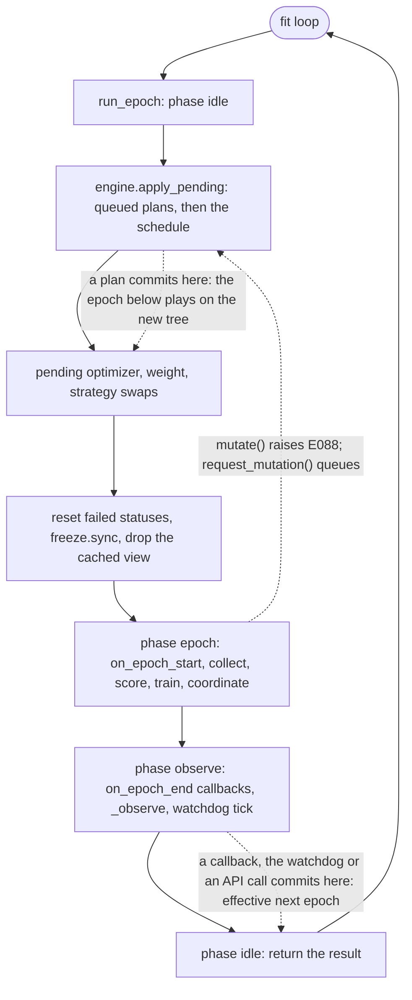

### 12.7 Rebinding the subsystems: the `MACTFTrainer` integration

12.5 gave the engine the trainer members it reads; this subsection adds them, and changes every
place in the trainer that walks the tree so that a retired peer is out of play (M10). The order
of the epoch (document 08 section 5.2) does not change; a run that never mutates executes the
same statements in the same order (the active view below is the tree itself when nothing is
retired).

#### 12.7.1 The sites

| Site | Today | After |
|---|---|---|
| imports (`trainer.py:1-130`) | | `MutationLimits`, `MutationPlan`, `MutationReport`, `structure_digest`, `MutationEngine`, `PathState`, `MutationError` |
| `__init__` (`trainer.py:381-442`) | no topology state | adds `mutation_limits`, `mutation_journal`, `topology_epoch`, `_tombstones`, `_phase`, `_mutations_in_cycle`, `_active_view`, `_shared_trunk`, `_loss_baseline`, `_rate_baseline`, `_node_specs`, `_node_meta`, `_base_digest`, `_build_meta`, `engine`, `path_state` |
| `build()` (`trainer.py:574-576`, `:682`) | tree, peers, `_initial_nodes = len(self.peers)` | the limits are validated against the freshly built tree; the audit of 12.6.2 runs once at the end of the build when mutation is enabled |
| `_build_peers` (`trainer.py:826-875`) | construction inline in the loop; the shared trunk is a local | the loop body becomes `_assemble_peer`, which the engine also calls; the trunk is `self._shared_trunk` |
| `_make_optimizer` (12.5.3) | `self.peers[path]` | an optional `peer` argument, so a facade can be bound to a peer not yet installed |
| `_validate_tied_parameters` (`trainer.py:957-987`) | reads `self.tree`, `self.peers` | keyword arguments `tree`, `peers`, `skip`; the defaults reproduce today |
| `node_paths`, `peer_names` (`trainer.py:550-558`, `:1151-1155`) | every node, every root | `node_paths` stays the complete structure (identity, `TrainSpec`); `peer_names` reads the active roots; new `active_node_paths` |
| `mean_score` (`trainer.py:1263-1273`) | `self.tree.root_paths` | `self.active_tree.root_paths` |
| `collect_episode` (`trainer.py:1315`) | `tree = self.tree` | `tree = self.active_tree` |
| `_fail_node` (`trainer.py:1436-1445`) | `self.tree.mark` | `self._mark_node`, which marks the tree and the cached view |
| `score` (`trainer.py:1459`) | `score_tree(self.tree, ...)` | `score_tree(self.active_tree, ...)` |
| `_train_epoch` (`trainer.py:1650`) | `self.tree.walk` | `self.active_tree.walk` |
| `_group_aggregator`, `update_weights`, `aggregate` (`trainer.py:1679`, `:1758`, `:1815`) | `self.tree` | `self.active_tree` |
| `_tree_view` (11.9) | `tree_view(self.tree, ...)` | `tree_view(self.active_tree, ...)` |
| `run_epoch` (`trainer.py:1864-1919`) | no phases | the phase flag, the pending-plan call, the budget reset, the view reset |
| `_observe`, `_health_context` (`trainer.py:1921-2004`) | | 12.8 |
| `evaluate`, `infer` (`trainer.py:2084-2133`) | every peer; `self.tree` | retired peers skipped; `self.active_tree` |
| `_trainer_state`, `load_state_dict` (`trainer.py:2190`, `:2228`) | | the journal (12.9) |
| new public methods | | `mutate`, `preview_mutation`, `request_mutation`, `add_peer`, `retire_peer`, `revive_peer`, `purge_peer`, `modify_peer`, `topology`, `mutation_history`, `mutation_blockers`, `_after_mutation` |

`to()` (`trainer.py:2259-2270`), `export_parameters`, `import_parameters` and `close()` iterate
`self.peers`, which still holds retired peers on purpose: moving a retired peer to another
device, exporting its weights and writing it into a checkpoint are exactly what keeps `revive`
possible. They need no change.

#### 12.7.2 Construction

```python
# mactf/training/trainer.py   (imports, with the other relative imports)
from ..coopetition.tree import PeerTree
from ..exceptions import MutationError
from .mutation import MutationLimits, MutationPlan, MutationReport, add_peer as _op_add
from .mutation import modify_peer as _op_modify, purge_peer as _op_purge
from .mutation import retire_peer as _op_retire, revive_peer as _op_revive
from .mutation import structure_digest
from .mutation_engine import MutationEngine
from .path_state import PathState
```

```python
# mactf/training/trainer.py   (__init__: after ``self._loss_function`` at line 441)
        # -- tree mutation (12.7) -------------------------------------
        self.mutation_limits: MutationLimits = MutationLimits()
        self.mutation_journal: list[dict[str, Any]] = []
        self.topology_epoch: int = 0
        self._tombstones: set[str] = set()
        self._phase: str = "idle"                  # idle | epoch | observe
        self._mutations_in_cycle: int = 0
        self._active_view: PeerTree | None = None
        self._shared_trunk: nn.Module | None = None
        self._loss_baseline: int = 0               # first ``history`` index judged by the loss probes
        self._rate_baseline: int = 0               # first ``_epoch_seconds`` index judged by the rate probe
        self._node_specs: dict[str, dict[str, Any]] = {}   # path -> effective spec of a created or rebuilt node (12.9)
        self._node_meta: dict[str, dict[str, Any]] = {}    # path -> final metadata of a created or touched node (12.9)
        self._base_digest: str = ""                        # structure digest of the tree as built (12.9)
        self._build_meta: dict[str, dict[str, Any]] = {}   # path -> metadata the tree was built with (12.9)
        self.engine: MutationEngine = MutationEngine(self)
        self.path_state: PathState = PathState(self)
```

`MutationEngine.__init__` stores the trainer and nothing else, and `PathState.__init__` the
same, so creating them before `build()` is safe; both refuse to act until `built` is true
(`_gate`, and `audit` reads containers that exist from `__init__`).

```python
# mactf/training/trainer.py   (build(): immediately after ``self.tree = tree``, line 575;
#                              ``trainer_block`` is the variable of 11.9)
        self.mutation_limits = MutationLimits.from_settings(
            trainer_block.get("MUTATION"), initial_roots=len(tree.root_paths)
        )
```

```python
# mactf/training/trainer.py   (build(): the last three statements before ``self.built = True``, line 682)
        self._initial_nodes = len(self.active_tree)
        self._base_digest = structure_digest(self.tree, ())
        self._build_meta = {
            node.path: copy.deepcopy(node.metadata) for node in self.tree.walk("root-first") if node.metadata
        }
        if self.mutation_limits.enabled:
            problems = self.path_state.audit()
            if problems:
                raise MutationError(
                    "E089",
                    "the trainer is inconsistent before any mutation ran, so one would only make it worse: "
                    + "; ".join(problems),
                )
```

`len(self.active_tree)` equals `len(self.peers)` at build (nothing is retired), so the
baseline of `trainer.py:682` is unchanged. The audit at build costs one pass over the nine
containers and runs only for a run that opted in.

`_build_peers` keeps its loop and its order; what moves is the body that turns a module into a
peer, because the engine needs the identical construction for a peer it adds. Finetuning,
learning rate, action and state dimensions, weight decay and the metadata a peer carries are
therefore defined once.

```python
# mactf/training/trainer.py   (_build_peers, replacing lines 826-875)
    def _build_peers(self, tree: PeerTree, runtime: Runtime) -> dict[str, Peer]:
        self._tree_in_build = tree
        sharing = str(getattr(self._hierarchy, "sharing", "independent"))
        freeze_base = bool(
            self.finetuning.freeze_base if self.finetuning is not None else True
        )

        peers: dict[str, Peer] = {}
        trunk: nn.Module | None = None
        for node in tree.walk("root-first"):
            module = self._module_for(node.path)

            if sharing == "shared_trunk" and node.depth > 1:
                # Children deep-copy the trunk *once* and own their heads. A
                # gradient from one child then accumulates into the shared trunk,
                # which is why the trunk is frozen by default.
                if trunk is None:
                    trunk = copy.deepcopy(module)
                    if freeze_base:
                        for parameter in trunk.parameters():
                            parameter.requires_grad_(False)
                    self._shared_trunk = trunk
                module = _with_shared_trunk(trunk, module)

            peer = self._assemble_peer(node.path, node.depth, module, runtime)
            node.peer = peer
            peers[node.path] = peer
        if not peers:  # pragma: no cover - the tree always has one node
            raise ImproperlyConfigured("the tree produced no nodes")
        return peers

    def _assemble_peer(
        self,
        path: str,
        depth: int,
        module: nn.Module,
        runtime: Runtime,
        *,
        finetuned: bool = False,
    ) -> Peer:
        """Module -> peer: finetuning, the optimizer-less ``build_peer``, and the metadata.

        ``finetuned`` says the module is a copy of a peer that already went through
        ``apply_finetuning``; the call is then a no-op (``_already_applied``) and the flag is only
        recorded. The peer is *not* placed in the tree or in ``self.peers``: the caller does that,
        which is what lets the engine stage a peer without touching the live trainer.
        """
        training = self._training_settings()
        sharing = str(getattr(self._hierarchy, "sharing", "independent"))
        module, report = apply_finetuning(module, self.finetuning, device=runtime.device)
        peer = build_peer(
            module,
            name=path,
            runtime=runtime,
            learning_rate=float(training.get("LEARNING_RATE", 1e-3)),
            action_dim=int(training.get("ACTION_DIM", 4)),
            state_dim=int(training.get("STATE_DIM", 16)),
            weight_decay=float(training.get("WEIGHT_DECAY", 0.0)),
        )
        peer.metadata["depth"] = depth
        peer.metadata["sharing"] = sharing
        peer.metadata["finetuning"] = report
        if finetuned:
            peer.metadata["finetuning_inherited"] = True
        if depth == 1:
            peer.metadata["role"] = "root"
        return peer
```

The condition `node.depth == 1 and node.path in roots` of line 869 is `depth == 1`, because a
root is exactly a node with no parent and depth 1 (`tree.py:643-644`, `:200-212`); the local
`roots` list is therefore not needed. The old behaviour for every existing run is identical,
which the unchanged `test_trainer_build_*` tests confirm.

```python
# mactf/training/trainer.py   (_validate_tied_parameters, replacing lines 957-987)
    def _validate_tied_parameters(
        self,
        *,
        tree: PeerTree | None = None,
        peers: Mapping[str, Peer] | None = None,
        skip: Iterable[str] | None = None,
    ) -> None:
        """A tied parameter in two groups cannot receive two blended values.

        The keyword arguments let the mutation engine ask the same question about a tree and a
        set of peers that are not installed yet, over active members only (M7). With none given
        it reads the live tree and peers and skips the retired ones, which at build is nobody.
        """
        tree = tree if tree is not None else self.tree
        peers = peers if peers is not None else self.peers
        skipped = set(skip) if skip is not None else set(self.freeze.retired())
        owners: dict[int, str] = {}
        for parent, members in aggregation_groups(tree):
            group = "root" if parent is None else parent
            seen_in_group: dict[int, str] = {}
            for member in members:
                if member in skipped:
                    continue
                peer = peers.get(member)
                if peer is None:
                    continue
                for name, parameter in peer.module.named_parameters():
                    if not parameter.requires_grad:
                        # A frozen shared trunk holds identical values everywhere,
                        # so averaging it is harmless and it is never double counted.
                        continue
                    key = id(parameter)
                    if key in seen_in_group:
                        raise ContractError(
                            f"parameter {name!r} is tied between {seen_in_group[key]!r} "
                            f"and {member!r} in group {group!r}; siblings must not share "
                            "parameters because they are averaged"
                        )
                    seen_in_group[key] = member
                    previous = owners.get(key)
                    if previous is not None and previous != group:
                        raise ContractError(
                            f"parameter {name!r} is tied across groups {previous!r} and "
                            f"{group!r}; a tied parameter cannot receive two different "
                            "blended values"
                        )
                    owners[key] = group
```

`Iterable` is already imported from `collections.abc` or `typing` in `trainer.py`; if it is not
(the module imports `Callable, Mapping, Sequence` today, `trainer.py:60-70`) the import line
gains it. `_make_optimizer` (9.7) takes the peer:

```python
# mactf/training/trainer.py   (_make_optimizer of 9.7: the signature and the first line)
    def _make_optimizer(
        self, path: str, entry: OptimizerEntry, runtime: Runtime, peer: Peer | None = None
    ) -> MACTFOptimizer:
        """Build, finish and bind the facade of one node for one entry."""
        peer = peer if peer is not None else self.peers[path]
        module = peer.adapter
        # ... the rest of the method is unchanged
```

#### 12.7.3 The active view

Two trees exist, on purpose. `trainer.tree` is the *complete structure*: every node that has not
been purged, retired ones included, with status `pruned` for those. It is what the checkpoint
topology, the audit, the journal digest and `revive` need. `trainer.active_tree` is the tree the
epoch *plays on*: the same tree without the retired nodes and their descendants.

```python
# mactf/training/trainer.py   (new members)
    @property
    def active_tree(self) -> PeerTree:
        """The tree rollout, scoring, training, coordination and aggregation walk (M10).

        ``PeerTree.without`` returns the tree itself when nothing is retired, so a run that never
        mutates pays nothing and sees nothing different. The view is rebuilt after a commit
        (``_active_view`` is reset there) and at the top of each epoch.
        """
        view = self._active_view
        if view is None:
            view = self.tree.without(self.freeze.retired())
            self._active_view = view
        return view

    @property
    def active_node_paths(self) -> tuple[str, ...]:
        return tuple(node.path for node in self.active_tree.walk("root-first"))

    def _mark_node(self, path: str, status: str) -> None:
        """Set a node's status on the tree and on the cached view.

        ``without`` shares unchanged node objects, so for almost every node one write is enough.
        An ancestor that lost a retired child is a copy in the view, and a status written only
        to the tree would leave the copy ``active`` for the rest of the epoch, so a failed
        parent would still be trained. Both are written.
        """
        self.tree.mark(path, status)
        view = self._active_view
        if view is not None and view is not self.tree:
            node = view.get(path)
            if node is not None:
                node.status = status
```

`_tree_view`, `mean_score`, `collect_episode` and the rest read it:

```python
# mactf/training/trainer.py   (the one-line edits, in file order)

# peer_names, line 1154
            return tuple(self.active_tree.root_paths)

# mean_score, line 1269
            for path in self.active_tree.root_paths

# collect_episode, line 1315
        tree = self.active_tree

# _fail_node, line 1438
        self._mark_node(node.path, "failed")

# score, line 1459
                self.active_tree, episode.ledgers, episode=episode.index, evidence=evidence

# _train_epoch, line 1650 (the freeze condition of 11.4 follows on line 1651)
        for node in self.active_tree.walk("leaves-first"):

# _group_aggregator, line 1679
            children = len(self.active_tree[parent].children)

# update_weights, line 1758
        members = tuple(self.active_tree.root_paths)

# aggregate (11.9 version, the ``tuple(self.tree.root_paths)`` argument)
            tuple(self.active_tree.root_paths),

# _tree_view (11.9)
        return tree_view(self.active_tree, hierarchy=self._hierarchy is not None)

# run_epoch, the policy hook, line 1915
            self._trainer_policy.on_epoch_end(self.active_tree, result)

# infer, line 2127
            self.active_tree,
```

```python
# mactf/training/trainer.py   (evaluate, line 2099: skip peers that are out of play)
        for path, peer in self.peers.items():
            if self.freeze.is_retired(path):
                continue
            adapter = peer.adapter
```

Why this is enough, site by site. Delegation and synthesis walk the `tree` local of
`collect_episode`, so a retired child is never *selected* and never *synthesized from*; its
parent's `selected_by_parent` is built from `node.children`, which in the view lacks it. The
rollout loop never runs a retired peer, so `episode.participants` and `episode.ledgers` do not
name it, and `score_tree`'s own check (`scoring/hierarchy.py:225-229`, every ledger names a
node of *this* tree) passes. `score_tree` walks the view, so a retired child produces no
`ScorerOutput`, no `branch_void` entry, and no rollup into its parent: the parent is scored
over the children that played. `_train_epoch` and `_write` never see it (and `eligible_for`
gives the same answer for any code path that does walk the complete tree, because `RETIRED`
is the `mutation:retired` reason that `excludes` honours in both freeze modes, 12.6). The two
walks that deliberately stay on the complete tree are the failed-status reset at the top of
`run_epoch` (line 1874: a retired node is not `failed`, so it is untouched) and the
`FreezeSet` status mirror.

#### 12.7.4 Phases, the pending plans and the top of the epoch

M2 is a flag, not a convention. `_phase` is `"idle"` outside `run_epoch` and from its first
line until the epoch's work starts, `"epoch"` while an episode is being collected, scored,
trained and coordinated, and `"observe"` from the moment the epoch's result exists until
`run_epoch` returns. `_gate` (12.5.4) admits `idle` and `observe` only.



```python
# mactf/training/trainer.py   (run_epoch, lines 1864-1919: the statements this section adds or
#                              moves; everything else is unchanged, including 9.7, 10.8 and 11.9)
    def run_epoch(self, epoch: int) -> EpochResult:
        """One epoch in the fixed order of document 08 section 5.2."""
        self._require_built()
        self._phase = "idle"
        self._epoch = int(epoch)                    # a plan journaled below names this epoch
        self._mutations_in_cycle = 0
        self.engine.apply_pending(int(epoch))       # queued plans, then this epoch's schedule entries
        self._apply_pending_optimizers()            # 9.7
        self._apply_pending_weights()               # 10.8
        self._apply_pending_strategies()            # 11.9
        started = time.monotonic()
        self._epoch_cards = []
        self._epoch_step_losses = []
        self._epoch_node_metrics = {}
        self._normalization = None
        self._pending = None
        for node in self.tree.walk("root-first"):
            if node.status == "failed":
                self.tree.mark(node.path, "active")
        self.freeze.sync()                          # 11.4
        self._active_view = None                    # ancestors may hold a stale copy of a status
        self._phase = "epoch"
        try:
            self._dispatch_many("on_epoch_start", self, epoch)
            self.strategy_plan.epoch_start(self, epoch)
            self.freeze.check_learners(
                node.path for node in self.active_tree.walk("root-first")
                if node.peer is not None and node.status != "failed"
            )
            task = self.task_source.next(epoch)
            self.collect_episode(task)
            self.score()
            steps = self._train_epoch()
            self._stamp_distillation_metadata()
            report = self._coordinate(epoch)

            # ... lines 1887-1911, building ``metrics`` and ``result``, are unchanged ...

            self._phase = "observe"
            if self._trainer_policy is not None and callable(
                getattr(self._trainer_policy, "on_epoch_end", None)
            ):
                self._trainer_policy.on_epoch_end(self.active_tree, result)
            self._dispatch_many("on_epoch_end", self, result)
            self._observe(result, report)
            self._previous_scores = dict(self.signal_by_peer)
            return result
        finally:
            self._phase = "idle"
```

Three details of this listing. `self._epoch = int(epoch)` moves up from line 1868 because the
journal entry of a plan applied at the top of epoch `E` must say `E`, not `E - 1`. The
learner check of 11.9 now walks the active view, so a retired peer is not counted as a learner
and the check (`E075`) reports honestly when the *remaining* peers are all frozen. The
`try/finally` guarantees the flag returns to `idle` even when the epoch raises, so an
exception caught by a caller's `except` does not leave the trainer permanently "mid-epoch" and
unmutable.

A plan that commits in the `observe` phase takes effect at the next epoch: the epoch that just
ran produced its scorecards on the old tree, and the checkpoint `_observe` writes straight
afterwards carries the *new* topology and the journal that explains it (12.9). That ordering
is what makes a resume from that checkpoint start at the next epoch on the right tree.

#### 12.7.5 The public surface

```python
# mactf/training/trainer.py   (new methods, after ``request_stop`` at line 1133)
    # -- tree mutation ---------------------------------------------------
    def mutate(
        self, plan: "MutationPlan | Mapping[str, Any] | Sequence[Any]", *, dry_run: bool = False, source: str = "api"
    ) -> MutationReport:
        """Apply a plan atomically (12.5). ``dry_run=True`` simulates, stages, reports, installs nothing."""
        return self.engine.apply(plan, dry_run=dry_run, source=source)

    def preview_mutation(self, plan: "MutationPlan | Mapping[str, Any] | Sequence[Any]") -> MutationReport:
        return self.engine.apply(plan, dry_run=True, source="preview")

    def request_mutation(
        self, plan: "MutationPlan | Mapping[str, Any] | Sequence[Any]", *, source: str = "request"
    ) -> MutationPlan:
        """Queue a plan for the top of the next epoch. Parsed now, so a malformed plan fails here."""
        return self.engine.request(plan, source=source)

    def add_peer(self, path: str, *, reason: str = "", **spec: Any) -> MutationReport:
        return self.mutate(MutationPlan.of(_op_add(path, **spec), label=f"add:{path}", reason=reason))

    def modify_peer(self, path: str, *, reason: str = "", **changes: Any) -> MutationReport:
        return self.mutate(MutationPlan.of(_op_modify(path, **changes), label=f"modify:{path}", reason=reason))

    def retire_peer(self, path: str, *, recursive: bool = False, reason: str = "") -> MutationReport:
        return self.mutate(
            MutationPlan.of(_op_retire(path, recursive=recursive, reason=reason), label=f"retire:{path}", reason=reason)
        )

    def revive_peer(self, path: str, *, recursive: bool = False, reason: str = "") -> MutationReport:
        return self.mutate(
            MutationPlan.of(_op_revive(path, recursive=recursive, reason=reason), label=f"revive:{path}", reason=reason)
        )

    def purge_peer(
        self, path: str, *, recursive: bool = False, force: bool = False, reason: str = ""
    ) -> MutationReport:
        return self.mutate(
            MutationPlan.of(
                _op_purge(path, recursive=recursive, force=force, reason=reason), label=f"purge:{path}", reason=reason
            )
        )

    def mutation_history(self) -> list[dict[str, Any]]:
        """The journal: one entry per committed plan, oldest first, as stored in the checkpoint."""
        return [dict(entry) for entry in self.mutation_journal]

    def topology(self) -> dict[str, Any]:
        """What the tree is now: every node with its status, what is retired, what is tombstoned."""
        self._require_built()
        retired = self.freeze.retired()
        return {
            "topology_epoch": int(self.topology_epoch),
            "digest": structure_digest(self.tree, retired),
            "active": len(self.active_tree),
            "retired": sorted(retired),
            "tombstones": sorted(self._tombstones),
            "journal": len(self.mutation_journal),
            "pending": self.engine.pending(),
            "nodes": [
                {
                    "path": node.path, "role": node.role, "depth": node.depth, "parent": node.parent,
                    "status": node.status, "retired": node.path in retired,
                    "children": list(node.children),
                }
                for node in self.tree.walk("root-first")
            ],
        }

    def mutation_blockers(self) -> list[str]:
        """Reasons this trainer cannot be mutated at all (checked by ``MutationEngine._gate``)."""
        reasons: list[str] = []
        policy = self._trainer_policy
        if self._distillation.enabled and not bool(getattr(policy, "supports_tree_mutation", False)):
            reasons.append(
                "DISTILLATION is enabled and CoDistillStep keeps a fixed cohort and fixed teacher "
                "assignments; a policy that can follow a changing tree sets `supports_tree_mutation = True` "
                "and implements `on_tree_mutated(trainer, report)`"
            )
        return reasons
```

`label=f"add:{path}"` makes the journal readable without the plan. A custom `TrainerPolicy` of
section 7 that keeps per-peer state implements `on_tree_mutated`; `_after_mutation` (12.8)
calls it. `CoDistillStep` does not today (document 14), and the blocker says so rather than
letting a cohort step index a peer that has been purged.

A strategy or a callback that wants a change cannot call `mutate` (it runs while the phase is
`epoch`); it calls the queue. The coordination context of 11.6 exposes the same call so a
`PeerStrategy` does not need the trainer:

```python
# mactf/coopetition/strategy.py   (CoordinationContext: new method, after ``eligible_for``)
    def request_mutation(self, plan: Any, *, source: str = "strategy") -> Any:
        """Queue a topology change for the top of the next epoch; never applies it now (M2)."""
        return self._backend.request_mutation(plan, source=source)
```

and the one place a strategy would read what is retired:

```python
# mactf/coopetition/strategy.py   (CoordinationContext: new property)
    @property
    def retired(self) -> frozenset[str]:
        return self._backend.freeze.retired()
```

Because the `TreeView` a strategy receives is built from the active view (the `_tree_view`
edit above), `retired` is rarely needed: a retired peer is not in any group the strategy is
given.

#### 12.7.6 How the engine reads the trainer

12.5.4 already carries the two engine edges this subsection depends on; they are listed here so
the trainer side and the engine side can be checked against each other.

- `MutationEngine._gate(source)` admits `idle` and `observe` only, refuses a plan when
  `mutation_blockers()` is non-empty, and enforces `MAX_PLANS_PER_EPOCH` for every source
  except `replay`. The *internal* sources (`INTERNAL_SOURCES = ("watchdog", "replay")`) skip the
  `ENABLED` check: the watchdog's prune is a built-in feature that must not corrupt a run whether
  or not the user opted into mutation (its alternative today is the corruption of M-G2), and a
  replay reproduces a mutation the checkpoint says already happened, so it is neither budgeted
  nor refused for `ENABLED` (12.9 refuses it separately with `E080` when the journal is
  non-empty, the configuration says mutation is off and `STRICT_REPLAY` is true).
- `MutationEngine._finish` calls `t._after_mutation(report)` first, then the
  `on_tree_mutated` callbacks, then the `tree_mutated` signal. `_after_mutation` runs first so
  that the health baselines are rebased before any observer reads them, and, being plain trainer
  code, it is the one hook that a user callback cannot remove. Its text is in 12.8.5.
