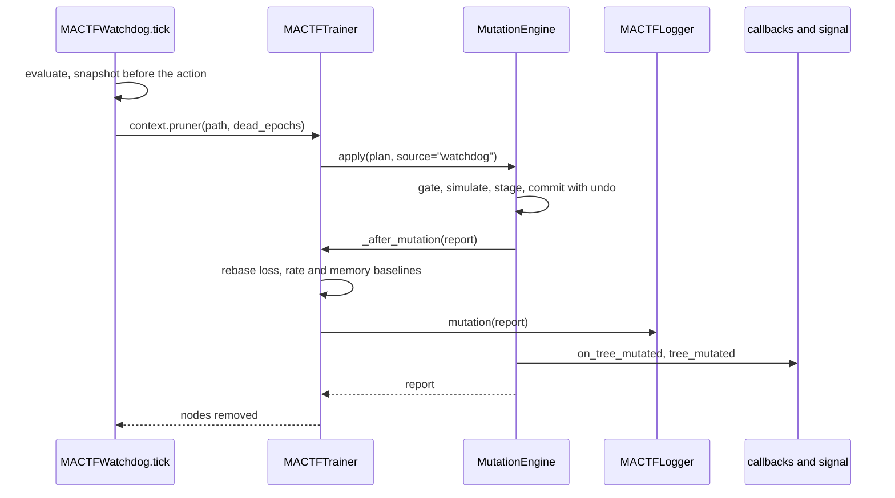

### 12.8 The watchdog, the health baselines and observability

The watchdog is the one component that already changes the tree on its own: `PRUNE_BRANCH`
removes a dead subtree (`watchdog.py:1128-1142`). Until now that was harmless because nothing
else cared; with a trainer that owns ten containers keyed by node path, it is the most likely
source of an inconsistent run. This subsection makes the watchdog a client of the mutation
engine, teaches the health machinery that a topology can change, and gives every mutation a
log record, a callback and a signal (M12).

#### 12.8.1 What is wrong today

| # | Finding | Evidence | Consequence once peers can come and go |
|---|---|---|---|
| **W-G1** | `MACTFWatchdog.prune_branch` calls `tree.remove_node(path, recursive=True)` on `context.extras["tree"]` | `watchdog.py:1128-1142` | The tree loses the node; `trainer.peers`, `optimizers`, `controllers`, `_group_aggregators`, `signal_by_peer`, `_last_weights`, `_previous_scores`, `_dead_counts`, `_epoch_node_metrics` and the freeze set keep it (M-G2). The parent's `AdaptiveKappa` and aggregator are still sized for the old children, so the next `aggregate` indexes a shape that no longer exists. Checkpoint `models` still carries the peer, the tree does not, and a resume raises `ContractMismatch` (`checkpoint_v2.py:995-999`) |
| **W-G2** | `tree_nodes = len(self.peers)`; `initial_tree_nodes` is set once at build | `trainer.py:682`, `:1999-2000` | A retired peer is still counted; an added peer is a "growth" nobody asked the probe to judge |
| **W-G3** | `WatchdogPolicy.max_tree_growth_ratio` is validated, serialized, documented, and read by **no probe**. `HealthContext.tree_nodes` and `initial_tree_nodes` have no reader either | `watchdog.py:126`, `:190`, `:295-296`; no `class` in the file consumes them | A dead setting (the same defect as `TRAINER.PEER_STRATEGY`). A callback that adds a peer every epoch is invisible to the watchdog |
| **W-G4** | `LossTrendProbe` judges the current loss against the median of the last five *prior* losses; `ThroughputProbe` compares this epoch's steps-per-second with the previous epoch's | `watchdog.py:389-433`, `:578-603`; `trainer.py:1962-1964`, `:1984` | The epoch after an `add` or a `retire` is on a different cohort: the mean loss moves because the *average* moved, not because training broke. A retire that removes the worst peer drops the loss (healthy); a purge that removes the best raises it by more than `loss_increase_ratio` and raises `CRITICAL` at `ratio >= 10`, whose default action is **rollback** |
| **W-G5** | The context is built from the complete tree: `roots = len(self.tree.root_paths)`, `dead` walks `self.tree`, `scores = dict(self.signal_by_peer)` | `trainer.py:1960`, `:1970-1974`, `:1983` | A retired root inflates `max_entropy = log(roots)`, so `EntropyProbe` reports a collapse that is a correct entropy over fewer peers. A retired peer's last signal stays in `scores` for the rest of the run |
| **W-G6** | `MemoryProbe` compares RSS with `_initial_rss`, read when the trainer is constructed | `trainer.py:423`, `:1997-1998`; `watchdog.py:606-637` | A new peer, its optimizer moments and its gradients are real memory the baseline never included: `RSS grew to 2.1x` after adding the fourth of four peers is a false `DEGRADED` |
| **W-G7** | `EarlyStopping` keeps `best` and `bad_epochs` across the whole run | `callbacks.py:291-338` | After a mutation the loss is measured on a different cohort; if it is higher than `best`, `bad_epochs` climbs until the run is stopped for something the user did on purpose |
| **W-G8** | A mutation leaves no trace in the log: no record kind, no callback, no signal | `logging.py:144-186` (the record kinds), `callbacks.py:34-44` (`HOOK_NAMES`), `signals.py:95-126` | A user comparing two runs cannot see that peer-3 left at epoch 7 |
| **W-G9** | `MACTFWatchdog.rollback` restores the last checkpoint into the *live* trainer (through `_CheckpointBridge`, `trainer.py:2399-2401`) | `watchdog.py:1110-1126`; `checkpoint_v2.py:995-999` | If the tree changed since that checkpoint the restore refuses with `ContractMismatch`, and the rollback that was meant to save the run is reported as `watchdog rollback failed`. 12.9 owns the fix (`reconcile_topology`) |

#### 12.8.2 The context learns about topology

```python
# mactf/training/watchdog.py   (HealthContext: new fields at the end, so positional construction
#                               and ``copies`` are unchanged; ``Callable`` is added to the typing import)
    extras: Mapping[str, Any] = field(default_factory=dict)
    #: First index of ``losses`` measured on the current topology. ``LossTrendProbe`` judges only
    #: ``losses[loss_baseline:]``; the NaN and Inf probes still read all of ``losses``.
    loss_baseline: int = 0
    #: Peers that are retired (still in the tree, out of play). ``tree_nodes`` counts only the others.
    retired_nodes: int = 0
    #: How many plans have committed, and the topology epoch they reached. Both 0 for a run that never mutated.
    mutations: int = 0
    topology_epoch: int = 0
    #: ``pruner(path, dead_epochs) -> nodes removed``. Set by a trainer; ``None`` for a context a
    #: caller built by hand, in which case ``prune_branch`` falls back to ``extras["tree"]``.
    pruner: Callable[[str, int], int] | None = None
```

`tree_nodes` keeps its name and its meaning "nodes in play", which for a run that never mutates
is `len(self.peers)`, the number it has always been. `retired_nodes`, `mutations` and
`topology_epoch` default to zero, so a hand-built context and every existing probe test
behave as before.

#### 12.8.3 Probes

`LossTrendProbe` reads the topology-aware slice; nothing else in the probe changes.

```python
# mactf/training/watchdog.py   (LossTrendProbe.probe, replacing line 393)
        losses = [float(value) for value in context.losses][max(0, int(context.loss_baseline)):]
```

With `loss_baseline == 0` (every run that never mutated, and every hand-built context) the
slice is the whole list: the probe is byte-for-byte what it was. After a mutation the probe has
fewer than two losses on the new topology and returns `HEALTHY`, then judges the new cohort
against its own trailing median. `NaNLossProbe` and `InfLossProbe` keep reading `losses`
unsliced: a NaN is a NaN whichever cohort produced it.

`TreeGrowthProbe` finally gives `max_tree_growth_ratio` a reader. It reports only growth: the
watchdog's own remedy for a dead branch (a smaller tree) must not raise an alarm of its own.

```python
# mactf/training/watchdog.py   (new probe, after DepthCostProbe)
class TreeGrowthProbe(_BaseProbe):
    """The active tree is more than ``max_tree_growth_ratio`` times the tree the run was built with.

    The probe is advisory (``DEGRADED`` at most): a user who doubles a tree on purpose raises
    ``WATCHDOG.MAX_TREE_GROWTH_RATIO``, and ``W044`` says so when the schedule is validated.
    Its job is the callback or strategy that requests a peer every epoch by mistake;
    ``TRAINER.MUTATION.MAX_PLANS_PER_EPOCH`` bounds the rate, this bounds the total.
    """

    name = "tree_growth"

    def probe(self, context: HealthContext) -> ProbeResult:
        nodes = context.tree_nodes
        initial = context.initial_tree_nodes
        if not nodes or not initial or int(initial) <= 0:
            return self._healthy()
        ratio = float(nodes) / float(initial)
        limit = float(self.policy.max_tree_growth_ratio)
        metadata = {
            "nodes": int(nodes),
            "initial_nodes": int(initial),
            "retired": int(context.retired_nodes),
            "mutations": int(context.mutations),
            "topology_epoch": int(context.topology_epoch),
        }
        if ratio > limit:
            return ProbeResult(
                name=self.name,
                status=WatchdogStatus.DEGRADED,
                value=ratio,
                threshold=limit,
                detail=(
                    f"the tree has {int(nodes)} active nodes, {ratio:.2f}x the {int(initial)} it was "
                    f"built with, after {int(context.mutations)} mutation(s)"
                ),
                metadata=metadata,
            )
        return self._healthy(ratio, threshold=limit, metadata=metadata)
```

```python
# mactf/training/watchdog.py   (default_probes: appended last, so the order and names of the
#                               existing probes are unchanged; ``__all__`` gains "TreeGrowthProbe")
        DepthCostProbe(policy),
        TreeGrowthProbe(policy),
    ]
```

```python
# mactf/training/watchdog.py   (MACTFWatchdog._recommendations: two branches, after "child_starvation")
            elif result.name == "tree_growth":
                advice.append(
                    "the tree keeps growing: inspect the callbacks and strategies that call "
                    "request_mutation, or raise WATCHDOG.MAX_TREE_GROWTH_RATIO if the growth is intended"
                )
            elif result.name == "dead_branch" and result.metadata.get("pruned"):
                advice.append(
                    f"branch {result.node_path!r} was removed from play ({result.metadata['pruned']}); "
                    "its weights are in the checkpoint written before the prune"
                )
```

The second branch is reached only by a report assembled after a prune; the first `dead_branch`
branch (`watchdog.py:1019-1022`) keeps its place and wins for an ordinary dead-branch result, so
no existing advice changes. A test pins `default_probes(policy)` names; it gains one entry
(`tree_growth`), which is the only edit to an existing test (12.11).

#### 12.8.4 `prune_branch` goes through the engine

```python
# mactf/training/watchdog.py   (MACTFWatchdog.prune_branch, replacing lines 1128-1142)
    def prune_branch(self, context: HealthContext) -> int:
        """Drop every dead subtree the report named; returns how many nodes left play.

        A trainer sets ``context.pruner``, which turns the removal into a mutation plan (12.8.5):
        the tree, the peers, the optimizers, the controllers and every per-path cache change
        together or not at all. A context a caller built by hand carries only a tree, and the
        original ``remove_node`` is the best that can be done for a structure nothing else
        depends on.
        """
        removed = 0
        pruner = context.pruner
        tree = context.extras.get("tree")
        if pruner is None and tree is None:
            return 0
        for path, count in sorted(context.dead_branches.items()):
            if int(count) < self.policy.dead_branch_patience:
                continue
            try:
                if pruner is not None:
                    removed += int(pruner(str(path), int(count)))
                else:
                    removed += int(tree.remove_node(str(path), recursive=True))
            except Exception as error:  # noqa: BLE001 - a failed prune is reported, never fatal
                emit = getattr(self.logger, "error", None)
                if callable(emit):
                    emit(f"watchdog could not prune branch {path!r}: {error}")
        return removed
```

`sorted` puts a parent before its children (a path is a prefix of its descendants'), so when
both a branch and a leaf under it are dead, the branch goes first and the pruner is asked
about a path that is already gone; `_prune_node` returns `0` for that, which is the correct
answer and not an error.

The snapshot that `tick` takes **before** the action (`watchdog.py:1049-1060`) is what makes a
prune recoverable: the checkpoint on disk holds the branch's weights and the journal without
the prune, and 12.9 shows how a rollback or a resume from it brings the branch back.

#### 12.8.5 The trainer side

```python
# mactf/training/trainer.py   (new methods, after ``mutation_blockers``)
    # -- the watchdog and the health baselines (12.8) ----------------------
    def _prune_node(self, path: str, dead_epochs: int = 0) -> int:
        """``PRUNE_BRANCH`` as a mutation. Returns the number of nodes that left play (0 if none).

        ``TRAINER.MUTATION.WATCHDOG_PRUNE`` decides how: ``purge`` (the default, and what
        ``remove_node`` always meant), ``retire`` (the branch keeps its weights and can be revived),
        or ``off`` (the watchdog only reports). A refusal (protected path, last active root, a
        distillation run) is recorded in ``failures`` and logged; training goes on.
        """
        node = self.tree.get(path)
        if node is None or path in self.freeze.retired():
            return 0
        mode = self.mutation_limits.watchdog_prune
        reason = f"dead branch: no proposals for {int(dead_epochs)} epoch(s)"
        if mode == "off":
            self.failures.append(f"watchdog: {path} is dead ({reason}) and WATCHDOG_PRUNE is off")
            return 0
        if mode == "retire":
            op = _op_retire(path, recursive=True, reason=reason)
        else:
            op = _op_purge(path, recursive=True, force=True, reason=reason)
        plan = MutationPlan.of(op, label=f"watchdog:{mode}:{path}", reason=reason)
        before = len(self.active_tree)
        try:
            self.engine.apply(plan, source="watchdog")
        except MutationError as error:
            self.failures.append(f"watchdog: could not {mode} {path}: {error}")
            log.error("watchdog could not %s %s: %s", mode, path, error)
            return 0
        return max(0, before - len(self.active_tree))

    def _after_mutation(self, report: MutationReport) -> None:
        """What the health machinery and the per-peer policies learn from a committed plan.

        Called by ``MutationEngine._finish`` before any user callback (12.7.6).
        """
        if report.dry_run or not report.changed:
            return
        # The first epoch measured on the new topology. At the top of epoch E (phase ``idle``) the
        # history holds E results and the next one is E's; in ``observe`` the epoch that just ran
        # is not in the history yet but belongs to the old topology, so the boundary is one later.
        self._loss_baseline = len(self.history) + (1 if self._phase == "observe" else 0)
        # ``_epoch_seconds`` already holds the epoch that just ran when this is called in ``observe``,
        # and not yet the one about to run when it is called in ``idle``; both give ``len``.
        self._rate_baseline = len(self._epoch_seconds)
        grown = tuple(dict.fromkeys((*report.added, *report.rebuilt)))
        if grown and self._initial_rss is not None:
            # New parameters, their gradients and optimizer moments are real, and a baseline
            # taken before them would call them a leak. Memory a purge frees is not credited
            # back: an allocator rarely returns it, so lowering the baseline would invite the
            # opposite false alarm.
            self._initial_rss += self._resident_bytes(grown)
        policy = self._trainer_policy
        hook = getattr(policy, "on_tree_mutated", None)
        if callable(hook):
            hook(self, report)
        record = getattr(self.logger, "mutation", None)
        if callable(record):
            record(report)

    #: Bytes a parameter costs while training: the weight, its gradient, and two Adam moments.
    _TRAINING_BYTES_PER_PARAMETER_BYTE = 4

    def _resident_bytes(self, paths: Iterable[str]) -> int:
        total = 0
        for path in paths:
            peer = self.peers.get(path)
            module = getattr(getattr(peer, "adapter", None), "module", None)
            if module is None:
                continue
            total += sum(
                int(parameter.numel()) * int(parameter.element_size()) for parameter in module.parameters()
            )
        return total * self._TRAINING_BYTES_PER_PARAMETER_BYTE
```

`log` is the module logger the trainer already uses; `Iterable` is already imported from
`typing` in the module header (`trainer.py:1-130`). A parameter shared with another peer
(`_shared_trunk`) is counted once per peer that holds it, which over-estimates and therefore
errs on the side of fewer false alarms.

`_health_context` is rewritten to read the active view and to hand the probes the topology
facts of 12.8.2. Everything that is not marked is the existing code.

```python
# mactf/training/trainer.py   (_health_context, replacing lines 1956-2004)
    def _health_context(self, result: EpochResult) -> "HealthContext":
        from .watchdog import HealthContext

        controller = self.controller
        active = self.active_tree
        roots = max(1, len(active.root_paths))                          # was self.tree.root_paths
        elapsed = self._epoch_seconds[-1] if self._epoch_seconds else 0.0
        previous_rate = None
        if (
            len(self._epoch_seconds) > 1
            and self._epoch_seconds[-2] > 0
            and len(self._epoch_seconds) - 2 >= self._rate_baseline     # the previous epoch ran on this topology
        ):
            previous_rate = result.steps / self._epoch_seconds[-2]
        escalated = sum(
            len(peer_card.warnings_escalated)
            for card in self._epoch_cards
            for peer_card in card.peers.values()
        )
        dead: dict[str, int] = {}
        in_play: set[str] = set()
        for node in active.walk("root-first"):                          # was self.tree.walk
            in_play.add(node.path)
            if node.status == "failed":
                dead[node.path] = self._dead_counts.get(node.path, 0) + 1
        self._dead_counts = dict(dead)
        count = 0
        if self.checkpoint is not None:
            try:
                count = len(self.checkpoint.list())
            except Exception:  # noqa: BLE001 - a missing directory is zero checkpoints
                count = 0
        retired = self.freeze.retired()
        return HealthContext(
            epoch=int(result.epoch),
            step=int(self.global_step),
            losses=tuple(item.mean_loss for item in self.history) + (result.mean_loss,),
            grad_norms=tuple(self.grad_norms),
            scores={path: value for path, value in self.signal_by_peer.items() if path in in_play},
            previous_scores=dict(self._previous_scores),
            entropy=float(controller.entropy) if controller else None,
            max_entropy=math.log(roots) if roots > 1 else 0.0,
            kappa=float(controller.kappa) if controller else None,
            aggregation_reports=tuple(self.reports),
            warnings_escalated=int(escalated),
            checkpoint_count=int(count),
            epoch_seconds=tuple(self._epoch_seconds),
            steps_per_second=(result.steps / elapsed) if elapsed > 0 else None,
            previous_steps_per_second=previous_rate,
            rss_bytes=self._rss(),
            initial_rss_bytes=self._initial_rss,
            tree_nodes=len(active),                                     # was len(self.peers)
            initial_tree_nodes=self._initial_nodes,
            dead_branches=dead,
            level_durations=dict(self._level_durations),
            extras={"tree": self.tree},
            loss_baseline=int(self._loss_baseline),
            retired_nodes=len(retired),
            mutations=len(self.mutation_journal),
            topology_epoch=int(self.topology_epoch),
            pruner=self._prune_node,
        )
```

For a run that never mutates, `active` is `self.tree`, `retired` is empty, `in_play` is every
node, `_rate_baseline` is `0` (so `len - 2 >= 0` holds whenever the old condition did), and the
five new fields are `0`, `0`, `0`, `0` and a bound method that is only called by a prune: the
context is equal to today's in every field a probe read before.

`extras["tree"]` stays the complete tree on purpose. A probe or a user callback that wants the
structure including retired nodes finds it where it always was; the *in-play* view is
`trainer.active_tree`.

#### 12.8.6 Observability: record, callback, signal

```python
# mactf/training/logging.py   (after HealthRecord, line 181)
@dataclass(frozen=True)
class MutationRecord(LogRecord):
    kind: str = "mutation"
```

```python
# mactf/training/logging.py   (MACTFLogger: new method, after ``health``, line 833)
    def mutation(self, report: Any, **fields: Any) -> None:
        """One record per committed plan: what changed, who asked, and the digests that prove it."""
        payload = dict(fields)
        if hasattr(report, "as_dict"):
            payload.update(report.as_dict())
        elif isinstance(report, Mapping):
            payload.update(dict(report))
        warned = bool(payload.get("warnings"))
        label = str(payload.get("label", "") or "")
        source = str(payload.get("source", "") or "")
        self.log(
            self._record(
                MutationRecord,
                level="warning" if warned else "info",
                epoch=int(payload.get("epoch", 0) or 0),
                message=f"{label or 'mutation'} ({source}): "
                f"+{len(payload.get('added', ()))} -{len(payload.get('purged', ()))} "
                f"retired {len(payload.get('retired', ()))} revived {len(payload.get('revived', ()))}",
                fields=payload,
            )
        )
```

`MutationReport.as_dict` (12.5) is already JSON-safe: tuples become lists, everything else is a
string, a number or a digest. The record goes through `MACTFLogger.log`, so every sink (console,
file, JSONL, TensorBoard, W&B) receives it with no sink change, and a sink that fails drops the
record rather than the mutation (`logging.py:701-709`).

```python
# mactf/signals.py   (a new group, after the training lifecycle, before "Startup")
# Topology lifecycle (document 17 section 12.8)
tree_mutated = Signal("tree_mutated")
```

```python
# mactf/training/callbacks.py   (HOOK_NAMES gains one entry; Callback gains the method; EarlyStopping reacts)
HOOK_NAMES: tuple[str, ...] = (
    "on_build",
    "on_epoch_start",
    "on_batch",
    "on_step",
    "on_score",
    "on_aggregate",
    "on_epoch_end",
    "on_tree_mutated",
    "on_resume",
    "on_close",
)

# class Callback:
    def on_tree_mutated(self, trainer: Any, report: Any) -> None:
        """A plan committed. ``report`` is the :class:`MutationReport`; the trainer is consistent again."""
        return None

# class EarlyStopping:
    def on_tree_mutated(self, trainer: Any, report: Any) -> None:
        """The loss is measured on a different cohort now: start the comparison over (W-G7)."""
        self.best = None
        self.bad_epochs = 0
```

Adding the name to `HOOK_NAMES` is what lets both `hooks={"on_tree_mutated": fn}` and a
`Callback` method pass the strict validation (`trainer.py:521-527`,
`callbacks.py:167-169`). The hook order is fixed: the trainer's own `_after_mutation`, the
`hooks` mapping and the callbacks (`_dispatch_many`: hooks first), then the signal.



#### 12.8.7 What the watchdog does and does not decide

| Question | Answer |
|---|---|
| Can the watchdog mutate a run whose `TRAINER.MUTATION.ENABLED` is false? | Yes, for `PRUNE_BRANCH` only, and only because the alternative is the corruption of W-G1. It is the `watchdog` internal source of 12.5.4; every other source needs `ENABLED` |
| Can a user forbid it? | `TRAINER.MUTATION.WATCHDOG_PRUNE: off` (the watchdog reports; the dead branch keeps failing each epoch, as an unpruned branch does today) |
| Can it prune the last root or a protected peer? | No. The same simulator rules (M5) apply: `E082`, recorded in `failures` |
| Does a prune weaken scoring? | No (M3). The dead branch produced no ledger; the survivors are scored by the same chain and averaged with the floor re-checked (M8) |
| Does a prune lose the branch? | With `retire`, no: it can be revived. With `purge`, the weights are in the snapshot taken before the action |
| What if `DISTILLATION` is on? | `mutation_blockers()` refuses, the prune is recorded in `failures`, and the branch stays dead as it is today |
| Is a prune in the journal? | Yes, with `source: "watchdog"`, so a resume reproduces it (12.9) |

#### 12.8.8 Findings closed by this subsection

| Finding | Closed by |
|---|---|
| W-G1 | 12.8.4, 12.8.5 (`prune_branch` -> `_prune_node` -> `MutationEngine`) |
| W-G2 | 12.8.5 (`tree_nodes = len(active)`) |
| W-G3 | 12.8.3 (`TreeGrowthProbe`) |
| W-G4 | 12.8.2, 12.8.3, 12.8.5 (`loss_baseline`, `_rate_baseline`) |
| W-G5 | 12.8.5 (`active` roots, `in_play` scores and dead counts) |
| W-G6 | 12.8.5 (`_resident_bytes`) |
| W-G7 | 12.8.6 (`EarlyStopping.on_tree_mutated`) |
| W-G8 | 12.8.6 (`MutationRecord`, `on_tree_mutated`, `tree_mutated`) |
| W-G9 | 12.9 (`reconcile_topology`) |
