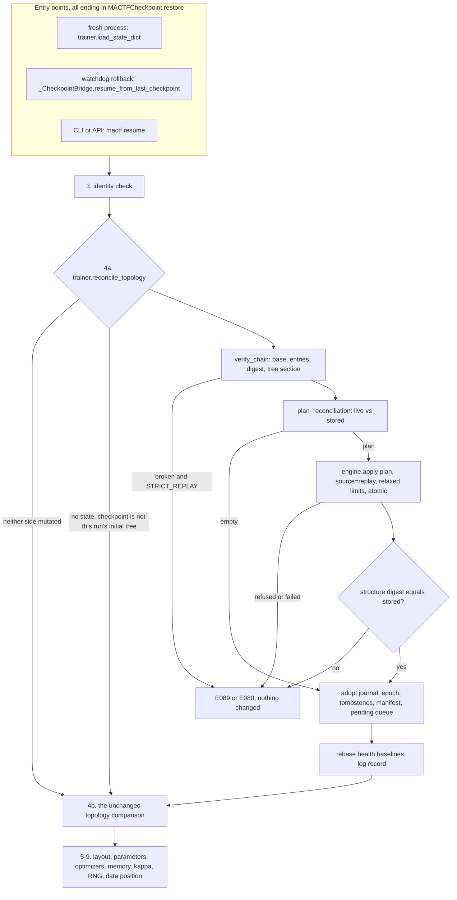

### 12.9 The checkpoint, the journal and the reconciliation of topology

A checkpoint is a statement about a structure: these nodes, these weights, these optimizer
states. Until now the structure was a constant of the run, so the restore (`checkpoint_v2.py:985-1000`)
could *compare* the stored tree with the live one and refuse on a difference. Once peers can
come and go, "the live tree differs from the stored tree" is no longer a sign of a wrong
checkpoint; it is the normal state of affairs after a resume in a new process (the new process
built the *initial* tree) and after a watchdog rollback (the live tree has moved on since the
snapshot). This subsection makes the restore *reproduce* the stored structure, and makes the
checkpoint carry what it takes to do so.

#### 12.9.1 The design in one paragraph, and the one it replaced

The checkpoint carries a **mutation state** (12.9.2): the journal, a **manifest** (the effective
spec of every node a plan created or rebuilt, and the metadata of every node a plan touched),
the tombstones, the queue of plans not yet run, and three digests that tie them to the tree
section. At restore, **before the topology check**, the trainer computes the difference between
its live structure and the stored one and applies it as **one ordinary mutation plan** through
the engine (`source="replay"`), so the reconciliation inherits atomicity, the path-state audit and
the optimizer rebinding of 12.5-12.7 and has no second implementation of any of them. The
journal does not drive the reconstruction; it *proves* the checkpoint is coherent (12.9.4).

The design this replaced was the obvious one: replay the journal forward on a fresh build, and
on a rollback invert the entries since the checkpoint. It was rejected for four reasons that
the cases of 12.9.7 make concrete.

| Reason | Why replay-and-invert fails |
|---|---|
| **`purge` has no inverse** | The weights, optimizer moments and caches of a purged peer are gone from the live trainer. A rollback to a snapshot taken *before* a watchdog prune (the very case W-G9 is about) needs the peer back; no inverse operation can conjure it. The snapshot has it, and a *difference* against the snapshot's tree knows to `add` the node and let the restore load its weights |
| **`rebuild` has no inverse** | Replacing a module changes its architecture; the previous module is not recoverable from the plan. The manifest records the architecture each node should have; the difference rebuilds toward it |
| **Replay is order- and history-sensitive** | A forward replay of an `add` with `init_from: peer-1` copies peer-1's weights *as of replay time*, not as of the original time; an inverse of a `modify` needs the prior value, which the entry would have to carry. A difference needs neither, because parameters come from the checkpoint's own `models` section afterwards |
| **Divergence** | A rollback target and the live run may have both mutated after a common ancestor. Inverting the live suffix and replaying the target's suffix is two procedures; a difference is one, and it handles "no common ancestor" (a fresh process) with the same code |

#### 12.9.2 The mutation state

```python
# mactf/training/mutation.py   (part 3: the pure pieces a checkpoint needs; after ``MutationLimits``.
#                               ``INTERNAL_SOURCES`` moved here from the engine; ``PeerTree`` is already imported)
#: Sources that are not the user asking: the watchdog's prune (12.8) and the reconciliation (12.9).
INTERNAL_SOURCES = ("watchdog", "replay")


def manifest_spec(spec: PeerSpec) -> dict[str, Any]:
    """The part of a ``PeerSpec`` that decides what a node *is*.

    ``init_from`` is dropped: it says where the first weights came from, and a reconciliation
    never needs it because the weights come from the checkpoint's ``models`` section.
    """
    payload = spec.canonical()
    payload.pop("init_from", None)
    return payload


def tree_state_digest(tree_state: Mapping[str, Any]) -> str:
    """``structure_digest`` of a stored tree section (``PeerTree.state_dict``): ``pruned`` is retired."""
    try:
        tree = PeerTree.from_dict(tree_state)
    except Exception as error:  # noqa: BLE001 - a tree that does not parse is a corrupt checkpoint
        raise MutationError("E089", f"the checkpoint's tree section does not parse: {error}") from error
    retired = [node.path for node in tree.walk("root-first") if node.status == "pruned"]
    return structure_digest(tree, retired)
```

```python
# mactf/training/mutation_reconcile.py   (new; pure Python: imports no torch, so the CLI and the API
#                                         can read a checkpoint's mutation state)
from __future__ import annotations

import copy
import logging
from dataclasses import dataclass, field
from typing import Any, Iterable, Mapping, Sequence

from ..coopetition.tree import PeerTree
from ..exceptions import MutationError
from .mutation import (
    BUILD_TOKEN, INTERNAL_SOURCES, MutationPlan, add_peer, modify_peer, parent_of, purge_peer,
    retire_peer, revive_peer, structure_digest, tree_state_digest,
)

log = logging.getLogger("mactf.mutation")

STATE_VERSION = 1
_STATE_KEYS = frozenset(
    {"version", "journal", "topology_epoch", "base_digest", "digest", "tombstones", "specs", "metadata", "pending"}
)
_ENTRY_KEYS = ("seq", "epoch", "topology_epoch", "source", "plan", "plan_digest", "before", "after")
_MISSING = object()


def _text(raw: Mapping[str, Any], key: str) -> str:
    value = raw.get(key, "")
    if not isinstance(value, str):
        raise MutationError("E089", f"the checkpoint's mutation state has a non-text `{key}`: {value!r}")
    return value


def _count(raw: Mapping[str, Any], key: str) -> int:
    value = raw.get(key, 0)
    if isinstance(value, bool) or not isinstance(value, int) or value < 0:
        raise MutationError("E089", f"the checkpoint's mutation state has an invalid `{key}`: {value!r}")
    return value


def _mapping_of_mappings(raw: Mapping[str, Any], key: str) -> dict[str, dict[str, Any]]:
    value = raw.get(key) or {}
    if not isinstance(value, Mapping) or not all(isinstance(item, Mapping) for item in value.values()):
        raise MutationError("E089", f"the checkpoint's mutation state `{key}` must map a path to a mapping")
    return {str(path): copy.deepcopy(dict(item)) for path, item in value.items()}


@dataclass(frozen=True)
class MutationState:
    """What a checkpoint says about how its tree came to be (``identity["trainer"]["mutation"]``).

    ``{}`` (no state at all) is what a run that never mutated writes, which is why the checkpoint
    of such a run is byte-for-byte what it has always been (M11).
    """

    journal: tuple[dict[str, Any], ...] = ()
    topology_epoch: int = 0
    base_digest: str = ""        # the tree as ``build()`` made it: what a configuration reproduces
    digest: str = ""             # the tree this state describes: must equal the checkpoint's tree section
    tombstones: tuple[str, ...] = ()
    specs: Mapping[str, Mapping[str, Any]] = field(default_factory=dict)
    metadata: Mapping[str, Mapping[str, Any]] = field(default_factory=dict)
    pending: tuple[dict[str, Any], ...] = ()

    def __post_init__(self) -> None:
        object.__setattr__(self, "specs", dict(self.specs or {}))
        object.__setattr__(self, "metadata", dict(self.metadata or {}))

    # -- serialisation ---------------------------------------------------
    def as_dict(self) -> dict[str, Any]:
        return {
            "version": STATE_VERSION,
            "journal": [copy.deepcopy(dict(entry)) for entry in self.journal],
            "topology_epoch": int(self.topology_epoch),
            "base_digest": self.base_digest,
            "digest": self.digest,
            "tombstones": list(self.tombstones),
            "specs": {path: copy.deepcopy(dict(spec)) for path, spec in self.specs.items()},
            "metadata": {path: copy.deepcopy(dict(meta)) for path, meta in self.metadata.items()},
            "pending": [copy.deepcopy(dict(row)) for row in self.pending],
        }

    @classmethod
    def parse(cls, raw: Mapping[str, Any]) -> "MutationState":
        """Validate the shape of a stored state. ``E089`` for anything that is not one."""
        if not isinstance(raw, Mapping):
            raise MutationError("E089", f"the checkpoint's mutation state is a {type(raw).__name__}, not a mapping")
        version = raw.get("version", STATE_VERSION)
        if version != STATE_VERSION:
            raise MutationError(
                "E089",
                f"the checkpoint's mutation state is version {version!r}; this build reads version {STATE_VERSION}",
            )
        unknown = sorted(set(raw) - _STATE_KEYS)
        if unknown:
            raise MutationError("E089", f"the checkpoint's mutation state has unknown keys {unknown}")
        journal = raw.get("journal") or []
        if isinstance(journal, (str, bytes)) or not isinstance(journal, Sequence):
            raise MutationError("E089", "the checkpoint's mutation journal must be a list")
        rows: list[dict[str, Any]] = []
        for index, entry in enumerate(journal):
            if not isinstance(entry, Mapping):
                raise MutationError("E089", f"journal entry {index} is not a mapping")
            missing = [key for key in _ENTRY_KEYS if key not in entry]
            if missing:
                raise MutationError("E089", f"journal entry {index} lacks {missing}")
            rows.append(copy.deepcopy(dict(entry)))
        pending = raw.get("pending") or []
        if isinstance(pending, (str, bytes)) or not isinstance(pending, Sequence) or not all(
            isinstance(row, Mapping) and "plan" in row for row in pending
        ):
            raise MutationError("E089", "the checkpoint's pending mutations must be a list of {source, plan}")
        return cls(
            journal=tuple(rows),
            topology_epoch=_count(raw, "topology_epoch"),
            base_digest=_text(raw, "base_digest"),
            digest=_text(raw, "digest"),
            tombstones=tuple(sorted(str(path) for path in (raw.get("tombstones") or ()))),
            specs=_mapping_of_mappings(raw, "specs"),
            metadata=_mapping_of_mappings(raw, "metadata"),
            pending=tuple(copy.deepcopy(dict(row)) for row in pending),
        )

    # -- coherence -------------------------------------------------------
    @property
    def user_driven(self) -> bool:
        """True when a journal entry came from a source that needs ``TRAINER.MUTATION.ENABLED``."""
        return any(entry["source"] not in INTERNAL_SOURCES for entry in self.journal)

    def verify_chain(self, tree_digest: str) -> list[str]:
        """Every way the journal fails to explain the checkpoint's tree. Empty means coherent.

        The chain is ``base -> entry 0 -> entry 1 -> ... -> digest``, each entry's ``before`` equal
        to the previous ``after``, ``seq`` contiguous, each plan hashing to its recorded digest, and
        the end equal to the tree section the checkpoint actually holds.
        """
        problems: list[str] = []
        previous = self.base_digest
        for index, entry in enumerate(self.journal):
            if entry["seq"] != index:
                problems.append(f"entry {index} has seq {entry['seq']!r}; the journal is not contiguous")
            if entry["before"] != previous:
                problems.append(
                    f"entry {index} ({entry['plan_digest']}) starts from structure {entry['before']}, "
                    f"but the structure before it was {previous}"
                )
            try:
                recomputed = MutationPlan.parse(entry["plan"]).digest()
            except MutationError as error:
                problems.append(f"entry {index}: the recorded plan does not parse: {error}")
            else:
                if recomputed != entry["plan_digest"]:
                    problems.append(
                        f"entry {index}: the recorded plan hashes to {recomputed}, not {entry['plan_digest']}"
                    )
            previous = entry["after"]
        if previous != self.digest:
            problems.append(f"the journal ends at structure {previous}, but the state describes {self.digest}")
        if self.digest != tree_digest:
            problems.append(
                f"the state describes structure {self.digest}, but the checkpoint's tree section is {tree_digest}"
            )
        return problems
```

`specs` and `metadata` are the manifest. `specs[path]` is the effective, `init_from`-free
`PeerSpec` of a node that a plan created or rebuilt (the engine's `_record_manifest`, 12.5.4);
`metadata[path]` is the final metadata of a node a plan created or touched. A node built from the
configuration and never touched has neither entry, and that absence means "as `build()` makes
it": the trainer keeps `_build_meta` (12.7.2) for the metadata half of that sentence.

The trainer assembles and writes it:

```python
# mactf/training/trainer.py   (new methods, after ``_trainer_state``, line 2200;
#                              ``copy`` is imported at the top of the module, ``MutationState`` from
#                              ``.mutation_reconcile``)
    def _mutation_state(self) -> dict[str, Any]:
        """The checkpoint's account of how the tree came to be. ``{}`` for a run that never mutated."""
        pending = self.engine.pending()
        if not (
            self.mutation_journal or pending or self._node_specs or self._node_meta or self._tombstones
        ):
            return {}
        return MutationState(
            journal=tuple(copy.deepcopy(entry) for entry in self.mutation_journal),
            topology_epoch=int(self.topology_epoch),
            base_digest=self._base_digest,
            digest=structure_digest(self.tree, self.freeze.retired()),
            tombstones=tuple(sorted(self._tombstones)),
            specs=copy.deepcopy(self._node_specs),
            metadata=copy.deepcopy(self._node_meta),
            pending=tuple(pending),
        ).as_dict()

    def _identity_extra(self) -> dict[str, Any]:
        """Keys a periodic or watchdog checkpoint adds to ``identity`` (section 14.4 widens this to the
        whole trainer state; the mutation state is what it holds today)."""
        mutation = self._mutation_state()
        return {"trainer": {"mutation": mutation}} if mutation else {}
```

```python
# mactf/training/trainer.py   (_trainer_state, line 2190: the dict is built, then gains one key)
        state = {
            "spec": self.spec.as_dict() if self.spec is not None else {},
            # ... the keys of lines 2192-2198 unchanged ...
            "distillation": self._distillation_state(),
        }
        mutation = self._mutation_state()
        if mutation:
            state["mutation"] = mutation
        return state
```

```python
# mactf/training/trainer.py   (_observe, lines 1930-1942: the periodic context gains one argument)
                CheckpointContext(
                    trainer=self,
                    episode=result.epoch,
                    # ... unchanged ...
                    aggregations=tuple(self.reports),
                    identity_extra=self._identity_extra(),
                ),
```

```python
# mactf/training/trainer.py   (_CheckpointBridge.save, lines 2382-2397: a context the caller built without
#                              extras, and the one the bridge builds, both carry the mutation state)
        if isinstance(context, CheckpointContext):
            resolved = context
            if not resolved.identity_extra:
                resolved.identity_extra = self._trainer._identity_extra()
        else:
            scores = dict(getattr(context, "scores", {}) or {})
            resolved = CheckpointContext(
                # ... unchanged ...
                aggregations=tuple(self._trainer.reports),
                identity_extra=self._trainer._identity_extra(),
            )
```

The watchdog's snapshot ("before the action", `watchdog.py:1049-1060`) goes through the bridge, so
the checkpoint a rollback will later restore describes the structure it was taken on. `state_dict()`
(`trainer.py:2207-2226`) needs no edit: it replaces `identity["trainer"]` with
`_trainer_state()`, which now includes the mutation state.

```python
# mactf/orchestration/checkpoint_v2.py   (CheckpointContext: one new field, at the end, so every
#                                         positional and keyword construction is unchanged)
    extras: Mapping[str, Any] = field(default_factory=dict)
    #: Keys merged into the ``identity`` section. They may not replace a framework key
    #: (``run_id``, ``episode``, ...). Empty for every caller that does not use it, which keeps the
    #: identity section, and its hash, exactly as they were.
    identity_extra: Mapping[str, Any] = field(default_factory=dict)
```

```python
# mactf/orchestration/checkpoint_v2.py   (_collect: after the ``identity = {...}`` literal, line 594)
        extra = dict(context.identity_extra or {})
        clash = sorted(set(extra) & set(identity))
        if clash:
            raise ValidationError(
                f"identity_extra may not replace the framework's identity keys {clash}; "
                "put trainer-owned state under the 'trainer' key"
            )
        identity.update(extra)
```

A run that never mutated has `_mutation_state() == {}`, hence `_identity_extra() == {}`, hence an
identity section that is key-for-key what `_collect` produced before: no section hash changes
(M11), and a checkpoint written by an older build loads (the restore reads
`identity.get("trainer", {}).get("mutation")` and finds nothing).

#### 12.9.3 Computing the difference

The planner is a pure function of four things: the live tree, the live retired set, the live
manifest and the stored target. It has no torch and no trainer, so its every branch is a unit
test.

```python
# mactf/training/mutation_reconcile.py   (continued: the target and the planner)
@dataclass(frozen=True)
class TargetNode:
    path: str
    parent: str | None
    role: str
    retired: bool
    depth: int


@dataclass(frozen=True)
class Target:
    """The structure a checkpoint describes, in root-first order."""

    nodes: Mapping[str, TargetNode]
    specs: Mapping[str, Mapping[str, Any]]
    metadata: Mapping[str, Mapping[str, Any]]
    digest: str

    @classmethod
    def build(
        cls,
        tree_state: Mapping[str, Any],
        state: MutationState | None,
        build_meta: Mapping[str, Mapping[str, Any]],
    ) -> "Target":
        try:
            tree = PeerTree.from_dict(tree_state)
        except Exception as error:  # noqa: BLE001 - a tree that does not parse is a corrupt checkpoint
            raise MutationError("E089", f"the checkpoint's tree section does not parse: {error}") from error
        nodes = {
            node.path: TargetNode(node.path, node.parent, node.role, node.status == "pruned", int(node.depth))
            for node in tree.walk("root-first")
        }
        metadata: dict[str, dict[str, Any]] = {}
        for path in nodes:
            if state is not None and path in state.metadata:
                metadata[path] = copy.deepcopy(dict(state.metadata[path]))
            elif path in build_meta:
                metadata[path] = copy.deepcopy(dict(build_meta[path]))
        retired = [path for path, node in nodes.items() if node.retired]
        return cls(
            nodes=nodes,
            specs={} if state is None else {path: dict(spec) for path, spec in state.specs.items()},
            metadata=metadata,
            digest=structure_digest(tree, retired),
        )


@dataclass(frozen=True)
class ReconcilePlan:
    """The plan that turns the live structure into the stored one, and what it will do."""

    plan: MutationPlan | None
    revived: tuple[str, ...] = ()
    modified: tuple[str, ...] = ()
    rebuilt: tuple[str, ...] = ()
    purged: tuple[str, ...] = ()
    added: tuple[str, ...] = ()
    retired: tuple[str, ...] = ()

    @property
    def empty(self) -> bool:
        return self.plan is None

    def summary(self) -> str:
        parts = [
            f"{name} {len(items)}"
            for name, items in (
                ("added", self.added), ("purged", self.purged), ("retired", self.retired),
                ("revived", self.revived), ("rebuilt", self.rebuilt), ("modified", self.modified),
            )
            if items
        ]
        return ", ".join(parts) or "nothing"


def _ancestors(path: str) -> list[str]:
    result: list[str] = []
    parent = parent_of(path)
    while parent is not None:
        result.append(parent)
        parent = parent_of(parent)
    return result


def _rebuild_block(spec: Mapping[str, Any] | None, available: set[str]) -> dict[str, Any]:
    """The ``rebuild`` mapping for a stored spec: its architecture, or the build-time module."""
    block: dict[str, Any] = {}
    if spec is not None:
        if spec.get("factory") is not None:
            block["factory"] = spec["factory"]
        if spec.get("like") is not None and spec["like"] in available:
            block["like"] = spec["like"]
    return block or {"factory": BUILD_TOKEN}


def plan_reconciliation(
    tree: PeerTree,
    retired: Iterable[str],
    specs: Mapping[str, Mapping[str, Any]],
    target: Target,
) -> ReconcilePlan:
    """The operations, in an order every one of them is valid at its turn.

    1. ``revive`` every retired node that must be active in the end, or that a later step must
       touch (a retired node cannot be modified, and nothing can be added under it), with its
       retired ancestors, root first.
    2. ``modify`` the nodes whose architecture, role or metadata differ.
    3. ``purge`` the topmost live-only nodes, recursively and forced (a purge takes the subtree).
    4. ``add`` the stored-only nodes, parents first, each with its stored spec.
    5. ``retire`` what the stored tree says is retired and is not now, deepest first.
    """
    gone_now = set(retired)
    live = {node.path: node for node in tree.walk("root-first")}
    gone = {path for path in live if path not in target.nodes}
    kept = [path for path in live if path in target.nodes]
    kept_set = set(kept)
    created = [path for path in target.nodes if path not in live]

    # -- what changes on a node that exists on both sides ----------------
    changes: dict[str, dict[str, Any]] = {}
    for path in kept:
        node = live[path]
        change: dict[str, Any] = {}
        want_spec = target.specs.get(path)
        have_spec = specs.get(path)
        if (None if want_spec is None else dict(want_spec)) != (None if have_spec is None else dict(have_spec)):
            change["rebuild"] = _rebuild_block(want_spec, kept_set)
        if node.role != target.nodes[path].role:
            change["role"] = target.nodes[path].role
        have = dict(node.metadata)
        want = dict(target.metadata.get(path, {}))
        delta = {key: value for key, value in want.items() if have.get(key, _MISSING) != value}
        delta.update({key: None for key in have if key not in want})
        if delta:
            change["metadata"] = delta
        if change:
            changes[path] = change

    # -- which retired nodes must be active while the plan runs ----------
    must_be_active = set(changes)
    for path in created:
        parent = parent_of(path)
        if parent is not None and parent in kept_set:
            must_be_active.add(parent)
    for path in list(must_be_active):
        must_be_active.update(ancestor for ancestor in _ancestors(path) if ancestor in kept_set)
    revive = [
        path for path in kept
        if path in gone_now and (not target.nodes[path].retired or path in must_be_active)
    ]
    still_retired = {path for path in kept if path in gone_now and path not in revive}

    ops: list[Any] = []
    for path in revive:                                   # kept is root-first
        ops.append(revive_peer(path, reason="checkpoint reconciliation"))
    for path, change in changes.items():
        ops.append(modify_peer(path, **change))
    top_gone = [path for path in live if path in gone and parent_of(path) not in gone]
    for path in top_gone:
        ops.append(purge_peer(path, recursive=True, force=True, reason="checkpoint reconciliation"))

    available = set(kept_set)
    for path in created:                                  # target order is root-first
        spec = {key: value for key, value in dict(target.specs.get(path) or {}).items() if key != "path"}
        if spec.get("like") is not None and spec["like"] not in available:
            spec.pop("like")                              # the template is gone; the build-time module is the fallback
        spec["role"] = target.nodes[path].role
        meta = target.metadata.get(path)
        if meta:
            spec["metadata"] = dict(meta)
        ops.append(add_peer(path, **spec))
        available.add(path)

    to_retire = [
        path for path, node in target.nodes.items()
        if node.retired and path not in still_retired
    ]
    to_retire.sort(key=lambda item: target.nodes[item].depth, reverse=True)
    for path in to_retire:
        ops.append(retire_peer(path, reason="checkpoint reconciliation"))

    if not ops:
        return ReconcilePlan(plan=None)
    plan = MutationPlan.of(
        *ops, label=f"reconcile:{target.digest}", reason="the checkpoint's topology differs from the live one"
    )
    return ReconcilePlan(
        plan=plan,
        revived=tuple(revive),
        modified=tuple(changes),
        rebuilt=tuple(path for path, change in changes.items() if "rebuild" in change),
        purged=tuple(top_gone),
        added=tuple(created),
        retired=tuple(to_retire),
    )
```

Three of its choices need a sentence.

* **A node that is retired in the live tree and must be modified is revived first and retired
  again at the end.** `modify` refuses a retired node (12.4) and so does `add` under one; the
  planner does not weaken those rules, it routes around them, and the final `retire` step puts the
  node back where the stored tree says it is. The cost is one revive and one retire, in a plan
  that is atomic.
* **`init_from` is never replayed.** A reconciliation produces *structure*. The weights of every
  node, new or not, come from the checkpoint's `models` section, which the restore loads right
  after this step (`checkpoint_v2.py:1001-1033`), so the first weights an `add` gives a node
  (whatever `init_from` or the factory's random initialisation produced) are overwritten before
  the first forward pass, and the engine's private RNG stream (M4, `fork_rng`) means producing
  them consumed none of the run's randomness.
* **A missing `like` falls back to the build-time module.** A stored `like` names a node that
  was the template when the peer was created. If that node is not in the stored tree any more,
  `like` is dropped and the node is built by `_module_for(path)` (step 3 of 12.3). When that is
  the wrong architecture the layout check (`E085`) says so, and the restore raises `E089` with
  the finding; nothing is installed.

#### 12.9.4 The reconciler

```python
# mactf/training/mutation_reconcile.py   (continued: the one entry point the restore calls)
class TopologyReconciler:
    """Make a built trainer's structure the one a checkpoint describes, before its parameters load."""

    def __init__(self, trainer: Any) -> None:
        self.trainer = trainer

    # -- entry point -----------------------------------------------------
    def reconcile(
        self, identity: Mapping[str, Any], tree_state: Mapping[str, Any], *, strict: bool = True
    ) -> list[str]:
        """Returns the notes for the ``ResumeReport``. Raises ``MutationError`` and changes nothing
        when the checkpoint cannot be reproduced (``E080``, ``E088``, ``E089``)."""
        t = self.trainer
        notes: list[str] = []
        stored = identity.get("trainer") if isinstance(identity, Mapping) else None
        raw = stored.get("mutation") if isinstance(stored, Mapping) else None
        state = MutationState.parse(raw) if raw else None
        mutated = bool(t.mutation_journal or t.topology_epoch or t._node_specs or t._node_meta)
        if state is None and not mutated:
            # Neither side ever mutated: the restore's own comparison (a topology that differs is a
            # configuration that changed) is the whole story, exactly as before 12.
            return notes

        enforce = bool(strict and t.mutation_limits.strict_replay)
        target_digest = tree_state_digest(tree_state)
        if state is None and target_digest != t._base_digest:
            # A live run that mutated, and a checkpoint that is not a snapshot of *this* run's
            # initial tree and carries no journal: it belongs to some other configuration.
            # The restore's comparison names the difference.
            return notes

        problems: list[str] = []
        disabled = False
        if state is not None:
            problems.extend(state.verify_chain(target_digest))
            if state.base_digest != t._base_digest:
                problems.append(
                    f"the configuration builds structure {t._base_digest}, but the run started from "
                    f"{state.base_digest}: the hierarchy or the model sources changed since the checkpoint"
                )
            if state.user_driven and not t.mutation_limits.enabled:
                disabled = True
                problems.append(
                    "the journal holds user-requested mutations but TRAINER.MUTATION.ENABLED is false"
                )
        if problems:
            text = "; ".join(problems)
            if enforce:
                code = "E080" if disabled and len(problems) == 1 else "E089"
                raise MutationError(
                    code,
                    "the checkpoint's mutation journal does not describe a structure this configuration "
                    f"can resume (set TRAINER.MUTATION.STRICT_REPLAY: false to tolerate it): {text}",
                    findings=problems,
                )
            log.warning("W045: tolerated an inconsistent mutation journal: %s", text)
            notes.append(f"W045: tolerated an inconsistent mutation journal: {text}")

        target = Target.build(tree_state, state, t._build_meta)
        difference = plan_reconciliation(t.tree, t.freeze.retired(), t._node_specs, target)
        report = None
        if difference.plan is not None:
            saved_cycle = t._mutations_in_cycle
            try:
                report = t.engine.apply(difference.plan, source="replay")
            except MutationError as error:
                raise MutationError(
                    error.code,
                    f"cannot reproduce the checkpoint's topology ({difference.summary()}): {error}",
                    findings=error.findings,
                    rolled_back=error.rolled_back,
                ) from error
            finally:
                t._mutations_in_cycle = saved_cycle
        reached = structure_digest(t.tree, t.freeze.retired())
        if reached != target.digest:
            raise MutationError(
                "E089",
                f"after reconciliation the structure is {reached}, but the checkpoint's tree is "
                f"{target.digest}; this trainer cannot continue from this checkpoint",
                rolled_back=False,
            )
        self._adopt(state, target)
        if report is not None:
            self._rebase(report)
            notes.append(f"topology reconciled with the checkpoint ({difference.summary()})")
        elif state is not None and state.journal:
            notes.append(f"topology already matches the checkpoint ({len(state.journal)} journaled plan(s))")
        return notes

    # -- the bookkeeping that is the checkpoint's, not the plan's --------
    def _adopt(self, state: MutationState | None, target: Target) -> None:
        """Replace the records the replayed plan wrote with the ones the checkpoint holds."""
        t = self.trainer
        stored = state if state is not None else MutationState(base_digest=t._base_digest, digest=target.digest)
        t.mutation_journal[:] = [copy.deepcopy(dict(entry)) for entry in stored.journal]
        t.topology_epoch = int(stored.topology_epoch)
        t._tombstones.clear()
        t._tombstones.update(stored.tombstones)
        t._node_specs.clear()
        t._node_specs.update({path: dict(spec) for path, spec in stored.specs.items()})
        t._node_meta.clear()
        t._node_meta.update({path: dict(meta) for path, meta in stored.metadata.items()})
        t.engine.restore_pending(stored.pending)
        t._active_view = None

    def _rebase(self, report: Any) -> None:
        """The health baselines of 12.8, once, for the structure the restore just installed."""
        t = self.trainer
        t._loss_baseline = len(t.history) + (1 if t._phase == "observe" else 0)
        t._rate_baseline = len(t._epoch_seconds)
        grown = tuple(dict.fromkeys((*report.added, *report.rebuilt)))
        if grown and t._initial_rss is not None:
            t._initial_rss += t._resident_bytes(grown)
        record = getattr(t.logger, "mutation", None)
        if callable(record):
            record(report, reconciled=True)
```

`_rebase` runs only when the reconciliation changed something. A fresh process (empty history,
no epoch timings) gets `_loss_baseline = 0`, which is what it would have anyway; an in-process
rollback gets the baselines of the moment, which is what a mutation at that moment would have
set. Memory freed by purged peers is not credited back, for the reason given in 12.8.5.

The trainer exposes it as one method, and the checkpoint manager calls it where the topology was
compared:

```python
# mactf/training/trainer.py   (new method, after ``_mutation_state``)
    def reconcile_topology(
        self, identity: Mapping[str, Any], tree_state: Mapping[str, Any], *, strict: bool = True
    ) -> list[str]:
        """Called by ``MACTFCheckpoint.restore`` before it compares topologies (12.9)."""
        from .mutation_reconcile import TopologyReconciler

        return TopologyReconciler(self).reconcile(identity, tree_state, strict=strict)
```

```python
# mactf/orchestration/checkpoint_v2.py   (restore, step 4, replacing lines 985-1000;
#                                         ``Orchestrator`` has no ``reconcile_topology``: it never mutates)
        if trainer is not None:
            # 4. topology.
            tree_state = stored.tree
            trainer_tree = getattr(trainer, "tree", None)
            reconcile = getattr(trainer, "reconcile_topology", None)
            if callable(reconcile) and tree_state and trainer_tree is not None:
                notes.extend(reconcile(identity, tree_state, strict=strict))
            if tree_state and trainer_tree is not None:
                from ..coopetition.tree import PeerTree

                restored_tree = PeerTree.from_dict(tree_state)
                current = trainer_tree.state_dict()
                incoming = restored_tree.state_dict()
                if _topology(current) != _topology(incoming):
                    raise ContractMismatch(
                        "checkpoint topology does not match this trainer: "
                        + _topology_diff(current, incoming)
                    )
                notes.append(f"topology verified ({len(incoming['nodes'])} nodes)")
```

`reconcile` runs first, so by the time the unchanged comparison runs the two trees are equal,
and for a run that never mutated it returned immediately. The comparison stays as the
last line of defence: it re-derives the agreement from the trees themselves rather than
trusting the reconciler's digest.

#### 12.9.5 One restore, three entry points



The three entry points differ only in what the live trainer looks like when they arrive:

| Entry | Live trainer | What the difference contains |
|---|---|---|
| A resume in a new process | built from the configuration: the *initial* tree, empty journal | every node the journal added, every retirement, every purge replayed as a structural difference |
| A watchdog rollback (`watchdog.py:1110-1126`) | the same run, possibly mutated after the snapshot | only what changed since the snapshot, including a node the watchdog itself pruned, which comes back as an `add` (its weights are in the snapshot) |
| `mactf resume` from the CLI or the API | a new process, as the first row | as the first row |

#### 12.9.6 What is and is not reproduced

| Item | Reproduced by | Notes |
|---|---|---|
| Paths, parents, roles, retired set | the difference, then checked by digest | `E089` if the digest differs |
| Architecture of a created or rebuilt peer | the manifest's `factory` / `like` | a factory a project removed raises `ComponentMissing` from the resolver, which the engine reports as `E085` |
| Metadata of a created or touched node | `manifest.metadata`, falling back to `_build_meta` | a metadata value of `null` cannot exist: in a plan it deletes the key |
| Parameters, buffers, optimizer moments, schedulers | the restore, as always (`checkpoint_v2.py:1001-1068`) | the reconciliation makes the nodes exist; it does not touch their tensors |
| Per-node optimizer override | the optimizer plan's own state (9.4) | `modify ... optimizer` is not in the manifest because the plan already checkpoints it |
| Kappa controllers and aggregators of groups that changed | the engine's rebinding (12.5.4), then the restore of controller state | a controller is rebuilt at the stored size, then loaded |
| Tombstones, topology epoch, journal, pending queue | `_adopt` | the replayed plan's own bookkeeping is overwritten |
| `history`, `_epoch_seconds`, losses | not part of a restore (`trainer.load_state_dict` never restored them) | the baselines of 12.8 handle the cohort boundary |
| The run's random stream | the restore (step 9) | the engine used a private stream, so the reconciliation did not consume it |
| The *order* in which a different history would have created the same tree | not reproduced, deliberately | `topology_epoch` is restored as recorded; seeds for later additions derive from it (`node_seed`), so the next addition is the same node on every path |

#### 12.9.7 The cases

| # | Situation | Outcome |
|---|---|---|
| 1 | Run never mutated; checkpoint from any older build | `reconcile` returns immediately; the unchanged comparison runs; v2 hashes unchanged |
| 2 | A resume in a new process of a run that added `peer-4` and retired `peer-3` | the new trainer has `peer-1..3`; the difference is `add peer-4`, `retire peer-3`; the restore loads `peer-4`'s weights |
| 3 | A rollback to a snapshot taken before a watchdog prune of `team-b`; the live tree no longer has `team-b` | the difference is `add team-b`, `add team-b/x`, ...; the nodes are built from the manifest or the build-time source, and the restore loads the weights the snapshot holds |
| 4 | A rollback past an `add` | the difference is a `purge` (forced, recursive) of the node; the peer, optimizer and caches go through the engine's own path (M9) |
| 5 | A rollback past a `retire` | `revive`; the node was never out of the checkpoint's `models` |
| 6 | A rollback past a `modify ... metadata` of a config-built node | the checkpoint has no manifest entry for it; the target is `_build_meta`'s metadata for it; the difference sets or deletes the keys that differ |
| 7 | A rollback past a `rebuild` | the checkpoint's manifest spec (or `@build` when it has none) is not the live spec: the node is rebuilt toward the stored one; the restore loads the stored weights |
| 8 | Live run mutated, checkpoint taken before the first mutation (no state) | the stored tree equals `_base_digest`, so the difference undoes every mutation; `_adopt` clears the journal, the epoch, the tombstones and the manifest |
| 9 | The checkpoint's journal and tree disagree (hand-edited, or a bug) | `verify_chain` names the first break; `E089` under `STRICT_REPLAY`, else `W045` and the tree section is trusted |
| 10 | The configuration's hierarchy changed since the run started | `base_digest` differs: `E089` (the run was started from a different tree than this configuration builds); the legacy message of the comparison is richer when no journal exists, and still applies then |
| 11 | The journal holds a user mutation and `ENABLED` is now false | `E080`; the watchdog's own entries never trigger it |
| 12 | `DISTILLATION` is now enabled and a plan is needed | the engine's blocker (`E088`) surfaces as `cannot reproduce the checkpoint's topology`; no change is made |
| 13 | The difference fails halfway (a factory raises) | the engine's transaction rolled back; the live trainer is untouched; the restore raises before it loads one tensor |
| 14 | A plan was queued by a callback in the epoch the checkpoint ends | `pending` carries it; `_adopt` re-queues it; it runs at the top of the resumed epoch |
| 15 | `MAX_PLANS_PER_EPOCH` is 1 and the difference is a single plan | the reconciliation is exempt (`source != "replay"` in `_gate`); the cycle counter is restored afterwards |
| 16 | A purged path is needed again by a rollback | tombstones are not consulted for `replay` (12.5.4 `simulator`), and `_adopt` restores the checkpoint's own tombstone set |

#### 12.9.8 Findings closed, and the limits that remain

W-G9 is closed: a watchdog rollback restores into a live trainer whose tree has changed, by
reproducing the snapshot's tree first; the `watchdog rollback failed` that M-G2 made likely can
no longer arise from a topology difference. M11 holds as stated in 12.2: every committed plan
is journaled, the journal is in every checkpoint the trainer writes (periodic, watchdog,
`state_dict`), the restore reproduces the stored structure before it restores anything else,
and a reproduction that does not hit the stored digest is `E089`.

Three limits are deliberate and are repeated in section 21:

1. **The journal grows without bound.** Every checkpoint carries all of it. `JOURNAL_WARN`
   (default 1000) raises `W045` once; no compaction is offered, because compaction would have to
   forget the chain that `verify_chain` uses. A run with thousands of plans is better served by
   a `MutationPlan` that does the work of many.
2. **The architecture of a node whose factory was removed from the project cannot be rebuilt.** The
   manifest names the factory; if the registry no longer has it the resolver reports
   `ComponentMissing` (reported as `E085`), and the restore refuses rather than substitute a different architecture for one the
   weights were trained under.
3. **A node can be *added* by a reconciliation only if its parent exists in the stored tree.** That
   is a property of any valid tree, so it never fails for a checkpoint the trainer wrote; it can
   fail for a hand-built payload, and then `Target.build` reports the tree section as unparseable
   (`E089`).
