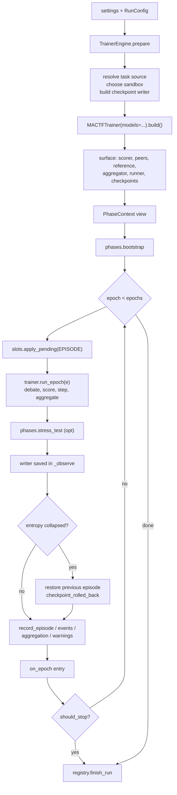

---

## 13. Engine integration

Sections 3 to 12 made `MACTFTrainer` extensible. This section makes it **reachable**: a
project selects `ORCHESTRATOR.ENGINE: trainer` and gets the customizable engine behind
every surface that already drives a run — `mactf run`, `mactf runs resume`,
`mactf redteam`, the run manager's threads and event bus, and the API's run routes — with
no change to those surfaces and no change to `Orchestrator`, which stays the default and
the frozen equivalence oracle.

The mechanism is one adapter class, `TrainerEngine`, whose *whole* job is duck typing: it
exposes the attributes and methods `RunDriver` and `RunManager` already use, and delegates
the training to a `MACTFTrainer`. Where the orchestrator and the trainer disagree about
*what a run records* — the signal window, the rollback depth, the checkpoint schema — the
engine says which behaviour it reproduces and a test pins it (13.8).

---

### 13.1 What exists, and what is missing

Everything in this table was read in the tree.

| Piece | Where | State today |
|---|---|---|
| The run driver | `management/driver.py:162-360` | Constructs `Orchestrator(self.settings)` at `:181`, calls `prepare` at `:183`, reads `context.runtime`, `peers`, `sandbox_choice`, `startup_notes` at `:228-231`, and `run(config, should_stop=, on_epoch=)` at `:277-278` |
| The run manager | `orchestration/live.py:436-1032` | `_default_factory` returns `Orchestrator(settings, modules=..., registry=...)` (`:473-474`); `_execute` calls `prepare` (`:762`) and `run` (`:769-771`); `tree()` builds a flat `PeerTree` over `orchestrator.peers` (`:547-567`) |
| The run handle | `orchestration/live.py:359-417` | `handle.orchestrator` is typed `Orchestrator \| None` (`:372`) and is the object `peers.py` and `redteam` reach through |
| The API peers view | `contrib/api/views/peers.py:27-28` | Reads `handle.orchestrator.peers[name].adapter` |
| `mactf redteam` | `management/commands/redteam.py:92-98` | Uses `orchestrator.context` and `context.metrics` after the run, then calls `phases.stress_test` |
| `mactf runs resume` | `management/commands/runs.py:216-229` | The same `plan_run` + `RunDriver` pair as `run`, so it inherits whatever the driver builds |
| The trainer | `training/trainer.py:191-2284` | Complete, but reachable only from code: `MACTFTrainer(...).fit()` |
| Engine selection | `conf.py:158-169` (`ORCHESTRATOR_DEFAULTS`) | No `ENGINE` key; nothing reads one |

The gaps, each of which this section closes:

| ID | Gap | Evidence |
|---|---|---|
| **E-G1** | `RunDriver` hard-codes the orchestrator | `driver.py:181` is the only construction site inside the CLI path; `MACTFTrainer` cannot be run from a terminal at all |
| **E-G2** | `RunManager` hard-codes the orchestrator | `live.py:474`; the `orchestrator_factory` hook exists (`:447`) but no factory ships, so an API server always runs the orchestrator |
| **E-G3** | The driver reads six attributes and two methods off the object it drives | `prepare`, `run`, `registry`, `context`, `peers`, `sandbox_choice`, `startup_notes`, and `run_id` (written at `live.py:651`). Nothing declares that set, so "duck compatible" has been a convention |
| **E-G4** | The trainer emits no phase signals | `phases.debate/score_episode/local_update/aggregate` send `phase_started`/`phase_finished` (`phases.py:121-454`); `MACTFTrainer.run_epoch` (`trainer.py:1864-1919`) sends none, so the SSE `phase` event would be empty for a trainer run |
| **E-G5** | The trainer writes no run rows | `Orchestrator.run` owns `start_run`, `record_episode`, `record_events`, `record_checkpoint`, `record_aggregation`, `record_resume_report`, `finish_run` (`orchestrator.py:307-580`). `MACTFTrainer.fit` writes none of them |
| **E-G6** | The trainer's checkpoint schema is v2, the orchestrator's is v1 | `CheckpointManager.save` writes a flat dict (`checkpoint.py:52-85`); `MACTFCheckpoint.save` writes 16 hashed sections (`checkpoint_v2.py:512-573`). A run cannot silently change schema mid-run |
| **E-G7** | The two engines compute the epoch signal over different windows | `PhaseContext.signal_by_peer` averages over **every** card the run has produced (`phases.py:70-89`), `MACTFTrainer.signal_by_peer` over **this epoch's** cards (`trainer.py:1477-1484`). The existing equivalence test runs one epoch, which is why it passes (`tests/training/test_trainer_equivalence.py:41-70`) |
| **E-G8** | `RunManager._spawn` starts a bare thread | `live.py:669-675` passes `target=self._run`, so a `contextvars` overlay established on the request thread (section 3.5) is invisible to the run thread |

---

### 13.2 Invariants

| ID | Invariant | Enforced by |
|---|---|---|
| **T1** | *Surface parity.* `TrainerEngine` satisfies the protocol in 13.3: every attribute exists before `prepare` returns, every method has the orchestrator's signature and return shape. | `Engine` protocol (13.3), `test_engine_surface.py` |
| **T2** | *Selection is configuration, not code.* `ORCHESTRATOR.ENGINE` alone decides; an unknown value is `E090` at settings validation, before any model is built. | `dispatch.engine_name`, `conf._validate_blocks` |
| **T3** | *Orchestrator untouched.* No behaviour of `Orchestrator` changes; with `ENGINE` unset every existing test passes unchanged. | 13.6's diff touches `driver.py`, `live.py`, `conf.py`, `dispatch.py`, `engine.py` only |
| **T4** | *One run row per run.* The engine writes the same registry rows the orchestrator does, in the same order, with the same shapes, plus `settings.engine`. | `_run_epochs`, `_record_episode`, `_persist_warnings` (13.4) |
| **T5** | *One writer.* A run uses exactly one checkpoint schema. The engine never mixes `CheckpointManager` and `MACTFCheckpoint` in one directory, and `E091` refuses a resume across engines unless `ORCHESTRATOR.ALLOW_ENGINE_SWITCH`. | `_build_checkpoint_writer`, `_check_identity` |
| **T6** | *Reproducible signal.* With `ORCHESTRATOR.ENGINE_COMPAT=true` (default) the engine's epoch signal equals `Orchestrator`'s for every epoch of a flat run; with it `false` the trainer's documented per-epoch window applies. | `CumulativeSignal` (13.7.2) |
| **T7** | *No phase left open.* Every `phase_started` the engine emits is closed by a `phase_finished` before the epoch's `run_epoch` returns, including when the epoch raises. | `EnginePhaseBridge` + `finally` in `run_epoch` (13.7.3) |
| **T8** | *Cancellation at the boundary.* `should_stop` is polled between epochs only, after the epoch is recorded, so a cancel never leaves a half-written epoch row or a half-stepped optimizer. | `_run_epochs` loop tail (13.4.5) |
| **T9** | *Feature honesty.* A configuration the trainer cannot serve (`mactf.distributed` installed, `ORCHESTRATOR.ENGINE=trainer`) is refused with `E092` at `prepare`, not silently ignored at epoch 3. | `_refuse_unsupported` (13.4.2) |

---

### 13.3 The surface a run driver needs

This is the contract `TrainerEngine` implements. It is written down here as a
`runtime_checkable` protocol so a test can assert it instead of a reviewer.

```python
# mactf/orchestration/dispatch.py   (part 1: the protocol and the engine names)
"""Engine dispatch: pick ``Orchestrator`` or ``TrainerEngine`` without importing torch.

``mactf.management.driver`` documents that importing it imports no torch
(``driver.py:9-10``), so the choice and the class are separated: this module is
torch-free and imports a class only when a run is actually constructed.
"""

from __future__ import annotations

import logging
from typing import TYPE_CHECKING, Any, Mapping, Protocol, runtime_checkable

from ..exceptions import ImproperlyConfigured

if TYPE_CHECKING:  # pragma: no cover - annotations only, and torch-free by design
    from ..db import Registry
    from .orchestrator import RunConfig
    from .phases import PhaseContext

log = logging.getLogger("mactf.orchestration.dispatch")

#: ``ORCHESTRATOR.ENGINE`` values. The first is the default and the frozen oracle.
ENGINE_ORCHESTRATOR = "orchestrator"
ENGINE_TRAINER = "trainer"
ENGINES: tuple[str, ...] = (ENGINE_ORCHESTRATOR, ENGINE_TRAINER)
DEFAULT_ENGINE = ENGINE_ORCHESTRATOR


@runtime_checkable
class Engine(Protocol):
    """What ``RunDriver``, ``RunManager``, ``mactf redteam`` and the API read.

    Every member below is used by a real call site; the comment names it. The
    protocol is deliberately *structural*: ``Orchestrator`` satisfies it without
    being changed, and ``TrainerEngine`` satisfies it by delegation.
    """

    #: ``driver.py:228`` and ``live.py`` -- the resolved runtime description.
    settings: Any
    #: ``live.py:649-651`` reads and then writes it; ``driver.py:233`` logs it.
    run_id: str
    #: ``driver.py:182``, ``:295``; ``live.py:810``.
    registry: Any
    #: ``_persist_warnings`` and ``RunManager.attach`` consumers.
    scorer: Any
    #: ``driver.py`` does not read it; the engine's ``_resume`` does.
    checkpoints: Any
    #: ``driver.py:229`` (``", ".join(peers)``), ``peers.py:27``.
    peers: dict[str, Any]
    #: ``phases.bootstrap`` and every phase function.
    reference: Any
    #: ``phases.aggregate`` when the engine delegates; ``None`` is allowed.
    aggregator: Any
    #: The engine's own epoch loop uses it; surfaced for parity.
    runner: Any
    #: ``driver.py:228`` (``context.runtime``), ``redteam.py:92-98``.
    context: "PhaseContext | None"
    #: ``driver.py:230``.
    sandbox_choice: Any
    #: ``driver.py:231``, printed as ``note`` lines.
    startup_notes: list[str]
    #: Not read by a driver; recorded so a caller can compute a duration.
    started_at: float

    def prepare(self, config: "RunConfig | None" = None) -> "PhaseContext":
        """Build everything a run needs, raising before any row is written."""
        ...

    def run(
        self,
        config: "RunConfig | None" = None,
        *,
        should_stop: Any = None,
        on_epoch: Any = None,
    ) -> dict[str, Any]:
        """Run the epoch loop; return the summary ``driver.py:293-299`` reads."""
        ...


def engine_name(settings: Any) -> str:
    """``ORCHESTRATOR.ENGINE``, validated. ``E090`` for anything else."""
    block = settings.get("ORCHESTRATOR", {}) if hasattr(settings, "get") else {}
    raw = block.get("ENGINE", DEFAULT_ENGINE) if isinstance(block, Mapping) else DEFAULT_ENGINE
    name = str(raw if raw is not None else DEFAULT_ENGINE).strip().lower()
    if name not in ENGINES:
        raise ImproperlyConfigured(
            f"E090: ORCHESTRATOR.ENGINE must be one of {list(ENGINES)}, got {raw!r}"
        )
    return name


def engine_for(settings: Any) -> type:
    """The class, imported on demand so this module stays torch-free."""
    if engine_name(settings) == ENGINE_TRAINER:
        from .engine import TrainerEngine

        return TrainerEngine
    from .orchestrator import Orchestrator

    return Orchestrator


def engine_factory(
    settings: Any,
    registry: "Registry | None" = None,
    *,
    modules: Mapping[str, Any] | None = None,
) -> Engine:
    """Construct the configured engine.

    ``registry=None`` means "resolve one" (``ensure_registry``), which is what
    ``RunDriver`` wants: it has no registry until an engine has one.
    """
    if engine_name(settings) == ENGINE_TRAINER:
        from .engine import TrainerEngine

        return TrainerEngine(settings, modules=modules, registry=registry)
    from .orchestrator import Orchestrator

    return Orchestrator(settings, modules=dict(modules) if modules else None, registry=registry)


def engine_of(engine: Any) -> str:
    """The engine name of a live object, without importing either class.

    Used for the checkpoint's ``identity.engine`` and for ``E091``. A subclass of
    ``TrainerEngine`` is still the trainer engine; anything else is the orchestrator.
    """
    if type(engine).__name__ == "TrainerEngine":
        return ENGINE_TRAINER
    for klass in type(engine).__mro__:
        if klass.__name__ == "TrainerEngine":
            return ENGINE_TRAINER
    return ENGINE_ORCHESTRATOR
```

#### 13.3.1 The call sites, one by one

| Call site | Member | `Orchestrator` today | `TrainerEngine` |
|---|---|---|---|
| `driver.py:181` | constructor | `Orchestrator(settings)` | `engine_factory(settings, None)` |
| `driver.py:182` | `.registry` | `ensure_registry` in `__init__` | the same, or the writer's registry |
| `driver.py:183` | `.prepare(config)` | builds swarm, scorer, task source, sandbox | builds `MACTFTrainer`, then the same four |
| `driver.py:228` | `.context.runtime.describe()` | `PhaseContext.runtime` | the trainer's `Runtime` |
| `driver.py:229` | `.peers` | `dict[str, Peer]` | `trainer.peers` |
| `driver.py:230` | `.sandbox_choice.describe()` | `SandboxChoice` | the same `_choose_sandbox` result |
| `driver.py:231` | `.startup_notes` | task-source and sandbox notes | the same plus the trainer's `failures` |
| `driver.py:277` | `.run(config, should_stop=, on_epoch=)` | `_run_epochs` | 13.4.5 |
| `driver.py:293-299` | `summary["status" \| "history" \| "epochs_completed"]` | built in `_run_epochs` | identical keys |
| `driver.py:329` | `after(engine)` | `stress_test(context)` | same context, same phase function |
| `live.py:649` | `.run_id` (read) | `uuid4().hex[:12]` | the same shape |
| `live.py:651` | `.run_id = run_id` (write) | plain attribute | plain attribute, forwarded to the trainer before `build()` |
| `live.py:762` | `.prepare(config)` | see above | see above |
| `live.py:769` | `.run(...)` | see above | see above |
| `live.py:810` | `.registry` | same object | same object |
| `live.py:553` | `tree(run_id)` | flat `PeerTree` over peers | `trainer.tree` |
| `peers.py:27` | `.peers[name].adapter` | `Peer.adapter` | `Peer.adapter` |
| `redteam.py:92` | `.context` | a real `PhaseContext` | a real `PhaseContext` (13.4.4) |

Two facts make this cheap. `Peer`, `EpisodeRunner`, `ScoringPipeline` and `Aggregator`
are the *same classes* in both engines (`trainer.py:826-875` builds peers with
`build_peer`; `:988` builds the aggregator with `Aggregator.from_settings`), so the
objects the driver and the API read are the objects they already know. And the engine's
`context` is a real `PhaseContext`, so `phases.bootstrap` and `phases.stress_test` run
unmodified.

---

### 13.4 `TrainerEngine` (`mactf/orchestration/engine.py`)

#### 13.4.1 Structure



The engine owns **bookkeeping**; the trainer owns **training**. That split is why the
adapter is ~350 lines and not a second orchestrator.

```python
# mactf/orchestration/engine.py
"""The ``TrainerEngine`` adapter: ``MACTFTrainer`` behind the ``Orchestrator`` surface.

Section 13 of document 17. Three rules govern every line below:

1. The trainer trains; the engine records. No gradient, loss, weight or temperature
   arithmetic happens here.
2. Everything that can fail fails in ``prepare``, before ``registry.start_run`` writes a
   ``running`` row, exactly as ``Orchestrator.prepare`` does (``orchestrator.py:91-177``).
3. Where the orchestrator and the trainer disagree about *bookkeeping*, the engine
   reproduces the orchestrator unless a documented switch says otherwise (13.8).
"""

from __future__ import annotations

import logging
import time
import uuid
from pathlib import Path
from typing import Any, Callable, Mapping, Sequence

import torch

from .. import signals
from ..conf_files import is_authored
from ..coopetition.aggregation import feasible_bounds
from ..db import Registry, ensure_registry
from ..exceptions import ContractError, ImproperlyConfigured
from ..runtime import Runtime, load_checkpoint
from ..sandbox.detect import build_spec, choose_provider
from ..scoring.normalize import CohortNormalizer
from ..training.callbacks import Callback
from ..training.trainer import MACTFTrainer
from .checkpoint import CheckpointRecord, should_rollback
from .checkpoint_v2 import CheckpointContext, MACTFCheckpoint
from .dispatch import ENGINE_TRAINER
from .episode import EpisodeRunner
from .orchestrator import RunConfig, _default_modules, planned_epochs
from .phases import PhaseContext, bootstrap, stress_test

log = logging.getLogger("mactf.orchestration.engine")

__all__ = ["CumulativeSignal", "EnginePhaseBridge", "TrainerEngine"]
```

#### 13.4.2 Construction, `prepare` and the feature gate

```python
class TrainerEngine:
    """Drive one ``MACTFTrainer`` and record the run like ``Orchestrator`` does.

    ``trainer=`` exists for tests and for the API's preview path: a caller that already
    built a trainer (with its own hooks, callbacks and optimizer plan) hands it over and
    the engine only adds bookkeeping.

    ``engine_name`` is a class attribute so ``dispatch.engine_of`` and the checkpoint's
    ``identity["engine"]`` agree without importing this module.
    """

    engine_name = ENGINE_TRAINER

    def __init__(
        self,
        settings: Any,
        *,
        modules: Mapping[str, Any] | None = None,
        registry: Registry | None = None,
        trainer: MACTFTrainer | None = None,
        task_source: Any | None = None,
        logger: Any | None = None,
    ) -> None:
        self.settings = settings
        self.run_id = uuid.uuid4().hex[:12]
        self.registry: Registry = registry or ensure_registry(settings)
        self.trainer: MACTFTrainer | None = trainer
        # -- the surface, filled by prepare() ------------------------------
        self.scorer: Any = getattr(trainer, "scorer", None)
        self.checkpoints: MACTFCheckpoint | None = getattr(trainer, "checkpoint", None)
        self.peers: dict[str, Any] = dict(getattr(trainer, "peers", {}) or {})
        self.reference: Any = getattr(trainer, "reference", None)
        self.aggregator: Any = getattr(trainer, "aggregator", None)
        self.runner: EpisodeRunner | None = getattr(trainer, "runner", None)
        self.context: PhaseContext | None = None
        self.sandbox_choice: Any = None
        self.startup_notes: list[str] = []
        self.started_at = 0.0
        # -- inputs ---------------------------------------------------------
        self._modules: dict[str, Any] = dict(modules) if modules else {}
        self._task_source = task_source
        self._logger = logger
        # -- run state ------------------------------------------------------
        self._prepared_config: RunConfig | None = None
        self._source: Any = None
        self._bridge: EnginePhaseBridge | None = None
        self._signal: CumulativeSignal | None = None
        self._rollbacks: list[dict[str, Any]] = []
        self._bootstrap: dict[str, Any] = {}
        self._regions: list[str] = []

    # -- convenience ------------------------------------------------------
    @property
    def tree(self) -> Any:
        """The trainer's ``PeerTree``, or ``None`` before ``prepare``."""
        return getattr(self.trainer, "tree", None)

    def attach_logger(self, logger: Any) -> None:
        """Give the trainer the run logger ``RunManager`` created (``live.py:751-757``).

        Assigned after ``build()`` on purpose: the trainer reads ``self.logger`` in
        ``_observe`` (``trainer.py:1924``), so a logger attached at any point after
        construction is used from the next epoch on and the log file is closed by
        ``trainer.close()``.
        """
        self._logger = logger
        if self.trainer is not None:
            self.trainer.logger = logger

    def capabilities(self) -> Any:
        """The trainer's capability record, for a caller that wants it from the engine."""
        trainer = self._require_trainer()
        return trainer.capabilities()

    def close(self) -> None:
        """Flush and release the trainer (idempotent, like ``RunManager.shutdown``)."""
        if self.trainer is not None:
            self.trainer.close()

    def describe(self) -> dict[str, Any]:
        """What the engine is, for a log line and for the API's run detail."""
        trainer = self.trainer
        return {
            "engine": self.engine_name,
            "run_id": self.run_id,
            "built": bool(getattr(trainer, "built", False)),
            "nodes": len(self.peers),
            "checkpoint_schema": 2 if isinstance(self.checkpoints, MACTFCheckpoint) else None,
            "compat": self._compat,
            "rollbacks": len(self._rollbacks),
        }

    # -- construction ------------------------------------------------------
    def prepare(self, config: RunConfig | None = None) -> PhaseContext:
        """Resolve the runtime, build the trainer, and surface what a driver reads."""
        config = config or RunConfig()
        settings = self.settings

        if config.device:
            settings["DEVICE"] = config.device
        if config.seed is not None:
            settings["SEED"] = config.seed
        if config.run_id:
            self.run_id = config.run_id

        training = settings["TRAINING"]
        self._refuse_unsupported(config)

        trainer = self.trainer
        if trainer is None:
            modules = self._modules or _default_modules(settings)
            names = list(modules)
            if config.peers is not None:
                names = names[: config.peers]
            if not names:
                raise ImproperlyConfigured(
                    "no peers configured; set PEERS in settings, pass modules to the engine, "
                    "or hand it a built trainer"
                )
            models = {name: modules[name] for name in names}
            source = self._build_task_source(config)
            self._source = source
            trainer = MACTFTrainer(
                models=models,
                settings=settings,
                task_source=source,
                checkpoint=self._build_checkpoint_writer(),
                logger=self._logger,
                strict=True,
            )
            trainer.run_id = self.run_id
            trainer.build()
            self.trainer = trainer
        else:
            trainer.run_id = self.run_id if not trainer.built else trainer.run_id
            trainer.build()
            self._source = trainer.task_source

        # The swarm the driver, the API and the phases read.
        self.scorer = trainer.scorer
        self.peers = trainer.peers
        self.reference = trainer.reference
        self.aggregator = trainer.aggregator
        self.runner = trainer.runner
        self.checkpoints = trainer.checkpoint
        feasible_bounds(
            len(self.peers),
            floor=float(settings["COOPETITION"]["WEIGHT_FLOOR"]),
            cap=float(settings["COOPETITION"]["WEIGHT_CAP"]),
        )

        self.sandbox_choice = self._choose_sandbox(config)
        if self.sandbox_choice is not None:
            self.startup_notes.append(self.sandbox_choice.describe())
        for note in trainer.failures:
            if note not in self.startup_notes:
                self.startup_notes.append(note)

        self.context = self._phase_context(trainer, config)
        self._install_hooks(trainer, self.context)
        self._regions = ["trainer:" + path for path in sorted(self.peers)]
        self._prepared_config = config
        return self.context
```

`_refuse_unsupported` is the honesty gate (**T9**). The trainer has no distributed
bridge: `phases.local_update` hands over to `context.distributor` when the app is
installed (`phases.py:339-341`), and a `MACTFTrainer` epoch never consults it. Running one
with the other silently installed would train locally while the API reported workers.

```python
    def _refuse_unsupported(self, config: RunConfig) -> None:
        """Refuse a configuration the trainer cannot honour (``E092``), at prepare."""
        apps = list(self.settings.get("INSTALLED_APPS") or [])
        if any(str(app).startswith("mactf.distributed") for app in apps):
            raise ImproperlyConfigured(
                "E092: ORCHESTRATOR.ENGINE='trainer' cannot run with mactf.distributed "
                "installed: MACTFTrainer has no distributor bridge, so a worker cohort "
                "would be reported by the API and never used. Use ENGINE='orchestrator' "
                "for a distributed run."
            )
        if self.trainer is not None and config.peers is not None:
            if int(config.peers) != len(self.trainer.peers):
                raise ImproperlyConfigured(
                    f"E092: a pre-built trainer has {len(self.trainer.peers)} nodes but "
                    f"RunConfig.peers={config.peers}; build the trainer with the peers you mean"
                )
```

`_compat` reads the switch **T6** depends on:

```python
    @property
    def _compat(self) -> bool:
        """``ORCHESTRATOR.ENGINE_COMPAT``: reproduce the orchestrator's signal window."""
        value = self._block("ORCHESTRATOR").get("ENGINE_COMPAT", True)
        return bool(value)
```

#### 13.4.3 The parity helpers (duplicated from `Orchestrator`, on purpose)

Four small helpers are duplicated rather than extracted, because extracting them would
mean editing `Orchestrator` (decision **D1**) and because each is a *policy* that the two
engines must share, not a utility. `tests/components/test_engine_parity.py` (13.9, row 6)
asserts the two produce equal values for the same settings, so a drift is a red test, not
a surprise.

```python
    # -- mirrors of orchestrator.py:179-274, kept equal by test_engine_parity ------
    def _block(self, name: str) -> dict[str, Any]:
        """A settings block, or ``{}`` when absent or not a mapping (``orchestrator.py:179``)."""
        block = self.settings.get(name, {}) if hasattr(self.settings, "get") else {}
        return dict(block) if isinstance(block, dict) else {}

    def _task_name(self, config: RunConfig) -> str | None:
        """``RunConfig.task_source``, then ``ORCHESTRATOR.TASK_SOURCE``, then ``TRAINING.TASK``."""
        configured = self._block("ORCHESTRATOR").get("TASK_SOURCE")
        return (
            config.task_source
            or (str(configured) if configured else None)
            or self.settings["TRAINING"].get("TASK")
        )

    def _build_task_source(self, config: RunConfig) -> Any:
        """Resolve the task source with the same degradation rule the orchestrator uses.

        ``orchestrator.py:230-249``: a source that cannot be built from real data falls
        back to the synthetic generator with a note, because a run launched for another
        reason must not fail on a missing dataset directory.
        """
        from ..data.registry import build_source

        name = self._task_name(config) or "synthetic"
        try:
            return build_source(str(name), settings=self.settings)
        except Exception as exc:  # noqa: BLE001 - degraded, recorded, not silent
            message = f"task source {name!r} unavailable ({exc}); using synthetic"
            self.startup_notes.append(message)
            log.warning(message)
            return build_source("synthetic", settings=self.settings)

    def _choose_sandbox(self, config: RunConfig) -> Any:
        """``orchestrator.py:250-274``: choose a provider, and never fail a run over it."""
        del config  # the choice does not depend on the run config; kept for signature parity
        sandbox_settings = self.settings["SANDBOX"]
        try:
            choice = choose_provider(
                requested=str(sandbox_settings.get("PROVIDER", "auto")),
                isolation=sandbox_settings.get("ISOLATION", "hardware"),
                settings=sandbox_settings,
            )
        except Exception as exc:  # noqa: BLE001 - sandbox is optional for training
            self.startup_notes.append(f"sandbox unavailable: {exc}")
            return None
        if choice.degraded:
            message = (
                f"hardware isolation requested but running at {choice.report.isolation.label}: "
                + "; ".join(choice.reasons)
            )
            self.startup_notes.append(message)
            signals.integrity_incident.send(sender=self, reason=message)
            log.warning(message)
        build_spec(
            "swarm",
            settings=sandbox_settings,
            root=self.settings.path("ROOT"),
        )
        return choice

    def _build_checkpoint_writer(self) -> MACTFCheckpoint | None:
        """The v2 writer this run uses, or ``None`` when the project has no directory.

        ``CHECKPOINT.DIR`` (when authored) is resolved against ``ROOT``; otherwise
        ``PATHS["CHECKPOINTS"]``. The writer is given the registry, so every
        ``save`` also writes the ``checkpoints`` row the API lists
        (``checkpoint_v2.py:725-746``) -- the engine never calls ``record_checkpoint``
        itself, which is what keeps the two in step.
        """
        block = self._block("CHECKPOINT") if is_authored(self.settings, "CHECKPOINT") else {}
        directory = block.get("DIR")
        target: Path | None = None
        if directory:
            candidate = Path(str(directory)).expanduser()
            if not candidate.is_absolute():
                candidate = self.settings.path("ROOT") / candidate
            target = candidate
        try:
            return MACTFCheckpoint.from_settings(
                self.settings,
                run_id=self.run_id,
                directory=target,
                registry=self.registry,
            )
        except ImproperlyConfigured:
            if target is not None:
                raise  # the project named a directory; do not hide a bad path
            return None
```

#### 13.4.4 The `PhaseContext` view

`phases.bootstrap` reads `context.peers`, `reference`, `runtime`, `source` and
`training_settings` (`phases.py:126-147`); `phases.stress_test` reads `peers`, `scorer`
and `metrics` (`phases.py:437-455`); `mactf redteam`'s injectors read `scorer` and
`metrics` too. One real `PhaseContext` serves all three.

```python
    def _phase_context(self, trainer: MACTFTrainer, config: RunConfig) -> PhaseContext:
        """A live view over the trainer, in the shape the phase functions expect."""
        runtime = trainer.runtime
        if runtime is None:  # pragma: no cover - build() always resolves one
            raise ContractError("the trainer has no runtime after build()")
        training = dict(self.settings["TRAINING"])
        coopetition = dict(self.settings["COOPETITION"])
        return PhaseContext(
            run_id=self.run_id,
            epoch=0,
            peers=trainer.peers,
            reference=trainer.reference,
            scorer=trainer.scorer,
            runner=trainer.runner,
            runtime=runtime,
            metrics={
                "task_source": type(trainer.task_source).__name__,
                "engine": ENGINE_TRAINER,
            },
            source=trainer.task_source,
            signal_source=str(coopetition.get("SIGNAL_SOURCE", "final_score")).lower(),
            normalization=dict(coopetition.get("NORMALIZATION") or {}),
            training_settings=training
            | {"SEED": int(self.settings["SEED"]), "TASK": self._task_name(config)},
        )

    def _sync_context(self, trainer: MACTFTrainer) -> PhaseContext:
        """Re-point the view at the trainer's live containers before every epoch.

        A tree mutation (section 12) rebinds ``trainer.peers``, ``reference`` and
        ``runner``; the context the driver holds must follow, or ``mactf redteam``
        would score against the pre-mutation swarm.
        """
        context = self.context
        if context is None:  # pragma: no cover - prepare() sets it
            raise ContractError("_sync_context needs prepare() to have run")
        context.peers = trainer.peers
        context.reference = trainer.reference
        context.scorer = trainer.scorer
        context.runner = trainer.runner
        context.runtime = trainer.runtime or context.runtime
        context.source = trainer.task_source
        self.peers = trainer.peers
        self.reference = trainer.reference
        self.scorer = trainer.scorer
        self.runner = trainer.runner
        self.aggregator = trainer.aggregator
        return context

    def _require_trainer(self) -> MACTFTrainer:
        if self.trainer is None:
            raise ContractError("the engine has no trainer; call prepare() first")
        return self.trainer
```

#### 13.4.5 `run` and the epoch loop

```python
    # -- execution ---------------------------------------------------------
    def run(
        self,
        config: RunConfig | None = None,
        *,
        should_stop: Callable[[], bool] | None = None,
        on_epoch: Callable[[dict[str, Any]], None] | None = None,
    ) -> dict[str, Any]:
        """Drive ``trainer.run_epoch`` to completion or to ``should_stop``.

        ``should_stop`` is polled at the epoch boundary only (T8), after the epoch's
        rows are durable, so a cancel never interrupts a torch operation and never
        leaves an optimizer half-stepped.
        """
        config = config or RunConfig()
        if self.context is not None and self._prepared_config is config:
            context = self.context
        else:
            context = self.prepare(config)
        trainer = self._require_trainer()
        epochs = planned_epochs(self.settings, config)

        self.started_at = time.time()
        runtime_info = context.runtime.describe()
        row_settings: dict[str, Any] = {
            "device": self.settings["DEVICE"],
            "epochs": epochs,
            # Additive and diagnostic: a run row written by ``Orchestrator`` has no
            # ``engine`` key, which is exactly how ``_check_identity`` reads it.
            "engine": self.engine_name,
        }
        self.registry.start_run(
            self.run_id,
            settings=row_settings,
            runtime=runtime_info,
            sandbox=self.sandbox_choice.report.as_dict() if self.sandbox_choice else None,
            notes="; ".join(self.startup_notes),
        )
        try:
            return self._run_epochs(
                config,
                context,
                epochs,
                runtime_info,
                should_stop=should_stop,
                on_epoch=on_epoch,
            )
        except BaseException as exc:
            try:
                self.registry.finish_run(
                    self.run_id, status="failed", notes=f"{type(exc).__name__}: {exc}"[:500]
                )
            except Exception:  # noqa: BLE001 - never mask the original failure
                log.exception("could not mark run %s as failed", self.run_id)
            raise

    def _run_epochs(
        self,
        config: RunConfig,
        context: PhaseContext,
        epochs: int,
        runtime_info: dict[str, Any],
        *,
        should_stop: Callable[[], bool] | None = None,
        on_epoch: Callable[[dict[str, Any]], None] | None = None,
    ) -> dict[str, Any]:
        trainer = self._require_trainer()
        training = self.settings["TRAINING"]

        if config.dry_run:
            summary = {
                "run_id": self.run_id,
                "status": "dry_run",
                "runtime": runtime_info,
                "peers": list(self.peers),
                "sandbox": self.sandbox_choice.describe() if self.sandbox_choice else "none",
                "notes": list(self.startup_notes),
                "engine": self.engine_name,
            }
            self.registry.finish_run(self.run_id, status="dry_run")
            return summary

        start_epoch = 0
        if config.resume_from is not None:
            start_epoch = self._resume(config)

        # The orchestrator's first phase, run for the same reason and by the same
        # function: the two engines must prime the swarm identically (T6, 13.8.2).
        self._bootstrap = dict(bootstrap(context, enabled=bool(training["BOOTSTRAP"])) or {})

        history: list[dict[str, Any]] = []
        cancelled = False
        completed_epochs = 0
        max_entropy = float(torch.log(torch.tensor(float(max(1, len(self.peers))))).item())

        for epoch in range(start_epoch, epochs):
            context.epoch = epoch
            self._sync_context(trainer)
            self._apply_boundary(trainer)

            start = time.time()
            reports_before = len(trainer.reports)
            trainer.run_epoch(epoch)

            card = trainer.scorecards[-1]
            fresh = trainer.reports[reports_before:]
            report = fresh[-1] if fresh else None

            if config.redteam if config.redteam is not None else bool(training["REDTEAM"]):
                stress_test(context)

            score = sum(card.scores.values()) / max(1, len(card.scores))
            record = self._epoch_checkpoint(trainer, epoch)
            self._maybe_rollback(trainer, record, report, epoch, training, max_entropy)
            self._record_episode(epoch, card, report)

            report = self._epoch_report(trainer, report)
            entry = {
                "epoch": epoch,
                "duration": time.time() - start,
                "scorecards": card.to_dict(),
                "signal_by_peer": dict(trainer.signal_by_peer),
                "kappa": float(report.kappa) if report is not None else self._kappa(trainer),
                "entropy": float(report.entropy) if report is not None else self._entropy(trainer),
                "weights": dict(report.weights) if report is not None else {},
                "adjustments": list(report.adjustments) if report is not None else [],
                "score": score,
                "engine": self.engine_name,
            }
            history.append(entry)
            completed_epochs += 1
            log.info(
                "epoch %d kappa=%.4f entropy=%.4f score=%.4f",
                epoch,
                entry["kappa"],
                entry["entropy"],
                score,
            )
            if on_epoch is not None:
                on_epoch(entry)
            if should_stop is not None and should_stop():
                cancelled = True
                break

        status = "cancelled" if cancelled else "completed"
        self.registry.finish_run(
            self.run_id,
            status=status,
            kappa=self._kappa(trainer),
            entropy=self._entropy(trainer),
        )
        return {
            "run_id": self.run_id,
            "status": status,
            "epochs": epochs,
            "epochs_completed": completed_epochs,
            "runtime": runtime_info,
            "peers": list(self.peers),
            "history": history,
            "notes": list(self.startup_notes),
            "engine": self.engine_name,
            "bootstrap": dict(self._bootstrap),
            "rollbacks": list(self._rollbacks),
        }

    # -- small readers ------------------------------------------------------
    @staticmethod
    def _kappa(trainer: MACTFTrainer) -> float:
        controller = trainer.controller
        return float(controller.kappa) if controller is not None else 0.0

    @staticmethod
    def _entropy(trainer: MACTFTrainer) -> float:
        controller = trainer.controller
        return float(controller.entropy) if controller is not None else 0.0

    @staticmethod
    def _epoch_report(trainer: MACTFTrainer, report: Any) -> Any:
        """The report the epoch produced, or the trainer's cached one.

        ``_coordinate`` may legitimately return ``None`` (a strategy that does not
        aggregate this epoch, ``trainer.py:1843-1859``). The trainer still stores the
        last report in ``_epoch_report``; the engine prefers the epoch's own report and
        falls back to that, so the SSE ``epoch`` event keeps its ``kappa`` field.
        """
        if report is not None:
            return report
        return getattr(trainer, "_epoch_report", None)
```

`_apply_boundary` is the one line section 4.4 assigns to the engine: queued component
swaps are applied once per episode, *before* the epoch that will use them.

```python
    def _apply_boundary(self, trainer: MACTFTrainer) -> None:
        """Apply queued component swaps at the episode boundary (section 4.4)."""
        slots = getattr(trainer, "slots", None)
        apply_pending = getattr(slots, "apply_pending", None)
        if slots is None or not callable(apply_pending):
            return
        from ..components.kinds import Boundary

        for record in apply_pending(Boundary.EPISODE):
            log.info(
                "slot %s: %s -> %s at episode %d",
                record.slot, record.from_name, record.to_name, int(record.episode),
            )
```

#### 13.4.6 Checkpoint and rollback

The trainer writes the epoch's checkpoint inside `_observe` (`trainer.py:1929-1943`), so
the engine does not write a second one. It *finds* that record and decides about the
rollback, which is the only piece of the orchestrator's checkpoint logic the engine keeps
(`orchestrator.py:390-413`).

```python
    # -- checkpoint ---------------------------------------------------------
    def _epoch_checkpoint(self, trainer: MACTFTrainer, epoch: int) -> CheckpointRecord | None:
        """The record this epoch wrote, or ``None`` when the epoch wrote none.

        A run with ``TRAINING.CHECKPOINT_EVERY = 2`` writes on odd epochs only; the
        rollback check must not fire on an epoch that has no snapshot of its own.
        """
        writer = trainer.checkpoint
        latest = getattr(writer, "latest", None)
        if writer is None or not callable(latest):
            return None
        record = latest()
        if record is None or int(record.episode) != int(epoch):
            return None
        return record

    def _previous_record(self, writer: MACTFCheckpoint, epoch: int) -> CheckpointRecord | None:
        """The newest valid record strictly older than ``epoch``."""
        older = [record for record in writer.list() if int(record.episode) < int(epoch)]
        return older[-1] if older else None

    def _maybe_rollback(
        self,
        trainer: MACTFTrainer,
        record: CheckpointRecord | None,
        report: Any,
        epoch: int,
        training: Mapping[str, Any],
        max_entropy: float,
    ) -> None:
        """``orchestrator.py:390-413``, with the trainer's full v2 restore.

        ``should_rollback`` is the same function and the same arguments as the
        orchestrator's, so the two engines roll back at the same epoch for the same
        reason. What they restore differs (D-13.2): the orchestrator's v1 restore has
        peers, the reference and the controller in it, while the trainer's v2 restore
        also has the optimizers, the RNG state and the data position -- which is what a
        run that continues after a rollback actually needs.
        """
        if record is None or report is None:
            return
        rollback, reason = should_rollback(
            entropy=report.entropy,
            max_entropy=max_entropy,
            collapse_ratio=float(training["ENTROPY_COLLAPSE_RATIO"]),
            fallback=report.fallback,
            enabled=bool(training["ROLLBACK_ON_ENTROPY_COLLAPSE"]),
        )
        if not rollback:
            return
        writer = trainer.checkpoint
        if not isinstance(writer, MACTFCheckpoint):
            return
        previous = self._previous_record(writer, epoch)
        if previous is None:
            self.startup_notes.append(
                f"rollback wanted at epoch {epoch} ({reason}) but no earlier checkpoint exists"
            )
            return
        payload = writer.load(previous.episode)
        writer.restore(payload, trainer=trainer, strict=trainer.strict)
        signals.checkpoint_rolled_back.send(
            sender=self, reason=reason, episode=previous.episode
        )
        self.startup_notes.append(f"rollback at epoch {epoch}: {reason}")
        self._rollbacks.append(
            {"epoch": epoch, "restored": int(previous.episode), "reason": str(reason)}
        )
        log.warning("epoch %d rolled back to episode %d: %s", epoch, previous.episode, reason)
```

#### 13.4.7 Rows, events and warnings

These three methods are transcriptions of `orchestrator.py:574-619`, with the trainer's
containers as the source. The registry API is unchanged, so a query written for an
orchestrator run returns the same shapes for a trainer run.

```python
    # -- persistence --------------------------------------------------------
    def _record_episode(self, epoch: int, card: Any, report: Any) -> None:
        """``orchestrator.py:574-597``: the episode, the report, the events, the warnings."""
        context = self.context
        if context is None:  # pragma: no cover - prepare() sets it
            raise ContractError("_record_episode needs prepare() to have run")
        context.scorecards.append(card)
        trainer = self._require_trainer()
        if trainer.episodes:
            context.episodes.append(trainer.episodes[-1])
        if report is not None:
            context.reports.append(report)

        normalization = None
        recorded_report = report
        if context.signal_source == "points":
            # Kept bug-for-bug: the orchestrator replaces ``report`` with the
            # normalization report here and then writes it into the aggregation slot
            # (``orchestrator.py:577-582``). See Q-13.2.
            recorded_report = context.normalization_report()
            normalization = recorded_report.as_dict() if recorded_report is not None else None
        self.registry.record_episode(
            self.run_id, epoch, card.to_dict(), normalization=normalization
        )
        if recorded_report is not None:
            self.registry.record_aggregation(self.run_id, epoch, recorded_report)

        episode = trainer.episodes[-1] if trainer.episodes else None
        for peer in card.peers:
            ledger = (
                episode.participants[peer].ledger
                if episode is not None and peer in episode.participants
                else None
            )
            events = [
                {
                    "rule_id": event.rule_id,
                    "magnitude": event.magnitude,
                    "severity": event.resolved_severity().label,
                    "evidence": event.evidence,
                    "source": event.source,
                }
                for event in (ledger or ())
            ]
            self.registry.record_events(self.run_id, epoch, peer, events)
            self._persist_warnings(epoch, peer)

    def _persist_warnings(self, epoch: int, peer: str) -> None:
        """``orchestrator.py:599-619``: active and expired warning records."""
        registry = self.scorer.registry_for(peer)
        for rule_id, records in registry.all_active(peer).items():
            for record in records:
                self.registry.record_warning(self.run_id, peer, record)
        for rule_id, records in registry._warnings.get(peer, {}).items():
            for record in records:
                if record.active:
                    continue
                if record.expiry_episode > epoch:
                    continue
                self.registry.record_warning(self.run_id, peer, record)
                self.registry.expire_warning(
                    self.run_id, peer, rule_id, record.episode, expired_at=time.time()
                )
```

`registry._warnings` is private and is reached from `orchestrator.py:610` already; the
engine uses the same field so the two write the same rows. Section 14 (persistence) files
this as **Q-13.3**: the warning registry should expose the expired records it writes;
until then the two engines share the private access and one test
(`test_engine_warning_rows_match`) compares their rows.

#### 13.4.8 Resume

```python
    # -- resume -------------------------------------------------------------
    def _resume(self, config: RunConfig) -> int:
        """``orchestrator.py:465-542`` for a v2 checkpoint and a live trainer."""
        trainer = self._require_trainer()
        writer = trainer.checkpoint
        if not isinstance(writer, MACTFCheckpoint):
            raise ImproperlyConfigured(
                "resume_from needs a writable CHECKPOINT directory; set CHECKPOINT.DIR or "
                "PATHS['CHECKPOINTS'], or pass a trainer with a checkpoint writer"
            )
        restored_episode: int | None = None
        source = config.resume_from
        explicit: Path | None = None

        if source is True:
            configured = self._block("ORCHESTRATOR").get("RESUME_FROM")
            if configured:
                target = Path(str(configured)).expanduser()
                if not target.is_absolute():
                    target = self.settings.path("ROOT") / target
                if target.is_dir():
                    writer = MACTFCheckpoint.from_settings(
                        self.settings, run_id=self.run_id, directory=target,
                        registry=self.registry,
                    )
                    trainer.checkpoint = writer
                    self.checkpoints = writer
                    self.startup_notes.append(
                        f"resume directory from ORCHESTRATOR.RESUME_FROM: {target}"
                    )
                else:
                    source = target

        if source is True or source is None:
            record = writer.latest()
            if record is not None:
                restored_episode = int(record.episode)
            elif source is True:
                self.startup_notes.append(
                    f"W051: no valid checkpoint under {writer.directory}; the run starts at epoch 0"
                )
        else:
            explicit = Path(source)
            if explicit.is_dir():
                writer = MACTFCheckpoint.from_settings(
                    self.settings, run_id=self.run_id, directory=explicit,
                    registry=self.registry,
                )
                trainer.checkpoint = writer
                self.checkpoints = writer
                record = writer.latest()
                restored_episode = int(record.episode) if record is not None else None
            elif explicit.exists():
                payload = load_checkpoint(explicit)
                restored_episode = int(payload.get("episode", 0))
                self._restore(trainer, payload, where=explicit)
                self.startup_notes.append(f"resumed from {explicit.name}")
            else:
                raise ImproperlyConfigured(f"resume_from path does not exist: {explicit}")

        if source is True and restored_episode is not None:
            payload = writer.load(restored_episode)
            self._restore(trainer, payload, where=writer.path_for(restored_episode))
            self.startup_notes.append(f"resumed from episode {restored_episode}")

        restored_warnings = 0
        for peer in self.peers:
            restored_warnings += self.registry.restore_warnings(
                self.run_id, self.scorer.registry_for(peer), peer=peer
            )
        start_epoch = 0 if restored_episode is None else restored_episode + 1
        self.registry.record_resume_report(
            self.run_id,
            checkpoint_episode=restored_episode,
            started_epoch=start_epoch,
            warning_count=restored_warnings,
            report={
                "source": str(source),
                "warnings_restored": restored_warnings,
                "engine": self.engine_name,
                "notes": list(self.startup_notes),
            },
        )
        if restored_warnings:
            self.startup_notes.append(f"restored {restored_warnings} warning record(s)")
        return start_epoch

    def _restore(self, trainer: MACTFTrainer, payload: Any, *, where: Path) -> None:
        """Check the engine identity (``E091``) and restore through the trainer.

        ``MACTFTrainer.load_state_dict`` restores in the v2 order and then applies the
        trainer-owned sections (strategy, callbacks, distillation) -- which is exactly
        what a resume of a customized run needs (section 14).
        """
        self._check_identity(payload, where=where)
        trainer.load_state_dict(payload, strict=trainer.strict)

    def _check_identity(self, payload: Any, *, where: Path) -> None:
        """Refuse to continue another engine's run unless the project opted in (**T5**).

        ``identity["engine"]`` is written by section 14. A checkpoint without the key was
        written by ``Orchestrator`` (whose ``CheckpointManager`` payloads have no
        identity at all), which is the documented default.
        """
        identity = (
            dict(payload.get("identity") or {})
            if isinstance(payload, Mapping)
            else dict(getattr(payload, "identity", {}) or {})
        )
        recorded = str(identity.get("engine") or "orchestrator").strip().lower()
        if recorded == self.engine_name:
            return
        allowed = bool(self._block("ORCHESTRATOR").get("ALLOW_ENGINE_SWITCH", False))
        if not allowed:
            raise ImproperlyConfigured(
                f"E091: {where} was written by the {recorded} engine, but this run uses "
                f"{self.engine_name!r}. Set ORCHESTRATOR.ALLOW_ENGINE_SWITCH: true to "
                "continue it under the other engine (the parameters, optimizers and "
                "warnings are compatible; the epoch bookkeeping is not resumed)."
            )
        self.startup_notes.append(
            f"W050: continued a {recorded} checkpoint under the {self.engine_name} engine"
        )
```

#### 13.4.9 The two hooks

```python
    def _install_hooks(self, trainer: MACTFTrainer, context: PhaseContext) -> None:
        """Attach the phase bridge once, and the compat signal window when enabled."""
        if self._bridge is None:
            self._bridge = EnginePhaseBridge(self)
            trainer.add_callback(self._bridge)
        if self._compat and self._signal is None:
            self._signal = CumulativeSignal(trainer, context.signal_source)
            trainer.add_callback(self._signal)
```

`add_callback` raises `ValidationError` for a duplicate name
(`callbacks.py:121-124`), which is why the two guards exist: `prepare` may be called
twice (the driver calls it, then `run` sees the same `config` object and reuses the
context, `orchestrator.py:295-300`).

---

### 13.5 Dispatch, configuration and exports

#### 13.5.1 `ORCHESTRATOR_DEFAULTS` (`mactf/conf.py:158-169`)

```python
ORCHESTRATOR_DEFAULTS: dict[str, Any] = {
    # Which task source the run uses. None defers to TRAINER.TASK.
    "TASK_SOURCE": None,
    # Stop after this many epochs. None defers to TRAINER.EPOCHS.
    "MAX_EPOCHS": None,
    # Where a resumed run looks when --resume names no file.
    "RESUME_FROM": None,
    # Print the startup notes (path resolution, conf/ notes).
    "ANNOUNCE": True,
    # Validated but not read: see document 15 section 7.3.
    "PAUSE_IS_FATAL": False,
    # Document 17 section 13: which class runs the epochs.
    "ENGINE": "orchestrator",
    # Document 17 section 13.8: reproduce the orchestrator's cumulative signal window.
    "ENGINE_COMPAT": True,
    # Allow ``--resume`` to continue a checkpoint written by the other engine (E091).
    "ALLOW_ENGINE_SWITCH": False,
}
```

and the validation, inside `_validate_blocks`'s `orchestrator` branch
(`conf.py:835-849`), so a typo fails at settings load, before a model exists:

```python
    orchestrator = dict(settings.get("ORCHESTRATOR") or {})
    if orchestrator:
        from .orchestration.dispatch import ENGINES  # torch-free, so settings stay torch-free

        engine = str(orchestrator.get("ENGINE", "orchestrator") or "orchestrator").strip().lower()
        if engine not in ENGINES:
            raise ImproperlyConfigured(
                f"E090: ORCHESTRATOR.ENGINE must be one of {list(ENGINES)}, got "
                f"{orchestrator.get('ENGINE')!r}"
            )
        for key in ("ENGINE_COMPAT", "ALLOW_ENGINE_SWITCH"):
            if key in orchestrator and not isinstance(orchestrator[key], bool):
                raise ImproperlyConfigured(
                    f"ORCHESTRATOR.{key} must be true or false, got {orchestrator[key]!r}"
                )
        epochs = orchestrator.get("MAX_EPOCHS")
        # ... the existing MAX_EPOCHS / RESUME_FROM checks follow unchanged ...
```

`from .orchestration.dispatch import ENGINES` is safe in `conf.py`: `dispatch.py` imports
`mactf.exceptions` and the standard library only, and imports a class lazily, so the
"every command loads settings without torch" rule (`conf.py:704-707`) holds. The import
sits inside the branch so a settings load with no `ORCHESTRATOR` block does not touch
`mactf.orchestration` at all.

#### 13.5.2 `mactf/orchestration/__init__.py`

```python
_EXPORTS: dict[str, str] = {
    # ... existing entries ...
    "Engine": "dispatch",
    "ENGINES": "dispatch",
    "ENGINE_ORCHESTRATOR": "dispatch",
    "ENGINE_TRAINER": "dispatch",
    "engine_factory": "dispatch",
    "engine_for": "dispatch",
    "engine_name": "dispatch",
    "engine_of": "dispatch",
    "TrainerEngine": "engine",
}

if TYPE_CHECKING:  # pragma: no cover - static analysers see the real imports
    # ... existing imports ...
    from .dispatch import (
        ENGINES,
        ENGINE_ORCHESTRATOR,
        ENGINE_TRAINER,
        Engine,
        engine_factory,
        engine_for,
        engine_name,
        engine_of,
    )
    from .engine import TrainerEngine
```

Because the table is resolved through `_lazy`, `from mactf.orchestration import
engine_factory` still imports no torch, and `from mactf.orchestration import
TrainerEngine` imports it only when asked for.

#### 13.5.3 What a project writes

```yaml
ORCHESTRATOR:
  ENGINE: trainer            # the customizable engine (document 17)
  MAX_EPOCHS: 20
TRAINER:
  PEER_STRATEGY: cooperative # real since section 11; ignored by Orchestrator, W002
  WEIGHT_UPDATE: score_weighted
```

```bash
mactf run --epochs 20 --set ORCHESTRATOR.ENGINE=trainer
MACTF_ORCHESTRATOR__ENGINE=trainer mactf run --epochs 20   # --set wins over env
```

and the reverse, to compare the two engines on one project without editing a file:

```bash
mactf run --epochs 3 --seed 1337 --set ORCHESTRATOR.ENGINE=trainer --run-id t3
mactf run --epochs 3 --seed 1337 --set ORCHESTRATOR.ENGINE=orchestrator --run-id o3
mactf runs compare o3 t3        # document 16's comparison view; same columns, same rows
```

---

### 13.6 Driver and run-manager integration

#### 13.6.1 `RunDriver.execute` (`mactf/management/driver.py:175-190`)

```python
    def execute(self, plan: RunPlan, *, timeout: float | None = None, on_interrupt: str = "pause",
                log_path: Path | str | None = None, log_enabled: bool = True,
                after: Callable[[Any], Mapping[str, Any] | None] | None = None,
                label: str = "run") -> DriveResult:
        from ..orchestration.dispatch import engine_factory
        from ..orchestration.runlock import RunLock, lock_directory
        from .interrupt import StopFlag

        lock = RunLock(lock_directory(self.settings), plan.run_id, owner="cli")
        with lock, StopFlag(timeout=timeout, announce=self.out.warn) as stop:
            engine = engine_factory(self.settings)      # was: Orchestrator(self.settings)
            self._recheck(plan, engine.registry)
            engine.prepare(plan.config)                 # raises before any row is written
            logger, log_file = self._open_log(plan, log_path, log_enabled)
            try:
                return self._drive(plan, engine, lock, stop, logger, log_file,
                                   on_interrupt, after, label)
            finally:
                if logger is not None:
                    logger.close()
```

`_drive` and `_settle` take `engine` instead of `orchestrator`; their bodies are
unchanged except for the two places that read it (`engine.registry`, and
`after(engine)` at `:329`). `_drive`'s `on_epoch` closure is unchanged, so the CLI's
per-epoch line prints for a trainer run exactly as it does for an orchestrator run --
the entry dict has the same keys (13.4.5), plus `engine`, which the printer ignores.

#### 13.6.2 `RunManager` (`mactf/orchestration/live.py`)

Four edits.

**(a) The factory** (`:473-474`):

```python
    def _default_factory(self, settings: Settings, registry: Registry) -> Any:
        """The configured engine, built with this manager's modules and registry."""
        from .dispatch import engine_factory

        return engine_factory(settings, registry, modules=self.modules)
```

**(b) Context propagation** (`:669-675`) -- gap **E-G8**:

```python
    def _spawn(self, handle: RunHandle) -> None:
        """Start the run thread *inside the caller's context*.

        ``contextvars`` reaches an ``asyncio`` task automatically but not a new
        ``threading.Thread``. The component overlay of section 3.5 (and the request's
        identity, if an app installed one) lives in a ``ContextVar``; without this
        capture a trainer run started from an API request would lose the overlay that
        registered its components and fail at the first ``resolve``.
        """
        ctx = contextvars.copy_context()
        thread = threading.Thread(
            target=ctx.run,
            args=(self._run, handle),
            name=f"mactf-run-{handle.run_id}",
            daemon=True,
        )
        handle.thread = thread
        handle.done.clear()
        thread.start()
```

`contextvars` joins the module's imports (`live.py:17-26`). The context is captured
per spawn, so `start` and `resume` each get a fresh, unentered copy -- a `Context` may
only be entered once at a time, and a resumed run is a new thread.

**(c) The handle** (`:359-417`): `orchestrator` is widened and gains an alias, so new
code can say what it means while `handle.orchestrator` keeps working for the API views:

```python
        #: The engine driving this run: an ``Orchestrator`` or a ``TrainerEngine``
        #: (document 17 section 13). The name is historical; it is not always an
        #: orchestrator.
        self.orchestrator: Any = None

    @property
    def engine(self) -> Any:
        """The same object under the name section 13 uses."""
        return self.orchestrator
```

**(d) The run thread** (`:744-781`): attach the trainer so the observability routes and
`tree()` see it, hand the run logger to it, and close it on the way out.

```python
    def _execute(self, handle: RunHandle) -> None:
        engine = handle.orchestrator
        assert engine is not None
        config = handle.config
        if "logger" not in handle.components:
            from ..training.logging import MACTFLogger

            handle.components["logger"] = MACTFLogger(
                self.settings, run_id=handle.run_id, sinks=[], async_write=False, level="DEBUG"
            )
        if handle.cancel_requested:
            self._finish(handle, RunState.CANCELLED, {"epochs_completed": 0})
            return
        try:
            engine.prepare(config)
        except Exception as exc:  # noqa: BLE001
            self._fail(handle, exc)
            return
        # A trainer run exposes its trainer, so ``/runs/{id}/tree`` and the
        # observability routes read the live object instead of a flat copy.
        trainer = getattr(engine, "trainer", None)
        if trainer is not None:
            handle.components.setdefault("trainer", trainer)
        attach = getattr(engine, "attach_logger", None)
        if callable(attach):
            attach(handle.components["logger"])
        self._transition(handle, RunState.RUNNING)
        self._publish(handle.run_id, "run", {"status": "running"})
        try:
            summary = engine.run(
                config, should_stop=handle.should_stop,
                on_epoch=lambda entry: self._on_epoch(handle, entry),
            )
        except BaseException as exc:  # noqa: BLE001
            self._fail(handle, exc, already_recorded=True)
            return
        finally:
            close = getattr(engine, "close", None)
            if callable(close):
                try:
                    close()
                except Exception:  # noqa: BLE001 - shutdown never fails a finished run
                    logger.debug("could not close the %s engine", type(engine).__name__, exc_info=True)
        handle.summary = {k: v for k, v in summary.items() if k != "history"}
        handle.epochs_completed = int(summary.get("epochs_completed", handle.epochs_completed) or 0)
        status = RunState(summary.get("status", "completed"))
        if status is RunState.CANCELLED and handle.pause_requested and not handle.cancel_requested:
            self._pause(handle)
        else:
            self._finish(handle, status, summary)
```

and `tree()` (`:547-567`) prefers the engine's own tree:

```python
    def tree(self, run_id: str) -> Any | None:
        """The live ``PeerTree`` for a run the manager holds, else ``None``.

        A trainer engine's tree wins: it is the object mutations change (section 12),
        so a hierarchy, its statuses and its retired set are the truth. Otherwise the
        attached trainer's tree, and otherwise a flat tree over the engine's peers.
        """
        handle = self.get_handle(run_id)
        if handle is None:
            return None
        engine_tree = getattr(handle.orchestrator, "tree", None)
        if engine_tree is not None:
            return engine_tree
        trainer = handle.components.get("trainer")
        if trainer is not None and getattr(trainer, "tree", None) is not None:
            return trainer.tree
        orchestrator = handle.orchestrator
        if orchestrator is None or not orchestrator.peers:
            return None
        from ..coopetition.tree import PeerTree

        tree = PeerTree.flat(list(orchestrator.peers))
        for name, peer in orchestrator.peers.items():
            node = tree.get(name)
            node.peer = peer
        return tree
```

The `orchestrator_factory` parameter (`:447`) keeps its signature and its type widens to
`Callable[[Settings, Registry], Any]`, so a test that injects a fake engine still works;
a test that injected an `Orchestrator` subclasses nothing.

---

### 13.7 Signals and registry telemetry

#### 13.7.1 The event stream, one row per signal

`RunManager._connect_signals` (`live.py:482-497`) subscribes twelve signals. The table
says where each fires under each engine, and therefore whether the trainer path needs
anything from this document.

| Signal | Orchestrator source | Trainer source | Bridge needed? |
|---|---|---|---|
| `phase_started("bootstrap")` / `phase_finished` | `phases.py:121-147` | the engine calls `phases.bootstrap` (13.4.5) | no |
| `phase_started("debate")` | `phases.py:170` | `EnginePhaseBridge.on_epoch_start` | **yes** |
| `phase_started("scoring")` | `phases.py:233` | `EnginePhaseBridge.on_score` | **yes** |
| `phase_started("local_update")` | `phases.py:342` | `EnginePhaseBridge.on_score` (after scoring closes) | **yes** |
| `phase_started("aggregation")` / `phase_finished` | `phases.py:389-415` | `EnginePhaseBridge.on_aggregate` | **yes** |
| `phase_started("stress_test")` | `phases.py:441` | the engine calls `phases.stress_test` (13.4.5) | no |
| `episode_started` | `episode.py:117` (`EpisodeRunner.run`) | same call (`trainer.py:1350`) | no |
| `episode_scored` | `pipeline.py:629` | same call (`trainer.py:1460-1464`) | no |
| `episode_peer_scored` | `pipeline.py:391` | same call | no |
| `warning_issued` / `warning_escalated` / `warning_expired` | `warning.py:151-219` | same scorer, same call | no |
| `aggregation_completed` | `aggregation.py:329` (`Aggregator.apply`) | same call (`trainer.py:1794-1802`) | no |
| `checkpoint_written` | `checkpoint.py:86` (v1) or `checkpoint_v2.py:569` | `checkpoint_v2.py:569` (v2, in `_observe`) | no |
| `checkpoint_rolled_back` | `orchestrator.py:411` | `TrainerEngine._maybe_rollback` | **yes** |
| `integrity_incident` | `orchestrator.py:267`, `aggregation.py:262` | the engine's `_choose_sandbox` + the same aggregation | no |

Five of the fourteen rows need code; four of those are the phase bridge. That is the
whole reason the adapter is small: the trainer already lives on top of the same scorer,
the same runner, the same aggregator and the same checkpoint writer.

#### 13.7.2 `CumulativeSignal`: the window, closed (**T6**)

Gap **E-G7** is a real semantic difference, not a bug in either engine:

- `PhaseContext.signal_by_peer` averages over `context.scorecards`, and `score_episode`
  only ever appends (`phases.py:77-84`). After epoch 3 the map is the mean over four
  epochs.
- `MACTFTrainer.score` resets `_epoch_cards` at the top of every `run_epoch`
  (`trainer.py:1868`) and averages over that list (`:1477-1484`), so its map is the mean
  over one epoch.

With `ORCHESTRATOR.ENGINE_COMPAT: true` the engine restores the orchestrator's window by
recomputing the signal after `score()` from every card the run has produced. The hook
point is exact: `score()` assigns `self.signal_by_peer` and *then* dispatches `on_score`
(`trainer.py:1473-1486`), so a callback that overwrites the map is read by `_train_epoch`,
`_coordinate` and the checkpoint.

```python
class CumulativeSignal(Callback):
    """The orchestrator's signal window, recomputed from every card the run produced.

    ``final_score`` mode reproduces ``PhaseContext.signal_by_peer``
    (``phases.py:77-84``) exactly; ``points`` mode reproduces ``_points_signal``
    (``phases.py:86-89``), which pools the raw ``final_points`` of every card recorded
    so far and normalizes the pooled means **once**, not once per epoch.
    """

    name = "engine_cumulative_signal"

    def __init__(self, trainer: MACTFTrainer, mode: str) -> None:
        self.mode = str(mode).lower()
        self.cards: list[Any] = []
        self.policy = trainer.normalizer.policy

    def values(self) -> dict[str, float]:
        """The cumulative signal map, in the mode the run uses."""
        if self.mode == "points":
            return self._points()
        totals: dict[str, list[float]] = {}
        for card in self.cards:
            for peer, peer_card in card.peers.items():
                totals.setdefault(peer, []).append(float(peer_card.final_score))
        return {peer: sum(values) / len(values) for peer, values in totals.items() if values}

    def _points(self) -> dict[str, float]:
        totals: dict[str, list[float]] = {}
        voids: dict[str, bool] = {}
        for card in self.cards:
            for peer, peer_card in card.peers.items():
                points = peer_card.points
                value = (
                    points.get("final_points")
                    if isinstance(points, Mapping)
                    else getattr(points, "final_points", None)
                )
                if value is None:
                    raise ContractError(
                        "COOPETITION.SIGNAL_SOURCE='points' needs every scorecard to carry "
                        f"points; peer {peer!r} has none (pass evidence to the scorer)"
                    )
                totals.setdefault(peer, []).append(float(value))
                voids[peer] = voids.get(peer, False) or bool(peer_card.is_void)
        means = {peer: sum(values) / len(values) for peer, values in totals.items() if values}
        if not means:
            return {}
        report = CohortNormalizer(self.policy).normalize(
            means, episode=len(self.cards) - 1, void=voids
        )
        return report.signals()

    def on_score(self, trainer: MACTFTrainer, card: Any) -> None:
        self.cards.append(card)
        trainer.signal_by_peer = self.values()
        return None
```

`report.signals()` is the same accessor `MACTFTrainer.score` uses for the per-epoch map
(`trainer.py:1475`), so the two code paths cannot format the map differently.

#### 13.7.3 `EnginePhaseBridge`

```python
class EnginePhaseBridge(Callback):
    """Emit the phase signals from the trainer's hook points.

    A trainer epoch dispatches, in this order: ``on_epoch_start``, ``on_score`` (after
    the card exists), ``on_batch`` and ``on_step`` per node (inside the update),
    ``on_aggregate`` (after the group report exists), ``on_epoch_end``. The bridge maps
    the orchestrator's six phases onto those points, so the SSE ``phase`` event has the
    same names in the same order, and ``on_epoch_end`` closes anything still open --
    which is what makes **T7** true even when an epoch raises (``run_epoch`` dispatches
    ``on_epoch_end`` only on success, so the engine also closes in a ``finally``; see
    ``_close_phases``).
    """

    name = "engine_phase_bridge"

    def __init__(self, sender: Any) -> None:
        self.sender = sender
        self.open: list[str] = []

    # -- emission ---------------------------------------------------------
    def _start(self, phase: str, **payload: Any) -> None:
        signals.phase_started.send(sender=self.sender, phase=phase, **payload)
        self.open.append(phase)

    def _finish(self, phase: str, **payload: Any) -> None:
        if phase in self.open:
            self.open.remove(phase)
        signals.phase_finished.send(sender=self.sender, phase=phase, **payload)

    def _close_all(self, **payload: Any) -> None:
        for phase in list(reversed(self.open)):
            self._finish(phase, **payload)

    # -- hooks ------------------------------------------------------------
    def on_epoch_start(self, trainer: MACTFTrainer, epoch: int) -> None:
        self._start("debate", epoch=int(epoch))

    def on_score(self, trainer: MACTFTrainer, card: Any) -> None:
        # ``debate`` produced the ledgers; ``scoring`` produced this card; the update
        # that follows is ``local_update`` until the group report exists.
        self._finish("debate", episode=getattr(card, "episode", None))
        self._start("scoring")
        self._finish("scoring", scorecard=card)
        self._start("local_update")

    def on_aggregate(self, trainer: MACTFTrainer, report: Any) -> None:
        self._finish("local_update")
        self._start("aggregation")
        self._finish("aggregation", report=report)

    def on_epoch_end(self, trainer: MACTFTrainer, result: Any) -> None:
        # A strategy that aggregates nothing (``independent``) never dispatches
        # ``on_aggregate``; close the update here so no phase is left open.
        self._close_all(result=result)
```

and the engine closes the bridge on the failure path, which is the only place the
callback cannot run:

```python
    def _run_epochs(self, ...):
        ...
        for epoch in range(start_epoch, epochs):
            ...
            try:
                trainer.run_epoch(epoch)
            except BaseException:
                if self._bridge is not None:
                    self._bridge._close_all(epoch=epoch, failed=True)
                raise
```

`EnginePhaseBridge`'s `sender` is the engine, not the `PhaseContext` the orchestrator
uses (`phases.py:121`). Both are objects with a `run_id`, and no receiver in the tree
reads `sender` -- `RunManager` attributes by thread (`live.py:507-513`), and the API's
receivers read the payload (`contrib/api/receivers.py:20-40`). The engine's
`run_id` is the run's id, so an SSE consumer that does read the sender gets the right
one.

---

### 13.8 Equivalence with `Orchestrator`

The oracle has two layers: a property every epoch of a flat run must satisfy (13.8.1),
and a test that asserts it (13.8.2). Divergences that are *by design* are listed in
13.8.3 with the reason and the switch that controls them.

#### 13.8.1 What "equivalent" means

| Quantity | Oracle | Why it can be exact |
|---|---|---|
| Parameters after every epoch | `torch.equal` per tensor, per peer | both run the same `build_peer`, the same loss and the same optimizer on the same states, in the same order |
| Loss sequence | `pytest.approx(rel=0, abs=1e-9)` per step | float32 arithmetic on the same device is deterministic, and `DETERMINISTIC: true` pins it (`runtime.py:181-190`) |
| `kappa`, `entropy`, `weights` | `==` on floats | `AdaptiveKappa` and `_project_bounded` are pure functions of the scores |
| `final_score` per peer per epoch | `==` on floats | the same scorer, the same ledgers, the same evidence |
| Checkpoint `models` and `kappa` section hashes | `==` on the `sha256:` strings | `_HashWriter.digest` over the tensors (`checkpoint_v2.py:118-148`) |
| The `history` entry, minus `duration` | key-wise `==` | the engine builds it from the same objects |
| RNG state after `prepare` | `torch.get_rng_state()` equal | the parity assertion that makes the first line true (13.8.2, `test_engine_rng_parity`) |

Not asserted, and why:

- `identity.created_at`, `hostname`, `command_line`, and therefore `content_hash` and
  `section_hashes()["identity"]`: they are timestamps and environment, not training.
- `duration`: wall clock.
- `optimizers` section hash: the orchestrator's v1 file stores `Peer.state_dict()`'s
  optimizer block, the trainer's v2 file stores `MACTFOptimizer.state_dict()`; the
  *values* are compared through the restored behaviour instead (the resume test).

#### 13.8.2 The test

```python
# tests/components/test_engine_equivalence.py
"""Document 17 section 13.8: TrainerEngine reproduces Orchestrator, epoch for epoch."""

from __future__ import annotations

import copy
import json
import math

import pytest
import torch
import torch.nn as nn

from mactf.orchestration.dispatch import engine_factory, engine_name
from mactf.orchestration.orchestrator import Orchestrator, RunConfig
from mactf.orchestration.engine import TrainerEngine


class Tiny(nn.Module):
    """The shape ``tests/training/test_trainer_equivalence.py`` uses."""

    def __init__(self) -> None:
        super().__init__()
        self.body = nn.Sequential(nn.Linear(4, 16), nn.Tanh())
        self.policy = nn.Linear(16, 3)
        self.value = nn.Linear(16, 1)

    def forward(self, state):
        hidden = self.body(state)
        return self.policy(hidden), self.value(hidden)


@pytest.fixture()
def tuned(settings, tmp_path):
    settings["TRAINING"].update(
        {"EPOCHS": 3, "BATCH_SIZE": 8, "STATE_DIM": 4, "ACTION_DIM": 3,
         "BOOTSTRAP": False, "CHECKPOINT_EVERY": 1}
    )
    settings["DEVICE"] = "cpu"
    settings["DETERMINISTIC"] = True
    settings["SANDBOX"].update({"PROVIDER": "local", "ALLOW_FALLBACK": True})
    settings["CHECKPOINT"]["DIR"] = str(tmp_path / "ck")
    settings["COOPETITION"]["DISAGREEMENT_MAX"] = 1.0
    settings["ORCHESTRATOR"]["ENGINE_COMPAT"] = True
    return settings


def _modules() -> dict[str, nn.Module]:
    return {"peer-1": Tiny(), "peer-2": Tiny()}


def _fresh(settings) -> dict[str, nn.Module]:
    """The same weights for both engines: a deep copy of one seeded build."""
    torch.manual_seed(1337)
    return _modules()


def _same_tensors(left: dict[str, torch.Tensor], right: dict[str, torch.Tensor]) -> None:
    assert set(left) == set(right)
    for name, tensor in left.items():
        assert torch.equal(tensor, right[name]), f"{name} diverged"


def test_engine_selection_is_configuration(tuned):
    assert engine_name(tuned) == "orchestrator"
    tuned["ORCHESTRATOR"]["ENGINE"] = "trainer"
    assert engine_name(tuned) == "trainer"
    assert isinstance(engine_factory(tuned), TrainerEngine)


def test_unknown_engine_is_refused(tuned):
    tuned["ORCHESTRATOR"]["ENGINE"] = "trianer"
    from mactf.exceptions import ImproperlyConfigured

    with pytest.raises(ImproperlyConfigured, match="E090"):
        engine_name(tuned)


def test_engine_rng_parity(tuned, tmp_path):
    """Both engines reach the same RNG state after ``prepare`` (13.8.1, last row)."""
    modules = _fresh(tuned)
    torch.manual_seed(0)
    orchestrator = Orchestrator(tuned, modules=copy.deepcopy(modules))
    orchestrator.prepare(RunConfig(epochs=1))
    after_orchestrator = torch.get_rng_state().clone()

    torch.manual_seed(0)
    tuned["ORCHESTRATOR"]["ENGINE"] = "trainer"
    engine = TrainerEngine(tuned, modules=copy.deepcopy(modules))
    engine.prepare(RunConfig(epochs=1))
    assert torch.equal(torch.get_rng_state(), after_orchestrator)


def test_epoch_by_epoch_equivalence(tuned, tmp_path):
    modules = _fresh(tuned)
    torch.manual_seed(1337)
    orchestrator = Orchestrator(tuned, modules=copy.deepcopy(modules))
    oracle = orchestrator.run(RunConfig(epochs=3, seed=1337))

    torch.manual_seed(1337)
    tuned["ORCHESTRATOR"]["ENGINE"] = "trainer"
    tuned["CHECKPOINT"]["DIR"] = str(tmp_path / "trainer-ck")
    engine = TrainerEngine(tuned, modules=copy.deepcopy(modules))
    summary = engine.run(RunConfig(epochs=3, seed=1337))

    assert summary["status"] == oracle["status"] == "completed"
    assert len(summary["history"]) == len(oracle["history"]) == 3

    for expected, actual in zip(oracle["history"], summary["history"]):
        assert actual["epoch"] == expected["epoch"]
        assert actual["kappa"] == expected["kappa"]
        assert actual["entropy"] == expected["entropy"]
        assert actual["weights"] == expected["weights"]
        assert actual["score"] == expected["score"]
        assert actual["signal_by_peer"] == expected["signal_by_peer"]
        assert json.dumps(actual["scorecards"], sort_keys=True) == json.dumps(
            expected["scorecards"], sort_keys=True
        )

    for name, peer in engine.peers.items():
        _same_tensors(peer.export_parameters(), orchestrator.peers[name].export_parameters())


def test_checkpoint_sections_agree(tuned, tmp_path):
    """The v1 and v2 writers hash the same tensors to the same digest (13.8.1)."""
    modules = _fresh(tuned)
    torch.manual_seed(1337)
    orchestrator = Orchestrator(tuned, modules=copy.deepcopy(modules))
    orchestrator.run(RunConfig(epochs=1, seed=1337))
    v1 = orchestrator.checkpoints.load(orchestrator.checkpoints.latest().episode)

    torch.manual_seed(1337)
    tuned["ORCHESTRATOR"]["ENGINE"] = "trainer"
    tuned["CHECKPOINT"]["DIR"] = str(tmp_path / "trainer-ck")
    engine = TrainerEngine(tuned, modules=copy.deepcopy(modules))
    engine.run(RunConfig(epochs=1, seed=1337))
    writer = engine.trainer.checkpoint
    v2 = writer.load(writer.latest().episode)

    from mactf.orchestration.checkpoint_v2 import _HashWriter

    for path, payload in v1["peers"].items():
        models = payload.get("adapter") or payload.get("module") or payload
        stored = {k: v for k, v in dict(v2.models[path]).items() if k in models}
        assert _HashWriter.digest(stored) == _HashWriter.digest(
            {k: v for k, v in models.items() if k in stored}
        ), f"{path}: the two writers hash the same tensors differently"


def test_per_epoch_window_when_compat_is_off(tuned, tmp_path):
    """``ENGINE_COMPAT: false`` restores the trainer's documented per-epoch window."""
    modules = _fresh(tuned)
    torch.manual_seed(1337)
    orchestrator = Orchestrator(tuned, modules=copy.deepcopy(modules))
    oracle = orchestrator.run(RunConfig(epochs=3, seed=1337))

    torch.manual_seed(1337)
    tuned["ORCHESTRATOR"].update({"ENGINE": "trainer", "ENGINE_COMPAT": False})
    tuned["CHECKPOINT"]["DIR"] = str(tmp_path / "trainer-ck")
    engine = TrainerEngine(tuned, modules=copy.deepcopy(modules))
    summary = engine.run(RunConfig(epochs=3, seed=1337))

    assert summary["history"][0]["weights"] == oracle["history"][0]["weights"]
    assert summary["history"][-1]["weights"] != oracle["history"][-1]["weights"]
```

#### 13.8.3 Divergences that are by design

| ID | Divergence | Why it is allowed | Controlled by |
|---|---|---|---|
| **D-13.1** | The epoch signal window: cumulative (orchestrator) vs per-epoch (trainer) | The orchestrator is frozen; the trainer's window is the one document 11 specifies. The engine can reproduce either, so the oracle holds and a project can choose | `ORCHESTRATOR.ENGINE_COMPAT` |
| **D-13.2** | Rollback depth: peers/reference/controller (orchestrator) vs the whole v2 payload (engine) | A trainer run has optimizer moments, RNG state and a data position; restoring less would make its next epoch differ from the uninterrupted run | none; documented |
| **D-13.3** | Checkpoint schema v1 vs v2, and therefore the files' bytes | Section 14 defines v2 as the format for a customized run; the two writers' *section* digests agree (13.8.2) | `ORCHESTRATOR.ALLOW_ENGINE_SWITCH` only for resume |
| **D-13.4** | The run row gains `settings.engine` | Diagnostic, additive, and the only way to answer "which engine ran this?" from the registry | none |
| **D-13.5** | `trainer.global_step` and `history` do not rewind on a rollback | The parameters, optimizers, temperature and RNG do; the counters are monotonic by contract (they count work done, not work kept) | none |
| **D-13.6** | With a strategy that aggregates nothing, the entry's `weights` is `{}` | `_coordinate` may return `None`; the SSE consumer already treats `weights` as optional (`driver.py:260`) | the strategy |
| **D-13.7** | `episode_*` payloads carry node paths, and a hierarchy's paths include `/` | Both engines emit the same paths for the same tree; nothing in the stream assumes flat names | none |

---

### 13.9 Test matrix for section 13

| # | Test | Kind | Pins |
|---|---|---|---|
| 1 | `test_engine_surface.py::test_members_before_prepare` | unit | **T1**: every attribute of the protocol exists on a fresh engine |
| 2 | `test_engine_surface.py::test_isinstance_protocol` | unit | **T1**: `isinstance(engine, Engine)` and `isinstance(Orchestrator(...), Engine)` |
| 3 | `test_engine_surface.py::test_run_returns_the_driver_keys` | unit | `run_id`, `status`, `epochs`, `epochs_completed`, `runtime`, `peers`, `history`, `notes` |
| 4 | `test_engine_dispatch.py::test_engine_name_defaults_to_orchestrator` | unit | **T2** |
| 5 | `test_engine_dispatch.py::test_unknown_engine_is_e090` | unit | **T2**, `E090` from `engine_name` and from `conf.validate_settings` |
| 6 | `test_engine_parity.py::test_task_source_matches_orchestrator` | unit | the duplicated `_build_task_source` returns the same type and the same first task |
| 7 | `test_engine_parity.py::test_sandbox_choice_matches_orchestrator` | unit | the duplicated `_choose_sandbox` returns the same provider and the same notes |
| 8 | `test_engine_parity.py::test_checkpoint_directory_matches_orchestrator` | unit | `CHECKPOINT.DIR` beats `PATHS["CHECKPOINTS"]` identically |
| 9 | `test_engine_equivalence.py::test_engine_rng_parity` | integration | the last row of 13.8.1 |
| 10 | `test_engine_equivalence.py::test_epoch_by_epoch_equivalence` | integration | parameters, loss, kappa, entropy, weights, score, signal, scorecards over 3 epochs |
| 11 | `test_engine_equivalence.py::test_checkpoint_sections_agree` | integration | v1 and v2 hash the same tensors to the same digest |
| 12 | `test_engine_equivalence.py::test_per_epoch_window_when_compat_is_off` | integration | **T6**, both directions |
| 13 | `test_engine_signals.py::test_phase_order` | unit | the exact sequence `bootstrap, debate, scoring, local_update, aggregation` per epoch |
| 14 | `test_engine_signals.py::test_no_phase_left_open_on_failure` | unit | **T7**: a peer that raises mid-epoch still closes every phase |
| 15 | `test_engine_signals.py::test_episode_and_aggregation_signals_fire_once` | integration | rows 7-11 of 13.7.1 |
| 16 | `test_engine_db.py::test_run_rows_match_the_orchestrator` | integration | **T4**: `runs`, `episodes`, `scorecards`, `rule_events`, `checkpoints`, `aggregations` for one epoch, column by column |
| 17 | `test_engine_db.py::test_finish_run_on_failure` | integration | a raising epoch leaves `status='failed'` and the exception propagates |
| 18 | `test_engine_resume.py::test_resume_continues_at_the_next_epoch` | integration | `_resume` returns `episode + 1`, parameters restored, warnings restored |
| 19 | `test_engine_resume.py::test_resume_across_engines_is_e091` | integration | **T5**, both directions, and `ALLOW_ENGINE_SWITCH: true` gives `W050` and proceeds |
| 20 | `test_engine_resume.py::test_branch_from_a_checkpoint` | integration | `resume_from=Path` on a copied file starts a new run at `episode + 1` |
| 21 | `test_engine_rollback.py::test_entropy_collapse_rolls_back_once` | integration | `checkpoint_rolled_back` fires with the previous episode; parameters equal that episode's |
| 22 | `test_engine_rollback.py::test_no_earlier_checkpoint_is_a_note` | unit | the note, and no restore |
| 23 | `test_engine_driver.py::test_cli_run_selects_the_engine` | cli | `--set ORCHESTRATOR.ENGINE=trainer` produces a `completed` row and an `epoch` line per epoch |
| 24 | `test_engine_driver.py::test_cli_resume_and_branch` | cli | `mactf runs resume` and `--branch-from` under the trainer engine |
| 25 | `test_engine_live.py::test_manager_drives_the_trainer` | integration | `RunManager.start` with `ENGINE: trainer`; `phase`, `epoch`, `checkpoint`, `terminal` events on the bus |
| 26 | `test_engine_live.py::test_contextvars_reach_the_run_thread` | unit | **E-G8**: an overlay registered before `start` is visible inside `_execute` |
| 27 | `test_engine_live.py::test_tree_is_the_trainers_tree` | unit | `RunManager.tree` returns the trainer's `PeerTree` after a mutation |
| 28 | `test_engine_live.py::test_cancel_stops_at_the_boundary` | integration | **T8**: the epoch in flight is recorded; the summary says `cancelled` |
| 29 | `test_engine_redteam.py::test_injectors_run_under_the_trainer` | cli | `mactf redteam` scores both injectors against `engine.context` |
| 30 | `test_engine_api.py::test_peers_route_reads_the_trainer` | integration | `GET /runs/{id}/peers` returns the trainer's adapters |
| 31 | `test_engine_feature_gate.py::test_distributed_is_e092` | unit | **T9**, and `ENGINE=orchestrator` with the app installed is unaffected |
| 32 | `test_engine_feature_gate.py::test_prebuilt_trainer_with_a_peer_count` | unit | **T9**, second branch |
| 33 | `test_engine_defaults.py::test_no_engine_key_changes_nothing` | regression | **T3**: the whole existing suite is the assertion; this row pins `engine_for` returns `Orchestrator` for an unwritten block |

---

### 13.10 Errors, files and behaviour changes

#### 13.10.1 Codes introduced by section 13

| Code | Where | Meaning |
|---|---|---|
| `E090` | `dispatch.engine_name`, `conf._validate_blocks` | `ORCHESTRATOR.ENGINE` is not one of `ENGINES` (including a non-string value that stringifies to something else) |
| `E091` | `TrainerEngine._check_identity` | The checkpoint was written by the other engine and `ORCHESTRATOR.ALLOW_ENGINE_SWITCH` is false |
| `E092` | `TrainerEngine._refuse_unsupported` | The configuration cannot be served by the trainer engine: `mactf.distributed` installed, or `RunConfig.peers` disagrees with a pre-built trainer |
| `W050` | `TrainerEngine._check_identity` | A cross-engine resume was explicitly allowed; parameters are restored, epoch bookkeeping is not resumed |
| `W051` | `TrainerEngine._resume` | `--resume` found no valid checkpoint in the configured directory; the run starts at epoch 0 |

`E090` is raised twice on purpose: `conf.validate_settings` catches it at load, so
`mactf run --set ORCHESTRATOR.ENGINE=xyz` fails before a model exists, and
`engine_name` catches it again for a caller that built a settings dict by hand
(`mactf.testing` and the API's preview path both do).

#### 13.10.2 Files touched by section 13

| File | Change |
|---|---|
| `mactf/orchestration/engine.py` (new) | `TrainerEngine`, `CumulativeSignal`, `EnginePhaseBridge` |
| `mactf/orchestration/dispatch.py` (new) | `Engine`, `ENGINES`, `engine_name`, `engine_for`, `engine_factory`, `engine_of` |
| `mactf/orchestration/__init__.py` | eight new `_EXPORTS` entries; `TYPE_CHECKING` imports |
| `mactf/management/driver.py` | `engine_factory` at `:181`; `_drive`/`_settle` take `engine` |
| `mactf/orchestration/live.py` | `contextvars` import; `_default_factory` (`:473`); `_spawn` (`:669`); `_execute` (`:744-781`); `tree()` (`:547`); `RunHandle.engine` |
| `mactf/conf.py` | three `ORCHESTRATOR_DEFAULTS` keys; the `ENGINE` / bool validation in `_validate_blocks` |
| `mactf/testing/harness.py` | `Harness.engine(count=2, engine="trainer")`, which builds modules and returns `engine_factory` over a settings copy with `ORCHESTRATOR.ENGINE` set |
| `tests/components/test_engine_*.py` (new, 10 files) | Rows 1-33 |
| `docs/plans.new/17-component-customization.md` | this section |

#### 13.10.3 Behaviour changes with nothing configured

**T3** says a project that never writes `ORCHESTRATOR.ENGINE` cannot tell this section
shipped. That is true of training and of every number; four things are visible, and each
is a fix or an additive field:

1. **`RunDriver` builds through a factory** (`driver.py:181`). The object it gets is an
   `Orchestrator` with the same arguments (`settings`, no modules, registry resolved
   inside), so the run is identical. A test that monkeypatches
   `mactf.management.driver.Orchestrator` -- if one exists -- must patch
   `mactf.orchestration.orchestrator.Orchestrator` instead; the tree has no such test.
2. **`RunManager._spawn` enters a copied context.** A run started from a request thread
   now sees that request's `contextvars`. Nothing in the orchestrator path reads a
   context variable, so no number changes; a project that does (an overlay, a request id)
   now gets the behaviour it documented.
3. **`RunManager.tree` prefers `engine.tree`.** `Orchestrator` has no `tree` attribute,
   so `getattr(..., "tree", None)` is `None` and the old flat-tree path is taken
   unchanged. Only a trainer run takes the new branch.
4. **The handle gained an `engine` property** and its `orchestrator` field is typed
   `Any`. No runtime difference; the API views that read `handle.orchestrator` are
   untouched.

What does not change: `mactf run`, `mactf runs resume`, `mactf redteam` and the API's run
routes keep their output, their exit codes and their event names; `Orchestrator` keeps
its source; and every settings file without an `ORCHESTRATOR` block keeps
`ENGINE: orchestrator` and `ENGINE_COMPAT: true`, which are the only values the two
engine classes read.

---
