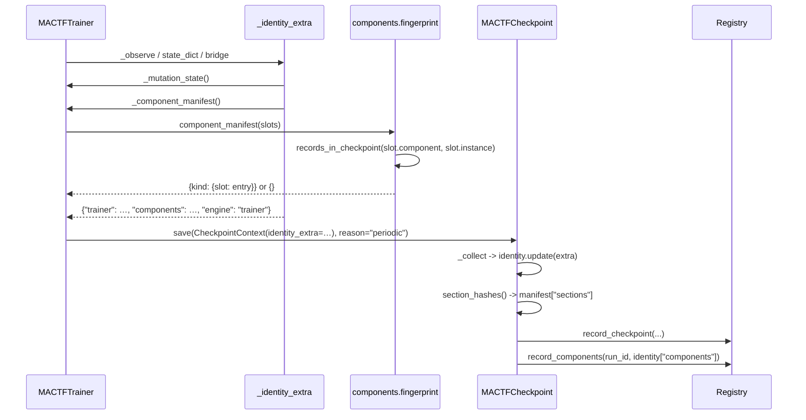
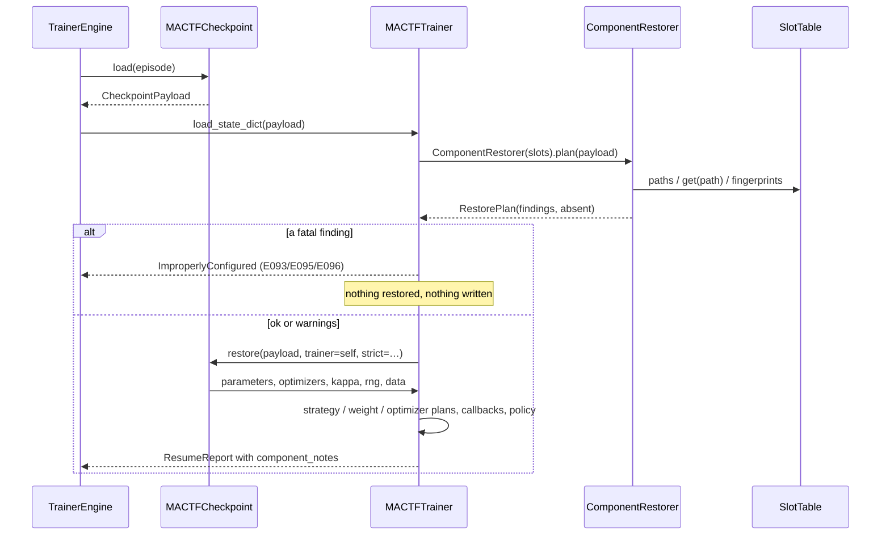

---

## 14. Persistence and compatibility

Sections 3 to 13 made a run able to use components that are not in the framework, and made
the engine that uses them reachable from a terminal. This section makes such a run
*resumable*: every extension a run used is written into the checkpoint, compared on the way
back in, and reported with a code when the code that provided it is gone. It also closes the
gap section 2.1 recorded — the periodic checkpoint carried no trainer-owned identity at all
— and adds registry migration **4** so a run row can answer "which components did this run
use?" without loading a checkpoint.

Two things are deliberately *not* persisted: a built-in component's parameters, because they
already live in `runs.settings` and in `conf/`, and configuration itself, because a
checkpoint restores *state*, and a checkpoint that silently overrode `conf/trainer.yaml`
would make the file a lie. What this section guarantees instead is that a mismatch is
impossible to miss.

---

### 14.1 What exists, and what is missing

| Piece | Where | State today |
|---|---|---|
| The identity section | `orchestration/checkpoint_v2.py:578-593` | Fifteen framework keys (`run_id`, `episode`, `global_step`, `schema_version`, `created_at`, torch/python/mactf versions, `hostname`, `command_line`, `device`, `dtype`, `amp`, `mode`, `score`) |
| The extra hook | `orchestration/checkpoint_v2.py:314-320` (`identity_extra` field), `:326-331` (merge) | Added by section 12.7; refuses to replace a framework key |
| Where the trainer fills it | `training/trainer.py:261-265` (`_identity_extra`) | Holds the mutation state only, and only after a mutation |
| Periodic checkpoint | `training/trainer.py:1930-1943` (`_observe`) | Builds a `CheckpointContext` **without** `identity_extra` |
| `state_dict` | `training/trainer.py:2207-2226` | Builds a `CheckpointContext` without `identity_extra`, then patches `identity["trainer"]` |
| Watchdog snapshot | `training/trainer.py` `_CheckpointBridge.save` (section 12.7) | Already passes `identity_extra=self._trainer._identity_extra()` |
| Registry writer | `orchestration/checkpoint_v2.py:725-745` (`_record_in_registry`) | Writes the `checkpoints` row; nothing about components |
| The registry schema | `db.py:20` (`SCHEMA_VERSION = 3`), `:234-238` (`MIGRATIONS`) | Three versions; no component column |
| The migrate command | `management/commands/migrate.py:33-74` | Generic: applies whatever `MIGRATIONS` holds, reports `core_pending` from `SCHEMA_VERSION` |
| The behind-schema guard | `management/base.py:422-432` | Refuses a command when `schema_version() < SCHEMA_VERSION` |
| Slot fingerprints | `components/slots.py` `SlotTable.fingerprints()` (section 4.4) | `{path: {kind, name, origin, version, spec_hash, source_digest, ...}}` |

The gaps:

| ID | Gap | Evidence |
|---|---|---|
| **P-G1** | A periodic checkpoint records nothing about the components a run used | `trainer.py:1930-1943` has no `identity_extra`; `_identity_extra` (`:261-265`) holds only the mutation state |
| **P-G2** | `state_dict()` records nothing either, so a `--branch-from` copy loses the fact as well | `trainer.py:2210-2219` |
| **P-G3** | Nothing compares a checkpoint's components with the live ones, so a resume silently uses whatever `conf/` says today | `checkpoint_v2.restore` (`:949-1191`) checks topology, layout, dtype and device — never a component |
| **P-G4** | A missing component produces a `NameError`-shaped failure deep inside a `load_state_dict`, or worse, a silently different component | no code path reads a component name back |
| **P-G5** | `runs` has no place to list a run's components, so `mactf runs show` cannot answer the question the CLI section adds | `db.py:51-118` (the `runs` table) |
| **P-G6** | The mutation state a section-12 run writes is absent from its *periodic* checkpoints, so a resume of a mutated run rebuilds the pre-mutation tree and fails the topology check | the same missing `identity_extra` as P-G1 |

---

### 14.2 Invariants

| ID | Invariant | Enforced by |
|---|---|---|
| **P1** | *Default identity.* A run that uses only built-in components with default parameters writes no `components` key, so `section_hashes()["identity"]` and `content_hash()` are byte-identical to the pre-change values (**I1**). | `component_manifest` returns `{}`; `_identity_extra` omits the key |
| **P2** | *Extension completeness.* Every slot whose component is not a built-in, overrides a built-in, or asks to be recorded appears in `identity["components"]`, keyed by kind and then by slot path. | `component_manifest` (14.3.2) |
| **P3** | *Fail before writing.* A manifest that is malformed, from a newer component schema, or names a component this build lacks is refused before any parameter, optimizer or RNG state is restored. | `ComponentRestorer.plan` runs first in `load_state_dict` (14.5.2) |
| **P4** | *No silent substitution.* A slot whose saved spec differs from the live one is either `E094` (strict) or `W052` naming the field — never a quiet continuation on a different component. | `diff()` (14.3.3), `RestorePlan` |
| **P5** | *Legacy tolerance.* A checkpoint with no `components` key (every file written before this section, and every all-built-in run) restores exactly as it did, with one informational note. | `W053`, `RestorePlan.empty` |
| **P6** | *One manifest, two readers.* The manifest in the file and the manifest in `runs.components_json` are produced by the same function, so the CLI and a resume cannot disagree. | `component_manifest` used by `_identity_extra` and by `record_components` |
| **P7** | *Additive schema.* Migration 4 adds one nullable column and changes no existing value; a database at version 3 upgrades in place and a version-4 reader works on a version-3 file. | `_migration_4_step` (14.6.2) |

---

### 14.3 The manifest (`mactf/components/fingerprint.py`)

#### 14.3.1 What a recorded entry holds

One entry is a slot's fingerprint plus the facts a fingerprint cannot carry:

```json
{
  "schema": 1,
  "kind": "weight_update",
  "name": "trimmed_mean",
  "origin": "project",
  "version": "0",
  "spec_hash": "sha256:6c1d…",
  "source_digest": "sha256:0a44…",
  "params": {"trim": 0.2},
  "slot": "TRAINER.WEIGHT_UPDATE"
}
```

| Field | Why it is there | Who reads it |
|---|---|---|
| `schema` | The shape of *this entry*, so a future format is a version, not a guess | `_check_entry` (`E096`) |
| `kind` | Redundant with the outer key, so an exported entry (the CLI's JSON, an API body) is self-describing | `diff`, `mactf components diff` |
| `name` | What must still be registered | `ComponentRestorer` (`E093`) |
| `origin` | Whether the entry is an extension at all, and whether a resume is *downgrading* an extension to a built-in | `diff` (`origin` change) |
| `version` | The component's own version string; a bump is reported even when the spec hash matches | `diff`, `W052` |
| `spec_hash` | The canonical hash of `{type, import, params}` (section 5.2) | `diff`, `E094` |
| `source_digest` | The hash of the *code* that defined a non-built-in factory (section 3.3) | `diff`, `E094` |
| `params` | What the project asked for, verbatim, so a mismatch can be shown | `diff`, the CLI |
| `slot` | The path, so an entry stands alone in an API response | CLI, API |

#### 14.3.2 Building it

```python
# mactf/components/fingerprint.py
"""The checkpoint's record of which components a run used, and the diff of two records.

Section 14. The manifest is the *only* place the framework writes a component's identity into
a checkpoint, and ``diff`` is the only place it compares two. Both are pure functions of the
slot table, so both are unit-testable without a trainer.
"""

from __future__ import annotations

import logging
from dataclasses import dataclass
from typing import Any, Iterable, Mapping

from .kinds import Origin

log = logging.getLogger("mactf.components")

#: The shape of one entry. Bumped only if an entry gains a field a reader must understand.
ENTRY_SCHEMA = 1
#: The key the entry lives under in ``identity``.
IDENTITY_KEY = "components"

#: Attributes on a component's *instance* that force it into the manifest even when it is a
#: built-in with default parameters. ``unsafe`` is how section 7.6 records a policy that runs
#: outside ``StepGuard``; ``record_in_checkpoint`` is the general hook.
RECORD_FLAGS: tuple[str, ...] = ("record_in_checkpoint", "unsafe")


def records_in_checkpoint(component: Any, instance: Any = None) -> bool:
    """Whether this slot belongs in a checkpoint's ``components`` manifest.

    Three reasons, in order of frequency:

    1. It is not a built-in: a ``project``, ``plugin`` or ``runtime`` component is *code* that
       the settings cannot reconstruct, so its identity must travel with the weights (I5, I6).
    2. It replaces a built-in: the origin is ``project`` already in that case, but the
       ``overrides_builtin`` flag is what the resume comparison reports.
    3. Its instance asks to be recorded, or declares itself ``unsafe``.

    A built-in with parameters set in configuration is deliberately **not** recorded: the
    parameters are in ``runs.settings`` and in ``conf/``, and recording them would break P1
    for every run that ever wrote a ``LOSS`` block.
    """
    if component.origin is not Origin.BUILTIN or bool(component.overrides_builtin):
        return True
    if instance is None:
        return False
    return any(bool(getattr(instance, flag, False)) for flag in RECORD_FLAGS)


def entry_for(slot: Any) -> dict[str, Any]:
    """One manifest entry for a live slot (``components.slots.Slot``)."""
    resolved = slot.resolved
    component = resolved.component
    payload: dict[str, Any] = {
        "schema": ENTRY_SCHEMA,
        "kind": slot.kind_id,
        "name": component.name,
        "origin": component.origin.value,
        "version": str(component.version),
        "spec_hash": str(resolved.spec_hash),
        "slot": slot.path,
        # The spec's params, verbatim: they are what the project wrote and what a diff shows.
        "params": dict(resolved.spec.params),
    }
    source = component.fingerprint(spec_hash=None).get("source_digest")
    if source:
        payload["source_digest"] = str(source)
    if component.overrides_builtin:
        payload["overrides_builtin"] = True
    return payload


def component_manifest(slots: Any, *, kinds: Iterable[str] | None = None) -> dict[str, dict[str, dict[str, Any]]]:
    """``{kind: {slot path: entry}}`` for every slot that must be recorded. ``{}`` otherwise.

    ``slots`` is a :class:`~mactf.components.slots.SlotTable`; ``kinds`` narrows the result (the
    CLI asks for one kind, a checkpoint always records all of them).
    """
    wanted = None if kinds is None else frozenset(str(kind) for kind in kinds)
    manifest: dict[str, dict[str, dict[str, Any]]] = {}
    for path in slots.paths():
        slot = slots.get(path)
        if wanted is not None and slot.kind_id not in wanted:
            continue
        if not records_in_checkpoint(slot.component, slot.instance):
            continue
        manifest.setdefault(slot.kind_id, {})[path] = entry_for(slot)
    return {kind: dict(sorted(entries.items())) for kind, entries in sorted(manifest.items())}


def recorded_slots(manifest: Mapping[str, Any]) -> list[tuple[str, str]]:
    """``[(kind, slot)]`` in kind-then-path order, for a report or a loop."""
    pairs: list[tuple[str, str]] = []
    for kind in sorted(manifest or {}):
        entries = manifest[kind]
        if not isinstance(entries, Mapping):
            continue
        for path in sorted(entries):
            pairs.append((str(kind), str(path)))
    return pairs
```

#### 14.3.3 Comparing two records

```python
@dataclass(frozen=True)
class Change:
    """One field that differs between a saved entry and a live one."""

    kind: str
    slot: str
    field: str
    saved: Any
    live: Any

    @property
    def structural(self) -> bool:
        """Whether the change means a *different component*, not a different version of it."""
        return self.field in ("name", "kind", "origin", "spec_hash", "source_digest", "present")

    def describe(self) -> str:
        if self.field == "present":
            return f"{self.slot}: {'absent now' if self.live is None else 'absent when saved'}"
        return f"{self.slot}: {self.field} {self.saved!r} -> {self.live!r}"


#: Fields compared in this order. ``present`` is synthetic (one side has no entry at all).
_COMPARED: tuple[str, ...] = (
    "kind", "name", "origin", "version", "spec_hash", "source_digest", "overrides_builtin",
)


def diff(
    saved: Mapping[str, Any] | None,
    live: Mapping[str, Any] | None,
) -> list[Change]:
    """Every difference between two manifests of the shape ``component_manifest`` returns.

    A slot present on one side only is one ``present`` change, not seven field changes: the
    message a user needs is "this slot is not configured any more", not the field list of a
    record that no longer exists. A differing ``params`` mapping is reported as one change
    whose values are the mappings, because ``spec_hash`` already moved and a per-key diff
    would repeat the same fact.
    """
    saved_map = _flat(saved)
    live_map = _flat(live)
    changes: list[Change] = []
    for kind, path in sorted(set(saved_map) | set(live_map)):
        before = saved_map.get((kind, path))
        after = live_map.get((kind, path))
        if before is None or after is None:
            changes.append(
                Change(kind=kind, slot=path, field="present", saved=before, live=after)
            )
            continue
        for field in _COMPARED:
            if before.get(field) != after.get(field):
                changes.append(
                    Change(kind=kind, slot=path, field=field,
                           saved=before.get(field), live=after.get(field))
                )
        if dict(before.get("params") or {}) != dict(after.get("params") or {}):
            changes.append(
                Change(kind=kind, slot=path, field="params",
                       saved=dict(before.get("params") or {}), live=dict(after.get("params") or {}))
            )
    return changes


def _flat(manifest: Mapping[str, Any] | None) -> dict[tuple[str, str], dict[str, Any]]:
    """``{(kind, slot): entry}`` from the nested shape."""
    flat: dict[tuple[str, str], dict[str, Any]] = {}
    for kind, entries in dict(manifest or {}).items():
        if not isinstance(entries, Mapping):
            continue
        for path, entry in entries.items():
            if isinstance(entry, Mapping):
                flat[(str(kind), str(path))] = dict(entry)
    return flat


def render(changes: Iterable[Change]) -> str:
    """One line per change, for a log or ``mactf components diff``."""
    return "\n".join(change.describe() for change in changes)
```

A worked diff, from a project that renamed its weight strategy between two runs:

```text
TRAINER.WEIGHT_UPDATE: name 'trimmed_mean' -> 'ema_softmax'
TRAINER.WEIGHT_UPDATE: spec_hash 'sha256:6c1d…' -> 'sha256:9f02…'
RL.loss: params {'clip': 0.2} -> {'clip': 0.1}
TRAINER.OPTIMIZER.default: absent now
```

`structural` is what the restorer keys on: a `version` bump is a `W052`, a `name` change is an
`E094` under strict.

---

### 14.4 Writing: three call sites, one function

Gap **P-G1** and **P-G2** are the same one-line omission in two places; **P-G6** follows from
it. The manifest itself is one function, called from the trainer's `_identity_extra`, which
all three writers already (or now) consult.

```python
# mactf/training/trainer.py   (replacing ``_identity_extra``, the section 12.7 body)
    def _identity_extra(self) -> dict[str, Any]:
        """Keys a checkpoint adds to ``identity``.

        Two sections and nothing else, each present only when it has content:

        * ``trainer``: the mutation state, for a run that changed its tree (section 12.7);
        * ``components``: the extensions the run uses (section 14.3), absent for an
          all-built-in run, which is what keeps a default run's identity hash unchanged (P1).

        ``engine`` is written by this module because ``MACTFTrainer`` is the only engine that
        writes a v2 checkpoint; ``Orchestrator``'s v1 files carry no ``identity`` at all, so an
        absent key already reads as "orchestrator" (``Engine._check_identity``).
        """
        extra: dict[str, Any] = {}
        mutation = self._mutation_state()
        if mutation:
            extra["trainer"] = {"mutation": mutation}
        manifest = self._component_manifest()
        if manifest:
            extra["components"] = manifest
        extra["engine"] = ENGINE_NAME
        return extra

    def _component_manifest(self) -> dict[str, dict[str, dict[str, Any]]]:
        """The section 14.3 manifest for this trainer's slots; ``{}`` when it has none.

        ``slots`` is created by ``build()`` (section 3.5); a trainer built by an older code
        path, or by a test that skipped the component model, has no attribute and records
        nothing rather than failing.
        """
        slots = getattr(self, "slots", None)
        if slots is None:
            return {}
        from ..components.fingerprint import component_manifest

        return component_manifest(slots)
```

`ENGINE_NAME` is a module constant, next to the module's other constants
(`trainer.py:2285-2288`):

```python
# mactf/training/trainer.py   (module constants, after ``_HEAD_PREFIXES``)
#: The engine that writes a schema-2 checkpoint. ``Orchestrator`` writes schema 1 and no
#: ``identity`` section, so its absence is how a resume reads "orchestrator" (13.4.8, E091).
ENGINE_NAME = "trainer"
```

`extra["engine"]` is written unconditionally, unlike the other two keys. That is intentional:
it is what `E091` compares, and a trainer checkpoint that omitted it would read as an
orchestrator file and be refused under `ALLOW_ENGINE_SWITCH: false`. It is also stable across
every trainer run, so it costs one key and no churn.

#### 14.4.1 The periodic checkpoint (`_observe`)

```python
# mactf/training/trainer.py   (replacing lines 1930-1943)
        every = int(self._training_settings().get("CHECKPOINT_EVERY", 1) or 0)
        writer = self.checkpoint
        if writer is not None and every and (result.epoch + 1) % every == 0:
            writer.save(
                CheckpointContext(
                    trainer=self,
                    episode=result.epoch,
                    global_step=self.global_step,
                    score=self.mean_score,
                    kappa=float(self.controller.kappa) if self.controller else 0.0,
                    entropy=float(self.controller.entropy) if self.controller else 0.0,
                    aggregations=tuple(self.reports),
                    # Section 14: without this a resumed run rebuilt the pre-mutation tree and
                    # the component set of the settings, not the one the file was written with.
                    identity_extra=self._identity_extra(),
                ),
                reason="periodic",
            )
```

#### 14.4.2 `state_dict()`

```python
# mactf/training/trainer.py   (replacing lines 2210-2226)
        context = CheckpointContext(
            trainer=self,
            episode=self._epoch,
            global_step=self.global_step,
            score=self.mean_score,
            kappa=float(self.controller.kappa) if self.controller else 0.0,
            entropy=float(self.controller.entropy) if self.controller else 0.0,
            aggregations=tuple(self.reports[-64:]),
            identity_extra=self._identity_extra(),
        ).resolve()
        payload = self.checkpoint._collect(
            context, episode=self._epoch, step=self.global_step
        )
        data = _detach_clone(payload.as_dict())
        state = self._trainer_state()
        identity = {**dict(data["identity"]), "trainer": state}
        data["identity"] = identity
        return data
```

The last line is the same merge as before; what changed is that `identity` now already holds
`components` and `engine`, and `data = _detach_clone(...)` no longer drops them (it clones
tensors and copies everything else, `trainer.py:2310-2330`).

#### 14.4.3 The watchdog snapshot

No edit: `_CheckpointBridge.save` builds its context with
`identity_extra=self._trainer._identity_extra()` (section 12.7), so widening
`_identity_extra` widens the snapshot too. That is why the fix is one method and three
call sites rather than four.

#### 14.4.4 The write path



---

### 14.5 Restoring: verification before any state is touched

#### 14.5.1 Statuses and codes

| Status | Meaning | Strict | Permissive | Consequence |
|---|---|---|---|---|
| `ok` | Entry matches the live slot field for field | — | — | Nothing; the component's own `load_state_dict` decides about its state |
| `builtin` | The entry is a built-in with default parameters (only possible in a hand-edited file) | `ok` | `ok` | Recorded, compared, never an error |
| `mismatch` | The slot is live but `diff` finds a structural or version difference | `E094` | `W052` | The live component is used; its own state loader drops what does not fit |
| `orphan` | Entry names a slot the run no longer has (a retired peer's `RL.*`, an override glob that stopped matching) | `W052` | `W052` | The entry is ignored, and named |
| `missing` | Slot is live and wants this component, but the registry does not have the name | `E093` | `E093` | Fatal: the code that produced the state is not loaded |
| `malformed` | The entry is not a mapping, or lacks `schema`/`kind`/`name` | `E095` | `E095` | Fatal: the file cannot be interpreted |
| `unsupported` | `schema` is not `ENTRY_SCHEMA` | `E096` | `E096` | Fatal: written by a newer build |
| `absent` | The checkpoint has no `components` key | `W053` | `W053` | Nothing to verify; today's behaviour exactly (P5) |

`missing`, `malformed` and `unsupported` are fatal in both modes, because there is no
defensible way to continue: the parameters on disk belong to code that is not here, and
either the answer is "install the module" or the answer is "do not resume".

#### 14.5.2 `ComponentRestorer` (`mactf/components/restore.py`)

```python
# mactf/components/restore.py
"""Read a checkpoint's ``components`` manifest and say what it means for this run.

Section 14.5. The restorer never edits a slot: configuration comes from settings (section 5),
and a restore that quietly re-pointed a slot would make ``conf/`` a lie. It verifies, reports
per slot, and raises only when continuing would mean training with the wrong code.
"""

from __future__ import annotations

import logging
from dataclasses import dataclass, field
from typing import Any, Mapping

from ..exceptions import ImproperlyConfigured
from .fingerprint import ENTRY_SCHEMA, IDENTITY_KEY, diff, recorded_slots, render

log = logging.getLogger("mactf.components")

#: Statuses that stop a resume in both modes.
FATAL = frozenset({"missing", "malformed", "unsupported"})


@dataclass(frozen=True)
class Finding:
    """What the restorer decided about one slot."""

    kind: str
    slot: str
    status: str
    code: str | None = None
    message: str = ""
    saved: Mapping[str, Any] | None = None
    live: Mapping[str, Any] | None = None

    @property
    def fatal(self) -> bool:
        return self.status in FATAL

    def describe(self) -> str:
        prefix = f"{self.code}: " if self.code else ""
        return f"{prefix}{self.slot} [{self.status}] {self.message}".rstrip()


@dataclass
class RestorePlan:
    """The findings for one checkpoint, plus the notes a caller appends to its report."""

    findings: list[Finding] = field(default_factory=list)
    #: ``True`` when the checkpoint carried no manifest at all (an older file, or an
    #: all-built-in run). Nothing was verified and nothing may be claimed.
    absent: bool = False
    checked: int = 0

    # -- queries ----------------------------------------------------------
    @property
    def fatal(self) -> list[Finding]:
        return [finding for finding in self.findings if finding.fatal]

    @property
    def warnings(self) -> list[Finding]:
        return [finding for finding in self.findings if finding.code and not finding.fatal]

    @property
    def ok(self) -> bool:
        return not self.fatal

    def status_of(self, slot: str) -> str | None:
        for finding in self.findings:
            if finding.slot == slot:
                return finding.status
        return None

    def notes(self) -> list[str]:
        return [finding.describe() for finding in self.findings if finding.code]

    def describe(self) -> dict[str, Any]:
        counts: dict[str, int] = {}
        for finding in self.findings:
            counts[finding.status] = counts.get(finding.status, 0) + 1
        return {
            "absent": self.absent,
            "checked": self.checked,
            "statuses": counts,
            "findings": [
                {
                    "kind": finding.kind,
                    "slot": finding.slot,
                    "status": finding.status,
                    "code": finding.code,
                    "message": finding.message,
                }
                for finding in self.findings
            ],
        }

    # -- raising ----------------------------------------------------------
    def raise_for_errors(self) -> None:
        """Raise ``E093``/``E095``/``E096`` for the first fatal finding, naming all of them.

        One exception with every fatal slot listed is more useful than the first one: an
        operator who is missing two plugins should install both, not discover them one
        resume at a time.
        """
        fatal = self.fatal
        if not fatal:
            return
        lines = [finding.describe() for finding in fatal]
        raise ImproperlyConfigured(lines[0] + ("" if len(lines) == 1 else f" (+{len(lines) - 1} more)"))


class ComponentRestorer:
    """Compare a checkpoint's manifest with the live slot table."""

    def __init__(self, slots: Any, *, policy: Any = None) -> None:
        self.slots = slots
        #: ``HubPolicy``; ``strict_restore`` is the only field read, and ``None`` means "read
        #: it from the hub when the plan is built", which keeps this class testable bare.
        self.policy = policy

    # -- planning ---------------------------------------------------------
    def plan(self, payload: Any) -> RestorePlan:
        """Plan against a checkpoint payload, a raw mapping, or a bare manifest.

        ``payload`` is what ``MACTFCheckpoint.load`` returns (a ``CheckpointPayload``), a
        ``torch.load`` result (a mapping with ``identity``), or already the manifest itself --
        the CLI passes the last form.
        """
        manifest = extract_manifest(payload)
        if manifest is None:
            return RestorePlan(absent=True)
        strict = self._strict()
        plan = RestorePlan()
        for kind, path in recorded_slots(manifest):
            entry = manifest[kind][path]
            plan.findings.append(self._check(kind, path, entry, strict=strict))
            plan.checked += 1
        for finding in plan.findings:
            if finding.code:
                (log.error if finding.fatal else log.warning)("%s", finding.describe())
        return plan

    def report(self, plan: RestorePlan) -> str:
        """A human summary, for the engine's ``startup_notes`` and ``mactf runs show``."""
        if plan.absent:
            return "W053: this checkpoint records no components; nothing to verify"
        if not plan.findings:
            return "components: nothing recorded"
        mismatched = [finding for finding in plan.findings if finding.status == "mismatch"]
        return (
            f"components: {plan.checked} checked, {len(mismatched)} differ, "
            f"{len(plan.fatal)} fatal"
        )

    # -- one slot ---------------------------------------------------------
    def _check(self, kind: str, path: str, entry: Any, *, strict: bool) -> Finding:
        problem = _check_entry(kind, path, entry)
        if problem is not None:
            status, code, message = problem
            return Finding(kind, path, status, code, message, saved=None)

        saved = dict(entry)
        try:
            slot = self.slots.get(path)
        except Exception:  # noqa: BLE001 - ``ComponentMissing`` for a slot is an orphan here
            return Finding(
                kind, path, "orphan", "W052",
                "the run no longer has this slot; the entry is ignored",
                saved=saved, live=None,
            )

        live = _live_entry(slot)
        if saved.get("name") != live.get("name") or saved.get("kind") != live.get("kind"):
            registered = _is_registered(saved.get("kind"), saved.get("name"))
            if not registered:
                return Finding(
                    kind, path, "missing", "E093",
                    f"needs component {saved.get('name')!r} of kind {saved.get('kind')!r}, which "
                    "is not registered; install the module that provides it "
                    "(COMPONENTS.MODULES or the mactf.components entry point) or resume "
                    "with a different checkpoint",
                    saved=saved, live=live,
                )

        changes = diff({kind: {path: saved}}, {kind: {path: live}})
        if not changes:
            return Finding(kind, path, "ok", None, "", saved=saved, live=live)

        structural = [change for change in changes if change.structural]
        detail = render(changes)
        if strict and structural:
            return Finding(
                kind, path, "mismatch", "E094",
                "differs from the checkpoint and COMPONENTS.STRICT_RESTORE is on:\n" + detail,
                saved=saved, live=live,
            )
        return Finding(
            kind, path, "mismatch", "W052",
            "differs from the checkpoint; this run uses the configured component:\n" + detail,
            saved=saved, live=live,
        )

    def _strict(self) -> bool:
        """``COMPONENTS.STRICT_RESTORE``, read off the effective ``HubPolicy``.

        ``getattr`` rather than an attribute access because ``HubPolicy`` gains the field in
        section 15.1: a build that has ``restore.py`` but not yet the settings key treats every
        difference as ``W052``, which is the safe direction (a warning cannot block a resume).
        """
        policy = self.policy
        if policy is None:
            try:
                from .registry import HUB

                policy = HUB.effective_policy()
            except Exception:  # noqa: BLE001 - a bare unit test has no hub
                return False
        return bool(getattr(policy, "strict_restore", False))


# ---------------------------------------------------------------------------
# Helpers
# ---------------------------------------------------------------------------
def extract_manifest(payload: Any) -> dict[str, dict[str, dict[str, Any]]] | None:
    """The manifest inside a payload, or ``None`` when the payload carries none.

    Three accepted shapes, because three call sites hand this a different object: a
    ``CheckpointPayload`` (``payload.identity``), a ``torch.load`` mapping (``["identity"]``),
    and a manifest itself (the CLI's ``components diff``), which is recognised because its
    values are ``{slot: entry}`` mappings rather than the identity's scalars.
    """
    identity: Any = None
    if isinstance(payload, Mapping):
        identity = payload.get("identity", payload if _looks_like_manifest(payload) else None)
    else:
        identity = getattr(payload, "identity", None)
    if not isinstance(identity, Mapping):
        return None
    raw = identity.get(IDENTITY_KEY) if _looks_like_manifest(identity) is not True else identity
    if raw is None:
        return None
    if not isinstance(raw, Mapping):
        return {IDENTITY_KEY: {"?": raw}}  # surfaced as E095 by ``_check_entry``
    return {str(kind): dict(entries) for kind, entries in raw.items() if isinstance(entries, Mapping)} or {
        IDENTITY_KEY: {"?": raw}
    }


def _looks_like_manifest(mapping: Mapping[str, Any]) -> bool:
    """``True`` when the values are ``{slot: {entry fields}}`` rather than identity scalars."""
    for value in mapping.values():
        if isinstance(value, Mapping):
            for inner in value.values():
                if isinstance(inner, Mapping) and "name" in inner:
                    return True
    return False


def _check_entry(kind: str, path: str, entry: Any) -> tuple[str, str, str] | None:
    """``(status, code, message)`` for a malformed or unsupported entry, else ``None``."""
    if not isinstance(entry, Mapping):
        return (
            "malformed", "E095",
            f"entry for {kind}/{path} is {type(entry).__name__}, not a mapping",
        )
    missing = [key for key in ("schema", "kind", "name") if key not in entry]
    if missing:
        return (
            "malformed", "E095",
            f"entry for {kind}/{path} lacks {', '.join(missing)}",
        )
    schema = entry["schema"]
    if not isinstance(schema, int) or isinstance(schema, bool):
        return ("malformed", "E095", f"entry for {kind}/{path} has a non-integer schema {schema!r}")
    if schema != ENTRY_SCHEMA:
        return (
            "unsupported", "E096",
            f"entry for {kind}/{path} uses component schema {schema}; this build understands "
            f"{ENTRY_SCHEMA}. Upgrade mactf, or resume with a build that wrote this file",
        )
    return None


def _live_entry(slot: Any) -> dict[str, Any]:
    from .fingerprint import entry_for

    return entry_for(slot)


def _is_registered(kind: Any, name: Any) -> bool:
    """Whether the registry can still build this name (``E093`` depends on it)."""
    if not isinstance(kind, str) or not isinstance(name, str):
        return False
    try:
        from .registry import HUB

        return HUB.registry(kind).find(name) is not None
    except Exception:  # noqa: BLE001 - an unknown kind means "not registered here"
        return False
```

`extract_manifest`'s `_looks_like_manifest` deserves a word: a `CheckpointPayload`'s identity
holds scalars and, at most, the `trainer` mapping (whose values are dicts of dicts, so the
`"name" in inner` test is what distinguishes them). A manifest's leaves always carry `name`.
That is a heuristic, and it is the reason the doc's CLI section reads the manifest from a
typed accessor (`CheckpointPayload.identity`) rather than a raw mapping wherever it can.

#### 14.5.3 Where the restorer runs

```python
# mactf/training/trainer.py   (MACTFTrainer.load_state_dict: five statements added at the top)
    def load_state_dict(
        self, payload: Mapping[str, Any], *, strict: bool = True
    ) -> ResumeReport:
        """Restore from a payload produced by :meth:`state_dict` or a checkpoint."""
        self._require_built()
        if self.checkpoint is None:
            raise ImproperlyConfigured("load_state_dict() needs a checkpoint writer")
        # Section 14.5: verify the components before a single parameter moves (P3). A missing
        # component must not be discovered after the models have been overwritten.
        plan = self._component_plan(payload)
        plan.raise_for_errors()
        self.component_notes = plan.notes()
        identity = payload.get("identity") if isinstance(payload, Mapping) else payload.identity
        extra = dict((identity or {}).get("trainer") or {})
        recorded = extra.get("signal_source")
        # ... the rest of the method is unchanged ...

    def _component_plan(self, payload: Any) -> Any:
        """The ``RestorePlan`` for this payload; ``absent`` when there is nothing recorded."""
        from ..components.restore import ComponentRestorer

        slots = getattr(self, "slots", None)
        if slots is None:
            # A trainer built without the component model: nothing can be verified, and nothing
            # was recorded by such a run either.
            from ..components.restore import RestorePlan

            return RestorePlan(absent=True)
        return ComponentRestorer(slots).plan(payload)
```

`self.component_notes` is initialised in `__init__` next to `strategy_warnings` (the list
section 11 already appends notes to, `trainer.py:530-560`):

```python
# mactf/training/trainer.py   (__init__: after ``self.strategy_warnings = []``)
        #: Notes from the section 14 component verification. ``mactf runs show`` prints them.
        self.component_notes: list[str] = []
```

and `TrainResult` carries them (section 11 already widens `TrainResult` with
`strategy_warnings`; `component_notes` joins it):

```python
# mactf/training/trainer.py   (TrainResult: one field after ``strategy_warnings``)
    component_notes: tuple[str, ...] = ()
```

`fit()` fills it from `self.component_notes` after a `resume` (section 11's code, one added
key). Nothing else reads it in the training path, which is what keeps it cheap.

#### 14.5.4 The restore path



---

### 14.6 Registry migration 4

#### 14.6.1 Why a column and not a table

A run's component set is written once at start and then only re-written when a swap changes
it. It is read as a whole, for one run, and never queried by field. A table would mean a row
per slot per run and two joins to answer "which weight strategy did run `abc123` use?",
which is the only question anyone asks. One JSON column answers it in one row, which is why
the same design was chosen for `runs.settings` (`db.py:51-118`).

| Why | Consequence |
|---|---|
| Read whole, per run | `TEXT` holding the manifest, decoded on read |
| Written at start, re-written on a swap | Idempotent `UPDATE`, no history (the checkpoints and the journals are the history) |
| Must not break an older reader | `SELECT *` readers ignore an unknown column; only `get_run` and the CLI decode it |
| Nullable | A run that used only built-ins leaves it `NULL`, exactly as the checkpoint leaves its key absent (P1, P7) |

#### 14.6.2 The migration

```python
# mactf/db.py   (SCHEMA_VERSION and the migration, replacing line 20 and extending lines 234-238)
SCHEMA_VERSION = 4


def _migration_4_step(connection: sqlite3.Connection) -> None:
    """The component manifest of a run (document 17 section 14).

    One nullable column, no backfill: a row written before this version keeps ``NULL``, and
    ``NULL`` means "this run predates the component model or used only built-ins". A backfill
    would have to invent a manifest, and an invented manifest is worse than an absent one --
    ``Registry.components`` reports the difference instead (``W053``).
    """
    _add_columns_if_absent(connection, "runs", {"components_json": "TEXT"})


MIGRATIONS: tuple[Migration, ...] = (
    Migration(1, statements=_MIGRATION_1),
    Migration(2, step=_migration_2_step),
    Migration(3, step=_migration_3_step),
    Migration(4, step=_migration_4_step),
)
```

`_add_columns_if_absent` (`db.py:39-48`) is what makes the step idempotent: a database that
already has the column (a hand-rolled build, or a re-run after a crash between the `ALTER` and
the `mactf_schema` insert) is left alone. `Registry.migrate` (`db.py:380-398`) then records
version 4 in `mactf_schema` and seeds `mactf_migrations` for `core`.

#### 14.6.3 The two methods

```python
# mactf/db.py   (after ``record_checkpoint``, line 909)
    def record_components(
        self,
        run_id: str,
        components: Mapping[str, Any] | None,
        *,
        source: str = "engine",
    ) -> None:
        """Store a run's component manifest (document 17 section 14).

        ``source`` is a note, not a filter: ``engine`` writes the manifest a run started with,
        ``checkpoint`` re-writes it when a swap or a resume changed it, ``import`` is a caller
        backfilling from a file. An empty or absent mapping stores ``NULL`` rather than ``{}``
        so that "no components recorded" and "recorded as nothing" cannot be confused.
        """
        payload = json.dumps(dict(components), default=str) if components else None
        with self.connect() as connection:
            cursor = connection.execute(
                "UPDATE runs SET components_json = ? WHERE id = ?", (payload, run_id)
            )
            if not cursor.rowcount:
                raise ImproperlyConfigured(
                    f"no run {run_id!r} to record {source} components for; "
                    "start_run must write the row first"
                )

    def components(self, run_id: str) -> dict[str, Any] | None:
        """The run's manifest as stored, or ``None`` when it has none.

        ``None`` is the honest answer for a run that predates the component model and for one
        that used only built-ins; the caller that needs to tell them apart looks at the
        checkpoint (``W053`` says the file records none either).
        """
        with self.connect() as connection:
            row = connection.execute(
                "SELECT components_json FROM runs WHERE id = ?", (run_id,)
            ).fetchone()
        if row is None:
            return None
        raw = row["components_json"]
        return json.loads(raw) if raw else None
```

and `get_run` decodes the column, so every existing reader of `runs` (the API's run detail,
`mactf runs show`, the comparison view of document 16) sees a mapping rather than a JSON
string:

```python
# mactf/db.py   (get_run, replacing lines 590-594)
    def get_run(self, run_id: str) -> dict[str, Any] | None:
        with self.connect() as connection:
            row = connection.execute("SELECT * FROM runs WHERE id = ?", (run_id,)).fetchone()
        return _decode_run(row) if row else None


def _decode_run(row: sqlite3.Row) -> dict[str, Any]:
    """A ``runs`` row with its JSON columns decoded (``settings``, ``runtime``, ``components``)."""
    item = _row_to_dict(row)
    for column in ("settings", "runtime", "sandbox", "components_json"):
        value = item.get(column)
        if isinstance(value, str) and value:
            try:
                item[column] = json.loads(value)
            except json.JSONDecodeError:  # a hand-edited row: keep the text, do not fail
                item[column] = value
    item["components"] = item.pop("components_json", None)
    return item
```

`_decode_run` is additive for readers (`get_run` gains decoded `settings`/`runtime`/`sandbox`
too, which is what the API was already doing by hand) and it renames the column to
`components` so the view's shape matches the checkpoint's key. `list_runs` keeps returning raw
rows: a list view does not need three decoded JSON blobs per row, and changing its shape would
be a behaviour change section 16 does not ask for.

#### 14.6.4 Who writes it

```python
# mactf/orchestration/engine.py   (TrainerEngine._run_epochs: three statements after start_run)
        self.registry.start_run(
            self.run_id,
            settings=row_settings,
            runtime=runtime_info,
            sandbox=self.sandbox_choice.report.as_dict() if self.sandbox_choice else None,
            notes="; ".join(self.startup_notes),
        )
        # Section 14.6: the manifest the run starts with, from the same function the checkpoint
        # uses (P6), so the row and the file cannot disagree about the initial set.
        manifest = trainer._component_manifest()
        if manifest:
            self.registry.record_components(self.run_id, manifest, source="engine")
```

and the writer re-records it on every save, because a mid-run swap is durable only in the
file until this line runs:

```python
# mactf/orchestration/checkpoint_v2.py   (save: one call after ``_record_in_registry``)
        self._record_in_registry(record)
        self._record_components(payload)
        signals.checkpoint_written.send(sender=self, record=record, payload=payload.as_dict())
```

```python
# mactf/orchestration/checkpoint_v2.py   (after ``_record_in_registry``, line 745)
    def _record_components(self, payload: CheckpointPayload) -> None:
        """Keep ``runs.components_json`` equal to the manifest this file was written with.

        A registry without the method (an app that supplies its own) is not an error: the file
        remains authoritative, which is the rule for every other registry write in
        ``_record_in_registry``.
        """
        recorder = getattr(self.registry, "record_components", None)
        if not callable(recorder):
            return
        manifest = dict(payload.identity.get(IDENTITY_KEY) or {})
        try:
            recorder(self.run_id, manifest or None, source="checkpoint")
        except ImproperlyConfigured:
            # ``start_run`` never ran (a bare ``state_dict()`` in a script). The file is
            # written and correct; there is simply no row to attach it to.
            log.debug("no run row for %s; components recorded in the file only", self.run_id)
```

`IDENTITY_KEY` is imported from `components.fingerprint`. `checkpoint_v2` already imports
from `mactf.*` at module level (`:1-40`), and `components.fingerprint` imports only
`components.kinds` and the standard library, so the import cannot create a cycle:
`components` never imports `orchestration` at module import time.

---

### 14.7 Compatibility

#### 14.7.1 Files

| File | `components` key | What a resume does |
|---|---|---|
| v1 (`CheckpointManager`, `checkpoint.py:51-88`) | impossible (no `identity`) | `load` migrates it (`checkpoint_v2.py:893-947`), `ExtractManifest` finds none → `W053`, then the topology and layout checks run as today. `E091` refuses it under the trainer engine unless `ALLOW_ENGINE_SWITCH` |
| v2, written before this document | absent | `W053`; nothing verified; parameters, optimizers, RNG and data position restore as today (P5) |
| v2, all built-in | absent (P1) | `W053`; identical bytes to the previous row |
| v2, one extension | present | Every entry checked; `ok` for each; the extension's own `load_state_dict` loads its state |
| v2, extension removed from `conf/` | present | `W052` naming every changed field; the run continues on the configured component and its state loader drops what does not fit |
| v2, extension's module uninstalled | present | `E093` before anything is restored, naming the component, the kind and the slot |
| v2, hand-edited entry | present | `E095` (missing field) or `E096` (a `schema` this build does not know) |
| v2, `STRICT_RESTORE: true`, extension's params edited | present | `E094` listing `spec_hash` and `params` |
| v2, `STRICT_RESTORE: true`, extension's *code* edited (same params) | present | `E094` listing `source_digest` |
| v2, `STRICT_RESTORE: true`, extension's `version` bumped only | present | `E094` (version is compared) — the one case a team may want permissive, and the reason the default is `false` |
| v2, written after a peer was retired | present, with the retired node's `RL.*` entries | Those entries are `orphan` → `W052`, not fatal: the slots legitimately no longer exist |

#### 14.7.2 Databases

| Database | `components_json` | Behaviour |
|---|---|---|
| version 1-3 | column absent | `mactf` refuses any *new* command with the existing behind-schema guard (`management/base.py:422-432`) until `mactf migrate`; a read-only `mactf runs list` on an old database keeps working because it never selects the column explicitly |
| version 3, migrated | all `NULL` | `components(run_id)` returns `None`; the CLI prints "not recorded" |
| version 4, new run, all built-in | `NULL` | same |
| version 4, new run, one extension | manifest | `components(run_id)` returns it |
| version 4, mid-run swap | manifest re-written at the next save | the row is the *latest* set, matching the latest checkpoint |
| version 4, written by a newer build | column possibly narrower/none | the JSON is opaque to the reader; an unknown kind is simply a key it prints |

The one-way property: a version-4 database opened by a version-3 build fails the schema check
(the recorded version is higher than `SCHEMA_VERSION`), which is the documented behaviour of
`Registry.migrate` for any newer file, not something this section changes.

#### 14.7.3 Engines

`Orchestrator` never writes `identity` at all (`CheckpointManager.save`,
`checkpoint.py:51-88`), so its files are the first row of 14.7.1 and nothing here touches it
(**T3**). A trainer checkpoint resumed under the orchestrator is `E091` (13.4.8) before this
section's check runs, because `_check_identity` is the engine's first statement.

---

### 14.8 What the bytes do and do not change

| Run | `identity` section | `section_hashes()["identity"]` | `content_hash()` | `runs.components_json` |
|---|---|---|---|---|
| All built-in, never mutated (P1) | unchanged, 15 keys | unchanged | unchanged | `NULL` |
| All built-in, mutated (section 12) | `+ identity["trainer"]["mutation"]` | changes | changes | `NULL` |
| One extension | `+ identity["components"]`, `+ identity["engine"]` | changes | changes | the same manifest |
| Extension plus mutation | both keys | changes | changes | the same manifest |

The first row is the invariant: a run that customizes nothing writes exactly the bytes it
wrote before this document, which is what makes `test_default_identity` a byte comparison and
not a semantic one. The second row is section 12's guarantee and is listed for completeness —
a mutated run already changed its identity hash before section 14 existed.

`identity["engine"]` is the one key that is always present on a trainer checkpoint, so
`section_hashes()["identity"]` for *any* trainer run differs from the pre-change value. That
is deliberate: `E091` needs it, and the alternative — inferring the engine from the filename
or the checkpoint directory — would fail exactly when someone copies a file.

#### 14.8.1 The demonstration

```python
# tests/components/test_persistence_identity.py   (the shape of the three assertions)
def test_a_default_run_writes_the_same_identity_hash(settings, tmp_path, monkeypatch):
    """P1: no components, no trainer extras, no engine key -- for ``Orchestrator``."""
    from mactf.orchestration.checkpoint_v2 import CheckpointPayload

    monkeypatch.setattr("mactf.training.trainer.ENGINE_NAME", "trainer")
    trainer = _trainer(settings, tmp_path)
    context = trainer._checkpoint_context(epoch=0, reason="periodic")
    payload = trainer.checkpoint._collect(context, episode=0, step=0)
    # The 15 framework keys, and not one more.
    assert sorted(payload.identity) == sorted(_FRAMEWORK_IDENTITY_KEYS)
    assert "components" not in payload.identity
```

`_FRAMEWORK_IDENTITY_KEYS` is the literal list from `checkpoint_v2.py:578-593`, kept in the
test on purpose: a future key added to `_collect` must be a decision, not a side effect.

---

### 14.9 Where every kind's state lives

The fingerprints above answer "which component"; this is the companion table for "which
state", consolidating what sections 7 to 12 each define, so a reviewer can check that no kind
was left with state that neither the checkpoint nor the registry knows about.

| Kind | Instance state | Section | Where it is written |
|---|---|---|---|
| `scorer` | None (a stage is a pure function of the ledger) | 6 | nothing |
| `reward_term` | None | 6.3 | nothing |
| `rl_function.<family>` | Only for a stateful function (a running normaliser, a counter) | 8.8.5 | `identity["trainer"]["functions"]` |
| `optimizer` | Moments, step counts, per-group state | 9.8 | `stored.optimizers[path]` (`MACTFOptimizer.state_dict`) |
| `scheduler` | The scheduler's own `state_dict` | 9.8 | `stored.schedulers[path]` |
| `peer_strategy` | Per-group and per-slot state | 11.10 | `identity["trainer"]["strategy"]`, `["strategy_plan"]` |
| `weight_update` | Per-group state, the plan | 10.9 | `identity["trainer"]["weight_plan"]` |
| `aggregator` | None of its own; the group reports are the record | 10.9 | `stored.aggregations` |
| `trainer_policy` | Whatever it declares, plus its name and `unsafe` flag | 7.7 | `identity["trainer"]["policy"]`, the flag in `identity["components"]` |
| `peer_factory` | The tree it built | 12.9 | `stored.tree`, `identity["trainer"]["mutation"]` |

Every row is either "pure, so nothing" or a section that names its key; there is no kind whose
state is implicit.

---

### 14.10 Test matrix for section 14

| # | Test | Kind | Pins |
|---|---|---|---|
| 1 | `test_fingerprint.py::test_a_builtin_with_default_params_is_not_recorded` | unit | **P1**, **P2** |
| 2 | `test_fingerprint.py::test_a_project_component_is_recorded` | unit | **P2**, all nine fields present |
| 3 | `test_fingerprint.py::test_an_unsafe_policy_is_recorded_with_its_flag` | unit | `RECORD_FLAGS`; `unsafe: true` in the entry |
| 4 | `test_fingerprint.py::test_manifest_is_sorted_and_grouped_by_kind` | unit | deterministic bytes (a stable hash across processes) |
| 5 | `test_fingerprint.py::test_diff_reports_one_present_change_for_a_missing_slot` | unit | 14.3.3 |
| 6 | `test_fingerprint.py::test_diff_reports_params_and_spec_hash_together` | unit | a params edit is visible even before the hash is compared |
| 7 | `test_persistence_identity.py::test_a_default_run_writes_the_same_identity_hash` | integration | **P1**, 14.8.1 |
| 8 | `test_persistence_identity.py::test_periodic_checkpoint_carries_the_manifest` | integration | **P-G1**: `_observe`'s context has `identity_extra` |
| 9 | `test_persistence_identity.py::test_state_dict_carries_the_manifest` | unit | **P-G2** |
| 10 | `test_persistence_identity.py::test_watchdog_snapshot_carries_the_manifest` | integration | 14.4.3 |
| 11 | `test_persistence_identity.py::test_engine_key_is_written_once` | unit | `identity["engine"] == "trainer"`, one key |
| 12 | `test_restore_components.py::test_a_matching_manifest_is_all_ok` | unit | `ok` per slot, no codes |
| 13 | `test_restore_components.py::test_a_missing_component_is_e093` | unit | **P3**, `missing` before any write |
| 14 | `test_restore_components.py::test_a_changed_spec_is_w052_or_e094` | unit | **P4**, both modes |
| 15 | `test_restore_components.py::test_a_changed_source_digest_is_e094_under_strict` | unit | code edited, params same |
| 16 | `test_restore_components.py::test_an_orphan_slot_is_w052` | unit | a retired peer's entry |
| 17 | `test_restore_components.py::test_a_malformed_entry_is_e095` | unit | four shapes: not a mapping, missing `schema`, missing `name`, non-integer schema |
| 18 | `test_restore_components.py::test_a_newer_schema_is_e096` | unit | `schema: 2` |
| 19 | `test_restore_components.py::test_a_legacy_file_is_one_w053` | unit | **P5**, no exception, no findings but the note |
| 20 | `test_restore_components.py::test_nothing_is_restored_after_a_fatal_finding` | guard | a poisoned payload: parameters unchanged, no optimizer mutated, no `checkpoints` row |
| 21 | `test_restore_components.py::test_every_fatal_slot_is_named` | unit | two missing components named in one exception |
| 22 | `test_db_migration.py::test_migration_4_adds_one_nullable_column` | unit | **P7**: version 3 → 4, existing rows keep their values |
| 23 | `test_db_migration.py::test_migration_4_is_idempotent` | unit | run twice; one `ALTER` |
| 24 | `test_db_migration.py::test_record_components_round_trip` | unit | `record_components` → `components()` equality |
| 25 | `test_db_migration.py::test_record_components_for_a_missing_run_is_refused` | unit | the `ImproperlyConfigured` naming the run |
| 26 | `test_db_migration.py::test_empty_manifest_stores_null` | unit | `None`, not `{}` |
| 27 | `test_db_migration.py::test_get_run_decodes_components` | unit | a mapping, and no `components_json` key |
| 28 | `test_db_migration.py::test_a_version_3_database_refuses_a_new_run` | cli | the existing guard, unchanged message plus `mactf migrate` |
| 29 | `test_persistence_engine.py::test_engine_records_the_manifest_at_start` | integration | **P6**, row equals the first checkpoint's key |
| 30 | `test_persistence_engine.py::test_a_swap_updates_the_row_at_the_next_save` | integration | 14.6.4 |
| 31 | `test_persistence_engine.py::test_resume_reports_component_notes` | integration | `ResumeReport` + `TrainResult.component_notes` |
| 32 | `test_persistence_engine.py::test_orchestrator_files_are_untouched` | regression | **T3**: a v1 file has no `identity` at all |

---

### 14.11 Codes, files and behaviour changes

#### 14.11.1 Codes introduced by section 14

| Code | Where | Meaning |
|---|---|---|
| `E093` | `ComponentRestorer._check` | A checkpoint needs a component (name and kind) that this build has not registered: the providing module is not loaded |
| `E094` | `ComponentRestorer._check` | A live slot differs from the recorded entry and `COMPONENTS.STRICT_RESTORE` is on; the message lists every differing field |
| `E095` | `ComponentRestorer._check` via `_check_entry` | The `components` section, or one entry, is not interpretable: not a mapping, no `schema`/`kind`/`name`, or a non-integer schema |
| `E096` | `_check_entry` | An entry's `schema` is newer than `ENTRY_SCHEMA` |
| `W052` | `ComponentRestorer._check` | A slot differs (permissive mode), or an entry names a slot the run no longer has |
| `W053` | `ComponentRestorer.plan` | The checkpoint records no components at all: a legacy file, or an all-built-in run |

#### 14.11.2 Files touched by section 14

| File | Change |
|---|---|
| `mactf/components/fingerprint.py` (new) | `ENTRY_SCHEMA`, `IDENTITY_KEY`, `RECORD_FLAGS`, `records_in_checkpoint`, `entry_for`, `component_manifest`, `recorded_slots`, `Change`, `diff`, `render` |
| `mactf/components/restore.py` (new) | `Finding`, `RestorePlan`, `ComponentRestorer`, `extract_manifest` |
| `mactf/training/trainer.py` | `ENGINE_NAME`; `_identity_extra` widened; `_component_manifest`; `_observe` and `state_dict` pass `identity_extra`; `load_state_dict` verifies first; `component_notes` on the trainer and on `TrainResult` |
| `mactf/orchestration/checkpoint_v2.py` | `_record_components`, called from `save` after `_record_in_registry` |
| `mactf/orchestration/engine.py` | `record_components` after `start_run` |
| `mactf/db.py` | `SCHEMA_VERSION = 4`; `_migration_4_step`; `MIGRATIONS` entry; `record_components`; `components`; `get_run` decodes via `_decode_run` |
| `tests/components/test_fingerprint.py`, `test_restore_components.py`, `test_persistence_identity.py`, `test_persistence_engine.py`, `tests/db/test_db_migration.py` (new) | Rows 1-32 |
| `docs/plans.new/17-component-customization.md` | this section |

#### 14.11.3 Behaviour changes with nothing configured

**P1** and **T3** again: a project that customizes nothing and never resumes across engines
sees two differences, both additive.

1. **A trainer checkpoint gains `identity["engine"]`.** `content_hash()` therefore differs
   from a file written before this document. Nothing compares that hash across builds except
   `verify()` against its own manifest, so the only effect is that a *new* file cannot be
   byte-compared with an *old* one — which no code does, and which the test in 14.8.1 pins
   explicitly.
2. **`get_run` returns decoded JSON.** `settings`, `runtime` and `sandbox` become mappings
   (the API views were decoding them by hand and now find them decoded; they must drop their
   own `json.loads`, which section 16 does as part of its own diff) and `components` appears
   as a key with value `None`. `list_runs` is unchanged.

What does not change: the `runs`, `episodes`, `checkpoints` and `aggregations` schemas other
than the one new column; every file written by `Orchestrator`; every file written by a
trainer run that uses only built-ins (apart from `identity["engine"]`); the migrate command's
output shape (`core_pending` is computed from `SCHEMA_VERSION`, so it reports `0` on a
version-4 database without a code change); and every checkpoint read path, which gains one
verification step that cannot fail when the manifest is absent.

---
