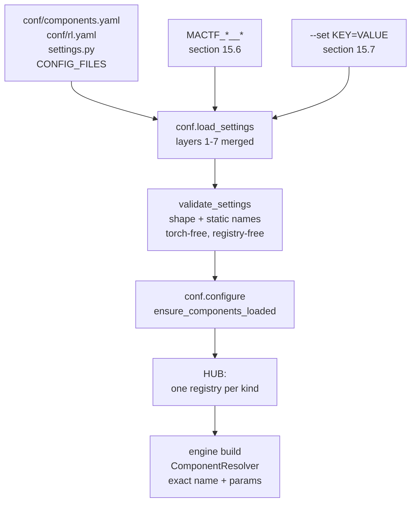
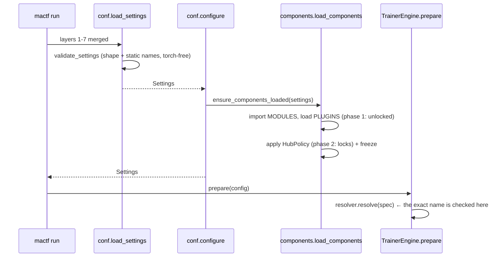

---

## 15. Configuration surface

Sections 3 to 14 defined the model, the guards and the persistence. This section is how a
project *reaches* them from a file: two new blocks (`COMPONENTS`, `COMPLIANCE`), one that
was declared but never given a home (`RL`), two new files in the `conf/` layout, validators
in `mactf/conf.py` that read the registries instead of a hard-coded tuple, and the two
command-line layers that already exist (`MACTF_*`, `--set`) taught to address a *component
spec* rather than only a scalar.

Three findings drive the shape of it, and each is a defect in the tree today:

| Finding | Evidence | What this section does |
|---|---|---|
| **C-G1** — the name sets are frozen | `mactf/conf.py:707-712` hard-codes `_PEER_STRATEGY_NAMES` and `_WEIGHT_STRATEGY_NAMES`; `:739-745` rejects anything else, so a strategy registered in section 11 is *refused by its own configuration* | 15.4: one torch-free `known.py`, read by the validators |
| **C-G2** — there is no `COMPONENTS` block | `DEFAULTS` (`conf.py:189-441`) has no key with that name; `HubPolicy` (`registry.py`, section 3.3) is only ever built with its defaults, so `ALLOW_BUILTIN_OVERRIDE`, `LOCKED`, `MODULES` and the rest have no file spelling | 15.1: the block, its defaults and `HubPolicy` wiring |
| **C-G3** — the two command-line layers cannot express a spec | `--set` walks into a scalar and refuses (`conf_overrides.py:143-165`: `"... is a str, not a mapping"`); `_apply_env` skips every mapping-valued key (`conf.py:588-596`) | 15.6 and 15.7: one promotion rule for `--set`, and `__`-separated nested environment overrides |

**C-G3 is the one that changes an existing promise.** Document 15 §14 non-goal 2 says "no
nested environment overrides: `_apply_env` walks scalars only, unchanged". Sections 3, 10,
11 and 12 of *this* document then wrote `MACTF_TRAINER__WEIGHT_UPDATE__TYPE=uniform`,
`MACTF_TRAINER__MUTATION__ENABLED=true` and `MACTF_ORCHESTRATOR__ENGINE=trainer` as working
examples — and the third one does work only because `ORCHESTRATOR.ENGINE` is a scalar
`str`, while the first two cannot work at all. This section resolves it in one direction:
**the `__` form is implemented** (§15.6), each earlier example becomes true, and document 15's
non-goal 2 is amended rather than left contradicted. A project that never writes a `__`
variable sees no change, which is what keeps **P1**.



The split is the whole design: **`validate_settings` may only use facts that need neither
torch nor a populated registry** (`conf.py:700-707` is the rule every command pays for), and
everything that needs a registry happens at `configure` and at build. A name that only a
plugin will register is therefore *unknown at load and correct at build* — the escape hatch
is `known.may_be_extended` (§15.4.3), not a looser load-time check.

---

### 15.1 The `COMPONENTS` block

#### 15.1.1 Defaults

```python
# mactf/conf.py   (new block beside ORCHESTRATOR_DEFAULTS, before DEFAULTS)
COMPONENTS_DEFAULTS: dict[str, Any] = {
    # -- who may replace a built-in ------------------------------------------------
    "ALLOW_BUILTIN_OVERRIDE": False,
    # -- what may not change at all (``kind:name`` or ``slot:<path>``, fnmatch) -----
    "LOCKED": [],
    # -- whether an old-style direct dict write is an error or just noise ----------
    "STRICT_LEGACY": False,
    # -- importing code named by a spec -------------------------------------------
    "ALLOW_IMPORT": False,
    "IMPORT_ALLOWLIST": [],
    # -- how many components of one kind may exist --------------------------------
    "MAX_PER_KIND": 512,
    # -- discovery ----------------------------------------------------------------
    "PLUGINS": "auto",          # "auto" | "off" | [entry-point names]
    "MODULES": [],              # dotted modules imported once, in order
    "FREEZE_AFTER_LOAD": False,
    # -- restore ---------------------------------------------------------------
    "STRICT_RESTORE": False,
}
```

Every value is the one that makes a project that writes nothing behave exactly as it does
today: no override, no lock, legacy writes tolerated (with a warning), no import from an
untrusted surface, `auto` discovery (which finds the framework's own entry point group,
empty), nothing imported, registries left open, and a restore difference reported as `W052`
rather than `E094` (§14.4).

`DEFAULTS` gains it as a copy, like every other block (`conf.py:425-440`):

```python
# mactf/conf.py   (inside DEFAULTS, after "CORS")
    # Document 17 section 15.1: the component registry's own policy.
    "COMPONENTS": copy.deepcopy(COMPONENTS_DEFAULTS),
    # Document 17 section 6.6: the compliance floor every custom scorer is held to.
    "COMPLIANCE": copy.deepcopy(COMPLIANCE_DEFAULTS),
    # Document 17 section 8.5: per-family RL function selection.
    "RL": copy.deepcopy(RL_DEFAULTS),
```

`COMPLIANCE_DEFAULTS` is the block §6.6 already wrote (`MIN_FLOOR_LAMBDA`,
`GUARD_MODE`, `REWARD_CEILING`, `TOLERANCE`, `TRUST_BUILTIN`) and `RL_DEFAULTS` is §8.5.2's
three keys (`UNCONSUMED`, `STRICT_GLOBS`, `VERIFY`). They are named constants here, next to
`TRAINER_DEFAULTS`, for the same reason those are: `tests/test_conf_blocks.py:29-38` asserts
`DEFAULTS[name] is not NEW_BLOCKS[name]`, so a default cannot be mutated through `DEFAULTS`.

#### 15.1.2 Two spellings, one key

§8.5.3's wiring note calls the API trust switch `COMPONENTS.API_ALLOW_IMPORT`; §5.4 calls it
`COMPONENTS.ALLOW_IMPORT`. Both sentences are wanted — one is about the *API surface*, the
other about the *import* operation — so both spellings are accepted, one is canonical, and
the duplicate is reported instead of silently aliased:

```python
# mactf/conf.py   (beside COMPONENTS_DEFAULTS)
#: Spellings kept for compatibility / readability. The value is the canonical key.
_COMPONENTS_ALIASES: dict[str, str] = {
    "API_ALLOW_IMPORT": "ALLOW_IMPORT",
}

log = logging.getLogger("mactf.conf")          # add ``import logging`` to the imports


def _canonical_components(block: Mapping[str, Any]) -> dict[str, Any]:
    """Upper-case the keys and fold an alias onto its canonical key.

    Two spellings that resolve to different values is a configuration the reader cannot
    predict, so it is refused rather than resolved by order; the same value twice is
    accepted with ``W006`` so a project can migrate one line at a time.
    """
    folded: dict[str, Any] = {}
    seen: dict[str, str] = {}
    for raw_key, value in dict(block or {}).items():
        key = str(raw_key).upper()
        canonical = _COMPONENTS_ALIASES.get(key, key)
        if canonical in folded:
            if folded[canonical] != value:
                raise ImproperlyConfigured(
                    f"E013: COMPONENTS.{key} and COMPONENTS.{seen[canonical]} both set "
                    f"{canonical} to different values ({value!r} vs {folded[canonical]!r})"
                )
            log.warning(
                "W006 COMPONENTS.%s is an alias of COMPONENTS.%s; keep one",
                key, canonical,
            )
            continue
        folded[canonical] = value
        seen[canonical] = key
    return folded
```

#### 15.1.3 `HubPolicy` gains `STRICT_RESTORE`

§14.4.1's `ComponentRestorer._strict` reads `getattr(policy, "strict_restore", False)` with a
fallback so a build with `restore.py` but without this key still behaves safely. This is the
key's other half, and it also closes the gap §4.2 left: `policy_from_settings` does not pass
it today.

```python
# mactf/components/registry.py   (HubPolicy, after ``max_components_per_kind``)
    #: ``COMPONENTS.STRICT_RESTORE``: a restore difference is E094, not W052 (section 14).
    strict_restore: bool = False
```

```python
# mactf/components/plugins.py   (policy_from_settings, replaces the body of section 4.2)
def policy_from_settings(components: Mapping[str, Any], *, locked: bool = True) -> HubPolicy:
    """Build a :class:`HubPolicy` from the ``COMPONENTS`` block (defaults in section 15.1)."""
    return HubPolicy(
        allow_builtin_override=bool(components.get("ALLOW_BUILTIN_OVERRIDE", False)),
        locked=frozenset(str(p) for p in components.get("LOCKED", ())) if locked else frozenset(),
        strict_legacy=bool(components.get("STRICT_LEGACY", False)),
        allow_import=bool(components.get("ALLOW_IMPORT", False)),
        import_allowlist=tuple(str(p) for p in components.get("IMPORT_ALLOWLIST", ())),
        max_components_per_kind=int(components.get("MAX_PER_KIND", 512)),
        strict_restore=bool(components.get("STRICT_RESTORE", False)),
    )
```

---

### 15.2 The `COMPLIANCE` block, wired

§6.6 gave the block, its validator and the three call sites. What belongs here is the two
lines that connect them, so a reader looking at `conf.py` sees the call and not a dangling
function:

```python
# mactf/conf.py   (inside _validate_blocks, immediately after the existing NON_OFFSETTABLE check)
    # Document 17 section 6.6: the floor every customization is held to. Before
    # _validate_points, because PENALTY_LAMBDAS is what it reads.
    _validate_compliance(settings)
```

```python
# mactf/conf.py   (_NEW_BLOCKS, conf.py:714-717)
_NEW_BLOCKS = (
    "TRAINER", "OPTIMIZER", "LOSS", "LOGGER", "WATCHDOG", "CHECKPOINT",
    "ORCHESTRATOR", "CORS",
    # Document 17: the blocks its sections own.
    "COMPONENTS", "COMPLIANCE", "RL",
)
```

`_NEW_BLOCKS` is the shape gate: `COMPONENTS: 3` and `RL: [1]` are `ImproperlyConfigured`
from the existing loop with no new code. `_validate_compliance` and `_validate_rl` are then
called from the block they belong to, so a bad value produces the coded message rather than
the generic one.

**One consequence worth stating.** `COMPLIANCE.MIN_FLOOR_LAMBDA` is validated against
`SCORING.PENALTY_LAMBDAS` *including* the six reserved rules, not only the configured set
(`p04` §6.6, the line at `conf.py:672-678`'s sibling). That is deliberate: `SCORING.NON_OFFSETTABLE`
may only *widen* the catalog set (H1), so a lambda of `0` on `P17` is a weakened floor whether
or not the project listed it.

---

### 15.3 The `conf/` layout extension

#### 15.3.1 Two files, two blocks

`CONF_LAYOUT` (`conf_files.py:54-142`) owns exactly seventeen blocks. Two more are needed, and
each gets a file whose `owns` tuple is *the block*, because the ownership check
(`_ownership_problems`, `conf_files.py:357-373`) is what stops a project from putting
`COMPONENTS` in `trainer.yaml` and wondering why it is ignored:

```python
# mactf/conf_files.py   (CONF_LAYOUT, inserted after "mactf.yaml" and after "loss.yaml")
    ConfFile(
        "components.yaml",
        ("COMPONENTS", "COMPLIANCE"),
        "Which components may be registered, replaced or imported, and the floor they "
        "are held to.",
    ),
    # ... peers.yaml, trainer.yaml, optimizer.yaml, loss.yaml unchanged ...
    ConfFile(
        "rl.yaml",
        ("RL",),
        "Per-family RL function selection: advantage, loss, rollup, synthesis and the rest.",
    ),
```

**Placement is load order, and load order is the tuple's order** (`conf_files.py:275-278`).
`components.yaml` comes second, before anything it governs, so `mactf config --origin` reads
in the order a reader thinks in: execution knobs, component policy, the swarm, the loop. It
has no *functional* precedence over `trainer.yaml` because the two own disjoint top-level
keys; putting `COMPONENTS` earlier only matters for the startup notes' order and for the
`conf:` layer label. `rl.yaml` comes directly after `loss.yaml`, because `RL.LOSS` and `LOSS`
are the two halves of one question and §8.5.4 refuses the combination `E040`.

Both files are new, so both need a packaged template (`mactf/templates/conf/components.yaml.tpl`,
`rl.yaml.tpl`) or `startproject` writes a project that fails its own drift test
(`tests/test_conf_blocks.py::test_every_template_leaf_equals_the_defaults_leaf`, and
`tests/test_startproject_conf.py::test_the_shipped_templates_are_exactly_the_layout`).

#### 15.3.2 `conf/components.yaml.tpl`

```yaml
# conf/components.yaml — owns: COMPONENTS and COMPLIANCE. A run that writes neither
# keyword behaves exactly as the framework always has: five strategies, six weight
# rules, no plugin, no import, and a restore difference reported as a warning.

COMPONENTS:
  # Replacing a built-in (``penalty``, ``kappa_softmax``, ``AdamW``, ...) needs this.
  # Off by default: a built-in is the framework's promise about a number.
  ALLOW_BUILTIN_OVERRIDE: false

  # Patterns, ``fnmatch``, two forms:
  #   "kind:name"       one component: cannot be registered over or removed
  #   "slot:<path>"     one slot: cannot be swapped or queued at run time
  # A production deployment pins the compliance boundary and freezes the rest.
  LOCKED: []
  #  - "scorer:penalty"
  #  - "slot:SCORING.CHAIN.penalty"
  #  - "slot:TRAINER.WEIGHT_UPDATE"

  # An old-style ``PEER_STRATEGIES["x"] = Cls`` write warns (W005). ``true`` makes it
  # an error, which is what a project that has finished migrating wants.
  STRICT_LEGACY: false

  # ``import: "pkg.mod:Class"`` in a spec executes a module. Trusted surfaces (conf/,
  # --set, code) may always; an HTTP request body may not unless ALLOW_IMPORT is on
  # *and* the module matches IMPORT_ALLOWLIST.
  ALLOW_IMPORT: false
  IMPORT_ALLOWLIST: []

  MAX_PER_KIND: 512

  # "auto" loads every installed ``mactf.components`` entry point; "off" loads none;
  # a list loads exactly those names.
  PLUGINS: auto

  # Dotted modules imported once, in order, before any spec is resolved. A module
  # named here is the project's opt-in (I5): registration is never a side effect of
  # being importable.
  MODULES: []

  # Refuse a new global component after startup. A run may still bring its own into
  # its overlay; a LOCKED slot may not change at all.
  FREEZE_AFTER_LOAD: false

  # A resume whose components differ from the checkpoint: false reports W052 and
  # continues with the configured component, true refuses with E094.
  STRICT_RESTORE: false

COMPLIANCE:
  # Lambda floor for every non-offsettable rule; > 0. A zero would erase a penalty.
  MIN_FLOOR_LAMBDA: 1.0
  # enforce: a guard violation fails the run. fallback: the reference stage scores
  # instead and W003 is logged. Never a silent clamp.
  GUARD_MODE: enforce
  # The largest reward total a custom reward stage may report.
  REWARD_CEILING: 10000.0
  # Floating-point slack in the guard's comparisons, in [0, 1e-3].
  TOLERANCE: 1.0e-9
  # Skip inspecting the three built-in stage classes (I1): they cannot violate.
  TRUST_BUILTIN: true
```

#### 15.3.3 `conf/rl.yaml.tpl`

```yaml
# conf/rl.yaml — owns: RL. One key per function family, plus the switches. Omitting a
# family keeps the framework's behaviour for it; omitting the file entirely is the same
# as writing every value below.

RL:
  # Each family takes a name, {type, params} or {import, params} (section 5.1).
  # ADVANTAGE: gae
  # VALUE:     {type: mlp, params: {hidden: 64}}
  # LOSS:      {type: weighted_sum, params: {terms: [...], weights: [...]}}
  # ROLLUP:    kappa_weighted
  # SYNTHESIS: consensus

  # A per-node family: glob -> spec. Not allowed for ROLLUP (E042: one rollup for
  # the whole tree).
  OVERRIDES: {}
  #  ADVANTAGE:
  #    "peer-b*": {type: clipped, params: {clip: 1.0}}

  # A configured family no active consumer reads is an error (E041); "warn" is the
  # migration setting and reports W010.
  UNCONSUMED: error
  # An override glob that matches no node at build is an error (E044).
  STRICT_GLOBS: true
  # Run the contract probe on custom functions only ("custom"), on all ("all"), or
  # not at all ("off").
  VERIFY: custom
```

#### 15.3.4 What the new files change in tests

| File | Assertion | Change |
|---|---|---|
| `tests/test_conf_files.py::test_layout_has_seventeen_distinct_files` | `len(names) == 17` | `19`, and the tuple must stay sorted-by-subsystem (the test already pins distinctness and the `.yaml` suffix) |
| `tests/test_conf_files.py::test_the_new_blocks_are_owned_by_the_documented_files` | owner per block | gain `COMPONENTS`/`COMPLIANCE` → `components.yaml`, `RL` → `rl.yaml` |
| `tests/test_conf_files.py::test_every_owned_key_has_exactly_one_owner` | one owner per key | unchanged; it is what fails if `COMPLIANCE` is also listed under `scorer.yaml` |
| `tests/test_startproject_conf.py::test_conf_has_every_layout_file` | `conf/` file set | derived from `CONF_LAYOUT`, so it passes with no edit; the **count** it asserts must be re-read |
| `tests/test_startproject_conf.py::test_the_shipped_templates_are_exactly_the_layout` | shipped `.tpl` set == layout | fails until both templates exist — the test that makes this subsection honest |
| `tests/test_packaging.py::test_wheel_ships_every_conf_template_and_no_legacy_configs` | wheel contains every `.tpl` | passes once the files exist; `pyproject.toml:133` already globs `*.tpl` |
| `tests/test_conf_blocks.py::test_every_template_leaf_equals_the_defaults_leaf` | parametrized over `CONF_LAYOUT` | picks the two files up automatically; every leaf above must equal `COMPONENTS_DEFAULTS`/`COMPLIANCE_DEFAULTS`/`RL_DEFAULTS` byte for byte |

The last row is the reason the templates spell every key. `PROJECT_CHOICES` in that test exists
for a *deliberate* difference from the framework default; `components.yaml` has none, so
`ALLOW_BUILTIN_OVERRIDE: false` must be written rather than omitted.

---

### 15.4 Static names: `mactf/components/known.py`

#### 15.4.1 Why a table and not the registries

`conf.py` runs on every command, including `help` and `__complete`, and must not import torch
(`conf.py:700-707`). The five registries that hold strategies, weight rules and stages are
populated by modules that *do* import torch (`coopetition/strategy.py`, `coopetition/weights.py`,
`scoring/reward_terms.py`). Reading `HUB.registry("peer_strategy").names()` at that moment
returns an empty list, and a validator built on it would reject `kappa_softmax`.

The resolution is a small module with no imports but `mactf.exceptions`:

```python
# mactf/components/known.py
"""The built-in component names, known without importing torch or populating a registry.

``conf.py`` validates a component reference at settings load, on every command, on a path
that must stay torch-free (``conf.py:700-707``). The registries cannot answer there: they
are populated by modules that import torch. So the built-ins are listed here, once, and
``tests/test_conf_mirrors.py`` keeps this table equal to the live registries as of import.

A kind absent from ``BUILTIN_NAMES`` is not name-checked at load: its reference is validated
by shape, and the registry decides at build with a precise ``ComponentMissing``. That is the
right split for kinds whose names are *derived* (every ``torch.optim`` class is a valid
``OPTIMIZER.CLASS``; every scheduler factory is a registry entry resolved later).
"""

from __future__ import annotations

import fnmatch
import re
from typing import Any, Mapping

from ..exceptions import ImproperlyConfigured
from .kinds import all_kind_ids

#: ``kind_id -> names the framework ships``. A kind that is not here is shape-checked only.
BUILTIN_NAMES: dict[str, frozenset[str]] = {
    "scorer": frozenset({"reward", "penalty", "warning", "hierarchy"}),
    "reward_term": frozenset({"severity_scaled", "capped"}),
    "peer_strategy": frozenset({
        "independent", "cooperative", "kappa_softmax", "frozen_peer", "hierarchical",
    }),
    "weight_update": frozenset({
        "kappa_softmax", "uniform", "score_weighted", "reference_only", "none", "explicit",
    }),
    "aggregator": frozenset({"default"}),
    "trainer_policy": frozenset({"default", "co_distill"}),
}

#: Every kind id a ``COMPONENTS.LOCKED`` pattern may name, ``rl_function.<family>`` included.
LOCKABLE_KINDS: frozenset[str] = frozenset(all_kind_ids())

#: Kinds whose names are lower-cased before comparison, because a YAML author writes
#: ``Kappa_Softmax`` and the registry key is lower case.
LOWERCASE_KINDS: frozenset[str] = frozenset({"scorer", "peer_strategy", "weight_update",
                                             "aggregator", "trainer_policy", "reward_term"})

#: ``str.isidentifier`` per segment; the same rule ``conf_files`` uses for a dotted path.
_DOTTED = re.compile(r"^[A-Za-z_][A-Za-z0-9_]*(\.[A-Za-z_][A-Za-z0-9_]*)*$")
#: A lock pattern's prefix: a kind id, a family-qualified kind id, or ``slot``.
_LOCK = re.compile(r"^(slot|rl_function(\.[a-z_]+)?|[a-z_]+):(.+)$")


def is_dotted_name(text: Any) -> bool:
    """Whether ``text`` is a dotted Python name (``acme.components``), not a path."""
    return isinstance(text, str) and bool(_DOTTED.match(text))


def registry_names(kind_id: str) -> frozenset[str]:
    """The names currently registered, or nothing at all when the hub is not loaded.

    ``HUB.registry`` *creates* an empty registry on first ask, so this cannot fail; it can
    only be uninformative, and the union below makes that harmless.
    """
    try:
        from .registry import HUB

        return frozenset(HUB.registry(kind_id).names())
    except Exception:  # noqa: BLE001 - a bare unit test may have no hub; names are static
        return frozenset()


def known_names(kind_id: str) -> frozenset[str] | None:
    """Every name a project may write for ``kind_id``, or ``None`` when not name-checked.

    The union, not the registry alone: at load time the registry is empty, and after a
    plugin loads it is a superset of the built-ins. Both directions are correct answers to
    "could this name exist?" and neither can be false.
    """
    static = BUILTIN_NAMES.get(kind_id)
    if static is None:
        return None
    return static | registry_names(kind_id)


def may_be_extended(components: Mapping[str, Any] | None) -> bool:
    """Whether a name the framework does not ship could legitimately exist at build.

    Two ways: ``COMPONENTS.MODULES`` names something to import, or a distribution exposes
    the ``mactf.components`` entry-point group. Both checks are import-free.
    """
    block = dict(components or {})
    if block.get("MODULES"):
        return True
    if str(block.get("PLUGINS", "auto")).lower() == "off":
        return False
    from importlib import metadata

    return bool(metadata.entry_points(group="mactf.components"))


def spec_shape_problem(raw: Any) -> str | None:
    """``None`` when ``raw`` can be a component spec. Names are not checked here (§8.5.2)."""
    if raw is None:
        return None
    if isinstance(raw, str):
        return None if raw.strip() else "an empty string is not a component name"
    if isinstance(raw, Mapping):
        keys = {str(key) for key in raw}
        if not ({"type", "name", "import"} & keys):
            return "a spec mapping needs 'type' (or 'import')"
        if "params" in keys and not isinstance(raw.get("params"), Mapping):
            return "'params' must be a mapping"
        return None
    return f"a spec is a name or a mapping, not {type(raw).__name__}"


def component_ref_problem(
    where: str, raw: Any, *, kind_id: str, settings: Any
) -> str | None:
    """Validate one component reference. ``None`` when it is acceptable *at load*.

    Three outcomes, and the third is the point of ``may_be_extended``:

    1. A name the framework ships: accepted.
    2. A mapping with ``type`` or ``import``: accepted by shape. The name inside ``type``
       is checked the same way when present; ``import`` is checked for shape only, because
       whether the module exists is a build-time fact (and an untrusted surface is refused
       there, by the resolver, not here).
    3. A name nothing ships: refused **unless** a project module or a plugin could add it,
       in which case it is accepted here and ``E011``/``ComponentMissing`` at build.
    """
    problem = spec_shape_problem(raw)
    if problem is not None:
        return f"{where}: {problem}"
    if isinstance(raw, Mapping):
        candidate = raw.get("type")
        if candidate is None:
            return None  # ``import`` only: shape is all a settings load can know
    else:
        candidate = raw
    text = str(candidate).strip()
    if not text:
        return f"{where}: an empty component name"
    names = known_names(kind_id)
    if names is None:
        return None
    folded = text.lower() if kind_id in LOWERCASE_KINDS else text
    if folded in names:
        return None
    components = dict(settings.get("COMPONENTS") or {}) if hasattr(settings, "get") else {}
    if may_be_extended(components):
        return None
    return f"{where} must be one of " + ", ".join(sorted(names))


def lock_pattern_problem(pattern: Any, *, kinds: Any) -> str | None:
    """One ``COMPONENTS.LOCKED`` entry, or why it cannot lock anything."""
    text = str(pattern)
    if not text or text != text.strip():
        return f"COMPONENTS.LOCKED: {pattern!r} is not a usable pattern"
    match = _LOCK.match(text)
    if match is None:
        return (
            f"COMPONENTS.LOCKED: {pattern!r} must be 'kind:name' or 'slot:<path>' "
            "(for example 'scorer:penalty' or 'slot:TRAINER.WEIGHT_UPDATE')"
        )
    head, _, name = match.groups()
    if head != "slot" and head not in kinds:
        return (
            f"COMPONENTS.LOCKED: {pattern!r} names unknown kind {head!r}; kinds are "
            + ", ".join(sorted(kinds))
            + ", or 'slot'"
        )
    return None
```

`/^[A-Za-z_][A-Za-z0-9_.]*:[A-Za-z_][A-Za-z0-9_.]*$/`'s sibling `_DOTTED` is used by
`E014` below; `fnmatch` is imported for the allow-list check in `_validate_components`.

#### 15.4.2 The validator, replacing the two hard-coded frozensets

`conf.py:707-712` and the two checks at `:739-745` are deleted. `_SHARING_MODES`
(`conf.py:702`) **stays**: sharing is a `nn.Module` layout decision, not a component kind
(§3.2's `ComponentKind` has no `sharing` member), so it has no registry to read and no plugin
should be able to invent one.

```python
# mactf/conf.py   (replaces _PEER_STRATEGY_NAMES ... and the two checks in _validate_blocks)
from .components.known import (
    BUILTIN_NAMES,
    component_ref_problem,
    known_names,
    lock_pattern_problem,
    may_be_extended,
)

#: The torch-free mirror of the built-ins, still read by ``tests/cli/test_conf_mirrors.py``.
#: They are views of ``known.BUILTIN_NAMES``, not a second copy of the names.
_PEER_STRATEGY_NAMES = BUILTIN_NAMES["peer_strategy"]
_WEIGHT_STRATEGY_NAMES = BUILTIN_NAMES["weight_update"]
```

`from .components.known import ...` at module scope is safe: `known.py` imports
`mactf.exceptions`, `fnmatch`, `re` and `typing` at import time, and `importlib.metadata`
inside a function. It imports nothing from `mactf.components.registry`, which is where
`contextvars` and the whole hub live — lazily, inside `registry_names`. The `conf.py:700-707`
rule therefore holds, and `tests/cli/test_import_weight.py` (which asserts that a settings
load imports no torch) keeps passing.

```python
# mactf/conf.py   (new function; called first in _validate_blocks)
_COMPONENTS_FLAGS = (
    "ALLOW_BUILTIN_OVERRIDE", "STRICT_LEGACY", "ALLOW_IMPORT", "FREEZE_AFTER_LOAD",
    "STRICT_RESTORE",
)


def _validate_components(settings: Any) -> None:
    """Shape and enumerations of ``COMPONENTS`` (section 15.1). No registry, no torch.

    Names that a *component reference* uses are checked by ``component_ref_problem`` at the
    place that names them (the ``TRAINER`` branch below, ``_validate_weight_blocks``,
    ``_validate_strategy_blocks``); this function checks the block itself.
    """
    raw = settings.get("COMPONENTS")
    if raw is None:
        return
    if not isinstance(raw, dict):
        raise ImproperlyConfigured("E013: COMPONENTS must be a mapping")
    block = _canonical_components(raw)
    unknown = sorted(set(block) - set(COMPONENTS_DEFAULTS))
    if unknown:
        raise ImproperlyConfigured(
            f"E013: COMPONENTS has unknown key(s) {unknown}; accepted: "
            + ", ".join(sorted(COMPONENTS_DEFAULTS))
        )
    for key in _COMPONENTS_FLAGS:
        value = block.get(key, COMPONENTS_DEFAULTS[key])
        if not isinstance(value, bool):
            raise ImproperlyConfigured(f"COMPONENTS.{key} must be true or false, got {value!r}")

    maximum = block.get("MAX_PER_KIND", COMPONENTS_DEFAULTS["MAX_PER_KIND"])
    if isinstance(maximum, bool) or not isinstance(maximum, int) or maximum < 1:
        raise ImproperlyConfigured(
            f"COMPONENTS.MAX_PER_KIND must be an integer >= 1, got {maximum!r}"
        )

    modules = block.get("MODULES", [])
    if not isinstance(modules, (list, tuple)):
        raise ImproperlyConfigured(
            f"COMPONENTS.MODULES must be a list of dotted module names, got "
            f"{type(modules).__name__}"
        )
    for entry in modules:
        # A path would be imported from the working directory, which is how a typo
        # becomes "it works on my machine". The message names the two usual mistakes.
        if not isinstance(entry, str) or not _DOTTED.match(entry):
            raise ImproperlyConfigured(
                f"E014: COMPONENTS.MODULES entry {entry!r} is not a dotted module name; "
                "write 'myproject.components' and put its parent on --pythonpath"
            )

    plugins = block.get("PLUGINS", COMPONENTS_DEFAULTS["PLUGINS"])
    if isinstance(plugins, (list, tuple)):
        bad = [name for name in plugins if not isinstance(name, str) or not name.strip()]
        if bad:
            raise ImproperlyConfigured(
                f"E015: COMPONENTS.PLUGINS names must be non-empty strings, got {bad!r}"
            )
    elif str(plugins).lower() not in {"auto", "off"}:
        raise ImproperlyConfigured(
            "E015: COMPONENTS.PLUGINS must be 'auto', 'off' or a list of entry-point names, "
            f"got {plugins!r}"
        )

    kinds = set(BUILTIN_NAMES) | {"slot"}
    locked = block.get("LOCKED", [])
    if not isinstance(locked, (list, tuple)):
        raise ImproperlyConfigured(
            f"COMPONENTS.LOCKED must be a list of patterns, got {type(locked).__name__}"
        )
    for pattern in locked:
        problem = lock_pattern_problem(pattern, kinds=kinds)
        if problem is not None:
            raise ImproperlyConfigured(f"E016: {problem}")

    allowlist = block.get("IMPORT_ALLOWLIST", [])
    if not isinstance(allowlist, (list, tuple)):
        raise ImproperlyConfigured(
            f"COMPONENTS.IMPORT_ALLOWLIST must be a list of module patterns, got "
            f"{type(allowlist).__name__}"
        )
    for pattern in allowlist:
        if not isinstance(pattern, str) or not pattern.strip():
            raise ImproperlyConfigured(
                f"E017: COMPONENTS.IMPORT_ALLOWLIST entry {pattern!r} is not a pattern"
            )
        if pattern in {"*", "**"}:
            # A blanket allow-list would make ALLOW_IMPORT meaningless on the one
            # surface it protects. Refused rather than documented as a footgun.
            raise ImproperlyConfigured(
                f"E017: COMPONENTS.IMPORT_ALLOWLIST cannot be {pattern!r}: it would admit "
                "every module an HTTP request names; list the packages instead"
            )
```

`fnmatch` is imported by `known.py` for the resolver's check; this function only needs the
literal-pattern refusal, so it does not import it.

#### 15.4.3 The two `TRAINER` checks, rewritten

```python
# mactf/conf.py   (_validate_blocks, trainer branch; replaces conf.py:739-745)
        problem = component_ref_problem(
            "TRAINER.PEER_STRATEGY", trainer.get("PEER_STRATEGY", "kappa_softmax"),
            kind_id="peer_strategy", settings=settings,
        )
        if problem is not None:
            raise ImproperlyConfigured(problem)
        problem = component_ref_problem(
            "TRAINER.WEIGHT_UPDATE", trainer.get("WEIGHT_UPDATE", "kappa_softmax"),
            kind_id="weight_update", settings=settings,
        )
        if problem is not None:
            raise ImproperlyConfigured(problem)
```

and the two per-block validators §10.10 and §11.11 wrote become one-liners over the same
helper, instead of each carrying its own `_validate_component_ref` and its own copy of
`_names_may_be_extended`:

```python
# mactf/conf.py   (_validate_weight_blocks, replacing its local helper calls)
    block = _canonical_components(settings.get("COMPONENTS") or {})   # for may_be_extended
    for where, raw in [
        ("TRAINER.WEIGHT_UPDATE", trainer.get("WEIGHT_UPDATE", "kappa_softmax")),
        *(
            (f"TRAINER.WEIGHT_UPDATE_OVERRIDES[{glob!r}]", value)
            for glob, value in dict(trainer.get("WEIGHT_UPDATE_OVERRIDES") or {}).items()
        ),
    ]:
        problem = component_ref_problem(
            where, raw, kind_id="weight_update", settings=settings
        )
        if problem is not None:
            raise ImproperlyConfigured(problem)
    aggregator = trainer.get("AGGREGATOR")
    if aggregator is not None:
        problem = component_ref_problem(
            "TRAINER.AGGREGATOR", aggregator, kind_id="aggregator", settings=settings
        )
        if problem is not None:
            raise ImproperlyConfigured(problem)
```

```python
# mactf/conf.py   (_validate_strategy_blocks, replacing its local helper calls)
    for where, raw in [
        ("TRAINER.PEER_STRATEGY", trainer.get("PEER_STRATEGY", "kappa_softmax")),
        *(
            (f"TRAINER.PEER_STRATEGY_OVERRIDES[{glob!r}]", value)
            for glob, value in dict(trainer.get("PEER_STRATEGY_OVERRIDES") or {}).items()
        ),
    ]:
        problem = component_ref_problem(
            where, raw, kind_id="peer_strategy", settings=settings
        )
        if problem is not None:
            raise ImproperlyConfigured(problem)
```

`SCORING.STAGES` and the `RL` families keep `_spec_shape_problem` (§8.5.2) as their load-time
check and gain nothing: a *stage* is also a component, but `zero_reward`/`no_warnings` must be
reachable before `known.py` exists in an installation that has not upgraded, and shape-only
checking there has no downside (§6.4's guard is what protects a stage, not its name).

**Message compatibility.** `tests/test_conf_blocks.py:192-193` matches
`"TRAINER.PEER_STRATEGY must be one of"`, which `component_ref_problem` produces verbatim
(`f"{where} must be one of " + ", ".join(sorted(names))`). The accepted set is now the union
with the live registry, which is a superset; the test asserts a prefix, so it keeps passing.

---

### 15.5 When components load

§4.2's `load_components` is the only importer, and its docstring claims it runs "before the
registry-backed validators in `conf.py`". That cannot be literally true: those validators run
*inside* `load_settings`, and `load_components` needs the merged settings to know what to
import. The true order is:



The name that a plugin provides is therefore *unknown* to `validate_settings` and *known* to
the resolver — which is exactly why `may_be_extended` exists and why `E011`/`ComponentMissing`
is the code a typo gets when `MODULES` is set. To make the order real and idempotent:

```python
# mactf/components/plugins.py   (addition)
_LAST_BLOCK: dict[str, Any] | None = None
_LAST_REPORT: LoadReport | None = None


def ensure_components_loaded(settings: Any = None) -> LoadReport:
    """Load components once per distinct ``COMPONENTS`` block; safe to call anywhere.

    Every caller needs the same guarantee and none can be sure it is first: ``conf.configure``
    (the CLI), ``TrainerEngine.prepare`` (a run built in code), ``RunManager.create`` (the API
    runs several), ``mactf check``. Comparing the canonical block means a settings reload in a
    test loads the new one, and a second call in the same process does nothing.
    """
    global _LAST_BLOCK, _LAST_REPORT
    if settings is None:
        from ..conf import get_settings

        settings = get_settings()
    block = dict(settings.get("COMPONENTS") or {}) if hasattr(settings, "get") else {}
    from .reflect import canonical_json

    fingerprint = canonical_json(block)
    with _LOCK:
        if _LAST_BLOCK is not None and canonical_json(_LAST_BLOCK) == fingerprint:
            assert _LAST_REPORT is not None
            return _LAST_REPORT
        report = load_components(block)
        _LAST_BLOCK = block
        _LAST_REPORT = report
        return report
```

and the one call site in `conf.configure`:

```python
# mactf/conf.py   (configure, after _settings = load_settings(...))
    apps_module.reset_registry()
    _clear_http_caches()
    # Document 17 section 15.5: the registry is configured with the settings that
    # describe it, before any consumer resolves a spec. Idempotent and torch-free
    # unless a MODULE imports torch, which is the project's own decision.
    from .components.plugins import ensure_components_loaded

    ensure_components_loaded(_settings)
    return _settings
```

`reset_for_tests` (§4.2) gains the two module globals so a test that changes `COMPONENTS`
between cases reloads:

```python
def reset_for_tests() -> None:
    """Forget what was loaded. Test-only: registrations themselves are not undone."""
    global _LAST_BLOCK, _LAST_REPORT
    with _LOCK:
        _LOADED.clear()
        _LAST_BLOCK = None
        _LAST_REPORT = None
        HUB.configure(HubPolicy())
```

---

### 15.6 Environment overrides: `MACTF_A__B__C`

#### 15.6.1 The rule

`_apply_env` (`conf.py:588-596`) walks the *top level* and skips every mapping-valued key. So
`MACTF_TRAINER=...` does nothing, `MACTF_TRAINER__MUTATION__ENABLED` does nothing, and
`MACTF_SEED=7` works. Sections 3, 10, 11 and 12 need the middle form; this is it.

| Form | Meaning |
|---|---|
| `MACTF_<KEY>` | A top-level *scalar* setting: `MACTF_SEED=7`, `MACTF_DEBUG=true`. Unchanged. |
| `MACTF_<BLOCK>__<KEY>` | One key of a block: `MACTF_ORCHESTRATOR__ENGINE=trainer`. |
| `MACTF_<BLOCK>__<KEY>__<SUB>` | A nested mapping: `MACTF_TRAINER__MUTATION__ENABLED=true`. Up to four segments. |
| `MACTF_<BLOCK>=...` | **Refused** when the block is a mapping: replacing a whole block from one variable is a configuration file in an environment variable, and it would bypass every per-key type check. |

A segment is the key's spelling in `DEFAULTS` (upper case), because that is what
`Settings` holds. The value is coerced by the type the key already has, exactly as a flat
variable is (`_coerce_env`, `conf.py:566-585`), which is what makes `PROTECTED='["peer-1"]'`
a list and `ENABLED=true` a bool. A key that does not exist yet can be created only where
the default is an absent or empty mapping — the same `_is_open` rule `--set` uses.

#### 15.6.2 The code

```python
# mactf/conf_overrides.py   (made public so conf.py uses the one rule)
def is_open_container(defaults: Mapping[str, Any], container_path: Sequence[str]) -> bool:
    """A container accepts new keys when its default is absent or an empty mapping."""
    return _is_open(defaults, container_path)


_is_open = is_open_container   # the private name the rest of this module already uses
```

```python
# mactf/conf.py   (replaces _apply_env, conf.py:588-596)
#: ``MACTF_A__B__C__D`` is the deepest form the documented blocks need
#: (``TRAINER.WEIGHT_UPDATE.params.alpha`` is four). A fifth segment is a typo.
_MAX_ENV_SEGMENTS = 4


def _env_segments(key: str) -> tuple[str, ...]:
    """``MACTF_TRAINER__MUTATION__ENABLED`` -> ``("TRAINER", "MUTATION", "ENABLED")``."""
    return tuple(part.strip() for part in key[len("MACTF_") :].split("__"))


def _apply_env(values: dict[str, Any]) -> None:
    """Apply ``MACTF_*`` variables: flat scalars and ``__``-separated block leaves.

    Document 15 §14 non-goal 2 said this walks scalars only. Document 17 section 15.6
    amends it, because a component spec is a mapping and a mapping is what every block a
    project tunes has become. Nothing changes for a variable without ``__``.
    """
    from .conf_overrides import is_open_container

    for key in sorted(os.environ):                  # deterministic, so a note is stable
        if not key.startswith("MACTF_") or key in _ENV_NON_SETTINGS:
            continue
        segments = _env_segments(key)
        raw = os.environ[key]
        if not segments[0]:
            raise ImproperlyConfigured(f"E018: {key} names no setting")

        first = segments[0]
        if first not in values or first.startswith("_"):
            raise ImproperlyConfigured(
                f"E018: {key}: unknown setting {first!r}"
                + _close(first, [name for name in values if not name.startswith("_")])
            )
        if len(segments) == 1:
            if isinstance(values[first], dict):
                raise ImproperlyConfigured(
                    f"E018: {key} sets {first}, which is a mapping; override one key "
                    f"instead: {key}__<KEY>"
                )
            values[first] = _coerce_env(first, raw, values[first])
            continue

        if len(segments) > _MAX_ENV_SEGMENTS:
            raise ImproperlyConfigured(
                f"E018: {key} has {len(segments)} segments; at most {_MAX_ENV_SEGMENTS} "
                "are supported (BLOCK__KEY__SUB__LEAF)"
            )
        if any(not segment for segment in segments):
            raise ImproperlyConfigured(f"E018: {key} has an empty segment")

        container: Any = values
        walked: list[str] = []
        for index, segment in enumerate(segments[:-1]):
            if not isinstance(container, dict):
                raise ImproperlyConfigured(
                    f"E018: {key}: {'.'.join(walked)} is not a mapping"
                )
            if segment not in container:
                if not is_open_container(DEFAULTS, walked):
                    raise ImproperlyConfigured(
                        f"E018: {key}: {'.'.join(walked) or 'settings'} has no key "
                        f"{segment!r}{_close(segment, list(container))}"
                    )
                container[segment] = {}
                # Created rather than declared: worth one line, because the value is now
                # in the settings and not in any file the reader can grep.
                log.warning(
                    "W007 %s creates %s.%s, which no default declares",
                    key, ".".join(walked), segment,
                )
            child = container[segment]
            walked.append(segment)
            if not isinstance(child, dict):
                raise ImproperlyConfigured(
                    f"E018: {key}: {'.'.join(walked)} is a {type(child).__name__}, not a "
                    "mapping; set it whole or use a key of the mapping"
                )
            container = child

        last = segments[-1]
        if last not in container:
            if not is_open_container(DEFAULTS, walked):
                raise ImproperlyConfigured(
                    f"E018: {key}: {'.'.join(walked)} has no key {last!r}"
                    f"{_close(last, list(container))}"
                )
            log.warning(
                "W007 %s creates %s.%s, which no default declares",
                key, ".".join(walked), last,
            )
            container[last] = _coerce(raw)
            continue
        container[last] = _coerce_env("__".join((*walked, last)), raw, container[last])
```

`_close` is `conf_overrides._suggest` for the two places `conf.py` now needs it:

```python
# mactf/conf.py   (helper; ``import difflib`` joins the imports)
def _close(word: str, candidates: Sequence[str]) -> str:
    """``"; did you mean X?"`` for a typo in a variable name, or the empty string."""
    close = difflib.get_close_matches(word, list(candidates), n=3, cutoff=0.6)
    return f"; did you mean {', '.join(close)}?" if close else ""
```

**Three behaviours chosen deliberately:**

1. **A mapping-valued flat variable is refused, not merged.** `MACTF_TRAINER=...` used to be
   silently ignored (`if ... isinstance(values[name], dict): continue`). Ignoring it is how a
   team spends an afternoon on "why did six epochs not take". It is now `E018`.
2. **A created key warns (`W007`).** `TRAINER.MUTATION.PROTECTED` may legitimately arrive
   before the block is written in YAML, but the settings then differ from every file on disk,
   and a warning is the only trace.
3. **`__` never means "or".** `MACTF_TRAINER__PEER_STRATEGY_OVERRIDES__team-a` cannot exist,
   because `team-a` is not a Python identifier-shaped key and would need quoting to survive a
   shell. The documented form is a whole-mapping assign:
   `MACTF_TRAINER__PEER_STRATEGY_OVERRIDES='{"team-*": independent}'`, which the
   `_coerce_env` path parses as YAML. §15.9.2 shows it.

---

### 15.7 `--set` and component specs

#### 15.7.1 What fails today

`apply_overrides` (`conf_overrides.py:124-191`) walks the dotted path and raises as soon as a
segment is not a mapping:

```text
--set TRAINER.WEIGHT_UPDATE.type=uniform
  .--set 'TRAINER.WEIGHT_UPDATE.type=uniform': TRAINER.WEIGHT_UPDATE is a str, not a mapping
```

`TRAINER.WEIGHT_UPDATE` is the string `"kappa_softmax"` (`conf.py:44`), so the object a spec
layer wants to write into does not exist yet. The three forms that must work:

| Command | Resulting value |
|---|---|
| `--set TRAINER.WEIGHT_UPDATE=uniform` | `"uniform"` — the name form, works today |
| `--set TRAINER.WEIGHT_UPDATE.type=uniform` | `{"type": "uniform"}` |
| `--set TRAINER.WEIGHT_UPDATE.params.temperature=2` | `{"params": {"temperature": 2}}` |
| `--set 'TRAINER.WEIGHT_UPDATE={type: trimmed_mean, params: {trim: 0.2}}'` | parsed as YAML; works today |

#### 15.7.2 The promotion rule

One rule, in the loop that already decides whether a container exists:

> Walking `KEY.SEG...`, when `SEG` holds a **scalar** (a `str`) or `None`, and the next path
> segment is `params`, replace the scalar with `{"params": {}}`. When the next segment is the
> **last** one and is `type` or `import`, replace it with `{}`. Otherwise refuse, as today.

```python
# mactf/conf_overrides.py   (new constants beside _KEY)
#: The leaf names of a component spec (section 5.1). ``name`` is accepted by
#: ``spec_shape_problem`` but is not promoted: a spec is named by ``type`` or ``import``.
_SPEC_LEAVES = frozenset({"type", "import", "params"})


def _promotion(remaining: Sequence[str]) -> dict[str, Any] | None:
    """The mapping a scalar becomes so the remaining path can be written, or ``None``.

    ``("params", "temperature")`` -> ``{"params": {}}``
    ``("type",)``                -> ``{}``
    anything else                -> ``None`` (refused by the caller, as today)
    """
    if not remaining:
        return None
    head = remaining[0].lower()
    if head == "params":
        return {"params": {}}
    if len(remaining) == 1 and head in {"type", "import"}:
        return {}
    return None
```

```python
# mactf/conf_overrides.py   (apply_overrides, the walk; replaces lines 143-165)
        container: Any = values
        walked: list[str] = []
        for index, segment in enumerate(path[:-1]):
            if not isinstance(container, dict):
                raise CommandError.usage(
                    f"--set {override.text!r}: {'.'.join(walked)} is not a mapping"
                )
            if segment not in container:
                if _is_open(defaults, walked):
                    container[segment] = {}
                else:
                    raise CommandError.usage(
                        f"{'.'.join(walked) or 'settings'} has no key {segment!r} in "
                        f"--set {override.text!r}{_suggest(segment, list(container))}"
                    )
            child = container[segment]
            walked.append(segment)
            if isinstance(child, (list, tuple)):
                raise CommandError.usage(
                    f"--set {override.text!r}: {'.'.join(walked)} is a list; "
                    f"set the whole list: --set '{'.'.join(walked)}=[...]'"
                )
            if not isinstance(child, dict):
                promoted = _promotion(path[index + 1 :])
                if promoted is None or not isinstance(child, (str, type(None))):
                    # A scalar is only a *spec* placeholder; a float or a bool is a
                    # leaf, and walking into it cannot mean anything.
                    raise CommandError.usage(
                        f"--set {override.text!r}: {'.'.join(walked)} is a "
                        f"{_type_name(child)}, not a mapping"
                    )
                container[segment] = promoted
                child = promoted
            container = child
```

The last segment's handling is unchanged except for one case that now needs a hint rather than
a bare refusal: writing `--set TRAINER.WEIGHT_UPDATE.params={}` is a leaf write of a mapping
over a scalar, which `_compatible` (`conf_overrides.py:77-90`) refuses because `str` and `dict`
do not match. That is correct (it would discard the name), and the message already names both
types.

#### 15.7.3 What the promotion does *not* do

- It does not promote an `int`, `bool` or `float`. `--set TRAINER.EPOCHS.value=3` still says
  `TRAINER.EPOCHS is a int, not a mapping`, which is the only readable answer.
- It does not promote across a list. `--set SCORING.STAGES.reward.type=x` works only once
  `STAGES` exists as a mapping; the default `{}` is open, so the *first* segment creates it,
  and the rule above then handles `reward` (a scalar does not exist, it is created as `{}`
  because `defaults` has no `SCORING.STAGES.reward`). The result is
  `{"STAGES": {"reward": {"type": "x"}}}`, which is what §6.2 documents.
- It does not touch `_compatible`. A promoted `{}` meets `old = None` (the `AGGREGATOR`
  default) and `old = "kappa_softmax"` (the `WEIGHT_UPDATE` default) under the existing
  `isinstance(old, (dict, ...))` branches, because promotion replaces the old value before
  the compatibility check runs on the *leaf*.

---

### 15.8 The complete key reference

Every key this document adds, in one place, so a reviewer can check that no section invented
a setting with no reader and no reader has a setting with no section.

#### 15.8.1 `COMPONENTS` (§15.1)

| Key | Type | Default | Read by | Refusal |
|---|---|---|---|---|
| `ALLOW_BUILTIN_OVERRIDE` | bool | `false` | `ComponentRegistry._check_replace` (§3.4, I10) | `ComponentLocked` when a built-in is replaced without it |
| `LOCKED` | list of `kind:name` / `slot:<path>` | `[]` | `HubPolicy.is_locked`, `SlotTable._slot_locked` (§4.5) | `E016` for a malformed pattern; `ComponentLocked` at the attempt |
| `STRICT_LEGACY` | bool | `false` | `_check_replace` `via="legacy"` (§3.4) | `ComponentLocked` for a legacy write |
| `ALLOW_IMPORT` | bool | `false` | `ComponentResolver._import` (§5.4) | `ComponentImportDenied` on an untrusted surface |
| `IMPORT_ALLOWLIST` | list of `fnmatch` patterns | `[]` | same | `E017` for a bad entry or a blanket `*` |
| `MAX_PER_KIND` | int >= 1 | `512` | `ComponentRegistry.register` | `ComponentContractError` when full |
| `PLUGINS` | `"auto"` / `"off"` / list | `"auto"` | `load_components` (§4.2) | `E015` for anything else |
| `MODULES` | list of dotted names | `[]` | `load_components` (§4.2) | `E014` for a path or a bad segment |
| `FREEZE_AFTER_LOAD` | bool | `false` | `load_components` phase 2 | `ComponentLocked` on a later global write |
| `STRICT_RESTORE` | bool | `false` | `ComponentRestorer._strict` (§14.4.1) | `E094` instead of `W052` |
| `API_ALLOW_IMPORT` | alias of `ALLOW_IMPORT` | — | `_canonical_components` | `E013` when both are set to different values; `W006` when both agree |

#### 15.8.2 `COMPLIANCE` (§6.6, wired here)

| Key | Type | Default | Read by | Refusal |
|---|---|---|---|---|
| `MIN_FLOOR_LAMBDA` | float > 0 | `1.0` | `GuardPolicy`, `PenaltyScorer.min_floor_lambda` | `ImproperlyConfigured` naming the rule and the value |
| `GUARD_MODE` | `enforce` / `fallback` | `enforce` | `ComplianceGuard` (§6.4.2) | `ImproperlyConfigured` for any other string |
| `REWARD_CEILING` | float > 0 | `10000.0` | `ComplianceGuard` C008 | same |
| `TOLERANCE` | float in `[0, 1e-3]` | `1e-9` | every guard comparison | same |
| `TRUST_BUILTIN` | bool | `true` | `ComplianceGuard._trusted` (§6.4.3) | — |

#### 15.8.3 Blocks extended by sections 9 to 12

| Where | Keys | Section |
|---|---|---|
| `TRAINER` | `POLICY`, `ALLOW_UNSAFE_POLICY`, `STEP_GUARD`, `LOSS_COMPLIANCE`, `COMPLIANCE_COEFFICIENT` | 7 |
| `TRAINER` | `WEIGHT_UPDATE_OVERRIDES`, `WEIGHT_GUARD`, `WEIGHT_OPTIONS`, `AGGREGATOR` | 10 |
| `TRAINER` | `PEER_STRATEGY_OVERRIDES`, `PEER_STRATEGY_OPTIONS`, `STRATEGY_GUARD`, `FREEZE_MODE` | 11 |
| `TRAINER` | `MUTATION` (+ ten sub-keys) | 12 |
| `OPTIMIZER` | `OVERRIDES`, `MIGRATE`, `VERIFY`, `STRICT_GLOBS`, `PARAMS`; `TYPE` accepts any registered name | 9 |
| `SCORING` | `STAGES` | 6 |
| `COOPETITION` | `KAPPA_OVERRIDES` | 10 |
| `ORCHESTRATOR` | `ENGINE`, `ENGINE_COMPAT`, `ALLOW_ENGINE_SWITCH` | 13 |

Not one of them is a new *file*: `trainer.yaml` already owns `TRAINER` (`conf_files.py:73-75`),
`optimizer.yaml` owns `OPTIMIZER`, `scorer.yaml` owns `SCORING`, `orchestrator.yaml` owns
`COOPETITION` and `ORCHESTRATOR`. A project that puts any of the new keys in the *wrong* file
gets the ownership refusal naming both files (`_ownership_problems`), which is the behaviour
document 15 §3.3 asked for.

---

### 15.9 Worked examples

#### 15.9.1 A project that customizes, in files

```yaml
# conf/components.yaml
COMPONENTS:
  MODULES: ["acme_scoring.components", "acme_scoring.strategies"]
  ALLOW_BUILTIN_OVERRIDE: false
  LOCKED: ["scorer:penalty", "slot:SCORING.CHAIN.penalty"]
  MAX_PER_KIND: 64
  STRICT_RESTORE: true

COMPLIANCE:
  MIN_FLOOR_LAMBDA: 2.0
  GUARD_MODE: enforce
```

```yaml
# conf/trainer.yaml
TRAINER:
  WEIGHT_UPDATE:
    type: trimmed_mean
    params: {trim: 0.2}
  WEIGHT_UPDATE_OVERRIDES:
    "team-a": uniform
  PEER_STRATEGY: kappa_softmax
  POLICY: {type: co_distill}
  STEP_GUARD: {MODE: quarantine, SNAPSHOT: auto}
```

```yaml
# conf/rl.yaml
RL:
  ADVANTAGE: {type: clipped, params: {clip: 3.0}}
  OVERRIDES:
    ADVANTAGE:
      "peer-b*": {type: clipped, params: {clip: 1.0}}
  UNCONSUMED: error
```

#### 15.9.2 The same three settings, four ways

| Layer | Example | Lands as |
|---|---|---|
| `settings.py` | `TRAINER = {"WEIGHT_UPDATE": {"type": "trimmed_mean", "params": {"trim": 0.2}}}` | the mapping, `_mark_authored` records `WEIGHT_UPDATE` |
| `conf/` | the YAML above | decoded by `_load_yaml`, deep-merged |
| `CONFIG_FILES` | the same file, cited from `CONFIG_FILES` (which `mactf.yaml` owns) | merged after `conf/`, so it wins |
| `MACTF_*` | `MACTF_TRAINER__WEIGHT_UPDATE__TYPE=uniform` | `{"type": "uniform"}` — the params of the lower layer survive, because `ComponentSpec.merged_over` merges a patch (§5.5) |
| `MACTF_*`, whole mapping | `MACTF_TRAINER__WEIGHT_UPDATE_OVERRIDES='{"team-*": uniform}'` | parsed as YAML to a mapping |
| `--config` | `mactf run --config experiments/trim.yaml` | merged above the environment |
| `--set`, name | `mactf run --set TRAINER.WEIGHT_UPDATE=uniform` | the string, replacing the mapping wholesale |
| `--set`, leaf | `mactf run --set TRAINER.WEIGHT_UPDATE.params.trim=0.3` | `{"params": {"trim": 0.3}}` |

`--set` is last, so this command wins over all four files:

```text
mactf run --epochs 3 \
  --set COMPONENTS.STRICT_RESTORE=true \
  --set TRAINER.WEIGHT_UPDATE.params.trim=0.3 \
  --set 'TRAINER.PEER_STRATEGY_OVERRIDES={"team-*": cooperative}' \
  --set ORCHESTRATOR.ENGINE=trainer
```

#### 15.9.3 The override chain a resolver sees

For `TRAINER.WEIGHT_UPDATE`, given `conf/trainer.yaml` with `{type: trimmed_mean, params: {trim: 0.1}}`
and `--set TRAINER.WEIGHT_UPDATE.params.trim=0.3`:

| Layer | Value after merge |
|---|---|
| 1. default | `"kappa_softmax"` |
| 3. `conf/trainer.yaml` | `{"type": "trimmed_mean", "params": {"trim": 0.1}}` |
| 5. `MACTF_*` | unchanged (the variable addresses `params.trim` only if written) |
| 7. `--set` | `{"type": "trimmed_mean", "params": {"trim": 0.3}}` |
| 8. API body | `{"params": {"trim": 0.3, "temperature": 2.0}}` — a patch, applied with `merged_over` |
| 9. code instance | wins outright, recorded as `runtime`, `adopt`ed without a build |

The checkpoint then records `identity["components"]["weight_update"]["TRAINER.WEIGHT_UPDATE"]`
with `spec_hash = spec_hash({"type": "trimmed_mean", "params": {"trim": 0.3, "temperature": 2.0}})`.

---

### 15.10 Test matrix for section 15

| # | Test | Kind | Pins |
|---|---|---|---|
| 1 | `test_conf_components.py::test_defaults_block_has_every_documented_key` | unit | 15.8.1 and `COMPONENTS_DEFAULTS` cannot drift |
| 2 | `test_conf_components.py::test_defaults_are_inert` | unit | **P1**: a project writing nothing gets `HubPolicy()` and no `W006`/`W007` |
| 3 | `test_conf_components.py::test_the_block_is_a_copy_of_the_constant` | unit | `test_conf_blocks.py:41-46`'s rule, for the new block |
| 4 | `test_conf_components.py::test_a_non_bool_flag_is_e013` | unit | each of the five flags, one parametrized row |
| 5 | `test_conf_components.py::test_an_unknown_key_is_e013` | unit | message lists the accepted set |
| 6 | `test_conf_components.py::test_a_module_path_is_e014` | unit | `"./components.py"`, `"acme/scoring"`, `"acme."`, `"acme..x"` |
| 7 | `test_conf_components.py::test_plugins_forms` | unit | `auto`, `off`, a list; `"sometimes"` is `E015`; `[""]` is `E015` |
| 8 | `test_conf_components.py::test_a_lock_pattern_needs_a_kind_or_slot` | unit | `"penalty"`, `"scorer:"`, `":penalty"`, `"nonsense:penalty"` → `E016` |
| 9 | `test_conf_components.py::test_a_blanket_allowlist_is_refused` | unit | `["*"]` → `E017` |
| 10 | `test_conf_components.py::test_the_alias_is_w006` | unit | `API_ALLOW_IMPORT` alone sets `allow_import`; both set to the same value warns once |
| 11 | `test_conf_components.py::test_the_alias_conflict_is_e013` | unit | `true` and `false` together |
| 12 | `test_conf_components.py::test_strict_restore_reaches_the_hub_policy` | unit | `policy_from_settings` → `HubPolicy.strict_restore`; §14.4.1's `getattr` path and the field agree |
| 13 | `test_conf_known.py::test_the_table_matches_the_live_registries` | unit | **the missing `test_conf_mirrors.py`**: `known.BUILTIN_NAMES[kind] == frozenset(legacy table)` for all six kinds, importing torch once |
| 14 | `test_conf_known.py::test_every_kind_id_is_covered_or_explicitly_none` | unit | `known_names(k)` is not `None` for the six, and is `None` for `rl_function.loss` |
| 15 | `test_conf_known.py::test_a_scorer_registered_by_a_plugin_is_accepted` | unit | register then `component_ref_problem` → `None` |
| 16 | `test_conf_known.py::test_an_unknown_name_is_refused_without_modules` | unit | the exact `"must be one of"` message `test_conf_blocks.py:192-193` matches |
| 17 | `test_conf_known.py::test_an_unknown_name_is_deferred_with_modules` | unit | `MODULES` set → `None` at load, `ComponentMissing` at build |
| 18 | `test_conf_known.py::test_an_unknown_name_is_deferred_with_an_entry_point` | unit | a fake `metadata.entry_points` |
| 19 | `test_conf_known.py::test_a_mapping_spec_needs_type_or_import` | unit | `{}`, `{"params": {}}` refused; `{"import": ...}` accepted without a name check |
| 20 | `test_conf_env.py::test_a_nested_override_reaches_the_block` | unit | `MACTF_ORCHESTRATOR__ENGINE=trainer` |
| 21 | `test_conf_env.py::test_a_third_segment_reaches_a_sub_key` | unit | `MACTF_TRAINER__MUTATION__ENABLED=true` → `bool` |
| 22 | `test_conf_env.py::test_the_value_is_coerced_by_the_existing_type` | unit | `=true` → bool, `=2` → int, `'["peer-1"]'` → list |
| 23 | `test_conf_env.py::test_a_mapping_flat_variable_is_e018` | unit | `MACTF_TRAINER=...` |
| 24 | `test_conf_env.py::test_an_unknown_block_is_e018_with_a_suggestion` | unit | `MACTF_TRAINR__...` |
| 25 | `test_conf_env.py::test_a_scalar_container_is_e018` | unit | `MACTF_TRAINER__EPOCHS__X=1` |
| 26 | `test_conf_env.py::test_a_fifth_segment_is_e018` | unit | the depth bound |
| 27 | `test_conf_env.py::test_creating_an_undeclared_key_is_w007` | unit | `caplog` at `WARNING`, and the value present |
| 28 | `test_conf_env.py::test_a_flat_scalar_still_works` | regression | `MACTF_SEED=7`; the pre-existing path is untouched |
| 29 | `test_conf_overrides.py::test_a_spec_leaf_promotes_a_scalar` | unit | `--set TRAINER.WEIGHT_UPDATE.type=uniform` → `{"type": "uniform"}` |
| 30 | `test_conf_overrides.py::test_a_params_leaf_promotes_two_levels` | unit | `...params.trim=0.3` → `{"params": {"trim": 0.3}}` |
| 31 | `test_conf_overrides.py::test_an_import_leaf_promotes` | unit | `...import=pkg.mod:Cls` |
| 32 | `test_conf_overrides.py::test_a_non_spec_leaf_is_refused` | unit | `TRAINER.EPOCHS.value=3` still says "is a int, not a mapping" |
| 33 | `test_conf_overrides.py::test_a_list_still_refuses_a_walk` | regression | the existing message, unchanged |
| 34 | `test_conf_overrides.py::test_promotion_does_not_accept_a_float_container` | unit | `LR.value` refused |
| 35 | `test_conf_files.py::test_layout_has_nineteen_distinct_files` | unit | 15.3.4 |
| 36 | `test_conf_files.py::test_the_two_new_blocks_have_owners` | unit | `owner_of("COMPONENTS") == "components.yaml"`, `owner_of("RL") == "rl.yaml"` |
| 37 | `test_conf_files.py::test_a_key_written_by_the_wrong_file_names_both` | unit | `COMPLIANCE` in `scorer.yaml` |
| 38 | `test_startproject_conf.py::test_conf_has_nineteen_yaml_files` | cli | the count, and that both parse as mappings |
| 39 | `test_conf_blocks.py::test_every_template_leaf_equals_the_defaults_leaf[components.yaml]` | drift | picks the file up from `CONF_LAYOUT` |
| 40 | `test_conf_blocks.py::test_every_template_leaf_equals_the_defaults_leaf[rl.yaml]` | drift | same |
| 41 | `test_conf_blocks.py::test_every_owned_block_that_has_a_default_is_written_by_its_file` | drift | a default with no template line fails here |
| 42 | `test_conf_components.py::test_ensure_components_loaded_is_idempotent` | unit | two calls, one `importlib.import_module` (monkeypatched) |
| 43 | `test_conf_components.py::test_a_changed_block_reloads` | unit | a settings reload with different `MODULES` loads once more |
| 44 | `test_import_weight.py::test_a_settings_load_still_imports_no_torch` | regression | `known.py` at module scope, `registry.py` lazily |
| 45 | `tests/cli/test_help_snapshot.py::test_help_matches_the_snapshot` | regression | **unchanged**: section 15 adds no command and no flag |

---

### 15.11 Codes, files and behaviour changes

#### 15.11.1 Codes introduced by section 15

| Code | Where | Meaning |
|---|---|---|
| `E013` | `_validate_components`, `_canonical_components` | The `COMPONENTS` block is not a mapping, has an unknown key, gives a flag a non-bool, or sets an alias and its canonical key to different values |
| `E014` | `_validate_components` | A `COMPONENTS.MODULES` entry is not a dotted module name (a path, an empty segment, a trailing dot) |
| `E015` | `_validate_components` | `COMPONENTS.PLUGINS` is neither `auto`, `off`, nor a list of non-empty names |
| `E016` | `_validate_components` via `lock_pattern_problem` | A `COMPONENTS.LOCKED` entry is not `kind:name` or `slot:<path>`, or names an unknown kind |
| `E017` | `_validate_components` | A `COMPONENTS.IMPORT_ALLOWLIST` entry is not a pattern, or is a blanket `*`/`**` |
| `E018` | `_apply_env` | An environment override that cannot be applied: an empty segment, an unknown block or key, a mapping-valued flat variable, a scalar treated as a mapping, or more than four segments |
| `W006` | `_canonical_components` | `COMPONENTS.API_ALLOW_IMPORT` and `COMPONENTS.ALLOW_IMPORT` are both set to the same value: one line can be deleted |
| `W007` | `_apply_env` | An environment override created a key no `DEFAULTS` block declares |

`E001`, `E011` and `E012` are *not* introduced here: `E011` is a spec naming an injected
parameter (§6.2) and `E012` is a spec with both flat params and a `params` mapping (§5.1),
both raised by the resolver at build. `E002`..`E010` are reserved for the model's own codes
and are not used by any section of this document.

#### 15.11.2 Files touched by section 15

| File | Change |
|---|---|
| `mactf/conf.py` | `COMPONENTS_DEFAULTS`, `COMPLIANCE_DEFAULTS`, `RL_DEFAULTS`; `DEFAULTS` gains three copies; `_COMPONENTS_ALIASES`, `_canonical_components`, `_validate_components`, `_close`; `_PEER_STRATEGY_NAMES`/`_WEIGHT_STRATEGY_NAMES` become views of `known.BUILTIN_NAMES`; `_validate_blocks` calls `_validate_components` first, `_validate_compliance` after the NON_OFFSETTABLE check, and uses `component_ref_problem` in the trainer branch; `_NEW_BLOCKS` gains three names; `_apply_env` rewritten; `configure` calls `ensure_components_loaded`; `log` added |
| `mactf/components/known.py` (new) | `BUILTIN_NAMES`, `LOWERCASE_KINDS`, `registry_names`, `known_names`, `may_be_extended`, `spec_shape_problem`, `component_ref_problem`, `lock_pattern_problem` |
| `mactf/components/registry.py` | `HubPolicy.strict_restore` |
| `mactf/components/plugins.py` | `policy_from_settings` passes `strict_restore`; `ensure_components_loaded`; `reset_for_tests` clears the cached block |
| `mactf/conf_overrides.py` | `is_open_container` public; `_SPEC_LEAVES`, `_promotion`; `apply_overrides` promotes a scalar spec leaf |
| `mactf/conf_files.py` | two `ConfFile` entries (`components.yaml`, `rl.yaml`) |
| `mactf/templates/conf/components.yaml.tpl`, `rl.yaml.tpl` (new) | the two files above |
| `tests/test_conf_components.py`, `test_conf_known.py`, `test_conf_env.py`, `test_conf_overrides.py` (new) | rows 1-19, 20-28, 29-34, 42-43 |
| `tests/test_conf_files.py`, `test_startproject_conf.py`, `tests/cli/test_conf_mirrors.py` (new) | rows 35-41, 13 |

#### 15.11.3 Behaviour changes with nothing configured

A project that writes none of the new keys sees four differences, all of them in *metadata*,
none in a number, a weight or a score:

1. **`Settings.as_dict()` gains three blocks.** `mactf config`, a support bundle and the
   `runs.settings` JSON all show `COMPONENTS`, `COMPLIANCE` and `RL` with their defaults.
   `_AUTHORED` does not list them, so `mactf config --changed` shows nothing new; iterating
   `DEFAULTS` twice in a row (`test_conf_equivalence`'s leaf comparison) still matches,
   because both sides of that comparison read the same `DEFAULTS`.
2. **`conf/` has two more possible files.** A project that does not create them gets the
   existing notes (`components.yaml: absent, defaults apply`), and a project that creates a
   file named something else still gets the "no loader reads" refusal, which now suggests the
   two new names in its list.
3. **`MACTF_TRAINER=...` is now an error instead of being ignored** (`E018`). This is the one
   change that can fail a working command line, and it can only fire on a spelling that never
   did anything.
4. **`HUB` is configured at `configure()`.** `ALLOW_BUILTIN_OVERRIDE: false`,
   `MAX_PER_KIND: 512` and an empty `LOCKED` are exactly `HubPolicy()`'s defaults, so a
   registration that succeeded before still succeeds; the only new failure mode is a project
   that relied on importing its components *after* a settings load having registered
   silently — which is what `COMPONENTS.MODULES` is for, and `W001`/`W005` already report the
   legacy path.

What does **not** change: every default value in every existing block (`test_conf_blocks.py`'s
drift test and `test_conf_equivalence.py`'s leaf comparison both assert it); the seventeen
existing `conf/` files and their contents; `--set` on any path that is not a component spec;
`MACTF_<SCALAR>` for every existing scalar; the help snapshot (section 15 adds no command,
no flag and no argument); and every checkpoint, because none of these keys is read by a
hasher.

---
