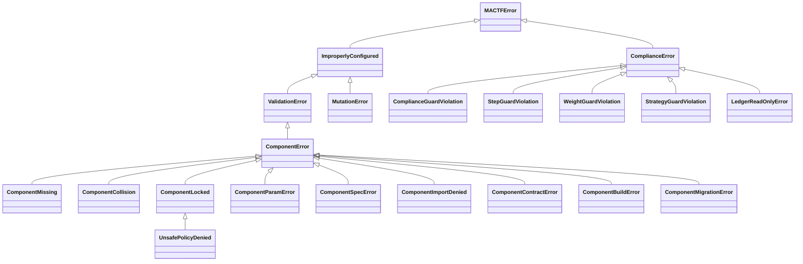

---

## 17. System checks and error taxonomy

Sections 3 to 16 raise errors and warnings from about thirty places. This section is where they
are defined once: the **exception classes** (17.1), the **consolidated table of codes** (17.2),
and the **system checks** that report the same codes before a run starts (17.3). Every code in
the table is raised by a section of this document and by nothing else, and every code a section
raises is in the table; `test_code_table_is_complete` (19.3) checks both directions by scanning
the source tree.

### 17.1 Exception classes (`mactf/exceptions.py`)

#### 17.1.1 Design

Three rules shaped the hierarchy.

1. **Existing handlers keep working.** A caller that wrote `except ImproperlyConfigured` around a
   scorer or strategy lookup keeps catching what it caught. `ValidationError` already exists as
   an `ImproperlyConfigured` subclass for "a spec named an unknown type or a keyword the
   constructor does not accept", so every error that is a *bad spec or bad configuration* derives
   from it, through one new base, `ComponentError`. `build_weight_update` therefore still raises
   something that `except ValidationError` catches, with a message that still names the accepted
   set (10.3, 11.6).
2. **One exception, one code, one text prefix.** Each class has a `code` (`E001` ...), and every
   message starts with it (`E004: weight_update:trimmed_mean does not accept ...`), the form the
   settings validators of sections 8 to 15 already use. A caller that needs the code reads
   `exc.code`; a reader of a log greps it. A subclass whose code varies (`ComponentSpecError` is
   `E005`, but a message that begins `E011:` or `E012:` is one of those) takes it from the message.
3. **Guard violations are not configuration errors.** A guard violation means a *component* did
   something at run time that the framework refuses to accept. These derive from
   `ComplianceError`, so they are `MACTFError`s that are not `ImproperlyConfigured`: a
   `try/except ImproperlyConfigured` around a build cannot swallow a compliance failure.



`MutationError` is defined in 12.3 (it carries `findings` and `rolled_back`) and
`WeightGuardViolation` and `StrategyGuardViolation` in 10.4 and 11.5; they are in the diagram and
the tables here, and are not repeated in the listing below.

#### 17.1.2 The listing

```python
# mactf/exceptions.py   (additions, after ValidationError and ComplianceError respectively)
import re
from collections.abc import Mapping, Sequence

_CODE_PREFIX = re.compile(r"^(E\d{3}): ")


class ComponentError(ValidationError):
    """Base of every error about a *component* (a registered, configurable part).

    ``code`` is the taxonomy code; ``kind`` and ``name`` say which component, when one is
    known. A message that already starts with a code (``E012: ...``) keeps that code, so one
    class can carry the sibling codes of its family without a subclass per code.
    """

    code = "E005"

    def __init__(self, message: str, *, kind: str | None = None, name: str | None = None,
                 code: str | None = None) -> None:
        found = _CODE_PREFIX.match(message)
        self.code = code or (found.group(1) if found else type(self).code)
        self.kind = kind
        self.name = name
        super().__init__(message if found else f"{self.code}: {message}")


class ComponentMissing(ComponentError):
    """``E001``: no such component. ``known`` is what *would* have been accepted.

    The same exception names a missing *slot* (``E010``): the slot table's ``get`` raises
    ``ComponentMissing("slot", path, sorted(paths))``.
    """

    code = "E001"

    def __init__(self, kind: str, name: str, known: Sequence[str] = ()) -> None:
        self.known = tuple(known)
        listed = ", ".join(repr(item) for item in self.known) or "none registered"
        super().__init__(
            f"no {kind} named {name!r}; accepted: {listed}", kind=kind, name=name,
            code="E010" if kind == "slot" else "E001",
        )


class ComponentCollision(ComponentError):
    """``E002``: the name is taken and ``replace`` was not given."""

    code = "E002"

    def __init__(self, kind: str, name: str, detail: str = "") -> None:
        super().__init__(f"{kind} {name!r} is already registered" + (f": {detail}" if detail else ""),
                         kind=kind, name=name)


class ComponentLocked(ComponentError):
    """``E003``: the component, the slot or the boundary may not be changed.

    ``reason`` is the one-line why (``COMPONENTS.LOCKED``, origin rank, mutability, boundary).
    """

    code = "E003"

    def __init__(self, kind: str, path: str, reason: str) -> None:
        self.path = path
        self.reason = reason
        super().__init__(f"{kind} {path!r} cannot be changed: {reason}", kind=kind, name=path)


class UnsafePolicyDenied(ComponentLocked):
    """``E009``: a policy declared ``unsafe`` and the operator has not allowed that."""

    code = "E009"

    def __init__(self, name: str, reason: str) -> None:
        # Skip ComponentLocked.__init__ (its message names a *slot*); keep its attributes.
        ComponentError.__init__(
            self, f"trainer_policy {name!r} cannot be used: {reason}",
            kind="trainer_policy", name=name, code="E009",
        )
        self.path = name
        self.reason = reason


class ComponentParamError(ComponentError):
    """``E004``: a spec key the component does not accept, or a value out of range. ``problems`` is complete."""

    code = "E004"

    def __init__(self, kind: str, name: str, problems: Sequence[str]) -> None:
        self.problems = tuple(problems)
        super().__init__(f"{kind}:{name}: " + "; ".join(self.problems), kind=kind, name=name)


class ComponentSpecError(ComponentError):
    """``E005`` (or ``E011``/``E012`` by message prefix): the spec is malformed."""

    code = "E005"

    def __init__(self, kind: str, detail: str) -> None:
        super().__init__(f"{kind} spec: {detail}" if not _CODE_PREFIX.match(detail) else detail, kind=kind)


class ComponentImportDenied(ComponentError):
    """``E006``: an ``import:`` spec on an untrusted surface, or a module outside the allow-list."""

    code = "E006"

    def __init__(self, target: str, reason: str) -> None:
        self.target = target
        super().__init__(f"import {target!r} refused: {reason}")


class ComponentContractError(ComponentError):
    """``E007``: the factory or instance does not meet its kind's contract. ``problems`` is complete."""

    code = "E007"

    def __init__(self, kind: str, name: str, problems: Sequence[str]) -> None:
        self.problems = tuple(problems)
        text = "; ".join(self.problems)
        # A probe failure (8.3, 9.6, 10.6) carries its own code; keep it.
        super().__init__(f"{kind}:{name} breaks its contract: {text}", kind=kind, name=name)


class ComponentBuildError(ComponentError):
    """``E008``: a factory (or a plugin module) raised. The cause is chained, never swallowed."""

    code = "E008"

    def __init__(self, kind: str, name: str, error: BaseException | str) -> None:
        self.cause = error if isinstance(error, BaseException) else None
        text = f"{type(error).__name__}: {error}" if isinstance(error, BaseException) else str(error)
        super().__init__(f"could not build {kind} {name!r}: {text}", kind=kind, name=name)


class ComponentMigrationError(ComponentError):
    """``E048``: a swap's state migration refused or failed; the old component keeps running."""

    code = "E048"

    def __init__(self, message: str) -> None:
        super().__init__(message)


class ComplianceGuardViolation(ComplianceError):
    """The scoring guard refused a stage's output (``C001``-``C012``). ``findings`` is every violation."""

    def __init__(self, findings: Sequence[Mapping[str, object]]) -> None:
        self.findings = tuple(dict(item) for item in findings)
        self.code = str(self.findings[0].get("code", "C001")) if self.findings else "C001"
        listed = "; ".join(f"{item.get('code')} {item.get('message', '')}".strip() for item in self.findings)
        super().__init__(f"{self.code}: scoring guard refused the output: {listed}")


class StepGuardViolation(ComplianceError):
    """The step guard refused a policy's step (``S001``-``S009``). ``path`` is the node."""

    def __init__(self, path: str, violations: Sequence[Mapping[str, object]]) -> None:
        self.path = path
        self.violations = tuple(dict(item) for item in violations)
        self.code = str(self.violations[0].get("code", "S001")) if self.violations else "S001"
        listed = "; ".join(f"{item.get('code')} {item.get('message', '')}".strip() for item in self.violations)
        super().__init__(f"{self.code}: step guard refused node {path!r}: {listed}")


class LedgerReadOnlyError(ComplianceError):
    """``C007``: a stage or plugin tried to write to the ledger (``record``, ``extend``, ``clear``)."""

    code = "C007"

    def __init__(self, operation: str) -> None:
        self.operation = operation
        super().__init__(f"C007: the ledger is read-only for scoring stages; {operation!r} is refused")
```

`ComponentMigrationError`'s code is `E048` even though the same class carries `E049` (a strict
restore of function state, 8.8) by message prefix, which `ComponentError.__init__` honours.
`ComponentContractError` carries `E007` for a registration failure and `E047` for a function
probe (8.3) and `E056` for an optimizer probe (9.6) in the same way: the raiser writes the code in
the message, the class does not need a subclass per code.

#### 17.1.3 Where each class is raised, and what it classifies to

| Class | Base | Code | Raised in | Exit code (16.2) | HTTP (16.3) |
|---|---|---|---|---|---|
| `ComponentMissing` | `ComponentError` | `E001`, `E010` | 3.4, 4.4, 5.2, 9.3 | `3` from a command argument, `2` from settings | `404` |
| `ComponentCollision` | `ComponentError` | `E002` | 3.4, 5.2 | `4` | `409` |
| `ComponentLocked` | `ComponentError` | `E003` | 3.4, 4.3-4.5, 7.4, 9.5 | `4` | `409` |
| `UnsafePolicyDenied` | `ComponentLocked` | `E009` | 7.4 | `2` | `422` |
| `ComponentParamError` | `ComponentError` | `E004` | 5.2, 6.7 | `2` (a finding: `1`) | `422` |
| `ComponentSpecError` | `ComponentError` | `E005`, `E011`, `E012` | 5.1, 5.2, 6.2 | `2` (a finding: `1`) | `422` |
| `ComponentImportDenied` | `ComponentError` | `E006` | 5.4 | `2` | `422` |
| `ComponentContractError` | `ComponentError` | `E007`, `E047`, `E056` | 3.7, 8.3, 9.6 | `2` (a finding: `1`) | `422` |
| `ComponentBuildError` | `ComponentError` | `E008` | 3.4, 4.2, 9.3 | `1` | `500` with `problem+json`, `code` |
| `ComponentMigrationError` | `ComponentError` | `E048`, `E049` | 8.8, 9.6 | `1` | `409` |
| `ComplianceGuardViolation` | `ComplianceError` | `C001`-`C012` | 6.4, 8.6 | `1` | the run fails; see the run's warnings |
| `StepGuardViolation` | `ComplianceError` | `S001`-`S009` | 7.6 | `1` | the run fails |
| `WeightGuardViolation` | `ComplianceError` | `E063` | 10.4 | `1` | the run fails |
| `StrategyGuardViolation` | `ComplianceError` | `E073` | 11.5 | `1` | the run fails |
| `LedgerReadOnlyError` | `ComplianceError` | `C007` | 6.4 | `1` | the run fails |
| `MutationError` | `ImproperlyConfigured` | `E080`-`E089` | 12.5 | `1` | `422` (a dry run), `409` (the run is not live) |

The two code ranges the column calls "the run fails" do not map to an HTTP status because they
happen *inside* a run: the API reports them as the run's `status: failed`, the `findings` in its
warnings, and `GET /runs/{id}/components`. `classify()` is extended for the three rows whose exit
code differs from what `isinstance` against `ImproperlyConfigured` would give (16.2.2).

### 17.2 The consolidated code table

#### 17.2.1 Conventions

| Prefix | Meaning | Where it appears | Fatal |
|---|---|---|---|
| `E` | An error: configuration, contract or state that makes the operation impossible | an exception message, a `mactf check` error, a `422` body | yes |
| `W` | A warning: legal but surprising, or a tolerated degradation | the run's log, its warnings table, a `mactf check` warning | no |
| `C` | A *compliance* finding of the scoring guard (`ComplianceGuard`, `RollupGuard`) | the `ComplianceGuardViolation.findings` list | yes under `enforce`, else substituted |
| `F` | A *function probe* finding (8.3): shape, finiteness, differentiability, determinism | the findings inside an `E047` | yes, except those marked skippable |

The ranges are allocated by section so a number tells a reader where to look:

| Range | Section | Subject |
|---|---|---|
| `E001`-`E012` | 3-6 | the model: registry, locking, specs, contracts, building |
| `E013`-`E018` | 15 | the `COMPONENTS` block and its environment overrides |
| `E040`-`E049` | 8 | RL functions and their state |
| `E050`-`E057` | 9 | optimizers and schedulers |
| `E060`-`E067` | 10 | weight updates and aggregation |
| `E070`-`E077` | 11 | peer strategies and freezing |
| `E080`-`E089` | 12 | peer-tree mutation |
| `E090`-`E092` | 13 | engine selection |
| `E093`-`E096` | 14 | checkpoint restore |
| `W001`-`W007` | 3, 4, 6, 7, 13, 15 | model and configuration warnings |
| `W010`-`W017`, `W021`, `W022` | 8-10 | RL, optimizer, weight-update warnings |
| `W030`-`W036` | 11 | strategy warnings |
| `W040`-`W045` | 12 | mutation warnings |
| `W050`-`W053` | 13, 14 | engine and restore warnings |
| `C001`-`C012` | 6, 8 | the compliance guard |
| `F001`-`F012` | 8 | function probe findings |

Gaps (`E019`-`E039`, `E058`, `E059`, ...) are reserved, not unused by accident: a later section
that adds a code takes the next free number in its own range, so a number is never reused for a
different meaning.

#### 17.2.2 The table

Severity `violation` and `finding` rows are the `C` and `F` codes. **Section** is where the code
is introduced and its behaviour specified; **Raised by** is the one place that raises it, with
the sibling raisers (a settings validator and a runtime check that share a code) named in the
section.

| Code | Severity | Section | Raised by | Meaning |
|---|---|---|---|---|
| **E001** | error | 3.4 | `ComponentRegistry.get`, `ComponentResolver`, `build_*` | A component of this kind and name is not registered (`ComponentMissing`); the message lists the accepted names |
| **E002** | error | 3.4 | `ComponentRegistry.register`, `ComponentResolver._import` | The name is taken by another factory and `replace` was not given (`ComponentCollision`) |
| **E003** | error | 4.3 | `ComponentRegistry`, `SlotTable.swap/request`, `OptimizerPlan` | The component, slot or boundary is locked: `COMPONENTS.LOCKED`, an origin of lower rank, a built-in without `ALLOW_BUILTIN_OVERRIDE`, a slot whose mutability forbids this boundary (`ComponentLocked`) |
| **E004** | error | 5.2 | `Component.check_params`, `ComponentResolver.validate` | A spec key the component does not accept, or a value outside its declared range or type (`ComponentParamError`); the message lists the accepted keys |
| **E005** | error | 5.1 | `ComponentSpec.parse` | A spec that is not a name or a mapping, has neither `type` nor `import`, or has a malformed `import` (`ComponentSpecError`) |
| **E006** | error | 5.4 | `ComponentResolver._import` | An `import` spec on a surface that is not trusted, or a module outside `IMPORT_ALLOWLIST` (`ComponentImportDenied`) |
| **E007** | error | 3.7 | `ComponentRegistry.register`, `ComponentResolver.adopt` | A factory or an instance does not meet its kind's contract, or asks for a looser mutability than the kind allows (`ComponentContractError`) |
| **E008** | error | 3.4 | `ComponentRegistry.build`, `build_scheduler`, `load_components` | A factory raised while building, or a plugin module raised at import (`ComponentBuildError`, with the cause chained) |
| **E009** | error | 7.7 | `MACTFTrainer._attach_policy` | A policy declared `unsafe = True` and `TRAINER.ALLOW_UNSAFE_POLICY` is not set (`UnsafePolicyDenied`); always raised at build, never mid-run |
| **E010** | error | 4.4 | `SlotTable.get`, `SlotTable.request` | A slot path that does not exist (`ComponentMissing` with kind `slot`) |
| **E011** | error | 6.2 | `ComponentSpec.parse`, `ComponentRegistry.build` | A spec names a parameter the framework injects (`policy`, `registries`, ...); it would be silently overridden, so it is refused |
| **E012** | error | 5.1 | `ComponentSpec.parse` | A spec gives parameters both flat and under `params` |
| **E013** | error | 15.11 | `_validate_components`, `_canonical_components` | The `COMPONENTS` block is not a mapping, has an unknown key, gives a flag a non-bool, or sets an alias and its canonical key to different values |
| **E014** | error | 15.11 | `_validate_components` | A `COMPONENTS.MODULES` entry is not a dotted module name (a path, an empty segment, a trailing dot) |
| **E015** | error | 15.11 | `_validate_components` | `COMPONENTS.PLUGINS` is neither `auto`, `off`, nor a list of non-empty names |
| **E016** | error | 15.11 | `_validate_components` via `lock_pattern_problem` | A `COMPONENTS.LOCKED` entry is not `kind:name` or `slot:<path>`, or names an unknown kind |
| **E017** | error | 15.11 | `_validate_components` | A `COMPONENTS.IMPORT_ALLOWLIST` entry is not a pattern, or is a blanket `*`/`` |
| **E018** | error | 15.11 | `_apply_env` | An environment override that cannot be applied: an empty segment, an unknown block or key, a mapping-valued flat variable, a scalar treated as a mapping, or more than four segments |
| **E040** | error | 8.10 | `FunctionBook.validate`, `conf._validate_rl` | Two sources name the same default (`LOSS` and `RL.LOSS`; `RL.SYNTHESIS` and `synthesis=`; `RL.ROLLUP` and `hierarchical_scorer=`) |
| **E041** | error | 8.10 | `FunctionBook.validate` | A family is configured that no active consumer reads (`W010` when `RL.UNCONSUMED: warn`) |
| **E042** | error | 8.10 | `conf._validate_rl`, `FunctionBook.install_override`, `swap_override` | A per-node override for a global-only family (`rollup`) |
| **E043** | error | 8.10 | `FunctionBook._select` | Two overrides of equal specificity match the same node |
| **E044** | error | 8.10 | `FunctionBook.validate` | An override glob matches no node at build (`W011` after a tree mutation or when `STRICT_GLOBS: false`) |
| **E045** | error | 8.10 | `FunctionBook.validate` | `RL.ROLLUP` or `RL.SYNTHESIS` is set on a run with no hierarchy |
| **E046** | error | 8.10 | `build_synthesis` | A custom `rl_function.synthesis` name equals a node-level built-in name |
| **E047** | error | 8.10 | `verify_function` | A function failed its contract probe (`F001..F012` in the message) |
| **E048** | error | 8.10 | `migrations.py` | A migration refused or failed (`ComponentMigrationError`) |
| **E049** | error | 8.10 | `FunctionBook.load_state_dict` | Strict restore: saved function state does not match the configured spec |
| **E050** | error | 9.10 | `OptimizerPlan.validate` | An `OPTIMIZER.OVERRIDES` glob matches no node at build (`W011` after a mutation or with `STRICT_GLOBS: false`) |
| **E051** | error | 9.10 | `OptimizerPlan.select` | Two overrides of equal specificity match the same node |
| **E052** | error | 9.10 | `compile_entry`, `attach_scheduler`, `build_scheduler` | A scheduler cannot be used: the backend has no torch optimizer, or the scheduler needs a metric (`ReduceLROnPlateau`) |
| **E053** | error | 9.10 | `_compile_scheduler` | A scheduler's parameters are invalid (unknown key, `warmup_steps >= total_steps`, `total_steps < 1`) |
| **E054** | error | 9.10 | `OptimizerPlan.validate`, `stage`, `request` | Every node would be frozen, or the default entry would be removed |
| **E055** | error | 9.10 | `MACTFOptimizer._reconcile`, `OptimizerPlan.load_state_dict` | Strict restore: saved optimizer state or plan entry does not match the configured spec |
| **E056** | error | 9.10 | `verify_entry` | An optimizer failed its probe (`O001..O006` in the message) |
| **E057** | error | 9.10 | `compile_entry` | An entry is inconsistent: an unaccepted key, a key given flat and under `PARAMS`, scipy with accumulation, a bad `MIGRATE` |
| **E060** | error | 10.5 | `WeightGuardConfig`, `WeightPlan.validate`, `conf.py` | A weight-update configuration problem: an unknown or malformed `WEIGHT_GUARD` or `WEIGHT_OPTIONS` key, an override block that is not a mapping, a bad glob, an override that matches no group, or two aggregation groups with one label |
| **E061** | error | 10.5 | `pick_glob` via `WeightPlan.select` | Two `WEIGHT_UPDATE_OVERRIDES` globs of equal specificity match one group |
| **E062** | error | 10.5 | `pick_glob` via `KappaPlan` | Two temperature-override globs of equal specificity match one group |
| **E063** | error | 10.4 | `WeightGuard` (`WeightGuardViolation`) | A weight strategy's output broke the weight contract (`U001`-`U007`) under `MODE=enforce` |
| **E064** | error | 10.6 | `verify_aggregator`, `WeightPlan.validate` | A strategy's `validate` rejected the tree, or its output probe failed; at build and after a tree mutation |
| **E065** | error | 10.7 | `WeightStrategy.clone_with` check | `clone_with` returned a different class or different options, so a per-group copy would not be the strategy that was configured |
| **E066** | error | 10.9 | `WeightPlan.load_state_dict` | The saved plan differs from the configured one under `COMPONENTS.STRICT_RESTORE` |
| **E067** | error | 10.6 | `verify_aggregator` | A strategy's `state_dict` is not JSON, has no `load_state_dict`, or does not round-trip |
| **E070** | error | 11.12 | `StrategyPlan`, `FreezeSet`, `StrategyGuard`, `conf.py` | A strategy-configuration problem: unknown `PEER_STRATEGY_OPTIONS` or `STRATEGY_GUARD` key, bad `MODE` / `SCOPE` / `MIGRATE` / `FREEZE_MODE`, an override that matches no group (under `STRICT_GLOBS`), an invalid glob, colliding group labels |
| **E071** | error | 11.12 | `StrategyPlan.select` | Two override globs match one group with equal specificity |
| **E072** | error | 11.12 | `StrategyPlan` | A legacy strategy (no `coordinate`) used where only a context-driven one can work: as an override, or beside overrides |
| **E073** | error | 11.12 | `StrategyGuard` | `StrategyGuardViolation`: a hard rule (`Y005`, `Y006`), or any violation under `MODE=enforce` |
| **E074** | error | 11.12 | `StrategyPlan`, probe | A strategy's `validate` rejected the tree; it defines no entry point; the probe found a violation; `MIGRATE=fail` refused a swap that would drop state; bad `mode` argument |
| **E075** | error | 11.12 | `FreezeSet` | A malformed freeze reason; a freeze of a path that is not a node; no node would train |
| **E076** | error | 11.12 | `StrategyPlan.load_state_dict` | The saved plan differs from the configured one under `COMPONENTS.STRICT_RESTORE` |
| **E077** | error | 11.12 | probe | `state_dict` is not JSON, has no `load_state_dict`, or does not round-trip |
| **E080** | error | 12.11 | `PeerSpec.parse`, `Op.parse`, `MutationPlan.parse`, `MutationLimits.validate_block`, `MutationReconciler.reconcile` | A plan or a limit block is not valid data: unknown key, bad verb, bad path, bad role, non-JSON value, a plan that sets both `init_from` and `rebuild`, a schedule entry without `AT_EPOCH`, or a checkpoint whose journal holds user mutations while `ENABLED` is false |
| **E081** | error | 12.11 | `TopologySimulator._add`, `_modify`, `_retire`, `_revive`, `_purge` | A structural rule: no such node, the node exists, a tombstoned path, a missing or retired parent, the node is retired (revive first), a `revive` whose parent is still retired |
| **E082** | error | 12.11 | `TopologySimulator._retire`, `_purge`, `_finalize` | A protection or a size rule: `PROTECTED` glob, `ALLOW_PURGE` false, active children without `recursive`, active nodes without `force`, fewer than `MIN_ACTIVE_ROOTS` roots, every child of a branch retired |
| **E083** | error | 12.11 | `TopologySimulator._check_reference`, `MutationEngine._build_peer` | A reference (`like`, `init_from`) names an unknown node, the node itself, a purged node, or a node with no peer to read from |
| **E084** | error | 12.11 | `TopologySimulator.run`, `_add` | A size limit: more operations than `MAX_OPS_PER_PLAN`, or a node that would exceed `max_nodes` (from `TreeTooLargeError`) |
| **E085** | error | 12.11 | `MutationEngine._build_peer`, `_copy_weights`, `_check_layouts`, `_check_plans` | The new topology cannot exist: the factory returned something that is not an `nn.Module`, `@like` would unshare a trunk, a parameter count or layout differs from `init_from`, siblings in one group disagree on layout (M6), tied parameters would appear (M7), or the factory is no longer registered (`ComponentMissing`) |
| **E086** | error | 12.11 | `TopologySimulator._finalize` | The group's new active count admits no legal weight vector under `WEIGHT_FLOOR`/`WEIGHT_CAP` (`feasible_bounds`) (M8) |
| **E087** | error | 12.11 | `MutationEngine._check_plans` | A plan refused the topology the mutation would create: the optimizer plan, the strategy plan, the weight plan or the kappa plan raised `ImproperlyConfigured` for it |
| **E088** | error | 12.11 | `MutationEngine._gate`, `MutationReconciler.reconcile` | The plan cannot run now: the trainer is not built, mutation is off, the phase is `epoch`, a blocker is present (`DISTILLATION` with a policy that cannot follow a tree), the epoch's budget is spent, or a reconciliation is blocked by the same list |
| **E089** | error | 12.11 | `MutationEngine._commit`, `apply`, `PathState.audit`, `MutationState.parse`, `MutationReconciler.reconcile` | Atomicity or integrity: the post-commit audit found stale state, the rollback did not complete (`rolled_back=False`: discard the trainer), a checkpoint's mutation state or tree section does not parse, the journal does not reproduce its tree under `STRICT_REPLAY`, or a reconciliation did not reach the stored digest |
| **E090** | error | 13.10 | `dispatch.engine_name`, `conf._validate_blocks` | `ORCHESTRATOR.ENGINE` is not one of `ENGINES` (including a non-string value that stringifies to something else) |
| **E091** | error | 13.10 | `TrainerEngine._check_identity` | The checkpoint was written by the other engine and `ORCHESTRATOR.ALLOW_ENGINE_SWITCH` is false |
| **E092** | error | 13.10 | `TrainerEngine._refuse_unsupported` | The configuration cannot be served by the trainer engine: `mactf.distributed` installed, or `RunConfig.peers` disagrees with a pre-built trainer |
| **E093** | error | 14.11 | `ComponentRestorer._check` | A checkpoint needs a component (name and kind) that this build has not registered: the providing module is not loaded |
| **E094** | error | 14.11 | `ComponentRestorer._check` | A live slot differs from the recorded entry and `COMPONENTS.STRICT_RESTORE` is on; the message lists every differing field |
| **E095** | error | 14.11 | `ComponentRestorer._check` via `_check_entry` | The `components` section, or one entry, is not interpretable: not a mapping, no `schema`/`kind`/`name`, or a non-integer schema |
| **E096** | error | 14.11 | `_check_entry` | An entry's `schema` is newer than `ENTRY_SCHEMA` |
| **W001** | warning | 4.3 | `ComponentRegistry._check_replace` | A built-in component was replaced under `ALLOW_BUILTIN_OVERRIDE` |
| **W002** | warning | 2.2 | check `mactf.components.W002` | `TRAINER.PEER_STRATEGY` or `TRAINER.WEIGHT_UPDATE` is set to a non-default value but the active engine never reads it (the `Orchestrator` ignores both) |
| **W003** | warning | 6.4 | `ComplianceGuard`, check `mactf.components.W003` | A run started with `COMPLIANCE.GUARD_MODE: fallback`; a plugin bug costs a substituted score instead of the run |
| **W004** | warning | 7.7 | `mactf components validate`, check `mactf.components.W004` | A policy with `unsafe = True` is configured; `StepGuard` does not wrap it |
| **W005** | warning | 3.6 | `LegacyTable.__setitem__` | A component was replaced through a write to a legacy dict (`SCORER_TYPES`, `PEER_STRATEGIES`, ...) |
| **W006** | warning | 15.11 | `_canonical_components` | `COMPONENTS.API_ALLOW_IMPORT` and `COMPONENTS.ALLOW_IMPORT` are both set to the same value: one line can be deleted |
| **W007** | warning | 15.11 | `_apply_env` | An environment override created a key no `DEFAULTS` block declares |
| **W010** | warning | 8.10 | `FunctionBook.validate` | An unconsumed family under `RL.UNCONSUMED: warn` |
| **W011** | warning | 8.10 | `FunctionBook.validate` | A glob that matches no node, after mutation or with `STRICT_GLOBS: false` |
| **W012** | warning | 8.10 | `FunctionBook.load_state_dict` | Saved function state was dropped because the slot or its spec changed |
| **W013** | warning | 8.10 | `FunctionBook` at build | `RL.VERIFY: off`: custom functions run without a contract probe |
| **W014** | warning | 9.10 | `optimizer_migrations.carry` | A carry dropped something it could not move (the scheduler position onto a scheduler-less entry; an open accumulation window when `GRAD_ACCUMULATION` changed) |
| **W015** | warning | 9.10 | `MACTFOptimizer._reconcile`, `OptimizerPlan.load_state_dict` | Optimizer state or a swapped entry in the checkpoint differs from the configured spec; says whether it was carried or dropped |
| **W016** | warning | 9.5 | `OptimizerPlan.validate` | A `null` optimizer entry selects the only node of a group, so it would never be updated |
| **W017** | warning | 10.4 | `WeightGuard`, `build_weight_update` | A weight strategy was rejected, repaired by projection onto the bounded simplex, or replaced by `kappa_softmax` (`MODE` `repair` or `fallback`) |
| **W021** | warning | 10.9 | `WeightPlan.load_state_dict` | State saved for an aggregation group does not fit the live strategy at that label; dropped |
| **W022** | warning | 10.5 | `WeightPlan.validate` | An override matches no aggregation group after a tree mutation, or with `STRICT_GLOBS: false` |
| **W030** | warning | 11.12 | `StrategyGuard` | A soft violation was handled (`skip` or `fallback`) |
| **W031** | warning | 11.12 | `StrategyPlan` | Saved state or plan did not match the live one; the saved plan won or the state was dropped |
| **W032** | warning | 11.12 | `MACTFTrainer._write` | A group was skipped because every member is frozen |
| **W033** | warning | 11.12 | `StrategyPlan.validate` | An override matches no group (when `STRICT_GLOBS` is off, or after a mutation) |
| **W034** | warning | 11.12 | trainer, `FreezeSet` | `frozen_peer` under `legacy` (frozen peers still train and receive write-back), or the saved `FREEZE_MODE` differs |
| **W035** | warning | 11.12 | trainer | In a hierarchy, groups that no strategy serves (the default walks the root only) |
| **W036** | warning | 11.12 | `FreezeSet.load_state_dict` | A saved freeze entry has no node; dropped |
| **W040** | warning | 12.11 | `TopologySimulator._retire` | The node was already retired; the plan is a no-op for it |
| **W041** | warning | 12.11 | `TopologySimulator._revive` | The node was not retired; the plan is a no-op for it |
| **W042** | warning | 12.11 | `MutationEngine._rebind_groups` | A group's membership changed, so its aggregator, its controller state and the per-group strategy state were rebuilt |
| **W043** | warning | 12.11 | `MutationEngine._commit` (a `modify ... rebuild`) | The node's architecture was replaced, so its optimizer was rebuilt and its moments are gone |
| **W044** | warning | 12.11 | `MutationLimits.from_settings` | A `SCHEDULE` that can grow the tree beyond `WATCHDOG.MAX_TREE_GROWTH_RATIO` will be reported by `TreeGrowthProbe` |
| **W045** | warning | 12.11 | `MutationEngine._finish`, `MutationReconciler.reconcile` | The journal reached `JOURNAL_WARN`, or a journal that does not reproduce its tree was tolerated because `STRICT_REPLAY` is false |
| **W050** | warning | 13.10 | `TrainerEngine._check_identity` | A cross-engine resume was explicitly allowed; parameters are restored, epoch bookkeeping is not resumed |
| **W051** | warning | 13.10 | `TrainerEngine._resume` | `--resume` found no valid checkpoint in the configured directory; the run starts at epoch 0 |
| **W052** | warning | 14.11 | `ComponentRestorer._check` | A slot differs (permissive mode), or an entry names a slot the run no longer has |
| **W053** | warning | 14.11 | `ComponentRestorer.plan` | The checkpoint records no components at all: a legacy file, or an all-built-in run |
| **C001** | violation | 6.4 | `ComplianceGuard`, stage: every stage | A non-finite or negative number: `amount`, every bucket, every weight, every `amounts[k]`, `omega` must be finite and `>= 0` (`omega >= 1`) |
| **C002** | violation | 6.4 | `ComplianceGuard`, stage: PENALTY | Floor below reference: For every `k` in `NO` (the effective non-offsettable set) with a reference amount: `amounts[k] >= m_k * max(lambda_k, MIN_FLOOR_LAMBDA)` within tolerance, where `m_k` is the sum of the magnitudes of the admitted events of rule `k` |
| **C003** | violation | 6.4 | `ComplianceGuard`, stage: PENALTY | Omega below reference: `omega >= 1.0` and `omega >= omega_ref`, where `omega_ref` is the reference stage's bounded product |
| **C004** | violation | 6.4 | `ComplianceGuard`, stage: PENALTY | `void_rules` too small: `void_rules` is a superset of `{k in NO : reference amount exists}` |
| **C005** | violation | 6.4 | `ComplianceGuard`, stage: WARNING | Warning-first violation: `ctx.warning_only_rules` contains no rule in `NEVER_WARNING_FIRST` or `NO` (framework.md W9) |
| **C006** | violation | 6.4 | `ComplianceGuard`, stage: every stage | Out-of-role output: A REWARD or PENALTY stage returned `mutations`, `void_rules` (REWARD) or changed a protected context field in `prepare` |
| **C007** | violation | 6.4 | `ComplianceGuard`, stage: every stage | Ledger tampering: The ledger's event tuple changed during the walk, or `prepare` replaced the ledger |
| **C008** | violation | 6.4 | `ComplianceGuard`, stage: REWARD | Reward above ceiling: `sum(weights[b] * bucket[b]) <= COMPLIANCE.REWARD_CEILING` |
| **C009** | violation | 6.4 | `ComplianceGuard`, stage: REWARD, PENALTY | Amount for an event not admitted: `by_rule` / `amounts` keys are within the ledger's rules for that side; a penalty key must also be tier-admitted and not warning-only |
| **C010** | violation | 8.10 | `RollupGuard` | A rollup dropped a void a child reported |
| **C011** | violation | 8.10 | `RollupGuard` | A rollup raised, returned a non-`ScorerOutput`, or returned a non-finite amount |
| **C012** | violation | 8.10 | `RollupGuard` | A rollup emitted warning mutations |
| **F001** | finding | 8.3 | `function_probes.py` (all) | The entry method raised on a well-formed input |
| **F002** | finding | 8.3 | `function_probes.py` (all) | Wrong return type (not a tensor, not a mapping, not a `ScorerOutput`, ...) |
| **F003** | finding | 8.3 | `function_probes.py` (all) | Wrong shape or size |
| **F004** | finding | 8.3 | `function_probes.py` (all) | A non-finite value in the output, or in a loss `breakdown` |
| **F005** | finding | 8.3 | `function_probes.py` (`value`, `loss`, `regularization`, `objective`) | Not differentiable: the output does not depend on the parameters or inputs it claims; skippable with `probe["skip"]` |
| **F006** | finding | 8.3 | `function_probes.py` (all except sampling) | Not deterministic: the same input gave a different output; skippable with `probe["skip"]` |
| **F007** | finding | 8.3 | `function_probes.py` (all) | The function mutated an input it was handed; skippable with `probe["skip"]` |
| **F008** | finding | 8.3 | `function_probes.py` (`loss`) | A loss `breakdown.total` disagrees with the returned tensor |
| **F009** | finding | 8.3 | `function_probes.py` (`loss`) | A loss requires a batch key the probe cannot supply and the loss provides no `probe_batch` |
| **F010** | finding | 8.3 | `function_probes.py` (`rollup`) | A rollup dropped a child's `void_rules` |
| **F011** | finding | 8.3 | `function_probes.py` (all) | `probe["skip"]` names a code that cannot be skipped |
| **F012** | finding | 8.3 | `function_probes.py` (`synthesis`) | A synthesis output has the wrong shape for its declared shape rule |

#### 17.2.3 Probe and audit families

Four more prefixes label the *items inside* a finding rather than the exception that carries it.
They are listed here so a code in a log has one place to be looked up; none is raised on its own.

| Family | Prefix | Defined in | Carried inside |
|---|---|---|---|
| Step guard | `S001`-`S009` | 7.6 | `StepGuardViolation`, the card's `metadata["step_guard"]` |
| Optimizer probe | `O001`-`O006` | 9.6 | `E056` |
| Weight guard | `U001`-`U007` | 10.4 | `E063`, `E064`, `W017`, the aggregation report's `adjustments` |
| Strategy audit | `Y001`-`Y008` | 11.7 | `E073`, `E074`, `W030` |

#### 17.2.4 The rule for adding a code

A change that adds a code must, in one commit: add the row to the table above with its section
and its single raiser; add the code to the allocation table if it opens a new range; add a test
that provokes it (the test names the code in its docstring); and, if the code is a `W`, say in
the row whether `mactf check` reports it (17.3). `test_code_table_is_complete` fails the build
otherwise, so the table cannot drift from the code.

### 17.3 System checks

#### 17.3.1 The app

System checks (`mactf/checks.py`) are registered by an app's `systems.py` and reported by
`mactf check`, which takes `--app`, `--tag` and an id prefix. The components checks live in a
new contrib app that follows the scoring app exactly, so nothing about how a check is registered
or reported is new:

```python
# mactf/contrib/components/apps.py   (new)
"""The components contrib app: the checks that report the codes of 17.2 before a run starts."""

from __future__ import annotations

from ...apps import AppConfig


class ComponentsConfig(AppConfig):
    name = "mactf.contrib.components"
    label = "mactf_components"
    verbose_name = "MACTF Components"

    def ready(self) -> None:
        from . import systems  # noqa: F401  (registers checks)
```

```python
# mactf/contrib/components/systems.py   (new)
from __future__ import annotations

from ... import checks
from .checks import (
    check_builtin_replacements,
    check_configured_specs,
    check_dead_trainer_settings,
    check_engine_support,
    check_guard_modes,
    check_registry_contracts,
    check_unsafe_policy,
)

for _check in (
    check_registry_contracts, check_configured_specs, check_builtin_replacements,
    check_dead_trainer_settings, check_guard_modes, check_unsafe_policy, check_engine_support,
):
    checks.register(_check, app="mactf_components", requires="mactf.contrib.components")
```

The app is added to the default `INSTALLED_APPS` (`mactf/conf.py:194`, `mactf/settings_default.py:26`)
and to `startproject`'s generated settings (15.3); a project that removes it loses the checks and
nothing else, because the model itself does not depend on the app, only on `mactf.components`.
`requires=` makes each check inapplicable (so silently skipped) in a configuration that no longer
installs it, which is what `_applicable` in `checks.py` is for.

#### 17.3.2 The checks

Message ids use the **same code as the table**, namespaced by the app: `mactf.components.E007`
is `E007`, found by a check instead of raised mid-build. A check never invents a code.

| Check function | Reports | Level | Condition |
|---|---|---|---|
| `check_registry_contracts` | `E007`, `E002` | error | A registered component fails its kind's contract, or two registries disagree about a name; found by walking `HUB.snapshot()` |
| `check_configured_specs` | `E001`, `E004`, `E005`, `E006`, `E011`, `E012` | error | Every spec in `TRAINER.*`, `OPTIMIZER.*`, `RL.*`, `SCORING.*` and `COMPONENTS.*` resolves with `ComponentResolver.validate(trusted=False)` for an `import:` spec and `trusted=True` otherwise |
| `check_builtin_replacements` | `W001` | warning | A built-in is replaced while `COMPONENTS.ALLOW_BUILTIN_OVERRIDE` is on |
| `check_dead_trainer_settings` | `W002` | warning | `TRAINER.PEER_STRATEGY` or `TRAINER.WEIGHT_UPDATE` differs from its default while `ORCHESTRATOR.ENGINE` is `orchestrator` |
| `check_guard_modes` | `W003`, `W013` | warning | `COMPLIANCE.GUARD_MODE` is `fallback`; `RL.VERIFY` is `off` |
| `check_unsafe_policy` | `W004`, `E009` | warning, error | A policy with `unsafe = True` is configured (`W004`); with `ALLOW_UNSAFE_POLICY` off it is also `E009` |
| `check_engine_support` | `E090`, `E092` | error | `ORCHESTRATOR.ENGINE` is not a known engine; the trainer engine is selected with `mactf.distributed` installed |

```python
# mactf/contrib/components/checks.py   (new; the first two checks shown in full, the rest follow the same shape)
from __future__ import annotations

from ...checks import ERROR, WARNING, CheckMessage
from ...components import HUB, ComponentResolver, ComponentSpec, ensure_components_loaded
from ...components.known import configured_specs
from ...exceptions import ComponentError, ComponentMissing

_APP = "mactf.components"


def _error(code: str, message: str, hint: str | None = None) -> CheckMessage:
    return CheckMessage(level=ERROR, message=message, hint=hint, id=f"{_APP}.{code}")


def _warning(code: str, message: str, hint: str | None = None) -> CheckMessage:
    return CheckMessage(level=WARNING, message=message, hint=hint, id=f"{_APP}.{code}")


def check_configured_specs() -> list[CheckMessage]:
    """Every configured component resolves, with the same errors a build would raise."""
    from ...conf import get_settings

    settings = get_settings()
    ensure_components_loaded(settings)
    resolver = ComponentResolver(HUB)
    found: list[CheckMessage] = []
    for slot, kind_id, raw in configured_specs(settings):         # (path, kind id, raw spec), 15.4
        try:
            spec = ComponentSpec.parse(kind_id, raw)
            resolver.validate(spec, trusted=not spec.import_path)
        except ComponentMissing as exc:
            found.append(_error(exc.code, f"{slot}: {exc}", hint=f"accepted: {list(exc.known)}"))
        except ComponentError as exc:
            found.append(_error(exc.code, f"{slot}: {exc}"))
    return found


def check_dead_trainer_settings() -> list[CheckMessage]:
    """``W002``: a setting that looks like a selector and is read by nothing (2.2)."""
    from ...conf import DEFAULTS, get_settings
    from ...orchestration.dispatch import engine_name

    settings = get_settings()
    if engine_name(settings) != "orchestrator":
        return []
    trainer = settings.get("TRAINER") or {}
    defaults = DEFAULTS["TRAINER"]
    return [
        _warning(
            "W002",
            f"TRAINER.{key} is set to {trainer[key]!r} but ORCHESTRATOR.ENGINE=orchestrator never reads it",
            hint="Set ORCHESTRATOR.ENGINE=trainer (13.5), or remove the setting.",
        )
        for key in ("PEER_STRATEGY", "WEIGHT_UPDATE")
        if trainer.get(key) not in (None, defaults.get(key))
    ]
```

`mactf check` already reports these with `--format json`, and `mactf check --tag components`
selects them. `requires_system_checks` is the existing attribute that tells the dispatcher which
commands run checks before they execute; the new `components` group sets it to `("mactf_components",)`
for `validate` and to nothing for `list`, `inspect`, `scaffold` and `diff`, so that listing the
components of a project whose settings are broken is still possible. `--skip-checks` (the global
option that already exists) skips them like any other check, and `mactf run` runs them by default,
so a bad spec is found before a model is built.

#### 17.3.3 Interaction with settings validation

`conf.validate_settings` raises `E013`-`E018` and the other `ImproperlyConfigured` codes at load, so
a project that fails there never reaches the checks. The checks add what validation cannot know
without importing project code: whether a *name* resolves. The two are deliberately separate so
that `mactf config show` works on a project whose plugins are not importable, and so that
`mactf check` can be the one command that loads everything and says what is wrong.

### 17.4 Files and behaviour changes

| File | Change |
|---|---|
| `mactf/exceptions.py` | the classes of 17.1.2; `MutationError`, `WeightGuardViolation`, `StrategyGuardViolation` as in 12.3, 10.4, 11.5 |
| `mactf/contrib/components/__init__.py`, `apps.py`, `systems.py`, `checks.py` (new) | the app of 17.3 |
| `mactf/conf.py`, `mactf/settings_default.py` | `mactf.contrib.components` in `INSTALLED_APPS` |
| `mactf/management/exitcodes.py` | the branches of 16.2.2 |
| `tests/components/test_exceptions.py`, `test_code_table.py`, `test_system_checks.py` (new) | 19.3 |

Behaviour changes with nothing configured: `mactf check` reports one more app and, for a project
that sets `TRAINER.PEER_STRATEGY` or `TRAINER.WEIGHT_UPDATE` under the default engine, one
`W002` per setting; nothing else changes, and no `W` is a failure under the default
`--fail-level error`.
