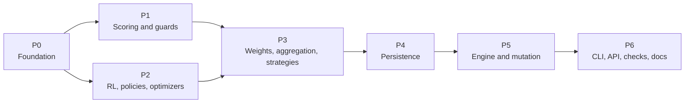

---

## 20. Phased rollout with acceptance gates

Sections 3-15 describe the finished design. This section orders the work. Documents 14, 15 and 16
are already implemented, so every phase starts from the shipped framework (the existing CLI
framework, the API, the client, the system checks and the checkpoint v2 format) and **extends**
it; no phase rewrites a shipped surface, and none edits the Orchestrator (**T3**, 13.2).

### 20.1 Rules that apply to every phase

1. **Inert by default.** A phase adds capability, never a changed default. After each phase a
   project that configures nothing new runs exactly as before, which is invariant I1, and the
   gate of the phase proves it (19.4).
2. **Fixtures first.** Phase P0 begins by running the **unmodified** framework to record the
   default-identity fixtures of 19.4 (`tests/components/fixtures/default_identity/`) and checking
   them in as the first commit of the phase, before any production line of this plan exists. A
   fixture recorded afterwards proves nothing.
3. **One gate per phase, named.** Each phase has an **exit criterion**: a named set of tests that
   must pass, run in a CI job named `components-gate-<phase>`, together with the entire existing
   suite. A phase is not started until the previous gate is green on the main branch.
4. **Smallest reviewable pieces.** A phase ships as a short series of pull requests, each of which
   passes the whole suite on its own. The order of the files inside a phase is the order in the
   "Files" column.
5. **Re-check the anchors.** Before a phase starts, the line anchors of 20.3 for that phase are
   re-read against the tree; a moved anchor is corrected in this document in the same pull
   request that notices it.
6. **A phase can be reverted alone.** Because nothing is on by default, reverting a phase's
   pull requests returns the framework to the previous gate. The one irreversible step, the
   database migration, is isolated in P4 and described in 20.4.

P1 and P2 depend only on P0 and may proceed in parallel; every other arrow is a hard dependency.

### 20.2 The phases

A note on names: **P0-P6** are rollout phases. They are not the persistence properties `P1`-`P6`
of section 14 or the rule identifiers `P1`-`P23` of the compliance catalog; context always
decides, and the phase names appear only in this section and in `components-gate-*` job names.

#### P0 - Foundation

| | |
|---|---|
| **Delivers** | Sections 3, 4 and 5; the `COMPONENTS` block and `HubPolicy` of 15; the `LegacyTable` views that make every existing registry a view of the hub (3.6) |
| **Files** | `mactf/components/` (new package: `kinds`, `reflect`, `params`, `registry` with the hub and overlays, `legacy`, `contracts`, `decorators`, `resolver`, `slots`, `plugins`), then one-line replacements of each legacy dict in `mactf/scoring/registry.py`, `mactf/coopetition/strategy.py`, `mactf/coopetition/weights.py` and `mactf/rl/functions/registry.py`, then `mactf/settings_default.py` and `mactf/conf.py` for the new block |
| **Exit criterion** | `test_default_identity` against the **recorded** fixtures; `test_import_weight` (importing `mactf.components` pulls in no `torch`); `test_function_registry`; `test_conf_blocks`; `test_conf_equivalence`; `test_overlay_isolated_between_runs`; `test_builtin_replacement_needs_the_flag_and_logs_w001` |
| **Done when** | every existing registration call site still works unchanged and every legacy dict is a view; nothing consumes a component yet |
| **Risk** | R1, R2 (21) |

The ordering constraint of 3.6 applies: each `LegacyTable(...)` is constructed at the bottom of
the module that defines the classes it lists.

#### P1 - Scoring and guards

| | |
|---|---|
| **Delivers** | Section 6 (scorer registry, pipeline chain validation, reward stages) and the `ComplianceGuard` |
| **Files** | `mactf/components/guards/compliance.py`, then `mactf/scoring/base.py`, `penalty.py`, `guards.py`, `pipeline.py`, `hierarchy.py` |
| **Exit criterion** | `test_default_pipeline_is_byte_identical`; `test_chain_validation_agrees`; `test_guard_property_compliance_floor`; `test_guard_property_void_stays_void`; the tests named in 6.5 and 6.7; `test_pipeline_validation` |
| **Done when** | a registered scorer or reward stage runs inside the guard, and a stage that tries to lower a breach's cost is refused with its `C` code |
| **Risk** | R3 |

#### P2 - RL functions, policies, optimizers and schedulers

| | |
|---|---|
| **Delivers** | Sections 7, 8 and 9 |
| **Files** | `mactf/rl/functions/` (`loss`, `advantage`, `support`), `mactf/components/guards/step.py` (the `StepGuard`), then `mactf/training/optimizer.py`, then the policy plumbing in `mactf/training/trainer.py` |
| **Exit criterion** | `test_override_loss_gets_compliance`; `test_clipped_advantage`; `test_optimizer_swap_is_atomic`; `test_optimizer_migration_*`; `test_median_synthesis`; `test_l1_anneal`; `test_default_identity` re-run (the fixtures must still match) |
| **Done when** | the optimizer and scheduler of section 9 and the worked example of 18.5 run, and every loss reaches the optimizer through `ensure_compliance` |
| **Risk** | R3, R5 |

#### P3 - Weight update, aggregation and peer strategies

| | |
|---|---|
| **Delivers** | Sections 10 and 11 (`WeightGuard`, `RollupGuard`, `StrategyGuard`, the strategy probe and the `mactf.testing.strategy` helpers) |
| **Files** | `mactf/coopetition/weights.py`, `aggregation.py`, `strategy.py`, `tree.py`, then `mactf/coopetition/weight_guard.py`, `mactf/components/guards/rollup.py` and `guards/strategy.py`, then `mactf/testing/strategy.py` |
| **Exit criterion** | `test_weights_default_identity`; `test_strategy_default_identity`; `test_strategy_swap_atomic`; `test_guard_property_weights_are_a_simplex`; `test_guard_property_strategy_cannot_write`; `test_guard_property_rollup_union_survives_trimming`; `test_trimmed_mean_rollup`; `test_staggered_mix` |
| **Done when** | the four rules for swapping an in-flight strategy (11.9) each have a passing `unit` and `integration` row |
| **Risk** | R4, R6 |

#### P4 - Persistence

| | |
|---|---|
| **Delivers** | Section 14: the `identity["components"]` manifest, `ComponentRestorer`, migration 4 and `record_components` |
| **Files** | `mactf/components/fingerprint.py`, `mactf/components/restore.py`, then `mactf/orchestration/checkpoint_v2.py`, then `mactf/db.py` (migration 4) |
| **Exit criterion** | `test_a_default_run_writes_the_same_identity_hash`; `test_checkpoint_bytes_unchanged_when_all_builtin`; `test_a_legacy_file_is_one_w053`; `test_a_missing_component_is_e093`; `test_a_changed_spec_is_w052_or_e094`; `test_migration_4_is_idempotent`; `test_db_migration` |
| **Done when** | a checkpoint written by the previous release restores under the new code with exactly one informational note, and a default run writes a byte-identical file |
| **Risk** | R7, R10 |

The migration is the one irreversible step; 20.4 says what that costs.

#### P5 - Engine integration and tree mutation

| | |
|---|---|
| **Delivers** | Sections 12 and 13: the `Engine` protocol, `TrainerEngine`, the `MutationPlan`/`MutationEngine`/`TopologySimulator`, and the live-run wiring |
| **Files** | `mactf/training/mutation.py` (the pure half, no `torch`), `mactf/training/mutation_engine.py`, `mactf/orchestration/engine.py`, `mactf/orchestration/dispatch.py`, `mactf/training/trainer.py`, `mactf/orchestration/live.py`, `mactf/testing/harness.py` (`Harness.engine`), `mactf/testing/tree.py` |
| **Exit criterion** | the 32 rows of 13.9; `test_orchestrator_trainer_equivalence` over all four scenarios; `test_mutation_atomicity`; `test_a_failed_rollback_is_e089_not_a_half_run`; `test_a_mutated_run_resumes_in_a_new_process`; `test_orchestrator_files_are_untouched` |
| **Done when** | one scenario runs bit-identically under both engines, and a three-operation plan that fails at each step leaves the trainer unchanged |
| **Risk** | R5, R8, R9 |

#### P6 - CLI, API, system checks, examples and documentation

| | |
|---|---|
| **Delivers** | Sections 16, 17 and 18; the remainder of section 15 (the mirrors and the shipped templates) |
| **Files** | `mactf/management/commands/components.py`, `mactf/components/scaffold.py`, the `runs components` and `peers mutate` verbs, `mactf/contrib/components/`, the API views, serializers and `urls.py`, `mactf/client/routes.py` and `specs.py`, the goldens, `docs/cli.md` and `docs/api.md` (regenerated, never hand-edited) |
| **Exit criterion** | `test_component_exit_codes`; `test_help_snapshot`; `test_command_contract`; `test_docs_generated`; `test_openapi_in_sync`; `test_literal_routes_precede_parameterised`; `test_routes_cover_every_component_view`; `test_code_table_is_complete`; `test_each_check_has_its_code_and_hint`; `test_every_worked_example_runs`; `test_wheel_ships_every_conf_template_and_no_legacy_configs` |
| **Done when** | `mactf check` on a fresh `startproject` is silent, and each example of section 18 runs from this document |
| **Risk** | R11, R12 |

The generated files change in a **separate commit** from the code that causes the change
(16.2.3), so a reviewer sees the regeneration as a pure consequence.

### 20.3 Line anchors to re-check

These are the `path:line` citations of sections 2-17 that a phase edits or reads. They were read
against the tree on the `last_reviewed` date; the snippet is the text of the line then. A phase
re-reads its own rows before it starts (rule 5 of 20.1).

| Phase | File | Line | Text at the time |
|---|---|---|---|
| P0 | `mactf/conf.py` | 37 | `TRAINER_DEFAULTS: dict[str, Any] = {` |
| P0 | `mactf/conf.py` | 158 | `ORCHESTRATOR_DEFAULTS: dict[str, Any] = {` |
| P0 | `mactf/conf.py` | 194 | `"INSTALLED_APPS": [` |
| P0 | `mactf/conf.py` | 672 | `missing = reserved - set(scoring["NON_OFFSETTABLE"])` |
| P0 | `mactf/conf.py` | 706 | `#: (document 16, section 7.9). ''tests/cli/test_conf_mirrors.py'' k...` |
| P0 | `mactf/conf.py` | 707 | `_PEER_STRATEGY_NAMES = frozenset({` |
| P0 | `mactf/conf.py` | 739 | `if str(trainer.get("PEER_STRATEGY", "kappa_softmax")).lower() not i...` |
| P0 | `mactf/coopetition/strategy.py` | 376 | `PEER_STRATEGIES: dict[str, type] = {` |
| P0 | `mactf/coopetition/strategy.py` | 425 | `def group_layouts(` |
| P0 | `mactf/coopetition/weights.py` | 464 | `WEIGHT_STRATEGIES: dict[str, type] = {` |
| P0 | `mactf/rl/functions/registry.py` | 28 | `"value": VALUE_FUNCTION_TYPES,` |
| P0 | `mactf/rl/functions/registry.py` | 56 | `#: Families exposed by ''function_capabilities()''; the tuple fixes...` |
| P0 | `mactf/rl/functions/registry.py` | 115 | `def build_function(spec: Mapping[str, Any], *, family: str \| None ...` |
| P0 | `mactf/scoring/registry.py` | 26 | `SCORER_TYPES: dict[str, type[Scorer]] = {` |
| P0 | `mactf/scoring/registry.py` | 34 | `def register_scorer(name: str, scorer: type[Scorer], *, replace: bo...` |
| P0 | `mactf/settings_default.py` | 26 | `INSTALLED_APPS = [` |
| P1 | `mactf/compliance.py` | 35 | `_INHERITED_VOID_FLOOR = 1000.0` |
| P1 | `mactf/compliance.py` | 108 | `def constrain(` |
| P1 | `mactf/compliance.py` | 129 | `)` |
| P1 | `mactf/compliance.py` | 198 | `continuous: ContinuousScore,` |
| P1 | `mactf/scoring/base.py` | 190 | `class Scorer(ABC):` |
| P1 | `mactf/scoring/base.py` | 222 | `@classmethod` |
| P1 | `mactf/scoring/guards.py` | 474 | `GUARDS: dict[str, Guard] = {` |
| P1 | `mactf/scoring/guards.py` | 700 | `class PointsEngine:` |
| P1 | `mactf/scoring/hierarchy.py` | 97 | `ROLLUP_STRATEGIES: dict[str, type] = {` |
| P1 | `mactf/scoring/hierarchy.py` | 145 | `def __init__(` |
| P1 | `mactf/scoring/penalty.py` | 52 | `def non_offsettable(self) -> frozenset[str]:` |
| P1 | `mactf/scoring/penalty.py` | 70 | `def score(self, ctx: ScoreContext) -> ScorerOutput:` |
| P1 | `mactf/scoring/pipeline.py` | 73 | `def __init__(` |
| P1 | `mactf/scoring/pipeline.py` | 329 | `non_offsettable = set(self.score_config.get("NON_OFFSETTABLE", NON_...` |
| P1 | `mactf/scoring/pipeline.py` | 499 | `def _compose(` |
| P2 | `mactf/distill/step.py` | 576 | `def attach(self, trainer: Any) -> None:` |
| P2 | `mactf/rl/advantage.py` | 89 | `def penalise_void_advantage(` |
| P2 | `mactf/rl/functions/loss.py` | 204 | `batch["compliance_floor"], device=reference.device, dtype=reference...` |
| P2 | `mactf/rl/functions/loss.py` | 397 | `class CallableLoss(_LossBase):` |
| P2 | `mactf/training/optimizer.py` | 66 | `class OptimizerBackend(Protocol):` |
| P2 | `mactf/training/optimizer.py` | 929 | `def attach_scheduler(self, name: str, **kwargs: Any) -> Any:` |
| P2 | `mactf/training/optimizer.py` | 1076 | `def state_dict(self) -> dict[str, Any]:` |
| P3 | `mactf/coopetition/aggregation.py` | 44 | `class Aggregator:` |
| P3 | `mactf/coopetition/aggregation.py` | 366 | `def _project_bounded(` |
| P3 | `mactf/coopetition/tree.py` | 571 | `def add_node(` |
| P4 | `mactf/orchestration/checkpoint_v2.py` | 56 | `@dataclass` |
| P5 | `mactf/orchestration/live.py` | 436 | `class RunManager:` |
| P5 | `mactf/training/trainer.py` | 349 | `self._trainer_policy = trainer` |
| P5 | `mactf/training/trainer.py` | 611 | `self.weight_strategy = build_weight_update(` |
| P5 | `mactf/training/trainer.py` | 1505 | `def train_step(self, node: Any, batch: Mapping[str, Any]) -> StepRe...` |
| P5 | `mactf/training/trainer.py` | 1921 | `def _observe(self, result: EpochResult, report: AggregationReport \...` |
| P6 | `mactf/management/driver.py` | 162 | `class RunDriver:` |
| P6 | `mactf/management/driver.py` | 175 | `from ..orchestration.orchestrator import Orchestrator` |

A row whose text no longer matches is not an error in the code; it means the file moved, and the
citation in the section that uses it must be corrected. `test_cited_paths_exist` (19.3.3) checks
the **files**; the lines are a review step, because a line number is the one thing a refactor
legitimately changes.

### 20.4 Performance budget and rollback

**Performance.** The only claim is that the default path costs nothing it did not cost before:
no guard runs (19.4, condition 4), no manifest is built (14.3.2), no import of the component
package pulls in `torch`. A benchmark row in `tests/components/test_overhead.py` times an
epoch of the `Harness` scenario with and without the package's slots installed and prints the
ratio; the gate **reports** it and does not fail on it, because a wall-clock threshold on a
shared CI runner is noise. A ratio above 1.02 on the maintainers' reference machine is a defect to
be explained in review.

**Rollback.** For each phase, in the order of risk:

| Phase | To revert | What stays behind |
|---|---|---|
| P6 | revert the pull requests, regenerate the goldens | nothing |
| P5 | revert; `ORCHESTRATOR.ENGINE` falls back to the Orchestrator, which was never modified | checkpoints written by `TrainerEngine` carry `engine: trainer`; resuming them under the Orchestrator is `E091` unless `ALLOW_ENGINE_SWITCH` is set (14.7.3) |
| P4 | revert the code | migration 4's nullable column stays in any database that ran it and is `NULL` for a default run; a version-4 database is not rolled back automatically (14.7.2) |
| P3 - P1 | revert | nothing; defaults were inert |
| P0 | revert | nothing; the legacy dicts are restored to plain dicts |

The practical rule: **do not merge P4 and P5 on the same day.** If a defect shows in P5, P4 is
already proven in use; the migration is then not a suspect.

### 20.5 Definition of done for the whole plan

All seven gates are green on the main branch; the matrices of every section pass; `mactf check`
is silent on a fresh project; `docs/cli.md` and `docs/api.md` are regenerated and in sync; the
front matter `status` of this document changes from `approved-for-implementation` to
`implemented`, with the date of the last gate; and the open questions of 21.2 each have an answer recorded
here or are explicitly carried forward.
