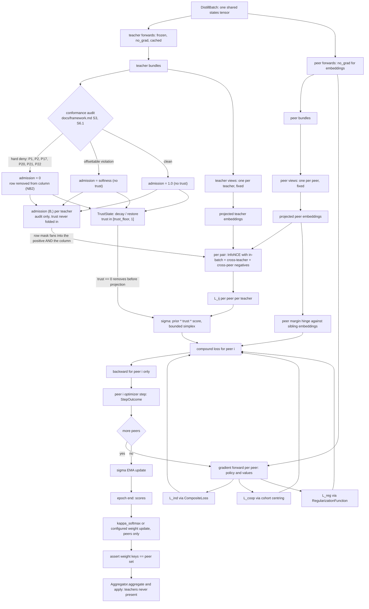

# 14. Contrastive Distillation (Multi-Peer, Multi-Teacher)

This document specifies one training policy: a cohort of **peers** (instance
copies of the model being trained) and a set of **teacher models** — different
architectures that solve the same task — are all shown **the same batch at the
same time**, and each peer minimizes a compound objective containing a
contrastive term toward every teacher.

It is additive. Nothing in `docs/plans/` changes. With
`DISTILLATION.ENABLED = False` the trainer produces the numbers document 08
produces, to `1e-12`, which is the gate in section 15.

Three things this document deliberately does not invent, because the library
already has them:

| Need | Existing implementation | Where |
|---|---|---|
| Weight blending and the fallback | `KappaSoftmaxAverage` -> `Aggregator.compute_weights` | `mactf/coopetition/weights.py:86`, `mactf/coopetition/aggregation.py:77` |
| The per-peer individual loss | `CompositeLoss` over `LossConfig` | `mactf/rl/functions/loss.py:239`, `mactf/rl/loss.py:53` |
| Regularization | `RegularizationFunction` (`l2`, `weight_decay`, `kl_to_reference`) | `mactf/rl/functions/support.py:171` |
| Step, AMP, clipping, accumulation | `MACTFOptimizer.step` -> `StepOutcome` | `mactf/training/optimizer.py:939` |
| Insertion point | structural `TrainerProtocol` | `mactf/training/protocol.py:142` |
| Zero-sum signal centering | `normalise_advantages` | `mactf/rl/value.py:44` |

## 1. Scope, non-goals, and the gaps this closes

### 1.1 What exists today

`mactf/rl/loss.py:77` (`compute_loss`) computes a PPO-style objective against
**one** reference policy produced by `build_reference`
(`mactf/coopetition/peer.py:115`), which is a deep copy of a peer. Six gaps
follow, and they are the reason this document exists:

| # | Gap | Consequence today |
|---|---|---|
| G1 | The reference is a copy of the same architecture, so it can only ever say "you drifted from yourself" | No signal can come from a *different* model family |
| G2 | The reference is a policy over one action space | A teacher with a different vocabulary or action space cannot be consumed at all |
| G3 | Every peer is trained on its own signal only (`phases.py:209-235`) | Nothing in the objective compares peer representations to an external target |
| G4 | There is no mechanism to weight several teachers by usefulness | A weak teacher is weighted the same as a strong one |
| G5 | `local_update` steps each peer independently and never sees the cohort's gradients | No term can be defined over the peer set itself |
| G6 | `Aggregator.compute_weights` requires one score per *participating peer* | Adding teacher keys to the weight vector would silently break the floor/cap feasibility check in `feasible_bounds` (`aggregation.py:347`) |

### 1.2 The policy this document adds

For a shared batch `x` of `B` samples, a peer set `P = {p_1..p_N}` and a teacher
set `T = {t_1..t_M}`:

1. Every peer and every teacher runs a forward pass on the **same** `x`, once.
2. Each teacher's output is **audited against `docs/framework.md`** and converted
   into a per-sample *admission* in `[0, 1]` (section 4.6). A sample whose teacher
   output violates a non-offsettable rule is admitted nowhere, for any peer, under
   any configuration. This step is the subject of section 4.6 and is the reason
   this policy cannot be used as a rule-following bypass.
3. Peers are compared to teachers in a shared embedding space obtained by a
   frozen, deterministic **output view** (section 5), so different architectures
   become comparable.
4. For peer `p_i` and teacher `t_j`, `L_ij` is a multi-positive InfoNCE loss
   (section 6), computed only over the samples that teacher is admitted for.
5. The teacher losses are reduced per peer with a peer-conditioned softmax
   `sigma_i(j)` (section 7), which is the "sigma-on-peer" reduction in the
   requirement. Admission multiplies into `sigma` before normalization, so a
   discredited teacher loses the peer's weight rather than merely losing a row.
6. Each peer minimizes the compound objective (section 8):

```
L_i = lambda_coop * L_coop,i
    + lambda_ind  * L_ind,i
    + lambda_reg  * L_reg,i
    + lambda_cd   * sum_j sigma_i(j) * L_ij
```

7. Each peer steps its **own** optimizer, so the per-peer losses act
   independently.
8. Parameter blending happens once per blend interval. When no strategy is
   configured, `KappaSoftmaxAverage` produces the weights from **peer scores
   only** (section 10). Teachers never enter the weight vector.

### 1.3 Non-goals, stated as refusals

- **Teachers are never blended.** They are frozen, output-only, and are not
  members of `PeerTree`, `PEER_STRATEGIES`, or any `AggregationReport`. A teacher
  with a different parameter layout cannot be averaged with a peer, and
  `Aggregator.aggregate` would raise on the length mismatch
  (`aggregation.py:282-286`) if it were attempted. Section 9.2 makes the refusal
  an assertion rather than a convention.
- **No learned projections in views.** A trainable projection would either break
  the peer/teacher pairing (two matrices, one gradient path) or add parameters
  that must be excluded from aggregation. Both failure modes are subtle and
  both are avoided by requiring every view to be parameter-free.
- **No new HTTP route or CLI command.** Capabilities are reported through the
  existing `TrainerCapabilities.as_dict()` (`mactf/training/protocol.py:98`);
  section 19 adds the trainer argument and the SDK/spec pass-through, and no
  endpoint.
- **No change to `final_score` or `final_points`.** Scoring is upstream of this
  document. `PeerScorecard.metadata` gains one key (section 13.2) and nothing
  else on the scorecard moves.
- **No teacher checkpointing.** Section 12 stores a digest, not weights.
- **Distillation never teaches rule compliance.** Teachers may or may not have been
  trained on `docs/framework.md`, and this policy makes no attempt to *make* a peer
  conformant — that is `L_ind`'s job. What the conformance gate (section 4.6) does
  is strictly narrower: it prevents a teacher's rule-breaking output from becoming
  a peer's target, which is the only way distillation could make a peer **less**
  conformant. Compliance is upstream in the objective, not in the contrastive term.

## 2. Module layout

```
mactf/distill/
  __init__.py       NEW  exports, `DISTILL_ENABLED` re-export
  batch.py          NEW  DistillBatch, coerce_batch
  teacher.py        NEW  Teacher, TeacherSpec, TeacherOutput, build_teacher, normalize_output
  conformance.py    NEW  TrustProfile, ConformanceVerdict, TeacherAuditor, DeclaredAudit,
                         GuardAudit, TrustOnlyAudit, TrustState, build_trust_profile,
                         admission
  views.py          NEW  OutputBundle, OutputView, IdentityView, HiddenStateView,
                         FixedRandomView, DistributionView, ViewPair, build_view_pair
  labelmap.py       NEW  LabelMap, build_label_map
  contrastive.py    NEW  l2_normalize, positive_mask, contrastive_loss, ContrastiveReport
  sigma.py          NEW  sigma_weights, SigmaState, QUALITY_UPDATE
  objective.py      NEW  CompoundObjective, ObjectiveConfig, PeerLoss, build_regularizers
  step.py           NEW  CoDistillStep, PreparedStep, PreparedPeer
  state.py          NEW  DistillationState
  config.py         NEW  DistillationConfig, DISTILLATION_KEYS (section 19.1)
```

`conformance.py` sits between `teacher.py` and `contrastive.py` in the dependency
order: it consumes a `TeacherOutput` and an `OutputBundle`, and it produces the
admission tensor that `contrastive_loss` and `sigma_weights` consume. It imports
from `mactf.rules` and `mactf.scoring.evidence`, both of which are leaf modules
with no dependency on `mactf.distill`, so the import graph stays acyclic.

Files this document edits (and nothing else):

| File | Edit |
|---|---|
| `mactf/conf.py` | `DEFAULTS["DISTILLATION"]` after the `"TRAINING"` block (`conf.py:214`, which ends at `conf.py:245`), and a `DISTILLATION` block in `validate_settings` (`conf.py:378`) |
| `mactf/signals.py` | six signals after `aggregation_completed` (`signals.py:107`) |
| `mactf/training/__init__.py` | re-export `CoDistillStep`, `DistillationState` |
| `mactf/scoring/scorecard.py` | `PeerScorecard.metadata["distillation"]` populated by the trainer, not by the scorer |
| `mactf/training/trainer.py` | the `distillation=` argument, its resolution in `__init__`, the `build()` attachment, and the `TrainSpec` field (section 19.1) |
| `mactf/training/protocol.py` | `TrainerCapabilities.supports_distillation` and `.distillation_conformance` (section 19.2) |
| `mactf/client/specs.py` | `trainer(distillation=...)` (section 19.3) |
| `mactf/contrib/api/serializers.py` | `DistillationSpecSerializer` and the `TrainerSpecSerializer` field (section 19.3) |
| `mactf/contrib/api/views/scorers.py` | `"distillation"` in `trainer_kwargs`'s pass-through tuple (section 19.3) |

Layering rules, enforced by the import-graph test in section 16:

```
mactf.distill  ->  mactf.rl, mactf.coopetition, mactf.training.protocol,
                   mactf.runtime, mactf.exceptions, mactf.conf,
                   mactf.rules, mactf.scoring.evidence
mactf.distill  -/-> mactf.http, mactf.contrib.api, mactf.client, mactf.orchestration
```

The rule is about **source imports**: no module in `mactf/distill/` names one of the
forbidden layers. `mactf.distill.step` imports `mactf.training.optimizer` and
`mactf.training.protocol`, and importing any submodule of `mactf.training` runs
`mactf/training/__init__.py`, which (document 09) loads `mactf.orchestration.checkpoint`.
So `mactf.orchestration.*` can appear in `sys.modules` after `import mactf.distill.step`,
but only through `mactf.training`; `mactf.http`, `mactf.contrib.api` and `mactf.client`
never do. `test_import_graph.py` checks the source imports by AST and the three
HTTP-side layers at runtime.

`mactf.scoring.evidence` is imported for `ClaimAudit` and `EpisodeEvidence`, and
`mactf.rules` for `CATALOG`, `NON_OFFSETTABLE`, and `Severity`. Both are leaf
modules: `evidence.py` imports only the standard library and `mactf.rules`
(its own docstring states this), and `rules/` imports nothing from `scoring`. No
cycle is introduced. Reusing them rather than defining a second audit vocabulary
is the point — a conformance verdict and a scorecard must agree on what P1 means.

`mactf.distill` must not import `mactf.training.optimizer` at module scope: the
optimizer is passed in. That keeps `CoDistillStep` usable with a hand-rolled
step loop and keeps the import graph acyclic.

`mactf/orchestration/phases.py` is **not** modified. `local_update`
(`phases.py:199`) keeps its current behaviour; the distillation path is reached
through `TrainerProtocol`, and section 9.6 states exactly how a caller that only
has a `PhaseContext` uses it.

## 3. Notation and invariants

| Symbol | Meaning | Type |
|---|---|---|
| `x` | the shared batch of states | `(B, S)` |
| `P` | peer paths, sorted | `str` |
| `T` | teacher names, sorted | `str` |
| `N`, `M` | `len(P)`, `len(T)` | `int` |
| `tau` | InfoNCE temperature | `float > 0` |
| `v_p(o)` | peer-side output view applied to a bundle | `(B, d)` |
| `v_t(o)` | teacher-side output view | `(B, d)` |
| `L_ij` | contrastive loss between peer `p_i` and teacher `t_j` | scalar |
| `sigma_i(j)` | weight of `t_j` for `p_i`, `sum_j sigma_i(j) = 1` | `float` |
| `s_i` | peer `p_i`'s epoch signal from scoring | `float` |
| `c_i` | cohort-centred competitive signal, `sum_i c_i = 0` | `float` |

Six invariants. Every one of them is a test in section 16.

**I1 — One batch, one pass.** For a given optimizer step there is exactly one
`x`. Peers and teachers are all evaluated on that same tensor. No peer sees a
different batch from a teacher, and no teacher is evaluated twice per step.

**I2 — Teachers are inert.** After `Teacher.freeze()`, no teacher parameter has
`requires_grad == True`, no teacher parameter receives a gradient, and no
teacher appears in a state dict of trainable objects. A test asserts `p.grad is
None` for every teacher parameter after a full step with `lambda_cd > 0`.

**I3 — Gradient isolation between peers.** The backward pass for `L_i` touches
only `p_i`'s parameters. Peer `p_j`'s gradients are exactly zero during that
backward. This is what makes "per peer individual loss" mean something: the
losses are minimized independently, then (and only then) parameters are blended.

**I4 — Determinism.** Every random matrix is derived from
`node_seed(run_seed, key)` (`mactf/coopetition/tree.py:139`). Every reduction
iterates `sorted()` names. Two runs with the same `SEED` produce bit-identical
`L_cd` on CPU float32.

**I5 — Fallback fidelity.** `weight_update=None` yields exactly
`KappaSoftmaxAverage` over `N` peer scores. The weight dict's key set equals
`set(P)` — never a superset, never with a `__reference` key appended.

**I6 — Off means off.** `DISTILLATION.ENABLED = False` skips module
construction entirely; `CoDistillStep` is not built, and `MACTFTrainer` uses
`CompositeLoss` as in document 08. The equivalence gate compares against
`compute_loss`.

**I7 — Non-offsettable rules are unwaivable.** No `TrustProfile`, no
`DISTILLATION.CONFORMANCE` value, and no trust trajectory can admit a sample
whose audit found any rule in `NON_OFFSETTABLE` (`mactf/rules/catalog.py:42`,
mirroring `docs/framework.md` section 6.1). A profile can only *narrow* trust.
`TrustProfile.__post_init__` raises on any `deny` set that omits one of them and
on any `tiers` set containing `0`, `1`, or `2`, so a widening attempt cannot
even be constructed.

**I8 — An inadmissible row is dropped from the column, not just the positive.**
When teacher `t_j`'s row `b` is not admitted, row `b` is removed from the
positive term *and* from the negative set of every other anchor. Masking the
positive alone would make the contrastive term push peers **away** from that
sample — an anti-lesson strictly worse than distilling nothing. This is the
single most likely implementation error, so it is a gate with a hand-computed
denominator rather than a comment.

I7 and I8 are the no-bypass invariants: I7 says a rule-breaking teacher sample
can never be a target, and I8 says it cannot become an anti-target either. Both
are tested in section 14.7.

## 4. Teachers

### 4.1 `TeacherSpec`

```python
# mactf/distill/teacher.py
@dataclass(frozen=True)
class TeacherSpec:
    """Declarative description of one teacher model.

    ``kind`` selects the loader; the four loaders are the four ways a model
    actually arrives in a project directory.
    """

    name: str
    kind: str = "module"          # "module" | "callable" | "state_dict" | "transformers"
    factory: str | None = None    # dotted path for kind="module" / "callable"
    path: str | None = None       # checkpoint file for kind="state_dict"
    arch: str | None = None       # dotted path of the class for kind="state_dict"
    kwargs: Mapping[str, Any] = field(default_factory=dict)
    view: Mapping[str, Any] = field(default_factory=dict)
    label_names: tuple[str, ...] = ()
    requires: str | None = None   # optional extra, e.g. "peft"
    device: str | None = None     # None inherits the runtime
    dtype: str | None = None
    weight: float = 1.0           # prior multiplier inside sigma
    hidden: str | None = None     # key to read for HiddenStateView
    trust: Mapping[str, Any] | TrustProfile | None = None   # section 4.6
    audit: str | None = None      # path to a DeclaredAudit artifact, or "guard"

    def __post_init__(self) -> None:
        if not self.name or not self.name.replace("_", "").replace("-", "").isalnum():
            raise ValidationError(
                f"teacher name {self.name!r} must be alphanumeric with '_' or '-'"
            )
        if self.kind not in TEACHER_KINDS:
            raise ValidationError(
                f"teacher {self.name!r} has unknown kind {self.kind!r}; accepted: "
                + ", ".join(sorted(TEACHER_KINDS))
            )
        if self.kind in {"module", "callable"} and not self.factory:
            raise ValidationError(
                f"teacher {self.name!r} of kind {self.kind!r} requires 'factory'"
            )
        if self.kind == "state_dict" and not (self.path and self.arch):
            raise ValidationError(
                f"teacher {self.name!r} of kind 'state_dict' requires both 'path' and 'arch'"
            )
        if self.weight <= 0.0:
            raise ValidationError(
                f"teacher {self.name!r} weight must be > 0, got {self.weight!r}"
            )
        # Resolve and validate the trust profile here rather than at step time, so
        # a widening attempt fails when the teacher is declared and not 400 steps
        # into a run. `TrustProfile.__post_init__` enforces I7, and
        # `build_trust_profile` stamps `declared` from the *pre-substitution* value
        # so `STRICT_UNDECLARED` can still see that nothing was written.
        object.__setattr__(
            self, "trust", build_trust_profile(self.trust, declared=self.trust is not None)
        )

    @classmethod
    def from_spec(cls, spec: Mapping[str, Any] | "TeacherSpec") -> "TeacherSpec":
        if isinstance(spec, TeacherSpec):
            return spec
        payload = dict(spec or {})
        name = payload.pop("name", None) or payload.pop("id", None)
        if not name:
            raise ValidationError("a teacher spec requires 'name'")
        labels = payload.get("label_names") or ()
        if isinstance(labels, str):
            labels = (labels,)
        payload["label_names"] = tuple(str(item) for item in labels)
        payload["kwargs"] = dict(payload.get("kwargs") or {})
        payload["view"] = dict(payload.get("view") or {})
        if isinstance(payload.get("trust"), TrustProfile):
            pass
        elif payload.get("trust") is not None:
            payload["trust"] = dict(payload["trust"])
        return build_from_kwargs(cls, {**payload, "name": str(name)})

    def describe(self) -> dict[str, Any]:
        return {
            "name": self.name,
            "kind": self.kind,
            "factory": self.factory,
            "path": self.path,
            "arch": self.arch,
            "view": dict(self.view),
            "weight": self.weight,
            "requires": self.requires,
            "trust": self.trust.describe(),
            "audit": self.audit,
        }
```

`build_from_kwargs` is reused from `mactf/rl/functions/_spec.py:38`, so a typo in
a teacher spec is a `ValidationError` listing the accepted keys, not a silently
ignored field.

Three consequences of the `trust` field, each with a test:

- **Omitting it is fail-closed, not permissive.** The default profile tolerates
  T3–T6 violations only at a graduated admission and refuses T0–T2 outright, so a
  teacher whose provenance nobody recorded cannot transmit a safety, honesty, or
  privacy violation into a peer. This is what makes `STRICT_UNDECLARED`
  meaningful: with it on, an omitted `trust` is a construction error rather than a
  silent default — which is only detectable because `build_trust_profile` records
  `declared=False` on the substituted profile rather than erasing the absence.
- **It cannot be widened.** `TrustProfile.__post_init__` raises on a `deny` set
  missing a `NON_OFFSETTABLE` member and on any `tiers` entry in `{0, 1, 2}`. A
  YAML file cannot express "tolerate a P1 violation", so a config typo cannot
  silently disable the gate.
- **`trust` is a profile, not a number.** The single float an operator might want
  to write is `trust: {trust_init: 0.7}`, whose defaults still refuse T0–T2. A
  bare float is rejected by `build_from_kwargs`, because `trust: 0.7` reads like
  "70% trusted" and would silently mean "every tier tolerated", which is the one
  thing the field exists to prevent.

### 4.2 `Teacher`

```python
@dataclass
class TeacherOutput:
    """Everything a view may read from a teacher's forward pass."""

    logits: torch.Tensor | None = None
    hidden: torch.Tensor | None = None
    probs: torch.Tensor | None = None
    extra: Mapping[str, torch.Tensor] = field(default_factory=dict)

    def features(self, key: str | None = None) -> torch.Tensor:
        """The tensor a view consumes when it is not vocabulary-aware."""
        if key is not None:
            candidate = self.extra.get(key)
            if candidate is None:
                raise ContractError(
                    f"teacher output has no key {key!r}; available: "
                    + (", ".join(sorted(self.extra)) or "(none)")
                )
            return candidate
        for candidate in (self.hidden, self.logits, self.probs):
            if candidate is not None:
                return candidate
        raise ContractError("teacher output carries no tensor to project from")
```

```python
class Teacher:
    """A frozen, output-only model. It is never an aggregation participant."""

    def __init__(
        self,
        module: torch.nn.Module,
        spec: TeacherSpec,
        *,
        runtime: Runtime,
        hidden_key: str | None = None,
    ) -> None:
        self.module = module
        self.spec = spec
        self.runtime = runtime
        self.hidden_key = hidden_key or spec.hidden
        self.frozen = False
        self._digest: str | None = None
        self._calls = 0
        self._cache_key: int | None = None
        self._cache: TeacherOutput | None = None

    # -- lifecycle -------------------------------------------------------
    def freeze(self) -> "Teacher":
        """Idempotent: eval mode, no grads, no cached forward."""
        self.module.eval()
        for parameter in self.module.parameters():
            parameter.requires_grad_(False)
        self.module.to(device=self.runtime.device)
        floating = [p for p in self.module.parameters() if p.is_floating_point()]
        if floating:
            self.module.to(dtype=self.runtime.dtype)
        self.frozen = True
        self._cache = None
        self._cache_key = None
        return self

    @property
    def digest(self) -> str:
        """Stable content hash, computed once.

        Covers the class path, every parameter name/shape/dtype, and the raw
        bytes of every parameter. Used by the resume check in section 12 so a
        swapped teacher file cannot silently change a resumed run's objective.
        """
        if self._digest is not None:
            return self._digest
        hasher = hashlib.sha256()
        hasher.update(f"{type(self.module).__module__}.{type(self.module).__qualname__}".encode())
        for name, parameter in sorted(self.module.named_parameters()):
            tensor = parameter.detach().to(device="cpu")
            hasher.update(name.encode())
            hasher.update(str(tuple(tensor.shape)).encode())
            hasher.update(str(tensor.dtype).encode())
            hasher.update(tensor.contiguous().reshape(-1).view(torch.uint8).numpy().tobytes())
        for name, buffer in sorted(self.module.named_buffers()):
            hasher.update(b"buffer:" + name.encode())
            hasher.update(str(tuple(buffer.shape)).encode())
        self._digest = hasher.hexdigest()
        return self._digest

    # -- forward ---------------------------------------------------------
    def __call__(self, states: torch.Tensor, *, reset: bool = False) -> TeacherOutput:
        return self.forward(states, reset=reset)

    def forward(self, states: torch.Tensor, *, reset: bool = False) -> TeacherOutput:
        """One no-grad pass. ``reset=True`` discards the previous cache."""
        if not self.frozen:
            # A caller that forgot freeze() would otherwise train the teacher via
            # the contrastive term, which is the single worst failure mode here.
            raise ContractError(
                f"teacher {self.spec.name!r} was called before freeze(); call "
                "Teacher.freeze() during setup"
            )
        key = int(states.data_ptr())
        if not reset and self._cache is not None and self._cache_key == key:
            return self._cache
        states = states.to(device=self.runtime.device, dtype=self.runtime.dtype)
        with torch.no_grad():
            raw = self.module(states)
        output = normalize_output(
            raw, hidden_key=self.hidden_key, teacher=self.spec.name
        )
        self._calls += 1
        self._cache = output
        self._cache_key = key
        return output

    def clear_cache(self) -> None:
        self._cache = None
        self._cache_key = None

    def describe(self) -> dict[str, Any]:
        total = sum(p.numel() for p in self.module.parameters())
        trainable = sum(p.numel() for p in self.module.parameters() if p.requires_grad)
        return {
            **self.spec.describe(),
            "class": f"{type(self.module).__module__}.{type(self.module).__qualname__}",
            "parameters": total,
            "trainable_parameters": trainable,
            "frozen": self.frozen,
            "digest": self.digest,
            "calls": self._calls,
        }
```

The forward cache is keyed on `states.data_ptr()` and is explicitly *not* keyed
on content. That is intentional and safe because of invariant I1: within one
step there is exactly one batch tensor, so a pointer match is a batch match. A
caller that reuses a buffer across steps must pass `reset=True` or call
`clear_cache()`, and `CoDistillStep` calls `clear_cache()` at the top of every
`prepare` so no step can ever observe a previous step's teacher output.

### 4.3 `normalize_output`

Teachers are not wrapped in `PeerAdapter`, because `PeerAdapter` synthesizes and
trains a value head (`adapter.py:197-226`) and registers trainable parameters.
That is correct for peers and wrong for a teacher. The output split is therefore
a small standalone function:

```python
def normalize_output(
    raw: Any, *, hidden_key: str | None = None, teacher: str = "?"
) -> TeacherOutput:
    """Split an arbitrary module output into logits / hidden / probs.

    Accepts a tensor, a ``(logits, value)`` tuple, a dict, or a
    ``ModelOutput``-like object. The accepted shapes are exactly the ones
    ``PeerAdapter._resolve_contract`` accepts (``adapter.py:150-196``); the
    divergence is that a value head is never synthesized here.
    """

    def first_tensor(value: Any) -> torch.Tensor | None:
        if torch.is_tensor(value):
            return value
        if isinstance(value, (list, tuple)):
            for item in value:
                found = first_tensor(item)
                if found is not None:
                    return found
        if isinstance(value, Mapping):
            for key in sorted(value):
                found = first_tensor(value[key])
                if found is not None:
                    return found
        return None

    extra: dict[str, torch.Tensor] = {}

    if torch.is_tensor(raw):
        logits = raw
        hidden = None
    elif isinstance(raw, Mapping):
        logits = raw.get("logits", raw.get("policy_logits", raw.get("action_logits")))
        hidden = raw.get("hidden", raw.get("last_hidden_state"))
        probs = raw.get("probs", raw.get("probabilities"))
        for key in sorted(raw):
            if torch.is_tensor(raw[key]):
                extra[str(key)] = raw[key]
        if logits is None and hidden is None and probs is None:
            logits = first_tensor(raw)
        if probs is not None:
            extra.setdefault("probs", probs)
    elif isinstance(raw, (tuple, list)):
        if not raw:
            raise ContractError(f"teacher {teacher!r} returned an empty {type(raw).__name__}")
        logits = raw[0] if torch.is_tensor(raw[0]) else first_tensor(raw)
        hidden = raw[1] if len(raw) > 1 and torch.is_tensor(raw[1]) else None
        if len(raw) > 2 and torch.is_tensor(raw[2]):
            extra["hidden3"] = raw[2]
    else:
        logits = getattr(raw, "logits", None)
        hidden = getattr(raw, "last_hidden_state", None)
        probs = getattr(raw, "probs", None)
        if probs is not None:
            extra["probs"] = probs

    if logits is None and hidden is None:
        fallback = first_tensor(raw)
        if fallback is None:
            raise ContractError(
                f"teacher {teacher!r} returned {type(raw).__name__}, which carries no tensor; "
                "return a tensor, a (logits, ...) tuple, a dict with 'logits', or a "
                "ModelOutput-like object"
            )
        logits = fallback

    if logits is not None:
        if logits.ndim == 0:
            logits = logits.reshape(1, 1)
        elif logits.ndim == 1:
            logits = logits.unsqueeze(0)
        extra.setdefault("logits", logits)
    if hidden is not None and hidden.ndim == 1:
        hidden = hidden.unsqueeze(0)
    if hidden_key is not None:
        chosen = extra.get(hidden_key)
        if chosen is None:
            raise ContractError(
                f"teacher {teacher!r} was configured with hidden key {hidden_key!r} but "
                "its output has no such key; available: "
                + (", ".join(sorted(extra)) or "(none)")
            )
        hidden = chosen
    return TeacherOutput(
        logits=logits,
        hidden=hidden,
        probs=extra.get("probs"),
        extra=extra,
    )
```

A test asserts `normalize_output` and `PeerAdapter._resolve_contract` agree on
the shared fixtures (tensor, tuple, dict, `ModelOutput`) so the two paths cannot
drift. The duplication is ~40 lines and buys the guarantee that a teacher never
owns an optimizer.

### 4.4 `build_teacher`

```python
def build_teacher(
    spec: TeacherSpec | Mapping[str, Any],
    *,
    runtime: Runtime,
    module: torch.nn.Module | None = None,
) -> Teacher:
    """Construct and freeze one teacher. Optional extras fail loudly."""

    spec = TeacherSpec.from_spec(spec)
    if spec.requires:
        try:
            importlib.import_module({"transformers": "transformers", "peft": "peft",
                                    "bitsandbytes": "bitsandbytes"}.get(spec.requires, spec.requires))
        except ImportError as exc:
            raise ImproperlyConfigured(
                f"teacher {spec.name!r} requires the optional dependency "
                f"{spec.requires!r}: pip install 'mactf[{spec.requires}]' ({exc})"
            ) from exc

    if module is None:
        module = _load_teacher_module(spec, runtime=runtime)

    if not isinstance(module, torch.nn.Module):
        raise ContractError(
            f"teacher {spec.name!r} factory returned {type(module).__name__}, expected nn.Module"
        )

    teacher = Teacher(module, spec, runtime=runtime, hidden_key=spec.hidden)
    if spec.device is not None or spec.dtype is not None:
        device = resolve_device(spec.device) if spec.device else runtime.device
        dtype = resolve_dtype(spec.dtype, device) if spec.dtype else runtime.dtype
        teacher.module.to(device=device)
        floating = [p for p in teacher.module.parameters() if p.is_floating_point()]
        if floating:
            teacher.module.to(dtype=dtype)
    teacher.freeze()
    if teacher.module.training:
        raise ContractError(
            f"teacher {spec.name!r} is still in training mode after freeze()"
        )
    return teacher


def _load_teacher_module(spec: TeacherSpec, *, runtime: Runtime) -> torch.nn.Module:
    if spec.kind in {"module", "callable"}:
        target = _import_dotted(spec.factory)
        produced = target(**dict(spec.kwargs))
        if not isinstance(produced, torch.nn.Module):
            if callable(produced):
                raise ImproperlyConfigured(
                    f"teacher {spec.name!r} factory {spec.factory!r} returned a callable, "
                    "not an nn.Module; kind='callable' teachers are wrapped by the caller "
                    "and passed as module="
                )
            raise ContractError(
                f"teacher {spec.name!r} factory {spec.factory!r} returned "
                f"{type(produced).__name__}, expected nn.Module"
            )
        return produced
    if spec.kind == "state_dict":
        klass = _import_dotted(spec.arch)
        module = klass(**dict(spec.kwargs))
        path = Path(spec.path)
        if not path.exists():
            raise ImproperlyConfigured(
                f"teacher {spec.name!r} checkpoint does not exist: {path}"
            )
        payload = load_checkpoint(path, map_location="cpu")
        state = payload.get("state_dict", payload.get("model", payload))
        if not isinstance(state, Mapping):
            raise ContractError(
                f"teacher {spec.name!r} checkpoint {path} has no 'state_dict' mapping"
            )
        missing, unexpected = module.load_state_dict(dict(state), strict=False)
        if missing or unexpected:
            raise ContractError(
                f"teacher {spec.name!r} checkpoint does not match {spec.arch!r}; "
                f"missing {len(missing)} key(s), unexpected {len(unexpected)} key(s); "
                f"first missing {list(missing)[:3]}, first unexpected {list(unexpected)[:3]}"
            )
        return module
    if spec.kind == "transformers":
        transformers = __import__("transformers")
        loader = getattr(transformers, str(spec.kwargs.pop("loader", "AutoModel")))
        module = loader.from_pretrained(spec.path or spec.factory, **dict(spec.kwargs))
        return module
    raise ImproperlyConfigured(f"teacher {spec.name!r}: unhandled kind {spec.kind!r}")
```

Rules that follow from this and are not negotiable:

- `freeze()` runs **inside** `build_teacher`, and `Teacher.forward` raises if it
  was not run. There is no path where an unfrozen teacher is stepped.
- `strict=False` on `load_state_dict` is followed by an explicit missing/unexpected
  check that raises. It is used for its *report*, not to tolerate mismatch.
- A teacher never receives `runtime.to()` on the whole module after freeze, which
  would rebuild nothing but could silently cast a quantized module. Device and
  dtype are applied before freezing, inside the branch above.

### 4.5 Teacher naming and collision rules

- Teacher names live in their own namespace. A teacher may share a name with a
  peer; `AggregationReport.weights` is keyed by peer path, so there is no
  collision, but a log line would be ambiguous. `CoDistillStep.__init__` rejects
  a teacher named exactly like a peer path with:

  ```
  ValidationError: teacher name 'peer-a' collides with a peer path; teacher names
  and peer paths must be disjoint so log records cannot be misread
  ```

- Teacher names are unique among teachers, and sorted order is the canonical
  order used by `sigma` and by every report.

### 4.6 Conformance: what a teacher is allowed to teach

This section is the answer to one question: **a teacher may or may not have been
trained to obey `docs/framework.md`, so on what basis may a peer imitate it?**

#### 4.6.1 The distinction the gate rests on

Contrastive distillation transfers *representational geometry* — which samples
are near each other in output space. It does not transfer the compliance
objective. Compliance reaches the parameters through `L_ind` only:
`CompositeLoss` plus `ComplianceFloorLoss` plus `VoidMaskLoss`
(`mactf/rl/functions/loss.py:239`, wired in section 8.7). The chain from
rule-breaking to a gradient is:

```
framework.md rule  ->  Ledger  ->  ContinuousScore  ->  compliance.constrain
  ->  PeerScorecard.final_score  ->  epoch signal  ->  L_ind  ->  parameters
```

Nothing in that chain reads a teacher. So a conformant teacher **cannot** teach
rule-following — it has no channel to do so — and a non-conformant one can only
do one kind of harm: make a rule-breaking output look like a correct target, so
that the peer's representation drifts toward it.

That single harm is what this section removes. The gate is an **admission
filter**, not a compliance teacher, and stating it that way is what stops someone
later from "fixing" the objective by adding a teacher-compliance term that would
double-count the same event.

#### 4.6.2 What a teacher may be trusted for

`TrustProfile` is declarative and frozen. It says which precedence tiers
(`docs/framework.md` section 3) a teacher's output is admitted as a target in.

```python
# mactf/distill/conformance.py
from dataclasses import dataclass, replace

from ..exceptions import ContractError, ImproperlyConfigured, ValidationError
# `build_from_kwargs` is the shared "reject an unknown key, naming the accepted
# list" helper. Reusing it keeps a mistyped `trust:` key a ValidationError here
# for the same reason it is one in a teacher spec.
from ..rl.functions._spec import build_from_kwargs
from ..rules.catalog import CATALOG, NON_OFFSETTABLE, TIERS
from ..rules.severity import Severity

#: Tiers a profile may never declare as trusted. Declaring any of these trusts a
#: teacher to be right about a non-offsettable domain, which I7 forbids.
FORBIDDEN_TIERS: frozenset[int] = frozenset({0, 1, 2})

CONFORMANCE_MODES: frozenset[str] = frozenset({"declared", "audit", "hybrid"})

#: Every key ``DISTILLATION.CONFORMANCE`` accepts. Kept here rather than in
#: ``conf.py`` so ``validate_settings`` and ``CoDistillStep`` cannot disagree about
#: which keys exist; an unknown key is a ``ValidationError`` rather than an
#: ignored typo, which matters here because ``TRUST_DECAY`` misspelt is a gate
#: silently running at its default.
CONFORMANCE_KEYS: frozenset[str] = frozenset(
    {
        "ENABLED",
        "MODE",
        "TRUST_INIT",
        "TRUST_FLOOR",
        "TRUST_DECAY",
        "TRUST_RESTORE",
        "TRUST_MIN",
        "STRICT_UNDECLARED",
        "AUDIT_ARTIFACTS",
        "SIGMA_TRUST_MIN",
    }
)


@dataclass(frozen=True)
class TrustProfile:
    """What a teacher is admitted as a target for, and by whose evidence.

    ``tiers``
        Precedence tiers whose violations this profile **tolerates at a graduated
        admission**. A violation in a tier *outside* this set is refused outright,
        because the profile never vouched for that tier and a wrong target there is
        treated as unrecoverable.

        With the default ``{3, 4, 5, 6}``: an epistemic (T3), collaboration (T4),
        task (T5), or efficiency (T6) violation costs a teacher a fraction of its
        admission for that sample, while a safety (T0), honesty (T1), or privacy
        (T2) violation is refused. That is the intended shape: peers are *supposed*
        to differ from a teacher on efficiency and style, so a disagreement there is
        information; a peer must not learn a dishonest target.
    ``deny``
        Rule ids that are refused regardless of tier or audit. Must contain every
        member of ``NON_OFFSETTABLE``; may contain more.
    ``trust_init`` / ``trust_floor``
        The starting trust in ``[trust_floor, 1]`` and the level below which trust
        never decays. A floor above zero means a teacher that violates an
        offsettable rule is down-weighted, not switched off.
    ``trust_min``
        Below this value the teacher is excluded from ``sigma`` entirely for the
        peers it has fallen below, rather than continuing at a small weight.
    ``require_audit``
        When true an auditor must be configured; a declared-only profile is a
        configuration error.
    ``source``
        Free-form provenance string recorded in the checkpoint so a reader knows
        where the claim came from ("operator review 2026-09", "eval-suite run 41").
    ``declared``
        False when this profile was produced by the fail-closed default rather than
        written down. `STRICT_UNDECLARED` and the checkpoint's resume note both
        read it; a default that looks identical to a declaration is exactly the
        ambiguity that setting exists to remove.
    """

    tiers: frozenset[int] = frozenset({3, 4, 5, 6})
    deny: frozenset[str] = NON_OFFSETTABLE
    trust_init: float = 1.0
    trust_floor: float = 0.0
    trust_min: float = 0.05
    require_audit: bool = False
    source: str | None = None
    #: False when the profile was filled in by the fail-closed default rather than
    #: written by an operator. `STRICT_UNDECLARED` reads this, because after the
    #: substitution an undeclared profile is indistinguishable from a declared one.
    declared: bool = False

    def __post_init__(self) -> None:
        tiers = frozenset(int(tier) for tier in self.tiers)
        forbidden = tiers & FORBIDDEN_TIERS
        if forbidden:
            raise ValidationError(
                "a TrustProfile may not tolerate tier(s) "
                + ", ".join(TIERS[tier] for tier in sorted(forbidden))
                + "; tiers 0-2 are non-offsettable (docs/framework.md section 6.1) and "
                "no declared profile can waive them (invariant I7)"
            )
        unknown = tiers - set(TIERS)
        if unknown:
            raise ValidationError(
                f"TrustProfile.tiers contains unknown tier(s) {sorted(unknown)}; "
                f"accepted: {sorted(TIERS)}"
            )

        deny = frozenset(str(rule_id) for rule_id in self.deny)
        waives = NON_OFFSETTABLE - deny
        if waives:
            raise ValidationError(
                "TrustProfile.deny must contain every non-offsettable rule; it is "
                "missing " + ", ".join(sorted(waives)) + ". A profile can only narrow "
                "trust, never widen it (invariant I7)."
            )
        unknown_rules = deny - set(CATALOG)
        if unknown_rules:
            raise ValidationError(
                f"TrustProfile.deny names unknown rule(s) "
                f"{sorted(unknown_rules)}; see mactf.rules.catalog.CATALOG"
            )

        if not (0.0 <= self.trust_floor <= self.trust_init <= 1.0):
            raise ValidationError(
                f"TrustProfile requires 0 <= trust_floor <= trust_init <= 1, got "
                f"floor={self.trust_floor!r} init={self.trust_init!r}"
            )
        if not 0.0 <= self.trust_min <= 1.0:
            raise ValidationError(
                f"TrustProfile.trust_min must be in [0, 1], got {self.trust_min!r}"
            )

    def permits(self, rule_ids: Sequence[str]) -> bool:
        """``True`` when the profile admits *any* of a sample whose audit fired
        ``rule_ids``.

        The sample is admitted when either:

        1. ``rule_ids`` is empty — nothing fired; or
        2. every fired rule is in ``deny``-free territory **and** every fired
           rule's tier is in ``tiers``, i.e. the profile tolerates a graduated
           violation there.

        It is refused when any fired rule is in ``deny``, or when any fired rule
        sits in a tier the profile did not vouch for. This is the function the
        ``hybrid`` mode uses to decide whether a soft outcome is allowed at all; it
        is deliberately written as "all rules must be tolerated", not "any rule may
        be tolerated", so a sample firing one T3 rule and one T0 rule is refused.
        """
        if not rule_ids:
            return True
        for rule_id in rule_ids:
            if rule_id in self.deny:
                return False
            rule = CATALOG.get(rule_id)
            if rule is None:
                # An unknown rule id cannot be tiered, so it cannot be admitted.
                return False
            if rule.tier not in self.tiers:
                return False
        return True

    def describe(self) -> dict[str, Any]:
        return {
            "tiers": sorted(self.tiers),
            "deny": sorted(self.deny),
            "trust_init": self.trust_init,
            "trust_floor": self.trust_floor,
            "trust_min": self.trust_min,
            "require_audit": self.require_audit,
            "source": self.source,
            "declared": self.declared,
        }


def build_trust_profile(
    spec: Mapping[str, Any] | TrustProfile | None,
    *,
    declared: bool | None = None,
) -> TrustProfile:
    """Resolve a spec into a profile, recording whether it was *declared*.

    ``declared`` is not cosmetic. ``STRICT_UNDECLARED`` has to distinguish "the
    operator wrote a profile" from "nobody said anything and the fail-closed
    default filled the gap", and once ``TeacherSpec.__post_init__`` has substituted
    the default both look like a ``TrustProfile``. So the flag is stamped at the
    point where the absence is still observable, here, and travels on the profile
    into the checkpoint.

    ``declared=None`` (the default) leaves the flag alone: it does not claim that a
    profile the caller constructed by hand was declared, because `TrustProfile()`
    and "the default this module substituted" are the same value and only the call
    site knows which one it meant. Pass ``declared=True`` to record a hand-written
    profile.
    """
    if isinstance(spec, TrustProfile):
        return replace(spec, declared=spec.declared if declared is None else bool(declared))
    if spec is None:
        return TrustProfile(declared=False if declared is None else bool(declared))
    payload = dict(spec)
    if "tiers" in payload:
        payload["tiers"] = frozenset(int(tier) for tier in payload["tiers"])
    if "deny" in payload:
        payload["deny"] = frozenset(str(rule) for rule in payload["deny"])
    payload["declared"] = True if declared is None else bool(declared)
    return build_from_kwargs(TrustProfile, payload)
```

`declared` defaults to `False` on the dataclass and is `True` for every path that
built from a mapping, so `TrustProfile()` constructed by hand is undeclared and
`trust: {trust_init: 0.9}` in YAML is declared even though the two produce the
same tiers.

The default is the important line. A teacher nobody said anything about may have
its T3–T6 violations (epistemic integrity, collaboration, task success,
efficiency) graduated, and its T0–T2 violations (safety, honesty, privacy/IP)
refused outright. That is not timidity: it is the observation that a wrong target
in T0–T2 is unrecoverable, while a wrong target in T3–T6 is exactly the
disagreement the contrastive term is meant to express — peers are *supposed* to
differ from a teacher on efficiency and style, so a T5 disagreement is signal
rather than corruption.

Concretely, with the default profile:

| Rule fired | Tier | Admission |
|---|---|---|
| `P3` (false accusation) | T1 | `0` — T1 is not tolerated |
| `P4` (negligent mischaracterization) | T1 | `0` |
| `P6` (suggestion dismissal) | T4 | `1.0 * 0.9 = 0.9` — T4 tolerated, S1 |
| `P8` (overclaiming) | T3 | `1.0 * 0.9 = 0.9` — T3 tolerated, S1 |
| `P1` (dishonesty or fabrication) | T1 | `0`, `hard_denied=True` — in `deny` |
| `P17` (harmful output) | T0 | `0`, `hard_denied=True` |

Note the third row is `P6` and the fourth is `P8`: both are *offsettable* and both
land in a tolerated tier, so they are graduated. The fifth and sixth are
non-offsettable, so they are absolute. A profile cannot move a row from the
bottom two groups into the top four — that is I7.

#### 4.6.3 The verdict

```python
@dataclass
class ConformanceVerdict:
    """One teacher's admission for one step.

    ``admission`` is per-sample and in ``[0, 1]``. ``1`` is full admission, ``0``
    is refusal, and a value in between is a graduated admission for a tolerated
    violation. It is a tensor, not a bool, because severity is graded and a hard
    0/1 would throw away the distinction between "this teacher is slightly off"
    and "this teacher fabricated a citation".

    ``trust`` is informational only: the teacher's trust as the run holds it when
    the verdict is sealed. It is **not** folded into ``admission``. Trust enters
    the objective through ``sigma_weights`` (section 6.5) and nowhere else, so a
    verdict must be reproducible from the audit alone — that is what lets the
    section 6.7 identities be stated in terms of ``admission`` and what keeps
    NB4b meaningful. An auditor constructs a verdict with the default `1.0` and
    `_conformance_gate` replaces it with the live value, so exactly one place
    stamps it and exactly one place can be audited.

    ``hard_denied`` is separate from ``admission``: it records *why* the zeros in
    it are absolute, so a caller cannot implement a "smooth" version that quietly
    admits a non-offsettable violation. When it is true, every row the audit
    reported a denied rule for is exactly zero; the invariant is checked in
    ``__post_init__`` by requiring that a hard-denied verdict have *no* non-zero
    entry at a row the audit marked. It deliberately does not mean "all rows are
    zero": a teacher that fabricated on sample 3 of 8 keeps its other seven rows
    and loses sample 3, and ``masked_fraction`` is what records the size of that
    loss.
    """

    teacher: str
    admission: torch.Tensor                    # (B,) in [0, 1], from the audit only
    rules: tuple[str, ...] = ()
    severity: Severity = Severity.NONE
    hard_denied: bool = False
    trust: float = 1.0                         # informational; see the docstring
    #: The audit's own per-row refusals. Kept separate because `masked_fraction`
    #: drives trust decay: a teacher at trust 0 whose audit found nothing must not
    #: be read as "fully masked", or trust would decay on its own penalty and
    #: could never climb back. Decay must answer "what did the audit find".
    audit_mask: torch.Tensor | None = None     # (B,) bool, True where refused
    reasons: tuple[str, ...] = ()
    source: str = "audit"

    def __post_init__(self) -> None:
        if self.admission.ndim != 1:
            raise ContractError(
                f"ConformanceVerdict.admission must be 1-D, got "
                f"{tuple(self.admission.shape)}"
            )
        if not bool(torch.isfinite(self.admission).all()):
            raise ContractError(
                f"teacher {self.teacher!r} has a non-finite admission entry; a "
                "refusal is 0, never nan (a nan propagates into every peer's loss)"
            )
        if bool((self.admission < 0).any()) or bool((self.admission > 1).any()):
            raise ContractError(
                f"teacher {self.teacher!r} has an admission entry outside [0, 1]"
            )
        # The hard-denial check is about *consistency*, not about being all-zero.
        # `admission` builds a hard-denied verdict with exactly the reported rows
        # at zero and every other row at `1.0`, so requiring an all-zero tensor
        # here would raise on every partially-denied teacher — the common case.
        # What must never happen is a hard-denied verdict with no zero row, which
        # would be a verdict that claims I7 applied and then admitted everything.
        if self.hard_denied and self.masked == 0:
            raise ContractError(
                f"teacher {self.teacher!r} is hard-denied for rules "
                + (", ".join(self.rules) or "-")
                + " but no admission entry is zero; a non-offsettable violation is "
                "absolute (invariant I7)"
            )

    @property
    def admitted(self) -> int:
        return int((self.admission > 0).sum().item())

    @property
    def refused(self) -> torch.Tensor:
        """Rows the **audit** refused.

        This is what `TrustState.observe` reads. It is deliberately not
        ``admission <= 0``: a hand-built verdict may leave ``audit_mask`` unset,
        and a decay rule keyed on admission would be a ratchet with no way back
        up the moment anything scaled admission downstream. ``audit_mask`` is the
        audit's own record and is never rewritten.
        """
        if self.audit_mask is not None:
            return self.audit_mask
        return self.admission <= 0

    @property
    def masked(self) -> int:
        return int(self.refused.sum().item())

    @property
    def masked_fraction(self) -> float:
        total = int(self.refused.numel())
        return float(self.masked) / total if total else 0.0

    @property
    def all_denied(self) -> bool:
        return self.admitted == 0

    def as_dict(self) -> dict[str, Any]:
        return {
            "teacher": self.teacher,
            "admitted": self.admitted,
            "masked": self.masked,
            "masked_fraction": round(self.masked_fraction, 6),
            "rules": list(self.rules),
            "severity": self.severity.label,
            "hard_denied": self.hard_denied,
            "trust": round(self.trust, 6),
            "reasons": list(self.reasons),
            "source": self.source,
        }

    def gather(self, batch: int) -> torch.Tensor:
        """Broadcast to ``(B,)``, refusing a verdict built for a different batch."""
        if int(self.admission.numel()) != int(batch):
            raise ContractError(
                f"verdict for teacher {self.teacher!r} covers "
                f"{int(self.admission.numel())} samples, but the batch has {batch}"
            )
        return self.admission
```

#### 4.6.4 The auditor protocol

```python
@runtime_checkable
class TeacherAuditor(Protocol):
    """Decides what a teacher's output for this batch is admissible for.

    Deliberately narrow. An auditor sees the teacher's *bundle* and the batch it
    was computed from, and nothing else: not the peer set, not the loss, not the
    trust history. An auditor that could see the loss could tune admission to make
    training easier, which is the failure mode this whole section exists to stop.
    """

    name: str

    def audit(
        self,
        bundle: OutputBundle,
        batch: DistillBatch,
        *,
        profile: TrustProfile,
    ) -> ConformanceVerdict: ...
```

Three implementations ship, and the plan's requirement was all of them:

**`DeclaredAudit`** reads a JSON artifact produced offline. An expensive audit of
a large teacher is done once, reviewed, and shipped; training replays it.

```python
@dataclass(frozen=True)
class DeclaredAudit:
    """A pre-computed, digest-verified conformance record.

    The artifact is a mapping from sample index to fired rule ids, plus the digest
    of the teacher it was computed for. A digest mismatch is a hard error, not a
    warning: an audit of a *different* teacher is not an audit of this one.
    """

    name: str
    rules_by_sample: Mapping[int, tuple[str, ...]]
    teacher_digest: str
    source: str = "declared"
    batch_fingerprint: str | None = None

    @classmethod
    def from_file(cls, path: Path) -> "DeclaredAudit":
        payload = json.loads(Path(path).read_text(encoding="utf-8"))
        if "teacher_digest" not in payload:
            raise ImproperlyConfigured(
                f"conformance artifact {path} has no 'teacher_digest'; an audit that "
                "does not say which teacher it audited cannot be used"
            )
        by_sample = {
            int(index): tuple(str(rule) for rule in rules)
            for index, rules in dict(payload.get("rules_by_sample") or {}).items()
        }
        for index, rules in sorted(by_sample.items()):
            unknown = sorted(set(rules) - set(CATALOG))
            if unknown:
                raise ImproperlyConfigured(
                    f"conformance artifact {path} names unknown rule(s) {unknown} at "
                    f"sample {index}"
                )
        return cls(
            name=str(payload.get("name", Path(path).stem)),
            rules_by_sample=by_sample,
            teacher_digest=str(payload["teacher_digest"]),
            source=str(payload.get("source", "declared")),
            batch_fingerprint=payload.get("batch_fingerprint"),
        )

    @property
    def digest(self) -> str:
        """Digest of the artifact contents, for the checkpoint's ``audit_digests``.

        Stable across a re-serialisation that does not change the rules, and
        independent of ``teacher_digest``: a retrained teacher audited under the
        same record is a teacher-digest mismatch with a matching audit digest, and
        those are different events.
        """
        payload = json.dumps(
            {
                "teacher_digest": self.teacher_digest,
                "rules_by_sample": {
                    str(index): list(rules)
                    for index, rules in sorted(self.rules_by_sample.items())
                },
                "batch_fingerprint": self.batch_fingerprint,
            },
            sort_keys=True,
            separators=(",", ":"),
        )
        return hashlib.sha256(payload.encode("utf-8")).hexdigest()

    def audit(
        self,
        bundle: OutputBundle,
        batch: DistillBatch,
        *,
        profile: TrustProfile,
    ) -> ConformanceVerdict:
        if self.batch_fingerprint is not None:
            fingerprint = batch.fingerprint
            if fingerprint != self.batch_fingerprint:
                raise ContractError(
                    f"conformance artifact {self.name!r} was computed for batch "
                    f"{self.batch_fingerprint[:12]}... but this batch is "
                    f"{fingerprint[:12]}...; an audit is only valid for the samples "
                    "it audited"
                )
        n = batch.batch
        fired: dict[int, tuple[str, ...]] = {
            index: rules for index, rules in self.rules_by_sample.items() if index < n
        }
        if any(index >= n for index in self.rules_by_sample):
            raise ContractError(
                f"conformance artifact {self.name!r} covers sample indices beyond the "
                f"batch size {n}; the artifact and the batch disagree"
            )
        return admission(
            teacher=self.name,
            profile=profile,
            fired=fired,
            batch=n,
            source=self.source,
        )
```

**`GuardAudit`** bridges to the existing guard machinery. It runs the guard
bindings whose evidence the teacher's bundle can supply, and reuses
`GuardVerdict` and `evaluate_binding` rather than defining a second verdict
vocabulary:

```python
@dataclass(frozen=True)
class GuardAudit:
    """Run the framework's own guards over a teacher output.

    ``evidence_factory`` turns one teacher bundle into ``EpisodeEvidence``; the
    guards then run unmodified through ``evaluate_binding``, so a conformance
    verdict and a scorecard cannot disagree about what P1 means — both go through
    ``mactf.scoring.guards.BINDINGS`` and ``mactf.scoring.evidence.ClaimAudit``.

    **Scope is the whole batch, not a sample.** A guard answers a question about
    an *episode*: ``RuleEvent`` carries ``rule_id``, ``magnitude``, ``severity``,
    ``evidence``, and ``tags`` (`mactf/scoring/ledger.py:20`) and has no sample
    index. So a guard that denies makes the verdict batch-level — every row is
    refused, or none is. This is deliberately *coarser* than `DeclaredAudit`,
    which can name individual rows, and it is the honest mapping: pretending a
    guard finding applied to row 3 of a batch, when the evidence it read was
    episode-scoped, would fabricate a precision the guard never had.

    ``rule_ids`` selects which rules to check. The default is every penalty in
    ``mactf.rules.catalog.PENALTIES``, because an auditor that only checked the
    non-offsettable set would have nothing to say about an offsettable violation,
    and a teacher would then be admitted at full trust on exactly the tier the
    profile declined to vouch for.
    """

    evidence_factory: Callable[[OutputBundle, DistillBatch], EpisodeEvidence]
    name: str = "guard"
    rule_ids: tuple[str, ...] | None = None      # None -> every penalty
    bindings: Mapping[str, RuleBinding] | None = None

    def _rules(self) -> tuple[str, ...]:
        if self.rule_ids is not None:
            return tuple(sorted(self.rule_ids))
        return tuple(sorted(rule.id for rule in PENALTIES))

    def audit(
        self,
        bundle: OutputBundle,
        batch: DistillBatch,
        *,
        profile: TrustProfile,
    ) -> ConformanceVerdict:
        evidence = self.evidence_factory(bundle, batch)
        audit_row = ClaimAudit.from_evidence(self.name, 0, evidence)
        fired: list[str] = []
        reasons: list[str] = []
        for rule_id in self._rules():
            binding = resolve_binding(rule_id, self.bindings)
            event = RuleEvent(
                rule_id=rule_id,
                evidence=f"teacher {self.name} batch audit",
                source="distill.conformance",
            )
            verdict = evaluate_binding(binding, event, audit_row)
            if verdict.earned:
                fired.append(rule_id)
            elif verdict.missing:
                # Not a violation: the teacher's bundle does not carry this rule's
                # evidence. Recorded because "could not check" and "checked and
                # clean" are different, and a profile with require_audit=True must
                # not be satisfiable by silence.
                reasons.append(
                    f"{rule_id}: not auditable, required evidence absent "
                    f"({', '.join(verdict.missing)})"
                )
        # Batch-level: every row is in `fired` or none is.
        rows = (
            {index: tuple(fired) for index in range(batch.batch)} if fired else {}
        )
        return admission(
            teacher=self.name,
            profile=profile,
            fired=rows,
            batch=batch.batch,
            reasons=tuple(reasons),
            source="guard",
        )
```

Two properties of this binding are worth naming, because they are the reason to
reuse `GUARDS` rather than write a distillation-specific checker:

- **The guard semantics are already asymmetric in the right direction.** Reward
  guards deny when evidence is absent; penalty guards do not suppress a penalty
  for absent evidence (`mactf/scoring/guards.py:1-15`). An auditor built on
  `evaluate_binding` therefore cannot be starved into silence, which is the
  laundering route a fresh implementation would likely introduce.
- **`evidence_required` is honoured for free.** `evaluate_binding` computes the
  absent sections and returns them in `verdict.missing`, which is what
  `reasons` records. A project can then see, per teacher, which rules its
  bundles cannot be audited for at all — and a `TrustProfile` with
  `require_audit=True` over such a gap is a configuration problem, not a pass.

The batch-level scope is why the requirement's answer was "all four" evidence
sources rather than one. `GuardAudit` is the cheap, always-available option and
it is coarse: a guard denial refuses the whole batch, so one dubious row costs a
teacher its contribution for that step and, at `TRUST_DECAY = 0.5`, half its
trust. `DeclaredAudit` is the precise option — a sample index and a rule list —
and it is expensive, because it requires a reviewed artifact. A project that wants
fine-grained admission should produce the artifact; a project that cannot afford
to should use the guard and accept that its masks are all-or-nothing. What no
project may do is use the coarseness as a reason to admit: the gate's answer to
"we could not check this precisely" is a full-batch refusal, not a pass.


`GuardAudit` is documented as *the* implementation for a teacher that emits text
or claims; `DeclaredAudit` is for a teacher whose audit cost is prohibitive;
`TrustOnlyAudit` is the honest no-op used when a project has neither:

```python
@dataclass(frozen=True)
class TrustOnlyAudit:
    """Admit on declaration alone. Only valid when ``require_audit`` is false.

    Named so that its use is visible in a config file and in a log line. A silent
    "no auditor" would be indistinguishable from a passing audit.

    It reports admission ``1.0`` and holds **no** trust value. Trust is the gate's
    input, not the auditor's: an auditor answers "did this output break a rule",
    and a class that also carried a trust number would capture the value it was
    built with, so a teacher whose trust decayed after construction would keep
    looking fully admitted while `extras["trust.<t>"]` reported the decay. Trust
    reaches the objective through `sigma_weights` alone (section 6.5), so a
    `source="declared"` verdict is admission `1.0` and the decay is felt as a
    smaller sigma weight.
    """

    name: str = "trust-only"

    def audit(
        self,
        bundle: OutputBundle,
        batch: DistillBatch,
        *,
        profile: TrustProfile,
    ) -> ConformanceVerdict:
        if profile.require_audit:
            raise ImproperlyConfigured(
                "TrustProfile.require_audit is set but the only auditor configured is "
                "TrustOnlyAudit, which audits nothing; configure a DeclaredAudit or a "
                "GuardAudit, or clear require_audit"
            )
        return ConformanceVerdict(
            teacher=self.name,
            admission=torch.ones((batch.batch,), dtype=torch.float32),
            source="declared",
        )
```

#### 4.6.5 The admission function

One function turns fired rules into a tensor, so every auditor shares the
arithmetic and none of them can get I7 wrong:

```python
def admission(
    *,
    teacher: str,
    profile: TrustProfile,
    fired: Mapping[int, Sequence[str]],
    batch: int,
    reasons: Sequence[str] = (),
    source: str = "audit",
) -> ConformanceVerdict:
    """Per-sample admission from fired rule ids.

    Deliberately **not** a parameterised-by-trust function. Trust is the gate's
    state and changes every step; an auditor that received it would bake one step's
    value into a verdict and, worse, would be able to raise admission by claiming
    a high trust. So this function answers only the question the audit can answer —
    *is this row admissible at all* — and admits at `1.0`, `softness`, or `0.0`.
    Trust is applied by `sigma_weights` (section 6.5) and nowhere else, so it is
    applied exactly once no matter how many auditors or how many steps, and a
    verdict stays a pure function of the audit (NB4b).

    The rules, in order, and each one matters:

    1. An empty fired set for a sample is admitted at `1.0`.
    2. A sample firing anything in ``profile.deny`` is admitted at exactly 0 and
       marks the verdict ``hard_denied``. That is I7, and there is no branch that
       skips it.
    3. A sample firing a rule from a tier the profile does **not** tolerate is
       admitted at exactly 0. The profile never vouched for that tier, and a
       violation there is treated as unrecoverable rather than graduated — this is
       the branch that refuses a T0/T1/T2 breach that is not in ``deny`` by
       accident, and it is deliberately *narrower* than ``deny`` so a future
       non-offsettable rule is refused even before it reaches the set.
    4. A sample firing only rules from *tolerated* tiers is admitted at
       ``softness``, where ``softness`` falls with severity. This is the graduated
       case: a teacher that is sometimes wrong on a tier the profile did vouch for
       is down-weighted, not banned.
    """
    if batch < 1:
        raise ValidationError(f"admission needs a positive batch size, got {batch!r}")

    values = torch.ones((batch,), dtype=torch.float32)
    fired_rules: set[str] = set()
    hard = False
    severity = Severity.NONE
    notes: list[str] = []

    for index in sorted(fired):
        if not 0 <= int(index) < batch:
            raise ContractError(
                f"admission for teacher {teacher!r} names sample {index}, outside a "
                f"batch of {batch}"
            )
        rules = tuple(str(rule) for rule in fired[index] if rule)
        if not rules:
            continue
        unknown = sorted(set(rules) - set(CATALOG))
        if unknown:
            raise ContractError(
                f"admission for teacher {teacher!r} names unknown rule(s) {unknown}; "
                "an untierable rule cannot be admitted"
            )
        # Only penalties can be violations. A reward id reaching `admission` means
        # the auditor reported *achievement* in a channel that only understands
        # infringement, and silently treating it as a violation would refuse a
        # sample for being good. Catching it here is cheap; catching it from a
        # mysteriously low `L_cd` is not.
        rewarded = sorted(rule for rule in rules if CATALOG[rule].kind == "reward")
        if rewarded:
            raise ContractError(
                f"admission for teacher {teacher!r} names reward rule(s) {rewarded}; "
                "admission reports penalties, because a reward is not a reason to "
                "refuse a teacher's target"
            )
        fired_rules.update(rules)
        denied = [rule for rule in rules if rule in profile.deny]
        if denied:
            hard = True
            values[int(index)] = 0.0
            notes.append(
                f"sample {index}: non-offsettable {', '.join(sorted(denied))} (I7)"
            )
            severity = _worse(severity, _severity_of(denied))
            continue
        untolerated = [
            rule for rule in rules if CATALOG[rule].tier not in profile.tiers
        ]
        if untolerated:
            values[int(index)] = 0.0
            notes.append(
                f"sample {index}: {', '.join(sorted(untolerated))} fired in a tier this "
                "profile does not tolerate; a violation there is treated as "
                "unrecoverable rather than graduated"
            )
            severity = _worse(severity, _severity_of(untolerated))
            continue
        softness = _softness(_severity_of(rules))
        values[int(index)] = softness
        notes.append(
            f"sample {index}: {', '.join(sorted(rules))} at softness {softness:g}"
        )
        severity = _worse(severity, _severity_of(rules))

    values = values.clamp(min=0.0, max=1.0)
    # Restated, not redundant. The per-sample branch above zeros a denied sample,
    # and this line re-zeros it from the raw `fired` mapping. The duplication is
    # deliberate: if a future edit ever softens the branch (a `min(...)`, a
    # severity-scaled value), this expression still forces a hard zero, so the
    # failure mode is "the redundancy looks silly" rather than "I7 was quietly
    # violated". `ConformanceVerdict.__post_init__` is the third check.
    denied_rows = torch.tensor(
        [
            any(rule in profile.deny for rule in fired.get(index, ()))
            for index in range(batch)
        ],
        dtype=torch.bool,
        device=values.device,
    )
    if hard and not bool((values[denied_rows] == 0).all()):
        raise ContractError(
            f"admission for teacher {teacher!r} softens a non-offsettable denial; "
            "this cannot happen and indicates a bug in the severity table (I7)"
        )
    values = torch.where(denied_rows, torch.zeros_like(values), values)
    return ConformanceVerdict(
        teacher=teacher,
        admission=values,
        rules=tuple(sorted(fired_rules)),
        severity=severity,
        hard_denied=hard,
        audit_mask=values <= 0,
        reasons=tuple(notes),
        source=source,
    )


#: Admission retained at each severity for an offsettable violation. A minor
#: violation costs a tenth of the sample; a severe one cannot occur here, because
#: every S4 rule in the catalog is non-offsettable.
SOFTNESS_BY_SEVERITY: dict[Severity, float] = {
    Severity.NONE: 1.0,
    Severity.MINOR: 0.9,
    Severity.MODERATE: 0.6,
    Severity.MAJOR: 0.25,
    Severity.SEVERE: 0.0,
}


def _softness(severity: Severity) -> float:
    return float(SOFTNESS_BY_SEVERITY[severity])


def _severity_of(rule_ids: Sequence[str]) -> Severity:
    """The worst default severity among the fired rules."""
    worst = Severity.NONE
    for rule_id in rule_ids:
        rule = CATALOG.get(rule_id)
        if rule is not None:
            worst = _worse(worst, rule.default_severity)
    return worst


def _worse(left: Severity, right: Severity) -> Severity:
    return left if int(left) >= int(right) else right
```

`Severity.SEVERE` maps to softness `0.0` even in the offsettable branch. That is
not belt-and-braces: it is the statement that *any* S4 event is inadmissible,
which happens to be true of the current catalog because every S4 rule is also
non-offsettable. If the catalog ever gains an S4 offsettable rule, this line
keeps the guarantee without a second edit.

Two inputs `admission` refuses rather than interprets, both because the
alternative is a silently wrong number:

- **An unknown rule id.** It cannot be tiered, so it cannot be admitted. This is
  the case where a typo would otherwise fall through to "no rules fired".
- **A reward id.** `admission` reports *penalties*; a reward reaching it means the
  auditor put an achievement in the infringement channel. Treating `R3` as a
  violation would refuse a sample for being good, which is worse than refusing to
  start: it would look like a working gate.

The severity table's `NONE: 1.0` is therefore unreachable through the normal path,
since a fired rule always carries a severity. It is present so `_softness` is a
total function, and a test asserts the table's keys cover `Severity` exactly.

Note what `admission` does *not* do: it never reads trust. Its output is `1.0`,
`softness`, or `0.0` — a statement about the rules, not about the teacher's
history. That separation is what allows the identities in section 6.7 to be stated
in terms of `admission` alone (NB2's `[1.0, 0.0, 1.0]`) while the trust-weighted
numbers in the same section are produced by `sigma_weights` from the same
admission. If `admission` folded trust in, every worked example would need a trust
vector attached and the two effects would be impossible to distinguish in a test.

#### 4.6.6 Trust decay and restoration

`TrustState` is a second axis, and it is deliberately not `SigmaState`.

```python
class TrustState:
    """Per-teacher trust in ``[trust_floor, 1]``.

    ``SigmaState`` answers "can this peer match this teacher", an EMA of ``-L_ij``.
    It is a *difficulty* measure and a hard teacher is not a bad teacher.
    ``TrustState`` answers "is this teacher's target legitimate", which is a
    *provenance* measure and has nothing to do with difficulty. Multiplying them
    (section 6.5) is the composition; merging them would make a hard-but-honest
    teacher indistinguishable from an easy-but-dishonest one.
    """

    def __init__(
        self,
        *,
        init: float = 1.0,
        floor: float = 0.0,
        decay: float = 0.5,
        restore: float = 0.05,
    ) -> None:
        if not 0.0 <= floor <= init <= 1.0:
            raise ValidationError(
                f"TrustState requires 0 <= floor <= init <= 1, got "
                f"floor={floor!r} init={init!r}"
            )
        if not 0.0 < decay <= 1.0:
            raise ValidationError(f"trust decay must be in (0, 1], got {decay!r}")
        if not 0.0 <= restore <= 1.0:
            raise ValidationError(f"trust restore must be in [0, 1], got {restore!r}")
        self.init = float(init)
        self.floor = float(floor)
        self.decay = float(decay)
        self.restore = float(restore)
        self._values: dict[str, float] = {}

    def get(self, teacher: str) -> float:
        return self._values.get(teacher, self.init)

    def set(self, teacher: str, value: float) -> float:
        """Force a trust value, clamped to ``[floor, 1]``.

        Used only by the resume path (section 11.2). Not used by ``observe``,
        which computes the decay itself, so the two paths cannot drift.
        """
        if not math.isfinite(float(value)):
            raise ContractError(
                f"trust for teacher {teacher!r} must be finite, got {value!r}"
            )
        clamped = min(1.0, max(self.floor, float(value)))
        self._values[str(teacher)] = clamped
        return clamped

    def observe(self, teacher: str, verdict: ConformanceVerdict) -> float:
        """Update one teacher's trust from one step's verdict.

        A step with no violations restores trust toward ``init`` at ``restore``;
        a step with any violation multiplies trust by ``(1 - decay)`` scaled by the
        audit's masked fraction. Decay is multiplicative because trust lost to a
        pattern of violations should compound, while a single bad batch should
        barely move a teacher that has been clean for a thousand steps.

        ``hard_denied`` pins trust to ``floor`` immediately. A teacher that
        fabricated a citation does not get to keep 90% of its trust because the
        fabrication was confined to one row.

        The masked fraction read here is ``verdict.masked_fraction``, which is
        derived from the **audit's** refusals (``audit_mask``), never from a
        trust-scaled tensor. That direction matters: if decay were driven by
        admission, a teacher at trust 0 whose audit found nothing would still
        report "nothing refused", and any edit that scaled admission by trust
        would turn the judgement into an unrecoverable ratchet whose trigger was
        its own penalty rather than anything the audit found. `observe` therefore
        never reads ``admission``.
        """
        current = self.get(teacher)
        if verdict.hard_denied:
            value = self.floor
        elif verdict.masked_fraction > 0.0:
            value = current * (1.0 - self.decay * verdict.masked_fraction)
        else:
            value = current + (self.init - current) * self.restore
        value = min(1.0, max(self.floor, value))
        self._values[teacher] = value
        return value

    def weights(self, teachers: Sequence[str]) -> dict[str, float]:
        return {name: self.get(name) for name in sorted(teachers)}

    def state_dict(self) -> dict[str, Any]:
        return {
            "init": self.init,
            "floor": self.floor,
            "decay": self.decay,
            "restore": self.restore,
            "values": {name: value for name, value in sorted(self._values.items())},
        }

    def load_state_dict(self, payload: Mapping[str, Any]) -> None:
        self.init = float(payload.get("init", self.init))
        self.floor = float(payload.get("floor", self.floor))
        self.decay = float(payload.get("decay", self.decay))
        self.restore = float(payload.get("restore", self.restore))
        self._values = {
            str(name): min(1.0, max(self.floor, float(value)))
            for name, value in dict(payload.get("values") or {}).items()
        }
```

#### 4.6.7 Where admission and trust enter the loss

Admission reaches the objective in exactly two places, and both are multiplied
*before* a normalization:

1. **Into `sigma`** (section 6.5): an all-denied teacher is removed from the
   peer's weight vector and the survivors renormalize. This is the coarse half of
   the hybrid the requirement asked for.
2. **Into `contrastive_loss`** (section 6.3): a partially-denied teacher keeps its
   `sigma` weight but contributes only on its admitted rows, with the denied rows
   removed from the column entirely (I8).

Trust is a *separate* input and reaches the objective in exactly one place:

3. **Into `sigma`** (section 6.5), as the third factor `prior_j * trust_j *
   score_j`. Trust is never folded into `admission` (NB4b); it only decides how
   much of an admitted target a peer listens to, and at or below `TRUST_MIN` it
   removes the teacher from the peer's simplex entirely.

Order matters and is fixed: audit, then admission, then trust update, then
`sigma`, then the contrastive terms. Applying trust after `sigma` would let a
floored sigma resurrect a discredited teacher, which is what `TRUST_MIN` exists
to prevent. Folding trust into admission would apply it twice and make a verdict
no longer reproducible from the audit alone.

#### 4.6.8 What this section does not do

- It does not score teachers. A teacher is never assigned a `PeerScorecard`, a
  `final_score`, or a weight. Trust is local to a run and is never reported as a
  score.
- It does not feed a teacher violation into `L_ind`. A teacher's P1 is not the
  peer's P1; charging the peer for the teacher's output would be exactly the
  tattletale-spam failure mode `docs/framework.md` P19 describes, with the
  evaluator replaced by an automatic auditor.
- It does not make peers conformant. Compliance remains `L_ind`'s job. The
  strongest claim this section makes is the negative one: it removes the only
  channel through which distillation could have made a peer *less* conformant.

## 5. Heterogeneous output views

A teacher is a *different model*. Its output lives in a different space: a
different width, a different vocabulary, or a different head entirely. A
contrastive loss is only defined once both sides are vectors of the same width
whose distance means the same thing. `OutputView` is that adapter, and it is the
only place where heterogeneity is handled.

### 5.1 Why views are parameter-free

A trainable projection `W` would make the loss depend on `W`, so its gradient
would flow into `W` and not into the peer alone, and `W` would be a trainable
tensor outside every `PeerAdapter`, invisible to
`Aggregator.export_parameters`. The peer and teacher sides would also need two
matrices, and there is no honest way to keep `W_p` and `W_t` aligned under
per-peer steps: peer `p_i` would move `W_p` and thereby change `L_kj` for a peer
that did not step.

So every view is a **pure function of frozen tensors**:

| View | Projection | Used when |
|---|---|---|
| `IdentityView` | none | the output is already the shared embedding |
| `LinearView` | frozen matrix, supplied or seeded | a checkpoint carries a projection, or widths differ |
| `FixedRandomView` | frozen Gaussian matrix from `node_seed` | no projection exists and one is needed |
| `HiddenStateView` | pools a named hidden tensor, then optionally the same frozen matrix | sequence models |
| `DistributionView` | none; goes through a `LabelMap` | classification heads over different vocabularies |

The rule: **a view contains no `nn.Parameter`.** A test asserts
`len(list(view.parameters())) == 0` for all five and that every tensor a view
holds has `requires_grad is False`.

### 5.2 `OutputBundle` and `OutputView`

```python
# mactf/distill/views.py
@dataclass
class OutputBundle:
    """What a view may read, for either side."""

    logits: torch.Tensor | None = None
    hidden: torch.Tensor | None = None
    probs: torch.Tensor | None = None
    extra: Mapping[str, torch.Tensor] = field(default_factory=dict)
    source: str = "peer"      # "peer" | "teacher"
    side: str = "?"           # peer path or teacher name


@runtime_checkable
class OutputView(Protocol):
    """One side's map from an output bundle to a ``(B, d)`` float tensor."""

    dim: int

    def __call__(self, bundle: OutputBundle) -> torch.Tensor: ...

    def describe(self) -> dict[str, Any]: ...
```

`OutputBundle` is the common shape of `TeacherOutput` and the peer side's
`(logits, value)` pair. Two adapters, and nothing else, construct it:

```python
def peer_bundle(logits: torch.Tensor, *, path: str) -> OutputBundle:
    if logits.ndim == 1:
        logits = logits.unsqueeze(0)
    return OutputBundle(logits=logits, extra={"logits": logits}, source="peer", side=path)


def teacher_bundle(output: TeacherOutput, *, name: str) -> OutputBundle:
    return OutputBundle(
        logits=output.logits,
        hidden=output.hidden,
        probs=output.probs,
        extra=dict(output.extra),
        source="teacher",
        side=name,
    )
```

### 5.3 `IdentityView`

```python
class IdentityView:
    """The output is already the embedding. Rejects a width mismatch."""

    name = "identity"

    def __init__(self, dim: int | None = None, *, key: str | None = None) -> None:
        self.dim = int(dim) if dim is not None else -1
        self.key = key

    def __call__(self, bundle: OutputBundle) -> torch.Tensor:
        tensor = bundle.extra.get(self.key) if self.key else None
        if tensor is None:
            tensor = bundle.hidden if bundle.hidden is not None else bundle.logits
        if tensor is None:
            raise ContractError(
                f"IdentityView on {bundle.source} {bundle.side!r} found no tensor"
            )
        tensor = tensor.float()
        if tensor.ndim > 2:
            tensor = tensor.reshape(tensor.shape[0], -1)
        if self.dim not in (-1, tensor.shape[-1]):
            raise ContractError(
                f"IdentityView on {bundle.source} {bundle.side!r} expects width "
                f"{self.dim} but the output is {tensor.shape[-1]}; use a projecting view"
            )
        self.dim = int(tensor.shape[-1])
        return tensor

    def describe(self) -> dict[str, Any]:
        return {"view": self.name, "dim": self.dim, "key": self.key}
```

`self.dim` starts at `-1` ("resolved at first call") and is fixed by the first
forward. That is the only late binding in the module, and it exists because the
peer's output width is not known until the adapter runs. A second call that
disagrees raises, so the late binding cannot drift.

### 5.4 `LinearView`

```python
class LinearView:
    """A frozen linear map ``x @ W + b``.

    ``weight`` may be supplied (a checkpoint carried a projection), or generated
    from ``seed``. The matrix is a plain ``torch.Tensor`` with
    ``requires_grad=False``, never an ``nn.Parameter``.
    """

    name = "linear"

    def __init__(
        self,
        in_dim: int,
        out_dim: int,
        *,
        weight: torch.Tensor | None = None,
        bias: torch.Tensor | None = None,
        seed: int | None = None,
        normalize: bool = True,
    ) -> None:
        if in_dim < 1 or out_dim < 1:
            raise ValidationError(
                f"LinearView needs positive dimensions, got {in_dim} -> {out_dim}"
            )
        self.in_dim = int(in_dim)
        self.out_dim = int(out_dim)
        self.dim = self.out_dim
        self.normalize = bool(normalize)
        if weight is None:
            if seed is None:
                raise ValidationError("LinearView requires either 'weight' or 'seed'")
            generator = torch.Generator(device="cpu").manual_seed(int(seed))
            weight = torch.randn(self.in_dim, self.out_dim, generator=generator)
        weight = torch.as_tensor(weight, dtype=torch.float32).detach().clone()
        if tuple(weight.shape) != (self.in_dim, self.out_dim):
            raise ValidationError(
                f"LinearView weight has shape {tuple(weight.shape)}, expected "
                f"{(self.in_dim, self.out_dim)}"
            )
        if self.normalize:
            # One global scale, not per-column: per-column scaling would change
            # the relative geometry of the embedding, which is the one thing the
            # contrastive loss reads.
            scale = float(weight.pow(2).sum().sqrt().clamp_min(1e-8)) / math.sqrt(
                max(1, self.in_dim)
            )
            weight = weight / max(scale, 1e-8)
        self.weight = weight.requires_grad_(False)
        if bias is None:
            self.bias = None
        else:
            bias = torch.as_tensor(bias, dtype=torch.float32).detach().clone()
            if tuple(bias.shape) not in {(), (self.out_dim,)}:
                raise ValidationError(
                    f"LinearView bias has shape {tuple(bias.shape)}, expected "
                    f"({self.out_dim},)"
                )
            self.bias = bias.reshape(-1).requires_grad_(False)

    def __call__(self, bundle: OutputBundle) -> torch.Tensor:
        tensor = bundle.hidden if bundle.hidden is not None else bundle.logits
        if tensor is None:
            raise ContractError(
                f"LinearView on {bundle.source} {bundle.side!r} found no tensor"
            )
        tensor = tensor.float()
        if tensor.ndim > 2:
            tensor = tensor.reshape(tensor.shape[0], -1)
        if tensor.shape[-1] != self.in_dim:
            raise ContractError(
                f"LinearView on {bundle.source} {bundle.side!r} expects width "
                f"{self.in_dim} but the output is {tensor.shape[-1]}"
            )
        weight = self.weight.to(device=tensor.device, dtype=tensor.dtype)
        projected = tensor @ weight
        if self.bias is not None:
            projected = projected + self.bias.to(device=tensor.device, dtype=tensor.dtype)
        return projected

    def parameters(self) -> tuple[torch.Tensor, ...]:
        """Present so the ``no trainable parameters`` test is meaningful."""
        return (self.weight,) + ((self.bias,) if self.bias is not None else ())

    def describe(self) -> dict[str, Any]:
        return {
            "view": self.name,
            "in_dim": self.in_dim,
            "out_dim": self.out_dim,
            "has_bias": self.bias is not None,
            "normalize": self.normalize,
        }
```

`parameters()` exists only so the test can assert every returned tensor has
`requires_grad is False`. The class is not an `nn.Module` and the method is not
`named_parameters`, so nothing can register it: a view is a plain object holding
plain tensors.

### 5.5 `FixedRandomView`

```python
class FixedRandomView(LinearView):
    """``LinearView`` whose matrix is generated from a recorded seed.

    The seed is ``node_seed(run_seed, f"view:{side}")`` by default, so the map is
    reproducible across a resume and differs per side. A peer and a teacher must
    not share a random projection or the contrast is trivially aligned.
    """

    name = "fixed_random"

    def __init__(self, in_dim: int, out_dim: int, *, seed: int, normalize: bool = True) -> None:
        self.seed = int(seed)
        super().__init__(in_dim, out_dim, seed=seed, normalize=normalize)

    def describe(self) -> dict[str, Any]:
        return {**super().describe(), "seed": self.seed}
```

### 5.6 `HiddenStateView`

```python
class HiddenStateView:
    """Reads a named hidden tensor, pools the time axis, then projects if needed.

    Sequence models produce ``(B, L, d)``. The contrastive unit is one sample, so
    the time axis is pooled. Mean pooling is the default: a teacher that emits
    per-token states has no single "answer token" contract, and mean pooling is
    the choice that does not need one. ``last`` is available for models whose
    contract really is "the final token".
    """

    name = "hidden"

    def __init__(
        self,
        key: str,
        *,
        out_dim: int | None = None,
        pool: str = "mean",
        seed: int | None = None,
        weight: torch.Tensor | None = None,
    ) -> None:
        if pool not in {"mean", "last", "first", "flat"}:
            raise ValidationError(
                f"HiddenStateView pool must be mean/last/first/flat, got {pool!r}"
            )
        self.key = key
        self.pool = pool
        self.out_dim = int(out_dim) if out_dim else -1
        self.dim = self.out_dim
        self._inner: LinearView | None = None
        self._seed = seed
        self._weight = weight

    def _select(self, tensor: torch.Tensor) -> torch.Tensor:
        if tensor.ndim == 2:
            return tensor
        if tensor.ndim != 3:
            raise ContractError(
                f"HiddenStateView {self.key!r} expects a 2-D or 3-D tensor, got "
                f"{tuple(tensor.shape)}"
            )
        if self.pool == "mean":
            return tensor.mean(dim=1)
        if self.pool == "last":
            return tensor[:, -1, :]
        if self.pool == "first":
            return tensor[:, 0, :]
        return tensor.reshape(tensor.shape[0], -1)

    def __call__(self, bundle: OutputBundle) -> torch.Tensor:
        tensor = bundle.extra.get(self.key)
        if tensor is None:
            raise ContractError(
                f"HiddenStateView {self.key!r} on {bundle.source} {bundle.side!r} found "
                "no such key; available: " + (", ".join(sorted(bundle.extra)) or "(none)")
            )
        pooled = self._select(tensor.float())
        if self.out_dim in (-1, pooled.shape[-1]):
            self.dim = int(pooled.shape[-1])
            return pooled
        if self._inner is None:
            self._inner = LinearView(
                int(pooled.shape[-1]), self.out_dim, weight=self._weight, seed=self._seed
            )
        return self._inner(
            OutputBundle(logits=pooled, source=bundle.source, side=bundle.side)
        )

    def parameters(self) -> tuple[torch.Tensor, ...]:
        return () if self._inner is None else self._inner.parameters()

    def describe(self) -> dict[str, Any]:
        return {
            "view": self.name,
            "key": self.key,
            "pool": self.pool,
            "out_dim": self.dim,
        }
```

The inner `LinearView` is created lazily because `pooled.shape[-1]` is unknown
until the first call, which is the same late binding as `IdentityView` and
carries the same guarantee: it is created once and a later width mismatch raises
inside `LinearView`.

### 5.7 `DistributionView`

Logits over a *vocabulary* are not an embedding, and an MSE between two
vocabularies is meaningless. `DistributionView` goes through a `LabelMap`
(section 5.9) to a shared label axis, then returns temperature-scaled
log-probabilities. Two models that agree about the same labels are then close
regardless of vocabulary size.

```python
class DistributionView:
    """Restricts logits to shared labels and returns ``log_softmax(logits / T)``.

    ``T`` is the teacher's own calibration temperature, not the contrastive
    ``tau``. The two must not be confused, so the parameter is ``calibration``.
    """

    name = "distribution"

    def __init__(
        self,
        labels: Sequence[str],
        *,
        calibration: float = 1.0,
        label_map: "LabelMap | None" = None,
        key: str = "logits",
    ) -> None:
        if calibration <= 0:
            raise ValidationError(
                f"DistributionView calibration must be > 0, got {calibration!r}"
            )
        self.labels = tuple(str(label) for label in labels)
        self.dim = len(self.labels)
        self.calibration = float(calibration)
        self.key = key
        self.label_map = label_map

    def __call__(self, bundle: OutputBundle) -> torch.Tensor:
        logits = bundle.extra.get(self.key)
        if logits is None:
            logits = bundle.logits
        if logits is None:
            raise ContractError(
                f"DistributionView on {bundle.source} {bundle.side!r} found no logits"
            )
        if logits.ndim > 2:
            logits = logits.reshape(logits.shape[0], -1)
        if self.label_map is not None:
            # ``LabelMap`` returns log-probabilities already, so the calibration
            # fold is skipped: re-applying log_softmax would double-normalise.
            return self.label_map(logits)
        if logits.shape[-1] != self.dim:
            raise ContractError(
                f"DistributionView on {bundle.source} {bundle.side!r} expects "
                f"{self.dim} shared labels but received {logits.shape[-1]}; supply a LabelMap"
            )
        return torch.log_softmax(logits.float() / self.calibration, dim=-1)

    def describe(self) -> dict[str, Any]:
        return {
            "view": self.name,
            "labels": len(self.labels),
            "calibration": self.calibration,
            "mapped": self.label_map is not None,
        }
```

Note what it returns: `log_softmax`, not `softmax`. Log-probabilities are the
representation whose squared distance is a KL-like quantity and whose contrast
stays informative for a very confident teacher; the `tau` clamp in section 6.3
then keeps the cosine from saturating.

### 5.8 Pairing the two sides

A contrastive term needs both sides at the same width. `ViewPair` resolves that
once, at construction, and refuses an undeclared mismatch:

```python
@dataclass(frozen=True)
class ViewPair:
    peer: OutputView
    teacher: OutputView
    dim: int

    def __post_init__(self) -> None:
        peer_dim = int(getattr(self.peer, "dim", -1))
        teacher_dim = int(getattr(self.teacher, "dim", -1))
        target = int(self.dim)
        if target < 1:
            raise ValidationError(f"ViewPair dim must be >= 1, got {self.dim!r}")
        for side, resolved in (("peer", peer_dim), ("teacher", teacher_dim)):
            if resolved not in (-1, target):
                raise ValidationError(
                    f"ViewPair {side} view resolves to width {resolved}, but the pair is "
                    f"declared at width {target}; give both sides the same out_dim, or "
                    "use DistributionView over the same LabelMap"
                )

    def describe(self) -> dict[str, Any]:
        return {
            "dim": self.dim,
            "peer": self.peer.describe(),
            "teacher": self.teacher.describe(),
        }
```

```python
VIEW_KINDS: frozenset[str] = frozenset(
    {"identity", "linear", "fixed_random", "hidden", "distribution"}
)


def build_view(
    *,
    side: str,
    spec: Mapping[str, Any] | None,
    in_dim: int | None,
    out_dim: int,
    seed: int,
    labels: Sequence[str] | None = None,
    label_map: "LabelMap | None" = None,
) -> OutputView:
    """Build one side's view. ``None`` or ``{}`` means identity."""

    payload = dict(spec or {})
    kind = str(payload.pop("kind", payload.pop("type", "identity"))).lower()
    if kind not in VIEW_KINDS:
        raise ValidationError(
            f"view kind {kind!r} for {side!r} is unknown; accepted: "
            + ", ".join(sorted(VIEW_KINDS))
        )
    if kind == "identity":
        return IdentityView(payload.pop("dim", out_dim), key=payload.pop("key", None))
    if kind == "linear":
        if in_dim is None:
            raise ValidationError(
                f"linear view for {side!r} needs in_dim, which is only known after a "
                "forward pass; pass the observed width or use kind='fixed_random'"
            )
        return LinearView(
            int(in_dim),
            int(payload.pop("out_dim", out_dim)),
            weight=payload.pop("weight", None),
            bias=payload.pop("bias", None),
            seed=int(payload.pop("seed", seed)),
            normalize=bool(payload.pop("normalize", True)),
        )
    if kind == "fixed_random":
        if in_dim is None:
            raise ValidationError(
                f"fixed_random view for {side!r} needs in_dim (the observed output width)"
            )
        return FixedRandomView(
            int(in_dim),
            int(payload.pop("out_dim", out_dim)),
            seed=int(payload.pop("seed", seed)),
            normalize=bool(payload.pop("normalize", True)),
        )
    if kind == "hidden":
        key = payload.pop("key", None)
        if not key:
            raise ValidationError(f"hidden view for {side!r} requires 'key'")
        requested = payload.pop("out_dim", None)
        return HiddenStateView(
            str(key),
            out_dim=int(requested) if requested is not None else None,
            pool=str(payload.pop("pool", "mean")),
            seed=int(payload.pop("seed", seed)),
            weight=payload.pop("weight", None),
        )
    resolved = labels or tuple(payload.pop("labels") or ())
    if not resolved:
        raise ValidationError(
            f"distribution view for {side!r} requires 'labels' (the shared label names)"
        )
    return DistributionView(
        resolved,
        calibration=float(payload.pop("calibration", 1.0)),
        label_map=label_map,
        key=str(payload.pop("key", "logits")),
    )
```

`build_view` pops every key it reads and never validates the remainder. That is
intentional: the caller is a config loader, and `_spec.constructor_keys`
(`mactf/rl/functions/_spec.py:17`) is the validation mechanism for keyword
exactness. Here the risk is the opposite one — a teacher's `view` mapping also
carries keys read by `build_teacher`, so consuming only known keys is what keeps
the two from fighting. A test asserts an unknown `kind` fails and that an unknown
*extra* key is ignored.

### 5.9 `LabelMap`

Two vocabularies are reconciled by the intersection of label names, aggregating
a model's probability mass onto the shared axis. This is real arithmetic:

```python
# mactf/distill/labelmap.py
class LabelMap:
    """Project one model's logits onto a shared label axis.

    A model's label ``i`` maps to at most one shared label. When several model
    labels map to the same shared label, their *probabilities* are summed: that is
    the only aggregation that preserves a distribution. Summing logits or
    averaging probabilities would both change the total mass.

    Labels the axis has but the model does not get zero mass. Labels the model has
    but the axis does not are dropped, and recorded in ``dropped``: dropping them
    without a record is how a silent accuracy bug starts.
    """

    def __init__(
        self,
        index: Sequence[int],
        *,
        source_size: int,
        axis: Sequence[str],
        source_labels: Sequence[str] = (),
    ) -> None:
        self.index = tuple(int(value) for value in index)
        self.source_size = int(source_size)
        self.axis = tuple(str(label) for label in axis)
        self.source_labels = tuple(str(label) for label in source_labels)
        if not self.axis:
            raise ValidationError("LabelMap requires a non-empty shared axis")
        if any(value < 0 for value in self.index):
            raise ValidationError("LabelMap index entries must be >= 0")
        if any(value >= self.source_size for value in self.index):
            raise ValidationError(
                f"LabelMap index refers past the source vocabulary ({self.source_size})"
            )
        if len(self.index) != len(self.axis):
            raise ValidationError(
                f"LabelMap index has {len(self.index)} entries for an axis of "
                f"{len(self.axis)} labels"
            )
        self.dropped = (
            tuple(sorted(set(self.source_labels) - set(self.axis)))
            if self.source_labels else ()
        )
        self.missing = (
            tuple(sorted(set(self.axis) - set(self.source_labels)))
            if self.source_labels else ()
        )

    def __call__(self, logits: torch.Tensor) -> torch.Tensor:
        """Aggregate ``logits`` onto the shared axis, in probability space."""
        if logits.shape[-1] != self.source_size:
            raise ContractError(
                f"LabelMap was built for a vocabulary of {self.source_size} but "
                f"received {logits.shape[-1]} logits"
            )
        probs = torch.softmax(logits.float(), dim=-1)
        mapped = probs.new_zeros((probs.shape[0], len(self.axis)))
        for position, source in enumerate(self.index):
            mapped[:, position] = mapped[:, position] + probs[:, source]
        total = mapped.sum(dim=-1, keepdim=True)
        if bool((total <= 0.0).any()):
            # Not an error: a sample whose entire mass sits on dropped labels has
            # no shared evidence, and a uniform vector is the honest encoding of
            # "this model said nothing about the shared axis".
            empty = (total.reshape(-1) <= 0.0)
            mapped[empty] = 1.0 / len(self.axis)
            total = mapped.sum(dim=-1, keepdim=True)
        mapped = mapped / total
        return mapped.clamp_min(1e-12).log()

    def describe(self) -> dict[str, Any]:
        return {
            "source_size": self.source_size,
            "axis": len(self.axis),
            "dropped": list(self.dropped),
            "missing": list(self.missing),
        }
```

`LabelMap.__call__` returns log-probabilities, matching `DistributionView`'s
unmapped output so either can feed the loss. The probabilities sum to 1 by
construction; the test asserts `logits.exp().sum(-1) == 1` within `1e-6`.

Construction from two vocabularies:

```python
def build_label_map(
    source_labels: Sequence[str],
    axis: Sequence[str],
    *,
    source_size: int | None = None,
) -> LabelMap:
    """Index map from ``source_labels`` onto ``axis``, position by position.

    ``index[i]`` is the source position of ``axis[i]``, or the source position of
    a label the axis does not contain. Because a shared axis is an intersection
    by construction (``shared_axis``), every ``axis`` entry resolves; a missing
    one is a programming error rather than a tolerance case.
    """
    axis = tuple(str(label) for label in axis)
    source = tuple(str(label) for label in source_labels)
    positions: dict[str, int] = {}
    for position, label in enumerate(source):
        if label in positions:
            raise ValidationError(
                f"source label {label!r} appears twice; a duplicate would make the "
                "mass of an ambiguous index"
            )
        positions[label] = position
    index = [positions[label] for label in axis if label in positions]
    if len(index) != len(axis):
        absent = sorted(set(axis) - set(positions))
        raise ValidationError(
            f"shared axis labels {absent[:5]} are absent from the source vocabulary; "
            "build the axis with shared_axis() so it is an intersection"
        )
    size = int(source_size) if source_size is not None else len(source)
    return LabelMap(index, source_size=size, axis=axis, source_labels=source)


def shared_axis(vocabularies: Mapping[str, Sequence[str]]) -> tuple[str, ...]:
    """The intersection of every vocabulary, in sorted order.

    Intersection rather than union: a label only one model knows cannot be
    compared, and a union axis would hand that model free mass the others can
    never match.
    """
    sets = [set(str(label) for label in labels) for labels in vocabularies.values()]
    if not sets:
        return ()
    return tuple(sorted(set.intersection(*sets)))
```

Two labels of the *same* model mapping to one shared label is expressed by giving
`LabelMap` an `index` with a repeated source position. `build_label_map` never
emits one (a duplicate axis entry is impossible, since `axis` is sorted and
unique), but the `__call__` loop adds rather than assigns, so a hand-built map
with a repeated position is handled correctly instead of silently overwriting.

### 5.10 Construction-time validation

`CoDistillStep` builds every `(peer, teacher)` `ViewPair` in `setup` and then
asserts the only two properties that make the loss meaningful:

```python
def _assert_view_pairs(self) -> None:
    """Every pair is width-consistent and every view is parameter-free.

    Called at the end of ``prepare``, when every width is known. A width mismatch
    caught here names the pair; caught later it would surface as a matmul error
    whose message says nothing about views.
    """
    for path in sorted(self._resolved_pairs):
        for name in sorted(self._resolved_pairs[path]):
            pair = self._resolved_pairs[path][name]
            if pair.dim != self.out_dim:
                raise ContractError(
                    f"view pair ({path}, {name}) resolves to width {pair.dim}, but "
                    f"OUT_DIM is {self.out_dim}"
                )
            if not _is_parameter_free(pair.peer) or not _is_parameter_free(pair.teacher):
                raise ContractError(
                    f"view pair ({path}, {name}) contains trainable parameters; views "
                    "must be parameter-free so one peer's step cannot move another "
                    "peer's objective"
                )


def _is_parameter_free(view: Any) -> bool:
    """``True`` when the view owns no tensor that a gradient could reach.

    A ``nn.Module`` is rejected outright: even a parameter-free module invites a
    later edit to add a parameter, and the point of the invariant is that the view
    can never become a gradient path. The loop covers a non-module that exposes a
    ``parameters()`` method.
    """
    if isinstance(view, nn.Module):
        return False
    for tensor in getattr(view, "parameters", lambda: ())():
        if not torch.is_tensor(tensor) or tensor.requires_grad:
            return False
    return True


def _assert_width(view: OutputView, observed: int, *, side: str) -> None:
    """A cached view must still accept the width this step produced.

    A run whose peer module changed shape mid-training (a reloaded adapter, a
    different ``action_dim``) would otherwise apply a stale projection matrix and
    produce embeddings of plausible width from mismatched semantics.

    Only views that declare ``in_dim`` are checked. ``IdentityView`` is inherently
    tied to its own width, ``HiddenStateView`` and ``DistributionView`` pool or map
    per-position and are width-agnostic by design, so for those the check is a
    no-op rather than a lie about coverage.
    """
    declared = getattr(view, "in_dim", None)
    if declared is not None and int(declared) != int(observed):
        raise ContractError(
            f"cached view for {side} expects input width {declared}, but this step "
            f"produced {observed}; the peer module changed shape mid-run"
        )
```

## 6. The contrastive core

### 6.1 What is contrasted with what

For a batch of `B` samples, peer `p_i` produces `u_i ∈ R^{B×d}` and teacher `t_j`
produces `w_j ∈ R^{B×d}`, both L2-normalized over `d`. The positive for row `b`
of `u_i` is row `b` of `w_j`: **the same sample through a different model**. The
negatives come from three sources, and all three are used:

| Source | Where it comes from | Why it is needed |
|---|---|---|
| In-batch | rows `b' != b` of `w_j` | teaches the peer to discriminate samples, not merely to imitate an average |
| Cross-teacher | row `b` of every other teacher `w_k` | prevents collapse toward one teacher; this is what makes it multi-teacher rather than a sum of independent distillations |
| Cross-peer | row `b` of every other peer `u_k` | keeps peers apart in the shared space, so parameter blending averages models that actually differ |

The two hard-negative groups share the row index `b` with the anchor and are
therefore *not* in-batch negatives: treating them that way would teach the peer
that two different models denying the same sample is a negative, which is exactly
backwards. So the denominator is assembled from three explicit groups, and the
cross-peer group is a **hinge margin** rather than a denominator entry
(section 6.4), because a denominator entry is satisfiable by collapsing every
peer onto the teacher.

### 6.2 `positive_mask`

```python
def positive_mask(batch: int, *, device: torch.device) -> torch.Tensor:
    """``(B, B)`` boolean: True on the diagonal, the same-sample positions."""
    if batch < 1:
        raise ValidationError(f"positive_mask needs a batch >= 1, got {batch}")
    return torch.eye(batch, dtype=torch.bool, device=device)
```

Trivial, and named anyway: every mask in this module is bool and `(B, B)`. There
is no ragged masking and no per-sample weighting of positives. A multi-positive
formulation where several rows are positives for one anchor is deliberately not
used, because the positive is defined by the sample index and the sample index is
unique within a batch.

### 6.3 `contrastive_loss`

```python
def l2_normalize(tensor: torch.Tensor, *, eps: float = 1e-8) -> torch.Tensor:
    if tensor.ndim != 2:
        raise ContractError(
            f"l2_normalize expects a 2-D tensor, got {tuple(tensor.shape)}"
        )
    return tensor / tensor.norm(dim=-1, keepdim=True).clamp_min(eps)


@dataclass
class ContrastiveReport:
    loss: torch.Tensor
    positives: torch.Tensor
    negatives: torch.Tensor
    logits_mean: float
    logits_std: float
    batch: int
    temperature: float
    mask_entropy: float
    masked_rows: int = 0
    admitted_rows: int | None = None
    soft_admission: float | None = None
    clamped: bool = False

    def as_dict(self) -> dict[str, float]:
        return {
            "loss": float(self.loss.detach().item()),
            "positives": float(self.positives.detach().item()),
            "negatives": float(self.negatives.detach().item()),
            "logits_mean": self.logits_mean,
            "logits_std": self.logits_std,
            "batch": float(self.batch),
            "temperature": self.temperature,
            "mask_entropy": self.mask_entropy,
            "masked_rows": float(self.masked_rows),
            "admitted_rows": float(
                self.admitted_rows if self.admitted_rows is not None else self.batch
            ),
            "soft_admission": float(
                1.0 if self.soft_admission is None else self.soft_admission
            ),
            "clamped": float(self.clamped),
        }


def contrastive_loss(
    anchor: torch.Tensor,
    positive: torch.Tensor,
    *,
    negatives: Sequence[torch.Tensor] = (),
    tau: float = 0.07,
    tau_min: float = 0.01,
    tau_max: float = 1.0,
    symmetric: bool = True,
    detach_positive: bool = True,
    admission: torch.Tensor | None = None,
    eps: float = 1e-8,
) -> tuple[torch.Tensor, ContrastiveReport]:
    """Multi-negative InfoNCE between one peer and one teacher.

    ``anchor`` is the peer's ``(B, d)`` embedding and ``positive`` the teacher's
    ``(B, d)``. Each entry of ``negatives`` is another ``(B, d)`` tensor whose row
    ``b`` is a hard negative for anchor row ``b`` (a cross-teacher or cross-peer
    embedding), not an in-batch negative.

    In-batch negatives are the positive tensor's own rows with the diagonal
    removed.

    ``admission`` is the per-sample conformance mask from section 4.6, shape
    ``(B,)`` in ``[0, 1]``. It acts on **both** sides of the contrast:

    * on the positive logit it becomes ``log(admission)``, so a soft admission
      softens the target and a zero admission removes it;
    * on the negative logits it becomes a **column** mask, so a row that is not
      admissible is not an anti-target either.

    The second half is not optional and not a refinement. A masked positive with
    an unmasked column teaches the peer to point *away* from the sample, which is
    worse than not distilling it at all (invariant I8).
    """
    if anchor.ndim != 2 or positive.ndim != 2:
        raise ContractError(
            "contrastive_loss expects 2-D embeddings, got "
            f"{tuple(anchor.shape)} and {tuple(positive.shape)}"
        )
    if anchor.shape != positive.shape:
        raise ContractError(
            f"contrastive_loss: anchor {tuple(anchor.shape)} and positive "
            f"{tuple(positive.shape)} must have the same shape"
        )
    batch, dim = anchor.shape
    if batch < 2:
        raise ContractError(
            "contrastive_loss needs a batch >= 2; with one sample there is no in-batch "
            "negative and the loss is identically zero"
        )
    requested = float(tau)
    if requested <= 0.0:
        raise ValidationError(f"tau must be > 0, got {tau!r}")
    temperature = float(min(max(requested, float(tau_min)), float(tau_max)))
    if temperature <= 0.0:
        raise ValidationError(
            f"tau_min must be > 0, got {tau_min!r} (a zero temperature is a hard argmax)"
        )

    a = l2_normalize(anchor, eps=eps)
    w = l2_normalize(positive.detach() if detach_positive else positive, eps=eps)
    hard = [l2_normalize(tensor.detach(), eps=eps) for tensor in negatives]
    for index, tensor in enumerate(hard):
        if tuple(tensor.shape) != (batch, dim):
            raise ContractError(
                f"contrastive_loss negative #{index} has shape {tuple(tensor.shape)}, "
                f"expected {(batch, dim)}"
            )

    admit = _admission_column(admission, batch=batch, device=a.device)
    device = a.device
    eye = positive_mask(batch, device=device)

    positive_logit = (a * w).sum(dim=-1, keepdim=True) / temperature     # (B, 1)
    batch_logits = ((a @ w.t()) / temperature).masked_fill(eye, float("-inf"))
    hard_logits = [
        (a * tensor).sum(dim=-1, keepdim=True) / temperature for tensor in hard
    ]
    logits = torch.cat([positive_logit, batch_logits, *hard_logits], dim=1)

    if admit is None:
        row_live = None
        masked_rows = 0
        soft_admission = None
    else:
        # Column mask first: row b of the teacher embedding is column b of the
        # in-batch block and of every hard-negative block. Setting the whole
        # column to -inf removes that sample from every anchor's denominator,
        # which is NB2 — a denied sample is not a target *and* not an anti-target.
        column = _admission_columns(admit, hard=len(hard))
        logits = logits.masked_fill(~column.unsqueeze(0), float("-inf"))
        # Positive side: add log(admission). A soft admission therefore softens
        # the numerator instead of deleting it, so a graduated admission still
        # trains rather than dropping the sample.
        logits = torch.cat(
            [logits[:, :1] + _admission_log(admit).unsqueeze(-1), logits[:, 1:]],
            dim=1,
        )
        row_live = torch.isfinite(logits[:, 0])
        if not bool(row_live.any()):
            raise ContractError(
                "contrastive_loss: every row is masked; a fully masked step must be "
                "skipped by the caller (section 8.7) rather than passed here"
            )
        masked_rows = int((~row_live).sum().item())
        soft_admission = float(admit.mean().item())

    # Rows whose positive is masked contribute exactly zero and are excluded from
    # the mean. They are dropped *before* the softmax rather than after, because
    # log_softmax of a row whose positive is -inf is +inf, and indexing afterwards
    # would leave an inf in the autograd graph.
    live_logits = logits if row_live is None else logits[row_live]
    per_row = -torch.log_softmax(live_logits, dim=-1)[:, 0]
    loss = per_row.mean()

    with torch.no_grad():
        rows = torch.ones(batch, dtype=torch.bool, device=device) if row_live is None else row_live
        positives = (a * w).sum(dim=-1)[rows]
        positives_mean = positives.mean() if positives.numel() else torch.zeros((), device=device)
        pieces = [(a @ w.t())[~eye].reshape(-1)]
        pieces.extend((a * tensor).sum(dim=-1) for tensor in hard)
        finite = live_logits[torch.isfinite(live_logits)]
        report = ContrastiveReport(
            loss=loss.detach(),
            positives=positives_mean.detach(),
            negatives=torch.cat(pieces).mean().detach(),
            logits_mean=float(finite.mean().item()) if finite.numel() else float("nan"),
            logits_std=(
                float(finite.std(unbiased=False).item()) if finite.numel() > 1 else 0.0
            ),
            batch=int(batch),
            temperature=temperature,
            mask_entropy=_mask_entropy(batch),
            masked_rows=masked_rows,
            admitted_rows=batch - masked_rows,
            soft_admission=soft_admission,
            clamped=abs(temperature - requested) > 1e-12,
        )

    if symmetric:
        reverse, _ = contrastive_loss(
            positive,
            anchor,
            negatives=negatives,
            tau=temperature,
            tau_min=temperature,
            tau_max=temperature,
            symmetric=False,
            detach_positive=False,
            admission=admission,
            eps=eps,
        )
        loss = 0.5 * (loss + reverse)
        report.loss = loss.detach()
    return loss, report


def _admission_column(
    admission: torch.Tensor | None,
    *,
    batch: int,
    device: torch.device,
) -> torch.Tensor | None:
    """Validate an admission tensor and move it to ``device`` as float32."""
    if admission is None:
        return None
    if not isinstance(admission, torch.Tensor):
        raise ContractError(
            f"contrastive_loss.admission must be a tensor, got {type(admission).__name__}"
        )
    if tuple(admission.shape) != (batch,):
        raise ContractError(
            f"contrastive_loss.admission must have shape ({batch},), got "
            f"{tuple(admission.shape)}"
        )
    admit = admission.detach().to(device=device, dtype=torch.float32)
    if not bool(torch.isfinite(admit).all()):
        raise ContractError(
            "contrastive_loss.admission contains a non-finite value; NaN must be "
            "resolved to 0 (denied) in conformance.admission, not here"
        )
    if bool((admit < 0).any()) or bool((admit > 1).any()):
        raise ContractError(
            "contrastive_loss.admission must lie in [0, 1]; clamp it in "
            "conformance.admission, not here"
        )
    return admit


def _admission_columns(admit: torch.Tensor, *, hard: int) -> torch.Tensor:
    """Build the ``logits.shape[1]``-wide column mask from a ``(B,)`` admission.

    ``logits`` is laid out as ``[positive | in-batch negatives | hard negatives]``:
    column ``0`` is the positive, columns ``1..B`` are the in-batch negatives where
    column ``1 + b`` is the embedding of teacher sample ``b``, and each hard block
    is ``B`` columns where column ``b`` is teacher sample ``b`` of that block.

    So the same ``(B,)`` mask applies to the in-batch block once and to each hard
    block once, and the positive column is left live (it is masked through
    ``log(admit)`` instead, so a soft admission keeps a gradient path).
    """
    live = (admit > 0).to(dtype=torch.bool)
    columns = [torch.ones(1, dtype=torch.bool, device=admit.device), live]
    for _ in range(int(hard)):
        columns.append(live)
    return torch.cat(columns)


def _admission_log(admit: torch.Tensor) -> torch.Tensor:
    """``log(admission)`` with an exact ``-inf`` at zero."""
    safe = admit.clamp_min(torch.finfo(torch.float32).tiny)
    return torch.where(
        admit > 0,
        torch.log(safe),
        torch.full_like(safe, float("-inf")),
    )


def _mask_entropy(batch: int) -> float:
    """``log(B - 1)``: the entropy of the uniform distribution over in-batch negatives.

    Reported so a degenerate batch (or a silently shrunk one) is visible in the
    log line rather than inferred from a suspiciously small loss.
    """
    if batch <= 1:
        return 0.0
    return float(math.log(batch - 1))
```

Five details a reimplementation would get wrong, so they are stated as rules:

1. **`positive` is detached by default.** The teacher side has no gradient, but a
   *view* could in principle be applied to a peer tensor — the symmetric call
   does exactly that, and it passes `detach_positive=False` so the reverse
   direction's anchor keeps its gradient. The result is a symmetric loss with a
   one-sided gradient path, which is invariant I3.
2. **Masking uses `-inf`.** `log_softmax` handles `-inf` exactly; a `-1e9`
   sentinel leaves a residual mass `exp(-1e9/tau)`, which is `0.0` in float32 but
   not in float64. Exactness here is free.
3. **`tau` is clamped and the clamp is reported.** A schedule that drifts out of
   range would otherwise fail a run at epoch 40; clamping is safe *because*
   `ContrastiveReport.clamped` and `.temperature` make it observable.
4. **The recursive call freezes the clamp.** It passes `tau_min = tau_max =
   temperature`, so the reverse direction cannot resolve to a different
   temperature and silently make the loss asymmetric in scale.
5. **`batch < 2` is an error, not a zero.** A silent zero would train nothing and
   log a plausible `L_cd = 0`.

And four rules about `admission`, because this is where a reimplementation
diverges quietly rather than loudly:

6. **Admission enters on both sides, and the sides are not symmetric.** The
   positive term is `log(admission)`; the negative term is a column kill at
   `admission == 0`. Using a column kill on the positive too would make a soft
   admission meaningless (any `a > 0` would be full trust). Using `log(admission)`
   on the negatives too would leave a denied sample in the denominator with a
   finite contribution, which is NB2 violated.
7. **The mask is applied to the logits, not to the embeddings.** Zeroing a row of
   `w` would make `(a * w).sum()` equal zero, which is a *valid cosine* target —
   the peer would be pulled toward the zero vector. Only `-inf` on the logit
   removes a term.
8. **A fully masked row is dropped from the mean, not averaged as zero.** A zero
   contribution averaged in would shrink `L_ij` toward zero as more rows were
   masked, which reads as "the teacher agrees with us" — the opposite of the
   truth. The row is dropped before `log_softmax` for the same reason: the
   softmax of an all-`-inf` row is `nan`.
9. **The mask is `detach()`ed.** Admission is a property of a teacher's output,
   measured under `no_grad`; letting a gradient flow through it would let the peer
   *negotiate* its own admission, which is the bypass this section exists to
   close.


### 6.4 The cross-peer margin

Cross-peer negatives are a hinge, not a denominator entry, so they cannot be
satisfied by collapsing every peer onto the teacher:

```python
def peer_margin(
    anchor: torch.Tensor,
    peers: Mapping[str, torch.Tensor],
    *,
    margin: float = 0.0,
    eps: float = 1e-8,
) -> torch.Tensor:
    """Penalise an anchor pointing the same way as a sibling peer.

    ``peers`` maps sibling path -> that sibling's ``(B, d)`` embedding for the same
    batch. The penalty is ``relu(cos(anchor, sibling) - margin)``, averaged over
    siblings and rows.

    ``margin`` is the tolerated sibling similarity. With ``margin=0`` the term is
    the positive part of the sibling cosine, i.e. "do not point the same way".
    With ``margin=0.5`` it tolerates substantial agreement and penalises only
    near-duplicates. Being a hinge, a peer already far from its siblings
    contributes exactly zero and receives exactly zero gradient.
    """
    if not peers:
        return torch.zeros((), device=anchor.device, dtype=anchor.dtype)
    if not 0.0 <= float(margin) <= 1.0:
        raise ValidationError(f"peer margin must be in [0, 1], got {margin!r}")
    a = l2_normalize(anchor, eps=eps)
    total = torch.zeros((), device=a.device, dtype=a.dtype)
    for name in sorted(peers):
        other = l2_normalize(peers[name].detach(), eps=eps)
        if other.shape != a.shape:
            raise ContractError(
                f"peer_margin: sibling {name!r} has shape {tuple(other.shape)}, "
                f"anchor has {tuple(a.shape)}"
            )
        total = total + torch.relu((a * other).sum(dim=-1) - float(margin)).mean()
    return total / len(peers)
```

Siblings are detached. Peer `p_i`'s objective may depend on where a sibling
*is*, but must not push the sibling, or `L_i` would move `p_j`'s parameters and
invariant I3 would be false. The sibling's own step moves it, one step later,
toward its own teacher.

### 6.5 The sigma reduction

The requirement reduces teacher losses per peer with a `sigma`-weighted sum.
`sigma_i(j)` answers "how much should peer `i` listen to teacher `j` this step",
and has three modes:

```python
# mactf/distill/sigma.py
SIGMA_MODES: frozenset[str] = frozenset(
    {"uniform", "teacher_softmax", "quality_softmax"}
)


def sigma_weights(
    losses: Mapping[str, float],
    *,
    mode: str = "quality_softmax",
    beta: float = 1.0,
    priors: Mapping[str, float] | None = None,
    quality: Mapping[str, float] | None = None,
    trust: Mapping[str, float] | None = None,
    trust_min: float = 0.0,
    floor: float = 0.0,
    cap: float = 1.0,
) -> dict[str, float]:
    """Teacher weights for one peer, summing to 1.

    ``losses`` maps teacher name -> that teacher's current ``L_ij`` for this peer.
    All iteration is over ``sorted()`` names, so the result is bit-identical
    regardless of mapping order.

    Modes
    -----
    ``uniform``          ``sigma_j ∝ prior_j``.
    ``teacher_softmax``  ``sigma_j ∝ prior_j * exp(-beta * L_j)``: a teacher that
                         currently agrees with the peer gets more weight.
    ``quality_softmax``  ``sigma_j ∝ prior_j * exp(beta * q_j)`` where ``q_j`` is
                         the pair's EMA of ``-L_ij``. Slower to react than
                         ``teacher_softmax`` and immune to one noisy batch, which
                         is why it is the default.

    ``trust`` is the third multiplier, from section 4.6: ``sigma_j ∝ prior_j *
    trust_j * score_j``. It answers a different question from ``quality`` and is
    never merged with it (see the `TrustState` docstring). Three properties matter:

    * A teacher whose trust is **at or below ``trust_min``** is removed from the
      dict entirely before normalization, so the survivors renormalize over a
      smaller set. It is not given a tiny weight, because a tiny weight is a live
      gradient path. ``trust_min`` defaults to `0.0`, which excludes exactly the
      zero-trust teachers; the caller passes `CONFORMANCE.TRUST_MIN` when it is
      configured, and passes `0.0` when `SIGMA_TRUST_MIN` is false (the soft
      mode, where a low-trust teacher is down-weighted rather than dropped).
    * Trust is applied **before** ``_project_sigma``. If it were applied after, a
      non-zero ``floor`` would resurrect a discredited teacher — the projection
      would push the zero back up to the floor. Applying it before means a
      floored teacher has already been removed from the box, so the project has
      nothing to resurrect.
    * A **zero-trust** teacher is never resurrected even by ``trust_min = 0.0``,
      because the test is strict `>`: a trust of exactly zero is never live.

    When every teacher is excluded the result is ``{}``. That is not an error:
    the caller treats an empty sigma as ``L_cd = 0`` for this peer and the step
    proceeds on ``L_ind`` alone, which is the correct meaning of "no admissible
    teacher this step".
    """
    if mode not in SIGMA_MODES:
        raise ValidationError(
            f"sigma mode {mode!r} is unknown; accepted: " + ", ".join(sorted(SIGMA_MODES))
        )
    names = sorted(losses)
    if not names:
        raise ValidationError("sigma_weights requires at least one teacher")
    if not 0.0 <= float(floor) <= float(cap):
        raise ValidationError(f"sigma floor {floor!r} must be in [0, cap={cap!r}]")
    if float(cap) > 1.0:
        raise ValidationError(f"sigma cap must be <= 1, got {cap!r}")
    if not 0.0 <= float(trust_min) <= 1.0:
        raise ValidationError(f"sigma trust_min must be in [0, 1], got {trust_min!r}")
    if float(beta) < 0.0:
        raise ValidationError(f"sigma beta must be >= 0, got {beta!r}")

    resolved_priors = {name: float((priors or {}).get(name, 1.0)) for name in names}
    for name, prior in resolved_priors.items():
        if not math.isfinite(prior) or prior <= 0.0:
            raise ValidationError(
                f"teacher {name!r} prior must be finite and > 0, got {prior!r}"
            )

    resolved_trust: dict[str, float] = {}
    for name in names:
        value = float((trust or {}).get(name, 1.0))
        if not math.isfinite(value):
            raise ContractError(f"teacher {name!r} trust is not finite: {value!r}")
        if not 0.0 <= value <= 1.0:
            raise ValidationError(
                f"teacher {name!r} trust must be in [0, 1], got {value!r}"
            )
        resolved_trust[name] = value

    # Drop untrusted teachers from the box before anything is normalized. This is
    # the ordering that makes TRUST_MIN and SIGMA_FLOOR compose instead of fight.
    # The test is `> trust_min`, so `trust_min = 0.0` still excludes exactly the
    # zero-trust teachers: a zero is never live, however low the threshold goes.
    live = [name for name in names if resolved_trust[name] > float(trust_min)]
    if not live:
        return {}

    if mode == "uniform":
        raw = {name: resolved_priors[name] * resolved_trust[name] for name in live}
    else:
        scores = (
            {name: -float(losses[name]) for name in names}
            if mode == "teacher_softmax"
            else {name: float((quality or {}).get(name, 0.0)) for name in names}
        )
        for name in names:
            if not math.isfinite(scores[name]):
                raise ContractError(
                    f"sigma score for teacher {name!r} is not finite: {scores[name]!r}"
                )
        # Shift by the maximum: softmax is shift-invariant, and without the shift
        # exp(beta * q) overflows for a large beta * q.
        ceiling = max(scores[name] for name in live)
        raw = {
            name: resolved_priors[name]
            * resolved_trust[name]
            * math.exp(float(beta) * (scores[name] - ceiling))
            for name in live
        }

    total = math.fsum(raw[name] for name in live)
    if not math.isfinite(total) or total <= 0.0:
        # A degenerate prior set is a configuration error, not a reason to fall
        # back silently: a uniform fallback would hide a zeroed teacher.
        raise ValidationError(
            "sigma_weights produced a non-positive total; check teacher priors and beta"
        )
    weights = {name: raw[name] / total for name in live}
    return _project_sigma(weights, floor=float(floor), cap=float(cap))


def _project_sigma(
    weights: Mapping[str, float], *, floor: float, cap: float
) -> dict[str, float]:
    """Project onto ``{s : sum(s) = 1, floor <= s <= cap}``.

    The arithmetic is delegated to
    ``mactf.coopetition.aggregation._project_bounded`` (`aggregation.py:366`), so
    a sigma floor of ``0.05`` and a peer ``WEIGHT_FLOOR`` of ``0.05`` mean
    exactly the same thing. An infeasible box raises there; it is translated here
    with a message naming the teacher count, because the caller configured
    teachers, not peers.
    """
    names = sorted(weights)
    if not names:
        return {}
    if floor <= 0.0 and cap >= 1.0:
        total = math.fsum(weights[name] for name in names)
        return {name: weights[name] / total for name in names}
    try:
        projected = _project_bounded(
            {name: float(weights[name]) for name in names}, floor=floor, cap=cap
        )
    except ComplianceError as exc:
        raise ValidationError(
            f"DISTILLATION.SIGMA_FLOOR={floor:g} / SIGMA_CAP={cap:g} is infeasible "
            f"for {len(names)} teachers: {exc}"
        ) from exc
    total = math.fsum(projected[name] for name in names)
    if total <= 0.0:
        raise ComplianceError(
            "sigma projection produced an all-zero vector; this cannot happen for a "
            "feasible box and indicates a bug in _project_bounded"
        )
    return {name: projected[name] / total for name in names}
```

`_project_sigma` reusing the peer projection is the point: two "floors" that
behave differently would be a documentation trap, and there is exactly one
bounded-simplex implementation in the library.

Three consequences of the `trust` argument, stated because each one is a place a
careless edit would silently undo the gate:

- **Zero trust removes, it does not shrink.** `live` is computed before
  normalization and untrusted names never enter `raw`. Multiplying by a small
  epsilon instead would keep the teacher's gradient path alive at 1e-9, which is
  not "off" in any useful sense and would still accumulate over a run.
- **Trust is inside the projection, not after it.** `_project_bounded` reprojects
  a vector onto a box with a positive `floor`; a teacher removed before the
  projection stays removed, while a teacher zeroed *after* it would be pushed
  back up to `floor`. `SIGMA_FLOOR > 0` is a supported configuration, so the
  ordering is load-bearing and is asserted by a test.
- **An empty result is a valid result.** `sigma_weights(...) == {}` means "no
  admissible teacher for this peer this step". The caller multiplies
  `lambda_cd * sum(...)` over an empty mapping, which is exactly `0`, so the peer
  takes its step on `L_ind`. Raising instead would make one discredited teacher
  crash a run in a cohort where every other peer is fine.

### 6.6 `SigmaState`: the quality EMA

`quality_softmax` needs per-`(peer, teacher)` history. It is small and it is
checkpointed (section 12):

```python
class SigmaState:
    """Per-pair running quality: the ``q_j`` that ``quality_softmax`` reads.

    ``q_j`` is an EMA of ``-L_ij``, so higher means "this teacher has recently
    been easier for this peer to match". It is not an absolute measure of teacher
    quality and is never compared across peers.
    """

    def __init__(self, *, decay: float = 0.9, init: float = 0.0) -> None:
        if not 0.0 <= float(decay) < 1.0:
            raise ValidationError(f"SigmaState decay must be in [0, 1), got {decay!r}")
        self.decay = float(decay)
        self._init = float(init)
        self._values: dict[tuple[str, str], float] = {}
        self._updates: dict[tuple[str, str], int] = {}

    def get(self, peer: str, teacher: str) -> float:
        return self._values.get((peer, teacher), self._init)

    def update(self, peer: str, teacher: str, loss: float) -> float:
        if not math.isfinite(float(loss)):
            raise ContractError(
                f"refusing to record a non-finite contrastive loss for "
                f"({peer}, {teacher}): {loss!r}"
            )
        key = (peer, teacher)
        previous = self._values.get(key, self._init)
        value = self.decay * previous + (1.0 - self.decay) * (-float(loss))
        self._values[key] = value
        self._updates[key] = self._updates.get(key, 0) + 1
        return value

    def for_peer(self, peer: str, teachers: Sequence[str]) -> dict[str, float]:
        return {name: self.get(peer, name) for name in sorted(teachers)}
    def describe(self) -> dict[str, Any]:
        return {
            "decay": self.decay,
            "pairs": {
                f"{peer}|{teacher}": round(value, 6)
                for (peer, teacher), value in sorted(self._values.items())
            },
        }

    def state_dict(self) -> dict[str, Any]:
        return {
            "decay": self.decay,
            "init": self._init,
            "values": {
                f"{peer}|{teacher}": value
                for (peer, teacher), value in sorted(self._values.items())
            },
            "updates": {
                f"{peer}|{teacher}": count
                for (peer, teacher), count in sorted(self._updates.items())
            },
        }

    def load_state_dict(self, payload: Mapping[str, Any]) -> None:
        self.decay = float(payload.get("decay", self.decay))
        self._init = float(payload.get("init", self._init))
        values: dict[tuple[str, str], float] = {}
        for key, value in dict(payload.get("values") or {}).items():
            peer, separator, teacher = str(key).partition("|")
            if not separator or not peer or not teacher:
                raise ValidationError(f"SigmaState key {key!r} is not 'peer|teacher'")
            values[(peer, teacher)] = float(value)
        self._values = values
        updates: dict[tuple[str, str], int] = {}
        for key, count in dict(payload.get("updates") or {}).items():
            peer, separator, teacher = str(key).partition("|")
            if not separator or not peer or not teacher:
                raise ValidationError(
                    f"SigmaState update key {key!r} is not 'peer|teacher'"
                )
            updates[(peer, teacher)] = int(count)
        self._updates = updates
```

### 6.7 Worked numeric example

Two peers, batch `B = 3`, `d = 2`, `tau = 0.5`, `symmetric=False`,
`detach_positive=True`, no hard negatives (so `M = 1` for this entry).

Peer `p_1`, after `l2_normalize`:

```
u = [[1.0, 0.0],
     [0.0, 1.0],
     [0.6, 0.8]]
```

Teacher `t_1`, after `l2_normalize`:

```
w = [[1.0, 0.0],
     [0.0, 1.0],
     [0.8, 0.6]]
```

Positive column is the row-wise cosine `[1.0, 1.0, 0.96]`, divided by `tau = 0.5`:
`[2.0, 2.0, 1.92]`.

In-batch cosine `u @ w.T`:

```
          w0     w1     w2
u0  [   1.00    0.00    0.80 ]
u1  [   0.00    1.00    0.60 ]
u2  [   0.60    0.80    0.96 ]
```

Masked (diagonal `-inf`) and divided by `0.5`:

```
          c0       c1       c2
u0  [   -inf     0.00     1.60 ]
u1  [   0.00    -inf      1.20 ]
u2  [   1.20     1.60    -inf  ]
```

Logits are `[positive | masked batch]`:

```
u0: [ 2.00, -inf,  0.00,  1.60 ]
u1: [ 2.00,  0.00, -inf,   1.20 ]
u2: [ 1.92,  1.20,  1.60, -inf  ]
```

Row 0: `logsumexp([2.0, 0.0, 1.6]) = 2.0 + log(1 + e^{-2.0} + e^{-0.4})`.
`e^{-2.0} = 0.135335`, `e^{-0.4} = 0.670320`, sum `1.805655`,
`log(1.805655) = 0.590924`. So `logsumexp = 2.590924` and
`-log p = 2.590924 - 2.0 = 0.590924`.

Row 1 is **not** symmetric with row 0, because `u_1` and `u_0` are different
vectors and `w_1 = [0, 1]` while `w_0 = [1, 0]`. Its logits are
`[2.00, 0.00, 1.20]`, so:

`logsumexp([2.0, 0.0, 1.2]) = 2.0 + log(1 + e^{-2.0} + e^{-0.8})`.
`e^{-0.8} = 0.449329`, sum `1.584664`, `log(1.584664) = 0.460373`, and
`-log p = 2.460373 - 2.0 = 0.460373`.

Row 2: `logsumexp([1.92, 1.20, 1.60]) = 1.92 + log(1 + e^{-0.72} + e^{-0.32})`.
`e^{-0.72} = 0.486752`, `e^{-0.32} = 0.726149`, sum `2.212901`,
`log(2.212901) = 0.794304`. So `logsumexp = 2.714304` and
`-log p = 2.714304 - 1.92 = 0.794304`.

Mean: `(0.590924 + 0.460373 + 0.794304) / 3 = 0.615200`.

An implementation reproduces `0.615200` to `1e-5` on this fixture. That is
`L_11` with `symmetric=False`.

Now `sigma`, with `M = 2`, `beta = 1.0`, no priors, and `q_1 = -0.30`,
`q_2 = -0.60`:

```
ceiling = max(-0.30, -0.60) = -0.30
raw_1 = exp(1.0 * (-0.30 - -0.30)) = 1.0
raw_2 = exp(1.0 * (-0.60 - -0.30)) = exp(-0.30) = 0.740818
sigma = [1.0 / 1.740818, 0.740818 / 1.740818] = [0.574443, 0.425557]
```

(The last digit is `0.574443`: `exp(-0.30) = 0.7408182207`, so
`1 / 1.7408182207 = 0.5744426...`. Carrying more digits than the display is what
the `1e-5` tolerance is for, and the gate is on the computation rather than on a
transcription.)

And with `mode="teacher_softmax"`, `L_11 = 0.615200`, `L_12 = 0.900000`:
`raw_1 = exp(-0.615200) = 0.540533`, `raw_2 = exp(-0.900000) = 0.406570`,
`sigma = [0.570723, 0.429277]`.

An implementation reproduces both to `1e-5`.

#### 6.7.1 The masked-row example (NB2)

Same fixture, `admission = [1.0, 0.0, 1.0]` for teacher `t_1`: sample 1 is
inadmissible. This is the case that separates a correct implementation from the
plausible-but-wrong one, so the numbers are written out.

**Step 1 — the column dies.** Teacher row `w_1 = [0.0, 1.0]` is removed as a
*negative* for every anchor, so column `j = 1` of the in-batch block becomes
`-inf`:

```
          j=0      j=1      j=2
u0  [    -inf     -inf     1.60 ]
u1  [    0.00     -inf     1.20 ]
u2  [    1.20     -inf     -inf  ]
```

Row 0's `j=0` entry was already `-inf` (the diagonal); row 2's `j=2` entry was
already `-inf`. The new `-inf`s are row 0 `j=1` (was `0.00`) and row 2 `j=1`
(was `1.60`).

**Step 2 — the positive dies, and the row leaves the mean.** Row 1's positive
logit was `2.00`; `log(admission[1]) = log(0) = -inf`, so row 1 has no positive
and contributes nothing. It is **dropped from the mean**, not averaged in as
zero. Two rows remain, so the denominator is `2`, not `3`.

**Step 3 — recompute the two live rows.**

Row 0, live logits `[2.00, 1.60]`:

```
logsumexp = 2.00 + log(1 + e^{-0.4})
          = 2.00 + log(1.670320) = 2.00 + 0.513015 = 2.513015
-log p    = 2.513015 - 2.00 = 0.513015
```

Row 2, live logits `[1.92, 1.20]`:

```
logsumexp = 1.92 + log(1 + e^{-0.72})
          = 1.92 + log(1.486752) = 1.92 + 0.396594 = 2.316594
-log p    = 2.316594 - 1.92 = 0.396594
```

Mean: `(0.513015 + 0.396594) / 2 = 0.454805`.

**The wrong implementation, for contrast.** If only the *positive* is masked and
the column survives, rows 0 and 2 are unchanged from the unmasked example
(`0.590924` and `0.794304`) and the mean over the two live rows is:

```
(0.590924 + 0.794304) / 2 = 0.692614
```

So the two readings differ by `0.237809`, a factor of `1.52`. The wrong one is
not a rounding difference — it is the difference between "this sample is not a
target" and "this sample is an anti-target", and it is exactly the error NB2
forbids. A test asserts `0.454805` to `1e-5` and asserts that `0.692614` is
*not* produced.

**Step 4 — a soft admission behaves differently on purpose.** With
`admission = [1.0, 0.5, 1.0]` nothing is denied, so no column dies and every row
stays in the mean. The positive for row 1 becomes `2.00 + log(0.5) = 1.306853`:

```
row 1 logsumexp = 1.306853 + log(e^0 + e^{-1.306853} + e^{-0.106853})
                = 1.306853 + log(2.169328)
                = 1.306853 + 0.774417 = 2.081270
-log p          = 2.081270 - 1.306853 = 0.774417
```

Mean: `(0.590924 + 0.774417 + 0.794304) / 3 = 0.719882`.

Note the direction: a soft admission of `0.5` *raises* row 1's term from `0.460373`
to `0.774417` (and the batch mean from `0.615200` to `0.719882`), because a
discounted target is a target the peer is told not to match fully. That is the
correct reading of a graduated admission, and it is why a soft admission is not a
substitute for a hard denial.

This step uses `admission` directly, with no trust involved — that is the whole
point of section 4.6.5. Trust never produces a number like `0.5` here; it only
changes the teacher's sigma weight in step 5.

**Step 5 — trust composes with sigma, not with the loss.** With
`trust = {t_1: 1.0, t_2: 0.5}` and the same `q = [-0.30, -0.60]`:

```
raw_1 = 1.0 * exp(0)                = 1.000000
raw_2 = 0.5 * exp(-0.30)            = 0.370409
sigma = [1.000000 / 1.370409, 0.370409 / 1.370409] = [0.729709, 0.270291]
```

And with `trust = {t_1: 1.0, t_2: 0.0}`, `t_2` is removed from the box before
normalization, so `sigma = {t_1: 1.000000}` — not `[0.729709, 0.0]`. With
`SIGMA_FLOOR = 0.05` it is *still* `{t_1: 1.000000}`, because the floor projects
`t_1`'s unit weight onto a one-element box. A post-projection zeroing would
instead have produced `[0.95, 0.05]` and left `t_2` with a live gradient path,
which is the ordering error section 6.5 warns about.

The same removal happens at a *positive* threshold when `SIGMA_TRUST_MIN` is on.
With `trust = {t_1: 1.0, t_2: 0.04}` and `TRUST_MIN = 0.05`, `t_2` is below the
threshold and leaves the box, so `sigma = {t_1: 1.000000}`. With
`SIGMA_TRUST_MIN = False` the threshold passed is `0.0`, `t_2` stays live, and
`sigma = [1.000000 / 1.029633, 0.029633 / 1.029633] = [0.971220, 0.028780]` —
a down-weight rather than a drop. Both are defensible; only the ordering (exclude
before projecting) is not negotiable.


## 7. The compound objective

### 7.1 The four terms

```python
# mactf/distill/objective.py
@dataclass(frozen=True)
class ObjectiveConfig:
    lambda_coop: float = 0.0
    lambda_ind: float = 1.0
    lambda_reg: float = 0.0
    lambda_cd: float = 1.0
    peer_margin: float = 0.25
    tau: float = 0.07
    tau_min: float = 0.01
    tau_max: float = 1.0
    beta: float = 1.0
    sigma_mode: str = "quality_softmax"
    symmetric: bool = True
    detach_positive: bool = True
    warmup_steps: int = 0
    ramp_steps: int = 0
    eps: float = 1e-8

    def __post_init__(self) -> None:
        for name in ("lambda_coop", "lambda_ind", "lambda_reg", "lambda_cd"):
            value = float(getattr(self, name))
            if value < 0.0:
                raise ValidationError(f"{name} must be >= 0, got {value!r}")
        if self.lambda_ind == 0.0 and self.lambda_cd == 0.0 and self.lambda_coop == 0.0:
            raise ValidationError(
                "all of lambda_coop, lambda_ind, and lambda_cd are zero; the objective "
                "would train nothing but the regularizer"
            )
        if self.warmup_steps < 0 or self.ramp_steps < 0:
            raise ValidationError("warmup_steps and ramp_steps must be >= 0")
```

`lambda_coop + lambda_ind + lambda_reg + lambda_cd` is **not** forced to 1. The
terms are not alternatives to be partitioned; they are simultaneously active
objectives with independent magnitudes, and forcing a sum would tie the
distillation strength to the individual loss in a way no user asked for. Defaults
follow document 08: `lambda_ind = 1.0` reproduces the current objective, and the
new terms are off (`lambda_coop = 0`, `lambda_reg = 0`) except `lambda_cd = 1.0`,
which only matters when `DISTILLATION.ENABLED` is true.

### 7.2 `L_ind` — per-peer individual loss

`L_ind,i` **is** `CompositeLoss` (`mactf/rl/functions/loss.py:239`) over the
peer's own scorecard signal. This document does not re-derive it, and the batch
keys it requires are exactly `CompositeLoss.required_fields`:

```python
IND_REQUIRED = frozenset(
    {"policy", "reference", "actions", "advantages", "values", "value_targets"}
)


def individual_term(
    loss_fn: "LossFunction",
    batch: Mapping[str, Any],
) -> tuple[torch.Tensor, LossBreakdown]:
    """Delegate to the configured ``LossFunction``. No arithmetic here.

    ``compliance_floor`` and ``void_mask`` are optional in ``CompositeLoss``: it
    adds a ``ComplianceFloorLoss`` when the former is present and applies
    ``VoidMaskLoss`` when the latter is. ``local_update`` passes both, so the
    distilled path passes both too, and the ``ENABLED=False`` gate compares like
    with like.
    """
    missing = sorted(key for key in loss_fn.required_fields if key not in batch)
    if missing:
        raise ContractError(
            "the individual loss is missing required field(s): " + ", ".join(missing)
        )
    total, breakdown = loss_fn.compute(batch)
    if not torch.is_tensor(total):
        raise ContractError(
            f"LossFunction {type(loss_fn).__name__} returned "
            f"{type(total).__name__}, expected a tensor"
        )
    return total, breakdown
```

The peer's advantages are produced exactly as `local_update` produces them
(`phases.py:294-300`): `penalise_void_advantage` over the epoch signal with a
void mask, a floor of `-1.0`, and the epoch signal itself as `value_targets`.
That reuse is what makes the `ENABLED=False` gate in section 14.1 an equality
rather than a similarity.

### 7.3 `L_coop` — the cohort term

This is the "peer coopetition loss": a term defined over the **peer set**, not
over one peer. It has two halves, and keeping them in one term is what makes it
coopetition rather than one of the two.

**Competitive half (zero-sum).** Each peer's own signal is centred against the
cohort mean, so the sum over peers is exactly zero:

```python
def cohort_signal(
    signals: Mapping[str, float],
    *,
    eligible: Mapping[str, bool] | None = None,
) -> dict[str, float]:
    """Zero-sum centring of the epoch signals over the eligible peers.

    ``sum(out.values()) == 0`` up to float error, which is what makes the competitive
    half strictly zero-sum: no peer can gain without another losing.

    An ineligible (void) peer is pinned to 0.0 rather than centred: it did not
    compete, so giving it the cohort's negative mean would be a benefit it did not
    earn, and giving it the positive mean would be a penalty for a peer that
    already forfeited its credit.
    """
    names = sorted(signals)
    if not names:
        return {}
    flags = {name: bool((eligible or {}).get(name, True)) for name in names}
    active = [name for name in names if flags[name]]
    if not active:
        return {name: 0.0 for name in names}
    mean = math.fsum(float(signals[name]) for name in active) / len(active)
    out = {name: 0.0 for name in names}
    for name in active:
        out[name] = float(signals[name]) - mean
    return out
```

The term itself is a *score-margin* objective, not a policy-gradient one: peer
`i` wants its own policy's likelihood of the cohort's winning behaviour to
increase relative to the cohort:

```python
def cooperative_term(
    policy: PolicyOutput,
    *,
    advantage: torch.Tensor,
    centring: float,
    coefficient: float,
) -> torch.Tensor:
    """``-coefficient * centring * mean(advantage * log pi(a))``, advantages detached.

    ``advantage`` is the peer's per-sample advantage already produced by the
    individual path, and ``centring`` is ``c_i`` from ``cohort_signal``. The
    advantage is detached because it is a *reward*: the gradient must flow
    through the likelihood, not through the reward estimate, which is the same
    convention ``policy_loss`` uses (``rl/loss.py:62``, and used by
    ``rl/functions/loss.py:100``).

    This term is unclipped by construction. The individual policy term is clipped
    against a reference ratio because it is an importance-weighted surrogate; this
    one is a cohort-margin on the likelihood itself, so ``clip_ratio`` does not
    apply and applying it would be a different objective wearing the same name.

    With ``coefficient == 0`` or ``centring == 0`` this returns a tensor that is
    exactly zero, and ``-coef * 0.0 * x`` has an exactly zero gradient, so the
    disabled case is a true no-op rather than a small one.
    """
    log_probs = policy.log_probs
    if log_probs.shape[0] != advantage.numel():
        raise ContractError(
            f"cooperative_term: log-probs have {log_probs.shape[0]} rows but the "
            f"advantage has {advantage.numel()} entries"
        )
    # Mean over actions for each sample, then mean over the batch: the cohort
    # signal is a per-sample scalar, so the likelihood must be reduced per sample
    # first or a large action space would swamp the term.
    per_sample = (log_probs * advantage.detach().reshape(-1, 1)).sum(dim=-1).mean()
    return -float(coefficient) * float(centring) * per_sample
```

The `policy.probs * 0.0` is the gradient attachment: `scaled` is a detached
constant with respect to the policy, and multiplying by `policy.probs * 0` keeps
the expression on the autograd graph at zero cost so the caller cannot accidentally
return a tensor that breaks a `.backward()` elsewhere in the step. If
`coefficient == 0` or `centring == 0`, the term is exactly zero and contributes
exactly zero gradient, which the gate in section 15 asserts.

**Cooperative half (non-zero-sum).** `R10`, `R11`, and `R16` are additive and
bounded by `CooperativePool` (`mactf/coopetition/pool.py:100`). This document does
not rescale them; the cooperative half of `L_coop` is the *reward* for behaviour
the pool already granted:

```python
def cooperative_reward_term(
    *, awarded: float, coefficient: float
) -> torch.Tensor:
    """``-coefficient * awarded``: the pool's grant as a fixed reward.

    A constant has zero gradient, so this term exists for reporting and for a
    caller that wants the objective's value to match the scorecard's accounting.
    Its gradient contribution is deliberately nothing: the gradient for R10/R11/R16
    reaches the parameters through the same policy-gradient path as any other
    reward, via ``advantage`` in the individual term.
    """
    return torch.zeros((), dtype=torch.float32) - float(coefficient) * float(awarded)
```

Stating that plainly matters, because a reimplementation might be tempted to make
this term trainable and would then reward the same event twice.

### 7.4 `L_reg` — regularization

`L_reg,i` is the sum of the configured `RegularizationFunction`s
(`mactf/rl/functions/support.py:171`) evaluated per peer:

```python
def build_regularizers(
    specs: Sequence[Any] | None,
    *,
    peers: Mapping[str, Any],
    settings: Mapping[str, Any],
) -> dict[str, list[Any]]:
    """``peer path -> [regularizer, ...]``. Each spec is built per peer.

    A ``kl_to_reference`` regularizer holds a reference *module*, so it cannot be
    shared across peers: peer A's reference is not peer B's. Building one per peer
    is therefore required, not an optimization.
    """
    from mactf.rl.functions.registry import build_function

    out: dict[str, list[Any]] = {name: [] for name in sorted(peers)}
    for raw in specs or ():
        spec = dict(raw) if isinstance(raw, Mapping) else {"type": raw}
        kind = str(spec.get("type", ""))
        for name in sorted(peers):
            payload = dict(spec)
            if kind == "kl_to_reference" and "reference" not in payload:
                payload["reference"] = peers[name].module
            out[name].append(build_function(payload, family="regularization"))
    return out

def regularization_term(regularizers: Sequence[Any], module: torch.nn.Module) -> tuple[torch.Tensor, dict[str, float]]:
    """Sum the configured regularizers for one peer, with per-term values."""
    total = None
    values: dict[str, float] = {}
    for index, regularizer in enumerate(regularizers):
        component = regularizer(module)
        if not torch.is_tensor(component) or component.numel() != 1:
            raise ContractError(
                f"regularizer #{index} ({type(regularizer).__name__}) returned "
                f"{type(component).__name__} with {getattr(component, 'numel', lambda: '?')()} "
                "element(s); a RegularizationFunction must return a scalar tensor"
            )
        values[f"{type(regularizer).__name__.lower()}:{index}"] = float(
            component.detach().item()
        )
        total = component if total is None else total + component
    if total is None:
        return torch.zeros((), dtype=torch.float32), {}
    return total, values
```

`kl_to_reference` is the honest anchor for this policy: it keeps a peer from
drifting arbitrarily far while it chases teachers, and it does so with the
peer's *own* module as the reference, which is a different job from the
teacher contrast. Section 7.6 states how the two differ.

### 7.5 Assembling one peer's loss

```python
@dataclass
class PeerLoss:
    """One peer's compound loss and the full derivation behind it."""

    peer: str
    total: torch.Tensor
    ind: torch.Tensor
    coop: torch.Tensor
    reg: torch.Tensor
    cd: torch.Tensor
    sigma: dict[str, float]
    per_teacher: dict[str, float]
    breakdown: LossBreakdown
    cd_reports: dict[str, ContrastiveReport]
    margin: torch.Tensor
    lambda_cd_effective: float

    def as_dict(self) -> dict[str, Any]:
        return {
            "peer": self.peer,
            "total": float(self.total.detach().item()),
            "ind": float(self.ind.detach().item()),
            "coop": float(self.coop.detach().item()),
            "reg": float(self.reg.detach().item()),
            "cd": float(self.cd.detach().item()),
            "margin": float(self.margin.detach().item()),
            "sigma": dict(self.sigma),
            "per_teacher": dict(self.per_teacher),
            "lambda_cd_effective": self.lambda_cd_effective,
        }


def compound_loss(
    *,
    peer: str,
    config: ObjectiveConfig,
    individual: torch.Tensor,
    cooperative: torch.Tensor,
    regularization: torch.Tensor,
    contrastive: Mapping[str, torch.Tensor],
    sigma: Mapping[str, float],
    margin: torch.Tensor,
    beta: float,
    step: int,
    breakdown: LossBreakdown | None = None,
    reports: Mapping[str, ContrastiveReport] | None = None,
) -> PeerLoss:
    """``L = l_coop*coop + l_ind*ind + l_reg*reg + l_cd*sum_j sigma_j * L_j``.

    ``beta`` is the ramp factor from ``ramp_factor``: ``lambda_cd`` is scaled by
    it, and every other coefficient is not. Distillation ramps in; the individual
    loss never ramps out, because a run that starts by training nothing and then
    switches objectives is not the same run as one that adds a term.
    """
    names = sorted(contrastive)
    if names != sorted(sigma):
        raise ContractError(
            f"contrastive teachers {names} and sigma keys {sorted(sigma)} disagree; "
            "a teacher with a loss and no weight (or the reverse) is a bug"
        )
    total_sigma = math.fsum(float(sigma[name]) for name in names)
    if names and abs(total_sigma - 1.0) > 1e-6:
        raise ContractError(
            f"sigma for peer {peer!r} sums to {total_sigma!r}, not 1; "
            "sigma_weights must be used to build it"
        )
    weighted = torch.zeros((), device=individual.device, dtype=individual.dtype)
    for name in names:
        weight = float(sigma[name])
        if weight == 0.0:
            continue
        term = contrastive[name]
        if not torch.is_tensor(term):
            raise ContractError(
                f"contrastive loss for ({peer}, {name}) is "
                f"{type(term).__name__}, expected a tensor"
            )
        weighted = weighted + weight * term
    lambda_cd = config.lambda_cd * float(beta)
    total = (
        config.lambda_coop * cooperative
        + config.lambda_ind * individual
        + config.lambda_reg * regularization
        + lambda_cd * weighted
        + config.peer_margin * margin
    )
    if not bool(torch.isfinite(total)):
        raise ComplianceError(
            f"compound loss for peer {peer!r} is not finite at step {step}; "
            "check tau, sigma, and the regularizer coefficients"
        )
    composed = breakdown or LossBreakdown()
    composed.total = float(total.detach().item())
    composed.extras.update(
        {
            "coop": float(cooperative.detach().item()),
            "reg": float(regularization.detach().item()),
            "cd": float(weighted.detach().item()),
            "cd_weighted": float((lambda_cd * weighted).detach().item()),
            "peer_margin": float(margin.detach().item()),
            "lambda_cd_effective": float(lambda_cd),
            "sigma_entropy": _sigma_entropy(sigma),
        }
    )
    for name in names:
        composed.extras[f"cd.{name}"] = float(contrastive[name].detach().item())
        composed.extras[f"sigma.{name}"] = float(sigma[name])
    return PeerLoss(
        peer=peer,
        total=total,
        ind=individual,
        coop=cooperative,
        reg=regularization,
        cd=weighted,
        sigma={name: float(sigma[name]) for name in names},
        per_teacher={name: float(contrastive[name].detach().item()) for name in names},
        breakdown=composed,
        cd_reports=dict(reports or {}),
        margin=margin,
        lambda_cd_effective=float(lambda_cd),
    )


def _sigma_entropy(sigma: Mapping[str, float]) -> float:
    total = 0.0
    for name in sorted(sigma):
        value = float(sigma[name])
        if value > 0.0:
            total -= value * math.log(value)
    return float(total)
```

### 7.6 Ramp and warmup

```python
def ramp_factor(step: int, *, warmup_steps: int, ramp_steps: int) -> float:
    """0 during warmup, then a linear ramp to 1, then 1.

    ``warmup_steps`` is a hard zero: the first N steps train on the individual
    objective only, which lets the peer's representation become non-degenerate
    before it is compared to anything. A contrastive loss against an untrained
    representation produces a large gradient that the individual term has not yet
    earned the right to steer.
    """
    if step < 0:
        raise ValidationError(f"step must be >= 0, got {step!r}")
    if step < warmup_steps:
        return 0.0
    if ramp_steps <= 0:
        return 1.0
    progress = (step - warmup_steps) / float(ramp_steps)
    return float(min(1.0, max(0.0, progress)))
```

The ramp multiplies `lambda_cd` **and** `peer_margin`, because both are
distillation terms derived from the same comparison; section 7.5 applies the
margin outside the ramp by design, so a project that wants the margin ramped
instead sets `lambda_cd` and leaves `peer_margin` at `0`.

### 7.7 Gradient isolation, restated as an invariant

`L_i` may read:

- `p_i`'s parameters and outputs,
- any teacher's frozen outputs, **through a `detach` in the positive**,
- every sibling's outputs **detached** (`peer_margin`'s `peers[name].detach()`),
- scalars from scoring.

`L_i` may not read a sibling's *undetached* output. The one place this could be
violated is `peer_margin`, and the `detach()` there is not a performance hint but
the property itself. The test in section 16 asserts it:
`u_j.grad is None` after `L_i.backward()` when `u_j` is a leaf with
`requires_grad=True`.

## 8. `CoDistillStep`

`CoDistillStep` implements `TrainerProtocol` (`mactf/training/protocol.py:142`)
structurally, so `MACTFTrainer(trainer=CoDistillStep(...))` works with no base
class and no trainer changes.

### 8.1 Batch

```python
# mactf/distill/batch.py
@dataclass
class DistillBatch:
    """The one batch every participant sees, plus per-peer scoring inputs.

    ``states`` is shared by construction. ``peer_inputs`` exists because a peer's
    module may want more than ``states`` (an attention mask, a target vector); a
    key absent for a peer falls back to ``states`` alone.
    """

    states: torch.Tensor
    peer_inputs: Mapping[str, Mapping[str, Any]] = field(default_factory=dict)
    extras: Mapping[str, Any] = field(default_factory=dict)

    def __post_init__(self) -> None:
        if not torch.is_tensor(self.states):
            raise ContractError(
                f"DistillBatch.states must be a tensor, got {type(self.states).__name__}"
            )
        if self.states.ndim == 0:
            raise ContractError("DistillBatch.states must have at least one dimension")
        if self.states.shape[0] < 2:
            raise ValidationError(
                f"DistillBatch batch size is {self.states.shape[0]}; contrastive "
                "distillation needs at least 2 samples for an in-batch negative"
            )

    @property
    def batch(self) -> int:
        return int(self.states.shape[0])

    def kwargs_for(self, peer: str) -> dict[str, Any]:
        payload = dict(self.peer_inputs.get(peer) or {})
        if "states" in payload:
            raise ContractError(
                f"peer_inputs[{peer!r}] must not override 'states'; the batch is shared"
            )
        return payload


def coerce_batch(value: Any) -> DistillBatch:
    """Accept a ``DistillBatch``, a tensor, or a mapping with a ``states`` key."""
    if isinstance(value, DistillBatch):
        return value
    if torch.is_tensor(value):
        return DistillBatch(states=value)
    if isinstance(value, Mapping):
        payload = dict(value)
        states = payload.pop("states", payload.pop("state", None))
        if states is None:
            raise ContractError(
                "a distillation batch mapping requires a 'states' key; got "
                + (", ".join(sorted(payload)) or "(nothing)")
            )
        peer_inputs = payload.pop("peer_inputs", {}) or {}
        if not isinstance(peer_inputs, Mapping):
            raise ContractError("batch 'peer_inputs' must be a mapping of peer -> mapping")
        return DistillBatch(
            states=states, peer_inputs=peer_inputs, extras=dict(payload)
        )
    raise ContractError(
        f"cannot read a DistillBatch from {type(value).__name__}; pass a DistillBatch, "
        "a states tensor, or a mapping with 'states'"
    )
```

Rejecting `states` inside `peer_inputs` is invariant I1 in code. A per-peer
override would give one peer a different batch, which would make `L_ij` compare
different samples and quietly produce a valid-looking number.

### 8.2 Constructor

```python
# mactf/distill/step.py
class CoDistillStep:
    """TrainerProtocol implementation: one shared batch, N peers, M teachers."""

    def __init__(
        self,
        *,
        teachers: Sequence["Teacher | TeacherSpec | Mapping[str, Any]"],
        loss: "LossFunction | Mapping[str, Any] | None" = None,
        config: ObjectiveConfig | Mapping[str, Any] | None = None,
        views: Mapping[str, Any] | None = None,
        out_dim: int = 64,
        tau: float | None = None,
        beta: float | None = None,
        sigma_mode: str | None = None,
        regularizers: Sequence[Any] | None = None,
        weight_update: Any = None,
        aggregator: "Aggregator | None" = None,
        kappa: "AdaptiveKappa | None" = None,
        peer_margin: float | None = None,
        sigma_floor: float = 0.0,
        sigma_cap: float = 1.0,
        sigma_decay: float = 0.9,
        auditors: Mapping[str, "TeacherAuditor | Any"] | None = None,
        trust: "TrustState | None" = None,
        runtime: Runtime | None = None,
        settings: Any | None = None,
        seed: int | None = None,
        strict: bool = True,
    ) -> None:
        if not teachers:
            raise ImproperlyConfigured(
                "CoDistillStep requires at least one teacher; use the built-in "
                "individual step when no teacher is available"
            )
        self.runtime = runtime or build_runtime(settings or get_settings())
        self._settings = settings or get_settings()
        self.seed = int(seed if seed is not None else self.runtime.seed)
        self.strict = bool(strict)
        self.out_dim = int(out_dim)
        if self.out_dim < 1:
            raise ValidationError(f"out_dim must be >= 1, got {out_dim!r}")

        self.config = _resolve_config(config, settings or get_settings())
        if tau is not None:
            self.config = replace(self.config, tau=float(tau))
        if beta is not None:
            self.config = replace(self.config, beta=float(beta))
        if sigma_mode is not None:
            self.config = replace(self.config, sigma_mode=str(sigma_mode))
        if peer_margin is not None:
            self.config = replace(self.config, peer_margin=float(peer_margin))
        if self.config.sigma_mode not in SIGMA_MODES:
            raise ValidationError(
                f"sigma_mode {self.config.sigma_mode!r} is unknown; accepted: "
                + ", ".join(sorted(SIGMA_MODES))
            )
        self.teachers: dict[str, Teacher] = {}
        for raw in teachers:
            teacher = raw if isinstance(raw, Teacher) else build_teacher(
                raw, runtime=self.runtime
            )
            if teacher.spec.name in self.teachers:
                raise ValidationError(
                    f"duplicate teacher name {teacher.spec.name!r}; teacher names must "
                    "be unique"
                )
            self.teachers[teacher.spec.name] = teacher
        self.teacher_names: tuple[str, ...] = tuple(sorted(self.teachers))

        # ---- conformance gate (section 4.6) --------------------------------
        conformance = self._settings.get("DISTILLATION", {}).get("CONFORMANCE", {})
        self._conformance_enabled = bool(conformance.get("ENABLED", True))
        self._conformance = dict(conformance)
        self._profiles: dict[str, TrustProfile] = {
            name: self.teachers[name].spec.trust for name in self.teacher_names
        }
        self._auditors = self._resolve_auditors(auditors, conformance)
        self._audit_digests: dict[str, str] = {
            name: getattr(self._auditors[name], "digest", "")
            for name in self.teacher_names
            if getattr(self._auditors[name], "digest", "")
        }
        self._trust = trust or TrustState(
            init=float(conformance.get("TRUST_INIT", 1.0)),
            floor=float(conformance.get("TRUST_FLOOR", 0.0)),
            decay=float(conformance.get("TRUST_DECAY", 0.5)),
            restore=float(conformance.get("TRUST_RESTORE", 0.05)),
        )

        self.views = dict(views or {})
        self._resolved_pairs: dict[str, dict[str, ViewPair]] = {}
        self.label_maps: dict[str, LabelMap] = {}

        self.loss = _resolve_loss(loss, settings or get_settings())
        self.regularizers_spec = list(regularizers or ())
        self.regularizers: dict[str, list[Any]] = {}

        self.weight_update = build_weight_update(weight_update, aggregator=aggregator)
        self.aggregator = aggregator
        self.kappa = kappa

        self.sigma_floor = float(sigma_floor)
        self.sigma_cap = float(sigma_cap)
        self.sigma = SigmaState(decay=sigma_decay)
        self.state = DistillationState(
            enabled=True,
            teacher_names=self.teacher_names,
            teacher_digests={name: self.teachers[name].digest for name in self.teacher_names},
        )
        self._step = 0
        self._peers: dict[str, Any] = {}
        self._optimizers: dict[str, Any] = {}
        self._buffered: dict[str, DistillBatch] = {}
        self._view_specs: dict[str, dict[str, Any]] = {}
        self._teacher_view_specs: dict[tuple[str, str], dict[str, Any]] = {}
        self._views: dict[str, OutputView] = {}
        self._episode_counts: dict[str, int] = {}
        self._signal: dict[str, float] = {}
        self._eligible: dict[str, bool] = {}
        self.references: dict[str, Any] = {}
        self._scored: bool = False
        self.last: dict[str, PeerLoss] = {}
        self.last_reports: dict[tuple[str, str], ContrastiveReport] = {}

    # -- helpers ---------------------------------------------------------
    def _resolve_auditors(
        self,
        declared: Mapping[str, Any] | None,
        conformance: Mapping[str, Any],
    ) -> dict[str, Any]:
        """Resolve one auditor per teacher, honouring ``CONFORMANCE.MODE``.

        Precedence per teacher: an explicit ``auditors[name]`` entry, then the
        teacher spec's ``audit`` field, then the mode default. ``MODE="audit"``
        with nothing resolvable is an ``ImproperlyConfigured``, not a silent
        downgrade to trust: a run declared to audit must not quietly stop
        auditing. ``MODE="declared"`` refuses a ``TrustProfile.require_audit`` for
        the same reason in the other direction.

        ``ENABLED = False`` short-circuits: an *explicitly supplied* auditor is
        still registered, because a caller who passed one has done the work and
        discarding it would throw away findings the gate would otherwise use. Only
        the *fallback* auditor is skipped, which is what makes
        ``ENABLED = False`` mean "do not construct an auditor" rather than "construct
        one and ignore it".
        """
        mode = str(conformance.get("MODE", "hybrid"))
        if mode not in CONFORMANCE_MODES:
            raise ValidationError(
                f"DISTILLATION.CONFORMANCE.MODE={mode!r} is unknown; accepted: "
                + ", ".join(sorted(CONFORMANCE_MODES))
            )
        strict_undeclared = bool(conformance.get("STRICT_UNDECLARED", True))
        enabled = bool(conformance.get("ENABLED", True))
        resolved: dict[str, Any] = {}
        explicit = dict(declared or {})

        for name in self.teacher_names:
            spec = self.teachers[name].spec
            profile = self._profiles[name]
            candidate = explicit.get(name)
            if candidate is None and spec.audit:
                if spec.audit == "guard":
                    raise ImproperlyConfigured(
                        f"teacher {name!r} declares audit='guard' but no guard binding "
                        "was supplied; pass auditors={...} with a GuardAudit whose "
                        "evidence_factory reads this teacher's bundle"
                    )
                candidate = DeclaredAudit.from_file(Path(spec.audit))

            if candidate is None:
                if not enabled:
                    # Gate off and no auditor of any kind: install nothing, so
                    # `_conformance_gate` admits every row at `1.0` and stamps
                    # source="disabled". Trust still applies through sigma, and
                    # `source` records that no rule was checked this step.
                    # Constructing a TrustOnlyAudit here would stamp
                    # source="declared" and make an unaudited step look like
                    # a declared one.
                    continue
                if strict_undeclared and not spec.trust.declared:
                    raise ImproperlyConfigured(
                        f"teacher {name!r} declares no trust profile and no auditor, and "
                        "DISTILLATION.CONFORMANCE.STRICT_UNDECLARED is true. Declare "
                        "'trust:' on the spec (a default profile tolerates tiers 3-6 at "
                        "a graduated admission and refuses 0-2), or configure an "
                        "auditor, or set "
                        "STRICT_UNDECLARED: false to accept the default profile."
                    )
                if mode == "audit":
                    raise ImproperlyConfigured(
                        f"DISTILLATION.CONFORMANCE.MODE='audit' but teacher {name!r} has "
                        "no auditor; configure auditors={...}, set the spec's 'audit' "
                        "path, or switch MODE to 'hybrid'"
                    )
                if mode == "declared" and profile.require_audit:
                    raise ImproperlyConfigured(
                        f"teacher {name!r} has require_audit=True but MODE='declared' "
                        "supplies no auditor; switch MODE to 'hybrid' or 'audit'"
                    )
                candidate = TrustOnlyAudit(name=name)
            resolved[name] = candidate
        return resolved

    def _path_of(self, node: "PeerNode | Peer") -> str:
        """The peer path for a node, matching ``setup``'s keying exactly.

        A ``PeerNode`` carries ``path``; a bare ``Peer`` carries ``name``. Using
        the same expression in both places is what keeps ``_peers``, ``_buffered``,
        and the score mapping keyed identically, and a mismatch there would mean a
        peer silently never arrives.
        """
        peer = getattr(node, "peer", node)
        path = getattr(node, "path", None)
        if path is None:
            path = getattr(peer, "name", None)
        if path is None:
            raise ContractError(
                f"cannot determine a peer path for {type(node).__name__}; a node must "
                "expose .path or .name"
            )
        return str(path)

    # -- TrainerProtocol -------------------------------------------------
    def setup(self, node: "PeerNode | Peer") -> None:
        """Bind views and regularizers for one peer. Idempotent."""
        path = self._path_of(node)
        if path in self._peers:
            return
        if path in self.teachers:
            raise ValidationError(
                f"peer path {path!r} collides with a teacher name; teacher names and "
                "peer paths must be disjoint"
            )
        peer = getattr(node, "peer", node)
        self._peers[path] = peer
        if isinstance(getattr(peer, "optimizer", None), MACTFOptimizer):
            self._optimizers[path] = peer.optimizer
        self._bind_views(path, peer)
        # Rebuilt once per newly discovered peer, over the *accumulated* peer set,
        # because a ``kl_to_reference`` regularizer must point at its own peer's
        # module and cannot be built before that peer is known.
        self.regularizers = build_regularizers(
            self.regularizers_spec, peers=self._peers, settings={}
        )

    def train_step(
        self, node: "PeerNode | Peer", batch: Mapping[str, Any]
    ) -> StepResult:
        """Called once per peer per step. Runs the cohort step on the last peer.

        ``TrainerProtocol`` (``mactf/training/protocol.py:142``) has no cohort
        concept, so the honest implementation is a rendezvous: buffer each peer's
        batch, and when every peer in the cohort has arrived, execute one cohort
        step and return the result to all of them.

        Returning the cohort result to every caller is not a fudge. The loss this
        policy minimizes *is* the cohort loss; a per-peer return value would have to
        invent a number, and every invented number here would be wrong
        (``L_i`` for the first peer to arrive is not computable yet).

        The buffered batches must be the same batch. That is checked, not assumed:
        a trainer that fed peer A batch 1 and peer B batch 2 would otherwise produce
        a contrastive loss over mismatched rows.
        """
        path = self._path_of(node)
        if path not in self._peers:
            self.setup(node)
        self._buffered[path] = coerce_batch(batch)

        if len(self._buffered) < len(self._peers):
            # Not every peer has arrived. There is no number to report yet, and
            # reporting zero would be a lie that a caller could act on.
            return StepResult(
                loss=torch.zeros((), dtype=torch.float32),
                breakdown=LossBreakdown(),
                stepped=False,
                metrics={"pending": 1.0, "buffered": float(len(self._buffered))},
            )

        canonical = self._buffered[sorted(self._buffered)[0]]
        for other in sorted(self._buffered):
            candidate = self._buffered[other]
            if candidate.batch != canonical.batch or not torch.equal(
                candidate.states, canonical.states
            ):
                raise ContractError(
                    f"peer {other!r} submitted a different batch for the same step; "
                    "every peer and teacher must see one identical states tensor, "
                    "which is invariant I1 of this policy"
                )

        self._buffered.clear()
        return self.step(self._peers, canonical, signal=self._signal, eligible=self._eligible)
```

The rendezvous is bounded: `len(self._peers)` is fixed after `setup`, so a missing
peer means `train_step` is never called for it, and the buffered entries for the
others are never consumed. That is detectable in `metrics["buffered"]` and is the
correct failure signal — a caller seeing `pending=1.0` forever has an incomplete
cohort, which is a wiring bug rather than something the step can paper over.

### 8.3 `on_epoch_end`

```python
def on_epoch_end(self, tree: Any, result: "EpochResult") -> None:
    """Blend parameters through the configured strategy, teachers excluded.

    Order is the gate from section 9.5: scoring already happened before this
    hook, so the weights use this epoch's scores rather than the previous
    epoch's.
    """
    if not bool(getattr(result, "completed", True)):
        return None
    report = self.update_weights()
    self.blend(report)
    return None
```

`train_step`'s rendezvous is what makes `CoDistillStep` a genuine
`TrainerProtocol` implementation. `TrainerProtocol` has three methods, not four
(`protocol.py:142`), and there is no cohort-level method in it, so a cohort policy
must accept the per-peer call and aggregate. The three behaviours that matter:

- `setup` is idempotent and binds one peer.
- `train_step` buffers, and executes exactly one cohort step per full arrival set.
- `on_epoch_end` blends, teachers excluded.

A project that drives the loop itself calls `step(node_map, batch)` directly and
never touches the rendezvous, so the two paths cannot diverge: `train_step`'s final
line *is* `self.step(...)`.

### 8.4 `_bind_views`

Views are resolved lazily on the first forward, because the peer's output width
is unknown until then. `_bind_views` records the *configuration*; `_resolve_view`
materializes the view once the width is observed, and fixes it:

```python
def _bind_views(self, path: str, peer: Any) -> None:
    """Record one peer's view spec. Resolution happens in ``prepare``."""
    self._view_specs[path] = dict(self.views.get(path) or self.views.get("*") or {})
    for name in self.teacher_names:
        spec = self.views.get(f"{path}:{name}") or self.views.get(f"{name}") or {}
        self._teacher_view_specs[(path, name)] = dict(spec)


def _resolve_view(
    self,
    *,
    side: str,
    spec: Mapping[str, Any],
    observed_dim: int,
    seed: int,
    labels: Sequence[str] | None,
    label_map: LabelMap | None,
) -> OutputView:
    """Build one side's view for an observed width, with the width recorded."""
    kind = str((spec or {}).get("kind", (spec or {}).get("type", "identity"))).lower()
    if kind in {"linear", "fixed_random", "hidden"} and observed_dim == self.out_dim:
        # A projecting view whose input already has the target width is the
        # identity. Building a random matrix here would rotate an embedding for
        # no reason and lose information.
        return IdentityView(self.out_dim)
    return build_view(
        side=side,
        spec=spec,
        in_dim=observed_dim,
        out_dim=self.out_dim,
        seed=seed,
        labels=labels,
        label_map=label_map,
    )
```

The identity substitution is not an optimization. A `fixed_random` view over
`d_in == d_out` multiplies a perfectly good embedding by an arbitrary rotation;
its only effect would be to make the loss harder to learn with no gain in
comparability. The substitution is recorded in `describe()` so it is visible.

### 8.5 `prepare`

```python
@dataclass
class PreparedPeer:
    """One peer's forward result and its projected embedding."""

    path: str
    peer: Any
    logits: torch.Tensor
    values: torch.Tensor | None
    embedding: torch.Tensor
    teacher_embeddings: dict[str, torch.Tensor]
    view_pairs: dict[str, ViewPair]
    teacher_admission: dict[str, torch.Tensor] = field(default_factory=dict)


@dataclass
class PreparedStep:
    """Everything one optimizer step needs, computed before any backward."""

    batch: DistillBatch
    peers: dict[str, PreparedPeer]
    teachers: dict[str, TeacherOutput]
    teacher_bundles: dict[str, OutputBundle]
    ramp: float
    step: int
    verdicts: dict[str, ConformanceVerdict] = field(default_factory=dict)
    trust: dict[str, float] = field(default_factory=dict)


class CoDistillStep:
    # ...
    def prepare(
        self,
        nodes: Mapping[str, Any],
        batch: Any,
        *,
        signal: Mapping[str, float] | None = None,
        eligible: Mapping[str, bool] | None = None,
    ) -> PreparedStep:
        """Run every forward pass for one step, with no gradients retained.

        Order is fixed and matters:

        1. Clear teacher caches, so no step can observe a previous step's output.
        2. One teacher pass each, on the shared states, in sorted name order.
        3. **Audit each teacher against `docs/framework.md`** and convert the
           verdict into a per-sample admission (section 4.6). This happens before
           any peer is compared to a teacher, so no downstream term can observe a
           teacher that was later found inadmissible.
        4. Update each teacher's trust from its verdict, then resolve `sigma` for
           every peer from the new trust.
        5. One peer forward each, under ``autocast``, in sorted path order.
        6. Resolve each side's view from the observed width, once, and fix it.
        7. Project both sides for every (peer, teacher) pair.

        The peer forward in step 5 is under ``torch.no_grad()`` because the
        embeddings are only used for the contrastive term in this phase; the
        gradient-carrying forward for the individual term happens in ``step``,
        where the loss is the one that must back-propagate through it.
        """
        self.batch = coerce_batch(batch)
        n = self.batch.batch
        if n < 2:
            raise ValidationError(
                f"batch size {n} is too small; contrastive distillation needs >= 2"
            )
        self._signal = dict(signal or {})
        self._eligible = dict(eligible or {})

        for teacher in self.teachers.values():
            teacher.clear_cache()

        teacher_outputs: dict[str, TeacherOutput] = {}
        teacher_bundles: dict[str, OutputBundle] = {}
        for name in self.teacher_names:
            teacher = self.teachers[name]
            output = teacher.forward(self.batch.states, reset=True)
            teacher_outputs[name] = output
            teacher_bundles[name] = teacher_bundle(output, name=name)

        verdicts = self._conformance_gate(self.batch, teacher_bundles)
        # `observe` runs after the audit and before `sigma`, so the weight vector
        # reflects this step's finding immediately. A one-step lag there would let
        # a teacher keep a full weight on the very step it fabricated, which
        # section 8.7 explains is exploitable. Admission is *not* re-scaled by the
        # updated value: trust reaches the objective through sigma alone.
        for name in self.teacher_names:
            previous = self._trust.get(name)
            updated = self._trust.observe(name, verdicts[name])
            self._note_trust_change(name, previous, updated)
        trust = self._trust.weights(self.teacher_names)
        # Sigma is resolved per peer in `_peer_loss`, because a softmax mode needs
        # that pair's L_ij and those only exist after the contrastive forward. The
        # trust vector is resolved here and carried on the step, so `_peer_loss`
        # reads one snapshot rather than re-reading a TrustState that the next
        # `prepare` may already have advanced.

        peers: dict[str, PreparedPeer] = {}
        for path in sorted(self._peers):
            prepared = self._prepare_peer(path, self.batch, teacher_bundles)
            prepared.teacher_admission = {
                name: verdicts[name].gather(n) for name in self.teacher_names
            }
            peers[path] = prepared
        self._assert_view_pairs()
        return PreparedStep(
            batch=self.batch,
            peers=peers,
            teachers=teacher_outputs,
            teacher_bundles=teacher_bundles,
            ramp=ramp_factor(
                self._step,
                warmup_steps=self.config.warmup_steps,
                ramp_steps=self.config.ramp_steps,
            ),
            step=self._step,
            verdicts=verdicts,
            trust=trust,
        )

    def _note_trust_change(self, name: str, previous: float, updated: float) -> None:
        """Emit ``distillation_trust_collapsed`` on the crossing, not on every step.

        Two crossings are reported: falling below ``TRUST_MIN`` (the teacher stops
        contributing to the peers' sigma) and reaching ``trust_floor`` (the teacher
        can never recover without an operator). Reporting every step below the
        threshold would bury the event that matters under the events that follow
        it, and the run already carries the value in ``extras["trust.<name>"]``
        and in the checkpoint.
        """
        minimum = float(self._conformance.get("TRUST_MIN", 0.05))
        if previous > minimum >= updated:
            emit(
                signals.distillation_trust_collapsed,
                teacher=name,
                trust=updated,
                reason="below TRUST_MIN",
                step=self._step,
            )
        elif previous > self._trust.floor and updated <= self._trust.floor:
            emit(
                signals.distillation_trust_collapsed,
                teacher=name,
                trust=updated,
                reason="at trust_floor",
                step=self._step,
            )
        elif updated < previous:
            logger.debug(
                "teacher %s trust decayed %.4f -> %.4f", name, previous, updated
            )

    def _sigma_trust_min(self) -> float:
        """The trust floor below which a teacher leaves a peer's sigma.

        ``CONFORMANCE.TRUST_MIN`` when ``SIGMA_TRUST_MIN`` is true (the default),
        and `0.0` when it is false. The soft setting still excludes a teacher at
        exactly zero trust — `sigma_weights` tests `> trust_min`, so a zero is
        never live — so turning the hard threshold off cannot resurrect a teacher
        the audit denied outright. It only changes whether a *low but non-zero*
        trust is a drop or a down-weight.
        """
        conformance = self._conformance
        if not bool(conformance.get("SIGMA_TRUST_MIN", True)):
            return 0.0
        return float(conformance.get("TRUST_MIN", 0.05))

    def _conformance_gate(
        self,
        batch: DistillBatch,
        bundles: Mapping[str, OutputBundle],
    ) -> dict[str, ConformanceVerdict]:
        """Audit every teacher, isolating an auditor failure like a forward failure.

        An audit that raises is **not** a reason to admit the teacher. The verdict
        for that teacher becomes an all-zero admission with ``hard_denied=False``
        and a ``reasons`` entry naming the exception, so:

        * the teacher contributes nothing this step (fail-closed),
        * the run continues for the other teachers and the other peers, and
        * the failure is visible in the signal and in the log rather than inferred
          from a silent drop in ``L_cd``.

        This mirrors section 12.4, where a teacher whose forward raised is masked
        for the step rather than aborting the cohort. The alternative — raising —
        would make one unparseable teacher output stop a run that could have made
        progress on every honest teacher.
        """
        verdicts: dict[str, ConformanceVerdict] = {}
        enabled = bool(self._conformance_enabled)
        for name in self.teacher_names:
            auditor = self._auditors.get(name)
            profile = self._profiles[name]
            if auditor is None:
                # `_resolve_auditors` always installs *something*, so reaching here
                # means the gate was disabled at construction. Admit every row and
                # record that no audit ran, so the log cannot be mistaken for a
                # pass. Trust is not folded in here; it reaches the objective
                # through sigma like every other step.
                verdicts[name] = ConformanceVerdict(
                    teacher=name,
                    admission=torch.ones((batch.batch,), dtype=torch.float32),
                    trust=float(self._trust.get(name)),
                    audit_mask=torch.zeros((batch.batch,), dtype=torch.bool),
                    source="disabled" if not enabled else "none",
                )
                continue
            try:
                verdict = auditor.audit(bundles[name], batch, profile=profile)
            except Exception as exc:                      # pragma: no cover - defensive
                verdict = ConformanceVerdict(
                    teacher=name,
                    admission=torch.zeros((batch.batch,), dtype=torch.float32),
                    trust=float(self._trust.get(name)),
                    audit_mask=torch.ones((batch.batch,), dtype=torch.bool),
                    reasons=(
                        f"auditor {getattr(auditor, 'name', type(auditor).__name__)!r} "
                        f"raised {type(exc).__name__}: {exc}",
                    ),
                    source="audit-error",
                )
                emit(
                    signals.distillation_conformance_violation,
                    teacher=name,
                    rules=[],
                    severity="error",
                    masked_fraction=1.0,
                    hard_denied=False,
                    step=self._step,
                    reason=f"auditor raised {type(exc).__name__}",
                )
            # An auditor answers "did this break a rule". Trust is the gate's own
            # state, and it enters the objective through `sigma_weights` and
            # nowhere else (section 4.6.7). So the verdict's `trust` field is
            # informational — the value the run holds — and `admission` is left
            # exactly as the audit produced it. Folding trust into admission here
            # as well would apply it twice: once as a discounted target and once
            # as a reduced weight, and a teacher trusted at 0.5 would be
            # suppressed like one at 0.25 (NB4b).
            verdict = replace(verdict, trust=float(self._trust.get(name)))
            if verdict.hard_denied:
                emit(
                    signals.distillation_conformance_violation,
                    teacher=name,
                    rules=list(verdict.rules),
                    severity=verdict.severity.label,
                    masked_fraction=verdict.masked_fraction,
                    hard_denied=True,
                    step=self._step,
                    reason="non-offsettable rule (I7)",
                )
            elif verdict.masked_fraction > 0.0:
                emit(
                    signals.distillation_conformance_violation,
                    teacher=name,
                    rules=list(verdict.rules),
                    severity=verdict.severity.label,
                    masked_fraction=verdict.masked_fraction,
                    hard_denied=False,
                    step=self._step,
                    reason="offsettable violation",
                )
            verdicts[name] = verdict
        return verdicts

```

`_prepare_peer` is the per-peer half, and it is where the two-sided view
resolution happens:

```python
def _prepare_peer(
    self,
    path: str,
    batch: DistillBatch,
    teacher_bundles: Mapping[str, OutputBundle],
) -> PreparedPeer:
    peer = self._peers[path]
    kwargs = batch.kwargs_for(path)
    with torch.no_grad(), autocast(self.runtime):
        logits, values = peer.adapter(batch.states, **kwargs)
    bundle = peer_bundle(logits.detach(), path=path)
    observed = int(bundle.logits.shape[-1])

    pairs: dict[str, ViewPair] = {}
    peer_embedding: torch.Tensor | None = None
    teacher_embeddings: dict[str, torch.Tensor] = {}

    # Resolved once per peer, then reused for every step and every teacher pair.
    # Re-resolving per step would be harmless for a seeded ``fixed_random`` view but
    # wrong for a ``linear`` one, and the invariant should not depend on the view kind.
    peer_view = self._views.get(f"peer:{path}")
    if peer_view is None:
        peer_view = self._resolve_view(
            side=f"peer:{path}",
            spec=self._view_specs.get(path, {}),
            observed_dim=observed,
            seed=node_seed(self.seed, f"view:peer:{path}"),
            labels=None,
            label_map=None,
        )
        self._views[f"peer:{path}"] = peer_view
    else:
        _assert_width(peer_view, observed, side=f"peer:{path}")
    peer_embedding = peer_view(bundle)

    for name in self.teacher_names:
        spec = self._teacher_view_specs.get((path, name), {})
        teacher_bundle_value = teacher_bundles[name]
        teacher_observed = int(
            (teacher_bundle_value.hidden if teacher_bundle_value.hidden is not None
             else teacher_bundle_value.logits).shape[-1]
        )
        label_map = self.label_maps.get(name)
        teacher_view = self._views.get(f"teacher:{name}")
        if teacher_view is None:
            teacher_view = self._resolve_view(
                side=f"teacher:{name}",
                spec=spec,
                observed_dim=teacher_observed,
                seed=node_seed(self.seed, f"view:teacher:{name}"),
                labels=None,
                label_map=label_map,
            )
            self._views[f"teacher:{name}"] = teacher_view
        else:
            _assert_width(teacher_view, teacher_observed, side=f"teacher:{name}")
        pair = ViewPair(peer=peer_view, teacher=teacher_view, dim=self.out_dim)
        pairs[name] = pair
        teacher_embeddings[name] = teacher_view(teacher_bundle_value)
    self._resolved_pairs[path] = pairs

    projected = peer_embedding
    if projected.shape[-1] != self.out_dim:
        raise ContractError(
            f"peer {path!r} projected to width {projected.shape[-1]}, expected "
            f"{self.out_dim}; declare a projecting view"
        )
    return PreparedPeer(
        path=path,
        peer=peer,
        logits=logits.detach(),
        values=None if values is None else values.detach(),
        embedding=projected,
        teacher_embeddings=teacher_embeddings,
        view_pairs=pairs,
    )
```

Two things this fixes in place:

- The peer view is resolved **once per peer** and then shared by every teacher
  pair for that peer. If each pair resolved its own peer view, two pairs could
  land on two different random matrices and the peer would be compared to two
  different geometries at once.
- The teacher view is resolved **once per teacher**, then shared by every peer.
  The consequence is that two peers are compared to the teacher in the *same*
  geometry, which is what makes their `L_ij` values comparable when `sigma`
  mixes them.

### 8.6 `step`

```python
def step(
    self,
    nodes: Mapping[str, Any] | Sequence[Any],
    batch: Any,
    *,
    scorecards: Mapping[str, Any] | None = None,
    signal: Mapping[str, float] | None = None,
    eligible: Mapping[str, bool] | None = None,
) -> StepResult:
    """One cohort step: prepare, per-peer loss, per-peer backward, per-peer step.

    Per-peer ordering is sorted, and each peer's backward happens immediately
    after its own loss is assembled and before the next peer's forward, so no two
    peers' graphs are alive at once. That is what keeps memory proportional to one
    peer rather than to the cohort.
    """
    if not self._peers:
        raise ContractError(
            "step() called before setup(); call setup(node) for every peer first, or "
            "use train_step(), which calls it implicitly"
        )
    for raw_node in (nodes.values() if isinstance(nodes, Mapping) else nodes):
        self.setup(raw_node)

    prepared = self.prepare(nodes, batch, signal=signal, eligible=eligible)
    prepared_signal = self._resolve_signal(signal)
    self._signal = dict(prepared_signal)
    self._eligible = dict(eligible or {})
    centring = cohort_signal(prepared_signal, eligible=self._eligible)

    self.last = {}
    self.last_reports = {}
    totals: list[float] = []
    stepped_any = False
    outcomes: dict[str, Any] = {}

    for path in sorted(prepared.peers):
        peer_entry = prepared.peers[path]
        loss = self._peer_loss(
            prepared=prepared,
            entry=peer_entry,
            signal=prepared_signal,
            centring=float(centring.get(path, 0.0)),
            scorecards=scorecards,
        )
        self.last[path] = loss

        optimizer = self._optimizers.get(path)
        if optimizer is None:
            raise ContractError(
                f"peer {path!r} has no MACTFOptimizer; CoDistillStep steps each peer "
                "through its own optimizer and cannot proceed without one"
            )
        optimizer.zero_grad(set_to_none=True)
        if self.runtime.amp and self.runtime.grad_scaler is not None:
            self.runtime.grad_scaler.scale(loss.total).backward()
        else:
            loss.total.backward()
        outcome = optimizer.step()
        outcomes[path] = outcome
        stepped_any = stepped_any or bool(getattr(outcome, "stepped", False))
        totals.append(float(loss.total.detach().item()))

    for path in sorted(self.last):
        for name, component in self.last[path].per_teacher.items():
            self.sigma.update(path, name, component)

    self._step += 1
    mean = math.fsum(totals) / len(totals) if totals else 0.0
    metrics: dict[str, float] = {"loss": mean, "peers": float(len(totals))}
    for path in sorted(self.last):
        metrics[f"peer.{path}"] = float(self.last[path].total.detach().item())
        for name in self.teacher_names:
            metrics[f"sigma.{path}.{name}"] = float(self.last[path].sigma.get(name, 0.0))
        if path in outcomes:
            metrics[f"grad_norm.{path}"] = float(
                getattr(outcomes[path], "grad_norm", None) or 0.0
            )
    signals.distillation_step.send(
        sender=self,
        step=self._step,
        losses={path: float(value.total.detach().item()) for path, value in self.last.items()},
        sigma={path: dict(value.sigma) for path, value in self.last.items()},
    )
    return StepResult(
        loss=torch.tensor(mean, dtype=torch.float32),
        breakdown=self._combined_breakdown(),
        stepped=stepped_any,
        metrics=metrics,
    )
```

`stepped_any` is the honest accumulator: with gradient accumulation one peer may
have stepped and another not, and `StepOutcome.skipped_reason`
(`mactf/training/optimizer.py:95`) is per peer, so collapsing it to one bool loses
information. The per-peer truth is in `metrics[f"grad_norm.{path}"]` and on the
signal. `stepped` is `False` only when *no* peer stepped, which is the case a
caller actually branches on.

### 8.7 `_peer_loss`

```python
def _peer_loss(
    self,
    *,
    prepared: PreparedStep,
    entry: PreparedPeer,
    signal: Mapping[str, float],
    centring: float,
    scorecards: Mapping[str, Any] | None,
) -> PeerLoss:
    """Assemble one peer's compound loss. The only place a peer graph is built."""
    path = entry.path
    peer = entry.peer
    optimizer = self._optimizers[path]
    batch = prepared.batch
    kwargs = batch.kwargs_for(path)

    # -- individual term: gradient-carrying forward ---------------------
    optimizer.zero_grad(set_to_none=True)
    peer.adapter.train()
    with autocast(self.runtime):
        logits, values = peer.adapter(batch.states, **kwargs)

    policy = make_policy(logits)
    with torch.no_grad():
        reference_logits, _ = self._reference_for(path).adapter(batch.states, **kwargs)
    reference_policy = make_policy(reference_logits)
    actions = greedy_action(policy)

    advantage = self._advantage(
        path=path,
        signal=float(signal.get(path, 0.0)),
        card=(scorecards or {}).get(path),
        batch=batch,
        device=logits.device,
    )
    floor = self._compliance_floor(path, scorecards)
    void_mask = self._void_mask(path, batch, (scorecards or {}).get(path), logits.device)
    signal_tensor = torch.full(
        (batch.batch,), float(signal.get(path, 0.0)),
        device=logits.device, dtype=logits.dtype,
    )
    ind_batch = {
        "policy": policy,
        "reference": reference_policy,
        "actions": actions,
        "advantages": advantage,
        "values": values if values is not None else torch.zeros_like(logits[:, :1]),
        # ``local_update`` targets the value head at the *epoch signal*, not at the
        # advantage. Using the advantage here would train a different critic, and
        # the ENABLED=False gate would diverge on the value term.
        "value_targets": signal_tensor.unsqueeze(-1),
        "compliance_floor": torch.tensor(float(floor), device=logits.device),
        "void_mask": void_mask,
    }
    individual, breakdown = individual_term(self.loss, ind_batch)

    # -- contrastive terms ---------------------------------------------
    siblings = {
        other: prepared.peers[other].embedding
        for other in sorted(prepared.peers)
        if other != path
    }
    margin = peer_margin(
        entry.embedding,
        siblings,
        margin=self.config.peer_margin,
        eps=self.config.eps,
    )

    per_teacher: dict[str, torch.Tensor] = {}
    reports: dict[str, ContrastiveReport] = {}
    for name in self.teacher_names:
        hard = self._hard_negatives(
            anchor_path=path, teacher=name, prepared=prepared
        )
        # The admission mask travels with the embedding it qualifies: `entry` owns
        # both, so a (B,) mask can never be paired with a different teacher's rows.
        admit = entry.teacher_admission.get(name)
        if admit is not None and not bool((admit > 0).any()):
            # Fully denied: record a zero term without calling the loss. Calling it
            # would raise, and raising would let one discredited teacher stop a
            # cohort whose other teachers are fine (section 4.6.7).
            per_teacher[name] = torch.zeros((), device=entry.embedding.device)
            reports[name] = ContrastiveReport(
                loss=torch.zeros((), device=entry.embedding.device),
                positives=torch.zeros((), device=entry.embedding.device),
                negatives=torch.zeros((), device=entry.embedding.device),
                logits_mean=float("nan"),
                logits_std=0.0,
                batch=int(batch.batch),
                temperature=float(self.config.tau),
                mask_entropy=0.0,
                masked_rows=int(batch.batch),
                admitted_rows=0,
                soft_admission=0.0,
                clamped=False,
            )
            self.last_reports[(path, name)] = reports[name]
            continue
        term, report = contrastive_loss(
            entry.embedding,
            entry.teacher_embeddings[name],
            negatives=hard,
            tau=self.config.tau,
            tau_min=self.config.tau_min,
            tau_max=self.config.tau_max,
            symmetric=self.config.symmetric,
            detach_positive=self.config.detach_positive,
            admission=admit,
            eps=self.config.eps,
        )
        per_teacher[name] = term
        reports[name] = report
        self.last_reports[(path, name)] = report

    # A teacher that contributed nothing is left out of sigma rather than entered
    # at a zero loss. A zero loss in a softmax is the *best possible* score, so
    # admitting it would invert the ordering and hand the discredited teacher the
    # largest weight. Two things make a teacher contribute nothing, and both must
    # be tested here or the two key sets below diverge:
    #
    # * **no admitted rows** — the audit refused every sample (section 4.6.7);
    # * **trust at or below `trust_min`** — `sigma_weights` will drop it, so it
    #   must not be offered as a loss either (NB3). Trust is not folded into
    #   admission, so a zero-trust teacher with a clean audit still has
    #   `admitted_rows != 0`; without this second test it would keep a loss and no
    #   weight, and `compound_loss`'s key-set check would raise.
    trust_min = self._sigma_trust_min()
    live = [
        name
        for name in self.teacher_names
        if reports[name].admitted_rows != 0
        and float(prepared.trust.get(name, 0.0)) > trust_min
    ]
    contributing = {
        name: float(reports[name].loss.detach().item()) for name in live
    }
    if contributing:
        # `prepared.trust` is the value *after* this step's `observe`, not before.
        # That is deliberate: a hard denial pins trust to `trust_floor` in
        # `observe`, and this step's admission already zeroes the offending rows. If
        # sigma used the pre-update trust, the teacher would keep a full weight on
        # the very step it fabricated, and the exclusion would be one step late.
        sigma = sigma_weights(
            contributing,
            mode=self.config.sigma_mode,
            beta=self.config.beta,
            priors={name: self.teachers[name].spec.weight for name in contributing},
            quality={name: self.sigma.get(path, name) for name in contributing},
            trust=prepared.trust,
            trust_min=trust_min,
            floor=self.sigma_floor,
            cap=self.sigma_cap,
        )
    else:
        sigma = {}
    # `compound_loss` requires the contrastive and sigma key sets to agree, and that
    # check is what catches a teacher with a loss and no weight. Deriving the terms
    # from `sigma`'s own keys makes the agreement structural rather than a second
    # predicate that could drift from the first. A teacher in neither set has its
    # zero recorded in the report and in `extras` instead, which is also what keeps
    # NB3 exact: an empty `per_teacher` sums to zero, so the step is bit-identical
    # to `lambda_cd = 0`.
    contrastive_terms = {name: per_teacher[name] for name in sigma}
    breakdown.extras.update(
        {f"trust.{name}": float(prepared.trust.get(name, 0.0)) for name in self.teacher_names}
    )
    breakdown.extras.update(
        {
            f"admission.masked.{name}": float(reports[name].masked_rows)
            for name in self.teacher_names
        }
    )
    breakdown.extras.update(
        {
            f"admission.soft.{name}": float(
                1.0 if reports[name].soft_admission is None else reports[name].soft_admission
            )
            for name in self.teacher_names
        }
    )

    # -- cooperative and regularizer terms -----------------------------
    coop = cooperative_term(
        policy,
        advantage=advantage,
        centring=centring,
        coefficient=self.config.lambda_coop,
    )
    reg, reg_values = regularization_term(self.regularizers.get(path, []), peer.module)
    breakdown.extras.update(
        {f"reg.{key}": value for key, value in sorted(reg_values.items())}
    )

    return compound_loss(
        peer=path,
        config=self.config,
        individual=individual,
        cooperative=coop,
        regularization=reg,
        contrastive=contrastive_terms,
        sigma=sigma,
        margin=margin,
        beta=prepared.ramp,
        step=prepared.step,
        breakdown=breakdown,
        reports=reports,
    )
```

The filtered mappings are the whole consequence of an excluded teacher, and they
are worth restating because an edit that keeps `per_teacher` full and passes
`sigma = {}` would fail `compound_loss`'s key-set check at runtime rather than at
review time:

- `contrastive_terms` is derived from `sigma`'s own keys, so the two sets agree by
  construction rather than by a duplicated predicate.
- A teacher in that set with a partial mask still appears, because it has rows;
  only its masked rows are removed, inside `contrastive_loss`.

Two filters compose, and each protects a different thing:

- The **`admitted_rows`** filter is what makes `TRUST_FLOOR > 0` safe. A floor
  keeps a teacher's *trust* from reaching zero, so a future step can recover, but
  a teacher with **zero admitted rows this step** contributes nothing regardless
  of trust. Otherwise a floored teacher would be handed its sigma weight for a
  batch in which every single row was refused — a nonzero gradient path into
  exactly the samples the audit rejected.
- The **trust** filter is what keeps a zero-trust teacher out of both sets. Trust
  is not folded into admission (NB4b), so a clean-audit teacher at trust `0` still
  has admitted rows; `sigma_weights` drops it, and the loss must be dropped with
  it or the key sets disagree (NB3).

### 8.8 `_hard_negatives`

```python
def _resolve_signal(self, signal: Mapping[str, float] | None) -> dict[str, float]:
    """One score per peer, defaulting to the last step's negative loss.

    The fallback is legitimate rather than a guess: the compound loss *is* the
    peer's training signal, so ``-L_i`` is the direction the peer actually moved
    in. It is only used when the caller supplied no scores, which is the
    hand-rolled-loop case; a trainer that scored the epoch always has real ones.
    """
    if signal:
        resolved = {str(k): float(v) for k, v in signal.items()}
    else:
        resolved = {
            path: -float(loss.total.detach().item()) for path, loss in self.last.items()
        }
    missing = [path for path in sorted(self._peers) if path not in resolved]
    if missing:
        raise ContractError(
            "no signal for peer(s) " + ", ".join(missing) + "; the cohort term needs a "
            "score for every peer, including ones that did not step"
        )
    return resolved


def _combined_breakdown(self) -> LossBreakdown:
    """One breakdown for the cohort, so a caller gets a single object.

    Per-peer breakdowns are the real detail and are kept on ``self.last`` and in
    the log record. This object is a cohort summary: the mean of each named
    component, which is what an existing sink expects from ``StepResult``.
    """
    combined = LossBreakdown()
    if not self.last:
        return combined
    names = sorted(self.last)
    for field in ("ind", "coop", "reg", "cd", "margin"):
        combined.extras[field] = math.fsum(
            float(getattr(self.last[name], field).detach().item()) for name in names
        ) / len(names)
    for name in names:
        combined.extras[f"peer.{name}"] = float(self.last[name].total.detach().item())
    combined.total = math.fsum(
        float(self.last[name].total.detach().item()) for name in names
    ) / len(names)
    return combined


def _hard_negatives(
    self, *, anchor_path: str, teacher: str, prepared: PreparedStep
) -> list[torch.Tensor]:
    """The cross-teacher and cross-peer embeddings for one (peer, teacher) pair.

    Cross-teacher: the same batch through every *other* teacher, so a peer cannot
    satisfy one teacher by collapsing onto it.
    Cross-peer: every sibling peer's embedding, so the shared space stays wide
    enough for blending to mean something.

    Both groups are aligned by row index: entry ``b`` of a hard negative is about
    sample ``b``, which is the anchor's sample. They are hard negatives, not
    in-batch negatives, and the mask in ``contrastive_loss`` is only over the
    positive tensor's own rows.
    """
    hard: list[torch.Tensor] = []
    for name in self.teacher_names:
        if name == teacher:
            continue
        hard.append(self._teacher_embedding_for(anchor_path, name, prepared))
    for other in sorted(prepared.peers):
        if other == anchor_path:
            continue
        hard.append(prepared.peers[other].embedding)
    return hard


def _teacher_embedding_for(
    self, anchor_path: str, teacher: str, prepared: PreparedStep
) -> torch.Tensor:
    """The teacher embedding this peer is already paired with, reused.

    Recomputing the view here would be a second projection of the same tensor;
    the pair's teacher side is cached on the peer entry precisely so every
    consumer sees one tensor.
    """
    return prepared.peers[anchor_path].teacher_embeddings[teacher]
```

### 8.9 `_advantage`, `_void_mask`, `_compliance_floor`

```python
def _advantage(
    self,
    *,
    path: str,
    signal: float,
    card: Any,
    batch: DistillBatch,
    device: torch.device,
) -> torch.Tensor:
    """Per-sample advantage, built exactly as ``local_update`` builds it.

    ``phases.py:294-300`` fills the peer's epoch signal across the batch, then
    forces a void peer's advantage non-positive with a floor of ``-1.0``. Reusing
    ``penalise_void_advantage`` (``mactf/rl/advantage.py:89``) rather than
    reimplementing the clamp is what keeps the ``ENABLED=False`` gate exact.
    """
    n = batch.batch
    signal_tensor = torch.full(
        (n,), float(signal), device=device, dtype=torch.float32
    )
    void = self._void_mask(path, batch, card, device)
    return penalise_void_advantage(signal_tensor, void, floor=-1.0)


def _void_mask(
    self, path: str, batch: DistillBatch, card: Any, device: torch.device
) -> torch.Tensor:
    """Per-sample void flag: every sample inherits the peer's epoch-level verdict.

    Void is a peer-level outcome (the episode did not complete, the branch was
    pruned), so it is broadcast over the batch. A per-sample void would need a
    per-sample episode record, which the batch does not carry and which this
    policy therefore does not invent.
    """
    void = bool(getattr(card, "is_void", False))
    return torch.full((batch.batch,), void, device=device, dtype=torch.bool)


def _compliance_floor(self, path: str, scorecards: Mapping[str, Any] | None) -> float:
    """The compliance floor for one peer: its card's floor, as ``phases.py:364`` does.

    ``phases.py:364`` averages ``card.floor`` across the peer's cards. One card per
    peer per step is the case this policy handles, so the peer's own ``card.floor``
    is the same number. A missing card means no floor, which is ``0.0`` — the same
    default ``local_update`` uses when it passes nothing.

    This is *not* a setting. Reading it from ``TRAINING`` would have been a
    fabricated key: the floor is an episode outcome recorded on the scorecard.
    """
    card = (scorecards or {}).get(path)
    floor = getattr(card, "floor", None)
    return float(floor) if floor is not None else 0.0
```

### 8.10 Reference resolution

```python
def _reference_for(self, path: str) -> Any:
    """The frozen reference for one peer path.

    Order: an explicit ``references`` mapping, then the ``*__reference`` node in
    the tree, then ``build_reference`` of the peer itself. The last is what
    ``build_reference`` (``peer.py:115``) exists for and reproduces today's
    behaviour when a run declares no separate reference.
    """
    if path in self.references:
        return self.references[path]
    candidate = f"{path}__reference"
    if candidate in self._peers:
        return self._peers[candidate]
    reference = build_reference(self._peers[path], runtime=self.runtime)
    self.references[path] = reference
    return reference
```

The reference is built **once per peer** and cached. Rebuilding it per step would
re-deep-copy the module on every batch and silently change the KL baseline
between steps, which would make `L_ind` non-comparable across a run and would
break resume.

### 8.11 Determinism

Three sources of nondeterminism exist in this design and each is closed:

| Source | Closed by |
|---|---|
| Random projection matrices | `node_seed(seed, f"view:{side}")`, computed once per side |
| Dictionary iteration order | every loop is over `sorted(...)`, and `math.fsum` is used for every reduction |
| Teacher cache staleness | `clear_cache()` at the top of `prepare`; `reset=True` on each forward |

`torch` ops themselves follow `Runtime.deterministic` (`mactf/runtime.py:159`),
unchanged by this document.

## 9. Weight update and blending

### 9.1 Per-peer losses are independent

Step 8.6 loops over peers and calls `optimizer.step()` per peer after that peer's
own backward. Nothing in the loop accumulates a cohort gradient. So the "per peer
individual loss" in the requirement is exactly what it says: each peer descends
its own compound loss with its own optimizer.

Blending is the *only* operation that couples peers, and it happens once per blend
interval, after every peer has stepped.

### 9.2 The default: `KappaSoftmaxAverage` over peers only

```python
def update_weights(
    self,
    *,
    scores: Mapping[str, float] | None = None,
    eligible: Mapping[str, bool] | None = None,
) -> "AggregationReport":
    """Weights over the peer set. Teachers are structurally excluded.

    ``scores`` defaults to the per-peer epoch signals the trainer recorded from
    scoring. When it is absent, the last step's negative compound loss is used,
    which is a legitimate fallback because the compound loss *is* the peer's
    training signal and its cohort term is already centred.
    """
    if not self._peers:
        raise ContractError(
            "update_weights called before setup(); there are no peers to weight"
        )
    names = sorted(self._peers)
    if len(names) < 1:
        raise ComplianceError("cannot aggregate an empty peer set")

    resolved = dict(scores if scores is not None else (self._signal or {}))
    missing = [name for name in names if name not in resolved]
    if missing:
        raise ContractError(
            "no score for peer(s) " + ", ".join(missing) + "; every participating "
            "peer needs a score, because a peer with no score would silently receive "
            "weight zero and be dropped from the blend"
        )

    kappa = self._kappa_value()
    report = self.weight_update.apply(
        {name: self._peers[name].export_parameters() for name in names},
        {name: float(resolved[name]) for name in names},
        kappa=kappa,
        eligible=dict(eligible if eligible is not None else self._eligible) or None,
        confidence=self._confidence(),
    )
    self._assert_peer_only(report)
    self.state.aggregations += 1
    return report


def _assert_peer_only(self, report: "AggregationReport") -> None:
    """The one assertion this whole document exists to make unreachable.

    A teacher reaching the weight vector would mean ``Aggregator.aggregate``
    averaged ``M + N`` vectors where the last ``M`` are frozen copies of other
    architectures. ``require_same_layout`` would catch most of those, but a
    same-width teacher would slip through and be blended as if it were a peer.
    """
    weights = set(report.weights)
    peers = set(self._peers)
    teachers = set(self.teachers)
    leaked = weights & teachers
    if leaked:
        raise ComplianceError(
            "aggregation weights name teacher(s) "
            + ", ".join(sorted(leaked))
            + "; teachers are output-only and must never be blended. This is a bug in "
            "the configured WeightUpdateStrategy or in the caller's score mapping."
        )
    if weights != peers:
        raise ComplianceError(
            f"aggregation weights cover {sorted(weights)} but the peer set is "
            f"{sorted(peers)}; the weight vector must be exactly the peer set"
        )
    total = math.fsum(report.weights.values())
    if abs(total - 1.0) > 1e-6:
        raise ComplianceError(
            f"aggregation weights sum to {total!r}, not 1; Aggregator.compute_weights "
            "guarantees a normalized vector, so this indicates a custom strategy"
        )


def _kappa_value(self) -> float:
    """The temperature the report records: the controller's, never recomputed.

    Document 08 section 6.2 makes ``AdaptiveKappa`` the single owner of kappa.
    Recomputing it here from the scores would advance a second, invisible
    controller and change every downstream number.
    """
    if self.kappa is not None:
        return float(self.kappa.kappa)
    if self.aggregator is not None:
        return float(self.aggregator.controller.kappa)
    return float(
        (self._settings.get("COOPETITION", {}) or {}).get("KAPPA_INIT", 1.0)
    )


def _confidence(self) -> dict[str, float] | None:
    """Per-peer confidence, or ``None`` when nothing measured it.

    ``phases.py:425-440`` uses "fraction of episodes the peer completed" as the
    proxy. The same definition is reused so a distilled run and a plain run reward
    the same behaviour. ``None`` (rather than a dict of 1.0) keeps
    ``Aggregator.compute_weights`` on its no-gating path, which is what makes the
    weights identical to the plain run when nothing voided.
    """
    if not self._episode_counts:
        return None
    total = float(max(self._episode_counts.values()))
    if total <= 0.0:
        return None
    return {
        name: float(count) / total for name, count in sorted(self._episode_counts.items())
    }
```

`_assert_peer_only` is cheap, and it is the difference between "teachers are
excluded by convention" and "teachers cannot appear".

### 9.3 The fallback rule, verbatim from document 08

The rule is repeated here because it must not diverge:

> If `weight_update` is `None`, or its `apply` raises `ComplianceError` or
> `NotImplementedError`, or the returned `AggregationReport.fallback` is true,
> `KappaSoftmaxAverage` runs instead. The reason is appended to
> `AggregationReport.adjustments` and published on the
> `aggregation_completed` signal. Degradation is never silent.

Implemented once, in `blend`:

```python
def blend(self, report: "AggregationReport | None" = None) -> "AggregationReport":
    """Apply the weight report to every peer, falling back per the rule above."""
    if report is None:
        report = self.update_weights()
    self._assert_peer_only(report)
    if report.fallback:
        report.adjustments.append(
            f"weight_update {getattr(self.weight_update, 'name', '?')!r} reported "
            "fallback=true; kappa_softmax is already the resolved strategy"
        )
    adapters = {name: self._peers[name].adapter for name in sorted(self._peers)}
    if self.aggregator is None:
        # Without an Aggregator there is no parameter blending to do; the report is
        # still produced and returned so a caller can log or veto it.
        report.adjustments.append("no Aggregator configured; parameters were not blended")
        return report
    reference = self._reference_for(sorted(self._peers)[0])
    result = self.aggregator.aggregate(
        adapters, report, reference=reference.adapter
    )
    coop = self._settings.get("COOPETITION", {}) or {}
    self.aggregator.apply(
        adapters,
        result,
        reference=reference.adapter,
        reference_ema=float(coop.get("REFERENCE_EMA", 0.05)),
        reset_optimizers=bool(coop.get("RESET_OPTIMIZERS", True)),
        optimizers={name: self._optimizers.get(name) for name in sorted(self._peers)},
    )
    self.state.blends += 1
    return report
```

Note the `fallback` branch: on a fallback, `Aggregator.aggregate` replaces every
peer's parameters with the reference's (`aggregation.py:261-289`). That is the
existing documented behaviour and it is preserved — a distilled run degrades
exactly like a plain one.

### 9.4 What is *not* recomputed

`blend` calls `Aggregator.aggregate` and `Aggregator.apply` directly. It does not
call `compute_weights` again, does not renormalise, does not re-clamp, and does not
touch `weights` or `kappa`. The floor, the cap, the trimmed mean, the disagreement
fallback, the bounded-simplex projection (`aggregation.py:366-395`), the
optimizer-state reset, and the reference EMA are all on the existing paths.
Reimplementing any of them here would be a fork, and section 15.3 is what proves
it is not.

### 9.5 Blending and distillation ordering

Within an epoch, the order is fixed:

```
for each step in the epoch:
    ramp factor for that step
    prepare()      # one shared batch, N + M forwards
    for each peer: loss -> backward -> optimizer.step()
    sigma EMA update per (peer, teacher)
on epoch end:
    score()                       # unchanged, documents 07 and 10
    update_weights() over peers   # section 9.2
    blend()                       # section 9.3
```

Blending before scoring would blend parameters using the *previous* epoch's
scores, and the equivalence gate against `Orchestrator._run_epochs`
(`orchestrator.py:283-320`) would fail. The order above is the gate.

### 9.6 Driving it from an existing loop

Three entry points exist, and each is honest about what it needs:

| Caller | How |
|---|---|
| `MACTFTrainer` | `trainer=CoDistillStep(...)`; `train_step` rendezvouses per peer and runs one cohort step |
| A hand-rolled loop | `step.setup(node)` per peer once, then `step.step(nodes, batch, signal=..., eligible=...)` per step, then `step.on_epoch_end(tree, result)` |
| A `PhaseContext` loop (`phases.py`) | Build the step with the context's peers as `nodes`, pass `signal=context.signal_by_peer()`, then call `update_weights()` and `blend()` in place of `phases.aggregate` |

The third row is the migration path for code written against the phase functions
today. It does not modify `phases.py`: the caller assembles `nodes` from
`context.peers` (a flat depth-1 tree is what `PeerTree` produces for exactly this
shape, per document 10 section 3.6) and passes the context's signal map in. The one
thing a caller must not do is call `phases.local_update` *and* `step.step` in the
same epoch: both compute `L_ind` and both step the peer's optimizer, so the peer
would take two steps against one batch.

## 10. Settings

### 10.1 `DEFAULTS["DISTILLATION"]`

A module-level mapping merged into `DEFAULTS` under the `"DISTILLATION"` key,
placed right after the `"TRAINING"` block, which closes at `mactf/conf.py:245`:

```python
DISTILLATION_DEFAULTS: dict[str, Any] = {
    "ENABLED": False,
    "TEACHERS": [],
    "OUT_DIM": 64,
    "TAU": 0.07,
    "TAU_MIN": 0.01,
    "TAU_MAX": 1.0,
    "SYMMETRIC": True,
    "BETA": 1.0,
    "SIGMA_MODE": "quality_softmax",
    "SIGMA_FLOOR": 0.0,
    "SIGMA_CAP": 1.0,
    "SIGMA_DECAY": 0.9,
    "LAMBDA_COOP": 0.0,
    "LAMBDA_IND": 1.0,
    "LAMBDA_REG": 0.0,
    "LAMBDA_CD": 1.0,
    "PEER_MARGIN": 0.25,
    "WARMUP_STEPS": 0,
    "RAMP_STEPS": 0,
    "REGULARIZERS": [],
    "VIEWS": {},
    "STRICT": True,
    "CONFORMANCE": {
        "ENABLED": True,
        "MODE": "hybrid",
        "TRUST_INIT": 1.0,
        "TRUST_FLOOR": 0.0,
        "TRUST_DECAY": 0.5,
        "TRUST_RESTORE": 0.05,
        "TRUST_MIN": 0.05,
        "STRICT_UNDECLARED": True,
        "AUDIT_ARTIFACTS": {},
        "SIGMA_TRUST_MIN": True,
    },
}
DEFAULTS["DISTILLATION"] = DISTILLATION_DEFAULTS
```

`ENABLED` defaults to `False`. Enabling distillation requires a teacher list, and a
teacher list is a project decision; a default that half-enabled the feature would
fail at step one for every existing project.

`CONFORMANCE.ENABLED` defaults to `True`, in deliberate contrast. Turning
distillation on is already an opt-in; having opted in, the *unsafe* default would
be to distill with no conformance gate, because the failure is silent and
irreversible — a peer trained on a fabricated target does not recover its geometry
when the config is later corrected. The gate can be switched off explicitly by an
operator who has a reason, and the reason is then in the config file.

| Key | Default | Effect when changed |
|---|---|---|
| `ENABLED` | `True` | `False` admits every row at `1.0` and records `source="disabled"` on every verdict; trust still applies through sigma |
| `MODE` | `"hybrid"` | `"audit"` requires an auditor per teacher; `"declared"` forbids `require_audit` profiles |
| `TRUST_INIT` | `1.0` | Starting trust; must be `>= TRUST_FLOOR` |
| `TRUST_FLOOR` | `0.0` | Lower bound of the trust trajectory |
| `TRUST_DECAY` | `0.5` | Fraction of trust lost at a fully masked step |
| `TRUST_RESTORE` | `0.05` | Fraction of the gap to `TRUST_INIT` recovered per clean step |
| `TRUST_MIN` | `0.05` | Below this a teacher is excluded from that peer's sigma |
| `STRICT_UNDECLARED` | `True` | A teacher with neither `trust` nor `audit` refuses to construct |
| `AUDIT_ARTIFACTS` | `{}` | teacher name -> artifact path, shorthand for the spec's `audit` field |
| `SIGMA_TRUST_MIN` | `True` | Apply `TRUST_MIN` as a hard exclusion; `False` down-weights a low-trust teacher instead (a zero-trust teacher is excluded either way) |

`TRUST_DECAY = 0.5` means one fully-masked step halves a teacher's trust. That is
aggressive on purpose: a fully masked step means the auditor refused *every*
sample, which is not noise. A partial mask scales the decay by
`masked_fraction`, so a one-row violation in a batch of 64 costs `0.5 *
(1/64) ≈ 0.008` of trust — visible over a run, invisible in any single step.

### 10.2 Loading

`CoDistillStep` reads the block once, in `_resolve_config`:

```python
def _resolve_config(
    config: ObjectiveConfig | Mapping[str, Any] | None, settings: Any
) -> ObjectiveConfig:
    """Explicit argument wins; then the settings block; then dataclass defaults."""
    block = dict(settings.get("DISTILLATION", {}) or {})
    if isinstance(config, ObjectiveConfig):
        return config
    payload: dict[str, Any] = {}
    if isinstance(config, Mapping):
        payload.update(dict(config))
    payload.setdefault("tau", block.get("TAU", 0.07))
    payload.setdefault("tau_min", block.get("TAU_MIN", 0.01))
    payload.setdefault("tau_max", block.get("TAU_MAX", 1.0))
    payload.setdefault("symmetric", block.get("SYMMETRIC", True))
    payload.setdefault("beta", block.get("BETA", 1.0))
    payload.setdefault("sigma_mode", block.get("SIGMA_MODE", "quality_softmax"))
    payload.setdefault("lambda_coop", block.get("LAMBDA_COOP", 0.0))
    payload.setdefault("lambda_ind", block.get("LAMBDA_IND", 1.0))
    payload.setdefault("lambda_reg", block.get("LAMBDA_REG", 0.0))
    payload.setdefault("lambda_cd", block.get("LAMBDA_CD", 1.0))
    payload.setdefault("peer_margin", block.get("PEER_MARGIN", 0.25))
    payload.setdefault("warmup_steps", block.get("WARMUP_STEPS", 0))
    payload.setdefault("ramp_steps", block.get("RAMP_STEPS", 0))
    return build_from_kwargs(ObjectiveConfig, payload)
```

`build_from_kwargs` (`_spec.py:38`) rejects an unknown key with the accepted list,
so `DISTILLATION.LAMBDA_CDD` is a `ValidationError` rather than a silently ignored
typo.

Environment overrides work through the existing `_apply_env` (`conf.py:368`) only
for scalar top-level keys, so `MACTF_DEVICE` and `MACTF_SEED` apply but
`MACTF_DISTILLATION_TAU` does **not** — nested blocks are not walked. That is
existing behaviour and this document does not change it. A project that needs a
per-run override passes `tau=` to `CoDistillStep` or uses a YAML overlay, which is
`CONFIG_FILES`' purpose.

### 10.3 YAML overlay

```yaml
# training/configs/distill.yaml
DISTILLATION:
  ENABLED: true
  OUT_DIM: 128
  TAU: 0.05
  BETA: 1.5
  SIGMA_MODE: quality_softmax
  SIGMA_FLOOR: 0.1
  SIGMA_DECAY: 0.95
  LAMBDA_CD: 0.5
  LAMBDA_REG: 0.01
  WARMUP_STEPS: 50
  RAMP_STEPS: 200
  CONFORMANCE:
    ENABLED: true
    MODE: hybrid
    TRUST_INIT: 0.8
    TRUST_FLOOR: 0.0
    TRUST_DECAY: 0.5
    TRUST_RESTORE: 0.05
    TRUST_MIN: 0.05
    STRICT_UNDECLARED: true
    AUDIT_ARTIFACTS:
      deep-teacher: var/audits/deep-v3.conformance.json
  REGULARIZERS:
    - type: kl_to_reference
      coefficient: 0.001
  TEACHERS:
    - name: wide-teacher
      kind: module
      factory: training.peers.WidePeer
      kwargs: {state_dim: 16, action_dim: 4}
      view: {kind: fixed_random, out_dim: 128}
      weight: 1.0
      trust: {tiers: [3, 4, 5], trust_init: 0.9, source: "operator review 2026-09"}
    - name: deep-teacher
      kind: state_dict
      path: var/teachers/deep-v3.pt
      arch: training.peers.DeepPeer
      view: {kind: fixed_random, out_dim: 128}
      weight: 0.8
      audit: var/audits/deep-v3.conformance.json
      trust: {tiers: [3, 4, 5, 6], source: "eval-suite run 41"}
  VIEWS:
    "*": {kind: fixed_random, out_dim: 128}
```

`wide-teacher` declares trust and relies on `TrustOnlyAudit`; `deep-teacher`
declares an artifact and is audited sample by sample. The first is the cheap
case and the second is the case the `DeclaredAudit` exists for. Neither can
express "trust P1 violations": `trust: {tiers: [0]}` raises at construction naming
`docs/framework.md` section 6.1.

### 10.4 `validate_settings` additions

Appended to `validate_settings` (`conf.py:378`), after the `TRAINING` checks:

```python
distillation = settings.get("DISTILLATION", {})
if not isinstance(distillation, dict):
    raise ImproperlyConfigured("DISTILLATION must be a mapping")

if bool(distillation.get("ENABLED", False)):
    teachers = distillation.get("TEACHERS") or []
    if not isinstance(teachers, (list, tuple)) or not teachers:
        raise ImproperlyConfigured(
            "DISTILLATION.ENABLED is true but DISTILLATION.TEACHERS is empty; a "
            "distilled run requires at least one teacher"
        )
    if len(teachers) > 64:
        raise ImproperlyConfigured(
            f"DISTILLATION.TEACHERS has {len(teachers)} entries; the per-step cost is "
            "N peers x M teachers contrastive terms, and more than 64 is a "
            "configuration mistake rather than a design"
        )

out_dim = distillation.get("OUT_DIM", 64)
if not isinstance(out_dim, int) or out_dim < 1:
    raise ImproperlyConfigured(
        f"DISTILLATION.OUT_DIM must be a positive integer, got {out_dim!r}"
    )

tau = float(distillation.get("TAU", 0.07))
tau_min = float(distillation.get("TAU_MIN", 0.01))
tau_max = float(distillation.get("TAU_MAX", 1.0))
if not tau_min > 0.0:
    raise ImproperlyConfigured("DISTILLATION.TAU_MIN must be strictly positive")
if not tau_max >= tau_min:
    raise ImproperlyConfigured("DISTILLATION.TAU_MAX must be >= TAU_MIN")
if not tau > 0.0:
    raise ImproperlyConfigured("DISTILLATION.TAU must be strictly positive")

beta = float(distillation.get("BETA", 1.0))
if beta < 0.0:
    raise ImproperlyConfigured("DISTILLATION.BETA must be >= 0")

mode = str(distillation.get("SIGMA_MODE", "quality_softmax"))
if mode not in {"uniform", "teacher_softmax", "quality_softmax"}:
    raise ImproperlyConfigured(
        "DISTILLATION.SIGMA_MODE must be 'uniform', 'teacher_softmax', or "
        f"'quality_softmax', got {mode!r}"
    )

sigma_floor = float(distillation.get("SIGMA_FLOOR", 0.0))
sigma_cap = float(distillation.get("SIGMA_CAP", 1.0))
if not 0.0 <= sigma_floor <= sigma_cap:
    raise ImproperlyConfigured("DISTILLATION.SIGMA_FLOOR must be within [0, SIGMA_CAP]")
if not 0.0 < sigma_cap <= 1.0:
    raise ImproperlyConfigured("DISTILLATION.SIGMA_CAP must be in (0, 1]")
count = len(distillation.get("TEACHERS") or [])
if count and sigma_floor * count > 1.0:
    raise ImproperlyConfigured(
        f"DISTILLATION.SIGMA_FLOOR={sigma_floor:g} x {count} teachers exceeds 1.0; "
        "no normalized sigma vector exists"
    )
if count and sigma_cap * count < 1.0:
    raise ImproperlyConfigured(
        f"DISTILLATION.SIGMA_CAP={sigma_cap:g} x {count} teachers is below 1.0; "
        "no normalized sigma vector exists"
    )

decay = float(distillation.get("SIGMA_DECAY", 0.9))
if not 0.0 <= decay < 1.0:
    raise ImproperlyConfigured("DISTILLATION.SIGMA_DECAY must be in [0, 1)")

for key in ("LAMBDA_COOP", "LAMBDA_IND", "LAMBDA_REG", "LAMBDA_CD"):
    value = float(distillation.get(key, 0.0))
    if value < 0.0:
        raise ImproperlyConfigured(f"DISTILLATION.{key} must be >= 0, got {value!r}")
if (
    float(distillation.get("LAMBDA_COOP", 0.0)) == 0.0
    and float(distillation.get("LAMBDA_IND", 0.0)) == 0.0
    and float(distillation.get("LAMBDA_CD", 0.0)) == 0.0
):
    raise ImproperlyConfigured(
        "DISTILLATION.LAMBDA_COOP, LAMBDA_IND, and LAMBDA_CD are all zero; the run "
        "would train nothing but the regularizer"
    )

margin = float(distillation.get("PEER_MARGIN", 0.25))
if not 0.0 <= margin <= 1.0:
    raise ImproperlyConfigured("DISTILLATION.PEER_MARGIN must be in [0, 1]")

for key in ("WARMUP_STEPS", "RAMP_STEPS"):
    if int(distillation.get(key, 0)) < 0:
        raise ImproperlyConfigured(f"DISTILLATION.{key} must be >= 0")

views = distillation.get("VIEWS", {})
if not isinstance(views, dict):
    raise ImproperlyConfigured("DISTILLATION.VIEWS must be a mapping")
for key, spec in views.items():
    if not isinstance(spec, dict):
        raise ImproperlyConfigured(
            f"DISTILLATION.VIEWS[{key!r}] must be a mapping, got {type(spec).__name__}"
        )
    kind = str(spec.get("kind", spec.get("type", "identity")))
    if kind not in {"identity", "linear", "fixed_random", "hidden", "distribution"}:
        raise ImproperlyConfigured(
            f"DISTILLATION.VIEWS[{key!r}].kind is {kind!r}; accepted: identity, "
            "linear, fixed_random, hidden, distribution"
        )

regularizers = distillation.get("REGULARIZERS", [])
if not isinstance(regularizers, (list, tuple)):
    raise ImproperlyConfigured("DISTILLATION.REGULARIZERS must be a list of specs")

conformance = distillation.get("CONFORMANCE", {})
if not isinstance(conformance, dict):
    raise ImproperlyConfigured("DISTILLATION.CONFORMANCE must be a mapping")
for key in sorted(set(conformance) - CONFORMANCE_KEYS):
    raise ImproperlyConfigured(
        f"DISTILLATION.CONFORMANCE.{key} is not a known key; accepted: "
        + ", ".join(sorted(CONFORMANCE_KEYS))
    )

conformance_mode = str(conformance.get("MODE", "hybrid"))
if conformance_mode not in CONFORMANCE_MODES:
    raise ImproperlyConfigured(
        "DISTILLATION.CONFORMANCE.MODE must be 'declared', 'audit', or 'hybrid', "
        f"got {conformance_mode!r}"
    )

trust_init = float(conformance.get("TRUST_INIT", 1.0))
trust_floor = float(conformance.get("TRUST_FLOOR", 0.0))
trust_min = float(conformance.get("TRUST_MIN", 0.05))
if not 0.0 <= trust_floor <= trust_init <= 1.0:
    raise ImproperlyConfigured(
        "DISTILLATION.CONFORMANCE requires 0 <= TRUST_FLOOR <= TRUST_INIT <= 1, "
        f"got TRUST_FLOOR={trust_floor:g}, TRUST_INIT={trust_init:g}"
    )
if not 0.0 < trust_min < 1.0:
    raise ImproperlyConfigured(
        f"DISTILLATION.CONFORMANCE.TRUST_MIN must be in (0, 1), got {trust_min:g}"
    )
if trust_min < trust_floor:
    raise ImproperlyConfigured(
        f"DISTILLATION.CONFORMANCE.TRUST_MIN={trust_min:g} is below "
        f"TRUST_FLOOR={trust_floor:g}; a teacher excluded at TRUST_MIN could never "
        "reach the floor that is supposed to bound it"
    )

trust_decay = float(conformance.get("TRUST_DECAY", 0.5))
if not 0.0 < trust_decay <= 1.0:
    raise ImproperlyConfigured(
        f"DISTILLATION.CONFORMANCE.TRUST_DECAY must be in (0, 1], got {trust_decay:g}"
    )
trust_restore = float(conformance.get("TRUST_RESTORE", 0.05))
if not 0.0 <= trust_restore <= 1.0:
    raise ImproperlyConfigured(
        f"DISTILLATION.CONFORMANCE.TRUST_RESTORE must be in [0, 1], got "
        f"{trust_restore:g}"
    )

artifacts = conformance.get("AUDIT_ARTIFACTS", {})
if not isinstance(artifacts, dict):
    raise ImproperlyConfigured(
        "DISTILLATION.CONFORMANCE.AUDIT_ARTIFACTS must map teacher name -> path"
    )
declared_names = {
    str(spec.get("name") or spec.get("id"))
    for spec in (distillation.get("TEACHERS") or [])
    if isinstance(spec, Mapping)
}
for teacher_name, artifact_path in artifacts.items():
    if str(teacher_name) not in declared_names:
        raise ImproperlyConfigured(
            f"DISTILLATION.CONFORMANCE.AUDIT_ARTIFACTS names teacher "
            f"{teacher_name!r}, which is not in DISTILLATION.TEACHERS; an audit of a "
            "teacher that is not configured can never be applied"
        )
    if not Path(str(artifact_path)).is_file():
        raise ImproperlyConfigured(
            f"DISTILLATION.CONFORMANCE.AUDIT_ARTIFACTS[{teacher_name!r}] points at "
            f"{artifact_path!r}, which is not a file; a missing audit is not an "
            "empty audit"
        )

if conformance_mode == "audit" and bool(conformance.get("ENABLED", True)):
    declared_audit = {
        str(spec.get("name") or spec.get("id"))
        for spec in (distillation.get("TEACHERS") or [])
        if isinstance(spec, Mapping) and spec.get("audit")
    }
    uncovered = declared_names - declared_audit - set(artifacts)
    if uncovered:
        raise ImproperlyConfigured(
            "DISTILLATION.CONFORMANCE.MODE is 'audit' but teacher(s) "
            + ", ".join(sorted(uncovered))
            + " declare no auditor; set the spec's 'audit' field, add an "
            "AUDIT_ARTIFACTS entry, or switch MODE to 'hybrid'"
        )
```

`CONFORMANCE_KEYS` and `CONFORMANCE_MODES` live in `mactf/distill/conformance.py`
and are imported by `conf.py`, so the validator and the runtime cannot disagree
about which keys exist.

Two of these rules deserve their reasons stated, because they are the ones a
reviewer will want to delete:

- **`TRUST_MIN >= TRUST_FLOOR`.** A `TRUST_MIN` below the floor is a
  contradiction: the floor guarantees trust never falls below it, so the
  exclusion threshold can never fire and the setting is dead. Rejecting it is
  cheaper than explaining later why `TRUST_MIN: 0.0` did nothing.
- **`MODE="audit"` coverage.** The whole point of the mode is that every teacher
  is audited. A per-teacher exception is exactly the bypass the mode exists to
  close, so an uncovered teacher is an error and not a `TrustOnlyAudit`.


Every message names the key and the accepted values, because a settings error at
import time is the cheapest possible failure and a vague one costs a debugging
session.

### 10.5 Settings that interact with document 08

| Setting | Interaction | Rule |
|---|---|---|
| `COOPETITION.WEIGHT_FLOOR` / `WEIGHT_CAP` | they bound the peer weights | unchanged; distillation adds no bound because it adds no participant |
| `COOPETITION.SIGNAL_SOURCE` | selects what `scores` means | unchanged; `cohort_signal` centres whatever the source produced, so a `[-1, 1]` points signal and a `[-50, 60]` `final_score` both work |
| `DISTILLATION.SIGMA_FLOOR` / `CAP` | a parallel bounded simplex | same implementation, so a floor means the same thing |
| `TRAINING.BATCH_SIZE` | a batch of 1 has no in-batch negative | `DistillBatch` rejects it at construction, before the first forward |
| `TRAINING.MAX_GRAD_NORM` | applied by `MACTFOptimizer._clip` | unchanged; per peer, via each peer's optimizer |

## 11. Checkpoint and resume

### 11.1 `DistillationState`

```python
# mactf/distill/state.py
STATE_HISTORY = 512


@dataclass
class DistillationState:
    """The section a checkpoint carries for this policy.

    Deliberately small: teacher *weights* are not stored (a teacher may be a 7B
    model on a shared volume, and re-serialising it per checkpoint is not a design
    anyone wants). What is stored is everything needed to prove the run is the same
    run: identities, the schedule cursor, and the sigma history.
    """

    enabled: bool = False
    teacher_names: tuple[str, ...] = ()
    teacher_digests: Mapping[str, str] = field(default_factory=dict)
    step: int = 0
    bake: int = 0
    aggregations: int = 0
    blends: int = 0
    sigma_state: Mapping[str, Any] = field(default_factory=dict)
    view_descriptions: Mapping[str, Any] = field(default_factory=dict)
    trust_state: Mapping[str, Any] = field(default_factory=dict)
    trust_profiles: Mapping[str, Any] = field(default_factory=dict)
    audit_digests: Mapping[str, str] = field(default_factory=dict)
    config: Mapping[str, Any] = field(default_factory=dict)
    loss_history: list[dict[str, float]] = field(default_factory=list)

    def state_dict(self) -> dict[str, Any]:
        return {
            "format_version": 2,
            "enabled": self.enabled,
            "teacher_names": list(self.teacher_names),
            "teacher_digests": dict(self.teacher_digests),
            "step": int(self.step),
            "bake": int(self.bake),
            "aggregations": int(self.aggregations),
            "blends": int(self.blends),
            "sigma_state": dict(self.sigma_state),
            "view_descriptions": dict(self.view_descriptions),
            "trust_state": dict(self.trust_state),
            "trust_profiles": dict(self.trust_profiles),
            "audit_digests": dict(self.audit_digests),
            "config": dict(self.config),
            "loss_history": [dict(row) for row in self.loss_history][-STATE_HISTORY:],
        }
```

`format_version` moves to `2` because the three new keys are additive but
meaningful: a version-1 checkpoint has no trust history, and restoring one must
start trust at `TRUST_INIT` **and say so**, rather than pretend the run had a
clean record. A loader that accepts version 1 without a note would let a resumed
run re-earn trust it never had.

The stored shape, concretely:

```python
{
  "format_version": 2,
  "enabled": True,
  "teacher_names": ["deep-teacher", "wide-teacher"],
  "teacher_digests": {
      "deep-teacher": "9f2c...e41",
      "wide-teacher": "1a77...08b"
  },
  "step": 1200,
  "bake": 4,
  "aggregations": 24,
  "blends": 24,
  "sigma_state": {
      "decay": 0.9,
      "init": 0.0,
      "values": {"peer-a|deep-teacher": -0.3012, "peer-a|wide-teacher": -0.4104},
      "updates": {"peer-a|deep-teacher": 1200, "peer-a|wide-teacher": 1200}
  },
  "view_descriptions": {
      "peer:peer-a": {"view": "fixed_random", "in_dim": 32, "out_dim": 128,
                      "seed": 4815162342, "has_bias": False, "normalize": True},
      "teacher:wide-teacher": {"view": "identity", "dim": 128, "key": None}
  },
  "trust_state": {
      "init": 1.0, "floor": 0.0, "decay": 0.5, "restore": 0.05,
      "values": {"deep-teacher": 0.5, "wide-teacher": 1.0}
  },
  "trust_profiles": {
      "deep-teacher": {"tiers": [3, 4, 5, 6], "deny": ["P1", "P2", "P17", "P20",
                       "P21", "P22"], "trust_init": 1.0, "trust_floor": 0.0,
                       "trust_min": 0.05, "require_audit": False,
                       "source": "eval-suite run 41", "declared": True},
      "wide-teacher": {"tiers": [3, 4, 5], "deny": ["P1", "P2", "P17", "P20",
                       "P21", "P22"], "trust_init": 0.9, "trust_floor": 0.0,
                       "trust_min": 0.05, "require_audit": False,
                       "source": "operator review 2026-09", "declared": True}
  },
  "audit_digests": {"deep-teacher": "c40b...7a2"},
  "config": {"tau": 0.05, "tau_min": 0.01, "tau_max": 1.0, "beta": 1.5,
             "sigma_mode": "quality_softmax", "lambda_coop": 0.0,
             "lambda_ind": 1.0, "lambda_reg": 0.01, "lambda_cd": 0.5,
             "peer_margin": 0.25, "warmup_steps": 50, "ramp_steps": 200,
             "symmetric": True, "detach_positive": True},
  "loss_history": [{"step": 1199.0, "peer-a|cd": 0.4123, "peer-a|ind": 1.8831}]
}
```

`trust_state.values` is the number that matters on resume: `deep-teacher` is at
`0.5` because its last audited step was fully masked. `audit_digests` is a digest
of the conformance artifact, not of the teacher, so a re-exported teacher with the
same audit record is *not* a mismatch on the audit side.

`loss_history` is bounded by `STATE_HISTORY`; the oldest rows drop off and the
dropped count is not tracked because it is not a number a reader needs.

### 11.2 Restoring

```python
def load_state_dict(self, payload: Mapping[str, Any]) -> "ResumeReport":
    """Restore the section and report every discrepancy.

    A digest mismatch does **not** raise. A run resumed against a re-exported
    teacher is a legitimate operation (the teacher was retrained), and refusing it
    would force the user to delete their checkpoint to continue. What must not
    happen is the mismatch going unnoticed, so it is a reported field.
    """
    restored: list[str] = []
    skipped: list[str] = []
    notes: list[str] = []

    stored = dict(payload.get("teacher_digests") or {})
    for name in sorted(self.teachers):
        current = self.teachers[name].digest
        previous = stored.get(name)
        if previous is None:
            notes.append(
                f"teacher {name!r} has no recorded digest; it is new since this checkpoint"
            )
            skipped.append(f"teacher_digest:{name}")
        elif previous != current:
            notes.append(
                f"teacher {name!r} digest changed ({previous[:12]}... -> {current[:12]}...); "
                "the contrastive objective is not comparable to the previous segment"
            )
        else:
            restored.append(f"teacher_digest:{name}")

    for name in sorted(set(stored) - set(self.teachers)):
        notes.append(
            f"checkpoint recorded teacher {name!r}, which this run does not configure; "
            "its sigma history is retained but unused"
        )

    if "sigma_state" in payload:
        self.sigma.load_state_dict(dict(payload["sigma_state"]))
        restored.append("sigma_state")
    else:
        skipped.append("sigma_state")
        notes.append("no sigma history; teacher weights restart from the prior")

    self._restore_trust(payload, restored=restored, skipped=skipped, notes=notes)

    self._step = int(payload.get("step", 0))
    counts = dict(payload.get("episode_counts") or {})
    self._episode_counts = {str(name): int(value) for name, value in counts.items()}
    if counts:
        restored.append("episode_counts")
    else:
        skipped.append("episode_counts")

    self.state = DistillationState(
        enabled=True,
        teacher_names=tuple(sorted(self.teachers)),
        teacher_digests={name: self.teachers[name].digest for name in sorted(self.teachers)},
        step=self._step,
        bake=int(payload.get("bake", 0)),
        aggregations=int(payload.get("aggregations", 0)),
        blends=int(payload.get("blends", 0)),
        sigma_state=self.sigma.state_dict(),
        view_descriptions={
            key: value.describe() for key, value in sorted(self._views.items())
        },
        trust_state=self._trust.state_dict(),
        trust_profiles={
            name: self._profiles[name].describe() for name in self.teacher_names
        },
        audit_digests=dict(self._audit_digests),
        config=asdict(self.config),
        loss_history=[dict(row) for row in (payload.get("loss_history") or ())][
            -STATE_HISTORY:
        ],
    )
    return ResumeReport(
        section="distillation",
        restored=tuple(restored),
        skipped=tuple(skipped),
        notes=tuple(notes),
    )

def _restore_trust(
    self,
    payload: Mapping[str, Any],
    *,
    restored: list[str],
    skipped: list[str],
    notes: list[str],
) -> None:
    """Restore trust, with the one rule that matters: never raise it on resume.

    Three cases, and each has a distinct, deliberate outcome:

    * **No stored trust** (a version-1 checkpoint). Trust starts at
      ``TRUST_INIT`` and a note says so. Silently starting at 1.0 would be
      indistinguishable from "this teacher has a clean record", which is a claim
      the checkpoint does not support.
    * **Stored trust lower than the incoming state.** The lower value is applied.
      This is the important case: a resumed run must not re-earn trust it already
      lost. A run that was interrupted mid-decay would otherwise restart at full
      trust and admit exactly the samples the previous segment had refused.
    * **Stored trust higher than the incoming state.** The incoming (lower) value
      wins, and the difference is noted. Trust is only ever reduced by a restore,
      never raised, so `min(stored, current)` is the rule — expressed as "seed
      from the checkpoint, then clamp at the current value" rather than a
      conditional, so there is no branch that can raise it.
    """
    stored_state = dict(payload.get("trust_state") or {})
    if not stored_state:
        skipped.append("trust_state")
        notes.append(
            "no trust history in the checkpoint (format_version < 2); every teacher "
            f"starts at TRUST_INIT={self._trust.init:g}"
        )
    else:
        stored_values = dict(stored_state.get("values") or {})
        applier = TrustState(
            init=float(stored_state.get("init", self._trust.init)),
            floor=float(stored_state.get("floor", self._trust.floor)),
            decay=float(stored_state.get("decay", self._trust.decay)),
            restore=float(stored_state.get("restore", self._trust.restore)),
        )
        applier.load_state_dict(stored_state)
        lowered: list[str] = []
        for name in self.teacher_names:
            stored = applier.get(name)
            current = self._trust.get(name)
            applied = min(stored, current)
            self._trust.set(name, applied)
            if stored < current:
                lowered.append(f"{name} ({stored:.3f} < {current:.3f})")
        if lowered:
            notes.append(
                "restored trust is lower than the configured start for "
                + ", ".join(lowered)
                + "; trust is applied as min(stored, current) so a resumed run "
                "cannot re-earn trust it lost"
            )
        restored.append("trust_state")

    stored_profiles = dict(payload.get("trust_profiles") or {})
    if not stored_profiles:
        skipped.append("trust_profiles")
    else:
        for name in self.teacher_names:
            previous = dict(stored_profiles.get(name) or {})
            current = self._profiles[name].describe()
            if not previous:
                notes.append(f"teacher {name!r} has no recorded trust profile")
            elif previous != current:
                notes.append(
                    f"teacher {name!r} trust profile changed since this checkpoint "
                    f"({previous} -> {current}); admission is not comparable to the "
                    "previous segment"
                )
        restored.append("trust_profiles")

    stored_audit = dict(payload.get("audit_digests") or {})
    if not stored_audit:
        skipped.append("audit_digests")
    else:
        for name in self.teacher_names:
            previous = stored_audit.get(name)
            current = self._audit_digests.get(name)
            if previous and current and previous != current:
                notes.append(
                    f"teacher {name!r} conformance artifact changed "
                    f"({previous[:12]}... -> {current[:12]}...)"
                )
        restored.append("audit_digests")
```

The six decisions, stated so they cannot be second-guessed:

1. **A digest mismatch warns, it does not raise.** See the docstring. The mismatch
   lands in `ResumeReport.notes`, which `MACTFWatchdog` and the logger surface.
2. **`step` is restored, so the ramp resumes rather than restarting.** A run
   restarted at `step = 0` with `warmup_steps = 50` would silently turn
   distillation off for 50 steps after every resume.
3. **`episode_counts` is restored**, so `_confidence` does not reset to `None`
   mid-run and change the aggregation's confidence gating after a resume. That
   would change `Aggregator.compute_weights`' output, which is exactly the class of
   bug a checkpoint exists to prevent.
4. **`view_descriptions` is written from the live views, not read from the file.**
   The checkpoint records what the run *is*; a comparison against the stored copy
   is the caller's job and produces the mismatch note.
5. **Trust is restored as `min(stored, current)`, never raised.** A resumed run
   must not re-earn trust it lost. Restoring to `TRUST_INIT` after an interruption
   would admit exactly the samples the previous segment had refused, and the
   interruption would become a quiet way to clear a teacher's record. A
   `format_version = 1` checkpoint has no trust state; the run starts at
   `TRUST_INIT` and a note says the history was absent rather than clean.
6. **A changed trust profile or audit digest is a note, not a failure.** Same
   policy as the teacher digest: a re-audited teacher is legitimate, but the
   contrastive objective before and after is not comparable, so the discontinuity
   is reported. Note that these are *different* events — a retrained teacher under
   an unchanged audit is a teacher-digest mismatch with a matching audit digest.
7. **A profile that was never declared is restored as not declared.** The
   `declared` flag is part of `describe()`, so a checkpoint written by a run whose
   teacher had no `trust:` block records `declared: false` and a resume under
   `STRICT_UNDECLARED=True` still refuses. Storing only the resolved tiers would
   launder an omission into a declaration on the second run.


### 11.3 What is *not* in the section

- Teacher parameters. See 11.1.
- Frozen projection matrices. They are regenerated from `node_seed`, and
  `view_descriptions` records the seed, so a mismatch is detectable rather than
  silent.
- Per-step `ContrastiveReport` objects. `loss_history` keeps the compact numeric
  rows; the full reports are logger events (section 12).

## 12. Observability

### 12.1 Signals

Four lifecycle signals plus two conformance signals, after `aggregation_completed` (`mactf/signals.py:107`):

```python
# Distillation lifecycle
distillation_step = Signal("distillation_step")
distillation_teacher_error = Signal("distillation_teacher_error")
distillation_sigma_collapsed = Signal("distillation_sigma_collapsed")
distillation_fallback = Signal("distillation_fallback")
# Distillation conformance (section 4.6)
distillation_conformance_violation = Signal("distillation_conformance_violation")
distillation_trust_collapsed = Signal("distillation_trust_collapsed")
```

| Signal | Sender | Payload | Fires |
|---|---|---|---|
| `distillation_step` | `CoDistillStep` | `step`, `losses`, `sigma`, `metrics` | once per `step()` |
| `distillation_teacher_error` | `CoDistillStep` | `teacher`, `error`, `action` | a teacher forward raised and was isolated (12.4) |
| `distillation_sigma_collapsed` | `CoDistillStep` | `peer`, `sigma`, `max_weight` | one teacher exceeds 0.9 of a peer's weight |
| `distillation_fallback` | `CoDistillStep` | `reason`, `report` | the 9.3 fallback actually fired |
| `distillation_conformance_violation` | `CoDistillStep` | `teacher`, `rules`, `severity`, `masked_fraction`, `hard_denied`, `step`, `reason` | a teacher's audit fired at least one rule |
| `distillation_trust_collapsed` | `CoDistillStep` | `teacher`, `trust`, `reason` | a teacher's trust crosses `TRUST_MIN` downward, or hits `trust_floor` |

`distillation_sigma_collapsed` exists because a collapsed sigma (`sigma = [1, 0,
0]`) is the characteristic failure of this objective: one teacher has taken over
and the run has quietly become single-teacher distillation. The threshold is
`max_weight > 0.9`, computed from the emitted weights rather than configured,
because the interesting event is "essentially all the weight" rather than a
tunable.

`distillation_trust_collapsed` is a separate signal from
`distillation_sigma_collapsed` and must stay separate. Sigma collapse says "the
peer listens to one teacher"; trust collapse says "the peer stopped listening to
a teacher because the teacher was breaking the rules". A run can have the first
without the second (a genuinely dominant teacher) and the second without the
first (two teachers, one discredited). Merging them would make an audit finding
indistinguishable from a weighting artefact.

It fires on the *crossing*, not on every step below the threshold — otherwise a
discredited teacher would emit one event per step for the rest of the run and
the one step where it happened would be lost in the log. The `reason` field
carries `"below TRUST_MIN"` or `"at trust_floor"` so a reader can tell a
soft exclusion from a hard one.


### 12.2 `LossBreakdown.extras` keys

Fixed names, so a log consumer can depend on them:

| Key | Meaning |
|---|---|
| `coop` | value of `L_coop` before its coefficient |
| `reg` | value of `L_reg` before its coefficient |
| `reg.<class>:<index>` | one regularizer's raw value |
| `cd` | `sum_j sigma_j L_ij`, before `lambda_cd` |
| `cd_weighted` | `lambda_cd * ramp * cd`, the actual contribution |
| `cd.<teacher>` | one teacher's raw `L_ij` |
| `sigma.<teacher>` | one teacher's weight for this peer |
| `sigma_entropy` | `-sum_j sigma_j log sigma_j` |
| `peer_margin` | the hinge value |
| `lambda_cd_effective` | `lambda_cd * ramp` |
| `trust.<teacher>` | that teacher's trust this step, in `[floor, 1]` |
| `admission.masked.<teacher>` | rows of this teacher excluded by the audit |
| `admission.soft.<teacher>` | mean admission over the batch; `1.0` when no mask was supplied |

`admission.masked.<teacher>` is a count and `admission.soft.<teacher>` is a mean,
which is the pair that distinguishes "the teacher was refused on 3 samples" from
"the teacher was only partially admitted on every sample". Both are `0`/`1.0` for
a clean teacher, so an operator can spot a violation without parsing the signal
payload. Note that `admission.soft` reports the audit's mean admission and never
includes trust: trust is on its own key, so the two effects stay separable in a
log.

`LossBreakdown.total` is set to the compound total, so `StepResult.loss_value` and
every existing sink keep working unchanged.

### 12.3 `PeerScorecard.metadata["distillation"]`

Populated by the trainer after scoring, never by a scorer:

```python
card.metadata["distillation"] = {
    "enabled": True,
    "step": 1200,
    "sigma": {name: round(value, 6) for name, value in sorted(peer_loss.sigma.items())},
    "per_teacher": {
        name: round(value, 6) for name, value in sorted(peer_loss.per_teacher.items())
    },
    "cd_weighted": round(
        peer_loss.lambda_cd_effective * float(peer_loss.cd.detach().item()), 6
    ),
    "peer_margin": round(float(peer_loss.margin.detach().item()), 6),
    "teachers": sorted(self.teacher_names),
}
```

The keys are the **last step's** values. That is stated because it is a subtle
point: this is not an epoch mean. An epoch mean would be a different number, and a
reader comparing it to a log line would find a mismatch. The epoch's history is in
`loss_history` and in the log records.

### 12.4 Failure isolation

A teacher that raises on a forward pass must not take the run down, because a
teacher is an external artifact. The failure is isolated, reported, and the
affected teacher drops out of the step:

```python
def _teacher_forward(
    self, name: str, states: torch.Tensor
) -> tuple[TeacherOutput | None, str | None]:
    teacher = self.teachers[name]
    try:
        return teacher.forward(states, reset=True), None
    except Exception as exc:  # noqa: BLE001 - a teacher is an external artifact
        reason = f"{type(exc).__name__}: {exc}"
        signals.distillation_teacher_error.send(
            sender=self, teacher=name, error=reason, action="excluded from this step"
        )
        logger.warning(
            "teacher %s failed during the forward pass; excluding it from this step: %s",
            name, reason,
        )
        return None, reason
```

`prepare` then runs `sigma_weights` over the survivors. If *every* teacher fails,
the step trains the individual objective only, and says so in the step metrics —
it does not substitute a zero contrastive loss, because `L_cd = 0` would claim the
peer already matches its teachers.

An **auditor** failure is isolated on the same principle, with a different
default. A teacher whose forward raised is *excluded* because there was nothing
to compare. A teacher whose audit raised is denied for the step — admission
`0.0` — because there was something to compare and the reason not to trust it is
precisely that nobody could establish whether it was admissible. The two are
kept distinct in the log (`distillation_teacher_error` versus
`distillation_conformance_violation` with `severity="error"`), because "the
teacher broke" and "we could not check the teacher" call for different operator
actions. Neither is ever a silent admission.

### 12.5 Log line

One record per step, at `INFO`, structured:

```
distill step=1200 ramp=0.83 peers=3 teachers=2
  peer-a ind=1.8831 cd=0.4123 sigma[deep=0.574 wide=0.426] margin=0.0412 total=2.3120
  peer-b ind=1.9207 cd=0.3988 sigma[deep=0.501 wide=0.499] margin=0.0391 total=2.3430
```

The formatter is `_TextFormatter` (`mactf/training/logging.py:245`), unchanged. The
payload is a `LogRecord` subclass named `DistillRecord` carrying `step`, `ramp`,
`peers`, and `teachers`. Adding a subclass rather than a new sink keeps every
existing sink (console, file, JSONL, TensorBoard, W&B) working without changes,
which is the point of `MACTFLogger`'s design.

## 13. One step, in one picture



The `AUD` node is drawn *before* the projected embeddings because that is the
order in `prepare`, and the order is the guarantee: no downstream term can observe
a teacher that the audit later refused. The `TR -> J` edge is labelled with both
destinations on purpose — a diagram that showed only the positive would be a
picture of the bug NB2 forbids.

## 14. Equivalence and failure gates

Every gate is a test. A gate that cannot be tested is not a gate.

### 14.1 The off gate

| Gate | Oracle | Tolerance |
|---|---|---|
| `ENABLED=False` reproduces `compute_loss` | `tests/test_rl.py:101-135` fixture set | `1e-12` |
| `ENABLED=False` reproduces `local_update`'s parameter delta | fixed seed, `state_targets_for` | `1e-12` |
| `ENABLED=False` leaves `Teacher` unconstructed | `CoDistillStep` never built | exact (no forward calls) |
| `lambda_cd = 0` reproduces the `lambda_cd > 0` run with `L_cd` removed | same seed, one step | `1e-12` on parameters |

The last one is subtle and worth stating: with `lambda_cd = 0` the contrastive
*forward* still happens (it is part of `prepare`), so the gate is that the
gradient and the parameter delta are identical, not that the forward is skipped.
Gating the forward on `lambda_cd` would make a mid-run change to `lambda_cd`
change the random stream, which is worse than the wasted compute.

### 14.2 The teacher-inertness gates

| Gate | Method |
|---|---|
| No teacher gradient | after a full step with `lambda_cd = 1.0`, every teacher parameter has `requires_grad is False` and `grad is None` |
| No teacher in the weight vector | `_assert_peer_only` raises on a hand-built report containing a teacher key |
| Teacher cannot be optimised | `Teacher.forward` before `freeze()` raises `ContractError` |
| Teacher module stays in eval | `teacher.module.training is False` after every `step()` |
| Teacher not in `PeerTree` | `tree.get(teacher_name) is None` for every teacher |
| Teacher not in a checkpoint's trainable set | the peer section's keys are exactly the peer paths |

### 14.3 The weight-fidelity gates

| Gate | Oracle | Tolerance |
|---|---|---|
| `KappaSoftmaxAverage` weights equal `Aggregator.compute_weights` | `tests/test_aggregation.py` | `1e-12` |
| `weight_update=None` resolves to `KappaSoftmaxAverage` | `weights.py:474` `build_weight_update` | exact class |
| fallback text format | document 08 section 6.3 string | exact match |
| `_assert_peer_only` accepts a normal report | a real `compute_weights` output | no raise |
| aggregation with a teacher present in `scores` is rejected | hand-built scores map | `ComplianceError` |

### 14.4 The contrastive-correctness gates

| Gate | Oracle | Tolerance |
|---|---|---|
| section 6.7 worked example | hand-computed `0.615200` | `1e-5` |
| section 6.7.1 masked-row example | hand-computed `0.454805`, and `0.692614` is *not* produced | `1e-5` |
| identical embeddings give the minimum | `u == w`, `tau = 0.07` | loss `< 1e-3` |
| orthogonal embeddings give `log(B)`-ish | random orthogonal, `M = 1` | `log(B)` within `1e-3` |
| duplicate rows give a finite loss | two identical rows | finite, no `nan` |
| a `-inf` mask produces no `nan` | forced duplicate positive | finite |
| `sigma` example 1 | hand-computed `[0.574442, 0.425557]` | `1e-5` |
| `sigma` example 2 | hand-computed `[0.570723, 0.429277]` | `1e-5` |
| section 6.7.1 soft-admission example | hand-computed `0.719882` | `1e-5` |
| section 6.7.1 trust-weighted sigma | hand-computed `[0.729709, 0.270291]` | `1e-5` |
| `sigma` with a zero-trust teacher | `{t_1: 1.0}` exactly, not `[1.0, 0.0]` | exact |
| `sigma` with a zero-trust teacher and `SIGMA_FLOOR = 0.05` | `{t_1: 1.0}`; the floor cannot resurrect | exact |
| `sigma` with `trust_min = 0.5` and trusts `[0.6, 0.4]` | `{t_1: 1.0}` | exact |
| section 6.7.1 `TRUST_MIN` split | `[0.971220, 0.028780]` with `SIGMA_TRUST_MIN=False`; `{t_1: 1.0}` with it on | `1e-5` |
| `sigma` sums to 1 | any input | `1e-9` |
| `sigma` is order-invariant | shuffled input mapping | bit-identical |
| `LabelMap` renormalizes | `logits.exp().sum(-1)` | `1e-6` |
| symmetric loss is symmetric | swap anchor and positive | `1e-9` |
| `tau` clamp is reported | `tau = 1e-6`, `tau_min = 0.01` | `clamped is True`, `temperature == 0.01` |

### 14.5 The gradient-isolation gates

| Gate | Method |
|---|---|
| `L_i.backward()` leaves `p_j.grad is None` | two peers, `u_j` a leaf with `requires_grad=True` |
| `peer_margin` detaches siblings | same as above with `peer_margin > 0` |
| the positive is detached | `w.grad is None` where `w` is a leaf |
| the symmetric direction keeps the anchor's gradient | `u.grad is not None`, `w.grad` unchanged |
| `lambda_coop = 0` gives exactly zero `L_coop` gradient | `p.grad` before and after an extra backward of `L_coop` only |

### 14.6 The refusal gates

Each of these must raise, and the test asserts the message names the problem:

| Situation | Exception |
|---|---|
| batch of 1 | `ValidationError` naming the in-batch negative requirement |
| a teacher named like a peer path | `ValidationError` naming the collision |
| `train_step` called with mismatched peer batches | `ContractError` naming invariant I1 |
| a teacher spec with an unknown `kind` | `ValidationError` listing accepted kinds |
| a missing optional extra | `ImproperlyConfigured` with the pip command |
| an infeasible `SIGMA_FLOOR` | `ValidationError` naming the teacher count |
| all-zero `LAMBDA_COOP/IND/CD` | `ImproperlyConfigured` |
| an unknown `DISTILLATION` key | `ValidationError` listing accepted keys |
| a `TrustProfile` whose `deny` omits a `NON_OFFSETTABLE` rule | `ValidationError` naming the rule and `docs/framework.md` section 6.1 |
| a `TrustProfile` with `tiers` containing `0`, `1`, or `2` | `ValidationError` naming the tier |
| `MODE="audit"` with an unconfigured teacher | `ImproperlyConfigured` naming the teacher |
| `STRICT_UNDECLARED=True` with no `trust` and no `audit` | `ImproperlyConfigured` naming the missing declaration |
| `admission` whose shape is not `(B,)` | `ContractError` naming both shapes |
| `admission` outside `[0, 1]` | `ContractError` naming the range |
| a `ConformanceVerdict` with `hard_denied=True` and no zero admission entry | `ContractError` (a partial denial is valid; a hard deny that admits everything is not) |
| a `ConformanceVerdict` with a `nan` or an out-of-range admission entry | `ContractError` |
| a declared audit for the wrong batch | `ContractError` naming both fingerprints |
| an audit artifact covering samples beyond the batch | `ContractError` |
| `TRUST_MIN < TRUST_FLOOR` | `ImproperlyConfigured` |

### 14.7 The no-bypass gates

These are the gates that justify the section 4.6 layer. Each one would pass
trivially if the layer were removed, which is why they are stated as equivalence
and counter-equivalence rather than as "the field is set".

**NB1 — a non-offsettable violation admits nothing, by any path that sees it.**

```
Given: one peer, one teacher, B = 8, and an auditor that fires P1 on sample 3,
       with the teacher's trust at 1.0 so trust cannot explain any difference.
Assert:
  verdict.admission.tolist() == [1,1,1,0,1,1,1,1]
  verdict.hard_denied is True
  peer_loss.per_teacher[t] is exactly 0 for a *fully* P1 teacher
  and for a partially denied teacher no row's positive logit is finite at index 3
Then vary, one at a time, and assert the same *shape* — index 3 is exactly 0 and
every other index is `1.0`, because a trust value must never appear in admission:
  trust = {tiers: [3,4,5,6], trust_init: 1.0}        # default profile
  trust = {tiers: [3,4,5,6], trust_init: 1.0, deny: NON_OFFSETTABLE | {"P1"}}
  trust = {tiers: [3,4,5,6], deny: NON_OFFSETTABLE, trust_init: 0.05}
  and for the third, admission[3] == 0 and admission[0] == 1.0, so the
  assertion is "index 3 is a hard zero, everything else is admitted fully";
  a low trust_init changes sigma only (NB4b covers that direction)
Then, with CONFORMANCE.ENABLED = False and an auditor configured, assert:
  the auditor's P1 finding still produces admission 0 at sample 3
  (disabling conformance disables the *gate*, not the auditor's evidence)
And assert these raise at construction, so the configuration cannot even exist:
  trust = {tiers: [0,1,2,3,4,5,6]}
  trust = {deny: ["P2","P17"]}                       # a partial deny set
  trust = {deny: []}
```

The `ENABLED = False` row is the one worth stating carefully, because it is the
only place a reader might expect a guarantee this design cannot give. With
`ENABLED = False` **and no auditor configured**, no audit runs, so no rule is
detected, so `admission` is `1.0` on every row and P1 is *not* refused. Trust
still applies, but only as a sigma weight — it cannot re-refuse a row, because a
number in sigma is not a mask. That is
a real bypass, and it is permitted only because an operator had to write
`ENABLED: false` in a config file to reach it — it is visible in the config, in
the checkpoint, and in every verdict's `source` field.

What `ENABLED = False` must **not** do is discard a finding that *was* produced.
So the gate distinguishes two things that are easy to conflate:

| Situation | Behaviour |
|---|---|
| `ENABLED = False`, no auditor | admission = `1.0` on every row; `source = "disabled"` |
| `ENABLED = False`, auditor configured | the auditor still runs; its denials still apply; `source = "audit"` |
| `ENABLED = True`, no auditor | `TrustOnlyAudit`, governed by `STRICT_UNDECLARED` and `MODE` |

The middle row is the reason `_conformance_gate` checks `not enabled or auditor is
None` in that order rather than short-circuiting on `enabled` alone: if an auditor
exists, its evidence is used whether or not the wider gate is on. The guarantee
this document actually claims is therefore **"a violation the audit reports is
never admitted"**, not the stronger and unachievable **"a violation is always
reported"**. Section 4.6.8's "what this does not do" list says the same thing.

**NB2 — a masked row leaves the column too.**

```
Given: the section 6.7.1 fixture, admission = [1.0, 0.0, 1.0], symmetric=False.
Assert:
  loss == 0.454805                                          tolerance 1e-5
  loss != 0.692614                                          tolerance 1e-5
  report.masked_rows == 1
  report.admitted_rows == 2
Then, with admission = [1.0, 0.0, 1.0] vs admission = None on a batch where
sample 1 is a near-duplicate of sample 0:
  the masked loss is strictly lower than the unmasked loss
  the difference equals what removing one column from the denominator predicts,
  recomputed by hand for that fixture, tolerance 1e-5
```

The second half is the counter-equivalence: a positive-only mask *raises* the loss
relative to no mask in that fixture, so the assertion distinguishes removal from
repulsion rather than merely checking a constant.

**NB3 — all teachers untrusted reproduces the `lambda_cd = 0` run.**

```
Given: two peers, one teacher, SEED = 1337, fixed batch.
Run A: lambda_cd = 0.0, conformance enabled.
Run B: lambda_cd = 0.5, trust = {t: 0.0} for the only teacher.
Assert: every parameter of both peers matches to 1e-12 after one step, and
        StepResult.loss_value matches to 1e-12.
```

This is the same gate style as 14.1. It is stronger than checking `sigma == {}`
because it exercises the whole path — admission, sigma, the compound loss, and the
optimizer — and it catches the specific bug where an empty sigma is summed into a
`0 * nan` or a zero tensor that still carries a graph.

Note *why* this gate needs the trust filter in section 8.7 rather than the
`admitted_rows` filter alone: a teacher at trust `0` with a clean audit still has
admitted rows, so only the trust filter removes it from `contrastive_terms`. An
implementation that filtered on `admitted_rows` alone would hand `compound_loss` a
loss with no matching sigma and raise — which is why this gate asserts bit-identical
parameters rather than only inspecting `sigma`.

**NB4 — an undeclared teacher refuses to construct.**

```
Given: a teacher spec with no `trust` and no `audit`.
Assert: CoDistillStep(..., settings={"DISTILLATION": {"CONFORMANCE":
        {"STRICT_UNDECLARED": True}}}) raises ImproperlyConfigured naming the
        teacher and both escape hatches.
Assert: the same construction with STRICT_UNDECLARED=False succeeds, and the
        resulting profile has tiers == {3,4,5,6} and deny == NON_OFFSETTABLE.
```

The second assertion is what keeps the gate honest: a test that only checked the
raise would still pass if the fallback silently trusted every tier.

A third assertion is worth adding, because the first two pass even if the
`declared` flag is never set: after the `STRICT_UNDECLARED=False` construction,
`step._profiles[t].declared is False`. Without it, a future edit that set
`declared=True` on the default would keep NB4 green while making
`STRICT_UNDECLARED` permanently inert.

**NB4b — trust never touches admission.**

```
Given: one peer, two teachers, both with no auditor (TrustOnlyAudit), trust at 1.0.
Assert: admission for both teachers == 1.0 and sigma == [0.5, 0.5].
Then set trust = {t_1: 0.5, t_2: 1.0} and assert:
  admission for t_1 remains exactly 1.0    (trust is not folded into admission)
  sigma[t_1] comes from prior * 0.5 * exp(...), recomputed by hand
  and NOT from prior * 0.25                 (which is what folding trust into
                                            admission as well would produce)
Assert: an auditor returning a hand-built verdict with `trust=0.5` does not change
        the admission; the gate overwrites only the informational `trust` field.
Assert: the same holds with a partial mask — a verdict with admission
        [1.0, 0.25, 1.0] stays that way at trust 0.5, and only sigma moves.
```

This is the gate that a plausible implementation fails silently: both places
legitimately say "trust matters", and folding it in at both is not an error any
type checker or parse test would catch.

**NB5 — an auditor failure denies rather than admits.**

```
Given: an auditor whose `audit` raises RuntimeError.
Assert: the step completes, the teacher's verdict has admission all zero,
        hard_denied is False, and source == "audit-error".
Assert: distillation_conformance_violation fired exactly once with
        severity == "error" and masked_fraction == 1.0.
Assert: the peer's L_cd contribution for that teacher is exactly 0.
```

**NB6 — trust never rises on resume.**

```
Given: a checkpoint with trust_state.values == {t: 0.25} and TRUST_INIT = 1.0.
Assert: after load_state_dict, trust.get(t) == 0.25.
Assert: a checkpoint with no trust_state leaves trust at TRUST_INIT and appends a
        note mentioning format_version.
Assert: when the configured TRUST_INIT is lowered to 0.1 before resume, the
        applied value is 0.1 (min(stored=0.25, current=0.1)).
```

NB6 is the one gate that protects a *decision* rather than an arithmetic identity,
and it is the reason `_restore_trust` is written as `min(stored, current)` with no
branch that could raise the value.

### 14.8 The wrapper-integration gates

These are section 19's gates. They are separate from 14.1 because 14.1 asks
"does an off run match document 08", while these ask "does the argument resolve to
the run the caller asked for", and a single test that conflated them would pass
with the whole argument dropped.

**NW1 — `distillation=` and `trainer=` are mutually exclusive.**

```
Given: a valid teacher list and a hand-built CoDistillStep.
Assert: MACTFTrainer(model=..., num_peers=2, trainer=step, distillation=True)
        raises ImproperlyConfigured naming both keywords.
Assert: the same construction with distillation=None succeeds and installs `step`.
Assert: passing the teachers via distillation= and omitting trainer= succeeds,
        and trainer._trainer_policy is the constructed CoDistillStep.
```

The third assertion is what distinguishes "the conflict is detected" from "the
conflict is detected and the surviving path still works". Without it a stub that
raised on everything would pass.

**NW2 — the resolution table, row by row.**

```
Given: DEFAULTS with DISTILLATION.ENABLED = false.
Assert: distillation=None, enabled=False in settings -> policy is None
Assert: distillation=None, enabled=True in settings  -> policy is a CoDistillStep
Assert: distillation=False, enabled=True in settings -> policy is None
Assert: distillation=True,  enabled=False in settings -> policy is a CoDistillStep
Assert: distillation={"ENABLED": False, "TAU": 0.05}, enabled=True -> policy is None
Assert: distillation={"TAU": 0.05} without ENABLED -> policy is a CoDistillStep
        with tau == 0.05
Assert: distillation={"CONFORMANCE": {"MODE": "audit"}} leaves
        TRUST_DECAY, STRICT_UNDECLARED and SIGMA_TRUST_MIN at their defaults
```

The fourth row is not redundant with the first three. It is the only row that
distinguishes a symmetric boolean pair from an asymmetric one, and an
implementation that merely reads `ENABLED` from settings passes rows 1-3 and fails
it. Both boolean rows matter for the same reason: they are the ones a caller writes
when they need to override a project default, so they are the ones a silent
regression would take away.

The last row is the deep-merge gate. A shallow merge passes every other row and
silently resets the conformance block, which is the failure that would change how
much a teacher is trusted.

**NW3 — the config dict is validated, not interpreted.**

```
Assert: distillation={"LAMBDA_CDD": 1.0} raises ValidationError naming 'LAMBDA_CDD'
        and listing the accepted keys.
Assert: distillation={"CONFORMANCE": {"STRICT_UNDECLARED": "yes"}} raises, naming
        the key.
Assert: distillation=True with DISTILLATION.TEACHERS == [] raises
        ImproperlyConfigured naming TEACHERS.
Assert: an unknown key inside the API serializer's distillation block is a 422,
        not a 500 (the nested serializer forbids unknown fields).
```

**NW4 — the chain is not silently inert.**

```
Given: a validated TrainerSpec carrying a distillation block.
Assert: trainer_kwargs(spec, settings) contains the 'distillation' key.
Assert: MACTFTrainer(**trainer_kwargs(...)) resolves it rather than ignoring it.
Assert: a spec whose distillation block is dropped from the key tuple yields a
        trainer with trainer._trainer_policy is None -- i.e. the test fails loudly
        if the pass-through line is ever removed.
```

NW4 exists because of section 19.3's named failure mode: an allow-list copy drops
an unlisted key without raising, so the API would accept, store, echo, and ignore a
distillation block. The third assertion is written so that removing the
`trainer_kwargs` entry breaks a test rather than a run.

**NW5 — capabilities tell the truth about the build.**

```
Assert: with mactf.distill importable, capabilities().supports_distillation is True
        for an enabled run and False for a disabled one.
Assert: capabilities().as_dict() contains both new keys.
Assert: distillation_conformance is False when CONFORMANCE.ENABLED is false, so a
        client can distinguish an audited run from an unaudited one.
Assert: capabilities() works on a trainer that was never build()t -- it must not
        raise, and it must not import mactf.distill.
```

## 15. Tests

One row per file. Each file is `tests/distill/test_*.py`; the fixture set is
`tests/conftest.py`'s `settings` and `project_settings`, plus two new fixtures in
`tests/distill/conftest.py`:

```python
# tests/distill/conftest.py
@pytest.fixture()
def tiny_teacher():
    """A 2-layer module with a different width from every peer fixture."""
    from training.peers import WidePeer
    return WidePeer(state_dim=16, action_dim=4)


@pytest.fixture()
def distill_step(tiny_teacher, settings):
    """A two-peer, one-teacher step over CPU float32 with a fixed seed."""
    ...

@pytest.fixture()
def denied_teacher():
    """A teacher plus an auditor that fires P1 on a fixed sample index.

    Returns ``(teacher, auditor)``. The auditor is a ``DeclaredAudit`` with one
    entry, so the no-bypass gates do not depend on the guard machinery and the
    assertion is about the gate rather than about a rule implementation.
    """
    ...
```

| File | Covers | Oracle / tolerance |
|---|---|---|
| `tests/distill/test_teacher.py` | `TeacherSpec.from_spec` validation matrix; `build_teacher` for all four kinds; `freeze` idempotence; `forward` before `freeze` raises; digest stability across two constructions; digest changes on a weight change; cache hit/miss on `reset`; missing-extra `ImproperlyConfigured`; `normalize_output` agreement with `PeerAdapter._resolve_contract` on the four shared fixtures | exact; digest is a hex string of length 64 |
| `tests/distill/test_views.py` | every view's width handling; `IdentityView` width mismatch raises; `LinearView` seed reproducibility (same seed, same matrix, `1e-12`); `LinearView` shape validation; `FixedRandomView` differs per seed; `HiddenStateView` for `(B, L, d)` with all four pools; `DistributionView` unmapped width check; `ViewPair` mismatch raises; **no view holds a parameter with `requires_grad=True`** | `1e-12` on generated matrices |
| `tests/distill/test_labelmap.py` | `shared_axis` intersection and empty case; `build_label_map` index correctness; duplicate source label raises; absent axis label raises; mass summation for a repeated source position; dropped/missing recording; renormalisation `1e-6`; all-dropped row becomes uniform; wrong source width raises | `1e-6` on `exp().sum(-1)` |
| `tests/distill/test_contrastive.py` | the 6.7 example; identical-embedding minimum; `batch < 2` raises; non-2-D raises; shape mismatch raises; `tau` clamping and reporting; `tau <= 0` raises; symmetric on/off; `detach_positive` on/off; no `nan` with a forced duplicate; `peer_margin` zero when far apart and zero gradient in that regime; `ContrastiveReport` fields finite | 6.7 example at `1e-5` |
| `tests/distill/test_sigma.py` | both worked examples; all three modes; prior scaling; non-finite loss raises; beta `0` equals uniform-prior ordering; floor/cap projection equals `_project_bounded` output; infeasible floor raises with the teacher count; order invariance; `SigmaState` EMA arithmetic against a hand-computed sequence; `state_dict`/`load_state_dict` round trip | `1e-5` on the examples, `1e-9` on sums |
| `tests/distill/test_objective.py` | `cohort_signal` sums to zero (`1e-9`); void peer pinned to 0; all-void cohort returns zeros; `cooperative_term` zero when coefficient or centring is 0; `regularization_term` sum and per-term keys; `compound_loss` sigma-sum assertion; non-finite total raises; `ramp_factor` piecewise values at the boundaries; `ObjectiveConfig` validation matrix | `1e-9` |
| `tests/distill/test_step.py` | `prepare` runs each teacher exactly once (call counter); teacher cache cleared between steps; `_teacher_forward` isolation for a raising teacher; all-teachers-fail falls back to `L_ind` and reports it; per-peer `optimizer.step` called once per peer; two peers' graphs are not both alive (parameter delta matches two independent single-peer runs); `metrics` keys present; `StepResult.stepped` false only when all peers skipped; `setup` idempotence; `train_step` rendezvous (N-1 calls return `pending=1.0`, the Nth returns the cohort result; the cohort step runs exactly once); mismatched batch rejection | exact on call counts; `1e-12` on deltas |
| `tests/distill/test_weights_fallback.py` | 14.3 in full; explicit strategy path; fallback on `ComplianceError`; fallback on `fallback=True`; non-`ComplianceError` propagates; `_kappa_value` reads the controller rather than recomputing (a hand-advanced controller is reflected); `_confidence` returns `None` with no counts | 14.3 tolerances |
| `tests/distill/test_state.py` | `state_dict` shape and key set; round trip; digest mismatch produces a note and no raise; new teacher produces a note; removed teacher produces a note; missing sigma produces a note; a version-1 checkpoint produces the trust note; `min(stored, current)` never raises trust (NB6); a changed `trust_profiles` entry produces a note; a changed `audit_digests` entry produces a note; `step` restored so the ramp resumes; `episode_counts` restored; `loss_history` bounded to 512 | exact on notes count; `1e-12` on restored numerics |
| `tests/distill/test_settings.py` | 10.4 in full: one test per `raise`, asserting the message; defaults are valid with `ENABLED=False`; `ENABLED=True` with no teachers raises; `sigma_floor * count > 1` raises; infeasible `sigma_cap * count < 1` raises; unknown view kind raises; unknown objective key raises; YAML overlay loads; every `CONFORMANCE` key and validation rule in 10.4, including `TRUST_MIN < TRUST_FLOOR` and `MODE="audit"` coverage | exact messages |
| `tests/distill/test_conformance.py` | 14.7 NB1–NB6 and NB4b in full; `admission` arithmetic (empty fired set, deny hit, untolerated-tier hit, soft branch at each severity, and that it returns `1.0`/`softness`/`0.0` and never reads trust); `admission` rejecting an unknown rule id and a reward id; `TrustProfile` rejection matrix (widened `deny`, a tier in `{0,1,2}`, unknown rule id, unknown tier, inverted trust bounds); `TrustProfile.permits` on all four branches; `build_trust_profile` stamping `declared` (a mapping is declared, `None` is not, a hand-built `TrustProfile` keeps its flag, and an explicit `declared=` overrides both); `TrustState` decay/restore arithmetic against a hand-computed sequence, including a fully masked step halving trust and `hard_denied` pinning to `floor`; `TrustState` round trip through `state_dict`; `DeclaredAudit` digest stability and sensitivity; `DeclaredAudit` wrong-batch and beyond-batch rejection; `TrustOnlyAudit` under `require_audit`; `_resolve_auditors` precedence (explicit map, spec path, mode default), the `ENABLED=False` skip, and each `ImproperlyConfigured`; `_peer_loss` dropping a zero-trust teacher with a clean audit from **both** `sigma` and `contrastive_terms`, so the two key sets stay equal | NB2 at `1e-5`; NB3 at `1e-12`; admission vectors exact |
| `tests/distill/test_equivalence.py` | 14.1 in full | `1e-12` |
| `tests/distill/test_import_graph.py` | `mactf.distill` does not import `mactf.http`, `mactf.contrib.api`, `mactf.client`, or `mactf.orchestration`; `mactf.rl.functions` does not import `mactf.distill`; no import cycle under `python -c "import mactf.distill"` | exact |
| `tests/training/test_trainer_distillation_arg.py` | 14.8 NW1, NW2, and NW3's trainer-side rows in full: the `trainer=` conflict; every row of the section 19.1 resolution table, including **both** unconditional boolean overrides (`False` over a true settings block and `True` over a false one); the deep merge of `CONFORMANCE`; the unknown-key `ValidationError` naming `LAMBDA_CDD`; `ENABLED` with an empty teacher list; `DistillationConfig.from_spec(True)` yielding `enabled=True` with every other key from the settings block; `set(f.lower() for f in DISTILLATION_KEYS)` equals the dataclass field names minus `enabled`; `TrainSpec.distillation` present as `{}` when off and as the resolved mapping when on; `as_dict()` round trip | exact on resolution; `1e-12` on the off-run equivalence |
| `tests/client/test_specs.py` | `specs.trainer(distillation=...)` accepts a mapping, `True`, and `False`; `True` is emitted as `{"ENABLED": True}` and `False` as `{"ENABLED": False}` (the wire normalization section 19.3 specifies); the key is absent when `None`; a mapping passes through with no key renaming | exact on the dict |
| `tests/contrib_api/test_trainer_spec.py` | `TrainerSpecSerializer` forbids unknown keys inside the nested distillation block; a misspelt `STRICT_UNDECLARED` is a 422; `trainer_kwargs` passes `distillation` through (14.8 NW4); a spec with the key removed yields a disabled trainer | exact on status codes |
| `tests/training/test_capabilities.py` | 14.8 NW5: both new keys are in `as_dict()`; `supports_distillation` follows the build's importability; `distillation_conformance` follows `CONFORMANCE.ENABLED` | exact |

The equivalence file deserves one more word. Its `ENABLED=False` case constructs a
plain `MACTFTrainer` and a `CoDistillStep`-carrying trainer *with* `ENABLED=False`,
runs both for one epoch at `SEED = 1337`, and compares every `final_score`,
`kappa`, and `entropy`. Because `ENABLED=False` means `CoDistillStep` is never
constructed, the comparison exercises the branch that matters: the settings block
existing must not change anything by itself.

## 16. Sequencing

```
labelmap.py        (no deps beyond torch and exceptions)
  -> views.py      (uses labelmap for DistributionView)
  -> teacher.py    (uses views' OutputBundle only for the adapter functions)
  -> conformance.py (uses rules.catalog and scoring.evidence; no distill deps)
  -> contrastive.py (pure math, depends on nothing in this package except exceptions)
  -> sigma.py      (uses aggregation._project_bounded)
  -> objective.py  (uses contrastive, sigma, rl.functions)
  -> step.py       (uses everything above, plus runtime and coopetition)
  -> state.py      (uses sigma, trust, and the config dataclass)
  -> config.py     (DistillationConfig, DISTILLATION_KEYS; no distill deps)
  -> conf.py edits, signals.py edits, __init__ exports
  -> gates green
  -> trainer.py / protocol.py / client / api edits (section 19)
  -> section 14.8 NW1-NW5 green
```

`conformance.py` before `contrastive.py` even though `contrastive_loss` predates
it in the section order: the conformance module has no dependency on any other
module in the package (it reads `mactf.rules` and `mactf.scoring.evidence`, both
leaf modules), so it can be written and tested first, including the 14.7 NB1 and
NB2 gates, before a single peer or teacher exists. That ordering matters because
NB2 is the gate most likely to be broken by a later refactor, and having it green
before `contrastive.py` changes makes the regression impossible to miss.

`contrastive.py` before `objective.py` is deliberate: its worked example is the
first thing that can be verified, and it needs no peer, no teacher, and no trainer.
`labelmap.py` first because `DistributionView` is the only view with real
arithmetic to get wrong, and a wrong normalization there poisons every downstream
number without ever raising.

`step.py` before `state.py`, because the state object exists to checkpoint a step
that already runs; a `state_dict` for a step that cannot execute is untestable.
`state.py` before `config.py` because the config dataclass names the state's
teacher digests and conformance block, not the other way round.

`step.py` is the last module, because it is the only one that cannot be tested
without a peer and a teacher, and by the time it is written every part it composes
has its own test.

The wrapper integration (section 19) is last, after `step.py` and the `conf.py`
edits, because it composes both: it resolves a config that section 10 defines and
constructs a step that section 8 defines. Writing it earlier would mean specifying
an argument whose target does not exist yet.

## 17. Non-goals, restated

1. **Teachers are not blended, adapted, or trained.** Output-only, frozen, absent
   from `AggregationReport`. Section 9.2's `_assert_peer_only` makes this
   structural.
2. **Views are parameter-free.** No learned projection. Section 5.1 explains why a
   learned one cannot be correct under per-peer steps.
3. **No new endpoint, route, table, or CLI command.** Distillation is reached
   through the existing `MACTFTrainer` argument, the existing `POST /runs` trainer
   spec, and the existing `TrainerCapabilities.as_dict()`; section 19 specifies the
   pass-through and nothing more. This replaces an earlier, broader refusal that
   claimed no SDK or service-layer change at all, which section 19 makes untrue.
4. **No change to `final_score`, `final_points`, or any scorer.** A
   `PeerScorecard` gains one metadata key, populated by the trainer.
5. **No change to `phases.py`, `aggregation.py`, `weights.py`, or `optimizer.py`.**
   This document composes them; it does not edit them.
6. **No teacher checkpointing.** A digest, not weights. Section 11.3.
7. **No multi-batch contrast.** The positives and negatives come from one batch.
   A memory-bank or queue design would change the loss's meaning and is a separate
   document.
8. **No gradient accumulation *within* the contrastive term.** The term is
   per-batch; accumulation across steps happens only at the optimizer
   (`MACTFOptimizer.grad_accumulation`), which is unchanged.
9. **No automatic teacher selection.** Every configured teacher is evaluated every
   step. A `sigma` of near-zero is the mechanism for ignoring a teacher, and it is
   observable.
10. **Distillation never teaches rule compliance.** Compliance is `L_ind`'s job
    (`CompositeLoss` + `ComplianceFloorLoss` + `VoidMaskLoss`). The section 4.6
    gate is an *admission filter*: it removes the only channel through which
    distillation could make a peer **less** conformant, and it makes no claim to
    make it more conformant. Adding a teacher-compliance term to `L_cd` would
    double-count an event that `L_ind` already handles and would charge a peer for
    an output it did not produce.
11. **A teacher's rule violation is never charged to a peer.** Section 4.6.8. The
    auditor's finding affects admission (which rows are trainable) and trust (a
    sigma weight); neither enters `ComplianceFloorLoss`, `VoidMaskLoss`, or any
    scorecard. A peer is scored for
    what the peer emitted.

## 18. Cross-references

| Topic | Document |
|---|---|
| the objective this replaces | `docs/plans/08-trainer-optimizer-strategies.md` section 5 |
| weight strategies and the fallback | `docs/plans/08-trainer-optimizer-strategies.md` section 6 |
| `LossFunction` and the wrapper registry | `docs/plans/07-scorers-and-functions.md` section 8.3, 10 |
| regularization wrappers | `docs/plans/07-scorers-and-functions.md` section 9 |
| hierarchy, `aggregation_groups`, `branch_void` | `docs/plans/10-hierarchical-peers.md` sections 3, 8 |
| `SIGNAL_SOURCE` and normalization | `docs/plans/11-points-and-normalization.md` section 8 |
| checkpoint sections and `ResumeReport` | `docs/plans/09-logging-watchdog-checkpoint.md` |
| the kappa controller | `mactf/coopetition/temperature.py` |
| precedence tiers, non-offsettable rules, penalty catalog | `docs/framework.md` sections 3 and 6.1 |
| the void/severity contract and `ComplianceError` | `docs/framework.md` section 9.2 |
| rule ids and severities | `mactf/rules/catalog.py` (`CATALOG`, `NON_OFFSETTABLE`, `TIERS`, `Severity`) |
| claim and episode evidence | `mactf/scoring/evidence.py` (`ClaimAudit`, `EpisodeEvidence`) |
| guard verdicts | `mactf/scoring/guards.py` (`Guard`, `GuardVerdict`, `GUARDS`, `resolve_binding`, `evaluate_binding`) |
| tier precedence and the non-offsettable contract | `mactf/rules/precedence.py` |
| the conformance gate itself | `mactf/distill/conformance.py` (`TrustProfile`, `ConformanceVerdict`, `TrustState`, `admission`) |
| the trainer argument and its resolution | `mactf/training/trainer.py` (`MACTFTrainer.__init__`, `_resolve_finetuning` as the precedent, `TrainSpec`) |
| the custom-step protocol distillation plugs into | `mactf/training/protocol.py` (`TrainerProtocol`, `TrainerCapabilities`) |
| the SDK trainer spec builder | `mactf/client/specs.py` (`trainer`) |
| the API trainer spec and its pass-through | `mactf/contrib/api/serializers.py` (`TrainerSpecSerializer`), `mactf/contrib/api/views/scorers.py` (`trainer_kwargs`) |
| settings defaults and deep merge | `mactf/conf.py` (`DEFAULTS`, `_deep_merge`, `validate_settings`) |
| the project-level settings file for this block | `docs/plans.new/15-project-conf-layout.md` section 6.10 (`conf/distillation.yaml`) |
| spec-key validation and its error text | `mactf/rl/functions/_spec.py` (`build_from_kwargs`) |

## 19. Wrapper integration

Sections 1 through 18 specify a package. This section specifies how a project
*reaches* it: one constructor argument on `MACTFTrainer`, one settings block, and
three pass-through points in the SDK and service layers. Nothing here changes the
arithmetic of sections 4 through 9; it changes only who builds the step and where
the configuration comes from.

The distinction this section keeps sharp: **the package is the policy, the wrapper
is the plumbing.** `CoDistillStep` already implements `TrainerProtocol`
(`mactf/training/protocol.py:142`), so `MACTFTrainer.train_step`
(`mactf/training/trainer.py:1368`) dispatches to it through the branch that exists
for any custom trainer. The integration therefore adds **no second code path** and
**no new dispatch site**. It adds argument resolution, validation, and the
declaration that the run is distilled.

### 19.1 `distillation=` on `MACTFTrainer`

One argument, polymorphic, next to `finetuning=` (`trainer.py:191`):

```python
distillation: bool | Mapping[str, Any] | "DistillationConfig | None" = None
```

It is deliberately one argument rather than a `distill: bool` plus a `distill_config:`
dict. Two arguments create a state the type system cannot rule out — `distill=True`
with `distill_config={"ENABLED": False}` — and every such pair needs a tie-break rule
that a reader has to remember. One argument whose *value* carries the toggle has no
such state. This mirrors `finetuning=`, which is likewise a single polymorphic
argument resolved by `_resolve_finetuning` (`trainer.py:470`) into a frozen config or
`None`.

#### Resolution table

This table is the whole contract. Every row is a gate in section 14.8.

| Value | Outcome | Config source |
|---|---|---|
| `None` | `DISTILLATION.ENABLED` decides | settings block when on |
| `False` | **off**, unconditionally | none |
| `True` | **on**, unconditionally | settings block, with `ENABLED` forced to `True` |
| `{"ENABLED": False, ...}` | **off** | none; the rest of the mapping is validated then discarded |
| `{"ENABLED": True, ...}` | on | the mapping over the settings block |
| mapping without `ENABLED` | on | the mapping over the settings block |
| `DistillationConfig` | on or off per its own `enabled` field | the config object |

The `True` row's "with `ENABLED` forced to `True`" is not a detail: `True` is the
caller saying "on", so it cannot resolve to off just because the project's YAML says
`ENABLED: false`. Only the *other* keys come from the settings block. This makes
`True` and `False` a symmetric pair of unconditional overrides, and leaves `None` as
the only value that defers to the project default.

Two rows deserve their reasoning stated, because both are places a reasonable
implementer would choose differently.

**`False` beats a `DISTILLATION.ENABLED: true` settings block.** The argument is
closer to the caller than a config file and is the more specific intent. The
opposite rule would make `distillation=False` silently ineffective for exactly the
projects that have the feature switched on globally, which is the case where a
caller is most likely to be trying to turn it off for one run. The precedent is
`amp=`: an explicit `amp=False` is not overridden by `DEFAULTS["AMP"]`.

**`True` beats a `DISTILLATION.ENABLED: false` settings block**, for the same reason
read in the other direction. The pair is symmetric on purpose: both booleans are
unconditional statements about intent, and neither is a "use the default" signal.
`None` is the only value that means "whatever the project says". A reader who takes
only one rule away should take this one, because an asymmetric pair (`False` beats
settings but `True` does not) is the version that looks reasonable and produces a
run that cannot be turned on from code in a project whose YAML disables it.

**A mapping without `ENABLED` means on.** A caller who wrote
`distillation={"TAU": 0.05, "TEACHERS": [...]}` has stated a distillation
configuration; requiring them to also write `ENABLED: True` in a mapping they
already passed to the distillation argument would be ceremony. `ENABLED` inside the
mapping exists so a config file that is shared between runs can carry the toggle,
not so every call site must repeat it.

#### `DistillationConfig`

A frozen dataclass, resolved once in `__init__` and never re-read, for the same
reason `FinetuneConfig` is frozen: the resolved value is what `build()` uses, so a
later mutation of the caller's dict cannot change the run's shape mid-flight.

```python
# mactf/distill/config.py
@dataclass(frozen=True)
class DistillationConfig:
    """The resolved ``DISTILLATION`` block for one run.

    Frozen and complete: every key in ``DISTILLATION_DEFAULTS`` (section 10.1) is
    present with its effective value, so ``build()`` reads one object and one
    object only. ``from_spec`` is the only constructor a caller should use; the
    dataclass constructor is what it calls after merging.
    """

    enabled: bool = False
    teachers: tuple[Mapping[str, Any], ...] = ()
    out_dim: int = 64
    tau: float = 0.07
    # ... one field per section 10.1 key, in the same order
    conformance: Mapping[str, Any] = field(default_factory=dict)

    @classmethod
    def from_spec(
        cls,
        spec: bool | Mapping[str, Any] | "DistillationConfig | None",
        *,
        settings: Any,
    ) -> "DistillationConfig":
        """Resolve first argument, then the settings block, then the defaults.

        Raises ``ValidationError`` on an unknown key, naming it and listing the
        accepted set. An unknown key is never ignored: ``TAU`` misspelt as ``TAUU``
        would otherwise run at the default and the run would be mislabelled rather
        than wrong, which is harder to notice than a crash.
        """
```

**Merge precedence**, stated once and implemented once: explicit mapping >
settings `DISTILLATION` > `DEFAULTS["DISTILLATION"]`, **deep-merged for the nested
`CONFORMANCE` block**. The deep merge is not a nicety:
`distillation={"CONFORMANCE": {"MODE": "audit"}}` must keep every other conformance
default, or switching the audit mode would silently reset `TRUST_DECAY` and
`STRICT_UNDECLARED` to their defaults. `_deep_merge` (`mactf/conf.py:278`) already
does exactly this for settings overlays, and this reuses it rather than defining a
second merge.

`ENABLED` sits outside that precedence chain rather than at the bottom of it. It is
resolved first, from the table above, and then the merge fills in everything else.
That ordering is why the snippet below pops `ENABLED` from the explicit mapping
*before* merging: popping it after would let a settings-block `ENABLED` leak back in
underneath an explicit one, and the `True` and `False` rows would stop being
unconditional.

Key validation reuses `build_from_kwargs` (`mactf/rl/functions/_spec.py:38`), which
is what section 10.2 already relies on for `ObjectiveConfig`:

```python
# the shape, not the full body: decide ENABLED, then merge, then validate
if spec is False:
    enabled, explicit = False, {}
elif spec is True:
    enabled, explicit = True, {}
elif spec is None:
    enabled, explicit = bool(settings_block.get("ENABLED", False)), {}
elif isinstance(spec, DistillationConfig):
    return spec
else:
    explicit = dict(spec)
    # A mapping without ENABLED means on; one with ENABLED honours it.
    enabled = bool(explicit.pop("ENABLED", True))

merged = _deep_merge(_deep_merge(DISTILLATION_DEFAULTS, settings_block), explicit)
removed = sorted(set(merged) - set(DISTILLATION_KEYS))
if removed:
    raise ValidationError(
        "DISTILLATION does not accept "
        + ", ".join(repr(key) for key in removed)
        + "; accepted keys: " + ", ".join(sorted(DISTILLATION_KEYS))
    )
# The resolved toggle wins, never the merged one.
merged.pop("ENABLED", None)
return cls(enabled=enabled, **merged)
```

`DISTILLATION_KEYS` is a frozenset declared beside `DISTILLATION_DEFAULTS` in
`mactf/distill/config.py`, the same way `CONFORMANCE_KEYS` is declared beside the
conformance defaults in `mactf/distill/conformance.py` (section 10.4). Both
`validate_settings` and `from_spec` read it, so the two can never disagree about
which keys exist. Neither module exists yet: both are created by this document, so
the "beside" is a rule for the implementer rather than a citation.

One mechanical detail the snippet elides: merged keys are upper-case
(`DISTILLATION_DEFAULTS` is a settings block, section 10.1) while the dataclass
fields are lower-case. The construction is `cls(enabled=enabled, **{k.lower(): v for
k, v in merged.items()})`, and a field whose name is not the lower-case form of a key
is a bug that a `DISTILLATION_KEYS`-vs-dataclass-fields test catches. That test is
listed in section 15.

#### Construction-time validation

All of this happens in `__init__`, not `build()`. The reason is the rule
`_validate_trainer` already relies on (`runs.py:36`): "construct without building,
so a bad spec is a 422 now, not a failure later". A configuration error that only
surfaces after a multi-hour run has started is the failure mode being avoided.

- **Enabled with no teachers** raises `ImproperlyConfigured` naming `TEACHERS`.
  This is section 10.4's existing rule, restated at the wrapper so the argument path
  and the settings path cannot disagree.
- **Enabled with an explicit `trainer=`** raises `ImproperlyConfigured` naming both.
  Both would set `self._trainer_policy` and the assignment order would decide the
  winner. That is the single most likely wiring bug in this integration, and it is
  a construction error rather than a silent precedence rule:

```
trainer=... and distillation=... are mutually exclusive; both install the
per-step policy. Pass the teachers to distillation= and drop trainer=, or
construct CoDistillStep yourself and pass it as trainer=.
```

  The second clause is not a consolation prize — it is the supported escape hatch
  for a caller who needs to build the step with arguments the config dict does not
  express (a hand-built `TrustState`, a custom `TeacherAuditor` map).
- **`distillation` given and `DISTILLATION` absent from settings** is legal: the
  defaults fill in. The settings block is optional.
- **A teacher spec that fails to construct** is *not* validated here. Section 4.4
  builds a teacher and may import an optional dependency; doing that in `__init__`
  would make a `422` depend on `transformers` being installed on the API process.
  Teacher construction stays in `build()`, and its failure is a run-time error, as
  it is today for `model_factory`.

#### Where it attaches

In `build()`, after optimizers are bound and the tree exists, and specifically
**before `_setup_custom_trainer()` at `trainer.py:614`** and before the
`TrainSpec(...)` construction at `trainer.py:622`:

```python
if self._distillation is not None and self._distillation.enabled:
    from ..distill import CoDistillStep

    self._trainer_policy = CoDistillStep.from_settings(
        self._distillation,
        tree=self.tree,
        optimizers=self.optimizers,
        runtime=self._runtime,
        settings=self.settings,
    )
```

`from_settings` is a constructor convenience, not a second implementation: it
expands the resolved config into the keyword arguments `CoDistillStep.__init__`
already takes (section 8.2). Nothing in `step.py` changes. It is a classmethod
rather than a module function so the wrapper imports one name, and it takes the
already-resolved `DistillationConfig` rather than re-reading settings, so the
section 19.1 precedence is applied exactly once.

Three consequences, each worth stating because each is a way this could go wrong:

- **When off, `_trainer_policy` is left exactly as the caller set it** — `None` for
  a normal run. The built-in `_builtin_step` continues to run, so section 14.1's off
  gate holds by construction rather than by a branch that could rot.
- **`setup()` runs after this assignment.** `_setup_custom_trainer`
  (`trainer.py:1089`) walks the tree root-first and calls `setup(node)` on whatever
  `_trainer_policy` is. Assigning in `build()` at line 614's predecessor is what
  makes `CoDistillStep.setup` reach every peer exactly once. Assigning after that
  call would leave every peer unset up, which would fail only at the first
  `train_step`, not at construction.
- **`on_epoch_end` reaches the step too**, through the existing call at
  `trainer.py:1756`, which passes `(self.tree, result)`. That is where section
  8.2b's sigma EMA and epoch scoring live, so a distilled run's weights are updated
  with no new hook. Note the signature: `on_epoch_end(self, tree, result)`, not
  `on_epoch_end(self, result)`.

#### `TrainSpec`

`TrainSpec` (`trainer.py:130`) gains one field, so `state_dict` records the run's
shape the same way it already records `optimizer`, `loss`, and `finetuning`:

```python
@dataclass(frozen=True)
class TrainSpec:
    # ... the fields above are unchanged ...

    #: The resolved distillation config, or an empty mapping when off. Recorded so
    #: a checkpoint's shape can be compared without importing mactf.distill.
    distillation: Mapping[str, Any] = field(default_factory=dict)
```

`as_dict()` gains `"distillation": dict(self.distillation)` next to `"finetuning"`.
Recording `{}` when off — rather than omitting the key — keeps the key set stable
across runs, so a resume comparison does not have to special-case a version where
the feature was never configured.

The recorded value is `DistillationConfig.as_dict()`, which omits `TEACHERS`
weights and audit artifacts by path, not by content: the checkpoint already stores
teacher digests (section 11.1), and duplicating a path is cheaper than duplicating
a resolved teacher.

#### Teachers are not peers, restated at this boundary

`num_peers`, `peer_names`, and `hierarchy` keep exactly their current meaning.
`CoDistillStep` reads `self.tree` for peers and its own `teachers` mapping for
teachers, and section 9.2's `_assert_peer_only` refuses a teacher key in a weight
vector. The wrapper therefore does **not** count teachers into `num_peers`, does
not accept a teacher name in `peer_names`, and does not add a teacher to
`PeerTree` — a `distillation` block with three teachers and `num_peers=2` is a run
with two peers and three teachers, not a run with five participants.

### 19.2 Settings and capabilities

`DEFAULTS["DISTILLATION"]["ENABLED"]` stays `False` (section 10.1). The wrapper
argument is the opt-in at the call site; the settings key is the opt-in at the
project level. A project that sets `ENABLED: true` in YAML gets distillation from
every `MACTFTrainer` that does not pass `distillation=False`, which is what
"project-level default" means.

`validate_settings` (`mactf/conf.py:378`) adds `"DISTILLATION"` to the tuple of
blocks required to be a mapping, beside the existing six, and applies the section
10.4 rules. It validates the *settings block only*: the wrapper's explicit mapping
is validated by `DistillationConfig.from_spec`, because `validate_settings` runs
before a caller's `__init__` arguments exist.

`TrainerCapabilities` (`mactf/training/protocol.py:86`) gains two fields, both in
`as_dict()`:

```python
@dataclass(frozen=True)
class TrainerCapabilities:
    # ... the fields above are unchanged ...

    #: True only when ``mactf.distill`` is importable and the run enabled it.
    supports_distillation: bool = False
    #: True when the conformance gate is on. A client that needs an audited run
    #: must check this: an enabled run with ``CONFORMANCE.ENABLED: false`` distills
    #: from unaudited teachers, which section 14.7's table documents as reachable.
    distillation_conformance: bool = False
```

`supports_distillation` is false when the package is absent, not merely when the
run did not enable it. The distinction matters for the service layer: a client
asking "can this build run distillation?" needs the answer about the build, while a
client asking "is this run distilling?" reads the spec. Collapsing the two into one
flag would make a build without the package look capable until the first run.

Two mechanical constraints on that implementation, both visible in the existing
`MACTFTrainer.capabilities()` (`trainer.py:1066`):

- **`capabilities()` is a plain method, not a `@property`.** It is called as
  `trainer.capabilities()`, and the new fields are added to the `TrainerCapabilities`
  construction inside it, not to a separate path.
- **It must not require `build()`.** The existing body guards `self._runtime` with
  `if self._runtime is not None`, and `supports_peft` reads `self.finetuning`, which
  `__init__` resolved. `supports_distillation` follows the same rule: it reads
  `self._distillation is not None and self._distillation.enabled` — both set in
  `__init__` — and probes importability with `importlib.util.find_spec("mactf.distill")`,
  which does not import the module. It must not import `mactf.distill` or build a
  `CoDistillStep`, or a capabilities call on an unbuilt trainer would become the
  expensive path.

### 19.3 SDK and API wrappers

Three pass-through points. Each passes the same value the trainer accepts; none
re-derives or renames a key, because a second translation layer is a second place
for `LAMBDA_CD` and `lambda_cd` to drift apart.

| Layer | Change |
|---|---|
| `mactf/client/specs.py: trainer()` (`:91`) | `distillation: Mapping[str, Any] \| bool \| None = None`, normalized to a mapping before being emitted through `_drop_none` |
| `mactf/contrib/api/serializers.py: TrainerSpecSerializer` (`:449`) | `distillation: DistillationSpecSerializer \| None` |
| `mactf/contrib/api/views/scorers.py: trainer_kwargs()` (`:37`) | `"distillation"` added to the pass-through key tuple |

**`specs.trainer()`** accepts the same polymorphic value as the constructor,
including bare `True` and `False`, but **normalizes it to a mapping on the wire**:

```python
distillation = None if distillation is None else (
    distillation if isinstance(distillation, Mapping) else {"ENABLED": bool(distillation)}
)
```

The normalization is what keeps the two layers from disagreeing. The serializer
field is `DistillationSpecSerializer | None` for the same reason
`finetuning: FinetuneSpecSerializer | None` is: a nested `Serializer` field is a
mapping shape, and a bare `true` on the wire would be a `422` at the edge. Without
the normalization, a caller who wrote `specs.trainer(distillation=True)` — the
ergonomic form the constructor accepts — would get a validation error from the
server instead of a run. `False` normalizes to `{"ENABLED": False}`, which resolves
to off by the section 19.1 table, so the two forms stay consistent end to end.

**`DistillationSpecSerializer`** mirrors `FinetuneSpecSerializer` and declares
`unknown_fields = "forbid"` explicitly. It must repeat that setting rather than
inherit it: `TrainerSpecSerializer` already sets `forbid` (`:450`), but a nested
serializer's field policy is its own, and a nested block that accepted unknown keys
would let `{"distillation": {"TAUU": 0.05}}` reach the trainer — where it would be
caught, but as a `500` rather than a `422`. The nested serializer also validates
the `CONFORMANCE` sub-block against `CONFORMANCE_KEYS`, so a misspelt
`STRICT_UNDECLARED` is rejected at the edge.

**`trainer_kwargs()`** is the line that makes the chain work. It builds the keyword
arguments the run executor passes to `MACTFTrainer`, and it copies an allow-list of
keys (`num_peers`, `peer_names`, `optimizer`, `loss`, `finetuning`, `peer_strategy`,
`weight_update`, `max_grad_norm`, `steps_per_epoch`). A serializer field that is not
in that tuple is validated, stored, and then dropped silently. This is the failure
mode worth naming: the API would accept a `distillation` block, echo it back in the
stored spec, and run without it.

**`_validate_trainer`** (`runs.py:35`) needs no change. It already constructs the
trainer without building it, so section 19.1's teacher-list rule, unknown-key rule,
and `trainer=`-conflict rule all surface as a `422` from the existing call.

### 19.4 Two wrappers that get a refusal, not an argument

Both were considered and both are refusals, because an argument that does nothing
is worse than an absent one: a caller who passes it believes the run is distilling.

**`BootstrapTrainer`** (`mactf/orchestration/bootstrap.py:99`) gets no
`distillation` argument. Bootstrap minimizes `-log pi(a* | s)` on a supervision
corpus with no episode, no cohort, and no reward. A contrastive term needs a peer
set to contrast *against* and a teacher forward on the same batch; at bootstrap
there are no scores, so `sigma` has nothing to be conditioned on beyond the prior.
The ordering is also wrong: bootstrap primes every peer to a common competent
baseline, and distillation is what differentiates them afterwards. Adding the
argument would create a run that reports `L_cd` in an epoch where no episode
exists. `MACTFTrainer` owns the ordering, and it runs bootstrap before the RL loop
that distillation replaces.

**`FinetuneConfig`** (`mactf/training/finetune.py:71`) gets no `distillation`
field. It describes *how a module's parameters are adapted* (LoRA rank, quantisation,
frozen base); distillation describes *what objective is minimized*. They are
orthogonal and compose: a distilled run may fine-tune with LoRA, and each is passed
to `MACTFTrainer` separately (`finetuning=`, `distillation=`). Putting a training
policy inside a PEFT description would also make `apply_finetuning`
(`:392`) — a module transform with no access to peers, teachers, or optimizers —
the owner of an objective it cannot compute.

### 19.5 What this section does not add

- **No new endpoint, route, table, or CLI command.** `distillation` travels inside
  the existing `POST /runs` trainer spec and the existing SDK builder.
- **No new dispatch path.** `CoDistillStep` is reached through the `TrainerProtocol`
  branch that predates this document.
- **No change to `phases.py`.** A caller driving the phase functions directly keeps
  the section 9.6 third-row path, which never involves `MACTFTrainer`.
- **No second settings reader.** `validate_settings` validates the block;
  `DistillationConfig.from_spec` validates the argument; `DEFAULTS` holds the
  values. Nothing re-parses YAML.
