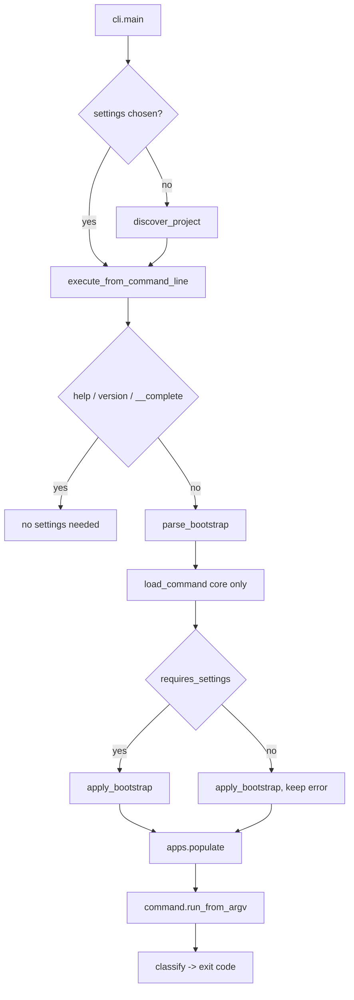

# 16. CLI Capabilities, Global Options, and Management Commands

`mactf` has eleven management commands and one cross-cutting defect: the command
framework discards what a command returns. `mactf check` with errors, `mactf migrate
--check` on a stale database, and `mactf sandbox provision` with a missing base image
all print their failure and then exit `0`, so no script, CI job, or container
healthcheck can gate on them. Around that sit smaller gaps: settings can only be
chosen through an environment variable, a run cannot be interrupted without being
marked `failed`, the run registry cannot be queried from a terminal beyond one
unfiltered `inspect`, and everything the HTTP API can do to a checkpoint (verify,
roll back) has no command at all.

This document specifies the fix and the expansion: a corrected command framework with
a stable exit-code contract, a two-phase global option layer (`--settings`, `--config`,
`--set`, `--format`, ...), a shared output layer, eleven repaired commands, eight new
command groups (`runs`, `checkpoints`, `logs`, `config`, `rules`, `peers`, `version`,
`completion`) plus `help`, and shell completion for bash, zsh, fish, and PowerShell.

It is documentation only. Every signature below is the signature that will be
implemented; nothing is deferred to "TBD".

Four decisions were made before writing, and they constrain everything below:

| Decision | Choice | Consequence |
|---|---|---|
| Parser | **stdlib `argparse` only** | No click, typer, rich, or argcomplete dependency. `pyproject.toml` `dependencies` does not change. Colour, tables, and completion are written here (section 6, section 9). |
| Machine contract | **`--format json` / `jsonl` is the API; text is for humans** | JSON shapes are specified per command and tested. Text layout may change between releases; JSON keys may only be added. In JSON modes stdout carries the payload and nothing else. |
| One implementation | **A command, an API view, and a test call the same function** | Checkpoint verification, rollback, peer description, and weight preview move out of `mactf/contrib/api/views/` into the core package (section 7); the view and the command both import them. No rule is written twice. |
| Compatibility | **Every existing flag keeps its spelling and meaning** | Behaviour changes only where section 1.5 lists it, each with a test and, where an opt-out is safe, an opt-out. The two that matter most: exit codes start being honoured, and a project directory is discovered automatically (section 4.3). |

## 1. Scope, non-goals, and what this replaces

### 1.1 What exists today

| Command | File | Options | Notes |
|---|---|---|---|
| `run` | `management/commands/run.py` | `--epochs --peers --device --seed --redteam --dry-run --resume VALUE --run-id --json` | `requires_system_checks = True`; blocks silently until the run ends |
| `redteam` | `management/commands/redteam.py` | `--epochs --peers --dry-run` | Always exits `0` |
| `serve` | `contrib/api/management/commands/serve.py` | `--host --port --workers --skip-checks --verbose-access` | Only present when `mactf.contrib.api` is installed |
| `check` | `management/commands/check.py` | `--fail-level --quiet` | `--fail-level` is declared and never read |
| `migrate` | `management/commands/migrate.py` | `--database --check` | `--check` returns `1`, which is discarded |
| `inspect` | `management/commands/inspect.py` | `target --runs --episodes --rules --checkpoints --json` | Opens `Registry(path)` without migrating |
| `doctor` | `management/commands/doctor.py` | `--json` | Always exits `0` |
| `shell` | `management/commands/shell.py` | `--interface` | Interactive only |
| `sandbox` | `management/commands/sandbox.py` | `action {status,install,provision,launch,clean} --peer --isolation --no-fallback --json` | `install` runs a package manager with no prompt |
| `startproject` | `management/commands/startproject.py` | `name --dir --force` | Calls `conf.configure()` first, so a broken default settings module blocks scaffolding |
| `startpeer` | `management/commands/startpeer.py` | `name --dir --state-dim --action-dim --force` | Same |

The framework is `mactf/management/base.py` (213 lines): `BaseCommand`, `CommandParser`,
`load_command`, `get_commands`, `execute_from_command_line`. The entry points are
`mactf/management/cli.py:main` (the `mactf` console script and `python -m mactf`) and a
generated `manage.py`.

Settings resolution today (`mactf/conf.py:906` `load_settings`) is, lowest to highest:
`DEFAULTS`, the settings module, the `conf/` tree (doc 15), `CONFIG_FILES` overlays,
`MACTF_<KEY>` environment variables for scalar top-level keys.

### 1.2 What is wrong with it

Every row was verified against the source; the location is where the defect lives.

| # | Problem | Location | Consequence |
|---|---|---|---|
| P1 | `run_from_argv` ends in a hard-coded `return 0`; the value `execute()` returns from `handle()` is thrown away | `management/base.py:78-88` | `check` failing, `migrate --check`, `inspect` on a missing run, `sandbox provision` without a base image, `shell --interface ipython` without IPython all exit `0` |
| P2 | `parser.parse_args` runs before the `try`; `CommandParser.error` raises `CommandError` | `management/base.py:79` | A mistyped flag prints a Python traceback instead of a usage message |
| P3 | `execute_from_command_line` calls `conf.configure()` outside any handler | `management/base.py:185` | A wrong `MACTF_SETTINGS_MODULE` prints a traceback for every command, including `help` |
| P4 | `check --fail-level` is never read; `run_checks(fail_level=)` never uses its parameter; `@check(**tags)` drops `tags`; messages are not stamped with their `app` unless the check sets it | `commands/check.py:14`, `checks.py:93-101,119-139` | `--fail-level WARNING` cannot make a warning fail the build |
| P5 | The only way to pick settings is the `MACTF_SETTINGS_MODULE` environment variable, and `cli.main` unconditionally `setdefault`s it to `mactf.settings_default` | `management/cli.py:21` | `mactf check` inside a generated project silently checks the framework defaults, not the project. The `mactf` console script's `sys.path[0]` is its own directory, so the project package is not importable either; only `python -m mactf` adds the working directory |
| P6 | `--resume VALUE` takes a value that is only tested for truthiness; `--resume` with a new `--run-id` (or none) starts at epoch 0 and reports nothing; `RunConfig(resume_from=False)` raises `TypeError` (`Path(False)`) | `commands/run.py:40`, `orchestrator.py:361,489-510` | Resuming a run that does not exist looks like success |
| P7 | A run prints nothing until it ends, ignores `should_stop`, and `KeyboardInterrupt` is a `BaseException`: `Orchestrator.run` catches it, writes the row `failed`, and re-raises into a traceback | `commands/run.py:43-47`, `orchestrator.py:323-333` | Ctrl-C produces a `failed` run that cannot be resumed under its own id, although a checkpoint exists |
| P8 | `inspect` opens `Registry(path)` and queries; on a fresh database the `runs` table does not exist | `commands/inspect.py:26` | `sqlite3.OperationalError` traceback, not "no runs recorded" |
| P9 | `inspect --checkpoints` formats `checkpoint['kappa']:.3f` and `checkpoint['score']:.4f`; both columns are nullable | `commands/inspect.py:80` | `TypeError` on a checkpoint written without them |
| P10 | `--json` exists on four commands, spelled per command; `check`, `migrate`, `run` (partially: the conf notes), and `redteam` have no machine-readable mode that is clean on stdout | all commands | Callers `out[out.index("{"):]` to skip preamble text |
| P11 | `_coerce` tests `_TRUE = {"1", ...}` before trying `int` | `conf.py:440-451` | `MACTF_SEED=1` becomes `True` and `MACTF_SEED=0` becomes `False`; `bool` is an `int`, so `seed=True` slips through every validator |
| P12 | `LOGGER.RUNS_DIR` is declared (`conf.py:89`) and read by nothing. The API's `?source=file` reads `PATHS.LOGS/<run_id>.jsonl` (`views/observability.py:53`) and nothing writes that file | `conf.py:89`, `observability.py:46-54` | A run launched from the CLI leaves no per-run log; `GET /runs/{id}/logs/tail?source=file` is always empty |
| P13 | Capabilities that exist as library calls or API routes have no command: list or filter runs, show warnings, adjudications, or aggregations, verify or roll back or prune checkpoints, tail a log, print the effective settings and where each value came from, list the rule catalog, describe a peer's contract, preview weights | `db.py`, `contrib/api/views/` | Operators write `sqlite3` one-liners |
| P14 | `help` lists names only; there is no `help <command>`, no grouping, no typo suggestion, no completion | `base.py:213` | Discoverability is `ls mactf/management/commands` |
| P15 | `sandbox install` runs `winget`, `apt-get`, `dnf`, or `pacman` immediately; `sandbox clean` globs `root/var/**` instead of `PATHS` | `commands/sandbox.py:54-96,146-157` | A mistyped action is a system change; a project that moved `PATHS.RUNS` is cleaned in the wrong place |
| P16 | `--run-id` is forwarded unvalidated and becomes part of checkpoint file names (`<run_id>-epNNNN.pt`) | `commands/run.py:41`, `checkpoint.py` | `--run-id ../x` writes outside the checkpoint directory |
| P17 | A run row left `running` by a crashed process is indistinguishable from a live one; the only liveness signal is the in-process `RunManager` | `db.py:511` `set_run_status`, `api/views/base.py:run_is_live` | `rollback` cannot know whether it is safe, and a dead run can never be resumed |
| P18 | `doctor` imports `torch` at the top of `handle` and `get_commands()` imports every command module, so `mactf help` pays the torch import | `commands/doctor.py:19`, `base.py:156-176` | Help and completion take seconds |

### 1.3 What this document adds

1. A corrected `BaseCommand` that returns what `handle()` returns, handles parse and
   bootstrap errors, and maps every exception to a documented exit code (sections 3, 4, 6).
2. Global options, valid after any command name: `--settings`, `--pythonpath`, `--config`,
   `--set`, `--no-discover`, `-v/-q`, `--format`, `--json`, `--no-color`, `--force-color`,
   `--traceback`, `-y/--yes` (sections 4, 6).
3. Project discovery, so `mactf <command>` inside a generated project uses that project
   (section 4.3).
4. Settings overrides on the command line with per-key provenance (section 5).
5. A shared output layer: text, tables, JSON, JSONL, YAML, colour that respects
   `NO_COLOR`, Windows consoles, and pipes (section 6.3).
6. A cooperative interrupt model for `run`: first Ctrl-C pauses at the epoch boundary and
   leaves the run resumable; second aborts (section 6.6, section 8.2).
7. Core extractions the commands and the API share: `orchestration/recovery.py`,
   `orchestration/runlock.py`, `orchestration/runview.py`, `coopetition/introspect.py`,
   `training/logging.run_log_path` (section 7).
8. Repairs to eleven commands and nine new ones (section 8).
9. Completion for four shells over an introspection protocol (section 9).
10. Tests, packaging, and rollout gates (sections 10 to 13).

### 1.4 Non-goals, stated as refusals

1. **No new runtime dependency.** `argparse`, `json`, `difflib`, `shutil`, `ctypes`
   (Windows console and process probing only), and PyYAML (already a hard dependency in
   `pyproject.toml:43`) are the toolbox.
2. **No change to the resolution order of doc 15.** `DEFAULTS < settings module < conf/ <
   CONFIG_FILES < MACTF_<KEY>` is untouched; section 5 appends two *command-line* layers
   above it.
3. **No remote control of a live run from another process.** `runs cancel` refuses a run
   a live process owns and says how to stop it. Cross-process control belongs to the API
   (`POST /runs/{id}/cancel`), which owns the in-process `RunManager`.
4. **No removal of the `--json` spelling, of `inspect`, or of `redteam`.** `inspect`
   becomes a compatibility front for `runs show`; `redteam` stays a command.
5. **No interactive TUI.** No curses, no spinners, no progress bars. A progress "bar" is
   one line per epoch, which is also what a log file needs.
6. **No change to the training algorithm, scoring, or checkpoint format.** The CLI only
   drives them. Section 8.2 changes how `run` is *started and stopped*, not what an epoch does.
7. **No `trainer`, `data`, `worker`, `distill`, or `score` commands in this document.**
   Their library surface (trainer capability introspection, dataset validation, the
   distributed worker, contrastive distillation) is specified or still moving in other
   documents; inventing a CLI over an unsettled API would be the stub this document
   refuses. Section 8.21 states the extension contract they will plug into.
8. **No plugin-defined global options.** An app adds commands (existing behaviour); it
   cannot add global flags.

### 1.5 Behaviour changes, listed so none is a surprise

| Change | Before | After | Opt-out |
|---|---|---|---|
| Honoured return codes | `check` with errors, `migrate --check` behind, `inspect` unknown run, `sandbox provision` missing image, `shell` missing IPython: exit `0` | exit `1`, `1`, `3`, `1`, `5` | none; this is the fix |
| Unknown command | exit `1`, traceback-free | exit `2`, with a "did you mean" suggestion | none |
| Bare `mactf` | prints help, exit `1` | prints grouped help, exit `2` | none |
| Bad flag | traceback | usage message, exit `2` | none |
| Project discovery | `mactf` always uses `mactf.settings_default` unless the env var is set | uses the project whose `manage.py` is found at or above the working directory | `--no-discover`, `MACTF_NO_DISCOVER=1`, or an explicit `--settings` / `MACTF_SETTINGS_MODULE` |
| Env coercion | `MACTF_SEED=1` is `True` | `1` | none; this is the fix (section 5.4) |
| Ctrl-C during `run` | traceback, row `failed` | message, row `paused`, exit `130` | `run --on-interrupt cancel` writes `cancelled` instead |
| Option abbreviations | `mactf run --dry` was accepted as `--dry-run` (argparse's default prefix matching) | exit `2`, `unrecognized arguments: --dry`; full spellings only (section 6.1) | none; a prefix that reaches a command can bypass the bootstrap pre-parser |

## 2. Module layout

New files are marked `+`, changed files `~`. Paths are relative to the repository root.

```text
mactf/
  checks.py                                ~ fail_level, app/id filters, app stamping (7.7)
  conf.py                                  ~ load_settings/configure parameters, provenance, env coercion (5)
  conf_overrides.py                        + parse_override, apply_overrides (5.2)
  db.py                                    ~ list_runs filters, episode_counts, delete_run, delete_checkpoint (7.1)
  exceptions.py                            ~ CommandError.returncode, ResourceNotFound, StateConflict, CapabilityUnavailable (3.2)
  _lazy.py                                 + lazy_exports, PEP 562 helper (7.9)
  management/
    __init__.py                            ~ re-exports
    base.py                                ~ pipeline, BaseCommand, load/get commands (4, 6.1)
    bootstrap.py                           + parse_bootstrap, discover_project, apply_bootstrap (4.1-4.3)
    cli.py                                 ~ discovery before the default, stream setup (4.3)
    exitcodes.py                           + ExitCode, classify (3)
    group.py                               + Sub, GroupCommand (6.2)
    output.py                              + Printer, Style, Column, clean (6.3)
    prompt.py                              + confirm (6.4)
    durations.py                           + parse_duration, format_duration, parse_when (6.5)
    interrupt.py                           + StopFlag (6.6)
    deprecation.py                         + Deprecation, DEPRECATIONS, deprecation_message (11.5)
    introspect.py                          + ArgInfo, CommandInfo, describe_command, overview_text (8.19)
    runsupport.py                          + run selection, listing, report, argument types (8.1.2)
    completion/
      __init__.py                          + Candidate, CompletionContext, complete, complete_main, write_raw (9.2)
      completers.py                        + COMPLETERS (9.3)
      scripts.py                           + render_script: bash, zsh, fish, powershell (9.4)
    commands/
      run.py redteam.py check.py migrate.py inspect.py doctor.py
      shell.py sandbox.py startproject.py startpeer.py   ~ section 8
      runs.py checkpoints.py logs.py config.py rules.py peers.py
      version.py help.py completion.py                   + section 8
  orchestration/
    __init__.py                            ~ lazy exports, no torch at package import (7.9)
    recovery.py                            + verify, describe, rollback, prune, delete_run_artifacts (7.2, 8.12)
    runlock.py                             + RunLock (7.3)
    runview.py                             + decode_run, summarize_run (7.4)
    live.py                                ~ RunManager takes the same lock (7.3)
  coopetition/introspect.py                + describe_peer, describe_contract, build_swarm, preview_weights (7.6)
  training/__init__.py                     ~ lazy exports, no torch at package import (7.9)
  training/logging.py                      ~ run_log_location, tail_jsonl, follow_jsonl, complete_size (7.5)
  contrib/api/views/
    recovery.py peers.py observability.py  ~ call the extractions; behaviour unchanged (7.8)
  testing/__init__.py                      ~ lazy exports, so importing mactf.testing.cli does not import torch (10.1.2)
  testing/cli.py                           + invoke, CliResult: the supported way to test a command (8.21)
tests/cli/                                 + section 10
docs/cli.md                                + user-facing reference, generated (11.3)
scripts/gen_cli_docs.py                    + renders docs/cli.md from `help --format json` (11.3)
pyproject.toml                             ~ pytest markers only; dependencies and extras unchanged (11.1)
.github/workflows/deploy.yml               ~ four gate jobs, `build.needs`, artifact listing (12.3)
```

Two rules apply to every module under `mactf/management/commands/`:

1. **Module level imports only `..base`, `..group`, `...exceptions`, the standard
   library, and cheap `mactf` modules.** Anything that imports `torch` (the orchestrator,
   `runtime`, `sandbox.detect`, `coopetition`) is imported inside `handle`. This is what
   makes `mactf help`, `mactf __complete`, and `mactf completion` return in
   milliseconds (P18). A test enforces it (section 10.2).
2. **A command module defines exactly one `Command`.** `get_commands()` keeps its
   duplicate-name `ImproperlyConfigured` check.

## 3. Exit codes and error semantics

### 3.1 The contract

`mactf/management/exitcodes.py`:

```python
from __future__ import annotations

import enum


class ExitCode(enum.IntEnum):
    OK = 0
    #: The operation ran and the answer is "no" or "it failed": a check failed, a
    #: checkpoint did not verify, a run failed, a plan is not applied.
    FAILURE = 1
    #: The invocation is wrong: bad arguments, unknown command, bad settings.
    USAGE = 2
    #: A named thing does not exist: run, episode, checkpoint, rule, peer, key.
    NOT_FOUND = 3
    #: The thing exists but its state forbids the action: run is live, id is taken,
    #: file would be overwritten, schema is behind.
    CONFLICT = 4
    #: The environment cannot do it: no QEMU, no IPython, port in use, extra missing.
    UNAVAILABLE = 5
    #: --timeout elapsed (the GNU `timeout` convention).
    TIMEOUT = 124
    #: A bug in mactf. Always printed with a request for --traceback.
    SOFTWARE = 70
    #: SIGINT or SIGTERM was honoured.
    INTERRUPTED = 130
    #: The reader of stdout went away (| head).
    PIPE = 141
```

`0` and `1` keep their meanings for every existing caller. Codes `2` and `70` keep the
meanings they already have in `run_from_argv` (`ImproperlyConfigured` is `2`).

### 3.2 Exceptions

`mactf/exceptions.py` gains four classes (the fourth, `InvalidArgument`, is defined in
section 7 beside the functions that need it) and one parameter:

```python
class CommandError(MACTFError):
    """A command failed in a way the operator can act on."""

    def __init__(self, message: str = "", *, returncode: int = 1) -> None:
        super().__init__(message)
        self.returncode = int(returncode)

    @classmethod
    def usage(cls, message: str) -> "CommandError":
        return cls(message, returncode=2)

    @classmethod
    def not_found(cls, message: str) -> "CommandError":
        return cls(message, returncode=3)

    @classmethod
    def conflict(cls, message: str) -> "CommandError":
        return cls(message, returncode=4)

    @classmethod
    def unavailable(cls, message: str) -> "CommandError":
        return cls(message, returncode=5)


class ResourceNotFound(MACTFError):
    """A named run, episode, checkpoint, rule, or peer does not exist."""


class StateConflict(MACTFError):
    """The target's state forbids the action. ``details`` is machine-readable.

    Named ``StateConflict`` because ``mactf.http.exceptions.Conflict`` (the 409
    response class) already exists and a module that handles both must not alias.
    """

    def __init__(self, message: str = "", **details: object) -> None:
        super().__init__(message)
        self.details = dict(details)


class CapabilityUnavailable(MACTFError):
    """The environment lacks something the action needs."""
```

`CommandError("x")` is unchanged: `returncode` defaults to `1`, so every existing
`raise CommandError(...)` site behaves as before. The four new exceptions exist so that
*core* functions (section 7) can fail precisely without importing the CLI or the HTTP
layer: the CLI maps them to `3`, `4`, `5`; an API view maps `ResourceNotFound` to
`Http404` and `StateConflict` to a 409 problem document. The API does this once, with
`register_handler(...)` in `views/base.py` (section 7.8), not in every view.

### 3.3 One classifier

```python
def classify(exc: BaseException) -> tuple[int, str]:
    """The exit code and the one-line stderr message for an exception."""
```

Used by both `BaseCommand._run` and `execute_from_command_line`, so a failure in
bootstrap and a failure in a handler are reported identically.

| Exception | Code | stderr line |
|---|---|---|
| `CommandError` | `exc.returncode` | `CommandError: <message>` |
| `ImproperlyConfigured` (incl. `ValidationError`) | `2` | `ImproperlyConfigured: <message>` |
| `InvalidArgument` | `2` | `error: <message>` |
| `ResourceNotFound`, `RunNotFound` | `3` | `NotFound: <message>` |
| `StateConflict`, `RunStateError`, `RunExists` | `4` | `Conflict: <message>` |
| `CapabilityUnavailable`, `SandboxUnavailable` | `5` | `Unavailable: <message>` |
| `AppRegistryNotReady` | `2` | `ImproperlyConfigured: <message>` |
| any other `MACTFError` (`ComplianceError`, `RuleViolation`, `ContractError`, `DataError`, `DistributedError`, `SandboxLaunchError`, ...) | `1` | `<ClassName>: <message>` |
| `KeyboardInterrupt` | `130` | `interrupted` |
| `BrokenPipeError` | `141` | none (stdout is redirected to the null device first, per the Python documentation recipe, so interpreter shutdown cannot raise a second time) |
| `OSError` raised while writing to stdout/stderr other than the above | `1` | `error: <strerror>` |
| any other `Exception` | `70` | `internal error: <ClassName>: <message>` followed by `re-run with --traceback for the stack` |

`--traceback` re-raises everything except `KeyboardInterrupt` and `BrokenPipeError`, so
a developer sees the real stack and a user never has to.

### 3.4 Honouring return values

`handle()` may return `None` (exit `0`) or an `int`. Any other return type is a
programming error:

```python
if result is None:
    return 0
if isinstance(result, bool) or not isinstance(result, int):
    raise TypeError(f"{type(self).__name__}.handle() must return an int or None, got {type(result).__name__}")
return int(result)
```

`bool` is rejected on purpose: `return True` from a handler that means "ok" would exit `1`.
The `TypeError` is classified as `70`, so the mistake is loud in the first test that runs
the command.

## 4. The dispatch pipeline

### 4.1 Bootstrap options

Five options change *which settings are loaded*, so they must be understood before
settings exist. They are read by a pre-parser that knows nothing about any command.

`mactf/management/bootstrap.py`:

```python
from __future__ import annotations

import argparse
from dataclasses import dataclass
from pathlib import Path
from typing import Sequence

from ..exceptions import CommandError


class _PreParser(argparse.ArgumentParser):
    def error(self, message: str) -> None:  # type: ignore[override]
        raise CommandError.usage(message)


@dataclass(frozen=True)
class Bootstrap:
    settings: str | None          # --settings MODULE
    pythonpath: tuple[str, ...]   # --pythonpath PATH, repeatable, os.pathsep-separable
    config: tuple[str, ...]       # --config FILE, repeatable, in order
    overrides: tuple[str, ...]    # --set KEY=VALUE, repeatable, in order
    no_discover: bool             # --no-discover
    traceback: bool               # --traceback
    rest: tuple[str, ...]         # the arguments with the options above removed


BOOTSTRAP_FLAGS = ("--settings", "--pythonpath", "--config", "--set", "--no-discover", "--traceback")


def parse_bootstrap(args: Sequence[str]) -> Bootstrap:
    """Split the bootstrap options from the arguments a command parser will see.

    Everything after a literal ``--`` is returned untouched in ``rest``; no mactf
    command takes a ``--`` remainder today, but the rule means none will have its
    arguments eaten if one does.
    """
    args = list(args)
    tail: list[str] = []
    if "--" in args:
        cut = args.index("--")
        args, tail = args[:cut], args[cut:]
    parser = _PreParser(add_help=False, allow_abbrev=False)
    parser.add_argument("--settings", default=None)
    parser.add_argument("--pythonpath", action="append", default=[])
    parser.add_argument("--config", action="append", default=[])
    parser.add_argument("--set", action="append", default=[], dest="overrides")
    parser.add_argument("--no-discover", action="store_true", default=False)
    parser.add_argument("--traceback", action="store_true", default=False)
    namespace, rest = parser.parse_known_args(args)
    paths: list[str] = []
    for entry in namespace.pythonpath:
        paths.extend(part for part in entry.split(os.pathsep) if part)
    return Bootstrap(
        settings=namespace.settings,
        pythonpath=tuple(paths),
        config=tuple(namespace.config),
        overrides=tuple(namespace.overrides),
        no_discover=namespace.no_discover or os.environ.get("MACTF_NO_DISCOVER") == "1",
        traceback=namespace.traceback,
        rest=tuple(rest) + tuple(tail),
    )
```

`allow_abbrev=False` is load-bearing: without it `--set` would swallow a prefix of
`--settings`, and `--config` a prefix of a command's own `--config-...` flag.

These six flags are **also declared on every command parser** (section 6.1) so that
`mactf run --help` lists them. Because the pre-parser removed them from `rest`, the
command parser never sees a value for them; the declaration exists for help text and for
completion only.

Global options are accepted **after the command name**, as Django's are:
`mactf run --set TRAINING.EPOCHS=2 --format json`. `mactf --settings x run` is not a
form; argument 1 is always the command.

### 4.2 Applying bootstrap

`apply_bootstrap(boot: Bootstrap) -> None`, in this order:

1. **`--pythonpath`.** Each entry is expanded (`~`), resolved, checked with
   `Path.is_dir()` (a non-directory is `CommandError.usage("--pythonpath entry ... is not a directory")`),
   and inserted at `sys.path[0]`, first entry first, skipping entries already present.
2. **`--settings`.** `boot.settings` wins over `MACTF_SETTINGS_MODULE`; the module name
   must match `^[A-Za-z_][\w]*(\.[A-Za-z_][\w]*)*$` or it is a usage error (a path such as
   `proj/settings.py` gets the hint "pass the dotted module name and use --pythonpath for
   its parent").
3. **Configure.** `conf.configure(module, force=explicit, overrides=boot.overrides,
   config_files=boot.config)` where `explicit = bool(boot.settings or boot.config or
   boot.overrides)`. `force` matters: `conf.configure()` returns a cached `Settings` when
   one exists (`conf.py:1036-1040`), and a test or an embedding program may have
   installed one; an explicit command-line request must not be silently ignored.
   `ImproperlyConfigured` propagates to the caller.

`apply_bootstrap` does not set `MACTF_SETTINGS_MODULE` in the environment when
`--settings` was given. (Django does; here a child process the command spawns, such as
the sandbox, should not inherit a one-off flag.)

### 4.3 Project discovery

Problem P5. After this section, `cd myswarm && mactf check` checks `myswarm`.

```python
@dataclass(frozen=True)
class Discovery:
    module: str          # "myswarm.settings"
    root: Path           # the directory holding manage.py
    pythonpath: Path     # root.parent, exactly what the generated manage.py inserts
    manage_py: Path


_MANAGE_RE = re.compile(
    r"""os\.environ\.setdefault\(\s*["']MACTF_SETTINGS_MODULE["']\s*,\s*["']([A-Za-z_][\w.]*)["']\s*\)"""
)


def discover_project(start: Path | None = None, *, max_levels: int = 6) -> Discovery | None:
    """Find the generated project at or above ``start``; never executes anything."""
    directory = (start or Path.cwd()).resolve()
    for level, candidate in enumerate((directory, *directory.parents)):
        if level > max_levels:
            break
        manage = candidate / "manage.py"
        if not manage.is_file():
            continue
        try:
            text = manage.read_text(encoding="utf-8", errors="replace")
        except OSError:
            continue
        match = _MANAGE_RE.search(text)
        if match:
            return Discovery(match.group(1), candidate, candidate.parent, manage)
    return None
```

`manage.py` is read as text and matched; it is never imported or run, so discovery has no
side effect and cannot be tricked into executing project code before the operator asked
for a command. A `manage.py` that is not a MACTF one (a Django project, say) has no
`MACTF_SETTINGS_MODULE` line and is skipped.

`management/cli.py:main` becomes:

```python
def main(argv: Sequence[str] | None = None) -> int:
    _tolerate_console_encoding()
    args = list(argv) if argv is not None else list(sys.argv[1:])
    if not _settings_chosen(args):
        found = None if _discovery_disabled(args) else discover_project()
        if found is not None:
            _add_path(found.pythonpath)
            os.environ["MACTF_SETTINGS_MODULE"] = found.module
        else:
            os.environ.setdefault("MACTF_SETTINGS_MODULE", "mactf.settings_default")
    from . import execute_from_command_line
    return execute_from_command_line(["mactf", *args])
```

- `_settings_chosen(args)` is true when `--settings` (or `--settings=...`) appears in
  `args` **or** `MACTF_SETTINGS_MODULE` is set to a value other than empty. The existing
  `setdefault` made the variable always set; it is now set only on the fallback branch,
  after discovery has had its chance.
- `_discovery_disabled(args)` is true for `--no-discover` or `MACTF_NO_DISCOVER=1`.
- `_tolerate_console_encoding()` calls `stream.reconfigure(errors="replace")` on stdout
  and stderr when the method exists, so a Windows code page that cannot encode a
  character in a run id or a message prints `?` instead of raising `UnicodeEncodeError`.
- A generated `manage.py` sets its own explicit module and calls
  `execute_from_command_line` directly; discovery is not involved.
- At verbosity `2` or more, `config show` and `doctor` print
  `discovered project <module> at <root>` (the `Discovery` is kept on
  `os.environ["MACTF_DISCOVERED_ROOT"]` for that purpose only).

### 4.4 The pipeline

`execute_from_command_line(argv)` after this document. Numbered because the order is the
design:

```python
def execute_from_command_line(argv: Sequence[str] | None = None) -> int:
    argv = list(argv if argv is not None else sys.argv)
    prog = argv[0] if argv else "mactf"
    traceback_wanted = "--traceback" in argv
    try:
        return _dispatch(prog, argv[1:])
    except BrokenPipeError:
        _silence_stdout()
        return int(ExitCode.PIPE)
    except KeyboardInterrupt:
        sys.stderr.write("interrupted\n")
        return int(ExitCode.INTERRUPTED)
    except Exception as exc:  # noqa: BLE001 - classify() decides what the user sees
        if traceback_wanted:
            raise
        code, line = classify(exc)
        sys.stderr.write(line + "\n")
        if code == ExitCode.SOFTWARE:
            sys.stderr.write("re-run with --traceback for the stack\n")
        return code
```

and `_dispatch`:

1. **No arguments.** Print grouped help to stderr, return `2`.
2. **Meta forms.** `-h`/`--help` is `help`; `--version` is `version`;
   `help` and `version` are ordinary commands with `requires_settings = False`.
   `__complete` (section 9) is handled here, before anything else loads.
3. **Pre-parse.** `boot = parse_bootstrap(args[1:])`.
4. **Resolve the command class from core packages only**
   (`load_command(name, populate=False)`), which imports one module and no app.
5. **Configure.**
   - If the class is found and `requires_settings is False`: call `apply_bootstrap`
     inside `try`; an `ImproperlyConfigured` is stored as `settings_error` and dispatch
     continues. Commands that need no settings (`help`, `version`, `completion`,
     `startproject`, `startpeer`, `config validate`) therefore work with a broken
     configuration (P3), and `config validate` can *report* the breakage.
   - Otherwise (class not found in core, or `requires_settings is True`): call
     `apply_bootstrap`; an `ImproperlyConfigured` propagates and is classified `2`.
6. **App commands.** If the class was not found in core, `apps.populate()` now runs and
   `load_command(name, populate=True)` searches installed apps' command packages. Still
   not found: `CommandError.usage(f"unknown command {name!r}. Did you mean {', '.join(suggestions)}?")`
   where the suggestions are `difflib.get_close_matches(name, sorted(get_commands()), n=3, cutoff=0.6)`
   (the clause is omitted when there are none), with the existing `serve` hint
   (`add 'mactf.contrib.api' to INSTALLED_APPS to get serve`) preserved.
7. **Populate.** When settings loaded, `apps.populate()` (idempotent), as today.
8. **Instantiate and run.** `command = command_class(bootstrap=boot, settings_error=settings_error)`;
   `return command.run_from_argv([prog, name, *boot.rest])`.

`BaseCommand.__init__` keeps its keyword arguments (`stdout`, `stderr`, `settings`) and
gains `bootstrap: Bootstrap | None = None` and `settings_error: Exception | None = None`;
a test that builds `Command(stdout=out, stderr=err)` is unaffected.



## 5. Settings from the command line

### 5.1 Two new layers, above the environment

Resolution order after this document, lowest to highest:

1. `DEFAULTS`
2. the settings module
3. the `conf/` tree (doc 15, step 2.5)
4. `CONFIG_FILES` overlays, in order
5. `MACTF_<KEY>` environment variables (scalar top-level keys only)
6. **`--config FILE`**, in the order given
7. **`--set KEY=VALUE`**, in the order given

Layers 6 and 7 sit above the environment on purpose. A flag typed on the command line is
the most specific statement an operator can make, and the environment is ambient: a CI
job that exports `MACTF_SEED=7` and then runs `mactf run --set SEED=11` means eleven.
Steps 1 to 5 are exactly doc 15's order and are not touched.

`--config FILE` is an overlay in the same sense as `CONFIG_FILES` (deep-merged, `TRAINER`
folded into `TRAINING`, keys recorded as authored), with two differences: a relative path
is relative to the **working directory** (a command-line path is, everywhere else in the
world), not to the project root, and it is applied after the environment.

`mactf/conf.py` signatures:

```python
def load_settings(
    module_path: str | None = None,
    *,
    overrides: Sequence[str] = (),
    config_files: Sequence[str | os.PathLike[str]] = (),
    trace: bool = False,
) -> Settings: ...


def configure(
    module_path: str | None = None,
    *,
    force: bool = False,
    overrides: Sequence[str] = (),
    config_files: Sequence[str | os.PathLike[str]] = (),
) -> Settings: ...
```

Both new parameters default to "nothing", so every existing caller (the API, the test
fixtures, `get_settings()`) is unchanged. In `load_settings` the code that follows
`_apply_env(values)` (currently `conf.py:972-973`) becomes:

```python
    _apply_env(values)

    for entry in config_files:                       # layer 6
        path = Path(entry).expanduser()
        if not path.is_absolute():
            path = Path.cwd() / path
        if not path.is_file():
            raise ImproperlyConfigured(f"--config file does not exist: {path}")
        overlay = _load_yaml(path)
        _deep_merge(values, overlay)
        for key, value in overlay.items():
            _mark_authored(authored, str(key), value)
        trainer_overlay = overlay.get("TRAINER")
        if isinstance(trainer_overlay, dict):
            conf_notes.extend(_fold_trainer(values, set(map(str, trainer_overlay))))

    if overrides:                                    # layer 7
        parsed = [parse_override(text) for text in overrides]
        written = apply_overrides(values, parsed, defaults=DEFAULTS)
        for override in parsed:
            _mark_authored(authored, override.path[0], {override.path[1]: None} if len(override.path) > 1 else override.value)
        conf_notes.extend(_fold_trainer(values, written.trainer_keys))
        conf_notes.extend(f"--set {o.text}" for o in parsed)

    _sync_trainer(values)                            # again: layers 6 and 7 may have written TRAINING
```

`_fold_trainer` is called with only the `TRAINER` keys the operator wrote, so a `--set
TRAINING.EPOCHS=2` is not undone by an older `TRAINER.EPOCHS`, and a `--set
TRAINER.EPOCHS=2` reaches `TRAINING.EPOCHS` (the shared key the orchestrator reads).

### 5.2 The override grammar: `mactf/conf_overrides.py`

```
--set KEY=VALUE
KEY   := SEGMENT ( "." SEGMENT )*
SEGMENT := [A-Za-z_][A-Za-z0-9_-]*
```

The first segment is a top-level settings key and must be upper-case. Examples:
`--set SEED=11`, `--set DEVICE=cpu`, `--set TRAINING.EPOCHS=2`,
`--set SANDBOX.ISOLATION=none`, `--set COOPETITION.WEIGHT_CAP=0.6`,
`--set 'LOGGER.SINKS=[console]'`.

**Value parsing.** Deliberately narrower than YAML, because YAML 1.1 turns `no` into
`false`, `1:30` into the integer 90, and `a: b` into a mapping:

```python
_INT = re.compile(r"[-+]?\d+")
_FLOAT = re.compile(r"[-+]?(?:\d+\.\d*|\.\d+|\d+)(?:[eE][-+]?\d+)?")


def parse_value(raw: str) -> Any:
    text = raw.strip()
    if text == "":
        return ""                      # KEY= sets the empty string; KEY=null sets null
    if text[0] in "[{\"'":
        try:
            return yaml.safe_load(text)  # flow lists/maps and quoted strings
        except yaml.YAMLError as exc:
            raise CommandError.usage(f"--set value {raw!r} is not valid YAML: {exc}") from exc
    lowered = text.lower()
    if lowered in ("true", "false"):
        return lowered == "true"
    if lowered in ("null", "~"):
        return None
    if _INT.fullmatch(text):
        return int(text)
    if _FLOAT.fullmatch(text):
        return float(text)
    return raw                          # anything else is a string, verbatim
```

`--set SANDBOX.ISOLATION=none` is therefore the string `"none"` (a legal isolation level),
not `null`. To force a string that looks like a number or boolean, quote it:
`--set 'DEVICE="1"'`.

```python
@dataclass(frozen=True)
class Override:
    path: tuple[str, ...]
    value: Any
    text: str                           # the original KEY=VALUE, for notes and errors


@dataclass(frozen=True)
class Written:
    trainer_keys: set[str]              # TRAINER keys this batch wrote


def parse_override(text: str) -> Override: ...
def apply_overrides(values: dict[str, Any], overrides: Sequence[Override], *, defaults: Mapping[str, Any]) -> Written: ...
```

`apply_overrides` walks each path and applies four rules; each failure is a
`CommandError.usage` that names the override and the fix:

1. **The first segment must exist** in `values` (top-level keys beginning with `_` are
   internal and not addressable). Otherwise: `unknown setting 'TRAININ'; did you mean
   TRAINING?` using `difflib.get_close_matches(first, candidates, n=3, cutoff=0.6)`.
2. **Intermediate segments must be mappings.** `--set PEERS.0.NAME=x` fails with `PEERS
   is a list; set the whole list: --set 'PEERS=[...]'`. Lists are replaced wholesale; there
   is no index syntax.
3. **The final key must exist, unless the container is open.** A container is open when
   the same path in `defaults` is absent or an empty mapping (`API.TOKENS`, `SANDBOX`
   extras, `LOGGER.REDACT`-style maps). Otherwise `TRAINING.EPOCH` fails with
   `TRAINING has no key 'EPOCH'; did you mean EPOCHS?`. A typo can no longer invent a key
   no consumer reads.
4. **The type must be compatible** with the value being replaced:

   ```python
   def _compatible(old: Any, new: Any) -> bool:
       if old is None or new is None:
           return True
       if isinstance(old, bool) or isinstance(new, bool):
           return isinstance(old, bool) and isinstance(new, bool)
       if isinstance(old, (int, float)):
           return isinstance(new, (int, float))
       if isinstance(old, str):
           return isinstance(new, str)
       if isinstance(old, dict):
           return isinstance(new, dict)
       if isinstance(old, (list, tuple)):
           return isinstance(new, (list, tuple))
       return True
   ```

   `--set TRAINING.EPOCHS=abc` and `--set AMP=3` fail before a validator ever runs. The
   rule is intentionally conservative about `bool`, which is an `int` subclass in
   Python and the root of P11.

After the batch, `validate_settings(settings)` runs as it always does, so range and
relationship checks (`WEIGHT_CAP` against `WEIGHT_FLOOR` and the peer count, for
example) still apply to an overridden value, and a violation exits `2`.

### 5.3 Provenance

`load_settings(..., trace=True)` records where every leaf came from. It is off for
normal loads (it deep-copies once per layer) and on for `config show --origin` and
`config files`.

```python
Origins = dict[str, str]        # "TRAINING.EPOCHS" -> "conf:trainer.yaml"
Layers = list[dict[str, Any]]   # [{"label", "path", "leaves"}], lowest layer first
```

`label` is one of the labels in the table below, `path` is the file for a file layer and
`None` otherwise, and `leaves` is how many leaves that layer is the origin of (a layer
every one of whose values was overridden above it reports `0`).

Flattening is `conf.iter_leaves(tree, prefix=())`, which yields `(path, value)` with `path`
a tuple of keys, and `conf.flatten_leaves(values)`, which joins each path with dots. Mappings
recurse; lists, scalars, and *empty* mappings are leaves (an empty `API.TOKENS` is a
setting, not an absence); keys that start with `_` are skipped. The tuple form exists
because a key may itself contain a dot (an `API.TOKENS` key is a token), so a dotted
string cannot always be split back into a path:

```python
def iter_leaves(tree: Any, prefix: tuple[str, ...] = ()) -> Iterator[tuple[tuple[str, ...], Any]]:
    if isinstance(tree, Mapping) and tree:
        for key, item in tree.items():
            if not str(key).startswith("_"):
                yield from iter_leaves(item, (*prefix, str(key)))
    elif prefix or not isinstance(tree, Mapping):
        yield prefix, tree


def flatten_leaves(values: Mapping[str, Any]) -> dict[str, Any]:
    return {".".join(path): value for path, value in iter_leaves(values)}
``` After each layer is merged, every leaf whose value differs
from the previous snapshot is attributed to that layer. Labels:

| Label | Layer |
|---|---|
| `default` | `DEFAULTS` |
| `settings:<module>` | the settings module |
| `conf:<file>` | the `conf/` tree; the file is `conf_files.owner_of(<top-level key>)`, which is unambiguous because ownership is disjoint (doc 15 section 3) |
| `fold:TRAINER` | a `TRAINING` value replaced by the `TRAINER` fold |
| `overlay:<path>` | a `CONFIG_FILES` entry |
| `env:MACTF_<KEY>` | an environment variable |
| `cli:--config <path>` | a `--config` file |
| `cli:--set` | a `--set` override |

The result is stored as `settings["_ORIGINS"]` and `settings["_LAYERS"]` only when
`trace=True`, and both are excluded from `as_dict()` unless asked for (they are
underscore-prefixed, like `_AUTHORED` and `_CONF_NOTES`).

Because the cached process settings were loaded without tracing, a command that wants
provenance re-runs the loader with the same inputs:

```python
load_settings(settings.module, overrides=boot.overrides, config_files=boot.config, trace=True)
```

`load_settings` has no side effect beyond importing the settings module, so this is safe.

### 5.4 The environment coercion fix (P11)

`_apply_env` (`conf.py:554-561`) only touches scalar top-level keys, which already exist
in `values`. Coerce by the type the key already has:

```python
def _coerce_env(name: str, raw: str, current: Any) -> Any:
    text = raw.strip()
    try:
        if isinstance(current, bool):                # before int: bool is an int subclass
            lowered = text.lower()
            if lowered in _TRUE:
                return True
            if lowered in _FALSE:
                return False
            raise ValueError("expected true/false, 1/0, yes/no, or on/off")
        if isinstance(current, int):
            return int(text)
        if isinstance(current, float):
            return float(text)
        if isinstance(current, str):
            return raw
    except ValueError as exc:
        raise ImproperlyConfigured(f"MACTF_{name}={raw!r}: {exc}") from exc
    return _coerce(raw)                              # current is None or a list: guess
```

and `_coerce`'s own bug is fixed so the guess path is right too: `_TRUE` and `_FALSE` lose
`"1"` and `"0"` for the *untyped* guess (they remain valid for a `bool`-typed key above).
`MACTF_SEED=1` is now `1`; `MACTF_AMP=1` is still `True`; `MACTF_AMP=maybe` is now an
`ImproperlyConfigured` that names the variable, where before it silently became the
string `"maybe"` and a truthy `AMP`.

## 6. The framework

### 6.1 `BaseCommand`

`mactf/management/base.py`. Everything not shown (`CommandParser`, `get_commands`, the
duplicate-name check) is as today.

```python
class BaseCommand:
    #: One line, shown in `mactf help`.
    help: str = ""
    #: Long description for `--help`; falls back to ``help``.
    description: str = ""
    #: Shell lines shown under "examples:" in `--help`.
    examples: tuple[str, ...] = ()
    #: Heading in `mactf help`.
    category: str = "General"
    requires_system_checks: bool = False
    #: False for commands that must work with broken or absent settings.
    requires_settings: bool = True
    #: Formats the command can produce. "text" must be present.
    output_formats: tuple[str, ...] = ("text",)
    #: Adds -y/--yes and enables confirm().
    destructive: bool = False
    arguments: list[tuple[tuple[str, ...], dict[str, Any]]] = []
    #: Sets of flags that may not be combined. The first flag of each argument names it.
    exclusive: tuple[tuple[str, ...], ...] = ()

    def __init__(self, *, stdout=None, stderr=None, settings=None, stdin=None,
                 bootstrap: Bootstrap | None = None, settings_error: Exception | None = None) -> None: ...

    def create_parser(self, prog_name: str, subcommand: str) -> CommandParser: ...
    def add_arguments(self, parser: argparse.ArgumentParser) -> None: ...
    def run_from_argv(self, argv: Sequence[str]) -> int: ...
    def execute(self, options: argparse.Namespace) -> Any: ...
    def handle(self, **options: Any) -> Any: ...

    # output
    out: Printer
    def success(self, message: str) -> None: ...        # = self.out.result(message), kept for compatibility
    def confirm(self, message: str, *, default: bool = False) -> bool: ...

    # registry access
    def registry_for_read(self) -> Registry | None: ...
    def registry_for_write(self) -> Registry: ...
```

`load_command(name, *, populate: bool | None = None)`: `None` is today's behaviour (core
first, then apps, populating on demand); `False` searches core only; `True` searches the
populated app packages. `get_commands(*, populate: bool = True)` lists core commands only
when `populate` is false (what `help` does when settings failed to load, because
populating apps needs working settings). It additionally skips module names starting with
`_`, as it does now, which is why `__complete` is dispatched in section 4.4 rather than
being a module.

**`run_from_argv`:**

```python
def run_from_argv(self, argv: Sequence[str]) -> int:
    parser = self.create_parser(argv[0], argv[1])
    try:
        options = parser.parse_args(list(argv[2:]))
    except CommandError as exc:                       # CommandParser.error
        self.stderr.write(f"{parser.prog}: error: {exc}\n")
        self.stderr.write(f"Try '{parser.prog} --help' for usage.\n")
        return int(ExitCode.USAGE)
    except SystemExit as exc:                         # argparse's own --help / error paths
        return int(exc.code or 0)
    return self._run(options)


def _run(self, options: argparse.Namespace) -> int:
    traceback_wanted = bool(getattr(options, "traceback", False) or (self.bootstrap and self.bootstrap.traceback))
    try:
        result = self.execute(options)
        return self._exit_code(result)
    except (KeyboardInterrupt, BrokenPipeError):
        raise                                          # execute_from_command_line owns these
    except Exception as exc:                           # noqa: BLE001
        if traceback_wanted:
            raise
        code, line = classify(exc)
        self.stderr.write(line + "\n")
        if code == ExitCode.SOFTWARE:
            self.stderr.write("re-run with --traceback for the stack\n")
        return code
```

This fixes P1 (the return value is honoured through `_exit_code`, section 3.4) and P2
(`parse_args` is inside the handler).

**`create_parser`** builds `CommandParser(prog=f"{prog} {sub}", description=..., epilog=...,
formatter_class=argparse.RawDescriptionHelpFormatter)`, declares `arguments`, applies
`exclusive`, then calls `add_global_options`. The epilog is the `examples` rendered as

```
examples:
  mactf runs list --status failed --since 2d
  mactf runs list --format json
```

with `mactf` replaced by the `prog_name` the user typed (`manage.py` in a generated
project).

**`CommandParser` gets two constructor defaults**, the one place the parser's behaviour is
pinned for every command, verb, and interpreter (`add_subparsers(parser_class=CommandParser)`
forwards the keywords, so verbs inherit them):

```python
class CommandParser(argparse.ArgumentParser):
    def __init__(self, *args: Any, **kwargs: Any) -> None:
        # No unambiguous-prefix matching. The bootstrap pre-parser (4.1) cannot see a
        # prefix: without this, `--sett x` passes the pre-parser untouched, is accepted here
        # as an abbreviation of the help-only `--settings`, and the command silently runs
        # against the wrong project. `--trace` and `--no-d` fail the same way.
        kwargs.setdefault("allow_abbrev", False)
        # Python 3.14 colours argparse's own help by default and decides for itself
        # (terminal, NO_COLOR, FORCE_COLOR); `--no-color` and section 6.3's single colour
        # decision could not reach it. Help is plain; `Printer` owns colour.
        if sys.version_info >= (3, 14):
            kwargs.setdefault("color", False)
        super().__init__(*args, **kwargs)
```

`test_group.py` parses `check --sett x`, `check --trace`, and `run --dry` and asserts exit
`2` with `unrecognized arguments`, and a 3.14 case asserts `--help` output contains no
`\x1b` even with `FORCE_COLOR=1`.

**Declared arguments** accept every `argparse.add_argument` keyword, plus one extension
key, `"completer"`, popped (from a *copy* of the dict, because declarations are shared
between verbs) before the call and stored on the action it creates as `action.completer`,
where `introspect.py` (8.19) and section 9 read it:

```python
(("run_id",), {"help": "Run id, or 'latest'.", "completer": "run_id"})
```

```python
def _declare(parser: argparse.ArgumentParser, arguments, exclusive) -> None:
    grouped = {flag for names in exclusive for flag in names}
    groups = {names: parser.add_mutually_exclusive_group() for names in exclusive}
    for names, kwargs in arguments:
        kwargs = dict(kwargs)                                  # never mutate a shared declaration
        completer = kwargs.pop("completer", None)
        target = next((groups[group] for group in exclusive if names[0] in group), parser)
        action = target.add_argument(*names, **kwargs)
        action.completer = completer
    unknown = grouped - {names[0] for names, _ in arguments}
    if unknown:                                                # a typo here would silently drop a rule
        raise ValueError(f"exclusive names no declared argument: {sorted(unknown)}")
```

**`exclusive`** is wired through `parser.add_mutually_exclusive_group()`: for each tuple, the
arguments whose first flag is in the tuple are added to one group instead of the parser.
argparse's own error ("not allowed with argument --x") becomes the usage message.

**Global options on every parser** (`add_global_options`):

```python
def add_global_options(parser, *, formats, destructive, skip_checks, suppress: bool) -> None:
    """Declare the options every command accepts.

    ``suppress`` is True for subcommand parsers: their absent flags must not overwrite
    the value the top-level parser already parsed (`mactf runs --format json list`
    and `mactf runs list --format json` mean the same thing).
    """
```

| Option | dest | Meaning | Default |
|---|---|---|---|
| `-v`, `--verbose` | `verbose` | count; each adds one verbosity level | `0` |
| `-q`, `--quiet` | `quiet` | count; each removes one level | `0` |
| `--format {text,json,jsonl,yaml}` | `format` | restricted to the command's `output_formats` | none (text) |
| `--json` | `json` | alias of `--format json`; declared only when `json` is a supported format | `False` |
| `--no-color` | `no_color` | never emit ANSI | `False` |
| `--force-color` | `force_color` | always emit ANSI | `False` |
| `--traceback` | `traceback` | re-raise instead of printing one line | `False` |
| `-y`, `--yes` | `yes` | answer yes to `confirm()`; declared only when `destructive` | `False` |
| `--skip-checks` | `skip_checks` | skip system checks; declared only when `requires_system_checks` and the command has not declared it (`serve` does) | `False` |
| `--settings --pythonpath --config --set --no-discover` | n/a | declared for help and completion only (section 4.1) | n/a |

`-q` was already `check --quiet` (a `store_true`); it is now a global count whose truthy
value keeps `check --quiet` meaning the same thing. A command that declares one of these
flags itself wins: the global declaration is skipped when the flag is already taken
(`parser._option_string_actions`), which is how `serve --skip-checks` and `check --quiet`
keep working unchanged.

**Verbosity** is `clamp(1 + verbose - quiet, 0, 3)`:

| Level | Meaning |
|---|---|
| `0` | errors and the command's result only |
| `1` | plus ordinary narrative (default) |
| `2` | plus decisions: discovered project, resolved paths, retries |
| `3` | plus `logging.getLogger("mactf")` at `DEBUG` on stderr |

**Format resolution** in `execute`:

```python
fmt = options.pop("format", None)
as_json = bool(options.get("json"))
if fmt is not None and as_json and fmt != "json":
    raise CommandError.usage(f"--json conflicts with --format {fmt}")
fmt = fmt or ("json" if as_json else "text")
options["format"] = fmt
options["json"] = fmt == "json"           # handlers that still read options["json"] keep working
```

**`execute`:**

```python
def execute(self, options: argparse.Namespace) -> Any:
    values = vars(options)
    self._resolve_globals(values)                       # format, verbosity, color, yes
    self.out = Printer(self.stdout, self.stderr, fmt=values["format"],
                       verbosity=values["verbosity"], color=values["color"])
    if self.requires_settings and self.settings_error is not None:
        raise self.settings_error
    if self.requires_system_checks and not values.get("skip_checks"):
        from ..checks import run_checks
        outcome = run_checks()
        if not outcome.ok:
            for message in outcome.errors:
                self.out.error(str(message))
            raise CommandError(outcome.summary())
    return self.handle(**values)
```

`handle` receives every parsed key, including the derived `json` and `format`, as it
does today.

**Registry access.** Two helpers replace every command's `Registry(path)`:

```python
def registry_for_write(self) -> Registry:
    """The registry with the schema guaranteed: ensure_registry(settings), which migrates."""

def registry_for_read(self) -> Registry | None:
    """None when the database file does not exist; never creates it.

    Raises StateConflict when the schema is behind: 'database schema N is behind M; run
    `mactf migrate`'. A reader must not alter the file it is reading.
    """
```

`Registry.__init__` creates the parent directory, so `registry_for_read` checks
`settings.database_path().exists()` *before* constructing one, and constructs it with
`read_only=True` (7.1), which neither creates anything nor alters the journal mode. A command that gets
`None` answers as an empty registry would (an empty list, exit `0`) or, when asked for a
specific run, raises `ResourceNotFound` (exit `3`). That removes P8.

### 6.2 `GroupCommand`: subcommands without a second dispatcher

`mactf/management/group.py`. `sandbox`, `runs`, `checkpoints`, `logs`, `config`, `rules`,
and `peers` all have verbs; one class gives them the same help, completion, global
options, and error handling.

```python
@dataclass(frozen=True)
class Sub:
    name: str
    help: str
    arguments: tuple[tuple[tuple[str, ...], dict[str, Any]], ...] = ()
    #: None inherits the group's output_formats.
    output_formats: tuple[str, ...] | None = None
    destructive: bool = False
    aliases: tuple[str, ...] = ()
    examples: tuple[str, ...] = ()
    exclusive: tuple[tuple[str, ...], ...] = ()
    #: Method on the Command; defaults to "sub_" + name with "-" as "_".
    handler: str = ""

    @property
    def method(self) -> str:
        return self.handler or "sub_" + self.name.replace("-", "_")


class GroupCommand(BaseCommand):
    subcommands: tuple[Sub, ...] = ()
    default_subcommand: str | None = None

    def add_arguments(self, parser: argparse.ArgumentParser) -> None:
        required = self.default_subcommand is None
        action = parser.add_subparsers(dest="subcommand", metavar="<subcommand>",
                                       parser_class=CommandParser, required=required)
        for sub in self.subcommands:
            child = action.add_parser(sub.name, aliases=list(sub.aliases), help=sub.help,
                                      description=sub.help, epilog=_epilog(parser.prog, sub.examples),
                                      formatter_class=argparse.RawDescriptionHelpFormatter)
            _declare(child, sub.arguments, sub.exclusive)
            add_global_options(child, formats=sub.output_formats or self.output_formats,
                               destructive=sub.destructive, skip_checks=False, suppress=True)

    def handle(self, **options: Any) -> Any:
        name = options.pop("subcommand", None) or self.default_subcommand
        sub = self._lookup(name)
        allowed = sub.output_formats or self.output_formats
        if options["format"] not in allowed:
            raise CommandError.usage(
                f"{self.name} {sub.name} does not support --format {options['format']} "
                f"(supported: {', '.join(allowed)})")
        self.destructive_sub = sub.destructive
        return getattr(self, sub.method)(**options)
```

The top-level group parser declares `--format` with the *union* of its subcommands'
formats, so the flag is accepted before the verb; `handle` then enforces the verb's own
set. `sandbox` keeps working as `mactf sandbox status` because `status` is its
`default_subcommand` and its old positional `action` becomes the subcommand name:
`mactf sandbox install` parses identically. A command that sets `default_subcommand`
accepts the bare form `mactf sandbox`.

Subparser namespaces: Python copies a subparser's attributes onto the parent namespace,
and an attribute whose default is `argparse.SUPPRESS` is not copied when absent. That
behaviour is stable from 3.10 through 3.14 and is what `suppress=True` relies on; a test
(section 10.2) parses both orders under each supported interpreter.

### 6.3 Output: `mactf/management/output.py`

```python
@dataclass(frozen=True)
class Column:
    key: str
    header: str
    align: str = "l"                          # "l" or "r"
    max_width: int | None = None
    fmt: Callable[[Any], str] | None = None   # None: "-" for None, else str()


class Style:
    """ANSI styling that degrades to identity when disabled."""
    def __init__(self, enabled: bool) -> None: ...
    def ok(self, text: str) -> str: ...        # green
    def warn(self, text: str) -> str: ...      # yellow
    def err(self, text: str) -> str: ...       # red
    def dim(self, text: str) -> str: ...
    def bold(self, text: str) -> str: ...


class Printer:
    def __init__(self, stdout: TextIO, stderr: TextIO, *, fmt: str = "text",
                 verbosity: int = 1, color: bool | None = None) -> None: ...

    machine: bool                  # fmt in ("json", "jsonl", "yaml")
    style: Style

    # narrative: text mode stdout; machine mode dropped below verbosity 2, then stderr
    def result(self, text: str = "") -> None: ...    # the command's answer; printed at any verbosity
    def info(self, text: str = "") -> None: ...      # verbosity >= 1
    def debug(self, text: str = "") -> None: ...     # verbosity >= 2, stderr
    # diagnostics: always stderr
    def warn(self, text: str) -> None: ...
    def error(self, text: str) -> None: ...
    # structure
    def kv(self, pairs: Sequence[tuple[str, Any]], *, indent: int = 2) -> None: ...
    def table(self, rows: Sequence[Mapping[str, Any]], columns: Sequence[Column], *, empty: str = "(none)") -> None: ...
    # machine payloads: stdout, exactly the documented shape
    def json(self, payload: Any) -> None: ...        # one document; a second call is a RuntimeError
    def jsonl(self, record: Any) -> None: ...        # one compact line, flushed
    def yaml(self, payload: Any) -> None: ...
    def emit(self, payload: Any, *, text: Callable[[], None]) -> None: ...
```

`emit(payload, text=fn)` is how a command stays short: in text mode it calls `fn()` to
print the human rendering; in `json`/`yaml` mode it writes `payload`; in `jsonl` mode
it writes `payload` as one line (a command that streams calls `jsonl` itself).

**The stream rule.** In text mode `result` and `info` go to stdout, `debug`, `warn`,
`error` to stderr. In a machine mode stdout carries *only* the payload and nothing
else, ever; `result` and `info` are dropped below verbosity `2` and go to stderr at or
above it. This is what lets a script do `mactf runs list --json | jq` and, with it,
removes the need to skip a preamble (P10).

**JSON rules.** `json.dumps(clean(payload), indent=2, ensure_ascii=False, allow_nan=False)`
plus a newline for `json`; `separators=(",", ":")` for `jsonl`. Key order is insertion
order (not sorted) so a payload reads in the order its section of this document lists
it. `clean` makes any value representable and is total:

```python
def clean(value: Any) -> Any:
    if value is None or isinstance(value, (str, bool, int)):
        return value
    if isinstance(value, float):
        return value if math.isfinite(value) else None     # NaN/Inf are not JSON
    if isinstance(value, Mapping):
        return {str(key): clean(item) for key, item in value.items()}
    if isinstance(value, (list, tuple)):
        return [clean(item) for item in value]
    if isinstance(value, (set, frozenset)):
        return sorted((clean(item) for item in value), key=repr)
    if isinstance(value, bytes):
        return value.hex()
    if isinstance(value, Path):
        return str(value)
    if isinstance(value, enum.Enum):
        return clean(value.value)
    if dataclasses.is_dataclass(value) and not isinstance(value, type):
        return clean(dataclasses.asdict(value))
    as_dict = getattr(value, "as_dict", None)
    if callable(as_dict):
        return clean(as_dict())
    item = getattr(value, "item", None)                     # numpy / torch scalars
    if callable(item):
        try:
            return clean(item())
        except (TypeError, ValueError, RuntimeError):
            pass
    return str(value)
```

**Colour.** One decision, made once per stream:

```python
def resolve_color(stream: TextIO, *, no_color: bool, force_color: bool, environ: Mapping[str, str]) -> bool:
    if no_color:
        return False
    if force_color:
        return True
    if environ.get("NO_COLOR"):                              # no-color.org: any non-empty value
        return False
    if environ.get("FORCE_COLOR") not in (None, "", "0"):
        return True
    if environ.get("TERM") == "dumb":
        return False
    isatty = getattr(stream, "isatty", None)
    return bool(isatty and isatty()) and _enable_vt(stream)
```

`_enable_vt` is `True` off Windows. On Windows it switches the console into virtual
terminal mode and reports whether that worked; if it did not (an old console host, a
redirected handle) colour is simply off:

```python
def _enable_vt(stream: TextIO) -> bool:
    if os.name != "nt":
        return True
    try:
        import ctypes
        import msvcrt
        from ctypes import wintypes

        kernel32 = ctypes.windll.kernel32
        kernel32.GetConsoleMode.argtypes = [wintypes.HANDLE, ctypes.POINTER(wintypes.DWORD)]
        kernel32.GetConsoleMode.restype = wintypes.BOOL
        kernel32.SetConsoleMode.argtypes = [wintypes.HANDLE, wintypes.DWORD]
        kernel32.SetConsoleMode.restype = wintypes.BOOL
        handle = msvcrt.get_osfhandle(stream.fileno())
        mode = wintypes.DWORD()
        if not kernel32.GetConsoleMode(handle, ctypes.byref(mode)):
            return False
        return bool(kernel32.SetConsoleMode(handle, mode.value | 0x0004))  # ENABLE_VIRTUAL_TERMINAL_PROCESSING
    except Exception:  # noqa: BLE001 - no colour is the safe answer
        return False
```

`argtypes` are set because `HANDLE` is pointer-sized and the default `ctypes` conversion
truncates a 64-bit handle. Colour is also never applied inside machine modes.

**Tables.** Column width is the maximum of the header and every rendered cell, capped by
`max_width`. When stdout is a terminal and the row is wider than
`shutil.get_terminal_size((100, 24)).columns`, the widest column with no `max_width`
shrinks, one character at a time, to a floor of 12, and its cells end in the ellipsis.
When stdout is not a terminal, nothing is truncated: a pipe gets the data. The ellipsis
is `"…"` if `stream.encoding` can encode it, else `"..."`. Right-aligned columns are
numeric. `None` renders as `-`. An empty `rows` prints `empty` (dimmed) instead of a
header with nothing under it.

**Broken pipe.** `_silence_stdout()` (used by section 4.4) opens `os.devnull`, `dup2`s it
over `sys.stdout.fileno()`, and swallows `OSError`, as the Python documentation
prescribes, so the interpreter's exit flush cannot raise a second `BrokenPipeError`.

### 6.4 Prompts

`BaseCommand.confirm` writes the prompt to **stderr** (stdout stays clean for data) and
reads from `self.stdin`:

```python
def confirm(self, message: str, *, default: bool = False) -> bool:
    if self.assume_yes:
        return True
    if not self.stdin.isatty():
        raise CommandError.usage(f"{message}: refusing to prompt without a terminal; pass --yes to proceed")
    self.stderr.write(f"{message} [{'Y/n' if default else 'y/N'}] ")
    self.stderr.flush()
    try:
        answer = self.stdin.readline().strip().lower()
    except (EOFError, KeyboardInterrupt):
        self.stderr.write("\n")
        return False
    return default if answer == "" else answer in ("y", "yes")
```

A destructive command that is declined prints `aborted` and returns `ExitCode.FAILURE`.
`assume_yes` is `options["yes"]`; only commands with `destructive = True` (or a
destructive `Sub`) declare `--yes`, so a flag that does nothing is never advertised.

### 6.5 Durations and times: `mactf/management/durations.py`

```python
def parse_duration(text: str) -> float:
    """'90', '90s', '15m', '2h', '3d', '1w', '1h30m' -> seconds. Bare numbers are seconds."""

def format_duration(seconds: float) -> str:
    """0.4s, 12.3s, 4m07s, 2h03m, 3d04h."""

def parse_when(text: str, *, now: float | None = None) -> float:
    """A duration ago ('2h' -> now - 7200) or an ISO-8601 date/time -> a POSIX timestamp."""
```

`parse_duration` accepts one or more `(\d+(?:\.\d+)?)([smhdw])` groups covering the whole
string (case-insensitive) or a bare non-negative number; anything else is
`CommandError.usage("invalid duration '2 hours'; use forms like 90s, 15m, 2h, 3d, 1h30m")`.
`parse_when` tries `parse_duration` first, then `datetime.fromisoformat` after replacing a
trailing `Z` with `+00:00` (Python 3.10 does not accept `Z`); a naive datetime is local
time. An unparseable value is a usage error naming both accepted forms.

### 6.6 Interrupt handling: `mactf/management/interrupt.py`

```python
class StopFlag:
    """The first SIGINT/SIGTERM asks for a stop; the second aborts.

    Also carries an optional wall-clock deadline so ``run --timeout`` and Ctrl-C share
    one ``should_stop`` callable.
    """

    def __init__(self, *, timeout: float | None = None,
                 announce: Callable[[str], None] = lambda message: None,
                 message: str = "stop requested: finishing epoch; press Ctrl-C again to abort") -> None: ...

    def __enter__(self) -> "StopFlag": ...       # installs handlers on the main thread only
    def __exit__(self, *exc_info: object) -> None: ...   # restores the previous handlers

    def wait(self, timeout: float | None = None) -> bool: ...   # blocks until is_set() or ``timeout``
    def is_set(self) -> bool: ...                # signal received or deadline passed
    @property
    def reason(self) -> str | None: ...          # "signal", "timeout", or None
    @property
    def signal_name(self) -> str | None: ...     # "SIGINT", "SIGTERM", "SIGBREAK"
    @property
    def timed_out(self) -> bool: ...
```

Signals handled: `SIGINT`, `SIGTERM` where defined, and `SIGBREAK` on Windows (Ctrl-Break,
and the signal a console close delivers). On the first one the handler records the
signal, calls `announce(message)` (the default text suits the epoch loop; `serve` passes its own),
and returns. On the second it raises `KeyboardInterrupt`, which `execute_from_command_line`
turns into exit `130`. Handlers are installed only when
`threading.current_thread() is threading.main_thread()` (the same guard `serve` uses), so
a command driven from a test thread or an embedding program does not fight over signals.
`wait(timeout)` is a `threading.Event.wait` that a handler sets, shortened to the time left
before the deadline (when there is one), and returns `is_set()`; callers that must stay
interruptible on Windows call it in slices of at most half a second (`serve`, `runs wait`).
`StopFlag` does not call `sys.exit` and does not touch the run itself; `run`
(section 8.2) polls it through `Orchestrator.run(should_stop=flag.is_set)`, the hook the
orchestrator already documents as polled "at each epoch boundary - after the epoch's
work is recorded and before the next one starts".

## 7. Core extractions

A command that re-implements what an API view already does is two implementations that
drift. Everything below moves out of `mactf/contrib/api/views/` (or out of a command)
into the core package; the view, the command, and the tests then import one function.
Each subsection states what moves, the exact signature, and what the old call site
becomes. **Behaviour of every HTTP route is unchanged**; the existing API test suite
(document 02) is the gate for that (section 12, gate G2).

Three vocabulary constants are shared by all of it and live in
`mactf/orchestration/recovery.py`:

```python
#: A run some process is (or claims to be) driving.
ACTIVE_STATUSES = frozenset({"queued", "running", "resuming"})
#: A run that can continue under its own id (RunManager.resume accepts exactly these).
RESUMABLE_STATUSES = frozenset({"paused", "interrupted"})
#: A run whose scorecard is final; restarting it would make that scorecard a lie.
FINAL_STATUSES = frozenset({"completed", "failed", "cancelled", "dry_run"})

RUN_ID_PATTERN = re.compile(r"^[A-Za-z0-9_-]{1,64}$")     # the pattern api/views/base.py already enforces


def validate_run_id(text: str) -> str:
    """``text`` unchanged when it is a legal run id, else ``InvalidArgument``.

    A run id becomes part of checkpoint file names (``<run_id>-epNNNN.pt``), a lock file
    name, and a log directory name, so ``../x``, ``a/b``, ``a b`` and the empty string
    are refused here, once, instead of being trusted three times (problem P16).
    """
```

`ACTIVE_STATUSES | RESUMABLE_STATUSES | FINAL_STATUSES` is every value `RunState`
(`orchestration/live.py`) defines; a test asserts the union equals
`{state.value for state in RunState}`, so a new state cannot be added without deciding
which set it belongs to.

One further exception joins section 3.2, because the extracted functions validate input
and must not import the HTTP layer to say so:

```python
class InvalidArgument(MACTFError):
    """A value is unacceptable. ``field`` names the argument or body field, when there is one."""

    def __init__(self, message: str = "", *, field: str | None = None) -> None:
        super().__init__(message)
        self.field = field
```

The CLI maps it to `2`; the API maps it to the same `ValidationError` it raises today
(section 7.8).

### 7.1 `mactf/db.py`

Backward compatible: every new parameter is keyword-only with the old behaviour as its
default.

```python
def list_runs(
    self, *, limit: int = 20, offset: int = 0,
    status: Iterable[str] | None = None,      # IN (...)
    since: float | None = None,               # started_at >= since (POSIX seconds)
    until: float | None = None,               # started_at <= until
    id_prefix: str | None = None,             # id LIKE 'prefix%', wildcards escaped
    order: str = "desc",                      # "desc" (newest first) or "asc"
) -> list[dict[str, Any]]: ...

def count_runs(self, *, status=None, since=None, until=None, id_prefix=None) -> int: ...

def episode_counts(self, run_ids: Sequence[str]) -> dict[str, int]:
    """Episodes per run in one ``GROUP BY`` per 500 ids (SQLite caps bound variables)."""

def delete_run(self, run_id: str) -> dict[str, int]:
    """Delete a run and everything that references it; rows removed per table."""

def delete_checkpoint_rows(self, row_ids: Sequence[int]) -> int:
    """Forget checkpoint rows by primary key (a ``-best`` row and a regular row can share an episode)."""
```

A reader must be unable to alter the file it reads, and today it can: `Registry.__init__`
creates the parent directory, and `connect()` runs `PRAGMA journal_mode = WAL` (which
*converts* a rollback-journal database, a write) on a connection that waits up to 30 seconds
for a lock. Section 6.1's promise that a read-only verb never creates anything, and section
9's promise that completion never blocks the prompt, both need this closed in the registry
and not by each caller's care. The constructor gains two keyword-only parameters, defaulting
to the old behaviour:

```python
def __init__(self, path: Path | str, *, read_only: bool = False,
             busy_timeout: float | None = None) -> None:
    self.path = Path(path)
    self.read_only = bool(read_only)
    self.busy_timeout = 30.0 if busy_timeout is None else float(busy_timeout)
    if not self.read_only and self.path.parent and not self.path.parent.exists():
        self.path.parent.mkdir(parents=True, exist_ok=True)       # never for a reader

@contextmanager
def connect(self) -> Iterator[sqlite3.Connection]:
    if self.read_only:
        # ``mode=ro`` refuses to create the file and refuses every write; a missing file is
        # sqlite3.OperationalError, which the callers below treat as "no registry".
        uri = f"{self.path.resolve().as_uri()}?mode=ro"
        connection = sqlite3.connect(uri, uri=True, timeout=self.busy_timeout)
    else:
        connection = sqlite3.connect(self.path, timeout=self.busy_timeout)
    connection.row_factory = sqlite3.Row
    try:
        connection.execute("PRAGMA foreign_keys = ON")
        if not self.read_only:
            connection.execute("PRAGMA journal_mode = WAL")       # converting is a write
        yield connection
        if not self.read_only:
            connection.commit()
    except Exception:
        if not self.read_only:
            connection.rollback()
        raise
    finally:
        connection.close()
```

`registry_for_read` (6.1) returns `Registry(path, read_only=True)`, so the "never creates"
rule holds even for a caller that forgets the `exists()` check, and the dynamic completers
(9.3) use `Registry(path, read_only=True, busy_timeout=0.25)`: a quarter of a second is the
longest a keypress will ever wait for the database. A database that is still in
rollback-journal mode (written by a pre-WAL release and never opened for writing since) is
read as it is. `test_recovery.py` asserts the three properties: a `read_only` registry
cannot insert (`sqlite3.OperationalError`), leaves the file's bytes and its directory
listing unchanged, and does not create a missing file or directory.

`order` is validated against the two literals before it is interpolated (it is the only
fragment of the statement that is not a bound parameter). The shared `WHERE` builder:

```python
def _run_filter(status, since, until, id_prefix) -> tuple[str, list[Any]]:
    clauses: list[str] = []
    params: list[Any] = []
    wanted = list(status) if status is not None else []
    if wanted:
        clauses.append(f"status IN ({','.join('?' for _ in wanted)})")
        params.extend(wanted)
    if since is not None:
        clauses.append("started_at >= ?")
        params.append(float(since))
    if until is not None:
        clauses.append("started_at <= ?")
        params.append(float(until))
    if id_prefix:
        escaped = id_prefix.replace("\\", "\\\\").replace("%", "\\%").replace("_", "\\_")
        clauses.append("id LIKE ? ESCAPE '\\'")
        params.append(escaped + "%")
    return (" WHERE " + " AND ".join(clauses)) if clauses else "", params
```

An explicitly empty `status` list means "no filter", not "match nothing": the CLI never
passes one, and a caller that wants nothing should not query.

`delete_run` discovers its tables instead of listing them, because apps add tables
through `migration_plan()` (`runs`, `episodes`, `rule_events`, `checkpoints`, `scorecards`,
warnings, adjudications, aggregations, and resume reports today; more tomorrow). A
hard-coded list would leave orphans the day an app adds one:

```python
def delete_run(self, run_id: str) -> dict[str, int]:
    removed: dict[str, int] = {}
    with self.connect() as connection:                      # one transaction; rolled back on error
        tables = [
            row["name"] for row in connection.execute(
                "SELECT name FROM sqlite_master WHERE type = 'table' AND name NOT LIKE 'sqlite_%'"
            )
        ]
        for table in tables:
            if table == "runs":
                continue
            columns = {info[1] for info in connection.execute(f'PRAGMA table_info("{table}")')}
            if "run_id" not in columns:
                continue
            count = connection.execute(f'DELETE FROM "{table}" WHERE run_id = ?', (run_id,)).rowcount
            if count:
                removed[table] = int(count)
        count = connection.execute("DELETE FROM runs WHERE id = ?", (run_id,)).rowcount
        if count:
            removed["runs"] = int(count)
    return removed
```

Table names come from `sqlite_master`, never from the caller; `run_id` is bound. Child
rows go first, so `PRAGMA foreign_keys = ON` (set by `connect`) never objects. A run that
does not exist returns `{}`; the caller decides whether that is `ResourceNotFound`.

`Registry` also gains `checkpoint_directory(settings)` as a free function in
`mactf/orchestration/recovery.py` (it needs `is_authored`, so it does not belong in the
registry): the directories a checkpoint file may legitimately live in.

```python
def checkpoint_roots(settings: Any) -> tuple[Path, ...]:
    """``CHECKPOINT.DIR`` when the project wrote it, and ``PATHS.CHECKPOINTS``; both resolved."""
    roots: list[Path] = []
    if is_authored(settings, "CHECKPOINT"):
        directory = (settings.get("CHECKPOINT") or {}).get("DIR")
        if directory:
            target = Path(str(directory)).expanduser()
            roots.append((target if target.is_absolute() else settings.path("ROOT") / target).resolve())
    roots.append(settings.path("CHECKPOINTS").resolve())
    return tuple(dict.fromkeys(roots))
```

This is the same rule `Orchestrator._build_checkpoint_manager` applies
(`orchestrator.py:217-229`), restated as a function the destructive commands use to
decide which files they are allowed to touch.

### 7.2 `mactf/orchestration/recovery.py`

Moves from `contrib/api/views/recovery.py`: `_sha256`, `verify_checkpoint`,
`checkpoint_entry`, the body of `perform_rollback`, and `_branch_checkpoint` from
`views/runs.py`. Adds `prune` and `reap_stale`. Module-level imports are the standard
library, `..exceptions`, `..signals`, and `.runlock`; `load_checkpoint` and
`MACTFCheckpoint` (both pull in `torch`) are imported inside the two functions that read
a checkpoint, so `import mactf.orchestration.recovery` is cheap.

```python
def verify_checkpoint(path: str | Path, run_id: str) -> dict[str, Any]:
    """``{"ok", "problems", "content_hash"}`` for a v2 or a legacy checkpoint file.

    Unchanged from the view: a missing file, an unreadable file, a v2 manifest that fails
    ``MACTFCheckpoint.verify``, and a legacy payload missing ``run_id``/``episode``/``peers``
    are all results (``ok: false`` with problems), never exceptions.
    """

def checkpoint_entry(row: Mapping[str, Any], *, deep: bool = False) -> dict[str, Any]:
    """The documented checkpoint object (keys as the API serializes them); ``deep`` verifies."""

def find_checkpoint(registry: Registry, run_id: str, episode: int) -> dict[str, Any]:
    """The registry row for ``episode``; ``ResourceNotFound`` when the run or the row is absent."""
```

```python
def rollback(
    registry: Registry, run_id: str, episode: int, *, live: bool, source: str, dry_run: bool = False,
) -> dict[str, Any]:
    """Make ``episode`` the newest checkpoint of a run that nothing is driving.

    Newer checkpoint files are renamed ``*.rolledback`` (never deleted) and their registry
    rows removed; scorecards and rule events stay, because the audit trail is append-only.
    ``live`` is the caller's answer to "is a process driving this run": the API asks its
    RunManager, the CLI asks RunLock. ``source`` ("api", "cli") rides on the
    ``checkpoint_rolled_back`` signal.
    """
    run = registry.get_run(run_id)
    if run is None:
        raise ResourceNotFound(f"no run {run_id!r}")
    if live:
        raise StateConflict("a checkpoint must not be restored under an active loop", run_id=run_id)
    rows = registry.checkpoints(run_id)
    target = next((row for row in rows if int(row["episode"]) == int(episode)), None)
    if target is None or not Path(target["path"]).exists():
        raise ResourceNotFound(f"run {run_id!r} has no checkpoint file for episode {episode}")
    outcome = verify_checkpoint(target["path"], run_id)
    if not outcome["ok"]:
        raise StateConflict("the checkpoint failed verification", problems=outcome["problems"])
    newer = [row for row in rows if int(row["episode"]) > int(episode)]
    if dry_run:
        entry = checkpoint_entry(target, deep=True)
        entry["would_archive"] = [Path(row["path"]).name + ".rolledback" for row in newer if Path(row["path"]).exists()]
        entry["would_remove_rows"] = len(newer)
        entry["dry_run"] = True
        return entry
    archived: list[str] = []
    for row in newer:
        source_path = Path(row["path"])
        if source_path.exists():
            destination = source_path.with_name(source_path.name + ".rolledback")
            source_path.replace(destination)
            archived.append(destination.name)
    removed = registry.delete_checkpoints_after(run_id, episode)
    if run["status"] != "paused":
        registry.set_run_status(run_id, "interrupted", notes=f"rolled back to episode {episode}")
    signals.checkpoint_rolled_back.send(sender=run_id, run_id=run_id, episode=int(episode), reason=source)
    entry = checkpoint_entry(target, deep=True)
    entry["archived"] = archived
    entry["rows_removed"] = removed
    return entry
```

The only differences from `perform_rollback` as it is today are the `live`/`source`
parameters (the view computed `run_is_live` and hard-coded `reason="api"` inline) and
`dry_run`. Errors that were `Http404`/`conflict(...)` are `ResourceNotFound`/`StateConflict`
carrying the same message and the same extension keys (`run_id`, `problems`).

```python
def branch_checkpoint(registry: Registry, source_run: str, resume_from: str | int) -> tuple[Path, int]:
    """The checkpoint file a NEW run is seeded from: ``"latest"`` or an episode of ``source_run``.

    ``ResourceNotFound`` when the source run is unknown or has no checkpoint file on disk for
    the request. ``InvalidArgument`` when ``resume_from`` is neither ``latest`` nor an integer.
    """
    if registry.get_run(source_run) is None:
        raise ResourceNotFound(f"no run {source_run!r} to resume from")
    rows = registry.checkpoints(source_run)
    if str(resume_from) != "latest":
        try:
            wanted = int(resume_from)
        except (TypeError, ValueError):
            raise InvalidArgument(f"resume_from must be 'latest' or an episode number, got {resume_from!r}",
                                  field="resume_from") from None
        rows = [row for row in rows if int(row["episode"]) == wanted]
    rows = [row for row in rows if Path(row["path"]).exists()]
    if not rows:
        raise ResourceNotFound(f"run {source_run!r} has no usable checkpoint for resume_from={resume_from!r}")
    chosen = rows[-1]
    return Path(chosen["path"]), int(chosen["episode"])
```

```python
def prune(
    registry: Registry, run_id: str, *, keep: int, keep_best: bool, roots: Sequence[Path],
    live: bool, dry_run: bool = False,
) -> dict[str, Any]:
    """Delete all but the newest ``keep`` checkpoints (and, with ``keep_best``, every ``-best`` one).

    Unlike rollback this *deletes* files, so three guards apply: ``keep`` must be >= 1 (a run
    with no checkpoint cannot resume); a live run is refused; and a file is unlinked only when
    its resolved path is inside one of ``roots`` (a registry row is data, and a doctored row
    must not turn ``prune`` into an arbitrary file delete). A row whose file is already gone is
    removed without complaint; a row whose file cannot be unlinked is kept and reported.
    """
    if keep < 1:
        raise InvalidArgument("--keep must be at least 1", field="keep")
    if registry.get_run(run_id) is None:
        raise ResourceNotFound(f"no run {run_id!r}")
    if live:
        raise StateConflict("a live run's checkpoints must not be pruned", run_id=run_id)
    rows = sorted(registry.checkpoints(run_id), key=lambda row: (int(row["episode"]), int(row["id"])))
    protected = {int(row["id"]) for row in rows[-keep:]}
    if keep_best:
        protected |= {int(row["id"]) for row in rows if Path(row["path"]).name.endswith("-best.pt")}
    resolved_roots = [Path(root).resolve() for root in roots]
    removed: list[dict[str, Any]] = []
    forget: list[int] = []
    freed = 0
    for row in rows:
        if int(row["id"]) in protected:
            continue
        path = Path(row["path"])
        item = {"episode": int(row["episode"]), "path": str(path), "size_bytes": None,
                "file_deleted": False, "row_removed": False, "problem": None}
        exists = path.exists()
        if exists:
            item["size_bytes"] = path.stat().st_size
            inside = any(_is_within(path.resolve(), root) for root in resolved_roots)
            if not inside:
                item["problem"] = "outside the checkpoint directories; file left alone"
            elif not dry_run:
                try:
                    path.unlink()
                    item["file_deleted"] = True
                    freed += int(item["size_bytes"] or 0)
                except OSError as exc:
                    item["problem"] = f"could not delete: {exc.strerror or exc}"
        if (not exists or item["file_deleted"]) and not dry_run:
            forget.append(int(row["id"]))
            item["row_removed"] = True
        removed.append(item)
    if forget:
        registry.delete_checkpoint_rows(forget)
    if dry_run:
        freed = sum(int(item["size_bytes"] or 0) for item in removed if item["problem"] is None)
    return {
        "run_id": run_id,
        "dry_run": dry_run,
        "kept": sorted(int(row["episode"]) for row in rows if int(row["id"]) in protected),
        "removed": removed,
        "freed_bytes": freed,
    }


def _is_within(path: Path, root: Path) -> bool:
    try:
        path.relative_to(root)
    except ValueError:
        return False
    return True
```

```python
def reap_stale(registry: Registry, lock_dir: Path, *, dry_run: bool = False) -> list[dict[str, Any]]:
    """Rewrite ``queued``/``running``/``resuming`` rows no live process holds to ``interrupted``.

    ``RunManager.reap_orphans`` does this for the rows *its own process* is not driving; this
    is the process-independent version, decided by ``RunLock.holder``. Returns one
    ``{"run_id", "was", "reaped"}`` per row examined that has no holder.
    """
    out: list[dict[str, Any]] = []
    for row in registry.runs_with_status(tuple(ACTIVE_STATUSES)):
        if RunLock.holder(lock_dir, row["id"]) is not None:
            continue
        if not dry_run:
            registry.set_run_status(
                row["id"], "interrupted", notes="process ended while the run was active (reaped)"
            )
        out.append({"run_id": row["id"], "was": row["status"], "reaped": not dry_run})
    return out
```

### 7.3 `mactf/orchestration/runlock.py`

Problem P17: the only liveness signal is an in-process `RunManager`, so a row left
`running` by a crashed process looks alive forever, `rollback` cannot know whether it is
safe, and a second process can start the same `--run-id` over the first one's checkpoints.
A run now holds a **lock file** for as long as a process is driving it.

Location: `<PATHS.STATE>/locks/<run_id>.lock` (`PATHS.STATE` is `var/state`, declared in
`conf.py` and cleaned by nothing else). Content is one JSON object:

```json
{"run_id": "9f3a1c7b02de", "pid": 18244, "host": "build-07", "owner": "cli",
 "started_at": 1790000000.12, "token": "5d0c0b7c8c9a4f3f9a58a7a4e1b3f2c1"}
```

```python
HEARTBEAT_SECONDS = 10.0
STALE_AFTER_SECONDS = 120.0
UNPARSEABLE_GRACE_SECONDS = 5.0


@dataclass(frozen=True)
class LockInfo:
    run_id: str
    pid: int
    host: str
    owner: str            # "cli" or "api"
    started_at: float
    heartbeat_at: float   # the lock file's mtime
    token: str

    def as_dict(self) -> dict[str, Any]: ...


def lock_directory(settings: Any) -> Path:
    """``PATHS.STATE``/locks (created on demand by ``acquire``, never by ``holder``)."""


def pid_alive(pid: int) -> bool: ...


class RunLock:
    def __init__(self, directory: Path, run_id: str, *, owner: str = "cli",
                 heartbeat: float = HEARTBEAT_SECONDS, stale_after: float = STALE_AFTER_SECONDS,
                 clock: Callable[[], float] = time.time) -> None: ...

    @staticmethod
    def holder(directory: Path, run_id: str, *, stale_after: float = STALE_AFTER_SECONDS,
               clock: Callable[[], float] = time.time) -> LockInfo | None: ...

    def acquire(self) -> "RunLock": ...
    def release(self) -> None: ...

    @property
    def lost(self) -> bool: ...            # another process took the lock over (see below)

    def __enter__(self) -> "RunLock": ...  # acquire()
    def __exit__(self, *exc_info: object) -> None: ...   # release()
```

`RunLock.__init__` calls `validate_run_id` first, so a lock path can never leave
`directory` (P16).

**Liveness** (`holder`) is the conjunction of three tests; failing any one means "nobody
holds it":

1. the file exists and parses (a file that exists but does not parse is treated as *held
   by pid 0* for `UNPARSEABLE_GRACE_SECONDS` after its mtime, because `acquire` creates the
   file before it writes it, and as stale after that);
2. the holder's process exists: `pid_alive(pid)` when `host == socket.gethostname()`; on a
   different host (a state directory on a network share) the process cannot be probed and
   this test passes;
3. the heartbeat is fresh: `clock() - mtime <= stale_after`. The holder touches the file
   every `HEARTBEAT_SECONDS` from a daemon thread, so a recycled PID (a different, live
   process that happens to own the dead holder's PID) stops looking like the holder
   within two minutes.

```python
def pid_alive(pid: int) -> bool:
    if pid <= 0:
        return False
    if os.name == "nt":
        import ctypes
        from ctypes import wintypes

        kernel32 = ctypes.WinDLL("kernel32", use_last_error=True)
        kernel32.OpenProcess.argtypes = [wintypes.DWORD, wintypes.BOOL, wintypes.DWORD]
        kernel32.OpenProcess.restype = wintypes.HANDLE
        kernel32.GetExitCodeProcess.argtypes = [wintypes.HANDLE, ctypes.POINTER(wintypes.DWORD)]
        kernel32.GetExitCodeProcess.restype = wintypes.BOOL
        kernel32.CloseHandle.argtypes = [wintypes.HANDLE]
        handle = kernel32.OpenProcess(0x1000, False, pid)        # PROCESS_QUERY_LIMITED_INFORMATION
        if not handle:
            return ctypes.get_last_error() == 5                  # ERROR_ACCESS_DENIED: exists, not ours
        try:
            code = wintypes.DWORD()
            if not kernel32.GetExitCodeProcess(handle, ctypes.byref(code)):
                return False
            return code.value == 259                             # STILL_ACTIVE
        finally:
            kernel32.CloseHandle(handle)
    try:
        os.kill(pid, 0)
    except ProcessLookupError:
        return False
    except PermissionError:
        return True
    except OSError:
        return False
    return True
```

**Acquire** creates the file with `O_CREAT | O_EXCL`, which is atomic on every platform
and filesystem the framework targets. A stale lock is taken over by *renaming it away*,
so that when two processes find the same stale file exactly one wins:

```python
def acquire(self) -> "RunLock":
    self.directory.mkdir(parents=True, exist_ok=True)
    for _ in range(3):
        try:
            descriptor = os.open(self.path, os.O_CREAT | os.O_EXCL | os.O_WRONLY, 0o644)
        except FileExistsError:
            info = self.holder(self.directory, self.run_id, stale_after=self.stale_after, clock=self.clock)
            if info is not None:
                raise StateConflict(
                    f"run {self.run_id} is being driven by pid {info.pid} on {info.host} ({info.owner}) "
                    f"since {_iso(info.started_at)}",
                    run_id=self.run_id, pid=info.pid, host=info.host, owner=info.owner,
                ) from None
            graveyard = self.path.with_name(f"{self.path.name}.stale-{os.getpid()}-{uuid.uuid4().hex[:8]}")
            try:
                os.replace(self.path, graveyard)            # one contender wins this rename
            except FileNotFoundError:
                continue                                    # someone else already cleared it; retry the create
            except OSError as exc:
                raise StateConflict(f"cannot take over the stale lock for run {self.run_id}: {exc}",
                                    run_id=self.run_id) from None
            with contextlib.suppress(OSError):
                graveyard.unlink()
            continue
        with os.fdopen(descriptor, "w", encoding="utf-8") as handle:
            json.dump({"run_id": self.run_id, "pid": os.getpid(), "host": socket.gethostname(),
                       "owner": self.owner, "started_at": self.clock(), "token": self.token}, handle)
            handle.flush()
            os.fsync(handle.fileno())
        self._start_heartbeat()
        return self
    raise StateConflict(f"could not acquire the lock for run {self.run_id}; try again", run_id=self.run_id)
```

(`_iso(ts)` is `datetime.fromtimestamp(ts).isoformat(timespec="seconds")`, a private helper
in `runlock.py`, so core does not import the CLI's `management.durations`.)

**Heartbeat.** `_start_heartbeat` starts a daemon thread that every `heartbeat` seconds
reads the file, compares its `token` with ours, and `os.utime`s it when they match. If the
file is gone or the token differs, someone took the lock over (the holder was stopped for
longer than `stale_after`, for example under a debugger or `SIGSTOP`): the thread sets
`lost` and exits. `run` includes `lock.lost` in the `should_stop` it hands the
orchestrator (section 8.2), so a run whose lock was stolen pauses at the next epoch
boundary instead of two processes training on one checkpoint directory.

**Release** stops the heartbeat, and unlinks the file only when the token inside is still
ours (`release` is idempotent and never raises).

**RunManager integration** (`orchestration/live.py`), three small changes:

1. `_run(handle)` acquires `RunLock(lock_directory(settings), handle.run_id, owner="api")` as
   its first act and releases it in a `finally`; a `StateConflict` from `acquire` is routed
   to `_fail`, which records the run as `failed` with the conflict message.
2. `resume(run_id)` calls `RunLock.holder(...)` *before* taking a slot; a holder from another
   process raises `RunStateError(run_id, "running", "resume")`, which the API already maps to
   409. Without this, `POST /runs/{id}/resume` on a run a CLI process is driving would start a
   second loop.
3. `reap_orphans()` skips a row whose lock has a live holder in **another** process. Today it
   rewrites every `running` row it is not driving to `interrupted` on server start; with a
   CLI run in progress that would mark a healthy run interrupted underneath its owner.

`classify` (section 3.3) recognises `RunStateError`, `RunExists`, and `RunNotFound` by
class name through `sys.modules.get("mactf.orchestration.live")`, never by importing it:
`live.py` imports the orchestrator and therefore `torch`.

### 7.4 `mactf/orchestration/runview.py`

Pure functions over a `Registry` row; no torch, no HTTP.

```python
def decode_json_columns(row: Mapping[str, Any], *columns: str) -> dict[str, Any]:
    """A copy of ``row`` with each named JSON text column decoded; a column that is not JSON stays as is."""

def decode_run(row: Mapping[str, Any]) -> dict[str, Any]:
    """``decode_json_columns(row, "settings", "runtime", "sandbox")`` (the API's ``run_payload``)."""

def resolve_run_id(registry: Registry, text: str | None, *, statuses: Collection[str] | None = None) -> str:
    """The run a user meant by ``text``.

    ``None`` or ``"latest"``: the newest run (restricted to ``statuses`` when given).
    Otherwise ``text`` must pass ``validate_run_id``, then: an exact id wins; else a unique
    prefix wins; an ambiguous prefix is ``InvalidArgument`` listing up to five candidates;
    no match is ``ResourceNotFound``. ``statuses`` restricts exact matches too, so
    ``resolve_run_id(..., statuses=RESUMABLE_STATUSES)`` on a completed run is a
    ``StateConflict`` naming its status, not a silent miss.
    """

def summarize_run(registry: Registry, run_id: str, *, row: Mapping[str, Any] | None = None) -> dict[str, Any]:
    """``{"run", "latest_episode", "latest_aggregation", "episodes"}``: the body of ``GET /runs/{id}/summary``.

    ``row`` is the run row to use instead of reading one (the API passes the row with the live
    status laid over it). ``latest_episode`` is the decoded episode row or ``None``.
    """

def liveness(lock_dir: Path, row: Mapping[str, Any]) -> str:
    """``"live"``: active status and a live lock holder. ``"stale"``: active status, no holder.
    ``"idle"``: any other status."""

def run_duration(row: Mapping[str, Any], *, now: float | None = None) -> float | None:
    """``finished_at - started_at``; for an active row ``now - started_at``; ``None`` if unknowable."""
```

`resolve_run_id` is the reason every run-taking command accepts `latest` and a prefix:
`mactf runs show latest`, `mactf checkpoints verify 9f3a`. The API deliberately does not
(a URL names a run exactly); the helper is core only because the CLI is its sole caller,
and a test pins its ambiguity behaviour.

`summarize_run` replaces the offset arithmetic in `RunSummaryView`
(`registry.episodes(run_id, limit=1, offset=count - 1)`) with `latest_episode` plus
`get_episode`, one primary-key lookup.

### 7.5 `mactf/training/logging.py`

Problem P12: nothing writes `PATHS.LOGS/<run_id>.jsonl`, the file the API reads for
`?source=file`, and `LOGGER.RUNS_DIR` is declared and unread. This section gives both one
meaning.

```python
@dataclass(frozen=True)
class LogLocation:
    path: Path
    shared: bool      # True: one file for every run (LOGGER.JSONL_FILE); records carry run_id
    exists: bool


def run_log_location(settings: Any, run_id: str) -> LogLocation: ...
def run_log_path(settings: Any, run_id: str) -> Path: ...     # run_log_location(...).path
```

Resolution, first match wins:

1. `_logger_config(settings)["JSONL_FILE"]` set (the project's `LOGGER`, or `TELEMETRY`
   widened to it) -> that file, resolved against `PATHS.ROOT`; `shared=True`.
2. `<LOGGER.RUNS_DIR>/<run_id>/events.jsonl`, `RUNS_DIR` resolved against `PATHS.ROOT`
   (default `var/runs`); `shared=False`. This is the new default.
3. `<PATHS.LOGS>/<run_id>.jsonl` **only when it already exists and (2) does not**: the
   location the API read before this document, honoured so a project that produced such
   a file keeps seeing it.

`run_id` goes through `validate_run_id` before it is joined to any path.

**Writing.** `mactf run` opens one sink for the run (section 8.2):

```python
def open_run_logger(settings: Any, run_id: str, *, path: Path | None = None) -> MACTFLogger:
    """A synchronous logger writing only JSONL to ``path`` (default ``run_log_path``)."""
    target = Path(path) if path is not None else run_log_path(settings, run_id)
    target.parent.mkdir(parents=True, exist_ok=True)
    config = _logger_config(settings)
    return MACTFLogger(settings, run_id=run_id, level=str(config.get("LEVEL", "INFO")),
                       sinks=[JsonlSink(target)], async_write=False)
```

`async_write=False` because the CLI is the only writer and wants each epoch on disk
before the next begins; the records are the existing `LogRecord.as_dict()` shape
(`kind`, `schema_version`, `run_id`, `node_path`, `depth`, `epoch`, `step`, `wall_time`,
`monotonic`, `duration`, `level`, `message`, `fields`), so `logs tail`, the API, and
`jq` agree. The CLI writes three kinds, using public `LogRecord` directly:
`kind="run"` (`message="started"`, then `"finished"`, with `fields` carrying the status,
device, epochs, peers, seed) and `kind="epoch"` per epoch (`fields`: `score`, `kappa`,
`entropy`, `weights`). The trainer's finer records (`step`, `loss`, `warning`, ...) are
unchanged and arrive wherever the trainer's own logger sends them.

**Reading.**

```python
def tail_jsonl(
    path: Path, n: int, *, node_path: str | None = None, kind: str | None = None,
    level: str | None = None, run_id: str | None = None, max_scan: int = 64 * 1024 * 1024,
    end: int | None = None,
) -> list[dict[str, Any]]:
    """The last ``n`` matching records, oldest first, reading backwards from the end.

    The API's ``_tail_file`` scanned the whole file through a deque; on a multi-gigabyte
    log that is the cost this removes. Reads 64 KiB blocks from the end, stops as soon as
    ``n`` records match or ``max_scan`` bytes have been examined, ignores blank and
    malformed lines, and returns ``[]`` for a missing file.
    """
    if n < 1 or not path.exists():
        return []
    wanted_level = level.lower() if level else None
    kept: list[dict[str, Any]] = []
    carry = b""
    scanned = 0
    with path.open("rb") as handle:
        size = handle.seek(0, os.SEEK_END)
        position = size if end is None else min(max(int(end), 0), size)
        while position > 0 and len(kept) < n and scanned < max_scan:
            step = min(65536, position)
            position -= step
            handle.seek(position)
            block = handle.read(step) + carry
            scanned += step
            lines = block.split(b"\n")
            carry = lines[0] if position > 0 else b""        # the first piece may be a partial line
            pending = lines[1:] if position > 0 else lines
            for raw in reversed(pending):
                raw = raw.strip()
                if not raw:
                    continue
                try:
                    record = json.loads(raw.decode("utf-8", errors="replace"))
                except ValueError:
                    continue
                if not isinstance(record, dict) or not _matches(record, node_path, kind, wanted_level, run_id):
                    continue
                kept.append(record)
                if len(kept) >= n:
                    break
    kept.reverse()
    return kept


def _matches(record, node_path, kind, level, run_id) -> bool:
    if node_path is not None and record.get("node_path") != node_path:
        return False
    if kind is not None and record.get("kind") != kind:
        return False
    if level is not None and str(record.get("level", "")).lower() != level:
        return False
    if run_id is not None and record.get("run_id") not in (None, "", run_id):
        return False                       # a shared file holds every run; keep this run's and unstamped lines
    return True
```

```python
def follow_jsonl(
    path: Path, *, stop: Callable[[], bool], from_end: bool = True, poll: float = 0.25,
    node_path: str | None = None, kind: str | None = None, level: str | None = None,
    run_id: str | None = None, sleep: Callable[[float], None] = time.sleep,
    offset: int | None = None,
) -> Iterator[dict[str, Any]]:
    """Yield records as they are appended, until ``stop()`` is true.

    Only whole lines are yielded: a line the writer is still in the middle of is held in a
    buffer until its newline arrives. A file that shrinks (truncated) or is replaced
    (rotation: a different inode, or a size smaller than the read offset) is re-read from
    its start. A file that does not exist yet is waited for. After ``stop()`` turns true the
    generator drains what is already on disk once more and returns.
    """
```

Offsets are bytes; the file is opened in binary and decoded per line, so a multi-byte
character split across a poll never corrupts. `stop` and `sleep` are parameters so a test
drives the generator with a fake clock.

**Tail then follow without a gap or a duplicate** (`logs tail --follow`, section 8.14).
Taking "the end of the file" twice, once for the tail and once for the follower, loses lines
written in between. Three small additions make it exact: `tail_jsonl(..., end: int | None
= None)` starts its backward scan at byte `end` instead of the end of the file;
`follow_jsonl(..., offset: int | None = None)` starts reading at byte `offset` (overriding
`from_end`); and `complete_size` returns the offset just after the last newline, so a line
the writer is half-way through belongs to the follower, which holds it until it is whole:

```python
def complete_size(path: Path) -> int:
    """Byte offset just past the last ``\n`` in ``path``; ``0`` for a missing or newline-free file."""
    if not path.exists():
        return 0
    with path.open("rb") as handle:
        position = handle.seek(0, os.SEEK_END)
        while position > 0:
            step = min(65536, position)
            position -= step
            handle.seek(position)
            block = handle.read(step)
            index = block.rfind(b"\n")
            if index != -1:
                return position + index + 1
    return 0
```

The caller computes `end = complete_size(path)` once, prints `tail_jsonl(path, n, end=end,
...)`, then iterates `follow_jsonl(path, offset=end, ...)`.

**API wiring.** `views/observability.py` deletes `_tail_file` and `_log_file` and calls
`run_log_location` / `tail_jsonl` (`run_id=` set only when `shared`). The response keeps its
shape: `{"run_id", "source": "file", "path", "items"}`.

### 7.6 `mactf/coopetition/introspect.py`

Moves out of `views/peers.py` the parts with no HTTP in them:

```python
def build_swarm(settings: Any) -> dict[str, PeerAdapter]:
    """Adapters for the configured peers (``_default_modules``), without building a run."""

def describe_peer(name: str, adapter: PeerAdapter, source: str) -> dict[str, Any]:
    """``{"name", "class", "parameter_count", "layout_hash", "source"}``; ``layout_hash`` is the
    first 16 hex digits of sha256(repr(parameter_shapes()))."""

def describe_contract(adapter: PeerAdapter) -> dict[str, Any]:
    """``{"contract", "input_names", "outputs_value", "output_kind", "notes"}``."""

def preview_weights(
    settings: Any, scores: Mapping[str, float], *, eligible: Mapping[str, bool] | None = None,
    confidence: Mapping[str, float] | None = None, advance: bool = False,
) -> dict[str, Any]:
    """What the swarm's weights would be for ``scores``: ``WeightReport.as_dict()``.

    Builds an ``Aggregator`` from ``COOPETITION`` with ``num_peers=len(scores)``; a throwaway
    controller is used, so a preview never moves a run's kappa. ``InvalidArgument`` for an empty
    ``scores`` or a missing ``eligible``/``confidence`` entry (``field`` names the mapping);
    ``ComplianceError`` when the floor/cap cannot be satisfied for that many peers.
    """
```

`views/peers.py` keeps `swarm(request)` (which prefers the one live run's peers, a
`RunManager` concern) and calls `build_swarm(settings)` for the fallback; `PeerListView`,
`PeerDetailView`, `PeerContractView`, and `WeightPreviewView` call the functions above.
`WeightPreviewView.post` catches `InvalidArgument` and raises
`ValidationError({exc.field or "scores": [str(exc)]})`, so the 422 body is the one it
produces today.

### 7.7 `mactf/checks.py` (problem P4)

Four defects, each with a fix that cannot change a default invocation:

1. **`fail_level` is a parameter nothing reads.** `CheckResult` gains `fail_level: str =
   ERROR` and `failing()`:

   ```python
   _RANK = {INFO: 0, WARNING: 1, ERROR: 2}

   @dataclass
   class CheckResult:
       messages: list[CheckMessage] = field(default_factory=list)
       checked: int = 0
       fail_level: str = ERROR

       def failing(self) -> list[CheckMessage]:
           threshold = _RANK[self.fail_level]
           return [m for m in self.messages if _RANK.get(m.level, 0) >= threshold]

       @property
       def ok(self) -> bool:
           return not self.failing()
   ```

   With the default `ERROR`, `ok` means what it always meant; `serve` and `run`'s
   `requires_system_checks` are unaffected. `run_checks(fail_level=...)` validates the
   value (`ValueError` listing the three names) and stores it.
2. **`@check(**tags)` discards `tags`.** The decorator records them in
   `_tags: dict[Callable, frozenset[str]]`; `register(check, *, app="core", requires=None,
   tags=())` accepts them.
3. **Messages are not stamped with their app.** `_normalize` already receives `app`; it
   now returns `dataclasses.replace(message, app=app)` for any message whose `app` is
   `None`, so `check --app` and the JSON output can say where a message came from.
4. **No way to run a subset or list the checks.**

   ```python
   def run_checks(*, fail_level: str = ERROR, app: str | None = None,
                  tags: Collection[str] = (), ids: Collection[str] = ()) -> CheckResult: ...

   @dataclass(frozen=True)
   class CheckInfo:
       name: str          # "mactf.checks.check_rules" style: module + function
       app: str
       tags: tuple[str, ...]
       requires: str | None
       doc: str           # first line of the docstring

   def list_checks() -> list[CheckInfo]: ...
   ```

   `app` keeps only that app's checks; `tags` keeps checks carrying *any* listed tag;
   `ids` filters *messages* by prefix (`"mactf.E0"` keeps `mactf.E001`, `mactf.E002`), so a
   user can silence neither errors nor warnings but can ask for one family. `checked`
   counts the checks actually run.

`CheckResult.as_dict()` returns the JSON shape used by `check --format json` (section 8.5).

### 7.8 API wiring

| File | Change |
|---|---|
| `views/base.py` | `decode_json_columns` and `run_payload` import from `orchestration.runview` (`run_payload = decode_run`) and stay in `__all__`. `ApiView.dispatch` translates the three core exceptions through one function before `convert_exception`. |
| `views/recovery.py` | Deletes `_sha256`, `verify_checkpoint`, `checkpoint_entry`; imports and re-exports them from `orchestration.recovery`. `perform_rollback(request, run_id, episode)` becomes `get_run_or_404(...)` (keeps the run-id gate and the 404 for a malformed id) followed by `recovery.rollback(registry, run_id, episode, live=run_is_live(request, run_id), source="api")`. |
| `views/runs.py` | `_branch_checkpoint` calls `recovery.branch_checkpoint(registry, ...)`. `RunSummaryView` calls `summarize_run(registry, run_id, row=get_run_or_404(...))` and adds `tags`. |
| `views/peers.py` | Section 7.6. |
| `views/observability.py` | Section 7.5. |

```python
def _translate(exc: BaseException) -> BaseException:
    """Core exceptions -> the HTTP exception classes the API already uses, so every
    problem document is byte-identical to what the inlined code produced."""
    if isinstance(exc, ResourceNotFound):
        return Http404(str(exc))
    if isinstance(exc, StateConflict):
        return Conflict(str(exc), extensions=dict(exc.details))
    if isinstance(exc, InvalidArgument):
        return ValidationError({exc.field or "detail": [str(exc)]})
    return exc
```

It is called in the `except Exception as exc:` branch of `ApiView.dispatch` as
`exc = _translate(exc)`, ahead of the `NotAuthenticated` header handling. `register_handler`
is not used for these: it returns a bare tuple and would have to re-state the problem
document's type URIs, where `_translate` reuses the classes that own them.

The check that proves "unchanged": the section 10 matrix runs the API's own tests for
checkpoints, rollback, resume, peers, weight preview, logs, and run summary unmodified
against the extracted code (gate G2), and adds a parity test per extraction that calls the
core function and the HTTP route on the same fixture and asserts equal JSON.

### 7.9 Keeping the extractions cheap: lazy package exports (problem P18)

Python imports a package's `__init__` before any module inside it. `mactf/orchestration/
__init__.py` eagerly imports `orchestrator` and `mactf/training/__init__.py` eagerly imports
`trainer`; both pull in `torch`. So `import mactf.orchestration.recovery` and `import
mactf.training.logging`, the modules 7.2 to 7.5 made torch-free, would still load torch,
and `mactf runs list`, `logs tail`, and `checkpoints verify` would pay seconds for nothing.
`mactf/coopetition/__init__.py` already solves this with PEP 562; this section gives the
other two packages the same treatment, with the mechanism written once:

```python
# mactf/_lazy.py
from __future__ import annotations

import importlib
from typing import Any, Callable, Mapping


def lazy_exports(package: str, exports: Mapping[str, str], namespace: dict[str, Any],
                 ) -> tuple[Callable[[str], Any], Callable[[], list[str]]]:
    """``__getattr__`` / ``__dir__`` for a package whose public names live in submodules.

    ``exports`` maps a public name to the submodule that defines it. The first access imports
    the submodule and caches the value in the package namespace, so ``__getattr__`` runs at
    most once per name.
    """
    def __getattr__(name: str) -> Any:
        module = exports.get(name)
        if module is None:
            raise AttributeError(f"module {package!r} has no attribute {name!r}")
        value = getattr(importlib.import_module(f".{module}", package), name)
        namespace[name] = value
        return value

    def __dir__() -> list[str]:
        return sorted(set(namespace) | set(exports))

    return __getattr__, __dir__
```

`mactf/orchestration/__init__.py` after this document (the `TYPE_CHECKING` block repeats
the old imports so type checkers and IDEs still see real symbols):

```python
"""Orchestration: episodes, phases, checkpoints, and the run driver."""

from __future__ import annotations

from typing import TYPE_CHECKING

from .._lazy import lazy_exports

_EXPORTS: dict[str, str] = {
    "CheckpointManager": "checkpoint", "CheckpointRecord": "checkpoint", "should_rollback": "checkpoint",
    "Episode": "episode", "EpisodeRunner": "episode", "PeerEpisode": "episode", "Task": "episode",
    "TaskSource": "episode", "consensus": "episode", "random_task": "episode",
    "Orchestrator": "orchestrator", "RunConfig": "orchestrator",
    "PhaseContext": "phases", "aggregate": "phases", "bootstrap": "phases", "debate": "phases",
    "local_update": "phases", "score_episode": "phases", "stress_test": "phases",
}

if TYPE_CHECKING:  # pragma: no cover - static analysers see the real imports
    from .checkpoint import CheckpointManager, CheckpointRecord, should_rollback
    from .episode import Episode, EpisodeRunner, PeerEpisode, Task, TaskSource, consensus, random_task
    from .orchestrator import Orchestrator, RunConfig
    from .phases import PhaseContext, aggregate, bootstrap, debate, local_update, score_episode, stress_test

__all__ = sorted(_EXPORTS)
__getattr__, __dir__ = lazy_exports(__name__, _EXPORTS, globals())
```

`mactf/training/__init__.py` is the same shape with `_EXPORTS = {"EpochResult": "protocol",
"StepResult": "protocol", "TrainResult": "protocol", "TrainerCapabilities": "protocol",
"TrainerProtocol": "protocol", "MACTFTrainer": "trainer", "TrainSpec": "trainer"}`.

Three properties make this safe to ship:

1. **No behaviour change for importers.** `from mactf.orchestration import Orchestrator`,
   `mactf.orchestration.Orchestrator`, `from mactf.training import MACTFTrainer`, and
   `import *` (through `__all__`) all work; only *when* the submodule loads moves.
2. **No name collision between an export and a submodule.** `__getattr__` runs only when
   normal attribute lookup fails; none of the export names above is also a submodule name
   (`bootstrap` and `aggregate` are functions in `phases`, and there is no
   `orchestration/bootstrap.py`; the CLI's `management/bootstrap.py` is another package).
   A test (10.2) asserts this for every `_EXPORTS` key.
3. **A typo cannot hide.** `tests/cli/test_lazy_exports.py` resolves every name in `__all__`
   of both packages, so a wrong submodule in `_EXPORTS` fails there, not in a user's first
   import.

The test that holds the line (also 10.2) runs in a fresh interpreter, because `sys.modules`
in the test process already contains torch:

```python
IMPORT_PROBE = (
    "import sys\n"
    "import mactf.orchestration.recovery, mactf.orchestration.runlock, mactf.orchestration.runview\n"
    "import mactf.training.logging, mactf.rules, mactf.db, mactf.checks\n"
    "import mactf.management.commands.runs, mactf.management.commands.logs\n"
    "import mactf.management.commands.checkpoints, mactf.management.commands.config\n"
    "import mactf.management.commands.help, mactf.management.commands.version\n"
    "print('torch' in sys.modules)\n"
)

def test_cheap_commands_do_not_import_torch():
    result = subprocess.run([sys.executable, "-c", IMPORT_PROBE], capture_output=True, text=True, check=True)
    assert result.stdout.strip() == "False"
```

## 8. Commands

Sections 3 to 7 built the machinery. This section is the command surface: every command,
every option, its exit codes, its JSON shape, and the handler code. Nothing here relies on
a helper that is not defined in sections 3 to 7 or in 8.1.

### 8.0 Inventory

| Command | Category | Settings needed | Formats | Destructive verbs | Status |
|---|---|---|---|---|---|
| `run` | Training | yes | `text json jsonl` | none | repaired (8.2) |
| `redteam` | Training | yes | `text json` | none | repaired (8.3) |
| `runs` | Runs | yes | `text json jsonl yaml` | `cancel reap delete` | new (8.12) |
| `checkpoints` | Runs | yes | `text json yaml` | `rollback prune` | new (8.13) |
| `logs` | Runs | yes | `text json jsonl` | none | new (8.14) |
| `inspect` | Runs | yes | `text json` | none | repaired, compatibility front (8.7) |
| `peers` | Swarm | yes | `text json yaml` | none | new (8.17) |
| `rules` | Swarm | no | `text json yaml` | none | new (8.16) |
| `config` | Project | per verb (`validate` no) | `text json yaml` | none | new (8.15) |
| `check` | Project | yes | `text json` | none | repaired (8.5) |
| `migrate` | Project | yes | `text json` | none | repaired (8.6) |
| `doctor` | Project | no | `text json` | none | repaired (8.8) |
| `sandbox` | Project | yes | `text json` | `install clean` | repaired (8.10) |
| `shell` | Project | yes | `text` | none | repaired (8.9) |
| `serve` | Server | yes | `text jsonl` | none | repaired (8.4) |
| `startproject` | Scaffold | no | `text json` | none | repaired (8.11) |
| `startpeer` | Scaffold | no | `text json` | none | repaired (8.11) |
| `version` | Meta | no | `text json` | none | new (8.18) |
| `help` | Meta | no | `text json` | none | new (8.19) |
| `completion` | Meta | no | `text` | none | new (8.20) |

`category` is the heading `mactf help` groups by; the order of headings is
`Training, Runs, Swarm, Project, Server, Scaffold, Meta`, then any other category an app
declares, alphabetically. A command that declares no category is listed under `General`.

There is deliberately no `runs pause`. Pausing a run is something the process *driving*
it does (Ctrl-C, `--timeout`, or `POST /runs/{id}/pause` on the API that owns the
in-process `RunManager`); a second process cannot reach into another's epoch loop
(non-goal 3). What a second process can legitimately do is `runs cancel` a run nobody
drives, and `runs resume` one that is paused.

### 8.1 Shared conventions

#### 8.1.1 Additions to `BaseCommand` and `Printer`

Five small additions to sections 6.1 and 6.3, listed here because the command code below
uses them:

```python
class BaseCommand:
    #: The program name the user typed ("mactf", "manage.py"); set by run_from_argv.
    prog: str = "mactf"
    #: True when --traceback was given (command line or bootstrap); set by _run.
    traceback_wanted: bool = False

    @property
    def settings(self) -> Any:
        """The constructor's ``settings`` argument, else ``conf.get_settings()``."""

    def need_settings(self) -> Any:
        """``self.settings``, or the stored ``ImproperlyConfigured`` when the load failed.

        A command with ``requires_settings = False`` that has a verb needing settings
        (``config show``) calls this first, so the verb that cannot work fails with the
        real reason and the verbs that can (``config validate``) never touch it.
        """
        if self.settings_error is not None:
            raise self.settings_error
        return self.settings
```

```python
class Printer:
    fmt: str            # "text", "json", "jsonl", "yaml"
    verbosity: int

    def event(self, record: Mapping[str, Any], *, text: str | None = None, level: int = 1) -> None:
        """One line of a stream.

        ``jsonl``: ``record`` as one compact line, always.
        ``text``: ``text`` through ``info`` (or ``result`` when ``level`` is 0), when given.
        ``json`` / ``yaml``: nothing; those formats print exactly one final document.
        """
```

`Column.fmt` (section 6.3) is applied to **non-`None` values only**; `None` always renders
as `-`, so a formatter never has to handle it. `durations.py` (6.5) gains
`format_timestamp(ts: float | None) -> str` (`"2026-10-22 22:53:07"` in local time, `"-"`
for `None`).

`orchestration/orchestrator.py` gains the module function
`planned_epochs(settings, config) -> int` (the body of today's `Orchestrator._epochs`,
which now calls it) so a command can compute the epoch target without building an
orchestrator.

#### 8.1.2 `mactf/management/runsupport.py`

Argument types, run selection, and the run listing/report used by `runs`, `inspect`,
`checkpoints`, and `logs`. Module-level imports are the standard library, `..exceptions`,
`.durations`, `.output`, and the cheap core modules from section 7 (none imports torch).

```python
from __future__ import annotations

import argparse
import re
from pathlib import Path
from typing import Any, Collection, Iterable, Mapping, Sequence

from ..db import Registry
from ..exceptions import CommandError, InvalidArgument, ResourceNotFound
from ..orchestration.recovery import (
    ACTIVE_STATUSES, FINAL_STATUSES, RESUMABLE_STATUSES, validate_run_id,
)
from ..orchestration.runlock import LockInfo, RunLock, lock_directory
from ..orchestration.runview import decode_run, liveness, resolve_run_id, run_duration
from .durations import format_duration, format_timestamp, parse_duration, parse_when
from .output import Column

ALL_STATUSES = ACTIVE_STATUSES | RESUMABLE_STATUSES | FINAL_STATUSES
STATUS_GROUPS = {
    "active": ACTIVE_STATUSES,
    "resumable": RESUMABLE_STATUSES,
    "final": FINAL_STATUSES,
}
SECTIONS = ("episodes", "rules", "checkpoints", "warnings", "adjudications", "aggregations", "resumes")


# -- argparse types: a bad value is a usage error naming the value ----------------------
def positive_int(text: str) -> int:
    try:
        value = int(text)
    except ValueError:
        raise argparse.ArgumentTypeError(f"{text!r} is not an integer") from None
    if value < 1:
        raise argparse.ArgumentTypeError(f"{text!r} must be at least 1")
    return value


def non_negative_int(text: str) -> int:
    try:
        value = int(text)
    except ValueError:
        raise argparse.ArgumentTypeError(f"{text!r} is not an integer") from None
    if value < 0:
        raise argparse.ArgumentTypeError(f"{text!r} must not be negative")
    return value


def run_id_arg(text: str) -> str:
    try:
        return validate_run_id(text)
    except InvalidArgument as exc:
        raise argparse.ArgumentTypeError(str(exc)) from None


_DEVICE = re.compile(r"^(auto|cpu|mps|cuda(:\d+)?)$")


def device_arg(text: str) -> str:
    if not _DEVICE.match(text):
        raise argparse.ArgumentTypeError(f"{text!r} is not a device; use auto, cpu, mps, cuda, or cuda:N")
    return text


def status_arg(text: str) -> frozenset[str]:
    key = text.strip().lower()
    if key in STATUS_GROUPS:
        return frozenset(STATUS_GROUPS[key])
    if key in ALL_STATUSES:
        return frozenset({key})
    raise argparse.ArgumentTypeError(
        f"unknown status {text!r}; use one of {', '.join(sorted(ALL_STATUSES))} or a group: "
        f"{', '.join(sorted(STATUS_GROUPS))}"
    )


def duration_arg(text: str) -> float:
    try:
        return parse_duration(text)
    except CommandError as exc:
        raise argparse.ArgumentTypeError(str(exc)) from None


def when_arg(text: str) -> float:
    try:
        return parse_when(text)
    except CommandError as exc:
        raise argparse.ArgumentTypeError(str(exc)) from None


def flatten_statuses(values: Sequence[frozenset[str]] | None) -> list[str] | None:
    """The union of every ``--status`` given, or ``None`` when there was none."""
    if not values:
        return None
    merged: set[str] = set()
    for value in values:
        merged |= value
    return sorted(merged)


# -- registry and run selection --------------------------------------------------------
def require_registry(command: Any) -> Registry:
    """The registry, or ``ResourceNotFound`` when no database exists yet. Never creates one."""
    registry = command.registry_for_read()
    if registry is None:
        raise ResourceNotFound(
            f"no run registry at {command.settings.database_path()}; nothing has been run yet"
        )
    return registry


def target_run(command: Any, text: str | None, *, statuses: Collection[str] | None = None) -> tuple[Registry, str]:
    """``(registry, run_id)`` for a user's run argument (id, unique prefix, or ``latest``)."""
    registry = require_registry(command)
    return registry, resolve_run_id(registry, text, statuses=statuses)


def lock_dir_for(command: Any) -> Path:
    return lock_directory(command.settings)


def holder_of(command: Any, run_id: str) -> LockInfo | None:
    return RunLock.holder(lock_dir_for(command), run_id)


#: The positional every run-taking verb shares. These dicts are shared between verbs, so
#: ``_declare`` (6.1) copies each kwargs dict before it pops ``"completer"`` from it.
RUN_OPTIONAL = (("run",), {"nargs": "?", "default": "latest", "completer": "run_id",
                           "help": "Run id, a unique prefix of one, or 'latest' (the default)."})
RUN_REQUIRED = (("run",), {"completer": "run_id",
                           "help": "Run id, a unique prefix of one, or 'latest'."})


# -- run listing ----------------------------------------------------------------------
def _three(value: float) -> str:
    return f"{value:.3f}"


RUN_COLUMNS = (
    Column("id", "ID"),
    Column("status", "STATUS"),
    Column("liveness", "STATE"),
    Column("progress", "EPOCHS", align="r"),
    Column("kappa", "KAPPA", align="r", fmt=_three),
    Column("entropy", "ENTROPY", align="r", fmt=_three),
    Column("started_at", "STARTED", fmt=format_timestamp),
    Column("duration", "TOOK", align="r", fmt=format_duration),
)


def run_listing(registry: Registry, rows: Sequence[Mapping[str, Any]], lock_dir: Path,
                *, now: float | None = None) -> list[dict[str, Any]]:
    """One flat, JSON-ready dict per run row: the shape of ``runs list`` items."""
    counts = registry.episode_counts([row["id"] for row in rows])
    items: list[dict[str, Any]] = []
    for row in rows:
        decoded = decode_run(row)
        planned = (decoded.get("settings") or {}).get("epochs") if isinstance(decoded.get("settings"), dict) else None
        done = counts.get(row["id"], 0)
        items.append({
            "id": row["id"],
            "status": row["status"],
            "liveness": liveness(lock_dir, row),
            "episodes": done,
            "planned_epochs": planned,
            "progress": f"{done}/{planned}" if planned else str(done),
            "kappa": row.get("kappa"),
            "entropy": row.get("entropy"),
            "started_at": row.get("started_at"),
            "finished_at": row.get("finished_at"),
            "duration": run_duration(row, now=now),
            "notes": row.get("notes") or "",
        })
    return items


# -- run report (runs show, inspect) ---------------------------------------------------
def _scores(card: Mapping[str, Any]) -> tuple[dict[str, Any], list[str]]:
    peers = card.get("peers") if isinstance(card, Mapping) else None
    peers = peers if isinstance(peers, Mapping) else {}
    scores = {
        name: (round(payload["final_score"], 4)
               if isinstance(payload, Mapping) and isinstance(payload.get("final_score"), (int, float))
               else None)
        for name, payload in peers.items()
    }
    void = [name for name, payload in peers.items() if isinstance(payload, Mapping) and payload.get("void")]
    return scores, void


def collect_run_report(registry: Registry, run_id: str, *, sections: Collection[str],
                       lock_dir: Path, now: float | None = None) -> dict[str, Any]:
    """Everything known about one run. ``sections`` (a subset of ``SECTIONS``) adds lists.

    Always present: ``run`` (decoded row), ``liveness``, ``lock``, ``duration``, ``counts``.
    A requested section appears as a top-level key; an unrequested one is absent, so the
    default payload stays small.
    """
    unknown = set(sections) - set(SECTIONS)
    if unknown:
        raise InvalidArgument(f"unknown section(s) {sorted(unknown)}; known: {', '.join(SECTIONS)}")
    row = registry.get_run(run_id)
    if row is None:
        raise ResourceNotFound(f"no run {run_id!r}")
    holder = RunLock.holder(lock_dir, run_id)
    rule_counts = registry.rule_counts(run_id)
    checkpoints = registry.checkpoints(run_id)
    warnings = registry.all_warnings(run_id)
    adjudications = registry.adjudications(run_id)
    aggregations = registry.aggregations(run_id)
    report: dict[str, Any] = {
        "run": decode_run(row),
        "liveness": liveness(lock_dir, row),
        "lock": holder.as_dict() if holder is not None else None,
        "duration": run_duration(row, now=now),
        "counts": {
            "episodes": registry.count_episodes(run_id),
            "checkpoints": len(checkpoints),
            "rule_events": sum(rule_counts.values()),
            "warnings": len(warnings),
            "adjudications": len(adjudications),
            "aggregations": len(aggregations),
        },
    }
    if "episodes" in sections:
        items = []
        for episode in registry.episodes(run_id):
            scores, void = _scores(episode.get("scorecard") or {})
            items.append({"episode": episode["episode"], "started_at": episode.get("started_at"),
                          "finished_at": episode.get("finished_at"), "scores": scores, "void": void,
                          "scorecard": episode.get("scorecard")})
        report["episodes"] = items
    if "rules" in sections:
        report["rules"] = rule_counts
    if "checkpoints" in sections:
        report["checkpoints"] = checkpoints
    if "warnings" in sections:
        report["warnings"] = warnings
    if "adjudications" in sections:
        report["adjudications"] = adjudications
    if "aggregations" in sections:
        report["aggregations"] = aggregations
    if "resumes" in sections:
        report["resumes"] = registry.resume_reports(run_id)
    return report
```

`render_run_report(out, report)` is the one text renderer for a report. It prints, in
order: the header `run <id> [<status>] <liveness>`, the key/value block (started,
finished, took, kappa, entropy, device, notes, lock holder), the `counts` line, then one
block per requested section in `SECTIONS` order. Section blocks reuse the `Column`
definitions (`episode`, `scores`, `void` for episodes; `rule_id`, `count` for rules;
`episode`, `kappa`, `entropy`, `score`, `path` for checkpoints). A checkpoint with a
`None` kappa or score prints `-` (problem P9: the old `:.3f` formatting is gone because
`Column.fmt` never sees `None`).

```python
def render_run_report(out: Any, report: Mapping[str, Any]) -> None:
    run = report["run"]
    out.result(f"run {run['id']} [{run['status']}] {report['liveness']}")
    runtime = run.get("runtime") if isinstance(run.get("runtime"), dict) else {}
    lock = report.get("lock")
    out.kv([
        ("started", format_timestamp(run.get("started_at"))),
        ("finished", format_timestamp(run.get("finished_at"))),
        ("took", format_duration(report["duration"]) if report.get("duration") is not None else "-"),
        ("kappa", _three(run["kappa"]) if run.get("kappa") is not None else "-"),
        ("entropy", _three(run["entropy"]) if run.get("entropy") is not None else "-"),
        ("device", runtime.get("device") or "-"),
        ("notes", run.get("notes") or "-"),
        ("driven by", f"pid {lock['pid']} on {lock['host']} ({lock['owner']})" if lock else "-"),
    ])
    counts = report["counts"]
    out.result("  " + "  ".join(f"{name}={value}" for name, value in counts.items()))
    if "episodes" in report:
        out.result("episodes")
        out.table(
            [{"episode": item["episode"],
              "scores": ", ".join(f"{peer}={value if value is not None else '-'}" for peer, value in item["scores"].items()) or "-",
              "void": ", ".join(item["void"]) or "-"} for item in report["episodes"]],
            [Column("episode", "EP", align="r"), Column("scores", "SCORES"), Column("void", "VOID")],
            empty="(no episodes)",
        )
    if "rules" in report:
        out.result("rule events")
        out.table([{"rule_id": rule, "count": count} for rule, count in report["rules"].items()],
                  [Column("rule_id", "RULE"), Column("count", "COUNT", align="r")], empty="(no rule events)")
    if "checkpoints" in report:
        out.result("checkpoints")
        out.table(report["checkpoints"],
                  [Column("episode", "EP", align="r"), Column("kappa", "KAPPA", align="r", fmt=_three),
                   Column("entropy", "ENTROPY", align="r", fmt=_three),
                   Column("score", "SCORE", align="r", fmt=lambda value: f"{value:.4f}"),
                   Column("path", "PATH")], empty="(no checkpoints)")
    if "warnings" in report:
        out.result("warnings")
        out.table(report["warnings"],
                  [Column("peer", "PEER"), Column("rule_id", "RULE"), Column("episode", "EP", align="r"),
                   Column("severity", "SEV"), Column("active", "ACTIVE"),
                   Column("expiry_episode", "EXPIRES", align="r")], empty="(no warnings)")
    if "adjudications" in report:
        out.result("adjudications")
        out.table(report["adjudications"],
                  [Column("peer", "PEER"), Column("rule_id", "RULE"), Column("episode", "EP", align="r"),
                   Column("decision", "DECISION"), Column("adjudicator", "BY"),
                   Column("rationale", "RATIONALE", max_width=60)], empty="(no adjudications)")
    if "aggregations" in report:
        out.result("aggregations")
        out.table([{"episode": item["episode"], "kappa": item["report"].get("kappa"),
                    "entropy": item["report"].get("entropy"),
                    "weights": ", ".join(f"{peer}={weight:.3f}" for peer, weight in (item["report"].get("weights") or {}).items()),
                    "fallback": item["report"].get("fallback")} for item in report["aggregations"]],
                  [Column("episode", "EP", align="r"), Column("kappa", "KAPPA", align="r", fmt=_three),
                   Column("entropy", "ENTROPY", align="r", fmt=_three), Column("weights", "WEIGHTS"),
                   Column("fallback", "FALLBACK")], empty="(no aggregations)")
    if "resumes" in report:
        out.result("resume reports")
        out.table(report["resumes"],
                  [Column("id", "ID", align="r"), Column("checkpoint_episode", "FROM", align="r"),
                   Column("started_epoch", "STARTED", align="r"),
                   Column("warnings_restored", "WARNINGS", align="r")], empty="(none)")
```

#### 8.1.3 Rules every command in this section follows

1. **Empty is not an error.** A listing with no rows prints `(none)`-style text (or `[]` /
   an empty `items` array) and exits `0`. A *named* thing that does not exist is exit `3`.
2. **`--limit`.** Listings take `--limit N` (`positive_int`, default `20`) and `--all`
   (every row; exclusive with `--limit`). Text mode prints a footer
   `showing N of TOTAL (use --all or --limit to see more)` to stderr when rows were cut.
   JSON carries `"total"` and `"count"`.
3. **Time.** Timestamps in JSON are POSIX seconds as floats, exactly as the registry stores
   them; durations are seconds as floats. Text shows `format_timestamp` and
   `format_duration`. `--since`/`--until` take `parse_when` values (`2h`, `3d`,
   `2026-10-01`, `2026-10-01T08:30`).
4. **Run arguments** take an id, a unique prefix, or `latest` (section 7.4). An ambiguous
   prefix is exit `2` and lists up to five candidates.
5. **Destructive verbs** declare `destructive=True` on their `Sub`, so `--yes` exists on
   them and nowhere else, and they all support `--dry-run` (it prints what would happen,
   exits `0`, changes nothing, and never prompts).
6. **JSON key order** follows the order each shape is documented below.
7. **A verb that is read-only never creates the database, a lock file, or a log file.**
   `require_registry` returns `ResourceNotFound` instead; `RunLock.holder` never writes.
8. **Examples.** Every command and verb carries at least two `examples`; a test fails the
   build if one is missing (section 10.2).

### 8.2 `run`

Problems P6, P7, P12, P16. The command keeps every flag it had and adds the controls an
operator needs to *start, bound, stop, and continue* a run.

| Option | Type | Default | Meaning |
|---|---|---|---|
| `--epochs N` | `positive_int` | settings | Total epochs, not additional epochs: `--resume` with `--epochs 10` on a run that finished epoch 6 trains 7 to 9. `0` was silently the default before and is now a usage error |
| `--peers N` | `positive_int` | settings | Limit the number of peers |
| `--device D` | `device_arg` | settings | `auto`, `cpu`, `mps`, `cuda`, `cuda:N` (a typo is now caught at parse time, not after the swarm is built) |
| `--seed N` | `int` | settings | |
| `--redteam` / `--no-redteam` | flag | `TRAINING.REDTEAM` | Force the stress pass on or off for this run; exclusive |
| `--task NAME` | `str` | `TRAINING.TASK` | `RunConfig.task_source` |
| `--dry-run` | flag | off | Build the swarm, record a `dry_run` row, train nothing |
| `--run-id ID` | `run_id_arg` | generated | Validated at parse time (P16). An id that already exists is exit `4`, not a database collision |
| `--resume [RUN]` | `str`, optional value | off | Continue a `paused` or `interrupted` run **under its own id**. Bare `--resume` resumes the run named by `--run-id`, else the newest resumable run. The old truthy values `1 true yes on` mean "bare" (compatibility) |
| `--branch-from RUN[:EPISODE]` | `str` | off | Start a **new** run seeded from a checkpoint of another run (`latest` unless an episode is given) |
| `--timeout DURATION` | `duration_arg` | none | Wall-clock budget; the run pauses at the next epoch boundary after it elapses and exits `124` |
| `--on-interrupt {pause,cancel}` | choice | `pause` | What the row becomes when Ctrl-C/SIGTERM stops the run |
| `--log-file PATH` | `str` | `LogLocation` of section 7.5 | Write the per-run JSONL log here instead |
| `--no-log` | flag | off | Write no per-run log |
| `--format {text,json,jsonl}` / `--json` | global | `text` | `jsonl` streams one event per epoch |

`exclusive = (("--resume", "--branch-from", "--dry-run"), ("--redteam", "--no-redteam"),
("--log-file", "--no-log"))`.

`--resume` versus `--branch-from` is the P6 fix, stated as two different intents:

- `--resume` *continues this run*. Its row, its warnings, its checkpoint directory, and its
  id are the same afterwards. It is only legal on `paused` or `interrupted` rows.
  `completed`, `failed`, `cancelled`, and `dry_run` rows are final: continuing one would
  make its scorecard a lie. The error says what to do instead (`--branch-from`).
- `--branch-from` *forks*. A new run id, a new row, a fresh warning ledger, weights and
  optimizer state restored from the named checkpoint file. The source run is not touched.

#### 8.2.1 The plan

Resolving the options into what will happen is a pure function of the options and the
registry, so it is tested without training anything. `mactf/management/commands/run.py`:

```python
from __future__ import annotations

import uuid
from dataclasses import dataclass
from pathlib import Path
from typing import Any

from ..base import BaseCommand
from ..runsupport import (
    device_arg, duration_arg, positive_int, run_id_arg,
)
from ...exceptions import CommandError, ResourceNotFound, StateConflict
from ...orchestration.recovery import RESUMABLE_STATUSES, branch_checkpoint
from ...orchestration.runview import resolve_run_id

RESUME_AUTO = "@auto"
_LEGACY_TRUTHY = frozenset({"1", "true", "yes", "on"})


@dataclass(frozen=True)
class RunPlan:
    run_id: str
    config: Any                   # RunConfig
    mode: str                     # "new", "resume", "branch"
    source_run: str | None        # the run resumed, or the run a branch was cut from
    source_episode: int | None    # the checkpoint episode training continues after
    epochs: int                   # the total epoch target


def _new_run_id() -> str:
    return uuid.uuid4().hex[:12]          # the same shape Orchestrator generates


def _registry(command: BaseCommand, *, must_exist: bool):
    if must_exist and not command.settings.database_path().exists():
        raise ResourceNotFound(
            f"no run registry at {command.settings.database_path()}; there is nothing to continue"
        )
    return command.registry_for_write()       # migrates an old schema, as run always has


def _require_unused(registry, run_id: str) -> None:
    row = registry.get_run(run_id)
    if row is not None:
        raise StateConflict(
            f"run {run_id} already exists ({row['status']}); continue it with --resume {run_id} "
            "or choose another --run-id", run_id=run_id,
        )


def plan_run(command: BaseCommand, options: dict[str, Any]) -> RunPlan:
    from ...orchestration.orchestrator import RunConfig, planned_epochs

    settings = command.settings
    redteam = True if options.get("redteam") else (False if options.get("no_redteam") else None)
    base = dict(
        epochs=options.get("epochs"), peers=options.get("peers"), device=options.get("device"),
        seed=options.get("seed"), dry_run=bool(options.get("dry_run")), redteam=redteam,
        task_source=options.get("task"),
    )
    planned = planned_epochs(settings, RunConfig(epochs=options.get("epochs")))
    run_id_option = options.get("run_id")
    resume = options.get("resume")
    branch = options.get("branch_from")

    if resume is not None:
        registry = _registry(command, must_exist=True)
        if resume == RESUME_AUTO or str(resume).lower() in _LEGACY_TRUTHY:
            wanted = run_id_option                       # None: the newest resumable run
        else:
            if run_id_option and run_id_option != resume:
                raise CommandError.usage(f"--resume {resume} and --run-id {run_id_option} name different runs")
            wanted = resume
        try:
            run_id = resolve_run_id(registry, wanted, statuses=RESUMABLE_STATUSES)
        except StateConflict as exc:
            raise StateConflict(
                f"{exc}; to continue from its checkpoint as a new run use --branch-from {wanted}",
                **exc.details,
            ) from None
        except ResourceNotFound:
            if wanted is None:
                raise ResourceNotFound("no paused or interrupted run to resume") from None
            raise
        latest = registry.latest_checkpoint(run_id)
        done = int(latest["episode"]) + 1 if latest is not None else 0
        if done >= planned:
            raise StateConflict(
                f"run {run_id} already reached epoch {done} of {planned}; pass --epochs larger than {done}",
                run_id=run_id,
            )
        config = RunConfig(**base, resume_from=True, run_id=run_id)
        return RunPlan(run_id, config, "resume", run_id,
                       int(latest["episode"]) if latest is not None else None, planned)

    if branch is not None:
        registry = _registry(command, must_exist=True)
        source_text, _, episode_text = str(branch).partition(":")
        source = resolve_run_id(registry, source_text or None)
        path, episode = branch_checkpoint(registry, source, episode_text or "latest")
        run_id = run_id_option or _new_run_id()
        _require_unused(registry, run_id)
        if episode + 1 >= planned:
            raise StateConflict(
                f"checkpoint {source}@{episode} is at epoch {episode + 1} of {planned}; "
                f"pass --epochs larger than {episode + 1}", run_id=source,
            )
        config = RunConfig(**base, resume_from=Path(path), run_id=run_id)
        return RunPlan(run_id, config, "branch", source, episode, planned)

    registry = command.registry_for_write()
    run_id = run_id_option or _new_run_id()
    _require_unused(registry, run_id)
    return RunPlan(run_id, RunConfig(**base, run_id=run_id), "new", None, None, planned)
```

`RunConfig.run_id` is set for every mode, including a new run with no `--run-id`: the lock
(8.2.2) must be taken on the id *before* the orchestrator exists, and
`Orchestrator.prepare` already honours `config.run_id`.

#### 8.2.2 The driver

`run` and `redteam` share one start/bound/stop sequence, so it is one class,
`mactf/management/driver.py`. It owns the lock, the interrupt flag, the per-run log, the
live progress lines, and the translation of "how did the loop end" into a row status and an
exit code.

```python
@dataclass
class DriveResult:
    run_id: str
    status: str                       # completed, dry_run, paused, cancelled, failed
    exit_code: int
    summary: dict[str, Any]           # what Orchestrator.run returned (empty on failure)
    stopped_by: str | None = None     # SIGINT, SIGTERM, SIGBREAK, timeout, lock_lost
    log_file: Path | None = None
    error: str | None = None
    extra: dict[str, Any] = field(default_factory=dict)   # whatever ``after`` returned

    def payload(self, plan: RunPlan) -> dict[str, Any]:
        body = dict(self.summary)
        body.update({
            "run_id": self.run_id,
            "status": self.status,
            "mode": plan.mode,
            "source_run": plan.source_run,
            "source_episode": plan.source_episode,
            "stopped_by": self.stopped_by,
            "log_file": str(self.log_file) if self.log_file is not None else None,
            "error": self.error,
            "exit_code": self.exit_code,
        })
        return body
```

```python
class RunDriver:
    def __init__(self, command: BaseCommand) -> None:
        self.command = command
        self.settings = command.settings
        self.out = command.out

    def execute(self, plan: RunPlan, *, timeout: float | None = None, on_interrupt: str = "pause",
                log_path: Path | None = None, log_enabled: bool = True,
                after: Callable[[Any], Mapping[str, Any] | None] | None = None,
                label: str = "run") -> DriveResult:
        from ...orchestration.orchestrator import Orchestrator
        from ...orchestration.runlock import RunLock, lock_directory
        from ..interrupt import StopFlag

        lock = RunLock(lock_directory(self.settings), plan.run_id, owner="cli")
        with lock, StopFlag(timeout=timeout, announce=self.out.warn) as stop:
            orchestrator = Orchestrator(self.settings)
            self._recheck(plan, orchestrator.registry)
            orchestrator.prepare(plan.config)           # raises before any row is written
            logger, log_file = self._open_log(plan, log_path, log_enabled)
            try:
                return self._drive(plan, orchestrator, lock, stop, logger, log_file,
                                   on_interrupt, after, label)
            finally:
                if logger is not None:
                    logger.close()
```

The lock is taken **before** the orchestrator is built, so two processes started with the
same `--run-id` collide in milliseconds with exit `4` and a message naming the first
process's pid and host, instead of both building a swarm. `prepare` runs before
`start_run`, so a bad `--device` or an unreadable `--branch-from` file fails with exit
`2`/`3` and leaves **no row** behind.

```python
    def _recheck(self, plan: RunPlan, registry: Any) -> None:
        """The plan was made before the lock; confirm nothing changed in between."""
        row = registry.get_run(plan.run_id)
        if plan.mode == "resume":
            if row is None or row["status"] not in RESUMABLE_STATUSES:
                raise StateConflict(
                    f"run {plan.run_id} is no longer resumable "
                    f"({row['status'] if row else 'missing'})", run_id=plan.run_id)
        elif row is not None:
            raise StateConflict(f"run {plan.run_id} already exists ({row['status']})", run_id=plan.run_id)

    def _open_log(self, plan, log_path, enabled):
        if not enabled:
            return None, None
        from ...training.logging import open_run_logger, run_log_path
        target = Path(log_path).expanduser() if log_path else run_log_path(self.settings, plan.run_id)
        return open_run_logger(self.settings, plan.run_id, path=target), target

    def _log(self, logger, kind: str, message: str, *, run_id: str, epoch: int = 0,
             duration: float = 0.0, level: str = "info", **fields: Any) -> None:
        if logger is None:
            return
        from ...training.logging import LogRecord
        logger.log(LogRecord(kind=kind, run_id=run_id, epoch=epoch, wall_time=time.time(),
                             monotonic=time.monotonic(), duration=duration, level=level,
                             message=message, fields=fields))
```

```python
    def _drive(self, plan, orchestrator, lock, stop, logger, log_file, on_interrupt, after, label):
        out = self.out
        run_id = plan.run_id
        registry = orchestrator.registry
        runtime = orchestrator.context.runtime.describe()
        peers = list(orchestrator.peers)
        sandbox = orchestrator.sandbox_choice.describe() if orchestrator.sandbox_choice else "none"
        epochs = plan.epochs
        notes = list(orchestrator.startup_notes)

        out.event({"event": "start", "run_id": run_id, "mode": plan.mode, "epochs": epochs,
                   "peers": peers, "device": runtime.get("device"), "dtype": runtime.get("dtype"),
                   "sandbox": sandbox, "source_run": plan.source_run,
                   "source_episode": plan.source_episode,
                   "log_file": str(log_file) if log_file else None},
                  text=f"{label} {run_id} [running] ({plan.mode})")
        for line in (
            f"  device   : {runtime.get('device')} dtype={runtime.get('dtype')}",
            f"  peers    : {', '.join(peers)}",
            f"  sandbox  : {sandbox}",
            f"  epochs   : {epochs}" + (f" (continuing after episode {plan.source_episode})"
                                        if plan.source_episode is not None else ""),
            *(f"  note     : {note}" for note in notes),
        ):
            out.info(line)
        out.debug(f"  lock     : {lock.path}")
        out.debug(f"  log      : {log_file or 'disabled'}")
        self._log(logger, "run", "started", run_id=run_id, mode=plan.mode, epochs=epochs,
                  peers=peers, device=runtime.get("device"), seed=self.settings.get("SEED"),
                  source_run=plan.source_run)

        began = time.monotonic()

        def on_epoch(entry: Mapping[str, Any]) -> None:
            weights = ", ".join(f"{peer}={weight:.3f}" for peer, weight in entry.get("weights", {}).items())
            out.event(
                {"event": "epoch", "run_id": run_id, "epoch": entry["epoch"], "epochs": epochs,
                 "score": entry["score"], "kappa": entry["kappa"], "entropy": entry["entropy"],
                 "duration": entry["duration"], "weights": entry.get("weights", {})},
                text=(f"  epoch {entry['epoch']}: score={entry['score']:.4f} kappa={entry['kappa']:.3f} "
                      f"entropy={entry['entropy']:.3f} [{weights}] {format_duration(entry['duration'])}"),
            )
            self._log(logger, "epoch", f"epoch {entry['epoch']}", run_id=run_id, epoch=int(entry["epoch"]),
                      duration=float(entry["duration"]), score=entry["score"], kappa=entry["kappa"],
                      entropy=entry["entropy"], weights=entry.get("weights", {}))

        def should_stop() -> bool:
            return stop.is_set() or lock.lost

        try:
            summary = orchestrator.run(plan.config, should_stop=should_stop, on_epoch=on_epoch)
        except KeyboardInterrupt:
            # The second Ctrl-C. Orchestrator.run already wrote the row "failed"; the run is not
            # failed, its last epoch is on disk, so say so.
            registry.set_run_status(run_id, "interrupted", notes="aborted by a second interrupt")
            self._log(logger, "run", "aborted", run_id=run_id, level="warning", reason="second interrupt")
            raise
        except Exception as exc:  # noqa: BLE001 - the row is already "failed"; report it
            if self.command.traceback_wanted:
                raise
            error = f"{type(exc).__name__}: {exc}"
            self._log(logger, "run", "failed", run_id=run_id, level="error", error=error)
            out.error(f"training failed: {error}")
            return DriveResult(run_id, "failed", int(ExitCode.FAILURE), {}, log_file=log_file, error=error)

        return self._settle(plan, orchestrator, summary, lock, stop, logger, log_file,
                            on_interrupt, after, began)
```

```python
    def _settle(self, plan, orchestrator, summary, lock, stop, logger, log_file, on_interrupt, after, began):
        registry = orchestrator.registry
        run_id = plan.run_id
        status = str(summary["status"])
        history = summary.get("history") or []
        last = int(history[-1]["epoch"]) if history else None
        stopped_by: str | None = None
        exit_code = int(ExitCode.OK)

        if status == "cancelled":                 # Orchestrator's word for "should_stop said stop"
            if lock.lost:
                stopped_by = "lock_lost"
            elif stop.timed_out:
                stopped_by = "timeout"
            elif stop.is_set():
                stopped_by = stop.signal_name or "signal"

            if stopped_by in ("timeout", "SIGINT", "SIGTERM", "SIGBREAK", "signal") \
                    and last is not None and last >= plan.epochs - 1:
                registry.finish_run(run_id, status="completed")      # stop arrived after the last epoch
                status, stopped_by = "completed", None
            elif stopped_by == "lock_lost":
                exit_code = int(ExitCode.CONFLICT)                  # another process owns the run now
            elif stopped_by == "timeout":
                registry.set_run_status(run_id, "paused", notes=f"timeout after epoch {last}", finished=False)
                status, exit_code = "paused", int(ExitCode.TIMEOUT)
            elif stopped_by is not None:
                exit_code = int(ExitCode.INTERRUPTED)
                if on_interrupt == "pause":
                    registry.set_run_status(run_id, "paused", notes=f"{stopped_by} after epoch {last}",
                                            finished=False)
                    status = "paused"
        summary["status"] = status

        self._log(logger, "run", "finished", run_id=run_id, status=status, stopped_by=stopped_by,
                  epochs_completed=summary.get("epochs_completed", 0),
                  duration=time.monotonic() - began)
        result = DriveResult(run_id, status, exit_code, summary, stopped_by=stopped_by, log_file=log_file)
        if after is not None and status in ("completed", "dry_run"):
            result.extra = dict(after(orchestrator) or {})
        return result
```

`after` runs **while the lock is still held**, so a second process
cannot start the same run between the training loop and the red-team pass.

The status table is the part to remember:

| The loop ended because | Row becomes | Exit | `stopped_by` |
|---|---|---|---|
| all epochs ran | `completed` | `0` | none |
| `--dry-run` | `dry_run` | `0` | none |
| first Ctrl-C / SIGTERM / Ctrl-Break, `--on-interrupt pause` | `paused` | `130` | `SIGINT`... |
| same, `--on-interrupt cancel` | `cancelled` | `130` | `SIGINT`... |
| `--timeout` elapsed | `paused` (always: a budget is not a verdict) | `124` | `timeout` |
| the stop arrived after the final epoch | `completed` | `0` | none |
| second Ctrl-C | `interrupted` | `130` | none (the process unwinds) |
| the lock was taken over (`lock.lost`) | left as the orchestrator wrote it; the new owner's `start_run` overwrites it | `4` | `lock_lost` |
| an exception in training | `failed` (by `Orchestrator.run`) | `1` | none |
| an exception before the first epoch (bad device, unreadable checkpoint, bad settings) | no row | classified (`2`, `3`, ...) | none |

A `paused` row has a checkpoint by construction only when `CHECKPOINT_EVERY` divides the
epoch; a run that paused before its first checkpoint resumes from epoch 0 with its
warnings restored, which is what `Orchestrator._resume` already does when no checkpoint
exists.

#### 8.2.3 The command

```python
class Command(BaseCommand):
    help = "Run the multi-agent coopetition training loop."
    description = (
        "Run the epoch loop. Progress prints one line per epoch. Ctrl-C once pauses the run at the\n"
        "next epoch boundary so `--resume` can continue it; Ctrl-C twice aborts."
    )
    category = "Training"
    requires_system_checks = True
    output_formats = ("text", "json", "jsonl")
    examples = (
        "mactf run --epochs 3",
        "mactf run --epochs 20 --timeout 2h --run-id nightly-01",
        "mactf run --resume nightly-01 --epochs 40",
        "mactf run --branch-from nightly-01:12 --epochs 30 --set COOPETITION.WEIGHT_CAP=0.5",
        "mactf run --epochs 2 --format jsonl | jq -c 'select(.event == \"epoch\") | .score'",
    )
    arguments = [
        (("--epochs",), {"type": positive_int, "default": None}),
        (("--peers",), {"type": positive_int, "default": None, "help": "Limit the number of peers."}),
        (("--device",), {"type": device_arg, "default": None, "help": "auto, cpu, mps, cuda, or cuda:N."}),
        (("--seed",), {"type": int, "default": None}),
        (("--redteam",), {"action": "store_true", "default": False}),
        (("--no-redteam",), {"action": "store_true", "default": False}),
        (("--task",), {"default": None, "help": "Task source name, overriding TRAINING.TASK."}),
        (("--dry-run",), {"action": "store_true", "default": False}),
        (("--resume",), {"nargs": "?", "const": RESUME_AUTO, "default": None, "completer": "resumable_run_id",
                         "help": "Continue a paused or interrupted run under its own id."}),
        (("--branch-from",), {"default": None, "metavar": "RUN[:EPISODE]", "completer": "run_id",
                              "help": "Start a new run from a checkpoint of another run."}),
        (("--run-id",), {"type": run_id_arg, "default": None}),
        (("--timeout",), {"type": duration_arg, "default": None, "metavar": "DURATION"}),
        (("--on-interrupt",), {"choices": ["pause", "cancel"], "default": "pause"}),
        (("--log-file",), {"default": None, "metavar": "PATH"}),
        (("--no-log",), {"action": "store_true", "default": False}),
    ]
    exclusive = (
        ("--resume", "--branch-from", "--dry-run"),
        ("--redteam", "--no-redteam"),
        ("--log-file", "--no-log"),
    )

    def handle(self, **options):
        settings = self.settings
        if (settings.get("ORCHESTRATOR") or {}).get("ANNOUNCE"):
            for note in settings.get("_CONF_NOTES") or []:
                self.out.info(f"  conf     : {note}")
        plan = plan_run(self, options)
        result = RunDriver(self).execute(
            plan, timeout=options["timeout"], on_interrupt=options["on_interrupt"],
            log_path=options["log_file"], log_enabled=not options["no_log"],
        )
        self._finish(plan, result)
        return result.exit_code

    def _finish(self, plan: RunPlan, result: DriveResult) -> None:
        present_run_end(self, plan, result)
```

`present_run_end` is a module function, not a method, because `runs resume` (8.12) ends the same
way and must not import a command class to get a renderer:

```python
def present_run_end(command: BaseCommand, plan: RunPlan, result: DriveResult) -> None:
    out = command.out
    payload = result.payload(plan)
    if out.fmt == "jsonl":
        out.jsonl({"event": "end", **{key: value for key, value in payload.items() if key != "history"}})
        return
    resume_hint = f"{command.prog} run --resume {result.run_id}"
    if result.status == "failed":
        line = f"run {result.run_id} [failed]"
    elif result.status in ("completed", "dry_run"):
        line = f"run {result.run_id} [{result.status}] {payload.get('epochs_completed', 0)} epoch(s)"
    elif result.status == "paused":
        reason = "timeout reached" if result.stopped_by == "timeout" else f"stopped by {result.stopped_by}"
        line = f"run {result.run_id} [paused] {reason}; resume with: {resume_hint}"
    else:
        line = f"run {result.run_id} [{result.status}]" + (f" ({result.stopped_by})" if result.stopped_by else "")

    def text() -> None:
        for note in result.summary.get("notes", []):
            out.info(f"  note     : {note}")
        if result.log_file is not None:
            out.info(f"  log      : {result.log_file}")
        out.result(line)
    out.emit(payload, text=text)
```

The old output format survives: the final line still starts `run <id> [<status>]`, the
`device`, `peers`, `sandbox` and `epoch N: score=... kappa=... entropy=... [weights]` lines
keep their spelling. What changed is *when* they print (live) and that the epoch lines are
not printed a second time at the end.

**Output examples.**

```text
$ mactf run --epochs 3
run 9f3a1c7b02de [running] (new)
  device   : cpu dtype=float32
  peers    : alpha, beta, gamma
  sandbox  : local (process isolation)
  epochs   : 3
  epoch 0: score=0.4121 kappa=0.500 entropy=1.099 [alpha=0.333, beta=0.333, gamma=0.333] 4.2s
  epoch 1: score=0.4388 kappa=0.512 entropy=1.071 [alpha=0.351, beta=0.318, gamma=0.331] 4.0s
  epoch 2: score=0.4602 kappa=0.529 entropy=1.052 [alpha=0.362, beta=0.309, gamma=0.329] 4.1s
  log      : var/runs/9f3a1c7b02de/events.jsonl
run 9f3a1c7b02de [completed] 3 epoch(s)

$ mactf run --epochs 20          # Ctrl-C during epoch 4
  epoch 3: score=0.4710 kappa=0.541 entropy=1.040 [...] 4.1s
stop requested: finishing epoch; press Ctrl-C again to abort
  epoch 4: score=0.4802 kappa=0.550 entropy=1.033 [...] 4.0s
run 9f3a1c7b02de [paused] stopped by SIGINT; resume with: mactf run --resume 9f3a1c7b02de
$ echo $?
130
```

`--format json` prints the orchestrator's summary (all its keys, unchanged) plus `mode`,
`source_run`, `source_episode`, `stopped_by`, `log_file`, `error`, `exit_code`. `--format
jsonl` prints, in order, one `start` event, one `epoch` event per epoch, one `end` event (the
json payload without `history`). Every line is flushed when written, so `| jq` and
`| while read` see epochs as they finish.

**Exit codes:** `0` completed or dry run; `1` training failed; `2` bad options, unknown
`--task`, bad settings; `3` `--resume`/`--branch-from` names something that does not exist;
`4` run id exists, run is not resumable, or another process holds the run; `5` hardware
isolation was required and is unavailable; `124` `--timeout`; `130` interrupted.

### 8.3 `redteam`

Problems P1, P10. The command is `run` with the stress pass forced on, followed by the
injector pass, and it now says what it found *in its exit code*: an injector that fails is
a finding, and a command whose purpose is to find them must not exit `0` when it does.

| Option | Type | Default | Meaning |
|---|---|---|---|
| `--epochs N` | `positive_int` | `1` | Epochs to train before the injector pass |
| `--peers N` | `positive_int` | settings | |
| `--dry-run` | flag | off | Build the swarm and run the injectors against the untrained context |
| `--injector NAME` | choice, repeatable | all | Run only the named injectors |
| `--list-injectors` | flag | off | Print the injector catalog and exit; trains nothing |
| `--device D`, `--seed N`, `--run-id ID`, `--timeout DURATION`, `--no-log` | as `run` | | |

The two injectors that exist today move into a name-to-function table so a subset can be
chosen and a new one is one line:

```python
INJECTORS: dict[str, Callable[[Any], None]] = {
    "rogue_credit_thief": rogue_credit_thief,
    "jailbreak_attempt": jailbreak_attempt,
}
```

The functions are unchanged. `Orchestrator._run_epochs` already calls `stress_test(context)`
with no injectors after each epoch when `redteam` is on (`orchestrator.py:389`); that call
records the empty `stress_test` metric, and the command's own call afterwards replaces it
with the real one, exactly as today.

```python
class Command(BaseCommand):
    help = "Run adversarial red-team checks against the current swarm."
    category = "Training"
    requires_system_checks = True
    output_formats = ("text", "json", "jsonl")
    examples = (
        "mactf redteam",
        "mactf redteam --epochs 2 --injector jailbreak_attempt",
        "mactf redteam --list-injectors --format json",
    )
    arguments = [
        (("--epochs",), {"type": positive_int, "default": 1}),
        (("--peers",), {"type": positive_int, "default": None}),
        (("--dry-run",), {"action": "store_true", "default": False}),
        (("--injector",), {"action": "append", "choices": sorted(INJECTORS), "default": None,
                           "completer": "injector", "help": "Run only this injector; repeatable."}),
        (("--list-injectors",), {"action": "store_true", "default": False}),
        (("--device",), {"type": device_arg, "default": None}),
        (("--seed",), {"type": int, "default": None}),
        (("--run-id",), {"type": run_id_arg, "default": None}),
        (("--timeout",), {"type": duration_arg, "default": None, "metavar": "DURATION"}),
        (("--no-log",), {"action": "store_true", "default": False}),
    ]

    def handle(self, **options):
        if options["list_injectors"]:
            return self._list()
        chosen = options["injector"] or sorted(INJECTORS)
        plan = plan_run(self, {**options, "redteam": True})

        def after(orchestrator) -> dict[str, Any]:
            context = orchestrator.context
            if context is None:
                return {}
            results = stress_test(context, injectors=[INJECTORS[name] for name in chosen])
            return {"stress_test": results, "scores": context.metrics.get("redteam", {})}

        result = RunDriver(self).execute(
            plan, timeout=options["timeout"], log_enabled=not options["no_log"],
            after=after, label="redteam run",
        )
        findings = (result.extra.get("stress_test") or {}).get("findings", [])
        failed = [item for item in findings if item["status"] != "ok"]
        exit_code = result.exit_code or (int(ExitCode.FAILURE) if failed else int(ExitCode.OK))
        self._report(plan, result, findings, result.extra.get("scores", {}), exit_code)
        return exit_code

    def _list(self) -> int:
        rows = [{"name": name, "description": (function.__doc__ or "").strip().splitlines()[0]}
                for name, function in sorted(INJECTORS.items())]
        self.out.emit({"injectors": rows}, text=lambda: self.out.table(
            rows, [Column("name", "INJECTOR"), Column("description", "WHAT IT CHECKS", max_width=70)]))
        return 0

    def _report(self, plan, result, findings, scores, exit_code) -> None:
        payload = result.payload(plan)
        payload.pop("history", None)
        payload.update({"injectors": len(findings), "findings": findings, "scores": scores,
                        "failed": sum(1 for item in findings if item["status"] != "ok"),
                        "exit_code": exit_code})
        if self.out.fmt == "jsonl":
            for item in findings:
                self.out.jsonl({"event": "finding", **item})
            self.out.jsonl({"event": "end", **payload})
            return

        def text() -> None:
            self.out.result(f"redteam run {result.run_id} [{result.status}]")
            for item in findings:
                self.out.result(f"  {item['injector']}: {item['status']} {item.get('error', '')}".rstrip())
            for name, card in scores.items():
                final = card.get("final_score")
                self.out.result(f"  {name}: severity={card.get('severity')} void={card.get('void')} "
                                f"final={final:.2f}" if isinstance(final, (int, float))
                                else f"  {name}: severity={card.get('severity')} void={card.get('void')} final=-")
            if payload["failed"]:
                self.out.error(f"{payload['failed']} injector(s) failed")
        self.out.emit(payload, text=text)
```

**Exit codes:** as `run`, plus `1` when any injector failed. `--format json` carries the
`run` payload (minus `history`) plus `injectors`, `findings` (`[{"injector", "status",
"error"?}]`), `scores` (the `redteam` metric: one scorecard dict per injector that
scored), `failed`, and `exit_code`.

### 8.4 `serve`

Problems P1, P10, P3 for the `serve` shape. `serve` lives in `mactf.contrib.api` and
exists only when that app is installed; the repairs below stay in that file.

| Option | Type | Default | Meaning |
|---|---|---|---|
| `--host H` | str | `HTTP.HOST` | |
| `--port N` | `port_arg` (0 to 65535) | `HTTP.PORT` | `0` asks the OS for a free port; the bound port is what `listening` reports |
| `--workers N` | `positive_int` | `1` | Kept for compatibility; more than 1 warns and is ignored (run state is process-local) |
| `--skip-checks` | flag | off | Declared by the command, as today |
| `--verbose-access` | flag | off | Per-request access lines |
| `--port-file PATH` | str | none | Write the bound port to PATH once listening, remove it on exit: how a script or test learns a `--port 0` port without parsing output |
| `--format {text,jsonl}` | global | `text` | `jsonl` emits `listening` and `stopped` events |

Two changes to the body:

1. **Shutdown is `StopFlag`**, not a bespoke `signal.signal` pair. That adds `SIGBREAK` on
   Windows (a console close and Ctrl-Break previously killed the process without closing
   the run manager), and a second Ctrl-C forces an exit instead of being swallowed.
   `serve_forever` runs on a worker thread and the main thread waits on the flag in
   half-second slices, because a blocking `Event.wait()` is not interruptible on Windows.
2. **A bind failure is classified.** Address in use is a conflict (`4`); everything else
   (permission denied, bad host name) is unavailable (`5`). Neither is a traceback.

```python
def port_arg(text: str) -> int:
    try:
        value = int(text)
    except ValueError:
        raise argparse.ArgumentTypeError(f"{text!r} is not a port number") from None
    if not 0 <= value <= 65535:
        raise argparse.ArgumentTypeError(f"{text!r} is outside 0-65535")
    return value


def bind_error(host: str, port: int, exc: OSError) -> CommandError:
    message = f"cannot bind {host}:{port}: {exc.strerror or exc}"
    if exc.errno == errno.EADDRINUSE:
        return CommandError.conflict(message + "; choose another --port or stop the other server")
    return CommandError.unavailable(message)


def format_url(host: str, port: int) -> str:
    shown = f"[{host}]" if ":" in host else host
    return f"http://{shown}:{port}/"
```

```python
class Command(BaseCommand):
    help = "Serve the MACTF API over HTTP (stdlib WSGI; use a production server for exposure)."
    category = "Server"
    output_formats = ("text", "jsonl")
    examples = (
        "mactf serve",
        "mactf serve --host 0.0.0.0 --port 9000",
        "mactf serve --port 0 --port-file .mactf-port --format jsonl",
    )
    arguments = [
        (("--host",), {"default": None}),
        (("--port",), {"type": port_arg, "default": None}),
        (("--workers",), {"type": positive_int, "default": 1,
                          "help": "Process count; only 1 is supported."}),
        (("--skip-checks",), {"action": "store_true", "default": False}),
        (("--verbose-access",), {"action": "store_true", "default": False}),
        (("--port-file",), {"default": None, "metavar": "PATH"}),
    ]

    def handle(self, **options):
        http = self.settings.get("HTTP") or {}
        host = options["host"] or http.get("HOST", "127.0.0.1")
        port = options["port"] if options["port"] is not None else int(http.get("PORT", 8000))
        if options["workers"] > 1:
            self.out.warn("run state (live runs, SSE bus) is process-local, so --workers is ignored; "
                          "serving with a single process")
        if not options["skip_checks"]:
            outcome = run_checks()
            for message in outcome.errors:
                self.out.error(str(message))
            if not outcome.ok:
                raise CommandError(f"system checks failed ({outcome.summary()}); fix them or pass --skip-checks")
        try:
            server = build_server(host, port, quiet=not options["verbose_access"])
        except OSError as exc:
            raise bind_error(host, port, exc) from exc

        bound_host, bound_port = server.server_address[:2]
        url = format_url(bound_host, bound_port)
        port_file = Path(options["port_file"]).expanduser() if options["port_file"] else None
        crashed: list[BaseException] = []

        def serve() -> None:
            try:
                server.serve_forever(poll_interval=0.25)
            except BaseException as exc:  # noqa: BLE001 - reported on the main thread
                crashed.append(exc)

        worker = threading.Thread(target=serve, name="mactf-serve", daemon=True)
        interrupted = False
        try:
            if port_file is not None:
                port_file.parent.mkdir(parents=True, exist_ok=True)
                port_file.write_text(f"{bound_port}\n", encoding="utf-8")
            self.out.event({"event": "listening", "host": bound_host, "port": bound_port,
                            "url": url, "pid": os.getpid()},
                           text=f"MACTF API on {url} (Ctrl-C to stop)", level=0)
            with StopFlag(announce=self.out.warn,
                          message="shutting down; press Ctrl-C again to force") as stop:
                worker.start()
                try:
                    while worker.is_alive() and not stop.wait(0.5):
                        pass
                except KeyboardInterrupt:
                    interrupted = True
        finally:
            if worker.is_alive():
                server.shutdown()                     # returns once serve_forever has exited
            worker.join(timeout=5)
            server.server_close()
            manager = server.application.state.get("run_manager")  # type: ignore[attr-defined]
            if manager is not None:
                manager.close()
            if port_file is not None:
                port_file.unlink(missing_ok=True)
            self.out.event({"event": "stopped"}, text="stopped", level=0)
        if crashed:
            raise crashed[0]
        return int(ExitCode.INTERRUPTED) if interrupted else int(ExitCode.OK)
```

`StopFlag.wait(timeout)` is a `threading.Event.wait` the handler sets, so the loop above
costs one wakeup every half second and reacts to a signal immediately. A stop from the
first signal exits `0`: a server asked to stop that stops is not an error. Only the second
Ctrl-C (the forced path) is `130`.

### 8.5 `check`

Problems P1, P4, P10. All four defects of section 7.7 are fixed in `checks.py`; this is the
command over them.

| Option | Type | Default | Meaning |
|---|---|---|---|
| `--fail-level {ERROR,WARNING,INFO}` | choice | `ERROR` | The lowest level that makes the command fail. Now read |
| `--app NAME` | str | all | Only this app's checks |
| `--tag TAG` | str, repeatable | any | Only checks carrying one of these tags |
| `--id PREFIX` | str, repeatable | any | Only messages whose id starts with a prefix (`mactf.E0`) |
| `--list` | flag | off | List the registered checks and exit; runs none |
| `-q` / `--quiet` | global | off | Print the summary line only |

```python
class Command(BaseCommand):
    help = "Run framework system checks (rules, scoring, peers, runtime, sandbox)."
    category = "Project"
    requires_system_checks = False
    output_formats = ("text", "json")
    examples = (
        "mactf check",
        "mactf check --fail-level WARNING",
        "mactf check --app mactf.contrib.api --format json",
        "mactf check --list",
    )
    arguments = [
        (("--fail-level",), {"default": "ERROR", "choices": ["ERROR", "WARNING", "INFO"]}),
        (("--app",), {"default": None, "completer": "check_app"}),
        (("--tag",), {"action": "append", "default": None, "completer": "check_tag"}),
        (("--id",), {"action": "append", "default": None, "metavar": "PREFIX"}),
        (("--list",), {"action": "store_true", "default": False}),
    ]

    def handle(self, **options):
        if options["list"]:
            rows = [asdict(info) for info in list_checks()]
            self.out.emit({"checks": rows}, text=lambda: self.out.table(rows, [
                Column("name", "CHECK"), Column("app", "APP"),
                Column("tags", "TAGS", fmt=lambda tags: ",".join(tags) or "-"),
                Column("requires", "REQUIRES"), Column("doc", "WHAT", max_width=60)]))
            return 0
        outcome = run_checks(fail_level=options["fail_level"], app=options["app"],
                             tags=options["tag"] or (), ids=options["id"] or ())
        payload = outcome.as_dict()
        payload["conf_notes"] = list(self.settings.get("_CONF_NOTES") or [])
        quiet = bool(options["quiet"])

        def text() -> None:
            if not quiet:
                for note in payload["conf_notes"]:
                    self.out.info(f"conf: {note}")
                for message in outcome.messages:
                    if message.level == "ERROR":
                        self.out.error(str(message))
                    else:
                        self.out.result(str(message))
            self.out.result(outcome.summary())

        self.out.emit(payload, text=text)
        return int(ExitCode.OK if outcome.ok else ExitCode.FAILURE)
```

`CheckResult.as_dict()` (section 7.7):

```json
{
  "ok": false,
  "fail_level": "WARNING",
  "summary": "System check identified 0 error(s), 1 warning(s), 0 info message(s) across 14 check(s).",
  "checked": 14,
  "counts": {"ERROR": 0, "WARNING": 1, "INFO": 0},
  "messages": [
    {"level": "WARNING", "id": "mactf.W004", "app": "core",
     "message": "no peers directory found", "hint": "run `mactf startpeer`"}
  ],
  "conf_notes": []
}
```

An unknown `--app` is not an error (the filtered run checks zero checks and says so); an
unknown `--fail-level` cannot happen (a `choices` violation is a usage error before the
handler runs). **Exit codes:** `0` no message at or above the fail level; `1` otherwise;
`2` usage or broken settings.

### 8.6 `migrate`

Problems P1, P8 and an undocumented one: `--check` reported only the core schema, not the
app migrations, and `Registry(path)` creates the database file as a side effect of
*looking* at it.

| Option | Type | Default | Meaning |
|---|---|---|---|
| `--database PATH` | str | `database_path()` | Override the sqlite file |
| `--check` | flag | off | Change nothing; exit `1` when the core schema is behind **or** any app migration is pending |
| `--plan` | flag | off | Change nothing; list what would be applied |

`exclusive = (("--check", "--plan"),)`. Both never create the file: a missing database is
version `0` with everything pending.

```python
class Command(BaseCommand):
    help = "Create or upgrade the run registry database."
    category = "Project"
    output_formats = ("text", "json")
    examples = ("mactf migrate", "mactf migrate --check", "mactf migrate --plan --format json")
    arguments = [
        (("--database",), {"default": None, "metavar": "PATH", "completer": "file",
                           "help": "Override the sqlite path."}),
        (("--check",), {"action": "store_true", "default": False, "help": "Report only; exit 1 if behind."}),
        (("--plan",), {"action": "store_true", "default": False, "help": "List pending migrations; apply none."}),
    ]
    exclusive = (("--check", "--plan"),)

    def handle(self, **options):
        path = Path(options["database"] or self.settings.database_path()).expanduser()
        plan = migration_plan()
        exists = path.exists()
        registry = Registry(path) if exists or not (options["check"] or options["plan"]) else None
        current = registry.schema_version() if registry is not None and exists else 0
        core_pending = max(0, SCHEMA_VERSION - current)
        app_pending = ([(app, version) for app, version, _ in registry.pending_plan(plan)]
                       if registry is not None and exists else [(app, version) for app, version, _ in plan])
        payload: dict[str, Any] = {
            "database": str(path), "exists": exists, "schema_version": current,
            "target_version": SCHEMA_VERSION, "core_pending": core_pending,
            "pending": [{"app": app, "version": version} for app, version in app_pending],
            "applied": [], "applied_apps": [], "mode": "check" if options["check"] else "plan" if options["plan"] else "apply",
        }
        if options["check"] or options["plan"]:
            payload["up_to_date"] = core_pending == 0 and not app_pending
            self.out.emit(payload, text=lambda: self._text(payload))
            return int(ExitCode.OK if payload["up_to_date"] or options["plan"] else ExitCode.FAILURE)

        assert registry is not None
        payload["applied"] = list(registry.migrate())
        try:
            payload["applied_apps"] = [{"app": app, "version": version}
                                       for app, version in registry.migrate_apps(plan)]
        except MigrationFailed as exc:
            raise CommandError(str(exc)) from exc
        payload["schema_version"] = registry.schema_version()
        payload["pending"] = []
        payload["core_pending"] = 0
        payload["up_to_date"] = True
        self.out.emit(payload, text=lambda: self._text(payload))
        return 0

    def _text(self, payload: Mapping[str, Any]) -> None:
        out = self.out
        out.result(f"database: {payload['database']}" + ("" if payload["exists"] or payload["mode"] == "apply" else " (not created yet)"))
        out.result(f"schema version: {payload['schema_version']} (target {payload['target_version']})")
        for item in payload["pending"]:
            out.result(f"  pending {item['app']}/{item['version']}")
        if payload["applied"]:
            out.result(f"applied migrations: {', '.join(str(version) for version in payload['applied'])}")
        for item in payload["applied_apps"]:
            out.result(f"applied {item['app']}/{item['version']}")
        if payload["mode"] == "apply" and not payload["applied"] and not payload["applied_apps"]:
            out.result(f"no migrations needed (schema at {payload['schema_version']})")
        if payload["mode"] != "apply":
            out.result("up to date" if payload["up_to_date"] else "migrations are pending; run `migrate`")
```

`--plan` always exits `0` (it is a question, not an assertion); `--check` is the assertion
and exits `1` when anything is pending. **Exit codes:** `0` done or up to date; `1` check
failed or a migration failed (`MigrationFailed` is a `CommandError`); `2` usage.

### 8.7 `inspect`

Problems P1, P8, P9. `inspect` stays and is the compatibility front for `runs show` and
`runs list`: every flag it had still works, it gains the sections `runs show` has, and it
delegates to the same `collect_run_report`, so the two cannot disagree.

| Option | Meaning |
|---|---|
| `target` | Run id, prefix, or `latest`; omitted means `latest` |
| `--runs` | The 25 most recent runs |
| `--episodes --rules --checkpoints` | As before |
| `--warnings --adjudications --aggregations --resumes` | New sections |
| `--json` | As before, plus `--format` |

```python
class Command(BaseCommand):
    help = "Inspect runs, episodes, rule counts, and checkpoints."
    category = "Runs"
    output_formats = ("text", "json")
    examples = ("mactf inspect", "mactf inspect 9f3a --episodes --rules", "mactf inspect --runs --json")
    arguments = [
        (("target",), {"nargs": "?", "default": None, "completer": "run_id",
                       "help": "Run id, or omit for the latest."}),
        (("--runs",), {"action": "store_true", "default": False, "help": "List recent runs."}),
        *[((f"--{name}",), {"action": "store_true", "default": False}) for name in SECTIONS],
    ]

    def handle(self, **options):
        registry = self.registry_for_read()
        if options["runs"]:
            rows = registry.list_runs(limit=25) if registry is not None else []
            # --json keeps printing the registry rows exactly as before: a bare array.
            self.out.emit(rows, text=lambda: self._list(registry, rows))
            return 0
        if registry is None or registry.count_runs() == 0:
            if options["target"] is None:
                self.out.emit({"run": None}, text=lambda: self.out.result(
                    f"no runs recorded; try `{self.prog} run --epochs 1`"))
                return 0
            raise ResourceNotFound("no runs recorded")
        registry, run_id = target_run(self, options["target"] or "latest")
        sections = {name for name in SECTIONS if options.get(name)}
        report = collect_run_report(registry, run_id, sections=sections, lock_dir=lock_dir_for(self))
        self.out.emit(report, text=lambda: render_run_report(self.out, report))
        return 0

    def _list(self, registry, rows) -> None:
        items = run_listing(registry, rows, lock_dir_for(self)) if rows else []
        self.out.table(items, RUN_COLUMNS, empty="no runs recorded")
```

Behaviour changes, all deliberate: an unknown run is exit `3` with `no run 'x'` on stderr
(it was exit `0` with the message on stdout); a fresh database says `no runs recorded`
instead of an `OperationalError` (P8); a checkpoint without a kappa or score prints `-`
instead of raising `TypeError` (P9); `--json` on a single run prints the report object of
8.1.2 as one clean document (it printed a text line, then JSON, so nothing could parse it).
`--runs --json` is unchanged: the same bare array of registry rows.

### 8.8 `doctor`

Problems P1, P3, P18. `doctor` is the command an operator runs when something is already
wrong, so it must work when settings do not load, when `torch` cannot be imported, and
when there is no GPU. It now has `requires_settings = False`, imports `torch` and
`mactf.runtime` inside the handler (so `help` and completion never pay for them), and
turns each probe into a field instead of a crash.

| Option | Type | Default | Meaning |
|---|---|---|---|
| `--require NAME` | `cuda`, `qemu`, `hardware-isolation`; repeatable | none | Exit `5` when the named capability is missing |

The payload keeps every key it has (`python platform executable torch cuda_available
cuda_version device dtype amp qemu sandbox isolation_available settings_module`) in the
same order, then appends:

```json
{
  "mactf": "0.0.0rc2",
  "gpus": [{"index": 0, "name": "NVIDIA RTX 4090", "total_memory_bytes": 25757220864}],
  "settings_error": null,
  "project": {"module": "myswarm.settings", "root": "D:\\work\\myswarm"},
  "requirements": [{"name": "cuda", "met": true}],
  "ok": true
}
```

`torch`, `cuda_version`, `device`, `dtype` are `null` when `torch` is not importable;
`device`/`dtype`/`amp` are computed from `auto`/defaults when settings failed to load
(`settings_error` then holds the message and `settings_module` is `null`); `project` is
`null` outside a generated project.

```python
class Command(BaseCommand):
    help = "Diagnose the environment: Python, torch, GPU, and sandbox isolation."
    category = "Project"
    requires_settings = False
    output_formats = ("text", "json")
    examples = ("mactf doctor", "mactf doctor --format json", "mactf doctor --require cuda --require qemu")
    arguments = [
        (("--require",), {"action": "append", "choices": ["cuda", "qemu", "hardware-isolation"],
                          "default": None, "help": "Fail (exit 5) when this capability is missing."}),
    ]

    def handle(self, **options):
        from ...sandbox.detect import probe_all
        from ...sandbox.base import IsolationLevel

        payload: dict[str, Any] = {
            "python": sys.version.split()[0],
            "platform": f"{platform.system()} {platform.release()}",
            "executable": sys.executable,
        }
        settings = self.settings if self.settings_error is None else None
        torch_module = _import_torch()
        gpus: list[dict[str, Any]] = []
        if torch_module is not None:
            from ...runtime import resolve_device, resolve_dtype
            device = resolve_device(settings["DEVICE"] if settings else "auto")
            dtype = resolve_dtype(settings["DTYPE"] if settings else "auto", device)
            cuda = bool(torch_module.cuda.is_available())
            payload.update({"torch": torch_module.__version__, "cuda_available": cuda,
                            "cuda_version": torch_module.version.cuda, "device": str(device),
                            "dtype": str(dtype).replace("torch.", ""),
                            "amp": bool(settings and settings["AMP"]) and device.type == "cuda"})
            for index in range(torch_module.cuda.device_count() if cuda else 0):
                props = torch_module.cuda.get_device_properties(index)
                gpus.append({"index": index, "name": props.name,
                             "total_memory_bytes": int(props.total_memory)})
        else:
            payload.update({"torch": None, "cuda_available": False, "cuda_version": None,
                            "device": None, "dtype": None, "amp": False})
        reports = probe_all()
        best = max((report.isolation for report in reports if report.usable), default=IsolationLevel.NONE)
        payload.update({
            "qemu": shutil.which("qemu-system-x86_64") or shutil.which("qemu-system-x86_64.exe"),
            "sandbox": {report.provider: report.as_dict() for report in reports},
            "isolation_available": best.label,
            "settings_module": settings.module if settings else None,
            "mactf": mactf.__version__,
            "gpus": gpus,
            "settings_error": str(self.settings_error) if self.settings_error else None,
            "project": _project_info(),
        })
        met = {"cuda": payload["cuda_available"], "qemu": bool(payload["qemu"]),
               "hardware-isolation": best >= IsolationLevel.HARDWARE}
        wanted = options["require"] or []
        payload["requirements"] = [{"name": name, "met": met[name]} for name in wanted]
        unmet = [name for name in wanted if not met[name]]
        payload["ok"] = not unmet and self.settings_error is None
        self.out.emit(payload, text=lambda: self._text(payload, reports))
        if unmet:
            self.out.error("missing: " + ", ".join(unmet))
            return int(ExitCode.UNAVAILABLE)
        return int(ExitCode.FAILURE) if self.settings_error is not None else int(ExitCode.OK)
```

`_import_torch()` is `try: import torch; return torch; except Exception: return None` (an
`ImportError` is expected; a broken CUDA install raises `OSError`, which is also a
finding, not a crash). `_project_info()` reads `MACTF_DISCOVERED_ROOT` (section 4.3) and
`MACTF_SETTINGS_MODULE`. `_text` prints the lines `doctor` prints today, in the same order
and spelling, then `  gpu[i]`, `  settings   : ERROR <message>` when settings failed, and
`  project    : <module> at <root>` when known; the existing QEMU install hint now reads
`install QEMU with `<prog> sandbox install``.

**Exit codes:** `0` healthy; `1` settings did not load; `5` a `--require`d capability is
missing (wins over `1`).

### 8.9 `shell`

Problems P1 and, for scripts, "interactive only". `shell` gains a non-interactive form so a
one-liner or a piped script has the same bootstrapped namespace.

| Option | Meaning |
|---|---|
| `--interface {auto,ipython,bpython,plain}` | As today |
| `-c`, `--command CODE` | Execute `CODE` in the namespace and exit |

With neither `-c` nor a terminal on stdin (`mactf shell < script.py`) the script is read
from stdin and executed, the way `python -` behaves. The namespace gains
`get_registry()` (a callable returning `registry_for_write()`, so a session does not
create the database unless it asks).

```python
class Command(BaseCommand):
    help = "Open an interactive shell with settings and apps loaded."
    category = "Project"
    output_formats = ("text",)
    examples = ("mactf shell", "mactf shell -c \"print(settings.database_path())\"",
                "mactf shell --interface plain < script.py")
    arguments = [
        (("--interface",), {"default": "auto", "choices": ["auto", "ipython", "bpython", "plain"]}),
        (("-c", "--command"), {"default": None, "metavar": "CODE"}),
    ]

    def handle(self, **options):
        settings = self.settings
        apps.populate()
        namespace = self._namespace(settings)

        source = options["command"]
        if source is None and not self.stdin.isatty():
            source = self.stdin.read()
        if source is not None:
            return self._execute(source, namespace)

        interface = options["interface"]
        if interface in ("auto", "ipython"):
            try:
                from IPython import start_ipython
            except ImportError:
                if interface == "ipython":
                    raise CapabilityUnavailable("IPython is not installed; `pip install ipython`") from None
            else:
                start_ipython(argv=[], user_ns=namespace)
                return 0
        if interface in ("auto", "bpython"):
            try:
                import bpython
            except ImportError:
                if interface == "bpython":
                    raise CapabilityUnavailable("bpython is not installed; `pip install bpython`") from None
            else:
                bpython.embed(locals_=namespace)
                return 0
        code.interact(banner=self._banner(settings, namespace), local=namespace)
        return 0

    def _execute(self, source: str, namespace: dict[str, Any]) -> int:
        try:
            compiled = compile(source, "<mactf shell>", "exec")
        except SyntaxError:
            traceback.print_exc(file=self.stderr)
            return int(ExitCode.FAILURE)
        try:
            exec(compiled, namespace)                         # noqa: S102 - the operator's own code
        except SystemExit as exc:
            return int(exc.code) if isinstance(exc.code, int) else int(ExitCode.OK if exc.code is None else ExitCode.FAILURE)
        except Exception:                                      # noqa: BLE001 - report like python does
            traceback.print_exc(file=self.stderr)
            return int(ExitCode.FAILURE)
        return 0
```

`_namespace` is the dictionary the command builds today plus `get_registry`; `_banner` is
today's banner string. A missing IPython with `--interface ipython` is exit `5` (it was a
`success(...)` line and exit `0`). `shell` is not machine-readable and says so: `--format
json` is a usage error.

### 8.10 `sandbox`

Problems P1, P10, P15, and one more found while writing this section: `sandbox provision`
and `sandbox launch` pass `allow_fallback=not options.get("no_fallback")`, which is `True`
whenever `--no-fallback` is absent, so a project that set `SANDBOX.ALLOW_FALLBACK = false`
in settings was **overridden by the command line it did not use**. The fix passes `None`
(defer to settings) unless `--no-fallback` was given.

`sandbox` becomes a `GroupCommand` with `default_subcommand = "status"`, so
`mactf sandbox`, `mactf sandbox status`, and `mactf sandbox install` parse as before.

| Verb | Options | Formats | Destructive |
|---|---|---|---|
| `status` (default) | `--require {none,process,container,hardware}` | `text json` | no |
| `install` | `--force`, `--dry-run` | `text` | yes |
| `provision` | `--peer NAME` (default `swarm`), `--isolation LEVEL`, `--no-fallback` | `text json` | no |
| `launch` | as `provision` | `text json` | no |
| `clean` | `--dry-run` | `text json` | yes |

**`status`.** `--format json` prints the bare array of `CapabilityReport.as_dict()`, as
today. `--require LEVEL` exits `5` (message on stderr) when the best usable isolation is
below `LEVEL`: a CI job can assert `mactf sandbox --require hardware`.

**`install`** is the verb that was a system change with no confirmation. It now
(1) computes the command, (2) prints it, (3) asks, and (4) runs it. `install_command()` is
a pure function of the platform and `PATH`, so it is tested without installing anything:

```python
def install_command() -> tuple[list[str], list[str]]:
    """``(argv, follow_up_lines)`` to install QEMU here; ``CapabilityUnavailable`` if it cannot be done."""
    if sys.platform.startswith("win"):
        winget = shutil.which("winget")
        if not winget:
            raise CapabilityUnavailable(
                "winget is not available. Install QEMU from https://qemu.weilnetz.de/ and add it to PATH.")
        return (
            [winget, "install", "-e", "--id", "SoftwareFreedomConservancy.QEMU",
             "--accept-package-agreements", "--accept-source-agreements"],
            ["QEMU installed. WHPX acceleration needs the Windows Hypervisor Platform:",
             "  (admin) dism /online /enable-feature /featurename:HypervisorPlatform /all",
             "  then reboot and re-run `{prog} sandbox status`"],
        )
    if sys.platform.startswith("linux"):
        managers = (
            ("apt-get", ["apt-get", "install", "-y", "qemu-system-x86", "qemu-utils"]),
            ("dnf", ["dnf", "install", "-y", "qemu-kvm", "qemu-img"]),
            ("pacman", ["pacman", "-S", "--noconfirm", "qemu-full"]),
        )
        for binary, argv in managers:
            if not shutil.which(binary):
                continue
            if hasattr(os, "geteuid") and os.geteuid() != 0:
                sudo = shutil.which("sudo")
                if sudo:
                    argv = [sudo, *argv]
            return argv, ["Verify KVM access with: ls -l /dev/kvm"]
        raise CapabilityUnavailable("no supported package manager found (apt/dnf/pacman)")
    raise CapabilityUnavailable(
        "automatic install is supported on Windows (winget) and Linux only; install QEMU manually on this platform")
```

```python
    def sub_install(self, **options):
        existing = shutil.which("qemu-system-x86_64") or shutil.which("qemu-system-x86_64.exe")
        if existing and not options["force"]:
            self.out.result(f"QEMU is already installed at {existing}; pass --force to run the installer anyway")
            return 0
        argv, follow_up = install_command()
        shown = " ".join(argv)
        if options["dry_run"]:
            self.out.result(f"would run: {shown}")
            return 0
        if not self.confirm(f"Run `{shown}` to install QEMU (may require elevation)?"):
            return declined(self)
        self.out.result(f"Installing QEMU: {shown}")
        completed = subprocess.run(argv, check=False)          # noqa: S603 - argv built above from fixed names
        if completed.returncode != 0:
            raise CommandError(f"{Path(argv[0]).name} exited with {completed.returncode}")
        for line in follow_up:
            self.out.result(line.format(prog=self.prog))
        return 0
```

`declined(command)` is two lines in `runsupport.py`: print `aborted` and return
`ExitCode.FAILURE`. `install` supports only `text` because the package manager writes to
the inherited stdout; a `--format json` request is a usage error that says so, which is
better than a JSON document interleaved with `winget`'s progress.

**`provision` and `launch`** share one selection helper:

```python
    def _choose(self, options):
        sandbox = self.settings["SANDBOX"]
        choice = choose_provider(
            requested=str(sandbox.get("PROVIDER", "auto")),
            isolation=options["isolation"] or sandbox.get("ISOLATION"),
            settings=sandbox,
            allow_fallback=False if options["no_fallback"] else None,     # None: settings decide
        )
        spec = build_spec(options["peer"], settings=sandbox, root=self.settings.path("ROOT"))
        return choice, spec

    def sub_provision(self, **options):
        choice, spec = self._choose(options)
        if not choice.report.usable:
            raise CapabilityUnavailable("selected provider is not usable: " + "; ".join(choice.report.reasons))
        if spec.base_image is None or not Path(spec.base_image).exists():
            raise CommandError(
                f"base image missing: {spec.base_image}\n"
                "Download a cloud image, for example:\n"
                "  https://cloud-images.ubuntu.com/jammy/current/jammy-server-cloudimg-amd64.img")
        handle = choice.provider.provision(spec)
        payload = {"provider": choice.report.provider, "choice": choice.describe(),
                   "spec": spec.describe(), "handle": handle.describe()}
        self.out.emit(payload, text=lambda: (
            self.out.result(choice.describe()), self.out.result(f"spec: {spec.describe()}"),
            self.out.result(f"provisioned: {handle.describe()}")))
        return 0

    def sub_launch(self, **options):
        choice, spec = self._choose(options)
        handle = choice.provider.provision(spec)
        handle = choice.provider.start(handle)
        payload = {"provider": choice.report.provider, "choice": choice.describe(),
                   "spec": spec.describe(), "handle": handle.describe(),
                   "pid": handle.pid, "endpoints": handle.endpoints}
        self.out.emit(payload, text=lambda: (
            self.out.result(f"launching: {handle.describe()}"),
            self.out.result(f"ready: pid={handle.pid} endpoints={handle.endpoints}"),
            self.out.result(f"use `{self.prog} sandbox clean` to remove overlay disks")))
        return 0
```

A missing base image is exit `1` (as the behaviour table in 1.5 says); an unusable
provider or an unmet `--no-fallback` (`SandboxUnavailable`) is exit `5`.

**`clean`** used to glob `peer-*.qcow2` and `*.sock` under `<ROOT>/var/**`, which both
missed overlays when a project moved `PATHS`/`SANDBOX.WORK_IMAGE` and removed any `.sock`
file under `var/`, including ones that were not the sandbox's. It now derives its targets
from the two settings that name them:

```python
def clean_targets(settings: Any) -> list[Path]:
    """Files the sandbox created: ``WORK_IMAGE`` and ``SERIAL_SOCKET`` with ``{peer}`` as a wildcard.

    The base image is never a target, even if a template were to match it.
    """
    sandbox = settings["SANDBOX"]
    root = settings.path("ROOT")
    base = _resolve(sandbox.get("BASE_IMAGE"), root)
    found: dict[str, Path] = {}
    for key in ("WORK_IMAGE", "SERIAL_SOCKET"):
        template = sandbox.get(key)
        if not template:
            continue
        for match in glob.glob(_pattern(str(template), root)):
            path = Path(match)
            if path.is_file() or path.is_socket() or path.is_symlink():
                if base is None or path.resolve() != base:
                    found[str(path)] = path
    return sorted(found.values())


def _resolve(template: Any, root: Path) -> Path | None:
    if not template:
        return None
    path = Path(str(template))
    return (path if path.is_absolute() else root / path).resolve()


def _pattern(template: str, root: Path) -> str:
    pieces = [glob.escape(piece) for piece in template.split("{peer}")]
    joined = "*".join(pieces)
    if Path(template.replace("{peer}", "x")).is_absolute():
        return joined
    return os.path.join(glob.escape(str(root)), joined)
```

```python
    def sub_clean(self, **options):
        targets = clean_targets(self.settings)
        if options["dry_run"]:
            return self._clean_report(targets, [], dry_run=True)
        if targets and not self.confirm(f"Remove {len(targets)} sandbox artifact(s)?"):
            return declined(self)
        removed: list[Path] = []
        failed: list[dict[str, str]] = []
        for path in targets:
            try:
                path.unlink()
                removed.append(path)
            except OSError as exc:
                failed.append({"path": str(path), "error": exc.strerror or str(exc)})
        return self._clean_report(removed, failed, dry_run=False)

    def _clean_report(self, files: Sequence[Path], failed: Sequence[Mapping[str, str]], *,
                      dry_run: bool) -> int:
        payload = {"dry_run": dry_run, "count": len(files), "removed": [str(path) for path in files],
                   "failed": list(failed)}

        def text() -> None:
            self.out.result(f"{'would remove' if dry_run else 'removed'} {len(files)} sandbox artifact(s)")
            for path in files:
                self.out.info(f"  {path}")
            for item in failed:
                self.out.error(f"could not remove {item['path']}: {item['error']}")
        self.out.emit(payload, text=text)
        return int(ExitCode.FAILURE) if failed else int(ExitCode.OK)
```

A file that cannot be unlinked (a socket held by a live VM on Windows) is reported and
makes the exit code `1`; the rest are still removed. `removed` in the dry-run payload
lists what *would* be removed.

### 8.11 `startproject` and `startpeer`

Problems P3, and two defects in the scaffolders themselves: `write_project` renders and
writes file by file, so a template that is missing from an incomplete install leaves a
half-written project behind; and `startpeer` joins the user's name onto the base directory
without checking that the result is still inside it (`startpeer ../../x` writes outside
the project), and derives a class name from a file name that may not be an identifier
(`critic-peer` produces `class Critic-peer`).

Both are `requires_settings = False` (they exist to run before there is a project), `category
= "Scaffold"`, `output_formats = ("text", "json")`.

#### `startproject`

| Option | Meaning |
|---|---|
| `name` | Package name; a valid, non-keyword identifier |
| `--dir PATH` | Parent directory; default: the working directory. Declared with `completer: "directory"` |
| `--force` | Overwrite the generated files that already exist (never deletes anything else) |
| `--dry-run` | List the files that would be written; write nothing, create no directory |

`write_project` becomes render-everything-then-write:

```python
def write_project(project_name: str, *, target_root: Path, force: bool = False,
                  dry_run: bool = False) -> list[Path]:
    """The files written (or, with ``dry_run``, that would be)."""
    validate_project_name(project_name)
    package_dir = target_root / project_name
    if (package_dir / "settings.py").exists() and not force:
        raise CommandError.conflict(
            f"{package_dir} already exists; pass --force to overwrite the generated files")

    rendered: list[tuple[Path, str]] = []
    for template_name, relative in LAYOUT:                      # 1. read and render all of it
        source, package = template_source(template_name)
        if not source.is_file():  # pragma: no cover - packaging regression guard
            raise CommandError(
                f"template {template_name!r} is missing from {package}; the installation is incomplete")
        rendered.append((package_dir / relative, render(source.read_text(encoding="utf-8"), project_name)))
    ignore = package_dir / ".gitignore"
    if not ignore.exists() or force:
        rendered.append((ignore, _GITIGNORE))

    if dry_run:                                                 # 2. stop here, having touched nothing
        return [destination for destination, _ in rendered]
    for destination, text in rendered:                          # 3. only now write
        destination.parent.mkdir(parents=True, exist_ok=True)
        destination.write_text(text, encoding="utf-8", newline="\n")
    return [destination for destination, _ in rendered]
```

Every file, `.gitignore` included, is now written with `newline="\n"` (the `.gitignore` used
the platform default, so a project scaffolded on Windows had CRLF in one file and LF in the
rest). The dry-run and the real list are the same files in the same order.

```python
    def handle(self, **options):
        name = validate_project_name(options["name"].strip())
        target_root = Path(options["dir"] or Path.cwd()).expanduser().resolve()
        written = write_project(name, target_root=target_root, force=options["force"],
                                dry_run=options["dry_run"])
        created = [path.relative_to(target_root).as_posix() for path in written]
        steps = [f"cd {name}", "edit conf/trainer.yaml to set epochs, batch size, and the task",
                 "python manage.py check", "python manage.py migrate", "python manage.py run --epochs 3"]
        payload = {"project": name, "root": str(target_root), "directory": str(target_root / name),
                   "dry_run": options["dry_run"], "created": created, "next_steps": steps}

        def text() -> None:
            verb = "would create" if options["dry_run"] else "created"
            self.out.result(f"{verb} project {name!r} in {target_root}")
            for item in created:
                self.out.result(f"  {item}")
            if not options["dry_run"]:
                self.out.result("")
                self.out.result("next steps:")
                for step in steps:
                    self.out.result(f"  {step}")
        self.out.emit(payload, text=text)
        return 0
```

`target_root.mkdir` is gone from the handler: `write_project` creates parents as it
writes, so a `--dry-run` creates nothing. Inside the new project `mactf check` works as well
as `python manage.py check` (section 4.3).

#### `startpeer`

| Option | Meaning |
|---|---|
| `name` | `critic_peer` or `peers/critic_peer` (a `.py` suffix is accepted) |
| `--dir PATH` | Base directory. Default, in order: the loaded settings' `PATHS.ROOT`; the discovered project root (when settings failed to load); the working directory. Declared with `completer: "directory"` |
| `--state-dim N`, `--action-dim N` | `positive_int`, defaults `16` and `4` |
| `--force` | Overwrite an existing file |
| `--dry-run` | Print the path and class that would be written |

```python
def peer_target(name: str, base: Path) -> tuple[Path, str]:
    """``(file, class_name)`` for a peer name, or a usage error."""
    raw = name.replace("\\", "/").strip("/")
    if not raw:
        raise CommandError.usage("a peer name is required")
    target = base / (raw if raw.endswith(".py") else f"{raw}.py")
    stem = Path(raw).stem
    if not stem.isidentifier() or keyword.iskeyword(stem):
        raise CommandError.usage(
            f"{stem!r} cannot be a module name; use letters, digits, and underscores, "
            "and do not start with a digit")
    root = base.resolve()
    resolved = target.resolve()
    if root != resolved and root not in resolved.parents:
        raise CommandError.usage(f"{name!r} would write outside {root}")
    class_name = "".join(part.capitalize() for part in stem.split("_")) or "Peer"
    return target, class_name
```

```python
    def handle(self, **options):
        target, class_name = peer_target(options["name"], self._base(options["dir"]))
        existed = target.exists()
        if existed and not options["force"]:
            raise CommandError.conflict(f"{target} already exists; pass --force to overwrite")
        payload = {"peer": target.stem, "class": class_name, "path": str(target),
                   "overwrote": existed and not options["dry_run"], "dry_run": options["dry_run"]}
        if not options["dry_run"]:
            target.parent.mkdir(parents=True, exist_ok=True)
            target.write_text(
                TEMPLATE.format(name=target.stem, class_name=class_name,
                                state_dim=options["state_dim"], action_dim=options["action_dim"]),
                encoding="utf-8")

        def text() -> None:
            self.out.result(f"{'would create' if options['dry_run'] else 'created'} {target}")
            self.out.result("register it by adding the module to INSTALLED_APPS, or by listing "
                            f"{class_name!r} in PEERS")
        self.out.emit(payload, text=text)
        return 0

    def _base(self, option: str | None) -> Path:
        if option:
            return Path(option).expanduser()
        if self.settings_error is None:
            return self.settings.path("ROOT")
        found = discover_project()
        return found.root if found is not None else Path.cwd()
```

`TEMPLATE` is unchanged. An existing file is exit `4` (`CommandError.conflict`; it was
`1`); a bad name is `2`.

### 8.12 `runs`

Problem P13. The registry already knows everything about every run; this command is the
operator's window onto it, and the only place the lock-based liveness of 7.3 is visible.

Four additions this section and the next two rely on:

```python
# mactf/management/output.py
def format_bytes(count: int) -> str:
    """0 B, 1023 B, 1.5 KiB, 12.0 MiB, 3.2 GiB, 1.0 TiB."""
    size = float(count)
    for unit in ("B", "KiB", "MiB", "GiB", "TiB"):
        if size < 1024 or unit == "TiB":
            return f"{int(size)} B" if unit == "B" else f"{size:.1f} {unit}"
        size /= 1024
    raise AssertionError("unreachable")        # the loop returns at "TiB"


# mactf/management/runsupport.py
def exclusive_run(command: Any, run_id: str) -> RunLock:
    """A lock to hold while mutating a run; ``acquire`` raises ``StateConflict`` if a process drives it."""
    return RunLock(lock_dir_for(command), run_id, owner="cli")


def declined(command: Any) -> int:
    command.out.result("aborted")
    return int(ExitCode.FAILURE)
```

`mactf/orchestration/recovery.py` gains `delete_run_artifacts`, the file half of deleting a
run. It deletes only what the registry says belongs to the run, and only inside the
directories a run may write to (the same rule `prune` applies):

```python
def delete_run_artifacts(settings: Any, registry: Registry, run_id: str, *, dry_run: bool = False) -> dict[str, Any]:
    """Delete a run's checkpoint files (and their ``.rolledback`` archives) and its own log file.

    A checkpoint file is deleted only inside ``checkpoint_roots(settings)``. A log file is
    deleted only when it is the run's own (``<run_id>/events.jsonl`` or ``<run_id>.jsonl``);
    the shared ``LOGGER.JSONL_FILE`` holds other runs and is never touched. Returns
    ``{"run_id", "dry_run", "files", "freed_bytes", "problems"}`` where each file is
    ``{"kind", "path", "size_bytes", "deleted", "problem"}``; ``problems`` lists only the
    files that *should* have been deleted and could not be.
    """
    from ..training.logging import run_log_location

    roots = [Path(root).resolve() for root in checkpoint_roots(settings)]
    candidates: list[tuple[str, Path]] = []
    for row in registry.checkpoints(run_id):
        path = Path(row["path"])
        candidates.append(("checkpoint", path))
        candidates.append(("checkpoint", path.with_name(path.name + ".rolledback")))
    location = run_log_location(settings, run_id)
    if not location.shared:
        candidates.append(("log", location.path))

    files: list[dict[str, Any]] = []
    problems: list[str] = []
    freed = 0
    seen: set[str] = set()
    for kind, path in candidates:
        if str(path) in seen or not path.exists():
            continue
        seen.add(str(path))
        if kind == "checkpoint":
            allowed = any(_is_within(path.resolve(), root) for root in roots)
        else:
            allowed = ((path.name == "events.jsonl" and path.parent.name == run_id)
                       or path.name == f"{run_id}.jsonl")
        item = {"kind": kind, "path": str(path), "size_bytes": path.stat().st_size,
                "deleted": False, "problem": None}
        if not allowed:
            item["problem"] = "outside the directories a run writes to; file left alone"
        elif dry_run:
            freed += int(item["size_bytes"])
        else:
            try:
                path.unlink()
                item["deleted"] = True
                freed += int(item["size_bytes"])
                if kind == "log" and path.name == "events.jsonl":
                    with contextlib.suppress(OSError):
                        path.parent.rmdir()               # only succeeds when it is empty
            except OSError as exc:
                item["problem"] = f"could not delete: {exc.strerror or exc}"
                problems.append(f"{path}: {item['problem']}")
        files.append(item)
    return {"run_id": run_id, "dry_run": dry_run, "files": files, "freed_bytes": freed, "problems": problems}
```

| Verb | Options | Formats | Destructive |
|---|---|---|---|
| `list` (`ls`) | `--status S` (repeatable; a status or `active`/`resumable`/`final`), `--since WHEN`, `--until WHEN`, `--prefix ID`, `--limit N`, `--all`, `--reverse` | `text json jsonl yaml` | no |
| `show` | `[RUN]` (default `latest`), one flag per section (`--episodes --rules --checkpoints --warnings --adjudications --aggregations --resumes`), `--all-sections` | `text json yaml` | no |
| `wait` | `[RUN]`, `--timeout DURATION`, `--interval DURATION` (default `2s`) | `text json` | no |
| `resume` | `[RUN]` (newest resumable by default), `--epochs N`, `--device D`, `--timeout`, `--on-interrupt`, `--log-file`, `--no-log` | `text json jsonl` | no |
| `cancel` | `[RUN]`, `--reason TEXT`, `--dry-run` | `text json` | yes |
| `reap` | `--dry-run` | `text json` | yes |
| `delete` (`rm`) | `RUN...` or `--older-than DURATION` with optional `--status`, `--keep-files`, `--dry-run` | `text json` | yes |

`exclusive` for `list`: `("--limit", "--all")`.

```python
class Command(GroupCommand):
    help = "List, inspect, wait for, resume, cancel, and delete runs."
    category = "Runs"
    output_formats = ("text", "json", "jsonl", "yaml")
    subcommands = (
        Sub("list", "List runs, newest first.", aliases=("ls",),
            arguments=(*_FILTERS, *_PAGING, (("--reverse",), {"action": "store_true", "default": False,
                                                              "help": "Oldest first."})),
            exclusive=(("--limit", "--all"),),
            examples=("mactf runs list", "mactf runs list --status failed --since 2d",
                      "mactf runs list --status active --format jsonl")),
        Sub("show", "Everything known about one run.", output_formats=("text", "json", "yaml"),
            arguments=(RUN_OPTIONAL, *_SECTION_FLAGS),
            examples=("mactf runs show", "mactf runs show 9f3a --episodes --rules")),
        Sub("wait", "Block until a run stops being active.", output_formats=("text", "json"),
            arguments=(RUN_OPTIONAL,
                       (("--timeout",), {"type": duration_arg, "default": None, "metavar": "DURATION"}),
                       (("--interval",), {"type": duration_arg, "default": 2.0, "metavar": "DURATION"})),
            examples=("mactf runs wait 9f3a --timeout 2h",)),
        Sub("resume", "Continue a paused or interrupted run under its own id.",
            output_formats=("text", "json", "jsonl"),
            arguments=(RUN_OPTIONAL, (("--epochs",), {"type": positive_int, "default": None}),
                       (("--device",), {"type": device_arg, "default": None}),
                       (("--timeout",), {"type": duration_arg, "default": None, "metavar": "DURATION"}),
                       (("--on-interrupt",), {"choices": ["pause", "cancel"], "default": "pause"}),
                       (("--log-file",), {"default": None, "metavar": "PATH"}),
                       (("--no-log",), {"action": "store_true", "default": False})),
            exclusive=(("--log-file", "--no-log"),),
            examples=("mactf runs resume", "mactf runs resume nightly-01 --epochs 40")),
        Sub("cancel", "Mark a run nobody is driving as cancelled.", destructive=True,
            output_formats=("text", "json"),
            arguments=(RUN_REQUIRED, (("--reason",), {"default": None}),
                       (("--dry-run",), {"action": "store_true", "default": False})),
            examples=("mactf runs cancel 9f3a --reason \"bad seed\"",)),
        Sub("reap", "Mark active runs with no live process as interrupted.", destructive=True,
            output_formats=("text", "json"),
            arguments=((("--dry-run",), {"action": "store_true", "default": False}),),
            examples=("mactf runs reap --dry-run", "mactf runs reap --yes")),
        Sub("delete", "Delete runs, their registry rows, checkpoints, and logs.", aliases=("rm",),
            destructive=True, output_formats=("text", "json"),
            arguments=((("run",), {"nargs": "*", "completer": "run_id",
                                   "help": "Run ids or unique prefixes."}),
                       (("--older-than",), {"type": duration_arg, "default": None, "metavar": "DURATION",
                                            "help": "Runs started more than this long ago."}),
                       (("--status",), {"action": "append", "type": status_arg, "default": None,
                                        "metavar": "STATUS", "completer": "run_status",
                                        "help": "With --older-than: which statuses (default: final)."}),
                       (("--keep-files",), {"action": "store_true", "default": False,
                                            "help": "Delete rows only; leave checkpoint and log files."}),
                       (("--dry-run",), {"action": "store_true", "default": False})),
            examples=("mactf runs delete 9f3a --dry-run", "mactf runs delete --older-than 30d --yes")),
    )
```

with the shared argument tuples:

```python
_FILTERS = (
    (("--status",), {"action": "append", "type": status_arg, "default": None, "metavar": "STATUS",
                     "completer": "run_status",
                     "help": "A status, or active, resumable, final. Repeatable."}),
    (("--since",), {"type": when_arg, "default": None, "metavar": "WHEN",
                    "help": "Started at or after: 2h, 3d, 2026-10-01, 2026-10-01T08:30."}),
    (("--until",), {"type": when_arg, "default": None, "metavar": "WHEN"}),
    (("--prefix",), {"default": None, "help": "Only runs whose id starts with this."}),
)
_PAGING = (
    (("--limit",), {"type": positive_int, "default": 20}),
    (("--all",), {"action": "store_true", "default": False, "help": "Every matching run."}),
)
_SECTION_FLAGS = (
    *[((f"--{name}",), {"action": "store_true", "default": False}) for name in SECTIONS],
    (("--all-sections",), {"action": "store_true", "default": False}),
)
```

#### `list`

```python
    def sub_list(self, **options):
        if options["since"] is not None and options["until"] is not None and options["since"] > options["until"]:
            raise CommandError.usage("--since is later than --until")
        registry = self.registry_for_read()
        filters = {"status": flatten_statuses(options["status"]), "since": options["since"],
                   "until": options["until"], "id_prefix": options["prefix"]}
        total = registry.count_runs(**filters) if registry is not None else 0
        limit = max(total, 1) if options["all"] else options["limit"]
        rows = (registry.list_runs(limit=limit, order="asc" if options["reverse"] else "desc", **filters)
                if registry is not None and total else [])
        items = run_listing(registry, rows, lock_dir_for(self)) if rows else []
        if self.out.fmt == "jsonl":
            for item in items:
                self.out.jsonl(item)
            return 0
        payload = {"total": total, "count": len(items), "items": items}

        def text() -> None:
            self.out.table(items, RUN_COLUMNS, empty="no runs match")
            if total > len(items):
                self.stderr.write(f"showing {len(items)} of {total} (use --all or --limit to see more)\n")
        self.out.emit(payload, text=text)
        return 0
```

JSON, one item (all keys always present):

```json
{
  "total": 41, "count": 20,
  "items": [{
    "id": "9f3a1c7b02de", "status": "paused", "liveness": "idle",
    "episodes": 5, "planned_epochs": 20, "progress": "5/20",
    "kappa": 0.541, "entropy": 1.04,
    "started_at": 1790000000.12, "finished_at": null, "duration": 25.4, "notes": "SIGINT after epoch 4"
  }]
}
```

Text:

```text
ID            STATUS     STATE  EPOCHS  KAPPA  ENTROPY  STARTED              TOOK
9f3a1c7b02de  paused     idle    5/20   0.541    1.040  2026-10-22 22:53:07  25.4s
e1b0c9a47f10  running    live    2/3    0.502    1.071  2026-10-22 22:50:01  3m06s
52dd01c8a3b9  running    stale   1/3    0.497    1.090  2026-10-21 08:12:44  1d14h
showing 3 of 41 (use --all or --limit to see more)
```

`STATE` is the answer to P17: `live` (an active status and a live lock holder), `stale` (an
active status and nobody home: a crashed run), `idle` (not active). `runs reap` turns
`stale` into `interrupted`, after which `runs resume` can continue it.

#### `show`

```python
    def sub_show(self, **options):
        registry, run_id = target_run(self, options["run"])
        sections = set(SECTIONS) if options["all_sections"] else {n for n in SECTIONS if options.get(n)}
        report = collect_run_report(registry, run_id, sections=sections, lock_dir=lock_dir_for(self))
        self.out.emit(report, text=lambda: render_run_report(self.out, report))
        return 0
```

#### `wait`

```python
    def sub_wait(self, **options):
        registry, run_id = target_run(self, options["run"])
        lock_dir = lock_dir_for(self)
        began = time.monotonic()
        with StopFlag(timeout=options["timeout"], announce=self.out.warn,
                      message="no longer waiting; the run itself is unaffected") as stop:
            while True:
                row = registry.get_run(run_id)
                if row is None:
                    raise ResourceNotFound(f"run {run_id} was deleted while waiting")
                state = liveness(lock_dir, row)
                self.out.debug(f"{run_id} {row['status']} {state}")
                if row["status"] not in ACTIVE_STATUSES or state == "stale":
                    break
                remaining = options["interval"]
                while remaining > 0 and not stop.wait(min(remaining, 0.5)):
                    remaining -= 0.5
                if stop.is_set():
                    break
        waited = time.monotonic() - began
        status = row["status"]
        if stop.timed_out:
            code = int(ExitCode.TIMEOUT)
        elif stop.is_set():
            code = int(ExitCode.INTERRUPTED)
        elif state == "stale":
            code = int(ExitCode.FAILURE)
        else:
            code = int(ExitCode.OK if status in ("completed", "dry_run") else ExitCode.FAILURE)
        payload = {"run_id": run_id, "status": status, "liveness": state, "waited": round(waited, 3),
                   "timed_out": stop.timed_out, "exit_code": code}

        def text() -> None:
            if stop.timed_out:
                self.out.result(f"run {run_id} is still {status} after {format_duration(waited)}")
            elif state == "stale":
                self.out.result(f"run {run_id} [{status}] has no live process; "
                                f"`{self.prog} runs reap` marks it interrupted")
            else:
                self.out.result(f"run {run_id} [{status}] after {format_duration(waited)}")
        self.out.emit(payload, text=text)
        return code
```

(The inner loop sleeps in half-second slices so Ctrl-C and `--timeout` are noticed
promptly whatever `--interval` is; `--interval 0.1` polls ten times a second.)

Exit codes: `0` the run ended `completed` or `dry_run`; `1` it ended any other way, or is
stale; `124` `--timeout`; `130` interrupted; `3` unknown run.

#### `resume`

`resume` is `run --resume` with the run as a positional, so an operator who has just read
`runs list` does not have to switch commands. It shares `plan_run`, `RunDriver`, and
`present_run_end` with `run`; nothing is duplicated.

```python
    def sub_resume(self, **options):
        outcome = run_checks()
        for message in outcome.errors:
            self.out.error(str(message))
        if not outcome.ok:
            raise CommandError(f"system checks failed ({outcome.summary()})")
        plan = plan_run(self, {"resume": options["run"], "epochs": options["epochs"],
                               "device": options["device"]})
        result = RunDriver(self).execute(
            plan, timeout=options["timeout"], on_interrupt=options["on_interrupt"],
            log_path=options["log_file"], log_enabled=not options["no_log"])
        present_run_end(self, plan, result)
        return result.exit_code
```

`options["run"]` defaults to `latest`, which `plan_run` resolves against
`RESUMABLE_STATUSES`: the newest *resumable* run, not the newest run. `runs resume` with
nothing to resume is exit `3`.

#### `cancel`

A run is cancelled only when no process is driving it. The check *is* the lock: taking
`RunLock` fails with `StateConflict` naming the holder's pid, so there is no
check-then-act window.

```python
    def sub_cancel(self, **options):
        registry, run_id = target_run(self, options["run"], statuses=ACTIVE_STATUSES | RESUMABLE_STATUSES)
        row = registry.get_run(run_id)
        holder = holder_of(self, run_id)
        if holder is not None:
            raise StateConflict(
                f"run {run_id} is being driven by pid {holder.pid} on {holder.host} ({holder.owner}); "
                "stop it there with Ctrl-C, or POST /runs/{id}/cancel on the API that owns it",
                run_id=run_id, pid=holder.pid)
        payload = {"run_id": run_id, "was": row["status"], "status": "cancelled",
                   "dry_run": options["dry_run"]}
        if options["dry_run"]:
            self.out.emit(payload, text=lambda: self.out.result(f"would cancel run {run_id} ({row['status']})"))
            return 0
        if not self.confirm(f"Cancel run {run_id} ({row['status']})? A cancelled run cannot be resumed."):
            return declined(self)
        with exclusive_run(self, run_id):
            current = registry.get_run(run_id)
            if current is None or current["status"] not in ACTIVE_STATUSES | RESUMABLE_STATUSES:
                raise StateConflict(f"run {run_id} is no longer cancellable "
                                    f"({current['status'] if current else 'deleted'})", run_id=run_id)
            registry.set_run_status(run_id, "cancelled",
                                    notes=options["reason"] or "cancelled from the command line")
        self.out.emit(payload, text=lambda: self.out.result(f"run {run_id} [cancelled]"))
        return 0
```

A completed run is `StateConflict` from `target_run` ("run X is completed"), exit `4`.

#### `reap`

`reap_stale` (7.2) decides by `RunLock.holder`, so it cannot touch a run a live process
holds: a run's lock is acquired before its row is written and released after its final
status is, so an active row with no holder is a crashed run and nothing else.

```python
    def sub_reap(self, **options):
        registry = require_registry(self)
        lock_dir = lock_dir_for(self)
        pending = reap_stale(registry, lock_dir, dry_run=True)
        payload = {"dry_run": options["dry_run"], "count": len(pending), "reaped": pending}
        if pending and not options["dry_run"]:
            if not self.confirm(f"Mark {len(pending)} stale run(s) interrupted?"):
                return declined(self)
            payload["reaped"] = reap_stale(registry, lock_dir)
            payload["count"] = len(payload["reaped"])

        def text() -> None:
            self.out.table(payload["reaped"], [Column("run_id", "RUN"), Column("was", "WAS"),
                                               Column("reaped", "REAPED")], empty="no stale runs")
            if payload["reaped"]:
                self.out.result(("would mark" if options["dry_run"] else "marked")
                                + f" {payload['count']} run(s) interrupted; "
                                  f"continue one with `{self.prog} runs resume <id>`")
        self.out.emit(payload, text=text)
        return 0
```

#### `delete`

```python
    def sub_delete(self, **options):
        registry = require_registry(self)
        lock_dir = lock_dir_for(self)
        explicit = bool(options["run"])
        if explicit == (options["older_than"] is not None):
            raise CommandError.usage("name runs to delete, or pass --older-than (not both, not neither)")
        if explicit:
            run_ids = list(dict.fromkeys(resolve_run_id(registry, text) for text in options["run"]))
        else:
            statuses = flatten_statuses(options["status"]) or sorted(FINAL_STATUSES)
            rows = registry.list_runs(limit=max(registry.count_runs(), 1), status=statuses,
                                      until=time.time() - options["older_than"])
            run_ids = [row["id"] for row in rows]

        eligible: list[dict[str, Any]] = []
        skipped: list[dict[str, str]] = []
        for run_id in run_ids:
            holder = RunLock.holder(lock_dir, run_id)
            if holder is not None:
                skipped.append({"run_id": run_id, "reason": f"driven by pid {holder.pid} on {holder.host}"})
            else:
                eligible.append(registry.get_run(run_id))
        deleted: list[dict[str, Any]] = []
        failed: list[dict[str, Any]] = []

        if options["dry_run"]:
            for row in eligible:
                artifacts = ({"files": [], "freed_bytes": 0} if options["keep_files"]
                             else delete_run_artifacts(self.settings, registry, row["id"], dry_run=True))
                deleted.append({"run_id": row["id"], "status": row["status"], "rows": {},
                                "files": artifacts["files"], "freed_bytes": artifacts["freed_bytes"]})
        elif eligible:
            if not self.confirm(f"Delete {len(eligible)} run(s) and "
                                f"{'their registry rows only' if options['keep_files'] else 'their files'}?"):
                return declined(self)
            for row in eligible:
                run_id = row["id"]
                try:
                    with exclusive_run(self, run_id):
                        artifacts = ({"files": [], "freed_bytes": 0, "problems": []} if options["keep_files"]
                                     else delete_run_artifacts(self.settings, registry, run_id))
                        if artifacts["problems"]:
                            failed.append({"run_id": run_id, "problems": artifacts["problems"]})
                            continue                     # keep the row: it still names the files left
                        rows = registry.delete_run(run_id)
                except StateConflict as exc:
                    skipped.append({"run_id": run_id, "reason": str(exc)})
                    continue
                deleted.append({"run_id": run_id, "status": row["status"], "rows": rows,
                                "files": artifacts["files"], "freed_bytes": artifacts["freed_bytes"]})

        payload = {"dry_run": options["dry_run"], "deleted": deleted, "skipped": skipped, "failed": failed,
                   "freed_bytes": sum(item["freed_bytes"] for item in deleted)}
        self.out.emit(payload, text=lambda: self._delete_text(payload))
        if failed:
            return int(ExitCode.FAILURE)
        if explicit and skipped and not deleted:
            return int(ExitCode.CONFLICT)
        return int(ExitCode.OK)

    def _delete_text(self, payload):
        verb = "would delete" if payload["dry_run"] else "deleted"
        for item in payload["deleted"]:
            rows = sum(item["rows"].values())
            self.out.result(f"{verb} run {item['run_id']} [{item['status']}] "
                            f"{(str(rows) + ' row(s), ') if rows else ''}{len(item['files'])} file(s), "
                            f"{format_bytes(item['freed_bytes'])}")
        for item in payload["skipped"]:
            self.out.warn(f"skipped {item['run_id']}: {item['reason']}")
        for item in payload["failed"]:
            self.out.error(f"kept {item['run_id']}: " + "; ".join(item["problems"]))
        if not payload["deleted"] and not payload["skipped"] and not payload["failed"]:
            self.out.result("no runs match")
```

Five guards, all in the code above: a run named by a *prefix* must resolve uniquely
(`resolve_run_id` raises on ambiguity, so `delete 9` never deletes two); a run a live process
holds is skipped, never deleted; files go only from inside the managed directories; the row
is kept when a file could not be removed, so no orphan file loses its record; and
`--dry-run` shows the same list `--yes` would act on. `--older-than` filters on
`started_at`, and its default status set is `final` so an interrupted run someone may still
resume is never swept up by accident.

### 8.13 `checkpoints`

Problem P13. The checkpoint operations the API exposes (list, describe, verify, roll
back) plus the one it does not and the disk needs: prune. All of them are the section 7.2
functions; the verbs only choose arguments and print.

| Verb | Options | Formats | Destructive |
|---|---|---|---|
| `list` | `[RUN]`, `--verify`, `--valid-only`, `--best` | `text json yaml` | no |
| `show` | `RUN`, `EPISODE` (an integer or `latest`) | `text json yaml` | no |
| `verify` | `RUN`, `[EPISODE]` | `text json yaml` | no |
| `rollback` | `RUN`, `EPISODE`, `--dry-run` | `text json yaml` | yes |
| `prune` | `[RUN]` or `--all`, `--keep N` (default `3`), `--no-keep-best`, `--dry-run` | `text json yaml` | yes |

```python
def episode_arg(text: str) -> int | str:
    if text.lower() == "latest":
        return "latest"
    try:
        value = int(text)
    except ValueError:
        raise argparse.ArgumentTypeError(f"{text!r} is not an episode number or 'latest'") from None
    if value < 0:
        raise argparse.ArgumentTypeError(f"{text!r} must not be negative")
    return value


def checkpoint_row(registry: Registry, run_id: str, episode: int | str) -> dict[str, Any]:
    if episode == "latest":
        row = registry.latest_checkpoint(run_id)
        if row is None:
            raise ResourceNotFound(f"run {run_id!r} has no checkpoints")
        return row
    return find_checkpoint(registry, run_id, int(episode))


CHECKPOINT_COLUMNS = (
    Column("episode", "EP", align="r"),
    Column("kappa", "KAPPA", align="r", fmt=lambda value: f"{value:.3f}"),
    Column("entropy", "ENTROPY", align="r", fmt=lambda value: f"{value:.3f}"),
    Column("score", "SCORE", align="r", fmt=lambda value: f"{value:.4f}"),
    Column("size_bytes", "SIZE", align="r", fmt=format_bytes),
    Column("verified", "OK", fmt=lambda value: "yes" if value else "NO"),
    Column("path", "PATH"),
)
```

`fmt` is never called with `None` (section 8.1.1), which is what fixes P9 for every
checkpoint column in one place.

```python
class Command(GroupCommand):
    help = "List, verify, roll back, and prune a run's checkpoints."
    category = "Runs"
    output_formats = ("text", "json", "yaml")
    subcommands = (
        Sub("list", "List a run's checkpoints.",
            arguments=(RUN_OPTIONAL,
                       (("--verify",), {"action": "store_true", "default": False,
                                        "help": "Hash and verify each file (reads every checkpoint)."}),
                       (("--valid-only",), {"action": "store_true", "default": False,
                                            "help": "Only checkpoints that verify; implies --verify."}),
                       (("--best",), {"action": "store_true", "default": False,
                                      "help": "Only the *-best checkpoints."})),
            examples=("mactf checkpoints list", "mactf checkpoints list 9f3a --verify")),
        Sub("show", "Describe and verify one checkpoint.",
            arguments=(RUN_REQUIRED, (("episode",), {"type": episode_arg,
                                                     "help": "Episode number or 'latest'."})),
            examples=("mactf checkpoints show 9f3a latest",)),
        Sub("verify", "Verify checkpoint files; exit 1 if any fails.",
            arguments=(RUN_REQUIRED, (("episode",), {"type": episode_arg, "nargs": "?", "default": None,
                                                     "help": "One episode; default: all."})),
            examples=("mactf checkpoints verify latest", "mactf checkpoints verify 9f3a 12")),
        Sub("rollback", "Make an earlier checkpoint the newest one, so a resume continues from it.",
            destructive=True,
            arguments=(RUN_REQUIRED, (("episode",), {"type": non_negative_int}),
                       (("--dry-run",), {"action": "store_true", "default": False})),
            examples=("mactf checkpoints rollback 9f3a 12 --dry-run",)),
        Sub("prune", "Delete all but the newest checkpoints of a run.", destructive=True,
            arguments=((("run",), {"nargs": "?", "default": None, "completer": "run_id"}),
                       (("--all",), {"action": "store_true", "default": False,
                                     "help": "Every run no process is driving."}),
                       (("--keep",), {"type": positive_int, "default": 3}),
                       (("--no-keep-best",), {"action": "store_true", "default": False,
                                              "help": "Do not protect *-best checkpoints."}),
                       (("--dry-run",), {"action": "store_true", "default": False})),
            examples=("mactf checkpoints prune 9f3a --keep 2", "mactf checkpoints prune --all --dry-run")),
    )
```

```python
    def sub_list(self, **options):
        registry, run_id = target_run(self, options["run"])
        deep = options["verify"] or options["valid_only"]
        items = [checkpoint_entry(row, deep=deep) for row in registry.checkpoints(run_id)]
        if options["best"]:
            items = [item for item in items if item["best"]]
        if options["valid_only"]:
            items = [item for item in items if item["verified"]]
        payload = {"run_id": run_id, "count": len(items), "items": items}
        self.out.emit(payload, text=lambda: (
            self.out.result(f"run {run_id}"),
            self.out.table(items, CHECKPOINT_COLUMNS, empty="no checkpoints")))
        return 0

    def sub_show(self, **options):
        registry, run_id = target_run(self, options["run"])
        entry = checkpoint_entry(checkpoint_row(registry, run_id, options["episode"]), deep=True)
        self.out.emit(entry, text=lambda: self._show_text(entry))
        return 0

    def sub_verify(self, **options):
        registry, run_id = target_run(self, options["run"])
        rows = ([checkpoint_row(registry, run_id, options["episode"])] if options["episode"] is not None
                else registry.checkpoints(run_id))
        items = [{"episode": int(row["episode"]), "path": row["path"],
                  **verify_checkpoint(row["path"], run_id)} for row in rows]
        failed = [item for item in items if not item["ok"]]
        payload = {"run_id": run_id, "ok": not failed, "count": len(items), "failed": len(failed),
                   "items": items}

        def text() -> None:
            for item in items:
                state = "ok" if item["ok"] else "FAILED"
                self.out.result(f"  episode {item['episode']:>4} {state}  {item['path']}")
                for problem in item["problems"]:
                    self.out.result(f"      {problem}")
            self.out.result(f"{len(items) - len(failed)} of {len(items)} checkpoint(s) verified"
                            if items else "no checkpoints")
        self.out.emit(payload, text=text)
        return int(ExitCode.FAILURE) if failed else int(ExitCode.OK)
```

`verify` with an explicit episode that has no row is exit `3`; a file that is missing or
corrupt is a *result* (`ok: false`, exit `1`), as `verify_checkpoint` already defines.
`_show_text` prints the entry as `kv` pairs (run, episode, path, size, created, kappa,
entropy, score, best, verified, sections, schema version) then the problems if any.

```python
    def sub_rollback(self, **options):
        registry, run_id = target_run(self, options["run"])
        episode = options["episode"]
        if options["dry_run"]:
            live = holder_of(self, run_id) is not None
            entry = recovery.rollback(registry, run_id, episode, live=live, source="cli", dry_run=True)
            self.out.emit(entry, text=lambda: self.out.result(
                f"would roll run {run_id} back to episode {episode}: archive "
                f"{len(entry['would_archive'])} file(s), remove {entry['would_remove_rows']} row(s)"))
            return 0
        newer = [row for row in registry.checkpoints(run_id) if int(row["episode"]) > episode]
        if not self.confirm(f"Roll run {run_id} back to episode {episode}? {len(newer)} newer checkpoint(s) "
                            "are archived as *.rolledback and forgotten."):
            return declined(self)
        with exclusive_run(self, run_id):
            entry = recovery.rollback(registry, run_id, episode, live=False, source="cli")
        self.out.emit(entry, text=lambda: (
            self.out.result(f"run {run_id} rolled back to episode {episode}; archived "
                            f"{len(entry['archived'])} file(s), removed {entry['rows_removed']} row(s)"),
            self.out.result(f"continue with: {self.prog} run --resume {run_id}")))
        return 0
```

The confirmation is shown only for the real operation, and the lock is held across the
whole `rollback` call so the file renames and the registry edit cannot interleave with a
process starting the run (`live=False` is true by construction: `acquire` would have raised).

```python
    def sub_prune(self, **options):
        registry = require_registry(self)
        if bool(options["run"]) == options["all"]:
            raise CommandError.usage("name a run, or pass --all (not both, not neither)")
        run_ids = ([resolve_run_id(registry, options["run"])] if options["run"]
                   else [row["id"] for row in registry.list_runs(limit=max(registry.count_runs(), 1))])
        roots = checkpoint_roots(self.settings)
        keep_best = not options["no_keep_best"]
        reports: list[dict[str, Any]] = []
        skipped: list[dict[str, str]] = []
        for run_id in run_ids:
            if holder_of(self, run_id) is not None:
                skipped.append({"run_id": run_id, "reason": "being driven by a live process"})
                continue
            plan = recovery.prune(registry, run_id, keep=options["keep"], keep_best=keep_best,
                                  roots=roots, live=False, dry_run=True)
            if plan["removed"]:
                reports.append(plan)
        if not options["dry_run"] and reports:
            freed = sum(plan["freed_bytes"] for plan in reports)
            if not self.confirm(f"Delete {sum(len(plan['removed']) for plan in reports)} checkpoint file(s) "
                                f"from {len(reports)} run(s) ({format_bytes(freed)})?"):
                return declined(self)
            applied = []
            for plan in reports:
                run_id = plan["run_id"]
                try:
                    with exclusive_run(self, run_id):
                        applied.append(recovery.prune(registry, run_id, keep=options["keep"],
                                                      keep_best=keep_best, roots=roots, live=False))
                except StateConflict as exc:
                    skipped.append({"run_id": run_id, "reason": str(exc)})
            reports = applied
        payload = {"dry_run": options["dry_run"], "keep": options["keep"], "keep_best": keep_best,
                   "runs": reports, "skipped": skipped,
                   "freed_bytes": sum(plan["freed_bytes"] for plan in reports)}
        self.out.emit(payload, text=lambda: self._prune_text(payload))
        problems = [item for plan in reports for item in plan["removed"] if item["problem"]]
        return int(ExitCode.FAILURE) if problems else int(ExitCode.OK)
```

`prune` is a *preview first, then act*: the dry-run pass computes exactly what would be
deleted for every selected run, `--yes` or the prompt then covers that total (a count and a
size, not "are you sure"), and the real pass recomputes under the lock, so a checkpoint
written in between is protected by being among the newest. `_prune_text` prints one line per
run (`run 9f3a: kept episodes [8, 9, 10] (best 7), removed 4 file(s), 1.2 GiB`), one line
per problem, and the footer `freed <size>` (`would free <size>` for a dry run). A problem
(a file that could not be unlinked, a file outside the checkpoint directories) is reported and
makes the exit code `1`.

### 8.14 `logs`

Problem P12 closes here: the CLI writes the per-run log (8.2.2), and this command reads it,
with the same filters the API has and a `--follow` it cannot have.

| Verb | Options | Formats |
|---|---|---|
| `tail` | `[RUN]`, `-n/--lines N` (default `20`), `-f/--follow`, `--kind K`, `--level L`, `--node PATH`, `--file PATH` | `text json jsonl` |
| `path` | `[RUN]` | `text json` |

```python
class Command(GroupCommand):
    help = "Read a run's JSONL log."
    category = "Runs"
    output_formats = ("text", "json", "jsonl")
    subcommands = (
        Sub("tail", "Print the last records of a run's log; --follow keeps printing new ones.",
            arguments=(RUN_OPTIONAL,
                       (("-n", "--lines"), {"type": positive_int, "default": 20}),
                       (("-f", "--follow"), {"action": "store_true", "default": False}),
                       (("--kind",), {"default": None, "completer": "log_kind",
                                      "help": "run, epoch, step, loss, score, aggregation, warning, ..."}),
                       (("--level",), {"choices": ["debug", "info", "warning", "error", "critical"],
                                       "default": None}),
                       (("--node",), {"default": None, "metavar": "NODE_PATH"}),
                       (("--file",), {"default": None, "metavar": "PATH", "completer": "file",
                                      "help": "Read this JSONL file instead of a run's log."})),
            examples=("mactf logs tail", "mactf logs tail 9f3a -n 100 --kind epoch",
                      "mactf logs tail -f --level warning", "mactf logs tail --format jsonl | jq .fields")),
        Sub("path", "Print where a run's log is (or would be).", output_formats=("text", "json"),
            arguments=(RUN_OPTIONAL,),
            examples=("tail -f $(mactf logs path)",)),
    )
```

```python
    def _resolve(self, options) -> tuple[Path, str | None, str | None]:
        """``(path, run_id for filtering, run id for liveness)``."""
        if options.get("file"):
            return Path(options["file"]).expanduser(), None, None
        registry, run_id = target_run(self, options["run"])
        location = run_log_location(self.settings, run_id)
        return location.path, (run_id if location.shared else None), run_id

    def sub_path(self, **options):
        registry, run_id = target_run(self, options["run"])
        location = run_log_location(self.settings, run_id)
        payload = {"run_id": run_id, "path": str(location.path), "shared": location.shared,
                   "exists": location.exists}
        self.out.emit(payload, text=lambda: self.out.result(str(location.path)))
        return 0
```

```python
    def sub_tail(self, **options):
        path, filter_run, live_run = self._resolve(options)
        if options["follow"] and self.out.fmt == "json":
            raise CommandError.usage("--follow streams; use --format jsonl or text")
        filters = {"node_path": options["node"], "kind": options["kind"],
                   "level": options["level"], "run_id": filter_run}
        if not path.exists() and not options["follow"]:
            raise ResourceNotFound(
                f"no log at {path}; the run was started with --no-log, or before per-run logs existed")
        end = complete_size(path)
        records = tail_jsonl(path, options["lines"], end=end, **filters)
        if self.out.fmt == "json":
            payload = {"run_id": live_run, "path": str(path), "count": len(records), "items": records}
            self.out.emit(payload, text=lambda: None)
            return 0
        for record in records:
            self._print(record)
        if not options["follow"]:
            return 0

        registry = self.registry_for_read()
        lock_dir = lock_dir_for(self)
        with StopFlag() as stop:                  # the first Ctrl-C ends the follow quietly
            def finished() -> bool:
                if stop.is_set():
                    return True
                if live_run is None or registry is None:
                    return False                                    # --file: until Ctrl-C
                row = registry.get_run(live_run)
                return row is None or liveness(lock_dir, row) != "live"

            try:
                for record in follow_jsonl(path, stop=finished, offset=end, **filters):
                    self._print(record)
            except KeyboardInterrupt:
                return int(ExitCode.INTERRUPTED)
        return int(ExitCode.INTERRUPTED) if stop.is_set() else int(ExitCode.OK)

    def _print(self, record: Mapping[str, Any]) -> None:
        if self.out.fmt == "jsonl":
            self.out.jsonl(record)
        else:
            self.out.result(render_log_line(record))
```

`render_log_line` builds a `LogRecord` from the dict (unknown keys ignored, missing keys
defaulted) and returns `format_timestamp(record["wall_time"]) + " " + LogRecord.to_text()`,
so the line layout is the one the trainer's console sink already prints. A followed run
that ends is drained once more by `follow_jsonl` after `finished()` turns true, so the
last records (`finished`) are never lost; following a run that is not live prints the tail,
drains, and returns `0` immediately instead of waiting for a writer that does not exist.
Ctrl-C while following exits `130`.

**Exit codes:** `0`; `3` unknown run, or no log file (without `--follow`); `2` usage;
`130` interrupted.

### 8.15 `config`

Problems P5 and P13. Section 5 made settings overridable from the command line; this is
the command that shows what that produced and why. It answers "what is `TRAINING.EPOCHS`
right now, and which file, variable, or flag made it so" without opening a Python shell.

`requires_settings = False`: `validate` must be able to *report* a configuration that does
not load. `show`, `get`, and `files` call `self.need_settings()` first, so on a broken
configuration they fail with the real reason and exit `2`.

| Verb | Arguments | Formats |
|---|---|---|
| `show` | `[KEY]`, `--origin`, `--changed`, `--reveal` | `text json yaml` |
| `get` | `KEY`, `--origin`, `--reveal` | `text json yaml` |
| `files` | none | `text json yaml` |
| `validate` | `--strict` | `text json yaml` |

`KEY` is a dotted path (`TRAINING.EPOCHS`). Each segment must match
`[A-Za-z_][A-Za-z0-9_-]*`; matching against the settings is exact first, then
case-insensitive when exactly one key matches (`config get training.epochs` works). Keys
beginning with `_` are internal and not addressable. An unknown segment is exit `3` with
the same suggestion the `--set` parser gives (`TRAINING has no key 'EPOCH'; did you mean
TRAINING.EPOCHS?`).

**Secrets are masked unless `--reveal` is given.** A name is secret when it contains any
fragment of `DEFAULT_REDACT` (`token`, `secret`, `password`, `api_key`, `authorization`,
`hf_token`, `wandb_key`) or of `LOGGER.REDACT`, case-insensitively: the list the logger
already redacts with, so there is one definition of "secret" in the framework. Three rules:

1. A non-empty string (or list of strings) under a secret name is replaced by `********`.
   Numbers and booleans are never masked, so `TRAINING.MAX_TOKENS: 512` is shown.
2. A mapping under a secret name has its *keys* masked (`<redacted 1>`, `<redacted 2>`, in
   order) because in `API.TOKENS` the key is the token; its scopes (lists) stay visible, so
   `config show API` still says how many principals exist and what each may do.
3. Masking is applied to the whole tree *before* a `KEY` is selected, so `config get
   API.TOKENS` cannot be used to step around it.

```python
"""mactf config: the effective settings, and where each value came from."""
from __future__ import annotations

import difflib
import json
import os
import re
from typing import Any, Collection, Mapping, Sequence

from ...conf import iter_leaves, load_settings
from ...conf_files import resolve_conf_dir
from ...exceptions import CommandError, ResourceNotFound
from ..exitcodes import ExitCode
from ..group import GroupCommand, Sub
from ..output import Column, clean

MASK = "********"
_SEGMENT = re.compile(r"[A-Za-z_][A-Za-z0-9_-]*")
_KEY = (("key",), {"metavar": "KEY", "completer": "setting_key", "help": "A dotted path such as TRAINING.EPOCHS."})


def secret_fragments(settings: Any) -> tuple[str, ...]:
    from ...training.logging import DEFAULT_REDACT          # torch-free since 7.9
    logger = settings.get("LOGGER")
    configured = logger.get("REDACT") if isinstance(logger, Mapping) else None
    return tuple(dict.fromkeys(str(item).lower() for item in (*DEFAULT_REDACT, *(configured or ())) if str(item)))


def _is_secret(name: str, fragments: Sequence[str]) -> bool:
    lowered = name.lower()
    return any(fragment in lowered for fragment in fragments)


def redact(value: Any, fragments: Sequence[str], *, name: str = "") -> Any:
    secret = _is_secret(name, fragments)
    if isinstance(value, Mapping):
        out: dict[Any, Any] = {}
        for index, (key, item) in enumerate(value.items(), start=1):
            out[f"<redacted {index}>" if secret else key] = redact(item, fragments, name="" if secret else str(key))
        return out
    if isinstance(value, (list, tuple)):
        return [redact(item, fragments, name=name) for item in value]
    if secret and isinstance(value, str) and value:
        return MASK
    return value


def strip_private(tree: Mapping[str, Any]) -> dict[str, Any]:
    return {key: strip_private(item) if isinstance(item, Mapping) else item
            for key, item in tree.items() if not str(key).startswith("_")}


def select_leaves(tree: Mapping[str, Any], keep: Collection[str]) -> dict[str, Any]:
    """A tree holding only the leaves whose dotted path is in ``keep``; paths are never re-split."""
    out: dict[str, Any] = {}
    for path, value in iter_leaves(tree):
        if ".".join(path) in keep:
            node = out
            for part in path[:-1]:
                node = node.setdefault(part, {})
            node[path[-1]] = value
    return out


def lookup(tree: Any, key: str) -> tuple[tuple[str, ...], Any]:
    """``(canonical path, value)`` for a dotted ``key``; ``ResourceNotFound`` names the nearest keys."""
    segments = key.split(".")
    for segment in segments:
        if not _SEGMENT.fullmatch(segment) or segment.startswith("_"):
            raise CommandError.usage(f"{key!r} is not a setting path; use dotted names such as TRAINING.EPOCHS")
    current, walked = tree, []
    for segment in segments:
        where = ".".join(walked) or "the settings"
        if not isinstance(current, Mapping):
            raise ResourceNotFound(f"{where} is a value, not a table; it has no key {segment!r}")
        if segment in current:
            match = segment
        else:
            folded = [name for name in current if str(name).lower() == segment.lower()]
            match = folded[0] if len(folded) == 1 else None          # ambiguous case-folding is no match
        if match is None:
            close = difflib.get_close_matches(segment.upper(), [str(k) for k in current], n=3, cutoff=0.5)
            hint = f"; did you mean {', '.join('.'.join([*walked, name]) for name in close)}?" if close else ""
            raise ResourceNotFound(f"{where} has no key {segment!r}{hint}")
        walked.append(str(match))
        current = current[match]
    return tuple(walked), current


def origin_for(origins: Mapping[str, str], path: Sequence[str]) -> str:
    """The origin of a leaf; a masked or synthetic path falls back to its nearest known ancestor."""
    for size in range(len(path), 0, -1):
        dotted = ".".join(path[:size])
        if dotted in origins:
            return origins[dotted]
        prefix = dotted + "."
        for candidate, origin in origins.items():
            if candidate.startswith(prefix):
                return origin
    return "unknown"


def plain(value: Any) -> str:
    """One value as a script wants it: strings bare, JSON for everything else."""
    if isinstance(value, str):
        return value
    return json.dumps(clean(value), ensure_ascii=False)
```

```python
_KEY_OPTIONAL = (_KEY[0], {**_KEY[1], "nargs": "?", "default": None})


class Command(GroupCommand):
    help = "Show the effective settings and where each value came from."
    category = "Project"
    requires_settings = False
    output_formats = ("text", "json", "yaml")
    subcommands = (
        Sub("show", "Print the effective settings (or one table of them).",
            arguments=(_KEY_OPTIONAL,
                       (("--origin",), {"action": "store_true", "default": False,
                                        "help": "Say which layer set each value."}),
                       (("--changed",), {"action": "store_true", "default": False,
                                         "help": "Only values that differ from the framework defaults."}),
                       (("--reveal",), {"action": "store_true", "default": False,
                                        "help": "Do not mask secrets."})),
            examples=("mactf config show TRAINING", "mactf config show --changed --origin",
                      "mactf --set TRAINING.EPOCHS=2 config show TRAINING.EPOCHS --origin")),
        Sub("get", "Print one value, bare, for use in scripts.",
            arguments=(_KEY, (("--origin",), {"action": "store_true", "default": False}),
                       (("--reveal",), {"action": "store_true", "default": False})),
            examples=("EPOCHS=$(mactf config get TRAINING.EPOCHS)",)),
        Sub("files", "List the layers settings were built from, lowest first.", arguments=(),
            examples=("mactf --config prod.yaml config files",)),
        Sub("validate", "Load and validate the settings; exit 2 if they do not load.",
            arguments=((("--strict",), {"action": "store_true", "default": False,
                                        "help": "Treat configuration notes as errors."}),),
            examples=("mactf --settings myproject.settings config validate",
                      "mactf --config overrides.yaml config validate --strict")),
    )

    def _traced(self, settings: Any) -> Any:
        if not settings.module:
            raise CommandError.usage("provenance needs a settings module; these settings were built in code")
        boot = self.bootstrap
        return load_settings(settings.module, overrides=boot.overrides if boot else (),
                             config_files=boot.config if boot else (), trace=True)
```

`show` and `get`:

```python
    def _view(self, settings: Any, *, key: str | None, origin: bool, changed: bool, reveal: bool):
        source = self._traced(settings) if (origin or changed) else settings
        origins = dict(source["_ORIGINS"]) if source is not settings else None
        tree = strip_private(source.as_dict())
        if changed:
            tree = select_leaves(tree, {path for path, layer in origins.items() if layer != "default"})
        if reveal:
            self.out.warn("--reveal: secrets are shown in clear text")
        else:
            tree = redact(tree, secret_fragments(settings))
        path, value = ((), tree) if key is None else lookup(tree, key)
        shown = None if origins is None else {".".join(leaf): origin_for(origins, leaf)
                                              for leaf, _ in iter_leaves(value, path)}
        return path, value, shown

    def sub_show(self, **options):
        settings = self.need_settings()
        path, value, origins = self._view(settings, key=options["key"], origin=options["origin"],
                                          changed=options["changed"], reveal=options["reveal"])
        payload = {"settings_module": settings.module, "key": ".".join(path) or None,
                   "value": value, "origins": origins}

        def text() -> None:
            if origins is None:
                if isinstance(value, Mapping):
                    import yaml
                    self.out.result(yaml.safe_dump(clean(value), sort_keys=False, allow_unicode=True,
                                                   default_flow_style=False).rstrip() or "{}")
                else:
                    self.out.result(plain(value))
                return
            rows = [(".".join(leaf), json.dumps(clean(item), ensure_ascii=False), origins[".".join(leaf)])
                    for leaf, item in iter_leaves(value, path)]
            width = min(max((len(f"{name} = {shown}") for name, shown, _ in rows), default=0), 72)
            for name, shown, origin in rows:
                self.out.result(f"{f'{name} = {shown}':<{width}}  # {origin}")
            if not rows:
                self.out.result("nothing differs from the defaults" if options["changed"] else "(empty)")
        self.out.emit(payload, text=text)
        return 0

    def sub_get(self, **options):
        settings = self.need_settings()
        path, value, origins = self._view(settings, key=options["key"], origin=options["origin"],
                                          changed=False, reveal=options["reveal"])
        if origins is not None and len(origins) != 1:
            raise CommandError.usage(
                f"--origin needs one value, and {options['key']} holds {len(origins)}; "
                f"use `{self.prog} config show {options['key']} --origin`")
        origin = next(iter(origins.values())) if origins else None
        payload = {"settings_module": settings.module, "key": ".".join(path), "value": value, "origin": origin}
        self.out.emit(payload, text=lambda: self.out.result(
            plain(value) + (f"\t{origin}" if origin is not None else "")))
        return 0
```

`get` prints a scalar bare and a table as one line of JSON, so `$(mactf config get KEY)` is
a value a script can use; with `--origin` the origin follows after a tab (`cut -f1`). A
table has one origin per value, so `get --origin` on a table is a usage error that points at
`show --origin`. `files`:

```python
    def sub_files(self, **options):
        settings = self.need_settings()
        traced = self._traced(settings)
        layers = [dict(layer) for layer in traced["_LAYERS"]]
        conf_dir = resolve_conf_dir(settings, settings.path("ROOT"))
        payload = {"settings_module": settings.module, "conf_dir": str(conf_dir) if conf_dir else None,
                   "layers": layers}

        def text() -> None:
            self.out.table(layers, [Column("label", "LAYER"), Column("leaves", "VALUES", align="r"),
                                    Column("path", "FILE")], empty="no layers")
            if conf_dir:
                self.out.info(f"conf directory: {conf_dir}")
        self.out.emit(payload, text=text)
        return 0
```

Example:

```text
LAYER                   VALUES  FILE
default                    211
settings:myswarm.settings    9
conf:trainer.yaml           14  D:\swarm\conf\trainer.yaml
overlay:prod.yaml            3  D:\swarm\conf\prod.yaml
env:MACTF_SEED               1
cli:--set                    1
conf directory: D:\swarm\conf
```

`validate` never calls `need_settings()`; the dispatcher stored the load failure for it:

```python
    def sub_validate(self, **options):
        error = self.settings_error
        errors = [str(error)] if error is not None else []
        notes = [] if error is not None else [str(note) for note in (self.settings.get("_CONF_NOTES") or [])]
        if options["strict"]:
            errors.extend(f"note (strict): {note}" for note in notes)
        module = (self.bootstrap.settings if self.bootstrap else None) or os.environ.get("MACTF_SETTINGS_MODULE")
        payload = {"ok": not errors, "settings_module": module, "errors": errors, "notes": notes}

        def text() -> None:
            for line in errors:
                self.out.error(line)
            for line in notes:
                self.out.info(f"note: {line}")
            self.out.result(f"settings {module or '(framework defaults)'}: "
                            + ("valid" if not errors else f"{len(errors)} problem(s)"))
        self.out.emit(payload, text=text)
        return int(ExitCode.OK if not errors else ExitCode.USAGE)
```

`validate` exits `2`, the same code every other command gives for a configuration that does
not load, so `mactf config validate && mactf run` and `mactf run` agree. `--config` and
`--set` are bootstrap options, so `mactf --config overrides.yaml config validate` checks
the *combined* result (an overlay that is valid alone and breaks the project is exactly the
case worth catching in CI).

JSON for `show TRAINING.EPOCHS --origin`:

```json
{
  "settings_module": "myswarm.settings",
  "key": "TRAINING.EPOCHS",
  "value": 2,
  "origins": {"TRAINING.EPOCHS": "cli:--set"}
}
```

**Exit codes:** `0`; `2` settings do not load, a bad `KEY` syntax, or `validate` failed;
`3` no such key.

### 8.16 `rules`

Problem P13. The rule catalog (`mactf/rules/catalog.py`) is data, and the only way to read
it today is to open `docs/framework.md` or import it. `requires_settings = False`: the
catalog does not depend on the project.

| Verb | Arguments | Formats |
|---|---|---|
| `list` (`ls`) | `--kind {reward,penalty}`, `--tier T` (repeatable), `--severity S` (repeatable), `--bucket B`, `--tag TAG` (repeatable), `--warning-eligible`, `--non-offsettable`, `--omega`, `--search TEXT`, `--sort {id,tier,severity,name}` | `text json yaml` |
| `show` | `RULE...` | `text json yaml` |
| `tiers` | none | `text json yaml` |
| `validate` | none | `text json yaml` |

```python
"""mactf rules: the reward and penalty catalog."""
from __future__ import annotations

import argparse
import difflib
import re
import shutil
import textwrap
from typing import Any

from ...exceptions import ResourceNotFound
from ...rules import ALL_RULES, CATALOG, TIERS, Rule, validate_catalog
from ...rules.severity import Severity
from ..exitcodes import ExitCode
from ..group import GroupCommand, Sub
from ..output import Column

BUCKETS = ("r_task", "r_epi", "r_collab", "r_align", "penalty")
_INDEX = {rule.id: position for position, rule in enumerate(ALL_RULES)}


def severity_arg(text: str) -> Severity:
    lowered = text.strip().lower()
    for member in Severity:
        if lowered == member.name.lower():
            return member
    found = re.fullmatch(r"s?([0-4])", lowered)
    if found:
        return Severity(int(found.group(1)))
    raise argparse.ArgumentTypeError(
        f"{text!r} is not a severity; use S0-S4 or none, minor, moderate, major, severe")


def tier_arg(text: str) -> int:
    lowered = text.strip().lower()
    found = re.fullmatch(r"t?([0-6])", lowered)
    if found:
        return int(found.group(1))
    for number, name in TIERS.items():
        if lowered == name:
            return number
    raise argparse.ArgumentTypeError(
        f"{text!r} is not a tier; use T0-T6 or one of {', '.join(TIERS.values())}")


def rule_dict(rule: Rule) -> dict[str, Any]:
    return {"id": rule.id, "name": rule.name, "kind": rule.kind, "tier": rule.tier,
            "tier_name": rule.tier_name, "severity": rule.default_severity.label,
            "severity_name": rule.default_severity.name.lower(), "bucket": rule.bucket,
            "description": rule.description, "warning_eligible": rule.warning_eligible,
            "non_offsettable": rule.non_offsettable, "omega": rule.omega, "tags": sorted(rule.tags)}


def flags_of(rule: Rule) -> str:
    return ",".join(label for label, on in (("warn", rule.warning_eligible),
                                            ("non-offsettable", rule.non_offsettable),
                                            ("omega", rule.omega)) if on) or "-"


def matches(rule: Rule, options: dict[str, Any]) -> bool:
    if options["kind"] and rule.kind != options["kind"]:
        return False
    if options["tier"] and rule.tier not in options["tier"]:
        return False
    if options["severity"] and rule.default_severity not in options["severity"]:
        return False
    if options["bucket"] and rule.bucket != options["bucket"]:
        return False
    if options["tag"] and not set(options["tag"]) <= rule.tags:        # every tag asked for
        return False
    if options["warning_eligible"] and not rule.warning_eligible:
        return False
    if options["non_offsettable"] and not rule.non_offsettable:
        return False
    if options["omega"] and not rule.omega:
        return False
    needle = (options["search"] or "").lower()
    return not needle or needle in f"{rule.id} {rule.name} {rule.description}".lower()


SORTS = {
    "id": lambda rule: _INDEX[rule.id],
    "tier": lambda rule: (rule.tier, _INDEX[rule.id]),
    "severity": lambda rule: (-int(rule.default_severity), _INDEX[rule.id]),   # worst first
    "name": lambda rule: (rule.name.lower(), _INDEX[rule.id]),
}

RULE_COLUMNS = (
    Column("id", "ID"), Column("kind", "KIND"),
    Column("tier", "TIER", fmt=lambda value: f"T{value}"), Column("severity", "SEV"),
    Column("bucket", "BUCKET"), Column("flags", "FLAGS"), Column("name", "NAME"),
)
```

`catalog order` (R1 to R17, then P1 to P23) is the tie-break for every sort, so output is
deterministic.

```python
class Command(GroupCommand):
    help = "List and explain the reward and penalty rules."
    category = "Swarm"
    requires_settings = False
    output_formats = ("text", "json", "yaml")
    subcommands = (
        Sub("list", "List rules, filtered.", aliases=("ls",),
            arguments=((("--kind",), {"choices": ["reward", "penalty"], "default": None}),
                       (("--tier",), {"action": "append", "type": tier_arg, "default": None, "metavar": "TIER"}),
                       (("--severity",), {"action": "append", "type": severity_arg, "default": None,
                                          "metavar": "SEVERITY"}),
                       (("--bucket",), {"choices": list(BUCKETS), "default": None}),
                       (("--tag",), {"action": "append", "default": None, "completer": "rule_tag"}),
                       (("--warning-eligible",), {"action": "store_true", "default": False,
                                                  "help": "Only rules whose first S1 occurrence is a warning."}),
                       (("--non-offsettable",), {"action": "store_true", "default": False,
                                                 "help": "Only penalties no reward can offset."}),
                       (("--omega",), {"action": "store_true", "default": False,
                                       "help": "Only rules that trigger the Omega amplifier."}),
                       (("--search",), {"default": None, "help": "Substring of id, name, or description."}),
                       (("--sort",), {"choices": list(SORTS), "default": "id"})),
            examples=("mactf rules list --kind penalty --severity major --severity severe",
                      "mactf rules list --tag honesty --format json",
                      "mactf rules list --non-offsettable")),
        Sub("show", "Describe one or more rules.",
            arguments=((("rule",), {"nargs": "+", "completer": "rule_id", "metavar": "RULE",
                                    "help": "Rule ids such as R2 or P20 (case-insensitive)."}),),
            examples=("mactf rules show P20 P21", "mactf rules show r2 --format json")),
        Sub("tiers", "List the precedence tiers and the rules in each.", arguments=(),
            examples=("mactf rules tiers",)),
        Sub("validate", "Check the catalog's own integrity; exit 1 if it is broken.", arguments=(),
            examples=("mactf rules validate",)),
    )

    def sub_list(self, **options):
        rules = sorted((rule for rule in ALL_RULES if matches(rule, options)), key=SORTS[options["sort"]])
        items = [{**rule_dict(rule), "flags": flags_of(rule)} for rule in rules]
        payload = {"count": len(items), "total": len(ALL_RULES), "items": [rule_dict(rule) for rule in rules]}
        self.out.emit(payload, text=lambda: self.out.table(items, RULE_COLUMNS, empty="no rules match"))
        return 0

    def sub_show(self, **options):
        wanted = [name.upper() for name in options["rule"]]
        unknown = [name for name in wanted if name not in CATALOG]
        if unknown:
            hints = []
            for name in unknown:
                close = difflib.get_close_matches(name, list(CATALOG), n=3, cutoff=0.5)
                hints.append(f"{name!r}" + (f" (did you mean {', '.join(close)}?)" if close else ""))
            raise ResourceNotFound("unknown rule " + ", ".join(hints)
                                   + "; rewards are R1-R17 and penalties P1-P23")
        rules = [CATALOG[name] for name in dict.fromkeys(wanted)]
        payload = {"count": len(rules), "items": [rule_dict(rule) for rule in rules]}

        def text() -> None:
            width = min(shutil.get_terminal_size((100, 24)).columns, 100) - 4
            for position, rule in enumerate(rules):
                if position:
                    self.out.result("")
                self.out.result(f"{rule.id}  {rule.name}")
                self.out.kv([("kind", rule.kind), ("tier", f"T{rule.tier} {rule.tier_name}"),
                             ("severity", f"{rule.default_severity.label} {rule.default_severity.name.lower()}"),
                             ("bucket", rule.bucket), ("flags", flags_of(rule)),
                             ("tags", ", ".join(sorted(rule.tags)) or "-")])
                self.out.result(textwrap.indent(textwrap.fill(rule.description, width=width), "  "))
        self.out.emit(payload, text=text)
        return 0

    def sub_tiers(self, **options):
        items = []
        for number, name in TIERS.items():
            members = [rule for rule in ALL_RULES if rule.tier == number]
            items.append({"tier": number, "name": name, "precedence": number + 1,
                          "rewards": sum(rule.is_reward for rule in members),
                          "penalties": sum(rule.is_penalty for rule in members),
                          "rules": [rule.id for rule in members]})
        self.out.emit({"count": len(items), "items": items}, text=lambda: self.out.table(
            items, [Column("tier", "TIER", fmt=lambda value: f"T{value}"), Column("name", "NAME"),
                    Column("rewards", "REWARDS", align="r"), Column("penalties", "PENALTIES", align="r"),
                    Column("rules", "RULES", fmt=lambda value: " ".join(value))]))
        return 0

    def sub_validate(self, **options):
        problems = validate_catalog()
        payload = {"ok": not problems, "rules": len(ALL_RULES), "problems": problems}

        def text() -> None:
            for problem in problems:
                self.out.error(problem)
            self.out.result("catalog ok" if not problems else f"{len(problems)} catalog problem(s)")
        self.out.emit(payload, text=text)
        return int(ExitCode.FAILURE if problems else ExitCode.OK)
```

`precedence` is `tier + 1` (1 is the tier that wins a conflict). Text for `rules list`:

```text
ID   KIND     TIER  SEV  BUCKET    FLAGS                      NAME
P1   penalty  T0    S4   penalty   non-offsettable            ...
P20  penalty  T0    S4   penalty   non-offsettable,omega      ...
R2   reward   T1    S2   r_epi     -                          Verified honesty
```

`rules show` with any unknown id fails the whole command with exit `3` *after* naming every
unknown id and its nearest matches, so `rules show R2 P99 X` reports both `P99` and `X`
rather than the first.

### 8.17 `peers`

Problem P13. The API's `GET /peers`, `/peers/{name}`, `/peers/{name}/contract`, and
`POST /weights/preview`, as commands. They build the *configured* peers (`PEERS` and
`_default_modules`) in this process: unlike the API, which prefers the peers of the one live
run it owns, a separate process cannot see another process's modules, and says so with
`"source": "settings"` in every payload.

| Verb | Arguments | Formats |
|---|---|---|
| `list` (`ls`) | none | `text json yaml` |
| `show` | `NAME` | `text json yaml` |
| `contract` | `NAME` | `text json yaml` |
| `weights` | `--score NAME=VALUE`..., `--eligible NAME=BOOL`..., `--confidence NAME=0..1`..., `--scores-file FILE`, `--advance` | `text json yaml` |

Module level imports nothing heavy; `build_swarm`, `describe_peer`, `describe_contract`, and
`preview_weights` (7.6) are imported inside the handlers.

```python
"""mactf peers: the configured peers, their contracts, and weight previews."""
from __future__ import annotations

import argparse
import difflib
import json
import math
import re
from pathlib import Path
from typing import Any

from ...exceptions import CapabilityUnavailable, CommandError, ComplianceError, MACTFError, ResourceNotFound
from ..group import GroupCommand, Sub
from ..output import Column

_NAME = re.compile(r"[A-Za-z0-9_.-]+")


def _pair(kind: str, convert):
    def parse(text: str) -> tuple[str, Any]:
        name, separator, raw = text.partition("=")
        name = name.strip()
        if not separator or not _NAME.fullmatch(name):
            raise argparse.ArgumentTypeError(f"{text!r} is not NAME=VALUE (a {kind} for a named peer)")
        try:
            return name, convert(raw.strip())
        except ValueError as exc:
            raise argparse.ArgumentTypeError(f"{text!r}: {exc}") from None
    return parse


def _finite(raw: str) -> float:
    value = float(raw)
    if not math.isfinite(value):
        raise ValueError("must be finite")
    return value


def _unit(raw: str) -> float:
    value = _finite(raw)
    if not 0.0 <= value <= 1.0:
        raise ValueError("must be between 0 and 1")
    return value


def _boolean(raw: str) -> bool:
    lowered = raw.lower()
    if lowered in ("true", "1", "yes", "on"):
        return True
    if lowered in ("false", "0", "no", "off"):
        return False
    raise ValueError("must be true or false")


score_pair, confidence_pair, eligible_pair = _pair("score", _finite), _pair("confidence", _unit), _pair("flag", _boolean)
```

```python
class Command(GroupCommand):
    help = "List the configured peers, describe a peer's contract, preview aggregation weights."
    category = "Swarm"
    output_formats = ("text", "json", "yaml")
    subcommands = (
        Sub("list", "List the configured peers.", aliases=("ls",), arguments=(),
            examples=("mactf peers list",)),
        Sub("show", "Describe one peer and its input/output contract.",
            arguments=((("name",), {"completer": "peer_name"}),), examples=("mactf peers show alpha",)),
        Sub("contract", "Print only a peer's input/output contract.",
            arguments=((("name",), {"completer": "peer_name"}),), examples=("mactf peers contract alpha",)),
        Sub("weights", "What would the swarm's weights be for these scores? Changes nothing.",
            arguments=((("--score",), {"action": "append", "type": score_pair, "default": None,
                                       "metavar": "NAME=VALUE", "completer": "peer_assignment"}),
                       (("--eligible",), {"action": "append", "type": eligible_pair, "default": None,
                                          "metavar": "NAME=BOOL", "completer": "peer_assignment",
                                          "help": "Default true for a peer not named."}),
                       (("--confidence",), {"action": "append", "type": confidence_pair, "default": None,
                                            "metavar": "NAME=0..1", "completer": "peer_assignment",
                                            "help": "Default 1.0 for a peer not named."}),
                       (("--scores-file",), {"default": None, "metavar": "FILE", "completer": "file",
                                             "help": "JSON or YAML with scores/eligible/confidence "
                                                     "(the API body); '-' reads standard input."}),
                       (("--advance",), {"action": "store_true", "default": False,
                                         "help": "Step the throwaway temperature controller once."})),
            examples=("mactf peers weights --score alpha=0.8 --score beta=0.6 --score gamma=0.2",
                      "mactf peers weights --scores-file scores.json --eligible gamma=false --format json")),
    )
```

```python
    def _swarm(self) -> dict[str, Any]:
        from ...coopetition.introspect import build_swarm
        settings = self.need_settings()
        try:
            return build_swarm(settings)
        except ImportError as exc:
            raise CapabilityUnavailable(f"building peers needs torch: {exc}") from exc
        except (CommandError, MACTFError):
            raise
        except Exception as exc:  # noqa: BLE001 - the project's peer code failed, which is not our bug
            raise CommandError(f"could not build the configured peers: {type(exc).__name__}: {exc}") from exc

    def _find(self, name: str) -> Any:
        adapters = self._swarm()
        if name not in adapters:
            close = difflib.get_close_matches(name, list(adapters), n=3, cutoff=0.5)
            raise ResourceNotFound(f"no peer {name!r}; known peers: {sorted(adapters)}"
                                   + (f" (did you mean {', '.join(close)}?)" if close else ""))
        return adapters[name]

    def sub_list(self, **options):
        from ...coopetition.introspect import describe_peer
        items = [describe_peer(name, adapter, "settings") for name, adapter in self._swarm().items()]
        payload = {"source": "settings", "count": len(items), "items": items}
        self.out.emit(payload, text=lambda: self.out.table(items, (
            Column("name", "PEER"), Column("class", "CLASS"),
            Column("parameter_count", "PARAMS", align="r", fmt=lambda value: f"{value:,}"),
            Column("layout_hash", "LAYOUT")), empty="no peers configured"))
        return 0

    def sub_show(self, **options):
        from ...coopetition.introspect import describe_contract, describe_peer
        adapter = self._find(options["name"])
        payload = {**describe_peer(options["name"], adapter, "settings"), **describe_contract(adapter)}
        self.out.emit(payload, text=lambda: self._text(payload))
        return 0

    def sub_contract(self, **options):
        from ...coopetition.introspect import describe_contract
        payload = describe_contract(self._find(options["name"]))
        self.out.emit(payload, text=lambda: self._text(payload))
        return 0

    def _text(self, payload: dict[str, Any]) -> None:
        pairs = [(key, ", ".join(value) if isinstance(value, list) else value)
                 for key, value in payload.items() if key != "notes"]
        self.out.kv(pairs)
        for note in payload.get("notes", []):
            self.out.result(f"  note: {note}")
```

`weights` merges a file and flags (a flag wins over the file for the same peer), fills the
defaults the help text promises, and hands one consistent body to `preview_weights`:

```python
    def sub_weights(self, **options):
        from ...coopetition.introspect import preview_weights
        body = self._read_body(options["scores_file"])
        scores = {**body["scores"], **dict(options["score"] or ())}
        if not scores:
            raise CommandError.usage("give at least one --score NAME=VALUE, or --scores-file")
        eligible = {**(body["eligible"] or {}), **dict(options["eligible"] or ())}
        confidence = {**(body["confidence"] or {}), **dict(options["confidence"] or ())}
        stray = sorted(({*eligible} | {*confidence}) - {*scores})
        if stray:
            raise CommandError.usage(f"eligible/confidence name peer(s) with no score: {', '.join(stray)}")
        eligible = {name: bool(eligible.get(name, True)) for name in scores} if eligible else None
        confidence = {name: float(confidence.get(name, 1.0)) for name in scores} if confidence else None
        try:
            report = preview_weights(self.need_settings(), scores, eligible=eligible, confidence=confidence,
                                     advance=options["advance"] or body["advance"])
        except ComplianceError as exc:
            raise CommandError.usage(f"these settings cannot weight {len(scores)} peer(s): {exc}") from exc
        payload = {"input": {"scores": scores, "eligible": eligible, "confidence": confidence,
                             "advance": options["advance"] or body["advance"]},
                   "report": report}
        self.out.emit(payload, text=lambda: self._weights_text(payload))
        return 0

    def _read_body(self, source: str | None) -> dict[str, Any]:
        empty = {"scores": {}, "eligible": None, "confidence": None, "advance": False}
        if source is None:
            return empty
        import yaml
        try:
            raw = self.stdin.read() if source == "-" else Path(source).expanduser().read_text(encoding="utf-8")
        except OSError as exc:
            raise ResourceNotFound(f"{source}: {exc.strerror or exc}") from exc
        try:
            data = (yaml.safe_load(raw) if source.lower().endswith((".yaml", ".yml")) else json.loads(raw))
        except (ValueError, yaml.YAMLError) as exc:
            raise CommandError.usage(f"{source}: not valid JSON/YAML: {exc}") from exc
        if not isinstance(data, dict) or not isinstance(data.get("scores"), dict):
            raise CommandError.usage(f"{source}: expected an object with a 'scores' object")
        unknown = sorted(set(data) - set(empty))
        if unknown:
            raise CommandError.usage(f"{source}: unknown field(s) {', '.join(unknown)}; "
                                     "allowed: scores, eligible, confidence, advance")
        try:
            return {"scores": {str(k): float(v) for k, v in data["scores"].items()},
                    "eligible": {str(k): bool(v) for k, v in (data.get("eligible") or {}).items()} or None,
                    "confidence": {str(k): float(v) for k, v in (data.get("confidence") or {}).items()} or None,
                    "advance": bool(data.get("advance", False))}
        except (TypeError, ValueError) as exc:
            raise CommandError.usage(f"{source}: scores and confidence must be numbers: {exc}") from exc
```

(An unreadable file is `ResourceNotFound`, exit `3`, with the operating system's reason;
a bare `OSError` would otherwise fall through to the classifier's "internal error" row.
`yaml` is imported inside the function so `peers list` does not pay for it.) The file schema is the API's
`WeightPreviewRequestSerializer` (`unknown_fields = "forbid"`), so a body that works with
`curl` works with `--scores-file`.

```python
    def _weights_text(self, payload: dict[str, Any]) -> None:
        report, given = payload["report"], payload["input"]
        rows = [{"peer": name, "score": given["scores"][name],
                 "eligible": (given["eligible"] or {}).get(name, True),
                 "confidence": (given["confidence"] or {}).get(name, 1.0),
                 "raw": report["raw_weights"].get(name), "weight": report["weights"].get(name)}
                for name in (report["order"] or list(given["scores"]))]
        self.out.table(rows, (Column("peer", "PEER"), Column("score", "SCORE", align="r", fmt=lambda v: f"{v:.4f}"),
                              Column("eligible", "ELIGIBLE", fmt=lambda v: "yes" if v else "no"),
                              Column("confidence", "CONF", align="r", fmt=lambda v: f"{v:.2f}"),
                              Column("raw", "RAW", align="r", fmt=lambda v: f"{v:.4f}"),
                              Column("weight", "WEIGHT", align="r", fmt=lambda v: f"{v:.4f}")))
        self.out.result(f"kappa {report['kappa']:.4f}  entropy {report['entropy']:.4f}"
                        + ("  FALLBACK to the reference weights" if report["fallback"] else ""))
        for label, names in (("gated", report["gated_peers"]), ("trimmed", report["trimmed_peers"])):
            if names:
                self.out.result(f"{label}: {', '.join(names)}")
        for line in report["adjustments"]:
            self.out.result(f"  {line}")
```

Exit codes: `0`; `2` a bad `--score`, a bad file, or a floor/cap the settings cannot satisfy
for that many peers (`ComplianceError` becomes a usage error naming the cause: the *input*
cannot be weighted); `3` unknown peer; `5` torch missing for the verbs that build peers.
`weights` builds an `Aggregator` only, never a peer, so it works without a GPU and, since it
needs no peers, without any `PEERS` configured.

### 8.18 `version`

```python
"""mactf version: the framework version, and optionally what it runs on."""
from __future__ import annotations

import os
import platform
import sys
from pathlib import Path

from ..base import BaseCommand

COMPONENTS = ("torch", "PyYAML", "numpy", "scipy", "peft", "transformers", "bitsandbytes",
              "uvicorn", "ipython", "bpython")


def installed(distribution: str) -> str | None:
    """The installed version from package metadata; never imports the package."""
    from importlib import metadata
    try:
        return metadata.version(distribution)
    except Exception:  # noqa: BLE001 - absent, or metadata corrupt: both mean "not usable"
        return None


class Command(BaseCommand):
    help = "Print the framework version."
    category = "Meta"
    requires_settings = False
    output_formats = ("text", "json")
    arguments = [(("--components",), {"action": "store_true", "default": False,
                                      "help": "Also print Python, the platform, and installed dependencies."})]
    examples = ("mactf version", "mactf version --components", "mactf version --format json")

    def handle(self, **options):
        import mactf
        payload = {
            "name": "mactf", "version": mactf.__version__, "release": list(mactf.VERSION),
            "python": {"version": platform.python_version(), "implementation": platform.python_implementation(),
                       "executable": sys.executable},
            "platform": platform.platform(),
            "install": str(Path(mactf.__file__).resolve().parent),
            "project": {"settings_module": os.environ.get("MACTF_SETTINGS_MODULE"),
                        "root": os.environ.get("MACTF_DISCOVERED_ROOT")},
            "components": {name: installed(name) for name in COMPONENTS},
        }

        def text() -> None:
            if not options["components"]:
                self.out.result(payload["version"])          # bare, as it has always been: scripts parse it
                return
            self.out.result(f"mactf {payload['version']}")
            python = payload["python"]
            rows = [("python", f"{python['version']} ({python['implementation']}) {python['executable']}"),
                    ("platform", payload["platform"]), ("install", payload["install"]),
                    ("project", (payload["project"]["settings_module"] or "(framework defaults)")
                     + (f" ({payload['project']['root']})" if payload["project"]["root"] else ""))]
            rows += [(name, version or "not installed") for name, version in payload["components"].items()]
            self.out.kv(rows)
        self.out.emit(payload, text=text)
        return 0
```

The default text output is the **bare** version string, exactly what `manage.py version` and
`mactf --version` print today, so `mactf version` in a script (`VERSION=$(mactf version)`)
keeps working. It reads package *metadata* rather than importing `torch` and friends, so
`version --components` works, and reports `not installed`, on a machine where `import
torch` hangs or crashes. `mactf --version` and `-V` are routed to this command by the
dispatcher (4.4 step 2).

### 8.19 `help`

Problems P7 and P18. One introspection layer feeds `help`, `__complete`, and the generated
documentation, so they cannot disagree about an option.

#### 8.19.1 `mactf/management/introspect.py`

```python
from __future__ import annotations

import argparse
from dataclasses import dataclass
from typing import Any, Iterable

from .output import clean

GLOBAL_FLAGS = frozenset({
    "-v", "--verbose", "-q", "--quiet", "--format", "--json", "--no-color", "--force-color",
    "--traceback", "-y", "--yes", "--skip-checks", "--settings", "--pythonpath", "--config",
    "--set", "--no-discover"})

CATEGORY_ORDER = ("Training", "Runs", "Swarm", "Project", "Server", "Scaffold", "Meta")

GLOBAL_OPTIONS_HELP = (
    ("--settings MODULE", "Settings module to load (default: the project found from the working directory)."),
    ("--pythonpath PATH", "Add a directory to sys.path; repeatable."),
    ("--config FILE", "Overlay a YAML settings file above the environment; repeatable."),
    ("--set KEY=VALUE", "Override one setting, for example TRAINING.EPOCHS=2; repeatable."),
    ("--no-discover", "Do not look for a project; use the framework defaults."),
    ("--format FORMAT", "text, json, jsonl, or yaml, where the command supports it."),
    ("--json", "Same as --format json."),
    ("-v / -q", "More / less output; -v may be repeated."),
    ("--no-color / --force-color", "Colour is automatic; NO_COLOR and FORCE_COLOR are honoured."),
    ("-y, --yes", "Answer yes to the confirmation of a destructive command."),
    ("--traceback", "Show the Python stack instead of one error line."),
)


@dataclass(frozen=True)
class ArgInfo:
    dest: str
    flags: tuple[str, ...]            # () for a positional
    kind: str                         # "flag", "count", "option", "positional"
    help: str
    metavar: str | None
    choices: tuple[str, ...] | None
    default: Any
    required: bool
    repeatable: bool
    nargs: str | None                 # "?", "*", "+", an integer as text, or None
    completer: str | None
    is_global: bool


@dataclass(frozen=True)
class CommandInfo:
    name: str
    summary: str
    description: str
    category: str
    aliases: tuple[str, ...]
    requires_settings: bool
    destructive: bool
    formats: tuple[str, ...]
    examples: tuple[str, ...]
    exclusive: tuple[tuple[str, ...], ...]
    arguments: tuple[ArgInfo, ...]
    subcommands: tuple["CommandInfo", ...]


def _arg_info(action: argparse.Action) -> ArgInfo | None:
    if isinstance(action, (argparse._HelpAction, argparse._SubParsersAction)) or action.help == argparse.SUPPRESS:
        return None                                   # help itself, the verb chooser, and hidden aliases
    flags = tuple(action.option_strings)
    if not flags:
        kind = "positional"
    elif isinstance(action, argparse._CountAction):
        kind = "count"
    elif action.nargs == 0:
        kind = "flag"
    else:
        kind = "option"
    metavar = action.metavar[0] if isinstance(action.metavar, tuple) else action.metavar
    return ArgInfo(
        dest=action.dest, flags=flags, kind=kind, help=" ".join((action.help or "").split()),
        metavar=metavar, choices=None if action.choices is None else tuple(str(c) for c in action.choices),
        default=None if action.default is argparse.SUPPRESS else clean(action.default),
        required=bool(action.required),
        repeatable=isinstance(action, (argparse._AppendAction, argparse._CountAction)),
        nargs=None if action.nargs is None else str(action.nargs),
        completer=getattr(action, "completer", None),
        is_global=bool(flags) and flags[0] in GLOBAL_FLAGS)


def _arguments(parser: argparse.ArgumentParser) -> tuple[ArgInfo, ...]:
    return tuple(info for info in map(_arg_info, parser._actions) if info is not None)


def _exclusive(parser: argparse.ArgumentParser) -> tuple[tuple[str, ...], ...]:
    return tuple(tuple(a.option_strings[0] for a in group._group_actions if a.option_strings)
                 for group in parser._mutually_exclusive_groups)


def describe_command(command_class: type, name: str, *, prog: str = "mactf") -> CommandInfo:
    command = command_class()
    parser = command.create_parser(prog, name)
    chooser = next((a for a in parser._actions if isinstance(a, argparse._SubParsersAction)), None)
    subs = ()
    if chooser is not None:
        subs = tuple(CommandInfo(
            name=sub.name, summary=sub.help, description=sub.help, category="", aliases=tuple(sub.aliases),
            requires_settings=command.requires_settings, destructive=sub.destructive,
            formats=tuple(sub.output_formats or command.output_formats), examples=tuple(sub.examples),
            exclusive=_exclusive(chooser.choices[sub.name]), arguments=_arguments(chooser.choices[sub.name]),
            subcommands=()) for sub in command.subcommands)
    text = (command.help or "").strip()
    return CommandInfo(
        name=name, summary=text.splitlines()[0] if text else "",
        description=(command.description or command.help or "").strip(), category=command.category or "General",
        aliases=(), requires_settings=command.requires_settings,
        destructive=bool(command.destructive or any(sub.destructive for sub in subs)),
        formats=tuple(command.output_formats), examples=tuple(command.examples),
        exclusive=_exclusive(parser), arguments=_arguments(parser), subcommands=subs)
```

`argparse._HelpAction`, `_SubParsersAction`, `_CountAction`, `_AppendAction`, and the
parser's `_actions` / `_mutually_exclusive_groups` are private names, used because argparse
offers no public way to enumerate a parser. They have been stable from 3.10 through 3.14,
and a test (10.2) builds a parser with every action type this module understands and checks
the resulting `ArgInfo`s under each supported interpreter, so a rename is a failing test
rather than a silent hole in completion. A group's own parser lists the global options on
the *group*; each verb's `arguments` list the global options valid for that verb (a
`--format` restricted to the verb's formats).

```python
def ordered(infos: Iterable[CommandInfo]) -> list[CommandInfo]:
    rank = {name: position for position, name in enumerate(CATEGORY_ORDER)}

    def key(info: CommandInfo) -> tuple:
        if info.category in rank:
            return (0, rank[info.category], info.name)
        if info.category == "General":
            return (2, 0, info.name)
        return (1, info.category.lower(), info.name)
    return sorted(infos, key=key)


def overview_text(infos: Iterable[CommandInfo], *, prog: str, verbs: bool = False) -> str:
    items = ordered(infos)
    width = max((len(info.name) for info in items), default=0)
    if verbs:
        width = max([width] + [len(f"{info.name} {sub.name}") - 2 for info in items for sub in info.subcommands])
    lines = [f"usage: {prog} [global options] <command> [options]", ""]
    current = None
    for info in items:
        if info.category != current:
            lines += [""] if current is not None else []
            lines.append(info.category)
            current = info.category
        lines.append(f"  {info.name:<{width}}  {info.summary}".rstrip())
        if verbs:
            for sub in info.subcommands:
                lines.append(f"    {info.name + ' ' + sub.name:<{width - 2}}  {sub.summary}".rstrip())
    lines += ["", "global options (valid before or after the command name):"]
    option_width = max(len(label) for label, _ in GLOBAL_OPTIONS_HELP)
    lines += [f"  {label:<{option_width}}  {text}" for label, text in GLOBAL_OPTIONS_HELP]
    lines += ["", f"Run '{prog} help <command>' for a command's options, '{prog} help --all' to list every",
              f"subcommand, and '{prog} completion <shell>' to enable tab completion."]
    return "\n".join(lines)
```

`overview_text` is also what bare `mactf` prints to stderr (4.4 step 1), so there is one
renderer.

#### 8.19.2 The command

```python
class Command(BaseCommand):
    help = "Show the commands, or one command's options."
    category = "Meta"
    requires_settings = False
    output_formats = ("text", "json")
    arguments = [
        (("topic",), {"nargs": "*", "metavar": "COMMAND [SUBCOMMAND]", "completer": "command",
                      "help": "A command, optionally followed by one of its subcommands."}),
        (("--all",), {"action": "store_true", "default": False,
                      "help": "List every subcommand under its command."}),
    ]
    examples = ("mactf help", "mactf help runs list", "mactf help --all",
                "mactf help --format json | jq '.commands[] | select(.destructive) | .name'")

    def _commands(self) -> dict[str, type]:
        if self.settings_error is not None:
            self.out.warn(f"app commands are not listed: {self.settings_error}")
            return get_commands(populate=False)
        return get_commands()

    def handle(self, **options):
        import mactf
        topic = options["topic"]
        if len(topic) > 2:
            raise CommandError.usage("help takes a command and at most one subcommand")
        commands = self._commands()
        if not topic:
            infos = [describe_command(cls, name, prog=self.prog) for name, cls in commands.items()]
            payload = {"schema": 1, "program": self.prog, "version": mactf.__version__,
                       "global_options": [{"usage": label, "help": text} for label, text in GLOBAL_OPTIONS_HELP],
                       "commands": ordered(infos)}
            self.out.emit(payload, text=lambda: self.out.result(
                overview_text(infos, prog=self.prog, verbs=options["all"])))
            return 0
        name = topic[0]
        if name not in commands:
            raise unknown_command(name, commands)
        info = describe_command(commands[name], name, prog=self.prog)
        parser = commands[name]().create_parser(self.prog, name)
        if len(topic) == 1:
            self.out.emit(info, text=lambda: self.out.result(parser.format_help().rstrip()))
            return 0
        if not info.subcommands:
            raise CommandError.usage(f"{name} has no subcommands")
        sub = next((s for s in info.subcommands if topic[1] == s.name or topic[1] in s.aliases), None)
        if sub is None:
            names = [s.name for s in info.subcommands]
            close = difflib.get_close_matches(topic[1], names, n=3, cutoff=0.5)
            raise CommandError.usage(f"{name} has no subcommand {topic[1]!r}; it has {', '.join(names)}"
                                     + (f". Did you mean {', '.join(close)}?" if close else ""))
        chooser = next(a for a in parser._actions if isinstance(a, argparse._SubParsersAction))
        self.out.emit(sub, text=lambda: self.out.result(chooser.choices[sub.name].format_help().rstrip()))
        return 0
```

`unknown_command` lives in `base.py` and is what `_dispatch` (4.4 step 6) uses too, so
`mactf rnu` and `mactf help rnu` fail identically:

```python
def unknown_command(name: str, commands: Mapping[str, Any]) -> CommandError:
    close = difflib.get_close_matches(name, sorted(commands), n=3, cutoff=0.6)
    hint = f". Did you mean {', '.join(close)}?" if close else ""
    if name == "serve" and "serve" not in commands:
        hint += " (add 'mactf.contrib.api' to INSTALLED_APPS to get serve)"
    return CommandError.usage(f"unknown command {name!r}{hint}")
```

`help runs` prints the group's help, which lists its verbs;
`help runs list` prints the verb's help (its options, defaults, and `examples:`), the same
text as `mactf runs list --help`. Help text goes to **stdout**, exit `0`, because it was
asked for; the bare `mactf` form goes to stderr and exits `2` because it was not.

JSON shape (`help --format json`), abbreviated to one command and one argument:

```json
{
  "schema": 1, "program": "mactf", "version": "0.0.0rc2",
  "global_options": [{"usage": "--set KEY=VALUE", "help": "Override one setting, ..."}],
  "commands": [{
    "name": "runs", "summary": "List, inspect, wait for, resume, cancel, and delete runs.",
    "description": "List, inspect, wait for, resume, cancel, and delete runs.",
    "category": "Runs", "aliases": [], "requires_settings": true, "destructive": true,
    "formats": ["text", "json", "jsonl", "yaml"], "examples": [], "exclusive": [],
    "arguments": [{"dest": "format", "flags": ["--format"], "kind": "option", "help": "",
                   "metavar": null, "choices": ["text", "json", "jsonl", "yaml"], "default": null,
                   "required": false, "repeatable": false, "nargs": null, "completer": null,
                   "is_global": true}],
    "subcommands": [{"name": "list", "summary": "List runs, newest first.", "aliases": ["ls"],
                     "destructive": false, "formats": ["text", "json", "jsonl", "yaml"],
                     "arguments": ["..."], "subcommands": []}]
  }]
}
```

`schema` is `1` and changes only if a key is removed or retyped; adding a key does not bump
it, so a consumer must ignore keys it does not know. This document is what the docs build
(11.3) reads to generate `docs/cli.md`'s option tables, so the reference cannot drift from
the code.

### 8.20 `completion`

Problem P7. Prints the completion script for a shell; the scripts and the `__complete`
protocol they call are section 9.

```python
SHELLS = ("bash", "zsh", "fish", "powershell")
_PROG = re.compile(r"[A-Za-z0-9_][A-Za-z0-9_.-]*")      # starts with a letter, digit, or '_'


class Command(BaseCommand):
    help = "Print a tab-completion script for bash, zsh, fish, or PowerShell."
    category = "Meta"
    requires_settings = False
    output_formats = ("text",)
    arguments = [
        (("shell",), {"choices": list(SHELLS), "completer": "shell"}),
        (("--prog",), {"default": "mactf", "metavar": "NAME",
                       "help": "The program name to complete (default: mactf)."}),
    ]
    examples = ("mactf completion bash >> ~/.bashrc", "mactf completion powershell | Out-String | Invoke-Expression",
                "mactf completion zsh --prog manage.py")

    def handle(self, **options):
        if not _PROG.fullmatch(options["prog"]):
            raise CommandError.usage(
                f"--prog {options['prog']!r}: start with a letter, digit, or '_'; then use letters, digits, '.', '_' or '-'")
        from ..completion import write_raw
        from ..completion.scripts import render_script
        write_raw(self.stdout, render_script(options["shell"], options["prog"]))
        return 0
```

The script goes to `self.stdout` through `write_raw` (9.2), not through `Printer`, so a
redirect captures exactly the script. `write_raw` writes the encoded bytes to the stream's
binary buffer when it has one, so the line endings are `\n` on every platform: Python's text
mode would write `\r\n` on Windows, and a bash or zsh script with a carriage return at the
end of each line fails to source from Git Bash or WSL. Each script starts with a comment
stating how to install it for that shell (9.4). `--prog` is for a project's `manage.py` or a
wrapper alias: the script registers completion under that name, and each shell calls back
into the program word the user actually typed.

### 8.21 The extension contract

Non-goal 7 declines to invent commands over unsettled APIs (`trainer`, `data`, `worker`,
`distill`, `score`). This section is what makes adding one later a one-file change, and what
a third-party app can rely on today. Nothing here is a plug-in registry: the mechanism is the
one that exists, a module in a `management/commands` package, with a stated stable surface.

**Adding a command.** A module `<package>/management/commands/<name>.py` that defines
exactly one `Command`. The core package is `mactf.management.commands`; an installed app
contributes its own through `AppConfig.get_commands()`. The module name is the command name
(a leading `_` hides it). A subclass of `GroupCommand` with `subcommands` is how a command
gets verbs.

**The stable surface** is `mactf.management.__all__`, and nothing else:

```python
__all__ = [
    "BaseCommand", "GroupCommand", "Sub",              # the classes to subclass
    "Column",                                          # table columns for self.out.table
    "ExitCode",                                        # the contract of section 3
    "CommandError", "ResourceNotFound", "StateConflict", "CapabilityUnavailable",   # raise these
    "positive_int", "non_negative_int", "duration_arg", "when_arg", "device_arg",   # argparse types
    "execute_from_command_line", "get_commands",
]
```

`mactf/management/__init__.py` imports the classes, errors, and the two functions eagerly,
and resolves the five argparse types lazily with `lazy_exports` (7.9) from `runsupport`, so
`import mactf.management` does not import the registry layer for a caller that only wants
`BaseCommand`.

and these attributes and methods of `BaseCommand`: `help`, `description`, `examples`,
`category`, `requires_settings`, `requires_system_checks`, `output_formats`, `destructive`,
`arguments`, `exclusive`, `add_arguments`, `handle`, `self.out` (`result info debug warn error
kv table emit jsonl`), `self.settings` and `need_settings()`, `self.confirm`,
`self.registry_for_read` and `registry_for_write`, `self.stdin/stdout/stderr`, `self.prog`.
Anything else (`_run`, `execute`, `_resolve_globals`, `Printer` internals, every name in
`runsupport.py` outside the argparse types above) is internal and may change in any
release.

**What a command promises** (each item is asserted by `test_every_command_meets_contract`,
10.2, which iterates `get_commands()` so a new command is covered the day it is added):

1. `help` is a non-empty single sentence; `examples` has at least one entry that starts with
   `mactf `; `category` is declared (a command with none lands in `General` and fails the
   contract test inside the framework's own tree).
2. `output_formats` contains `text`. A format a command lists is one it produces.
3. A `destructive` command (or `Sub`) honours `--dry-run` where a preview is meaningful and
   always confirms through `self.confirm`; it never reads `input()` directly.
4. In a machine format, stdout holds only the payload (use `self.out.emit`), and diagnostics
   go through `warn` and `error`, never `print`.
5. The handler returns `None` or an `int`; failures are raised as the exceptions of section 3
   so the exit code is the documented one; no `sys.exit`, no bare `except Exception`.
6. A command that does not need settings sets `requires_settings = False` and imports
   nothing heavy at module level (the torch rule of section 2).
7. Every argument whose values are a known set declares `choices` or a `completer`.

**Completion for app commands.** A command may declare completers by name, and name them in
its arguments:

```python
class Command(BaseCommand):
    completers = {"dataset": lambda ctx: sorted(p.stem for p in Path("data").glob("*.jsonl"))}
    arguments = [(("name",), {"completer": "dataset"})]
```

A completer takes a `CompletionContext` (9.2) and returns strings or `Candidate`s; a
completer that raises is skipped and costs the user nothing but the suggestions.
Command-local names shadow the built-in registry for that command only.

**Testing an app's command.** `mactf.testing.cli.invoke` is the supported harness:

```python
@dataclass
class CliResult:
    code: int
    stdout: str
    stderr: str

    def json(self) -> Any:
        return json.loads(self.stdout)

    def jsonl(self) -> list[Any]:
        return [json.loads(line) for line in self.stdout.splitlines() if line.strip()]


def invoke(argv: Sequence[str], *, input: str | None = None, env: Mapping[str, str] | None = None,
           cwd: str | os.PathLike[str] | None = None, prog: str = "mactf") -> CliResult:
    """Run ``execute_from_command_line([prog, *argv])`` in-process with captured streams.

    ``env`` is applied for the call and removed afterwards, ``cwd`` likewise, and the settings
    cache is reset on entry and exit, so one call cannot leak a configuration into the next.
    ``input`` becomes ``stdin``. Returns the exit code instead of raising ``SystemExit``.
    """
```

`invoke` drives the real entry point, so a test sees what a user sees: bootstrap, exit-code
classification, and stream separation included. It is the harness section 10 uses.

**Reserved names.** `trainer`, `data`, `worker`, `distill`, and `score` are reserved for core
commands a later document may add; an app should not ship a command of one of those names.
This is a guideline and not enforced, because refusing an existing app's command would be a
breaking change made for a command that does not exist yet. If core later adds one, the
existing duplicate-name check in `get_commands()` raises `ImproperlyConfigured` naming both
packages, so a collision is loud and immediate, never a silent shadowing.

**Definition of done for a new command document.** A later document that adds a command
specifies, in this document's shape: the command file and its `Sub` list; every option with
type, default, and the exit code of each failure; the JSON payload with all keys always
present; the completers it needs; the destructive verbs and their `--dry-run`; the tests it
adds under `tests/cli/`; and its row in the inventory table (8.0). The contract test above
and the golden help snapshot (10.2) then fail until each is true.

## 9. Shell completion

Problems P7 and P14. Completion is a protocol, not four scripts that each know the command
tree. The shell scripts are thin (about forty lines each): they hand the words typed so far
to the program, print what it answers, and apply two flags. Everything that needs to know
what a command accepts lives once, in Python, and reads the same `ArgInfo` records
`mactf help` and the generated reference read (8.19), so completion cannot offer an option
that `--help` does not list or miss one it does.

Six constraints shape it:

1. **No dependency.** Not `argcomplete`, not `click`. The engine is stdlib and about 250
   lines; each shell script is a template string.
2. **Fast.** `mactf __complete` never imports `torch` (the rule of section 2 and the probe
   of 7.9 cover it). Static completion (commands, verbs, flags, choices) is a function of
   the command classes alone and takes tens of milliseconds. Dynamic completion (run ids,
   rule ids, setting keys) loads settings and does one bounded read.
3. **Silent and safe.** The process writes nothing to stderr, exits `0` for every input
   including garbage, and never creates, migrates, locks, or writes anything. A broken
   project, a missing database, or a raising completer yields fewer candidates, never a
   message in the middle of someone's command line.
4. **It never shows a setting's value.** Setting keys are offered; values are not, in
   candidates or in descriptions, because a completion menu is on screen and in
   screen recordings, and `API.TOKENS` is a setting.
5. **Bytes, not text.** Output and scripts are written as UTF-8 with `\n` on every
   platform (`write_raw`, 9.2), so a script sourced from Git Bash or WSL has no carriage
   returns.
6. **Descriptions are ASCII for PowerShell.** Windows PowerShell 5.1 decodes a native
   command's output with the console's OEM code page; non-ASCII text becomes mojibake in the
   tooltip. The engine downgrades descriptions to ASCII for that shell only.

### 9.1 The protocol

Request, one process per Tab press:

```text
<program> __complete <shell> [--new-word] -- <word>...
```

- `<shell>` is `bash`, `zsh`, `fish`, or `powershell`. It selects the description policy
  (bash receives none; PowerShell receives ASCII) and nothing else.
- The words after `--` are the command line up to the cursor: the program as typed
  (`mactf`, `./manage.py`), then each completed word, then the word being completed, which
  may be the empty string. The engine ignores the first word.
- `--new-word` says "append an empty word to the list". It exists because Windows
  PowerShell 5.1 silently drops an empty-string argument to a native command, so the
  PowerShell script cannot send the empty current word and sends this flag instead. The
  other three scripts send a real empty string and never use the flag.

Response on stdout, UTF-8, `\n`-terminated lines:

```text
:<directive>
<value>[<TAB><description>]
<value>[<TAB><description>]
...
```

The first line is always the directive and is always present, so a script never has to guess
whether an empty answer is an answer. A candidate's `value` contains no tab or newline
(both become a space); a `description` is one line.

| Directive bit | Name | Meaning to the script |
|---|---|---|
| `1` | `FILES` | When there are **no candidates**, complete file names for the current word |
| `2` | `NOSPACE` | Do not append a space after a completed candidate (it ends in `=`, `/`, or `.` and the user will keep typing) |
| `4` | `DIRS` | When there are **no candidates**, complete directory names for the current word (wins over `FILES`) |

`FILES` and `DIRS` are fallbacks, not additions: the engine clears them whenever it returns a
candidate, so a shell never mixes the two. Worked exchanges (the same ones are tests, 10.2):

```text
$ mactf __complete fish -- mactf runs l
:0
list	List runs, newest first.

$ mactf __complete bash -- mactf run --form
:0
--format

$ mactf __complete bash -- mactf run --format ''
:0
text
json
jsonl

$ mactf __complete bash -- mactf run --format j
:0
json
jsonl

$ mactf __complete bash -- mactf logs tail --file ''
:1

$ mactf __complete bash -- mactf run --set TRAINING.EP
:2
TRAINING.EPOCHS=
```

In the fourth exchange `--file` is waiting for a value and declares `completer: "file"`, so
there are no candidates and the answer is the directive `FILES` alone: the script then asks
its shell for file names. In the sixth, the only candidate ends in `=`, so the engine adds
`NOSPACE`. The formats offered for `run` are the command's own `output_formats` (`text json
jsonl`), not the four the framework knows, because argparse's `choices` come from
`add_global_options(formats=...)` (6.1). Option descriptions are each argument's `help` text
(none for the global `--format`, which is why the second exchange has none).

The dispatch hook is the first statement of `_dispatch` (4.4 step 2), ahead of
bootstrap parsing, because completion must work when settings are broken:

```python
def _dispatch(prog: str, args: Sequence[str]) -> int:
    if args[:1] == ["__complete"]:
        from .completion import complete_main
        return complete_main(args[1:])
    # steps 3 onward of 4.4 (bootstrap parse, discovery, command dispatch) follow unchanged
```

`__complete` is not a module in `management/commands/`, so `get_commands()` cannot list it,
`help` does not show it, and a user cannot get a stale entry for it. It is deliberately
undocumented in `docs/cli.md` beyond a "protocol" appendix, because the only supported
caller is the generated scripts.

### 9.2 The engine: `mactf/management/completion/__init__.py`

```python
"""The engine behind ``mactf __complete``: what could the user type here?"""
from __future__ import annotations

import contextlib
import functools
import io
import sys
from dataclasses import dataclass, field
from typing import Any, Callable, Iterable, Mapping, Sequence, TextIO

from ..introspect import ArgInfo, CommandInfo, describe_command

FILES = 1
NOSPACE = 2
DIRS = 4
SHELLS = ("bash", "zsh", "fish", "powershell")
MAX_CANDIDATES = 200
_FOREVER = 1 << 30
_NO_SPACE_AFTER = ("=", "/", ".")

#: Every command declares the bootstrap options identically (4.1), so their completers
#: are named here once instead of on each declaration.
GLOBAL_COMPLETERS = {"--pythonpath": "directory", "--config": "file", "--set": "setting_assignment"}


@dataclass(frozen=True)
class Candidate:
    value: str
    description: str = ""


@dataclass
class Completion:
    candidates: list[Candidate]
    directive: int = 0


@functools.lru_cache(maxsize=1)
def _settings_for(words: tuple[str, ...]) -> Any | None:
    """The settings these words select, or ``None`` when they cannot be loaded. Never raises."""
    from ...exceptions import CommandError
    from ..bootstrap import apply_bootstrap, parse_bootstrap
    try:
        try:
            boot = parse_bootstrap(words)
        except CommandError:
            boot = parse_bootstrap(words[:-1])          # a dangling "--set" that has no value yet
        apply_bootstrap(boot)
        from ... import conf
        return conf.get_settings()
    except Exception:  # noqa: BLE001 - a broken project completes statically
        return None


@dataclass
class CompletionContext:
    """What a completer is told. ``prefix`` is the text typed for *this* value (after the
    ``=`` of ``--opt=value``), and the engine filters whatever a completer returns by it,
    so a completer may return everything cheap and let the engine narrow it, or use
    ``prefix`` to avoid an expensive full listing."""

    prefix: str
    command: str | None
    sub: str | None
    dest: str                                  # the argument being completed
    given: Mapping[str, Sequence[str]]         # dest -> raw values already on the line
    slot: Sequence[str]                        # values already given to this very argument
    words: Sequence[str]                       # the completed words after the program name
    commands: Mapping[str, type]

    @property
    def settings(self) -> Any | None:
        """The loaded settings, or ``None``. Loaded once per process, on first use."""
        return _settings_for(tuple(self.words))

    def populate(self) -> bool:
        """Populate the app registry (needed to see apps' checks); False when it cannot."""
        if self.settings is None:
            return False
        try:
            from ...apps import apps
            apps.populate()
            return True
        except Exception:  # noqa: BLE001
            return False


Completer = Callable[[CompletionContext], Iterable["str | Candidate"]]
```

The walk that decides *which* argument the cursor is in. It is a small model of argparse,
not a second parser: it only has to be right about which positional or option value comes
next, and the tests (10.2) compare it with a real `parse_args` for every command's example
lines.

```python
def _need(arg: ArgInfo) -> tuple[int, int]:
    """``(minimum, maximum)`` values an argument takes."""
    if arg.kind in ("flag", "count"):
        return (0, 0)
    nargs = arg.nargs
    if nargs is None:
        return (1, 1)
    if nargs == "?":
        return (0, 1)
    if nargs == "*":
        return (0, _FOREVER)
    if nargs == "+":
        return (1, _FOREVER)
    if nargs.isdigit():
        return (int(nargs), int(nargs))
    return (1, 1)


@dataclass
class _State:
    args: list[ArgInfo]
    exclusive: tuple[tuple[str, ...], ...]
    sub: CommandInfo | None = None
    pending: ArgInfo | None = None            # an option still expecting values
    pending_count: int = 0
    positional_only: bool = False             # after a literal "--"
    used: dict[str, int] = field(default_factory=dict)
    given: dict[str, list[str]] = field(default_factory=dict)
    filled: dict[str, int] = field(default_factory=dict)     # positional dest -> values taken

    def index(self) -> dict[str, ArgInfo]:
        return {flag: arg for arg in self.args for flag in arg.flags}

    def positionals(self) -> list[ArgInfo]:
        return [arg for arg in self.args if arg.kind == "positional"]


def _mark(state: _State, arg: ArgInfo) -> None:
    state.used[arg.dest] = state.used.get(arg.dest, 0) + 1
    state.given.setdefault(arg.dest, [])


def _positional(state: _State, word: str) -> None:
    for arg in state.positionals():
        if state.filled.get(arg.dest, 0) < _need(arg)[1]:
            state.filled[arg.dest] = state.filled.get(arg.dest, 0) + 1
            state.given.setdefault(arg.dest, []).append(word)
            return


def _step(state: _State, root: CommandInfo, word: str) -> None:
    index = state.index()
    if state.positional_only:
        _positional(state, word)
        return
    if word == "--":
        state.positional_only, state.pending = True, None
        return
    if state.pending is not None and (not word.startswith("-") or word == "-"):
        state.given[state.pending.dest].append(word)
        state.pending_count += 1
        if state.pending_count >= _need(state.pending)[1]:
            state.pending = None
        return
    if word.startswith("--"):
        flag, equals, value = word.partition("=")
        arg = index.get(flag)
        state.pending = None
        if arg is None:
            return
        _mark(state, arg)
        if equals:
            state.given[arg.dest].append(value)
        elif arg.kind == "option" and _need(arg)[1] > 0:
            state.pending, state.pending_count = arg, 0
        return
    if word.startswith("-") and len(word) > 1:               # -v, -vv, -n20, -n
        state.pending = None
        body = word[1:]
        for position, char in enumerate(body):
            arg = index.get("-" + char)
            if arg is None:
                return
            _mark(state, arg)
            if arg.kind in ("flag", "count"):
                continue
            attached = body[position + 1:]
            if attached:
                state.given[arg.dest].append(attached)
            else:
                state.pending, state.pending_count = arg, 0
            return
        return
    state.pending = None                                     # a plain word
    if root.subcommands and state.sub is None:
        chosen = next((sub for sub in root.subcommands if word == sub.name or word in sub.aliases), None)
        if chosen is not None:
            state.sub, state.args, state.exclusive = chosen, list(chosen.arguments), chosen.exclusive
            state.filled = {}
        return
    _positional(state, word)


def _walk(root: CommandInfo, words: Sequence[str]) -> _State:
    state = _State(args=list(root.arguments), exclusive=root.exclusive)
    for word in words:
        _step(state, root, word)
    return state
```

Candidate sources: option names, argument values, subcommand and command names.

```python
def _brief(text: str, limit: int = 72) -> str:
    """The first sentence of ``text``, on one line, at most ``limit`` characters."""
    text = " ".join((text or "").split())
    cut = text.find(". ")
    if cut != -1:
        text = text[: cut + 1]
    return text if len(text) <= limit else text[: limit - 3].rstrip() + "..."


def _options(state: _State, current: str) -> list[Candidate]:
    """Flags that start with ``current`` and may still be given."""
    index = state.index()
    blocked: set[str] = set()
    for group in state.exclusive:                            # one of a mutually exclusive set is used
        dests = [index[flag].dest for flag in group if flag in index]
        if any(dest in state.used for dest in dests):
            blocked.update(dest for dest in dests if dest not in state.used)
    if "format" in state.used:
        blocked.add("json")
    if "json" in state.used:
        blocked.add("format")
    found: list[Candidate] = []
    for arg in state.args:
        if not arg.flags or arg.dest in blocked:
            continue
        if arg.dest in state.used and not arg.repeatable:
            continue
        found.extend(Candidate(flag, _brief(arg.help)) for flag in arg.flags if flag.startswith(current))
    return found


def _values(arg: ArgInfo, partial: str, state: _State, command_class: type,
            commands: Mapping[str, type], done: Sequence[str]) -> tuple[list[Candidate], int]:
    """Candidates for one argument's value, and the fallback directive when there are none."""
    if arg.choices is not None:
        return [Candidate(choice) for choice in arg.choices if choice.startswith(partial)], 0
    key = arg.completer or GLOBAL_COMPLETERS.get(arg.flags[0] if arg.flags else "")
    if key == "file":
        return [], FILES
    if key == "directory":
        return [], DIRS
    if key is None:
        return [], 0
    from .completers import COMPLETERS
    function = (getattr(command_class, "completers", None) or {}).get(key) or COMPLETERS.get(key)
    if function is None:
        return [], 0
    context = CompletionContext(
        prefix=partial, command=done[0], sub=state.sub.name if state.sub else None, dest=arg.dest,
        given=state.given, slot=list(state.given.get(arg.dest, ())), words=list(done), commands=commands)
    found: list[Candidate] = []
    try:
        for item in function(context):
            candidate = item if isinstance(item, Candidate) else Candidate(str(item))
            if candidate.value.startswith(partial):
                found.append(candidate)
    except Exception:  # noqa: BLE001 - a completer that raises costs the user only its suggestions
        return [], 0
    return found, 0


def _finish(found: Iterable[Candidate], directive: int = 0) -> Completion:
    unique: dict[str, Candidate] = {}
    for candidate in found:
        unique.setdefault(candidate.value, candidate)
    ordered = list(unique.values())[:MAX_CANDIDATES]
    if any(candidate.value.endswith(_NO_SPACE_AFTER) for candidate in ordered):
        directive |= NOSPACE
    if ordered:
        directive &= ~(FILES | DIRS)                         # file names are a fallback only
    elif directive & DIRS:
        directive &= ~FILES
    return Completion(ordered, directive)


def _commands(done: Sequence[str]) -> dict[str, type]:
    from ..base import get_commands
    core = get_commands(populate=False)
    if done and done[0] in core:
        return core
    if _settings_for(tuple(done)) is None:                   # cannot see app commands without settings
        return core
    try:
        return get_commands()
    except Exception:  # noqa: BLE001
        return core


def _first_line(text: str) -> str:
    return _brief((text or "").strip().splitlines()[0] if (text or "").strip() else "")


def _command_names(current: str, commands: Mapping[str, type]) -> list[Candidate]:
    if current.startswith("-"):
        meta = (("--help", "Show the commands."), ("-h", "Show the commands."),
                ("--version", "Print the version."))
        return [Candidate(flag, text) for flag, text in meta if flag.startswith(current)]
    return [Candidate(name, _first_line(cls.help)) for name, cls in sorted(commands.items())
            if name.startswith(current)]
```

The decision itself, in the order a user's cursor can be somewhere:

```python
def complete(words: Sequence[str]) -> Completion:
    """``words`` are the arguments after the program name; the last is the word being completed."""
    done, current = list(words[:-1]), words[-1]
    if not done:
        return _finish(_command_names(current, _commands(done)))
    if done[0].startswith("-"):
        return Completion([], 0)
    commands = _commands(done)
    command_class = commands.get(done[0])
    if command_class is None:
        return Completion([], 0)
    info = describe_command(command_class, done[0])
    state = _walk(info, done[1:])
    index = state.index()

    def values(arg: ArgInfo, partial: str) -> tuple[list[Candidate], int]:
        return _values(arg, partial, state, command_class, commands, done)

    # 1. --option=partial
    if current.startswith("--") and "=" in current and not state.positional_only:
        flag, _, partial = current.partition("=")
        arg = index.get(flag)
        if arg is not None and arg.kind == "option":
            found, _ = values(arg, partial)
            return _finish(Candidate(f"{flag}={item.value}", item.description) for item in found)
        return Completion([], 0)
    # 2. the value of an option that is still waiting for one
    pending = state.pending
    if pending is not None and not state.positional_only:
        if not (current.startswith("-") and state.pending_count >= _need(pending)[0]):
            found, directive = values(pending, current)
            return _finish(found, directive)
    # 3. an option name
    if current.startswith("-") and not state.positional_only:
        return _finish(_options(state, current))
    # 4. a subcommand
    if info.subcommands and state.sub is None:
        return _finish(Candidate(sub.name, sub.summary) for sub in info.subcommands
                       if sub.name.startswith(current))
    # 5. the next positional
    for arg in state.positionals():
        if state.filled.get(arg.dest, 0) < _need(arg)[1]:
            found, directive = values(arg, current)
            return _finish(found, directive)
    return Completion([], 0)
```

Output and the entry point:

```python
def _flat(text: str) -> str:
    return " ".join(str(text).split())


def render(completion: Completion, shell: str) -> str:
    lines = [f":{completion.directive}"]
    for candidate in completion.candidates:
        value = _flat(candidate.value)
        description = _flat(candidate.description)
        if shell == "bash":
            description = ""                                  # bash cannot show one
        elif shell == "powershell":
            description = description.encode("ascii", "replace").decode("ascii")
        lines.append(f"{value}\t{description}" if description else value)
    return "\n".join(lines) + "\n"


def write_raw(stream: TextIO, text: str) -> None:
    """Write ``text`` as UTF-8 with ``\\n`` line endings, bypassing text-mode translation."""
    buffer = getattr(stream, "buffer", None)
    if buffer is not None:
        buffer.write(text.encode("utf-8"))
        buffer.flush()
    else:                                                     # an in-memory stream (tests)
        stream.write(text)
        stream.flush()


def complete_main(args: Sequence[str], *, stdout: TextIO | None = None) -> int:
    """``__complete <shell> [--new-word] -- <words...>``. Always returns 0; stderr stays empty."""
    stream = stdout if stdout is not None else sys.stdout
    shell = args[0] if args else ""
    rest = list(args[1:])
    new_word = rest[:1] == ["--new-word"]
    if new_word:
        rest = rest[1:]
    if shell not in SHELLS or rest[:1] != ["--"]:
        return 0
    words = rest[1:]
    if new_word:
        words.append("")
    if not words:
        words = ["mactf", ""]
    elif len(words) == 1:
        words.append("")
    try:
        with contextlib.redirect_stdout(io.StringIO()), contextlib.redirect_stderr(io.StringIO()):
            completion = complete(words[1:])
    except (Exception, SystemExit):  # noqa: BLE001 - never let a completion bug reach the prompt
        completion = Completion([], 0)
    write_raw(stream, render(completion, shell))
    return 0
```

`complete` runs with both standard streams redirected into memory: project code that prints
while settings load, a deprecation warning from an import, and a logging handler bound to
stderr cannot reach the terminal, and the only bytes the shell sees are the ones `write_raw`
writes afterwards. `_settings_for` is cached (`lru_cache(maxsize=1)`) because one process
serves one Tab press: `_commands` and a completer ask for the same settings and pay once.

The three decisions that are easy to get wrong, and why the code makes them as it does:

- **A pending option wins over a flag, unless its minimum is met.** In `mactf runs list
  --status <Tab>` the cursor is on the value of `--status`; `--status` needs one value, so
  the engine completes statuses even when the word is empty. In `mactf run --resume <Tab>`
  `--resume` takes an optional value, so the engine offers resumable run ids, and the user
  who meant the next flag types `-`, at which point `pending_count (0) >= minimum (0)`
  releases the cursor and option names are offered.
- **`--` ends option completion.** After a literal `--`, a word starting with `-` is a
  positional, as argparse treats it.
- **Case 1 returns no directive.** `--config=pa<Tab>` cannot be completed by a shell's
  file completer, because the shell sees the word `--config=pa`; so the `=` form offers
  only what the engine can name, and the space form (`--config pa<Tab>`) is the one that
  falls back to files.

**Test seam.** `complete(words)` is a pure function of the words, the installed commands,
and (for dynamic completers) the loaded settings, which is what lets the tests of 10.2 call
it directly with a fixture project instead of spawning a process per case; one test per
shell does spawn the real process, to cover `complete_main`, the hook, and the byte-level
output.

### 9.3 The completers: `mactf/management/completion/completers.py`

A completer is the function a declaration names with `"completer": "<name>"` (6.1). The
engine looks the name up first in the command's own `completers` dict (8.21) and then in
`COMPLETERS`. `file` and `directory` are not functions: the engine turns them into the
`FILES` and `DIRS` directives, because only the shell can complete a path correctly (quoting,
`~`, drive letters).

| Name | Used by | Candidates | Source |
|---|---|---|---|
| `command` | `help` | command names; after one command, its subcommands | `ctx.commands`, `describe_command` |
| `shell` | `completion` | `bash zsh fish powershell` | constant |
| `run_id` | every run-taking verb, `inspect`, `run --branch-from` | `latest`, then up to 50 run ids that start with the prefix, newest first, each described as `<status> <started>` | the registry, read-only |
| `resumable_run_id` | `run --resume` | run ids whose status is `paused` or `interrupted` | the registry, read-only |
| `run_status` | `runs list --status`, `runs wait --status` | every status, plus `active`, `resumable`, `final` | `runsupport.ALL_STATUSES` |
| `injector` | `redteam --injector` | the injector names | `commands.redteam.INJECTORS` |
| `check_app` | `check --app` | the apps that registered a check | `checks.list_checks()` |
| `check_tag` | `check --tag` | every tag a check carries | `checks.list_checks()` |
| `log_kind` | `logs tail --kind` | the record kinds a log can hold | constant |
| `setting_key` | `config get`, `config show` | dotted setting paths, one level at a time (`TRAINING.` then `TRAINING.EPOCHS`) | the loaded settings, keys only |
| `setting_assignment` | every command's `--set` | `KEY=`, and `KEY=true` / `KEY=false` when the current value is a boolean | the loaded settings, keys and booleans only |
| `rule_id` | `rules show` | rule ids, each described by its name | `mactf.rules.ALL_RULES` |
| `rule_tag` | `rules list --tag` | every tag a rule carries | `mactf.rules.ALL_RULES` |
| `peer_name` | `peers show`, `peers contract` | the `name` of each `PEERS` entry | settings, no peer is built |
| `peer_assignment` | `peers weights --score/--eligible/--confidence` | `NAME=` for each peer not yet assigned on that option | settings, no peer is built |

Three details follow from the table. `peer_name` reads the names out of the `PEERS`
declarations and builds nothing: completing a peer must not construct an
`nn.Module` (which would import `torch`). `setting_key` returns keys and nothing else, and
`setting_assignment` only ever puts the words `true` and `false` after an `=`: no setting's
value is ever echoed (constraint 4). And a project whose settings fail to load completes
every static candidate and none of these, because `ctx.settings` is `None` and each
completer starts by checking it.

```python
"""The named completers argument declarations refer to."""
from __future__ import annotations

from importlib import import_module
from typing import Any, Callable, Iterable, Iterator, Mapping

from . import Candidate, CompletionContext

LOG_KINDS = ("run", "epoch", "step", "loss", "score", "aggregation", "warning",
             "checkpoint", "health", "resume", "log")


def _first_line(text: str) -> str:
    stripped = (text or "").strip()
    return stripped.splitlines()[0] if stripped else ""


def _registry(ctx: CompletionContext):
    """A read-only run registry, or ``None``. Opens an existing file only; never creates, migrates, or locks."""
    settings = ctx.settings
    if settings is None:
        return None
    path = settings.database_path()
    if not path.is_file():
        return None
    from ...db import Registry
    return Registry(path, read_only=True, busy_timeout=0.25)      # 7.1: cannot write, never waits long


def command(ctx: CompletionContext) -> Iterator[Candidate]:
    if not ctx.slot:
        for name, cls in sorted(ctx.commands.items()):
            yield Candidate(name, _first_line(cls.help))
    elif len(ctx.slot) == 1 and ctx.slot[0] in ctx.commands:
        from ..introspect import describe_command
        for sub in describe_command(ctx.commands[ctx.slot[0]], ctx.slot[0]).subcommands:
            yield Candidate(sub.name, sub.summary)


def shell(ctx: CompletionContext) -> Iterator[str]:
    from . import SHELLS
    yield from SHELLS


def _runs(ctx: CompletionContext, statuses: Iterable[str] | None) -> Iterator[Candidate]:
    registry = _registry(ctx)
    if registry is None:
        return
    from ..durations import format_timestamp
    for row in registry.list_runs(limit=50, id_prefix=ctx.prefix or None,
                                  status=None if statuses is None else sorted(statuses)):
        yield Candidate(row["id"], f"{row['status']} {format_timestamp(row.get('started_at'))}")


def run_id(ctx: CompletionContext) -> Iterator[Candidate]:
    yield Candidate("latest", "the newest run")
    yield from _runs(ctx, None)


def resumable_run_id(ctx: CompletionContext) -> Iterator[Candidate]:
    from ...orchestration.recovery import RESUMABLE_STATUSES
    yield from _runs(ctx, RESUMABLE_STATUSES)


def run_status(ctx: CompletionContext) -> Iterator[Candidate]:
    from ..runsupport import ALL_STATUSES, STATUS_GROUPS
    for name in sorted(ALL_STATUSES):
        yield Candidate(name)
    for name in sorted(STATUS_GROUPS):
        yield Candidate(name, "group: " + ", ".join(sorted(STATUS_GROUPS[name])))


def injector(ctx: CompletionContext) -> list[str]:
    return sorted(import_module("mactf.management.commands.redteam").INJECTORS)


def check_app(ctx: CompletionContext) -> list[str]:
    ctx.populate()
    from ...checks import list_checks
    return sorted({info.app for info in list_checks()})


def check_tag(ctx: CompletionContext) -> list[str]:
    ctx.populate()
    from ...checks import list_checks
    return sorted({tag for info in list_checks() for tag in info.tags})


def log_kind(ctx: CompletionContext) -> tuple[str, ...]:
    return LOG_KINDS


def _paths(ctx: CompletionContext) -> list[tuple[str, ...]]:
    settings = ctx.settings
    if settings is None:
        return []
    from ...conf import iter_leaves
    return [path for path, _ in iter_leaves(settings.as_dict())]


def _children(paths: list[tuple[str, ...]], partial: str) -> Iterator[tuple[str, bool]]:
    """The next path segment under the table ``partial`` names: ``(text, is_leaf)``."""
    head, dot, _ = partial.rpartition(".")
    base = head + dot
    depth = base.count(".")
    for path in paths:
        if len(path) <= depth or not ".".join(path).startswith(base):
            continue
        step = base + path[depth]
        leaf = len(path) == depth + 1
        yield (step if leaf else step + "."), leaf


def setting_key(ctx: CompletionContext) -> Iterator[str]:
    for text, _ in _children(_paths(ctx), ctx.prefix):
        yield text


def _value_at(settings: Any, dotted: str) -> Any:
    node: Any = settings.as_dict() if settings is not None else None
    for segment in dotted.split("."):
        if not isinstance(node, Mapping) or segment not in node:
            return None
        node = node[segment]
    return node


def setting_assignment(ctx: CompletionContext) -> Iterator[str]:
    key, equals, _ = ctx.prefix.partition("=")
    if not equals:
        for text, leaf in _children(_paths(ctx), key):
            yield text + "=" if leaf else text
        return
    if isinstance(_value_at(ctx.settings, key), bool):        # the one value a user cannot guess wrongly
        yield f"{key}=true"
        yield f"{key}=false"


def rule_id(ctx: CompletionContext) -> Iterator[Candidate]:
    from ...rules import ALL_RULES
    for rule in ALL_RULES:
        yield Candidate(rule.id, rule.name)


def rule_tag(ctx: CompletionContext) -> list[str]:
    from ...rules import ALL_RULES
    return sorted({tag for rule in ALL_RULES for tag in rule.tags})


def _peer_names(ctx: CompletionContext) -> list[str]:
    settings = ctx.settings
    declared = (settings.get("PEERS") if settings is not None else None) or []
    return [str(entry["name"]) for entry in declared if isinstance(entry, Mapping) and entry.get("name")]


def peer_name(ctx: CompletionContext) -> list[str]:
    return _peer_names(ctx)


def peer_assignment(ctx: CompletionContext) -> Iterator[str]:
    taken = {value.partition("=")[0] for value in ctx.given.get(ctx.dest, ())}
    for name in _peer_names(ctx):
        if name not in taken:
            yield name + "="


COMPLETERS: dict[str, Callable[[CompletionContext], Iterable[Any]]] = {
    "command": command, "shell": shell, "run_id": run_id, "resumable_run_id": resumable_run_id,
    "run_status": run_status, "injector": injector, "check_app": check_app, "check_tag": check_tag,
    "log_kind": log_kind, "setting_key": setting_key, "setting_assignment": setting_assignment,
    "rule_id": rule_id, "rule_tag": rule_tag, "peer_name": peer_name, "peer_assignment": peer_assignment,
}
```

`run_id` asks the registry for `id_prefix=ctx.prefix` so a registry of ten thousand runs is
a `LIKE 'prefix%' LIMIT 50` query, not a listing; the escape of `%` and `_` in the prefix
is the one `_run_filter` (7.1) already does. `list_runs` raising (a schema that is behind,
a locked file) is caught by the engine and means "no run ids". `check_app` and
`check_tag` call `ctx.populate()` because a core command does not populate apps (4.4 step 4);
without it the list would omit every app's checks.

Declarations the earlier sections gain with this section: `startproject --dir` and
`startpeer --dir` use `completer: "directory"`; `logs tail --file`, `peers weights
--scores-file`, and `migrate --database` use `completer: "file"` (all already written in
their command sections). A test (10.2) asserts the closure in both directions: every
`completer` name any command declares is in `COMPLETERS` or is `file`/`directory`, and every
name in `COMPLETERS` is used by at least one declaration, so a renamed completer or a dead
one fails the build.

### 9.4 The scripts: `mactf/management/completion/scripts.py`

Each script does the same five things: reconstruct the words up to the cursor, call
`<typed program> __complete <shell> -- <words>`, split the first line (directive) from the
rest, hand the candidates to the shell with descriptions where the shell has a place for
them, and apply `NOSPACE` and the `FILES` / `DIRS` fallback. The program is the word the
user typed, not a name baked into the script, so `./manage.py`, a venv's `mactf`, and a
shell alias all call themselves. `@PROG@` (the name completion is registered under, from
`--prog`) and `@FUNC@` (a sanitised function name) are the only substitutions.

```python
"""Completion scripts. ASCII only, ``\n`` line endings (``write_raw`` keeps them on Windows)."""
from __future__ import annotations

import re

from ...exceptions import CommandError
from . import SHELLS

_BASH = r"""# bash completion for @PROG@
#   current shell:  eval "$(@PROG@ completion bash)"
#   every shell:    @PROG@ completion bash >> ~/.bashrc
@FUNC@() {
    local line cur out directive body item trim ch head i
    local -a words=()
    line="${COMP_LINE:0:COMP_POINT}"
    read -r -a words <<< "$line"
    if [[ "$line" == *[[:space:]] ]]; then
        words+=("")
    fi
    cur="${words[${#words[@]}-1]}"
    out="$("${words[0]}" __complete bash -- "${words[@]}" 2>/dev/null)" || return 0
    directive="${out%%$'\n'*}"
    body="${out#*$'\n'}"
    [[ "$body" == "$out" ]] && body=""
    directive="${directive#:}"
    [[ "$directive" =~ ^[0-9]+$ ]] || directive=0
    COMPREPLY=()
    while IFS= read -r item; do
        item="${item%$'\r'}"
        [[ -n "$item" ]] && COMPREPLY+=("${item%%$'\t'*}")
    done <<< "$body"
    trim=""
    for ch in = :; do
        if [[ "$COMP_WORDBREAKS" == *"$ch"* && "$cur" == *"$ch"* ]]; then
            head="${cur%"$ch"*}$ch"
            (( ${#head} > ${#trim} )) && trim="$head"
        fi
    done
    if [[ -n "$trim" ]]; then
        for i in "${!COMPREPLY[@]}"; do
            COMPREPLY[i]="${COMPREPLY[i]#"$trim"}"
        done
    fi
    (( directive & 2 )) && compopt -o nospace 2>/dev/null
    if (( ${#COMPREPLY[@]} == 0 )) && (( directive & 5 )); then
        compopt -o filenames 2>/dev/null
        if (( directive & 4 )); then
            while IFS= read -r item; do COMPREPLY+=("$item"); done < <(compgen -d -- "$cur")
        else
            while IFS= read -r item; do COMPREPLY+=("$item"); done < <(compgen -f -- "$cur")
        fi
    fi
    return 0
}
complete -F @FUNC@ @PROG@
"""

_ZSH = r"""#compdef @PROG@
# zsh completion for @PROG@ (run compinit first)
#   current shell:  eval "$(@PROG@ completion zsh)"
#   every shell:    @PROG@ completion zsh > "${fpath[1]}/@FUNC@"
@FUNC@() {
    local out directive item value description
    local -a lines candidates flags
    out="$("${words[1]}" __complete zsh -- "${(@)words[1,CURRENT]}" 2>/dev/null)" || return 0
    lines=("${(@f)out}")
    directive="${lines[1]#:}"
    [[ "$directive" == <-> ]] || directive=0
    for item in "${(@)lines[2,-1]}"; do
        [[ -n "$item" ]] || continue
        value="${item%%$'\t'*}"
        description=""
        [[ "$item" == *$'\t'* ]] && description="${item#*$'\t'}"
        value="${value//:/\\:}"
        if [[ -n "$description" ]]; then
            candidates+=("${value}:${description}")
        else
            candidates+=("$value")
        fi
    done
    (( directive & 2 )) && flags=(-S '')
    if (( ${#candidates} > 0 )); then
        _describe -t values '@PROG@' candidates "${flags[@]}"
    elif (( directive & 4 )); then
        _files -/
    elif (( directive & 1 )); then
        _files
    fi
}
if [ "$funcstack[1]" = "@FUNC@" ]; then
    @FUNC@ "$@"
else
    compdef @FUNC@ @PROG@
fi
"""

_FISH = r"""# fish completion for @PROG@
#   install:  @PROG@ completion fish > ~/.config/fish/completions/@PROG@.fish
function @FUNC@
    set -l tokens (commandline -opc)
    set -l current (commandline -ct)
    set -l out (command $tokens[1] __complete fish -- $tokens $current 2>/dev/null)
    test (count $out) -ge 1; or return 0
    set -l directive (string replace -r '^:' '' -- $out[1])
    set -e out[1]
    if test (count $out) -gt 0
        printf '%s\n' $out
        return 0
    end
    if contains -- $directive 4 5 6 7
        __fish_complete_directories $current
    else if contains -- $directive 1 3
        __fish_complete_path $current
    end
end
complete -c @PROG@ -f -a '(@FUNC@)'
"""

_POWERSHELL = r"""# PowerShell completion for @PROG@
#   current session:  @PROG@ completion powershell | Out-String | Invoke-Expression
#   every session:    add the line above to your $PROFILE
Register-ArgumentCompleter -Native -CommandName '@PROG@' -ScriptBlock {
    param($wordToComplete, $commandAst, $cursorPosition)
    $words = New-Object System.Collections.Generic.List[string]
    $lastEnd = -1
    foreach ($element in $commandAst.CommandElements) {
        if ($element.Extent.StartOffset -ge $cursorPosition) { break }
        $text = $element.Extent.Text
        if ($text.Length -ge 2 -and ($text[0] -eq "'" -or $text[0] -eq '"') -and $text[$text.Length - 1] -eq $text[0]) {
            $text = $text.Substring(1, $text.Length - 2)
        }
        $words.Add($text)
        $lastEnd = $element.Extent.EndOffset
    }
    $newWord = $true
    if ($words.Count -gt 0 -and $cursorPosition -le $lastEnd) {
        $words[$words.Count - 1] = $wordToComplete
        $newWord = $false
    }
    $program = $words[0]
    $arguments = @('__complete', 'powershell')
    if ($newWord) { $arguments += '--new-word' }
    $arguments += '--'
    $arguments += $words.ToArray()
    $lines = @(& $program @arguments 2>$null)
    foreach ($line in ($lines | Select-Object -Skip 1)) {
        if ([string]::IsNullOrWhiteSpace($line)) { continue }
        $parts = $line.Split([char]9, 2)
        $value = $parts[0]
        $tip = if ($parts.Length -gt 1 -and $parts[1]) { $parts[1] } else { $value }
        $insert = if ($value -match '\s') { "'" + $value.Replace("'", "''") + "'" } else { $value }
        [System.Management.Automation.CompletionResult]::new($insert, $value, 'ParameterValue', $tip)
    }
}
"""

SCRIPTS = {"bash": _BASH, "zsh": _ZSH, "fish": _FISH, "powershell": _POWERSHELL}


def function_name(shell: str, prog: str) -> str:
    stem = re.sub(r"[^A-Za-z0-9]", "_", prog)
    if shell == "zsh":
        return f"_{stem}"                       # compsys autoloads a file named for its function
    return f"_{stem}_complete" if shell == "bash" else f"__{stem}_complete"


def render_script(shell: str, prog: str) -> str:
    try:
        template = SCRIPTS[shell]
    except KeyError:
        raise CommandError.usage(f"unknown shell {shell!r}; use one of {', '.join(SHELLS)}") from None
    return template.replace("@PROG@", prog).replace("@FUNC@", function_name(shell, prog))
```

`prog` reaches the template only after `completion` validated it against
`[A-Za-z0-9_][A-Za-z0-9_.-]*` (8.20), so it cannot carry a quote, a space, a `$`, or a leading
`-` (which `complete` would read as an option) into a script the user is about to `eval`. A test (10.2) renders every shell for a hostile name and asserts the
usage error rather than relying on the reader.

Why each script differs from the others:

- **bash** rebuilds the words from `COMP_LINE` cut at `COMP_POINT`, not from `COMP_WORDS`,
  because bash's default `COMP_WORDBREAKS` contains `=` and `:`, which would split
  `TRAINING.EPOCHS=2` into three words and make the engine's walk wrong. The cost is that
  quoted arguments with spaces split on the space; none of the options that take such values
  is completed after the quote. The same breaks mean a candidate such as
  `TRAINING.EPOCHS=true` would be inserted *after* the `=` the shell already considers a
  separate word, so the `trim` loop strips from each candidate the part of the current word
  up to its last `=` or `:` (only characters actually in `COMP_WORDBREAKS`). `compopt` needs
  bash 4.0; on 3.2 (the macOS system shell) it is absent, the error is discarded, and the
  only loss is the trailing-space and file-name niceties. The `\r` strip is for output
  produced by a Windows Python called from Git Bash.
- **zsh** takes `words` and `CURRENT` from compsys, which already respect quoting, and feeds
  `_describe`, the one function that renders `value:description` pairs in a menu. A colon in
  a value is escaped for it. The last six lines make the same file work autoloaded from
  `$fpath` (it runs as the function) and `eval`'d (it registers with `compdef`).
- **fish** needs no description handling: its native candidate format is
  `value<TAB>description`, which is the protocol's. `complete -f` turns off fish's default
  file completion, and the script calls `__fish_complete_path` /
  `__fish_complete_directories` itself for the two fallbacks. Fish does not append a space
  after a candidate ending in `=` or `/`, which covers `NOSPACE` without a flag.
- **PowerShell** gets the words from the AST (`CommandElements`), the only reliable source,
  strips one layer of surrounding quotes, and passes `--new-word` instead of an empty
  string (9.1). It cannot suppress its own file-name fallback, so `NOSPACE` and `DIRS` are
  not representable and the directive is ignored: when the answer has no candidates,
  PowerShell completes file names anyway, which is what `FILES` asked for and an
  acceptable result for `DIRS`. A value containing whitespace is inserted in single quotes.

Supported shells: bash 3.2 or newer (4.0 for the niceties above), zsh 5.0 or newer with
`compinit`, fish 3.0 or newer, Windows PowerShell 5.1 and PowerShell 7 or newer.

### 9.5 Installing, and what each context completes

| Shell | Current session | Every session |
|---|---|---|
| bash | `eval "$(mactf completion bash)"` | `mactf completion bash >> ~/.bashrc` |
| zsh | `eval "$(mactf completion zsh)"` after `compinit` | `mactf completion zsh > "${fpath[1]}/_mactf"` |
| fish | `mactf completion fish \| source` | `mactf completion fish > ~/.config/fish/completions/mactf.fish` |
| PowerShell | `mactf completion powershell \| Out-String \| Invoke-Expression` | the same line in `$PROFILE` |
| a project's `manage.py` | add `--prog manage.py` (`python manage.py completion bash --prog manage.py`) | as above |

What the cursor can be on, and what the engine offers there (the numbers are the cases in
`complete`, 9.2):

| Cursor is on | Case | Offered |
|---|---|---|
| the word after the program | root | command names (app commands too when settings load); `--help`, `-h`, `--version` after a `-` |
| a word after a group command | 4 | that group's subcommand names, with their summaries |
| a word starting with `-` | 3 | the flags of the active parser (the verb's, once one is chosen) that are not yet used, are not repeatable-and-used, and do not conflict with one that is; `--json` and `--format` hide each other |
| the value of an option that takes one | 2 | its `choices`, else its completer |
| `--opt=prefix` | 1 | `--opt=` plus each value its choices or completer produce |
| a positional | 5 | the next positional's choices or completer; file and directory fall back to the shell |
| anything after `--` | 5 | positionals only |

### 9.6 Failure behaviour

| Situation | Behaviour |
|---|---|
| Unknown shell or a malformed request | exit `0`, no output |
| Settings cannot be loaded | static candidates only; dynamic completers return nothing |
| Registry file missing, schema behind, or locked | no run ids; everything else unchanged |
| A completer raises | its candidates are dropped; the rest of the answer stands |
| Project code prints or warns while loading | swallowed; the terminal never sees it |
| `Ctrl-C` during a slow completion | the shell abandons the process; nothing was written |
| More than 200 candidates | the first 200, in the completer's order |
| Output closed early | `BrokenPipeError` is handled by `execute_from_command_line` (4.4); exit `141` is the one non-zero a shell would see, and it ignores it |

Performance budget, asserted by a test with generous margins so it fails on a regression and
not on a slow CI machine: a static completion (`mactf runs l`) returns in under 1.0 s on the
CI image; a `run_id` completion against a registry of 5000 runs returns in under 1.5 s;
neither imports `torch` (the fresh-interpreter probe of 7.9 extended to `mactf.management.
completion`).

## 10. Test plan

The suite lives in `tests/cli/` and runs in the existing `test` job (ubuntu 3.10 to 3.13,
windows 3.12) plus the jobs of section 12. Five rules shape it.

1. **Everything goes through the real entry point.** A command is tested with
   `mactf.testing.cli.invoke` (8.21), which runs `execute_from_command_line`, so bootstrap,
   the classifier, and stream separation are under test every time. Only pure functions
   (`parse_override`, `parse_duration`, `clean`, `_walk`) are called directly.
2. **Hermetic.** No test reads the developer's environment, working directory, home
   directory, or an existing registry. The autouse fixture of 10.1 enforces it.
3. **Assert the contract, not the prose.** Exit codes, JSON keys, and which stream a line
   went to are asserted exactly. Human text is asserted by the fragments that carry
   information (an id, a count, a hint), never by whole-screen equality.
4. **One golden file kind, and it is interpreter independent.** `argparse` formats
   `--help` differently across 3.10 to 3.14 (3.13 changed how a short and a long option
   share a metavar; 3.14 can colour help), so `--help` output is asserted structurally. What
   is compared byte-for-byte is `help --format json` and `overview_text`, which this
   package renders itself (10.2).
5. **A requirement without a test does not exist.** 10.7 maps every problem P1 to P18 and
   every behaviour change of 1.5 to the tests that fail if it regresses.

### 10.1 Layout, markers, and fixtures

```text
tests/cli/
  conftest.py                  fixtures below; the needs_torch skip hook
  support/
    toy_settings.py            a settings module with a two-peer ToyPeer swarm (mactf.testing.harness)
    shims.py                   write_shim(): a `mactf` executable on PATH for the shell tests
  golden/
    help.json                  help --format json, version normalised
    overview.txt               overview_text(...) for the core commands
  test_exitcodes.py            classify(), ExitCode, handle() return values (3)
  test_cli_bootstrap.py        parse_bootstrap, apply_bootstrap, argument order (4.1, 4.2)
  test_discovery.py            discover_project, cli.main, MACTF_NO_DISCOVER (4.3)
  test_pipeline.py             execute_from_command_line order, broken settings, BrokenPipe (4.4)
  test_conf_overrides.py       parse_override, apply_overrides, type rules (5.2)
  test_provenance.py           origins, redaction (5.3)
  test_env_coercion.py         MACTF_SEED=1 and friends (5.4)
  test_output.py               Printer, clean, resolve_color, tables, Windows VT (6.3)
  test_prompt_durations.py     confirm, parse_duration, parse_when, format_duration (6.4, 6.5)
  test_interrupt.py            StopFlag in-process; run Ctrl-C in a subprocess (6.6, 8.2)
  test_group.py                GroupCommand, aliases, default_subcommand, suppressed namespaces (6.2)
  test_lazy_exports.py         _EXPORTS resolve, no collisions (7.9)
  test_import_weight.py        torch-free probes (2, 7.9, 9)
  test_cli_budgets.py          wall-clock budgets of 10.6, one parametrised case per row
  test_command_contract.py     test_every_command_meets_contract (8.21)
  test_introspect.py           ArgInfo for every action type; help --format json (8.19)
  test_help_snapshot.py        the two golden files (10.2)
  test_cmd_run.py  test_cmd_redteam.py  test_cmd_serve.py  test_cmd_check.py
  test_cmd_migrate.py  test_cmd_inspect.py  test_cmd_doctor.py  test_cmd_shell.py
  test_cmd_sandbox.py  test_cmd_scaffold.py
  test_cmd_runs.py  test_cmd_checkpoints.py  test_cmd_logs.py  test_cmd_config.py
  test_cmd_rules.py  test_cmd_peers.py  test_cmd_version.py  test_cmd_help.py
  test_cmd_completion.py
  test_completion_engine.py    _walk, complete(), render(), complete_main() (9.2)
  test_completion_completers.py   every completer, closure, secrecy (9.3)
  test_completion_scripts.py   render_script, hostile names, line endings (9.4)
  test_completion_shells.py    real bash, zsh, fish, PowerShell (10.4)
  test_api_parity.py           core function vs HTTP route, per extraction (7.8)
  test_recovery.py  test_runlock.py  test_runview.py  test_log_tail.py  test_checks_filters.py
  test_docs_generated.py       docs/cli.md is what the generator produces (11.3)
  test_packaging_cli.py        wheel contents, no new dependency, unique test names (11.1)
  test_compat_flags.py         every pre-existing flag still parses (11.4)
  test_deprecation.py          the deprecation registry and its release gate (11.5)
```

Markers, registered in `pyproject.toml` under `[tool.pytest.ini_options]`:

```toml
markers = [
    "needs_torch: imports the orchestrator or a peer; skipped when torch is not installed",
    "subprocess: starts a child interpreter (signals, real stdout bytes)",
    "shell: needs a real shell binary (bash, zsh, fish, PowerShell)",
    "posix: skipped on Windows",
    "windows: skipped elsewhere",
]
```

`addopts = "-ra"` is unchanged; `--strict-markers` is not added, because the existing suite
would then have to register every marker it uses.

```python
# tests/cli/conftest.py
from __future__ import annotations

import importlib.util
import os
import sys
from dataclasses import dataclass
from pathlib import Path

import pytest

from mactf import conf
from mactf.testing.cli import CliResult, invoke

HAVE_TORCH = importlib.util.find_spec("torch") is not None


def pytest_collection_modifyitems(config, items):
    """The cli-interpreters job installs no torch; tests that need it say so and are skipped."""
    if HAVE_TORCH:
        return
    skip = pytest.mark.skip(reason="torch is not installed in this job")
    for item in items:
        if "needs_torch" in item.keywords:
            item.add_marker(skip)


@pytest.fixture(autouse=True)
def hermetic(monkeypatch, tmp_path):
    """No environment variable, working directory, or settings cache leaks in or out."""
    for key in [k for k in os.environ if k.startswith("MACTF_")]:
        monkeypatch.delenv(key)
    for key in ("NO_COLOR", "FORCE_COLOR", "COLUMNS", "LINES"):
        monkeypatch.delenv(key, raising=False)
    monkeypatch.setenv("MACTF_NO_DISCOVER", "1")          # tests that exercise discovery unset it
    monkeypatch.setenv("COLUMNS", "100")
    monkeypatch.setenv("HOME", str(tmp_path / "home"))
    monkeypatch.setenv("USERPROFILE", str(tmp_path / "home"))
    monkeypatch.chdir(tmp_path)
    conf.reset()
    yield
    conf.reset()


@dataclass
class Project:
    root: Path                       # holds manage.py
    package: Path                    # holds settings.py and conf/
    module: str                      # "<name>.settings"
    env: dict[str, str]

    def invoke(self, *argv: str, **kw) -> CliResult:
        return invoke(["--settings", self.module, *argv], env={**self.env, **kw.pop("env", {})}, **kw)


@pytest.fixture()
def project(tmp_path, monkeypatch) -> Project:
    """A generated project (``startproject``) whose settings load, with its package importable."""
    from conf_project import purge_project, scaffold

    purge_project("demo_swarm")
    package = scaffold(tmp_path, "demo_swarm")
    monkeypatch.syspath_prepend(str(tmp_path))
    yield Project(tmp_path, package, "demo_swarm.settings", {})
    purge_project("demo_swarm")


@pytest.fixture()
def registry(project):
    """A migrated registry in the project, with the rows listed in 10.1.1."""
    from mactf.db import Registry

    reg = Registry.from_settings(conf.load_settings(project.module))   # DATABASES.default.NAME, under PATHS.ROOT
    reg.migrate()
    return reg
```

`conf_project` is the helper the `conf/` tests already import (`scaffold` calls
`startproject.write_project`), so `tests/cli/` adds no second way to build a project.

**File names are unique across `tests/`.** The suite has no `__init__.py` files in its
directories (only `tests/evaluator/` has one), so pytest's default import mode needs every
test module's base name to be unique; `tests/test_bootstrap.py` already exists, which is why
this directory's file is `test_cli_bootstrap.py`. Every file listed above was checked
against the tree for a collision, and `test_packaging_cli.py` asserts the rule so a later
file cannot break collection for the whole suite:

```python
def test_cli_test_names_are_unique_across_the_suite():
    seen: dict[str, Path] = {}
    for path in (ROOT / "tests").rglob("test_*.py"):
        if path.parent.name == "evaluator":           # the one packaged directory
            continue
        assert path.name not in seen, f"{path} collides with {seen[path.name]}"
        seen[path.name] = path
```

#### 10.1.1 The seeded registry

`seed_registry(reg, tmp_path)` in `conftest.py` writes through the registry's own API
(`start_run`, `set_run_status`, `record_episode`, `record_checkpoint`), never SQL, so a
schema change breaks one function and not forty tests. It creates:

| Run id | Status | Episodes | Checkpoints | Purpose |
|---|---|---|---|---|
| `run-completed-a` | `completed` | 4 | 3 files that verify | listing, show, verify, prune, rollback refusal on a live run |
| `run-completed-b` | `completed` | 2 | 1 file whose bytes were altered after recording | `checkpoints verify` exits `1` |
| `run-paused` | `paused` | 3 | 2 files | `runs resume`, `latest` for `--resume`, `resumable_run_id` |
| `run-interrupted` | `interrupted` | 1 | none | resume from epoch 0 with restored warnings |
| `run-running-dead` | `running`, no lock file | 1 | none | `runs reap` marks it `interrupted` (P17) |
| `run-running-live` | `running`, a lock file held by this process | 1 | none | `runs cancel` exits `4`; `checkpoints rollback` exits `4` |
| `run-failed` | `failed` | 2 | none | `runs delete` |
| `run-cancelled` | `cancelled` | 0 | none | `runs list --status final` |
| `run-null-metrics` | `completed` | 1 | 1 with `kappa` and `score` NULL | P9: `checkpoints list` renders `-`, no `TypeError` |

Started times are `now - k*3600` for `k = 0..8` so `--since 2h`, `--until`, and ordering are
deterministic. The lock for `run-running-live` is a real `RunLock` taken in the fixture and
released at teardown (it is the only way to produce a live holder without a second process).

#### 10.1.2 `mactf.testing` must stop importing torch

`mactf/testing/__init__.py` today imports `.client` and `.harness` eagerly, and `harness`
defines `ToyPeer(nn.Module)`, so `from mactf.testing.cli import invoke` would load torch
before `cli.py` runs. That would make the supported harness the slowest thing in an app's
test suite, make the torch-free CI job of 12.3 impossible, and contradict 7.9. The package
gets the same treatment as `orchestration` and `training`; the public names are unchanged:

```python
# mactf/testing/__init__.py
"""Testing utilities for MACTF. Exports resolve lazily: ``mactf.testing.cli`` needs no torch."""
from __future__ import annotations

from typing import TYPE_CHECKING

from .._lazy import lazy_exports

_EXPORTS: dict[str, str] = {
    "Client": "client", "TestResponse": "client",
    "Harness": "harness", "ToyPeer": "harness", "build_harness": "harness", "make_ledger": "harness",
    "CliResult": "cli", "invoke": "cli",
}

if TYPE_CHECKING:  # pragma: no cover
    from .cli import CliResult, invoke
    from .client import Client, TestResponse
    from .harness import Harness, ToyPeer, build_harness, make_ledger

__all__ = sorted(_EXPORTS)
__getattr__, __dir__ = lazy_exports(__name__, _EXPORTS, globals())
```

`cli`, `client`, and `harness` are submodule names and none is an export name, so property 2
of 7.9 holds. `test_lazy_exports.py` covers this package too (every key of `_EXPORTS` for
`orchestration`, `training`, and `testing` resolves), and the `from mactf.testing.cli import
invoke` case of `test_cheap_paths_do_not_import_torch` above is its torch-free probe.

### 10.2 Framework-level tests

These are the tests the earlier sections point at as "(10.2)". Each is written out because
each protects a claim the rest of the design depends on.

**Every command module imports nothing heavy** (the torch rule of section 2, P18):

```python
# tests/cli/test_import_weight.py
import subprocess
import sys
from pathlib import Path

import pytest

import mactf.management.commands as _commands

HEAVY = ("torch", "transformers", "peft", "scipy")
MODULES = sorted(
    f"mactf.management.commands.{path.stem}"
    for path in Path(_commands.__file__).parent.glob("*.py")
    if not path.name.startswith("_")
) + ["mactf.contrib.api.management.commands.serve"]


def _probe(statements: str) -> subprocess.CompletedProcess:
    code = "import sys\n" + statements + (
        f"\nbad = sorted(m for m in {HEAVY!r} if m in sys.modules)\nassert not bad, bad\n")
    return subprocess.run([sys.executable, "-c", code], capture_output=True, text=True, timeout=120)


@pytest.mark.parametrize("module", MODULES)
def test_command_module_import_is_torch_free(module):
    run = _probe(f"import importlib; importlib.import_module({module!r})")
    assert run.returncode == 0, run.stderr


@pytest.mark.parametrize("statements", [
    "from mactf.management import execute_from_command_line, get_commands, BaseCommand",
    "import mactf.orchestration, mactf.training",                         # lazy exports (7.9)
    "from mactf.testing.cli import invoke",                               # the harness itself (10.1.2)
    "from mactf.management.introspect import describe_command\n"
    "from mactf.management import get_commands\n"
    "[describe_command(c, n) for n, c in get_commands(populate=False).items()]",
    "import mactf.management.completion as c, io\n"
    "c.complete_main(['bash', '--', 'mactf', 'runs', 'l'], stdout=io.StringIO())",
    "from mactf.management.cli import main; main(['version'])",
    "from mactf.management.cli import main; main(['completion', 'bash'])",
    "from mactf.management.cli import main; main(['help'])",
])
def test_cheap_paths_do_not_import_torch(statements):
    run = _probe(statements)
    assert run.returncode == 0, run.stderr
```

**Every command meets the contract of 8.21** (iterates `get_commands()`, so a new command
is covered the day it is added; the seven numbered promises are the seven assertions):

```python
# tests/cli/test_command_contract.py
import ast
import inspect
import re

import pytest

from mactf.management import get_commands
from mactf.management.group import GroupCommand
from mactf.management.introspect import describe_command

COMMANDS = sorted(get_commands().items())
IDS = [name for name, _ in COMMANDS]
# Argument names whose values come from a known set; add a name here when a new one appears.
KNOWN_SETS = {"run", "status", "injector", "app", "tag", "peer", "rule", "shell", "kind", "key", "topic"}


def _verbs(cls):
    return list(getattr(cls, "subcommands", ()) or ())


def _every_arg(info):
    yield from info.arguments
    for sub in info.subcommands:
        yield from _every_arg(sub)


@pytest.mark.parametrize("name,cls", COMMANDS, ids=IDS)
def test_every_command_meets_contract(name, cls):
    info = describe_command(cls, name)
    # 1. help, examples, category
    assert cls.help and cls.help.strip() == cls.help and "\n" not in cls.help
    assert cls.help.rstrip().endswith("."), f"{name}: help is one sentence ending in a full stop"
    assert any(example.startswith("mactf ") for example in cls.examples), name
    assert cls.category, f"{name}: no category"
    # 2. text is always available, and no format is promised that the command lacks
    assert "text" in cls.output_formats
    assert set(cls.output_formats) <= {"text", "json", "jsonl", "yaml"}
    # 3. destructive verbs confirm and preview: --yes and --dry-run exist on them
    verbs = {sub.name: sub for sub in info.subcommands}
    targets = [verbs[sub.name] for sub in _verbs(cls) if sub.destructive]
    if cls.destructive and not _verbs(cls):
        targets.append(info)
    for target in targets:
        flags = {flag for arg in target.arguments for flag in arg.flags}
        assert {"--yes", "--dry-run"} <= flags, f"{name} {target.name}: a destructive verb needs both"
    # 5. the module's source: no input(), print(), sys.exit(), bare except, or unexplained
    #    `except Exception` (a handler must raise the exceptions of section 3)
    source = inspect.getsource(inspect.getmodule(cls))
    tree = ast.parse(source)
    called = {n.func.id for n in ast.walk(tree) if isinstance(n, ast.Call) and isinstance(n.func, ast.Name)}
    assert not called & {"input", "print"}, f"{name}: use self.out and self.confirm"
    assert not any(isinstance(n, ast.Attribute) and n.attr == "exit"
                   and isinstance(n.value, ast.Name) and n.value.id == "sys"
                   for n in ast.walk(tree)), f"{name}: raise a CommandError instead of sys.exit"
    for node in ast.walk(tree):
        if isinstance(node, ast.ExceptHandler):
            assert node.type is not None, f"{name}: bare except"
            if isinstance(node.type, ast.Name) and node.type.id == "Exception":
                assert "noqa: BLE001" in source.splitlines()[node.lineno - 1], \
                    f"{name} line {node.lineno}: `except Exception` needs a stated reason"
    # 7. every argument whose values are a known set declares them
    for arg in _every_arg(info):
        if arg.dest in KNOWN_SETS and arg.choices is None:
            assert arg.completer, f"{name} {arg.dest}: declare `choices` or a `completer`"


@pytest.mark.parametrize("name,cls", COMMANDS, ids=IDS)
def test_every_verb_has_two_examples(name, cls):
    for sub in _verbs(cls):
        assert len(sub.examples) >= 2, f"{name} {sub.name}: 8.1 item 8 asks for two examples"
    if not _verbs(cls):
        assert len(cls.examples) >= 2 or name in {"version", "completion"}, name


@pytest.mark.parametrize("name,cls", COMMANDS, ids=IDS)
def test_group_commands_declare_their_verbs(name, cls):
    if issubclass(cls, GroupCommand):
        assert _verbs(cls), name
        assert len({sub.name for sub in _verbs(cls)}) == len(_verbs(cls))
        taken = [alias for sub in _verbs(cls) for alias in (sub.name, *sub.aliases)]
        assert len(taken) == len(set(taken)), f"{name}: a verb alias collides"
```

The contract test also runs, per command and per format it lists, `invoke([name, ...,
"--format", fmt, "--help"])` and asserts exit `0` with an empty stderr, so a listed format
that argparse rejects is caught without needing a seeded project.

**Help snapshots** (the only byte-for-byte comparison, and interpreter independent):

```python
# tests/cli/test_help_snapshot.py
import json
import os
from pathlib import Path

from mactf import __version__
from mactf.testing.cli import invoke

GOLDEN = Path(__file__).parent / "golden"
UPDATE = os.environ.get("MACTF_UPDATE_GOLDEN") == "1"


def _check(path: Path, actual: str) -> None:
    if UPDATE:
        path.write_text(actual, encoding="utf-8", newline="\n")
    assert actual == path.read_text(encoding="utf-8"), (
        f"{path.name} changed; review the diff, then MACTF_UPDATE_GOLDEN=1 pytest {__file__}")


def test_help_json_is_stable():
    payload = invoke(["help", "--format", "json"]).json()
    payload["version"] = "<version>"
    _check(GOLDEN / "help.json", json.dumps(payload, indent=2, sort_keys=False) + "\n")


def test_overview_text_is_stable():
    out = invoke(["help"], env={"NO_COLOR": "1", "COLUMNS": "80"})
    assert out.code == 0
    _check(GOLDEN / "overview.txt", out.stdout)


def test_help_json_schema_is_additive_only():
    """Every key of the committed golden is still present; new keys are allowed (8.19)."""
    golden = json.loads((GOLDEN / "help.json").read_text(encoding="utf-8"))
    live = invoke(["help", "--format", "json"]).json()
    assert live["schema"] == golden["schema"]

    def keys(node, prefix=""):
        if isinstance(node, dict):
            for key, value in node.items():
                yield prefix + "." + key
                yield from keys(value, prefix + "." + key)
        elif isinstance(node, list) and node:
            yield from keys(node[0], prefix + "[]")

    assert set(keys(golden)) <= set(keys(live))
```

The golden files are regenerated on purpose (`MACTF_UPDATE_GOLDEN=1`), reviewed as a diff in
the pull request, and only ever contain output this package renders. The argparse `--help`
text for every command and verb is asserted structurally in `test_introspect.py`: it
contains each non-suppressed flag of the `ArgInfo` records, its `examples:` epilog, and, for
a group, every verb name.

**Introspection covers every action type** (the private-name risk of 8.19, under each
interpreter of the `cli-interpreters` job):

```python
# tests/cli/test_introspect.py
import argparse

from mactf.management.introspect import _arg_info


def test_every_action_type_becomes_an_arginfo():
    parser = argparse.ArgumentParser(prog="x")
    parser.add_argument("name")                                              # positional
    parser.add_argument("pair", nargs=2, metavar="A")                        # integer nargs, as text
    parser.add_argument("rest", nargs="*")
    parser.add_argument("--flag", action="store_true")
    parser.add_argument("--off", action="store_false")
    parser.add_argument("-v", "--verbose", action="count", default=0)
    parser.add_argument("--one", choices=["a", "b"], default="a")
    parser.add_argument("--many", action="append", default=None)
    parser.add_argument("--opt", nargs="?", const="x")
    parser.add_argument("--hidden", help=argparse.SUPPRESS)
    by_dest = {info.dest: info for action in parser._actions if (info := _arg_info(action))}
    assert "help" not in by_dest and "hidden" not in by_dest
    assert by_dest["name"].kind == "positional" and by_dest["name"].required
    assert by_dest["pair"].nargs == "2"
    assert by_dest["rest"].nargs == "*" and not by_dest["rest"].required
    assert by_dest["flag"].kind == by_dest["off"].kind == "flag"
    assert by_dest["verbose"].kind == "count"
    assert by_dest["one"].choices == ("a", "b") and by_dest["one"].default == "a"
    assert by_dest["many"].repeatable
    assert by_dest["opt"].nargs == "?"
```

**The completion walk agrees with a real parse** (9.2): for every example line of every
command and verb, the engine's `_walk` and `argparse` must see the same arguments.

```python
# tests/cli/test_completion_engine.py  (excerpt)
import shlex

import pytest

from mactf.management import get_commands
from mactf.management.completion import _walk, complete
from mactf.management.introspect import describe_command

def _examples():
    """``(command, tokens after the command name, the example line)`` for every documented example."""
    for name, cls in sorted(get_commands().items()):
        lines = [*cls.examples, *(e for sub in getattr(cls, "subcommands", ()) for e in sub.examples)]
        for line in lines:
            words = shlex.split(line)
            if words[:2] == ["mactf", name]:
                yield name, words[2:], line


EXAMPLES = list(_examples())


@pytest.mark.parametrize("name,tokens,example", EXAMPLES, ids=[e[2] for e in EXAMPLES])
def test_walk_ends_clean_on_every_documented_example(name, tokens, example):
    info = describe_command(get_commands()[name], name)
    state = _walk(info, tokens)
    assert state.pending is None, f"{example}: an option is left waiting for a value"
    assert not state.positional_only


@pytest.mark.parametrize("name,tokens,example", EXAMPLES, ids=[e[2] for e in EXAMPLES])
def test_every_flag_in_an_example_is_offered_just_before_it(name, tokens, example):
    """Completing ``-`` at the position of each flag offers that flag (or a sibling spelling)."""
    info = describe_command(get_commands()[name], name)
    every = {flag: arg for arg in info.arguments for flag in arg.flags}
    for position, token in enumerate(tokens):
        flag = token.split("=", 1)[0]
        if flag not in every:
            continue
        offered = {c.value for c in complete([name, *tokens[:position], "-"]).candidates}
        assert set(every[flag].flags) & offered, f"{example}: {flag} not offered at position {position}"
```

and two cheap property tests next to them: for every `ArgInfo` with `choices`, completing
its value with the empty prefix returns exactly those choices and with a one-letter prefix
only those that start with it; and `complete([...])` never returns a flag already used
unless it is `repeatable`.

**Both argument orders parse the same** (6.2), the claim behind global options valid "after
any command name":

```python
# tests/cli/test_group.py  (excerpt)
import pytest

from mactf.testing.cli import invoke


@pytest.mark.parametrize("argv_a,argv_b", [
    (["--format", "json", "rules", "list"],              ["rules", "list", "--format", "json"]),
    (["--format", "json", "rules", "list"],              ["rules", "--format", "json", "list"]),
    (["--no-color", "-v", "version"],                    ["version", "--no-color", "-v"]),
    (["--set", "TRAINING.EPOCHS=2", "config", "get", "TRAINING.EPOCHS"],
                                                         ["config", "get", "TRAINING.EPOCHS", "--set", "TRAINING.EPOCHS=2"]),
])
def test_global_options_may_come_before_or_after(argv_a, argv_b):
    first, second = invoke(argv_a), invoke(argv_b)
    assert (first.code, first.stdout) == (second.code, second.stdout)
```

**The completer set is closed both ways** (9.3):

```python
# tests/cli/test_completion_completers.py  (excerpt)
from mactf.management import get_commands
from mactf.management.completion import GLOBAL_COMPLETERS
from mactf.management.completion.completers import COMPLETERS
from mactf.management.introspect import describe_command


def _every_arg(info):
    yield from info.arguments
    for sub in info.subcommands:
        yield from _every_arg(sub)


def test_completer_names_resolve_and_none_is_dead():
    used = set(GLOBAL_COMPLETERS.values())
    for name, cls in get_commands().items():
        local = set(getattr(cls, "completers", None) or ())
        for arg in _every_arg(describe_command(cls, name)):
            if arg.completer and arg.completer not in local:
                used.add(arg.completer)
    assert used - {"file", "directory"} <= set(COMPLETERS), "a declaration names a missing completer"
    assert set(COMPLETERS) <= used, "a completer nothing declares"
```

**Generated completion scripts cannot carry a hostile program name**:

```python
# tests/cli/test_completion_scripts.py  (excerpt)
import pytest

from mactf.management.completion import SHELLS
from mactf.testing.cli import invoke


@pytest.mark.parametrize("shell", SHELLS)
@pytest.mark.parametrize("prog", ["a b", "a;b", "$(x)", "a'b", 'a"b', "a`b", "", "-x", ".", "a\nb", "a|b"])
def test_prog_is_validated_before_it_reaches_a_template(shell, prog):
    out = invoke(["completion", shell, f"--prog={prog}"])
    assert out.code == 2 and out.stdout == "", (shell, prog)


@pytest.mark.parametrize("shell", SHELLS)
@pytest.mark.parametrize("prog", ["mactf", "manage.py", "my-swarm", "m_1"])
def test_good_names_render_with_no_unreplaced_marker(shell, prog):
    out = invoke(["completion", shell, "--prog", prog])
    assert out.code == 0 and "@PROG@" not in out.stdout and "@FUNC@" not in out.stdout
    assert prog in out.stdout and out.stdout.isascii()
    assert "\r" not in out.stdout
```

**Bytes on the wire** (`write_raw`, 9.2): the one test that cannot use `invoke`, because
`invoke` captures text and the property is about the real stream:

```python
@pytest.mark.subprocess
@pytest.mark.parametrize("args", [["completion", "bash"], ["__complete", "bash", "--", "mactf", "runs", "l"]])
def test_output_has_unix_newlines_even_on_windows(args):
    run = subprocess.run([sys.executable, "-m", "mactf", *args], capture_output=True, timeout=120,
                         env={**os.environ, "MACTF_NO_DISCOVER": "1"})
    assert run.returncode == 0 and b"\r" not in run.stdout and run.stderr == b""
```

Also in the framework group: `test_exitcodes.py` asserts every row of the table in 3.3 (one
parametrised case per exception class, checking the code and the stderr line), asserts
`handle()` returning `True`, `"x"`, or `1.5` is code `70`, asserts `--traceback` re-raises
everything but `KeyboardInterrupt` and `BrokenPipeError`, and asserts that a failure raised
in bootstrap and the same failure raised in a handler produce the same stderr line.

### 10.3 Command tests

Each file below invokes through `project.invoke` against the seeded registry of 10.1.1
unless it says otherwise. "Exit" is the code; "JSON" means `--format json` and that stdout
parses as one document and holds nothing else.

| File | Cases that must exist |
|---|---|
| `test_cmd_run.py` | `--dry-run` writes a `dry_run` row and exits `0`; `--resume latest` picks the newest resumable run (`run-paused`), not the newest run; `--resume` on a completed run is exit `4`; `--resume NOPE` is exit `3`; `--run-id ../x` is exit `2` and writes nothing outside the checkpoint directory (P16); `--timeout 1s` against the toy swarm is exit `124` with the row `paused`; one progress line per epoch on stdout in text mode and none in JSON mode; `--format jsonl` emits one record per epoch followed by a final summary record; the status table of 8.2.2 row by row, driving the stop with an injected `StopFlag`; `--on-interrupt cancel` writes `cancelled`; `--no-log` creates no log file; `--redteam` and `--no-redteam` are exclusive (exit `2`); a second `run` with the same `--run-id` while the first holds the lock is exit `4` |
| `test_cmd_redteam.py` | `--list-injectors` prints every key of `INJECTORS` and trains nothing; `--injector bogus` is exit `2`; `--dry-run`; JSON has every key of the documented payload |
| `test_cmd_serve.py` | binds port `0`, prints the chosen address, serves `/api/v1/...` once, stops on `StopFlag`, exits `0`; a taken port is exit `4`, not `1`; no `INSTALLED_APPS` entry means the "add 'mactf.contrib.api'" hint at exit `2` |
| `test_cmd_check.py` | exit `1` when an ERROR exists and `0` when none (P1); `--fail-level WARNING` turns a warning into exit `1` (P4); `--tag`, `--app`, `--id` filter; an unknown `--app` checks zero checks and says so, exit `0`; `--list` runs nothing; JSON has `ok fail_level summary checked counts messages conf_notes`; `-q` prints the summary line only |
| `test_cmd_migrate.py` | `--check` is exit `1` on a stale database and `0` on a current one; `--plan` changes nothing (file bytes equal before and after); a plain run applies, a second run applies nothing; `--database PATH` targets that file; a corrupt file is classified, not a traceback |
| `test_cmd_inspect.py` | a fresh database prints "no runs recorded" and exits `0` (P8); an unknown run is exit `3` (P1); `--checkpoints` on a NULL `kappa`/`score` row prints `-` (P9); output equals `runs show` for the same run; `--json` is `--format json` |
| `test_cmd_doctor.py` | runs with a broken settings module and reports it (P3); `torch` is imported only inside the handler (probe); exit `1` when a probe fails, `0` otherwise; JSON keys fixed |
| `test_cmd_shell.py` | `-c "print(1)"` prints `1`, exit `0`; `--interface ipython` without IPython is exit `5` (P1); the `settings` name is bound |
| `test_cmd_sandbox.py` | bare `sandbox` is `sandbox status`; `install` without `--yes` and without a terminal is exit `2` and runs no package manager (P15); `install --dry-run` prints the command and runs nothing; `provision` without a base image is exit `1`; `clean` removes under `PATHS` and nowhere else, including when `PATHS.RUNS` was moved (P15); every package-manager call is made through an injected runner, so no test installs anything |
| `test_cmd_scaffold.py` | `startproject` and `startpeer` work with `MACTF_SETTINGS_MODULE` pointing at a module that does not exist (P3); `--dry-run` creates no directory; `--force` overwrites only the files it generates; `startproject` output imports and `config validate` exits `0` on it; invalid names are exit `2` |
| `test_cmd_runs.py` | `list` with every filter (`--status` including the groups `active resumable final`, `--since`, `--until`, `--prefix`, `--limit`, `--all`); an empty result prints `(none)` / `[]` and exits `0`; an ambiguous prefix is exit `2` and names up to five candidates; `latest`; `show` JSON keys; `wait` returns when a run leaves `active`, `--timeout` is `124`; `resume` refuses a completed run (`4`); `cancel` refuses a live run (`4`) and cancels a dead one; `reap` marks only `run-running-dead` and leaves `run-running-live`; `delete --dry-run` changes nothing and `delete --yes` removes rows, checkpoint files, and the log; read-only verbs create no database, lock, or log when none existed (hash of the directory tree before and after) |
| `test_cmd_checkpoints.py` | `list`, `show`, `verify` (exit `1` for `run-completed-b`, `0` for `-a`), `rollback` (the target becomes the newest, later rows and files are removed, a live run is exit `4`, `--dry-run` changes nothing), `prune --keep N` keeps the newest N and deletes the files; parity with the API routes lives in `test_api_parity.py` |
| `test_cmd_logs.py` | `tail -n`, `--kind`, `--follow` stops on `StopFlag` with exit `0`; a partial last line is not emitted until complete (7.5); `path` for a run with no log says where it would be and exits `0`; the three log locations of 7.5 are resolved in the documented order |
| `test_cmd_config.py` | `show` and `get` mask secrets (`********`) in text, JSON, and YAML; only `--reveal` unmasks, and it warns on stderr (5.3 and 8.15); `--show-secrets` is not an option (exit `2`); `show --origin` names the layer of each leaf including `--set` and `--config`; `get` prints one bare value and exits `3` for an unknown key; `get --origin` on a non-leaf is exit `2`; `files` lists layers lowest first; `validate` exits `2` for a settings module that does not import and `0` otherwise, with no settings loaded first; `--set` type rules of 5.2 (a string into an int is exit `2`, an unknown key is exit `2`, `PEERS.0.NAME=x` is exit `2`) |
| `test_cmd_rules.py` | `list` filters (`--tier`, `--kind`, `--tag` all of them); `show` several ids; unknown id is exit `3`; `tiers`; `validate` exits `0` on the shipped catalog and `1` on a catalog patched to be broken; works with no settings (`requires_settings = False`) |
| `test_cmd_peers.py` | `list` builds no peer (probe: `torch` not imported); `show` and `contract` for each configured peer and exit `3` for a missing one; `weights` with `--score`, `--eligible`, `--confidence` produces the same numbers as `introspect.preview_weights` and as `POST /peers/weights`; an unknown peer name in an assignment is exit `2`; a malformed `NAME=VALUE` is exit `2`; `--scores-file` |
| `test_cmd_version.py` | text and JSON; JSON has `mactf python platform torch cuda` and `torch` is `null` rather than an import error when torch is absent |
| `test_cmd_help.py` | `help`, `help runs`, `help runs list`; `help bogus` is exit `2` with a "did you mean"; bare `mactf` is exit `2` on stderr; `mactf --help` and `-h` print the same as `help` on stdout, exit `0`; unknown command suggestions; `help --format json` is the document of 8.19 |
| `test_cmd_completion.py` | each shell renders; unknown shell is exit `2`; `--prog` validated; the script begins with its install comment |

Parity tests (`test_api_parity.py`) run the core function and the HTTP route (through
`mactf.testing.Client`) on the same fixture, per extraction of section 7: checkpoint verify,
rollback, prune, branch checkpoint, run summary, peer description and contract, weight
preview, log tail. They assert equal JSON, so a change to one side that the other does not
follow fails here and not in production.

### 10.4 Real-shell completion tests

`test_completion_shells.py` runs the generated scripts in the real shells. Each shell has a
driver that does not need a pseudo-terminal:

```python
# tests/cli/support/shims.py
def write_shim(directory: Path) -> Path:
    """A ``mactf`` executable that runs this checkout's interpreter; put ``directory`` on PATH."""
    if os.name == "nt":
        shim = directory / "mactf.cmd"
        shim.write_text(f'@echo off\r\n"{sys.executable}" -m mactf %*\r\n', encoding="ascii")
    else:
        shim = directory / "mactf"
        shim.write_text(f'#!/bin/sh\nexec "{sys.executable}" -m mactf "$@"\n', encoding="ascii")
        shim.chmod(0o755)
    return shim
```

| Shell | Driver | Asserts |
|---|---|---|
| bash | `bash --noprofile --norc -c 'source <(mactf completion bash); COMP_LINE="mactf runs l"; COMP_POINT=${#COMP_LINE}; _mactf_complete; printf "%s\n" "${COMPREPLY[@]}"'` | `list` is offered and `delete` is not; `mactf --set TRAINING.EPOCHS=` offers `TRAINING.EPOCHS=` only when the key exists, never a value other than `true` or `false`; `mactf runs show ` offers `latest` and the seeded ids; a line ending in a space completes the next word |
| zsh | `zsh -fc` with `compdef`, `_describe`, and `_files` redefined as functions that print their arguments, then `words=(mactf runs l); CURRENT=3; _mactf` | `_describe` receives `list:List runs, newest first.` and the NOSPACE `-S ''`; a `DIRS` answer calls `_files -/` |
| fish | `fish -c 'mactf completion fish \| source; complete -C "mactf runs l"'` | the tab-separated `list<TAB>description` lines |
| PowerShell | `powershell -NoProfile -Command` (5.1) and `pwsh -NoProfile -Command` (7): evaluate the script, then `(TabExpansion2 'mactf runs l' 12).CompletionMatches` | the matches include `list`; a candidate with a space is quoted; an empty trailing word works (`--new-word`, 9.1) |

On top of the behavioural drivers every shell gets a **syntax check** of the script it was
given (`bash -n`, `zsh -n`, `fish --no-execute`, and `[System.Management.Automation.Language.
Parser]::ParseInput` for PowerShell), so a quoting slip in a template fails even on a
machine without the other shells. A shell that is not installed skips its tests, **unless**
`MACTF_REQUIRE_SHELLS` (a comma-separated list) names it, in which case its absence fails
them: CI sets it, a developer laptop does not. The vocabulary is exactly `bash`, `zsh`,
`fish`, `pwsh` (PowerShell 7) and `powershell` (Windows PowerShell 5.1); an unknown name in
the list is itself a failure, so a typo in the workflow cannot silently require nothing.

macOS and bash 3.2 are not covered by CI (the repository's workflow tests ubuntu and one
Windows interpreter, and a test in `tests/test_packaging.py` asserts exactly that). 9.4
states what bash 3.2 loses and why that is safe; this document does not claim it is verified.

### 10.5 Signals and processes

`test_interrupt.py` has two halves. The in-process half drives `StopFlag` with
`signal.raise_signal` on the main thread (first signal sets the flag and announces, the
second raises `KeyboardInterrupt`, handlers are restored on exit, nothing is installed from a
non-main thread, the deadline sets `timed_out`). The subprocess half runs the real command:

```python
ROOT = Path(__file__).resolve().parents[2]          # the repository root, so `tests.cli.support` imports


@pytest.mark.subprocess
@pytest.mark.needs_torch
def test_ctrl_c_pauses_the_run_and_it_resumes(tmp_path):
    env = {**os.environ, "MACTF_NO_DISCOVER": "1", "PYTHONPATH": os.pathsep.join(
        [str(ROOT), os.environ.get("PYTHONPATH", "")])}
    flags = subprocess.CREATE_NEW_PROCESS_GROUP if os.name == "nt" else 0
    child = subprocess.Popen(
        [sys.executable, "-m", "mactf", "--settings", "tests.cli.support.toy_settings",
         "--set", f"PATHS.ROOT={tmp_path}", "run", "--epochs", "200", "--run-id", "intr1"],
        stdout=subprocess.PIPE, stderr=subprocess.PIPE, text=True, env=env, creationflags=flags)
    first = child.stdout.readline()                         # one progress line per epoch (8.2)
    assert "epoch" in first.lower(), first
    child.send_signal(signal.CTRL_BREAK_EVENT if os.name == "nt" else signal.SIGINT)
    try:
        code = child.wait(timeout=120)
    finally:
        if child.poll() is None:
            child.kill()
    assert code == 130
    status = invoke(["--settings", "tests.cli.support.toy_settings", "--set", f"PATHS.ROOT={tmp_path}",
                     "runs", "show", "intr1", "--format", "json"]).json()
    assert status["status"] == "paused"
    resumed = invoke(["--settings", "tests.cli.support.toy_settings", "--set", f"PATHS.ROOT={tmp_path}",
                      "runs", "resume", "intr1", "--epochs", "3"])
    assert resumed.code == 0
```

`tests/cli/support/toy_settings.py` builds its two-peer swarm from `ToyPeer` in
`mactf.testing.harness`, with `DEVICE = "cpu"` and `CONFIG_FILES = []`, the same shape as the
`settings` fixture of `tests/conftest.py`. The Windows leg uses `CTRL_BREAK_EVENT` because
`CTRL_C_EVENT` cannot be sent to a single child process; `SIGBREAK` is the signal `StopFlag`
handles there (6.6).

A second subprocess test sends `SIGTERM` (POSIX) and asserts the same outcome, and a third
runs `mactf runs list | head -1` through a shell on POSIX and asserts no traceback on stderr
(exit `141` is the child's, the pipeline's is `0`).

### 10.6 Performance and weight budgets

Asserted by `test_cli_budgets.py` (the torch assertions by `test_import_weight.py`), with
margins wide enough that only a regression fails them:

| Probe | Budget | Why |
|---|---|---|
| `python -m mactf help` wall time, fresh interpreter | under 2.0 s on the CI image; and `torch` absent from `sys.modules` | P18 |
| `python -m mactf __complete bash -- mactf runs l` | under 1.0 s | 9.6 |
| the same with `run_id` completion against 5000 seeded runs | under 1.5 s | 9.6, `LIKE ... LIMIT 50` |
| `mactf runs list --limit 20` against 5000 runs | under 2.0 s | an unindexed full listing would blow it |
| `mactf --version` | under 1.0 s | healthcheck use |

Wall-clock budgets are measured as the median of three runs. They are skipped, not failed,
when the environment variable `MACTF_SKIP_TIMING=1` is set, so a developer on a busy
machine is not blocked; CI does not set it. The `torch` assertions are never skipped.

### 10.7 Traceability

Every row of 1.2 and 1.5 maps to tests that fail if it regresses.

| Problem or change | Tests |
|---|---|
| P1 return codes thrown away | `test_exitcodes.py` (return values), `test_cmd_check.py` exit `1`, `test_cmd_migrate.py --check`, `test_cmd_inspect.py` unknown run, `test_cmd_sandbox.py` provision, `test_cmd_shell.py` ipython |
| P2 parse errors are tracebacks | `test_pipeline.py::test_bad_flag_is_usage`, `test_group.py` |
| P3 broken settings break every command | `test_pipeline.py::test_no_settings_commands_survive_a_broken_module`, `test_cmd_scaffold.py`, `test_cmd_doctor.py`, `test_cmd_config.py::validate` |
| P4 `--fail-level`, tags, app stamping | `test_cmd_check.py`, `test_checks_filters.py` |
| P5 settings chosen only by env, wrong project | `test_cli_bootstrap.py`, `test_discovery.py`, amended `tests/test_packaging.py` entry-point test |
| P6 `--resume` semantics | `test_cmd_run.py` resume cases, `test_recovery.py` |
| P7 Ctrl-C marks `failed` | `test_interrupt.py`, `test_cmd_run.py` status table |
| P8 `inspect` on a fresh database | `test_cmd_inspect.py` |
| P9 NULL `kappa`/`score` | `test_cmd_checkpoints.py`, `test_cmd_inspect.py` |
| P10 no clean machine mode | `test_output.py` stream rule, contract test (JSON only on stdout), every command file's JSON case |
| P11 `MACTF_SEED=1` is `True` | `test_env_coercion.py` |
| P12 `RUNS_DIR` read by nothing | `test_log_tail.py`, `test_cmd_logs.py`, `test_api_parity.py` log tail |
| P13 capabilities with no command | `test_cmd_runs.py`, `test_cmd_checkpoints.py`, `test_cmd_logs.py`, `test_cmd_config.py`, `test_cmd_rules.py`, `test_cmd_peers.py` |
| P14 help, grouping, suggestions, completion | `test_cmd_help.py`, `test_help_snapshot.py`, `test_completion_*.py` |
| P15 `sandbox install` and `clean` | `test_cmd_sandbox.py` |
| P16 unvalidated `--run-id` | `test_cmd_run.py`, `test_recovery.py` (`validate_run_id`) |
| P17 dead `running` rows, rollback safety | `test_runlock.py`, `test_cmd_runs.py` (`reap`, `cancel`), `test_cmd_checkpoints.py` (rollback on a live run) |
| P18 torch on `help` | `test_import_weight.py`, 10.6 |
| 1.5 honoured return codes | the P1 rows |
| 1.5 unknown command, bare `mactf`, bad flag | `test_pipeline.py`, `test_cmd_help.py` |
| 1.5 project discovery and its three opt-outs | `test_discovery.py` (one case each for `--no-discover`, `MACTF_NO_DISCOVER=1`, explicit `--settings`, explicit env var) |
| 1.5 env coercion | `test_env_coercion.py` |
| 1.5 option abbreviations; 3.14 help colour | `test_group.py` (6.1) |
| 1.5 Ctrl-C during `run` | `test_interrupt.py` |

#### 10.7.1 Existing tests this document changes

Two tests in `tests/test_packaging.py` encode today's behaviour and are amended in the same
pull request as the code they describe, not left to fail:

- `test_cli_entry_point_defaults_settings_module` calls `cli.main(["version"])` from the
  repository root. After 4.3, `main` runs discovery first, so the test gains
  `monkeypatch.chdir(tmp_path)` and `monkeypatch.setenv("MACTF_NO_DISCOVER", "1")` to stay
  hermetic, and a sibling test asserts the discovered case (a `manage.py` above the working
  directory wins over the default).
- `test_workflow_has_every_required_gate_and_build_waits_for_them` has its `gates` set
  extended with the four jobs of section 12.3. The sibling
  `test_workflow_tests_windows_on_python_312_only` is **not** changed: it asserts the matrix
  of the `test` job, and no new job touches that matrix.

`test_wheel_contains_every_new_package` gains `mactf/management`,
`mactf/management/commands`, `mactf/management/completion`, and `mactf/orchestration`, so a
wheel that drops a new package is caught (11.1).

## 11. Packaging, documentation, stability, and deprecation

### 11.1 Packaging

The distribution does not change shape. Everything this document adds is pure Python inside
the existing `mactf` package, so the build metadata changes in exactly one place:

| File | Change | Why |
|---|---|---|
| `pyproject.toml` `[project] dependencies` | none: `torch>=2.4`, `PyYAML>=6.0` | section 1.4 refusal 1; asserted below |
| `pyproject.toml` `[project.optional-dependencies]` | none | the existing `test_extras_are_exactly_the_documented_set` keeps passing untouched |
| `pyproject.toml` `[project.scripts]` | none: `mactf = "mactf.management.cli:main"` | discovery (4.3) lives in `main`, so the console script, `python -m mactf`, and a generated `manage.py` all gain it or deliberately do not |
| `pyproject.toml` `[tool.pytest.ini_options]` | `markers = [...]` with the five of 10.1 | an unregistered marker is a warning today and an error under `--strict-markers` later |
| `pyproject.toml` `[tool.setuptools.packages.find]` | none | `include = ["mactf*"]` already finds `mactf.management.completion`, because it has an `__init__.py` |
| `pyproject.toml` `[tool.setuptools.package-data]` | none | the completion scripts are Python string templates in `scripts.py`, not `.sh` data files; a data file is a thing a wheel can silently drop, a module is not |
| `MANIFEST.in` | `recursive-include scripts *.ps1 *.sh *.py` (was `*.ps1 *.sh`) | the sdist must carry `scripts/gen_cli_docs.py`, or `test_docs_generated.py` inside an unpacked sdist has nothing to run. `docs/cli.md` already travels: `include docs/*.md` |
| `.github/workflows/deploy.yml` | section 12.3 | four jobs, `build.needs`, the artifact listing |

The wheel keeps excluding `scripts*` and `docs*` (`[tool.setuptools.packages.find] exclude`),
so neither the generator nor the generated reference is installed; `mactf help` is the
reference an installed user has, and it is the same data (11.3).

`tests/cli/test_packaging_cli.py` pins the claims above so a later change cannot erode them
by accident:

```python
# tests/cli/test_packaging_cli.py
import json
import os
import re
import subprocess
import sys
from pathlib import Path

import pytest

from mactf.testing.cli import invoke

try:
    import tomllib
except ModuleNotFoundError:                                   # Python 3.10
    import tomli as tomllib

ROOT = Path(__file__).resolve().parents[2]
PYPROJECT = tomllib.loads((ROOT / "pyproject.toml").read_text(encoding="utf-8"))
BUILTIN_MARKS = {"parametrize", "skip", "skipif", "xfail", "usefixtures", "filterwarnings"}


def _names(requirements):
    return sorted(re.split(r"[<>=!~;\[ ]", item, maxsplit=1)[0].lower() for item in requirements)


def test_runtime_dependencies_are_unchanged():
    assert _names(PYPROJECT["project"]["dependencies"]) == ["pyyaml", "torch"]


def test_the_console_script_and_the_module_entry_point_are_unchanged():
    assert PYPROJECT["project"]["scripts"] == {"mactf": "mactf.management.cli:main"}
    assert (ROOT / "mactf" / "__main__.py").is_file()


def test_every_marker_the_cli_tests_use_is_registered():
    registered = {entry.split(":")[0].strip()
                  for entry in PYPROJECT["tool"]["pytest"]["ini_options"]["markers"]}
    used: set[str] = set()
    for path in (ROOT / "tests" / "cli").rglob("*.py"):
        used |= set(re.findall(r"pytest\.mark\.(\w+)", path.read_text(encoding="utf-8")))
    assert used - BUILTIN_MARKS <= registered, sorted(used - BUILTIN_MARKS - registered)


def test_management_ships_no_data_files():
    """Completion scripts are templates in scripts.py; a data file would need package-data."""
    stray = [path for path in (ROOT / "mactf" / "management").rglob("*")
             if path.is_file() and path.suffix not in {".py", ".pyc"}]
    assert stray == []


def test_the_sdist_manifest_carries_the_docs_generator():
    manifest = (ROOT / "MANIFEST.in").read_text(encoding="utf-8")
    assert re.search(r"recursive-include scripts .*\*\.py", manifest)
    assert "include docs/*.md" in manifest


@pytest.mark.subprocess
def test_python_dash_m_and_the_function_entry_point_agree():
    env = {**os.environ, "MACTF_NO_DISCOVER": "1"}
    run = subprocess.run([sys.executable, "-m", "mactf", "version", "--format", "json"],
                         capture_output=True, text=True, timeout=120, env=env)
    assert run.returncode == 0, run.stderr
    assert json.loads(run.stdout) == invoke(["version", "--format", "json"],
                                            env={"MACTF_NO_DISCOVER": "1"}).json()


def test_cli_test_names_are_unique_across_the_suite():
    seen: dict[str, Path] = {}
    for path in (ROOT / "tests").rglob("test_*.py"):
        if path.parent.name == "evaluator":           # the one packaged directory
            continue
        assert path.name not in seen, f"{path} collides with {seen[path.name]}"
        seen[path.name] = path
```

`tests/test_packaging.py` gets the two amendments of 10.7.1 and nothing else: the four new
packages in `test_wheel_contains_every_new_package`, and the four jobs in the `gates` set.
The wheel-building fixture stays there, because it needs the repository layout and takes
a minute, and `tests/cli/` is meant to run fast and torch-free.

### 11.2 Documentation changes

The repository's `README.md` says `docs/` holds "framework.md and the original .bak, never
modified". That sentence stays true: `framework.md` and `framework.md.bak` are not touched.
Every other change is below. There is no `mkdocs.yml` in the tree (the `docs` extra exists,
the site does not), so there is no navigation to update.

| File | Change |
|---|---|
| `docs/cli.md` | New. Generated (11.3); never edited by hand. The user-facing reference: global options, exit codes, every command and verb with its options, and the completion protocol appendix |
| `README.md`, "Commands" table | Replaced by the eight-category table from `mactf help` (one line per command, `runs`, `checkpoints`, `logs`, `config`, `rules`, `peers`, `version`, `help`, `completion` added) and a link to `docs/cli.md`; the `--resume` summary in the `run` row is corrected to the new semantics |
| `README.md`, quick start | Adds `cd myswarm && mactf check` next to `python manage.py check`, with the one sentence on discovery (4.3) and its opt-outs |
| `README.md`, new "Shell completion" subsection | The four install lines of 9.5 verbatim, and "restart the shell" |
| `README.md`, "Sandbox" | `sandbox install` now shows the command and asks (`--yes` to skip, `--dry-run` to preview); the sentence "it does not run it silently" is made true for `winget` and the package managers as well as `dism` |
| `README.md`, layout block | `management/` line lists `completion/`; `orchestration/` line adds `recovery, runlock, runview` |
| `docs/recovery.md` | New "From the command line" subsection under Checkpoints and under Resume: `checkpoints verify`, `rollback`, `prune`; `run --resume`, `runs resume`, `runs reap`; what Ctrl-C leaves behind (a `paused` row, exit `130`, resumable under its own id) |
| `docs/observability.md` | "Sinks": the per-run log file and its three lookup locations (7.5); a new "From the command line" subsection for `logs tail`, `logs tail --follow`, `logs path` |
| `docs/sandbox.md` | The confirmation behaviour of `install` and `clean`, and `sandbox status --require` for CI |
| `docs/api.md` | One paragraph under "Routes": each checkpoint, rollback, peer, weight-preview, and log route has a CLI twin that calls the same function, with the parity test as the guarantee (7.8, 10.3) |
| `docs/apps.md` | New "Adding a command" section: the one-file rule, the stable surface, the contract test, and `mactf.testing.cli.invoke` (8.21) |
| `docs/plans.new/16-cli-capabilities.md` | Front matter `status` becomes `implemented` and `last_reviewed` is set, in the pull request that closes the rollout (12.6) |
| `CHANGELOG.md` | An `## Unreleased` heading above `## 0.1.0`, below |

The changelog entry is part of the compatibility story and is written to be pasted into
release notes. The "Changed" list is section 1.5 restated for someone who has not read this
document:

```markdown
## Unreleased

### Added

- Global options valid after any command: `--settings`, `--pythonpath`, `--config`,
  `--set KEY=VALUE`, `--no-discover`, `--format {text,json,jsonl,yaml}`, `--json`, `-v`/`-q`,
  `--no-color`, `--force-color`, `--traceback`, `-y`/`--yes`.
- `mactf <command>` inside a generated project now uses that project (discovered from the
  working directory); `--no-discover` and `MACTF_NO_DISCOVER=1` turn it off.
- New commands: `runs` (`list show wait resume cancel reap delete`), `checkpoints`
  (`list show verify rollback prune`), `logs` (`tail path`), `config` (`show get files
  validate`), `rules` (`list show tiers validate`), `peers` (`list show contract weights`),
  `version`, `help`, and `completion` for bash, zsh, fish, and PowerShell.
- `run --timeout`, `--resume [RUN]`, `--branch-from`, `--on-interrupt`, `--log-file`,
  `--no-log`; one progress line per epoch; `--format jsonl` for a stream of epoch records.
- `check --app --tag --id --list`; `migrate --plan`; `sandbox status --require`;
  `sandbox install --dry-run`; `redteam --injector --list-injectors`.
- Per-run JSONL log files, so `GET /runs/{id}/logs/tail?source=file` has something to read
  for runs started from the command line.
- `docs/cli.md`, generated from the command definitions.

### Changed

- **Exit codes are honoured.** `check` with errors, `migrate --check` on a stale database,
  `inspect` on an unknown run, `sandbox provision` without a base image, and `shell
  --interface ipython` without IPython now exit non-zero (`1`, `1`, `3`, `1`, `5`). A script
  that relied on `0` from these should test the failure it was ignoring. The full table is
  in `docs/cli.md`.
- An unknown command or a bad flag exits `2` with a usage message and, for a command, a
  "did you mean" suggestion; bare `mactf` prints the grouped help to stderr and exits `2`.
- Option abbreviations are no longer accepted: `--dry` must be written `--dry-run`.
- Ctrl-C during `run` pauses the run at the epoch boundary (row `paused`, exit `130`),
  and `runs resume` continues it under the same id; a second Ctrl-C aborts and leaves the run
  `interrupted`. Before, the row was `failed` and a traceback was printed.
- `sandbox install` and `sandbox clean` show what they will do and ask first.
- `MACTF_SEED=1` is the integer `1`, not `True`; a value that cannot be read as the setting's
  type is an `ImproperlyConfigured` naming the variable.

### Fixed

- `inspect` on a fresh database, and on a checkpoint written without `kappa` or `score`.
- `check --fail-level` is honoured; `@check(tags=...)` is kept; messages carry their app.
- `--run-id` is validated; `--run-id ../x` can no longer write outside the checkpoint
  directory.
- `mactf help` and tab completion no longer import `torch`.
```

### 11.3 The generated reference: `scripts/gen_cli_docs.py`

`docs/cli.md` is not written by hand because the options of twenty-odd commands drift in a
week. It is rendered from `help --format json` (8.19), the same document the golden snapshot
(10.2) pins, so three things (the parser, `help`, the reference) have one source. The script
is complete as written; it needs no dependency beyond the package it documents:

```python
#!/usr/bin/env python
"""Render docs/cli.md from ``mactf help --format json``.

    python scripts/gen_cli_docs.py           write docs/cli.md
    python scripts/gen_cli_docs.py --check   exit 1 when the committed file is stale
"""
from __future__ import annotations

import argparse
import difflib
import json
import sys
import types
from pathlib import Path
from typing import Any

ROOT = Path(__file__).resolve().parent.parent
TARGET = ROOT / "docs" / "cli.md"
SETTINGS_MODULE = "mactf_cli_docs_settings"
ENV = {"MACTF_NO_DISCOVER": "1", "NO_COLOR": "1", "COLUMNS": "100"}

#: One sentence per ExitCode member; test_docs_generated.py fails when the sets differ.
EXIT_MEANING = {
    "OK": "Success.",
    "FAILURE": "The operation ran and the answer is no: a check failed, a checkpoint did not "
              "verify, a run failed, a plan is not applied.",
    "USAGE": "The invocation is wrong: bad arguments, unknown command, bad settings.",
    "NOT_FOUND": "A named run, episode, checkpoint, rule, peer, or settings key does not exist.",
    "CONFLICT": "It exists but its state forbids the action: the run is live, the id is taken, "
                "the file would be overwritten, the schema is behind.",
    "UNAVAILABLE": "The environment cannot do it: no QEMU, no IPython, the port is in use, "
                   "an extra is missing.",
    "TIMEOUT": "`--timeout` elapsed.",
    "SOFTWARE": "A bug in mactf. Re-run with `--traceback` and report it.",
    "INTERRUPTED": "SIGINT or SIGTERM was honoured.",
    "PIPE": "The reader of stdout went away (`| head`).",
}

INTRO = """\
`mactf` is also `python -m mactf`, and a generated project's `manage.py` runs the same
commands. Global options are valid after the command name and after a subcommand name;
`mactf runs list --format json` and `mactf --format json runs list` are the same request
(the second spelling is accepted for a leading global option).

With `--format json`, `jsonl`, or `yaml`, standard output holds the payload and nothing
else; diagnostics, progress, and warnings go to standard error. The keys of a JSON payload
are only ever added to. Text layout is for people and may change between releases.
"""

PROTOCOL = """\
Shell completion scripts call back into the program with one process per Tab press:

```text
<program> __complete <shell> [--new-word] -- <word>...
```

The response is UTF-8, one line per item. The first line is always `:<directive>`; each
following line is `<value>` or `<value><TAB><description>`. The directive is a bit set:
`1` ask the shell for file names when there are no candidates, `2` do not append a space,
`4` ask the shell for directory names when there are no candidates. The scripts are
generated by `mactf completion <shell>`; nothing else is a supported caller.
"""


def _install_settings() -> None:
    """The framework defaults plus the API app, so ``serve`` is documented."""
    from mactf import settings_default

    module = types.ModuleType(SETTINGS_MODULE)
    for key, value in vars(settings_default).items():
        if key.isupper():
            setattr(module, key, value)
    module.INSTALLED_APPS = [*settings_default.INSTALLED_APPS, "mactf.contrib.api"]
    sys.modules[SETTINGS_MODULE] = module


def payload() -> dict[str, Any]:
    sys.path.insert(0, str(ROOT))
    _install_settings()
    from mactf.testing.cli import invoke

    result = invoke(["--settings", SETTINGS_MODULE, "help", "--format", "json"], env=ENV)
    if result.code != 0:
        raise SystemExit(f"mactf help failed with exit {result.code}:\n{result.stderr}")
    return result.json()


def _cell(value: object) -> str:
    return " ".join(str(value).split()).replace("|", "\\|")


def _shown(arg: dict[str, Any]) -> str:
    if arg["kind"] == "positional":
        name = arg["metavar"] or arg["dest"]
        return f"`[{name}]`" if arg["nargs"] in ("?", "*") else f"`{name}`"
    value = ""
    if arg["kind"] == "option":
        value = arg["metavar"] or (
            "{" + ",".join(arg["choices"]) + "}" if arg["choices"] else arg["dest"].upper())
        if arg["nargs"] == "?":
            value = f"[{value}]"
        value = " " + value
    return "`" + ", ".join(arg["flags"]) + value + "`"


def _default(arg: dict[str, Any]) -> str:
    value = arg["default"]
    if value is None or value is False or value == []:
        return ""
    return f"`{json.dumps(value)}`"


def _arguments(arguments: list[dict[str, Any]]) -> list[str]:
    rows = [arg for arg in arguments if not arg["is_global"]]
    if not rows:
        return []
    lines = ["| Argument | Meaning | Default |", "|---|---|---|"]
    for arg in rows:
        meaning = _cell(arg["help"])
        if arg["repeatable"] and arg["kind"] != "count":
            meaning = f"{meaning} Repeatable.".strip()
        if arg["required"] and arg["kind"] != "positional":
            meaning = f"{meaning} Required.".strip()
        lines.append(f"| {_shown(arg)} | {meaning} | {_default(arg)} |")
    return [*lines, ""]


def _facts(info: dict[str, Any]) -> str:
    parts = ["Formats: " + ", ".join(f"`{fmt}`" for fmt in info["formats"]),
             "needs settings" if info["requires_settings"] else "works without settings"]
    if info["destructive"]:
        parts.append("destructive: asks first; `--yes` skips the question")
    if info.get("aliases"):
        parts.append("aliases: " + ", ".join(f"`{alias}`" for alias in info["aliases"]))
    return "; ".join(parts) + "."


def _block(info: dict[str, Any], level: int, title: str) -> list[str]:
    lines = [f"{'#' * level} `{title}`", ""]
    text = (info["description"] or info["summary"]).strip()
    lines += [text, ""] if text else []
    lines += [_facts(info), ""]
    lines += _arguments(info["arguments"])
    for names in info["exclusive"]:
        lines += ["Not allowed together: " + ", ".join(f"`{name}`" for name in names) + ".", ""]
    if info["examples"]:
        lines += ["```text", *info["examples"], "```", ""]
    return lines


def render(data: dict[str, Any]) -> str:
    from mactf.management.deprecation import DEPRECATIONS, deprecation_message
    from mactf.management.exitcodes import ExitCode

    out = ["# mactf command-line reference", "",
           "<!-- Generated by scripts/gen_cli_docs.py from `mactf help --format json`. "
           "Do not edit; run the script. -->", "", INTRO, "## Global options", "",
           "| Option | Meaning |", "|---|---|"]
    out += [f"| `{_cell(item['usage'])}` | {_cell(item['help'])} |" for item in data["global_options"]]
    out += ["", "## Exit codes", "", "| Code | Name | Meaning |", "|---|---|---|"]
    out += [f"| {int(code)} | `{code.name}` | {EXIT_MEANING[code.name]} |" for code in ExitCode]
    out += ["", "## Commands", ""]
    category = None
    for info in data["commands"]:
        if info["category"] != category:
            category = info["category"]
            out += [f"**{category}**", "", "| Command | Summary |", "|---|---|"]
        out += [f"| [`{info['name']}`](#mactf-{info['name']}) | {_cell(info['summary'])} |"]
        following = data["commands"].index(info) + 1
        if following == len(data["commands"]) or data["commands"][following]["category"] != category:
            out += [""]
    for info in data["commands"]:
        out += _block(info, 2, f"mactf {info['name']}")
        for sub in info["subcommands"]:
            out += _block(sub, 3, f"mactf {info['name']} {sub['name']}")
    out += ["## Deprecated", ""]
    if DEPRECATIONS:
        out += [f"- {deprecation_message(entry)}" for entry in DEPRECATIONS] + [""]
    else:
        out += ["Nothing is deprecated.", ""]
    out += ["## Appendix: the completion protocol", "", PROTOCOL]
    return "\n".join(out).rstrip() + "\n"


def generate() -> str:
    return render(payload())


def committed() -> str:
    return TARGET.read_text(encoding="utf-8").replace("\r\n", "\n") if TARGET.exists() else ""


def main(argv: list[str] | None = None) -> int:
    parser = argparse.ArgumentParser(description=(__doc__ or "").splitlines()[0])
    parser.add_argument("--check", action="store_true", help="exit 1 when docs/cli.md is stale")
    args = parser.parse_args(argv)
    text = generate()
    if args.check:
        if text == committed():
            return 0
        diff = difflib.unified_diff(committed().splitlines(), text.splitlines(),
                                    "docs/cli.md (committed)", "docs/cli.md (generated)",
                                    lineterm="", n=2)
        sys.stderr.write("docs/cli.md is stale; run `python scripts/gen_cli_docs.py`\n")
        sys.stderr.write("\n".join(list(diff)[:80]) + "\n")
        return 1
    TARGET.parent.mkdir(parents=True, exist_ok=True)
    TARGET.write_text(text, encoding="utf-8", newline="\n")
    print(f"wrote {TARGET.relative_to(ROOT)} ({len(text.splitlines())} lines)")
    return 0


if __name__ == "__main__":
    raise SystemExit(main())
```

Decisions inside it, so a reader does not have to reverse-engineer them. The settings
module is built in memory from the framework defaults plus `mactf.contrib.api`, because
`serve` exists only when that app is installed and a reference without it would be missing a
command; the module is never written to disk. `NO_COLOR` and a fixed `COLUMNS` keep any
width-dependent text stable. The output carries no version, so a release bump does not
make the file stale. `committed()` normalises `\r\n`, because `.gitattributes` and
`core.autocrlf` rewrite line endings on a Windows checkout and the check must not fail there.
A default that depends on the machine (a path, the user's name) would make the file differ
between developers; the rule that prevents it is the one `introspect.py` already follows,
that a default is a literal or `None` and a settings-derived value is resolved in `handle`,
and `test_generation_is_independent_of_the_working_directory` catches a violation.

```python
# tests/cli/test_docs_generated.py
import importlib.util
from pathlib import Path

import pytest

from mactf.management.exitcodes import ExitCode

ROOT = Path(__file__).resolve().parents[2]


@pytest.fixture(scope="module")
def gen():
    spec = importlib.util.spec_from_file_location("gen_cli_docs", ROOT / "scripts" / "gen_cli_docs.py")
    module = importlib.util.module_from_spec(spec)
    spec.loader.exec_module(module)
    return module


def test_the_committed_reference_is_what_the_generator_produces(gen):
    assert gen.committed() == gen.generate(), "docs/cli.md is stale: python scripts/gen_cli_docs.py"


def test_generation_does_not_depend_on_the_working_directory(gen, tmp_path, monkeypatch):
    first = gen.generate()
    elsewhere = tmp_path / "elsewhere"
    elsewhere.mkdir()
    monkeypatch.chdir(elsewhere)
    assert gen.generate() == first


def test_every_command_and_verb_has_a_section(gen):
    data = gen.payload()
    text = gen.committed()
    assert "serve" in {command["name"] for command in data["commands"]}
    for command in data["commands"]:
        assert f"## `mactf {command['name']}`" in text, command["name"]
        for sub in command["subcommands"]:
            assert f"### `mactf {command['name']} {sub['name']}`" in text, (command["name"], sub["name"])


def test_every_exit_code_is_described(gen):
    assert set(gen.EXIT_MEANING) == {code.name for code in ExitCode}


def test_check_mode_reports_a_stale_file(gen, tmp_path, monkeypatch, capsys):
    stale = tmp_path / "cli.md"
    stale.write_text("old\n", encoding="utf-8")
    monkeypatch.setattr(gen, "TARGET", stale)
    assert gen.main(["--check"]) == 1
    assert "stale" in capsys.readouterr().err
    assert stale.read_text(encoding="utf-8") == "old\n"          # --check never writes
```

CI runs `python scripts/gen_cli_docs.py --check` as its own step (12.3), so a stale file
fails with the diff in the log rather than with a pytest assertion message.

### 11.4 Stability policy

Until now nothing in `mactf.management` was promised. From the release that contains this
document, the following are, and everything else is not.

| Surface | Promise |
|---|---|
| Command names, verb names and their aliases, flag spellings, the `choices` of an option | Removed or renamed only through the process of 11.5 |
| Exit codes (3.1) | Numbers and meanings fixed. A new code is added only for a new class of outcome, never by reusing a number |
| JSON, JSONL, and YAML payloads | Keys are added, never removed, retyped, or renamed. Enumerated values (a run `status`, a check level) may gain members, so a consumer must tolerate one it does not know |
| `help --format json` | `schema` is `1` and changes only when a key is removed or retyped (8.19); the additive-only test of 10.2 enforces it |
| The completion protocol (9.1) | Request grammar and directive bits are append-only: a script generated by release N works against release N+1. A script newer than the program (a downgrade) is unsupported; regenerate with `mactf completion` |
| `mactf.management.__all__`, the `BaseCommand` attributes and methods listed in 8.21, `mactf.testing.cli.invoke` and `CliResult` | Public API: changes follow the same process |
| Environment variables `MACTF_SETTINGS_MODULE`, `MACTF_NO_DISCOVER`, `NO_COLOR`, `FORCE_COLOR`, and the `MACTF_<KEY>` scalar overrides of doc 15 | Public |
| Text output on stdout, every message on stderr, table layout, colour, progress lines | **Not stable.** Scripts parse JSON; people read text |
| `MACTF_UPDATE_GOLDEN`, `MACTF_REQUIRE_SHELLS`, `MACTF_SKIP_TIMING` | Test-only; may change with the suite |
| Every other name under `mactf.management.*`, `runsupport.py`, `Printer` internals, the completion engine's functions | Internal |

Two sentences bound the promises. Before 1.0 a minor release may still break a public
surface, but it does so through 11.5 and not silently; and a defect fix may change behaviour
at once, when the old behaviour was wrong and is listed in the changelog's "Changed" with a
test (section 1.5 is exactly that, once).

The "flags keep their spelling" promise of section 1 is a test, not an intention.
`test_compat_flags.py` holds one invocation per pre-existing flag of the table in 1.1 and
asserts that the parser of the new command still accepts it; an accidental rename fails here
before it reaches a user's script:

```python
# tests/cli/test_compat_flags.py
import importlib

import pytest

from mactf.management import load_command
from mactf.management.introspect import describe_command

#: Every flag of the table in 1.1, per command. Abbreviations are not spellings (section 1.5).
LEGACY_FLAGS = {
    "run": {"--epochs", "--peers", "--device", "--seed", "--redteam", "--dry-run", "--resume",
            "--run-id", "--json"},
    "redteam": {"--epochs", "--peers", "--dry-run"},
    "serve": {"--host", "--port", "--workers", "--skip-checks", "--verbose-access"},
    "check": {"--fail-level", "--quiet"},
    "migrate": {"--database", "--check"},
    "inspect": {"--runs", "--episodes", "--rules", "--checkpoints", "--json"},
    "doctor": {"--json"},
    "shell": {"--interface"},
    "sandbox": {"--peer", "--isolation", "--no-fallback", "--json"},
    "startproject": {"--dir", "--force"},
    "startpeer": {"--dir", "--state-dim", "--action-dim", "--force"},
}

#: Whole invocations (the words after the command name). Together they use every flag above.
LEGACY_ARGV = [
    ("run", ["--epochs", "2", "--peers", "2", "--device", "cpu", "--seed", "1", "--redteam",
             "--dry-run", "--run-id", "r1", "--json"]),
    ("run", ["--resume"]), ("run", ["--resume", "1"]), ("run", ["--resume", "true"]),
    ("redteam", ["--epochs", "2", "--peers", "2", "--dry-run"]),
    ("serve", ["--host", "127.0.0.1", "--port", "8000", "--workers", "1", "--skip-checks",
               "--verbose-access"]),
    ("check", ["--fail-level", "WARNING", "--quiet"]),
    ("migrate", ["--database", "x.sqlite3", "--check"]),
    ("inspect", ["--runs", "--json"]),
    ("inspect", ["abc", "--episodes", "--rules", "--checkpoints"]),
    ("doctor", ["--json"]),
    ("shell", ["--interface", "plain"]),
    ("sandbox", []), ("sandbox", ["status"]), ("sandbox", ["install"]), ("sandbox", ["clean"]),
    ("sandbox", ["provision", "--peer", "p", "--isolation", "process", "--no-fallback", "--json"]),
    ("sandbox", ["launch", "--peer", "p"]),
    ("startproject", ["demo", "--dir", "x", "--force"]),
    ("startpeer", ["p", "--dir", "x", "--state-dim", "8", "--action-dim", "2", "--force"]),
]


def _class(name):
    if name == "serve":
        return importlib.import_module("mactf.contrib.api.management.commands.serve").Command
    return load_command(name, populate=False).__class__


@pytest.mark.parametrize("name,argv", LEGACY_ARGV, ids=[f"{n} {' '.join(a)}" for n, a in LEGACY_ARGV])
def test_every_legacy_invocation_still_parses(name, argv):
    parser = _class(name)().create_parser("mactf", name)
    parser.parse_args(argv)           # a CommandError (usage) or SystemExit fails the test


def test_the_invocations_use_every_legacy_flag():
    used = {}
    for name, argv in LEGACY_ARGV:
        used.setdefault(name, set()).update(token for token in argv if token.startswith("--"))
    assert used == LEGACY_FLAGS


@pytest.mark.parametrize("name", sorted(LEGACY_FLAGS))
def test_the_introspected_parser_declares_every_legacy_flag(name):
    info = describe_command(_class(name), name)
    declared = {flag for arg in info.arguments for flag in arg.flags}
    for sub in info.subcommands:
        declared |= {flag for arg in sub.arguments for flag in arg.flags}
    assert LEGACY_FLAGS[name] <= declared
```

(`load_command(name, populate=False)` returns the command instance; the repository's
existing function returns the command, which is why `.__class__` is taken, and the test
reaches `serve` by import because `populate=False` is core-only, 6.1.)

### 11.5 Deprecations

**This document deprecates nothing.** `inspect` stays (non-goal 4), `--json` stays
alongside `--format json`, `serve --workers` is kept and warns when it is greater than one,
and `run --resume 1|true|yes|on` keeps meaning "bare `--resume`". Each of those is a
compatibility behaviour that costs a line to keep and breaks a script to remove, so each is
kept on purpose, and none is registered below.

What the document adds is the mechanism, so that the first deprecation is a table row and a
test and not a design discussion. `mactf/management/deprecation.py`:

```python
from __future__ import annotations

import re
from dataclasses import dataclass

_RELEASE = re.compile(r"(\d+)\.(\d+)")


def _release(label: str, text: str) -> tuple[int, int]:
    match = _RELEASE.fullmatch(text)
    if match is None:
        raise ValueError(f"{label} {text!r} must be '<major>.<minor>', for example '0.3'")
    return int(match.group(1)), int(match.group(2))


@dataclass(frozen=True)
class Deprecation:
    surface: str          # exactly what the user typed: "mactf runs list --newest"
    replacement: str      # what to type instead: "mactf runs list" (newest first is the default)
    since: str            # the first release that warns: "0.3"
    removal: str          # the release that removes it: "0.5"
    reason: str = ""

    def __post_init__(self) -> None:
        since_major, since_minor = _release("since", self.since)
        removal_major, removal_minor = _release("removal", self.removal)
        # At least two minor releases of warning, unless a major version intervenes.
        if not (removal_major > since_major or (removal_major, removal_minor) >= (since_major, since_minor + 2)):
            raise ValueError(
                f"{self.surface}: removal {self.removal} gives fewer than two minor releases "
                f"after {self.since}")


#: Every deprecated surface that is still accepted. Empty today (see 11.5).
DEPRECATIONS: tuple[Deprecation, ...] = ()


def deprecation_message(entry: Deprecation) -> str:
    text = (f"{entry.surface} is deprecated since {entry.since} and will be removed in "
            f"{entry.removal}; use {entry.replacement}")
    return f"{text} ({entry.reason})" if entry.reason else text
```

The procedure for a real one, each step a reviewable change:

1. Add a `Deprecation` to `DEPRECATIONS` in the pull request that starts the warning. The
   constructor refuses a removal date closer than two minor releases (or a bare major bump
   that does not start a new major).
2. The old spelling keeps working. Its handler calls `self.out.warn(deprecation_message(ENTRY))`
   once per invocation; `warn` goes to stderr at every verbosity, so a JSON consumer's stdout
   is untouched. The argument's `help` begins `Deprecated:`.
3. `docs/cli.md` lists it under "Deprecated" automatically (11.3) and the changelog gets a
   "Deprecated" entry.
4. Its row stays in `LEGACY_ARGV` of `test_compat_flags.py` until the removal release.
5. The removal pull request deletes the entry, its `LEGACY_ARGV` row, and the handler branch,
   and adds a changelog "Removed" line.

A deprecation cannot be forgotten, because the release is gated on it:

```python
# tests/cli/test_deprecation.py
import pytest

from mactf import VERSION
from mactf.management.deprecation import DEPRECATIONS, Deprecation, deprecation_message


def test_two_minor_releases_of_warning_are_required():
    with pytest.raises(ValueError):
        Deprecation("mactf x --old", "mactf x --new", since="0.3", removal="0.4")
    Deprecation("mactf x --old", "mactf x --new", since="0.3", removal="0.5")
    Deprecation("mactf x --old", "mactf x --new", since="0.9", removal="1.0")      # a major bump


@pytest.mark.parametrize("bad", ["", "0", "0.3.1", "v0.3", "x.y", "0.3rc1"])
def test_versions_are_major_dot_minor(bad):
    with pytest.raises(ValueError):
        Deprecation("a", "b", since=bad, removal="9.9")
    with pytest.raises(ValueError):
        Deprecation("a", "b", since="0.1", removal=bad)


def test_the_message_names_the_old_the_new_and_both_releases():
    entry = Deprecation("mactf x --old", "mactf x --new", since="0.3", removal="0.5", reason="renamed")
    message = deprecation_message(entry)
    assert all(part in message for part in ("mactf x --old", "mactf x --new", "0.3", "0.5", "renamed"))


def test_no_overdue_deprecation_ships():
    for entry in DEPRECATIONS:
        due = tuple(int(part) for part in entry.removal.split("."))
        assert VERSION[:2] < due, (
            f"{entry.surface}: removal {entry.removal} is due in this release; remove it, "
            f"or move the date and say so in the changelog")
```

`VERSION` is `mactf.VERSION`, the numeric release tuple derived from `__version__`
(`mactf/__init__.py`), which is `(0, 0, 0)` for `0.0.0rc2`. Pre-releases of a version compare
as that version, so an `rc` of the removal release already fails the test: the removal lands
before the first candidate, not after.

## 12. Rollout

### 12.1 Landing order

One document, seven pull requests, in this order. A later pull request may assume everything
before it; none assumes anything after. Each leaves `python -m pytest tests -q` green on its
own, because each adds the tests for the code it adds in the same pull request.

| PR | Contents | Sections | Depends on | Must pass before merge |
|---|---|---|---|---|
| 1 | Honest exit codes: `exitcodes.py`, the exception additions, `run_from_argv` and `_run`, `CommandParser` defaults, the lazy `mactf/testing` and `mactf/_lazy.py`, `testing/cli.py` | 3, 6.1 (parser, execute), 7.9 (the helper), 10.1.2 | none | G1 (the files it adds), G3 |
| 2 | Bootstrap and discovery, `conf_overrides.py`, provenance, the env coercion fix, `cli.main` | 4, 5; `tests/test_packaging.py` entry-point amendment (10.7.1) | 1 | G1, G4 |
| 3 | Output, prompts, durations, interrupt, `GroupCommand`, `introspect.py`, `help`, `version`, `completion`, the completion package and scripts | 6.2 to 6.6, 8.18 to 8.20, 9 | 1, 2 | G1, G3, G4, G5 |
| 4 | Core extractions: `db.py`, `recovery.py`, `runlock.py`, `runview.py`, `training/logging.py`, `coopetition/introspect.py`, `checks.py`, API wiring, lazy `orchestration` and `training` | 7 | 1 | **G2**, G3 |
| 5 | Repaired commands: `run`, `redteam`, `serve`, `check`, `migrate`, `inspect`, `doctor`, `shell`, `sandbox`, `startproject`, `startpeer`, `runsupport.py` | 8.1 to 8.11 | 1 to 4 | G1, G2, G4 |
| 6 | New command groups: `runs`, `checkpoints`, `logs`, `config`, `rules`, `peers` | 8.12 to 8.17 | 1 to 5 | G1, G2, G4, G5 |
| 7 | `docs/cli.md`, the generator, README and docs edits, changelog, packaging, the four CI jobs, `build.needs`; `status: implemented` | 11, 12.3 | 1 to 6 | G1 to G6, then G7 |

Pull request 4 is the only one that changes code the HTTP API runs, so it is the risk
concentration and carries the strictest gate. It is deliberately independent of 2, 3, 5, and 6:
it can be developed in parallel with them and merged as soon as it is green. Pull requests 1
to 6 are protected by the existing `test` job (which runs all of `tests/`, including
`tests/cli/`, on ubuntu 3.10 to 3.13 and windows 3.12); pull request 7 is what makes the new
claims *blocking for a release*, by adding the four jobs of 12.3 to `build.needs`.

**Where the gates run.** `deploy.yml` triggers on a version tag and on `workflow_dispatch`
only; it has no `pull_request` trigger. So, for pull requests 1 to 6, the evidence that a gate
passes is a green `workflow_dispatch` run (`target: build-only`) on the pull request's head
commit, linked in the description, plus the local command of the gate. Pull request 7 makes the
jobs exist; until it merges, the dispatch run exercises `test` and the older gates, and the
local commands of 12.2 are the proof. Adding a `pull_request` trigger would run every gate on
every push; that is a cost and policy decision for the whole project and is not made here.

### 12.2 Gates

A gate is one claim, one command, and one place it is enforced after pull request 7. The
commands are what a developer runs locally; CI runs the same.

| Gate | Claim | Local command | Enforced by | Blocks |
|---|---|---|---|---|
| G1 | **Contract.** Every command meets 8.21; exit codes, pipeline order, stream separation, help snapshots, compat flags, deprecation registry, and the generated reference hold | `python -m pytest tests/cli -q -m "not shell"` and `python scripts/gen_cli_docs.py --check` | job `cli-contract` | release |
| G2 | **The API is unchanged.** The HTTP routes behave as before, and every extraction returns what its route returns | `python -m pytest tests/cli/test_api_parity.py tests/contrib_api tests/orchestration tests/logging tests/checkpoints -q`, plus the diff rule below | job `cli-parity` | release; pull request 4 |
| G3 | **Cheap paths stay cheap.** `help`, `version`, `completion`, `__complete`, and `from mactf.testing.cli import invoke` import no `torch`, and stay inside the 10.6 budgets | `python -m pytest tests/cli/test_import_weight.py tests/cli/test_cli_budgets.py -q` | `test_import_weight.py` in `cli-interpreters` (where `torch` is not installed at all), `test_cli_budgets.py` in `cli-contract` | release |
| G4 | **Interpreters.** The CLI works on 3.10, 3.11, 3.12, 3.13, and 3.14 with no `torch` | `python -m pytest tests/cli -q -m "not shell"` in an environment without `torch` | job `cli-interpreters` | release |
| G5 | **Shells.** The generated scripts parse and complete in real bash, zsh, fish, PowerShell 7, and Windows PowerShell 5.1 | `MACTF_REQUIRE_SHELLS=bash,zsh,fish,pwsh python -m pytest tests/cli/test_completion_shells.py -q` | job `cli-shells` | release |
| G6 | **Packaging.** No new dependency, the new packages are in the wheel, the markers are registered, test names are unique, the reference is fresh | `python -m pytest tests/cli/test_packaging_cli.py tests/test_packaging.py -q` | `cli-contract` and the existing `conf-layout` | release |
| G7 | **What CI cannot see.** A real console, a real Ctrl-C, macOS, an interactive Tab | the checklist of 12.4, run by a person | the release pull request description | the release tag |

**The G2 diff rule.** "The API's own tests, unmodified" is a claim about the diff, not about
a test run: a run proves nothing if the tests were edited to fit the extraction. For pull
request 4 (and any later one touching `mactf/contrib/api/views/` or `mactf/orchestration/`)
the reviewer runs, with `BASE` the merge base:

```text
git diff --exit-code BASE -- tests/contrib_api tests/http tests/orchestration tests/logging tests/checkpoints
git diff BASE -- mactf/db.py | rg "^\+.*\bMigration\("
```

The first must print nothing and exit `0`; the second must print nothing, which is the proof
that this document added no schema migration (12.5 relies on it). A pull request that
legitimately needs to change one of those tests says so in its description and has a second
reviewer.

### 12.3 CI jobs

Four jobs join the `deploy.yml` "required checks" section, in its style (one claim per job,
`${{ env.PYTHON_VERSION_DEFAULT }}`, CPU `torch` first so pip does not pull a CUDA wheel). Every
`tests/...py` path named in a `run:` step must exist, which `test_every_gate_names_test_files_that_exist`
checks; the jobs below name only files that section 10.1 defines.

```yaml
  cli-contract:
    name: CLI contract, exit codes, generated reference
    runs-on: ubuntu-latest
    timeout-minutes: 30
    steps:
      - uses: actions/checkout@v4
      - uses: actions/setup-python@v5
        with:
          python-version: ${{ env.PYTHON_VERSION_DEFAULT }}
          cache: pip
          cache-dependency-path: pyproject.toml
      - name: Install
        run: |
          python -m pip install --upgrade pip
          python -m pip install --index-url https://download.pytorch.org/whl/cpu torch
          python -m pip install -e ".[dev]"
      - name: docs/cli.md is what the generator produces
        run: python scripts/gen_cli_docs.py --check
      - name: Every command meets the contract (shell tests run in cli-shells)
        run: python -m pytest tests/cli -q -m "not shell"
      - name: Packaging claims of the CLI
        run: python -m pytest -q tests/cli/test_packaging_cli.py tests/test_packaging.py

  cli-interpreters:
    name: CLI without torch (Python ${{ matrix.python-version }})
    runs-on: ubuntu-latest
    timeout-minutes: 30
    strategy:
      fail-fast: false
      matrix:
        python-version: ["3.10", "3.11", "3.12", "3.13", "3.14"]
    steps:
      - uses: actions/checkout@v4
      - uses: actions/setup-python@v5
        with:
          python-version: ${{ matrix.python-version }}
      - name: Install the package without its dependencies, and only what the CLI tests import
        run: |
          python -m pip install --upgrade pip
          python -m pip install --no-deps -e .
          python -m pip install PyYAML pytest "tomli>=2.0; python_version < '3.11'"
      - name: torch really is absent
        run: python -c "import importlib.util as u; assert u.find_spec('torch') is None, 'torch is installed'"
      - name: The CLI tests that need no torch
        run: python -m pytest tests/cli -q -rs -m "not shell"

  cli-shells:
    name: Completion in real shells (${{ matrix.os }})
    runs-on: ${{ matrix.os }}
    timeout-minutes: 30
    strategy:
      fail-fast: false
      matrix:
        include:
          - os: ubuntu-latest
            shells: bash,zsh,fish,pwsh
          - os: windows-latest
            shells: powershell,pwsh
    env:
      MACTF_REQUIRE_SHELLS: ${{ matrix.shells }}
    steps:
      - uses: actions/checkout@v4
      - uses: actions/setup-python@v5
        with:
          python-version: ${{ env.PYTHON_VERSION_DEFAULT }}
      - name: Install the shells ubuntu does not ship, and print every version
        if: runner.os == 'Linux'
        run: |
          sudo apt-get update
          sudo apt-get install -y zsh fish
          bash --version | head -n 1
          zsh --version
          fish --version
          pwsh -NoProfile -Command '$PSVersionTable.PSVersion.ToString()'
      - name: Install (completion is torch-free)
        run: |
          python -m pip install --upgrade pip
          python -m pip install --no-deps -e .
          python -m pip install PyYAML pytest
      - name: Syntax-check and drive every generated script
        run: >
          python -m pytest -q -rs
          tests/cli/test_completion_shells.py
          tests/cli/test_completion_scripts.py
          tests/cli/test_completion_engine.py

  cli-parity:
    name: CLI and API share one implementation
    runs-on: ubuntu-latest
    timeout-minutes: 30
    steps:
      - uses: actions/checkout@v4
      - uses: actions/setup-python@v5
        with:
          python-version: ${{ env.PYTHON_VERSION_DEFAULT }}
          cache: pip
          cache-dependency-path: pyproject.toml
      - name: Install
        run: |
          python -m pip install --upgrade pip
          python -m pip install --index-url https://download.pytorch.org/whl/cpu torch
          python -m pip install -e ".[dev]"
      - name: Each extraction returns what its route returns
        run: >
          python -m pytest -q
          tests/cli/test_api_parity.py
          tests/cli/test_recovery.py
          tests/cli/test_runlock.py
          tests/cli/test_runview.py
          tests/cli/test_log_tail.py
          tests/cli/test_checks_filters.py
      - name: The HTTP API's own tests
        run: >
          python -m pytest -q
          tests/contrib_api/test_runs.py
          tests/contrib_api/test_resume.py
          tests/contrib_api/test_cancel.py
          tests/contrib_api/test_completed_run.py
          tests/contrib_api/test_checks.py
          tests/contrib_api/test_migrations.py
          tests/contrib_api/test_smoke.py
          tests/contrib_api/test_scorecard_v2.py
          tests/contrib_api/test_contract_completeness.py
          tests/orchestration/test_live.py
          tests/orchestration/test_orchestrator_cancel.py
          tests/logging
          tests/checkpoints
```

and the `build` job changes in two places: `needs` gains the four, and the artifact listing
checks the new packages:

```yaml
    needs:
      - resolve
      - test
      - api-contract
      - stdlib-only
      - numeric-equivalence
      - determinism
      - points-equivalence
      - points-parity
      - transport-parity
      - conf-layout
      - cli-contract
      - cli-interpreters
      - cli-shells
      - cli-parity
```

```text
[print(p, p + '/__init__.py' in names) for p in ('mactf/http','mactf/contrib/api','mactf/client',
  'mactf/testing','mactf/data','mactf/distributed','mactf/training','mactf/rl/functions',
  'mactf/management','mactf/management/commands','mactf/management/completion','mactf/orchestration')]
```

Notes that explain the choices:

- **`cli-interpreters` installs no `torch` at all.** That is stronger than the
  `sys.modules` probe of 10.2: a stray `import torch` on a cheap path is an immediate
  `ModuleNotFoundError`, not a slow import that a probe has to notice. Tests marked
  `needs_torch` are skipped by the hook of 10.1, and `-rs` prints the skip reasons so a
  marker added to a test that does not need it shows up in the log as lost coverage. It is also
  the first CI coverage of Python 3.14 for any part of `mactf`: a failure there that is not
  about the CLI is fixed, or 3.14 is dropped from this matrix in its own pull request with a
  changelog line. It is never silenced with `continue-on-error`.
- **`cli-shells` pins its required shells** with `MACTF_REQUIRE_SHELLS`. A missing `zsh` is a
  failure there, not a skip. Windows PowerShell 5.1 (`powershell`) and PowerShell 7 (`pwsh`) are
  both preinstalled on `windows-latest`; Git Bash is too, but the Windows leg does not test
  bash, because its `mactf.cmd` shim is not what a Git Bash user has.
- **macOS and bash 3.2 are not in any job.** That is deliberate (the repository's workflow
  tests no macOS, and `test_workflow_tests_windows_on_python_312_only` asserts it), and it is
  why the macOS items are in the manual checklist and not claimed as verified.
- **`test` is unchanged**: its matrix is what `test_workflow_tests_windows_on_python_312_only`
  asserts, and `tests/cli/` already runs there with `torch`, so the new jobs add coverage and
  do not move any.

### 12.4 Manual verification (G7)

Run once per release candidate by a person who did not write the change, on the platforms the
CI cannot represent. Record each row (date, machine, shell, `mactf version`, pass or fail, one
line of evidence) in the release pull request. A row that fails blocks the tag.

Every row starts from a wheel built by `python -m build` and installed into a fresh virtual
environment (`pip install dist/mactf-*.whl`), never an editable install, so a file the wheel
dropped is found here.

| # | Platform and shell | Do | Expect |
|---|---|---|---|
| 1 | Windows 11, Windows PowerShell 5.1 in conhost | `mactf startproject demo; cd demo; mactf check; mactf migrate; mactf run --epochs 2; mactf runs list; mactf runs show latest; mactf logs tail -n 5; mactf checkpoints list latest` | each exits `0` (`$LASTEXITCODE`), `check` reports `demo` as the project at `-v`, one progress line per epoch, no traceback |
| 2 | Windows Terminal, PowerShell 7 | the same, then `mactf run --epochs 200`, press Ctrl-C once | the run stops at an epoch boundary, prints that it is paused, exit `130`; `mactf runs show latest` says `paused`; `mactf runs resume latest --epochs 2` completes |
| 3 | same | start a run, press Ctrl-C twice quickly | the process exits within a second, exit `130`, the row is `interrupted`, `runs resume latest` still works |
| 4 | Ubuntu 24.04, bash | rows 1 to 3 | as above, with `echo $?` |
| 5 | macOS, zsh and system bash 3.2 | install; `eval "$(mactf completion zsh)"` (zsh) and `source <(mactf completion bash)` (bash 3.2); press Tab after `mactf ru`, `mactf runs show `, `mactf --set TRAINING.` | `runs` completes; the seeded ids and `latest` are offered; keys complete with a trailing `=` and no space. Anything 9.4 says bash 3.2 loses is lost, nothing else |
| 6 | Windows PowerShell 5.1, interactive | add the completion line to `$PROFILE`, open a new window, press Tab and Ctrl-Space after `mactf runs ` | the verbs are offered with descriptions in ASCII, an empty trailing word works, no error text in the prompt |
| 7 | fish | install to `~/.config/fish/completions`, Tab after `mactf runs l` | `list` with its description |
| 8 | any terminal, then redirected | `mactf runs list`, `mactf runs list \| cat` (`\| Out-String` on Windows), `NO_COLOR=1 mactf runs list`, `mactf runs list --force-color \| cat` | colour only on the terminal, none through the pipe or with `NO_COLOR`, colour forced when asked |
| 9 | cmd.exe, legacy conhost | `mactf runs list` | no raw `ESC[` text (virtual terminal processing is enabled, or colour is off) |
| 10 | any | `mactf runs list \| head -1` (`\| Select-Object -First 1`) | one line, no traceback on stderr |
| 11 | Windows with code page 437 or 1252 | a run id and a project path containing a non-ASCII letter; `mactf runs list` | printed with `?` where the code page cannot encode, never `UnicodeEncodeError` |
| 12 | any | `mactf sandbox install --dry-run` | prints the command it would run and runs nothing. Do **not** run a real install on the release machine |
| 13 | a registry with several thousand runs (`runs delete` is not used to build it; seed it with the fixture script of 10.1.1) | Tab after `mactf runs show ` | the answer appears without a perceptible pause (10.6 asserts the number; this checks it feels right) |
| 14 | Python 3.14, `FORCE_COLOR=1` | `mactf runs --help` | no escape sequences (6.1) |

### 12.5 Rollback and recovery

The design keeps a revert cheap, and this section states why so nobody has to trust it.

**Nothing about stored data changes.** This document adds no database migration (the
second command of the diff rule in 12.2 proves it), so a registry written or modified by the
new CLI is read correctly by the previous release. The new CLI writes only statuses the
vocabulary already had (`paused`, `interrupted`, `cancelled`; `RunManager.resume` already
accepts the first two), and it reads checkpoints in the existing format. What it adds on disk
is lock files under `<PATHS.STATE>/locks/` and per-run log files; an older release ignores
both, and a stale lock expires by the liveness rules of 7.3 (a dead process, or no heartbeat
for the stale interval).

**Settings overrides are never persisted.** `--set`, `--config`, and `--settings` act for
one process; no command writes them back, so a revert leaves no configuration residue.

**What cannot be undone** is what the operator asked for: `runs delete --yes`, `checkpoints
rollback`, and `checkpoints prune` remove data on request (each previews with `--dry-run`
and asks first). A revert of the code does not restore what a person deleted.

| Situation | Action |
|---|---|
| A pull request 1 to 6 breaks something before release | Revert it. Later pull requests depend on earlier ones (12.1), so revert from the newest down to the broken one; pull request 4 is the exception and reverts alone, because 2, 3, 5, and 6 do not depend on it |
| The HTTP API regresses after pull request 4 | Revert pull request 4 and re-run G2. The commands that depend on the extractions (`runs`, `checkpoints`, `logs`, `peers`) go with it, because they import the same functions |
| A release is published and is wrong | Yank it on PyPI (do not delete it); fix on `main`; publish the next patch version through the normal tag flow (`resolve` sends a pre-release tag to TestPyPI only, so a release candidate is the rehearsal). Rehearse any pipeline change first with `workflow_dispatch`, `target: build-only` |
| A script breaks because a command now exits non-zero (1.5) | There is deliberately no switch to restore `0`: a silent success is the defect. The changelog says which commands changed; a script that wants the old behaviour appends `\|\| true` and takes responsibility for the failure it ignores |
| Discovery picks the wrong project | `--no-discover`, `MACTF_NO_DISCOVER=1`, or an explicit `--settings` / `MACTF_SETTINGS_MODULE`, per 4.3; no release is needed |

### 12.6 Definition of done

The document is complete, and its `status` becomes `implemented`, when all of these hold on
the final commit:

1. Gates G1 to G6 are green on a `workflow_dispatch` run of that commit, linked in the
   closing pull request, and the four new jobs are in `build.needs`.
2. The G7 table of 12.4 is filled in and attached, with no failing row.
3. `python scripts/gen_cli_docs.py --check` exits `0`, and `docs/cli.md`, the README, and the
   four docs of 11.2 are updated.
4. `CHANGELOG.md` has the `## Unreleased` entry of 11.2, and its "Changed" list matches
   section 1.5 line for line.
5. Every row of the traceability table (10.7) names a test that exists and passes, and every
   problem P1 to P18 is closed. A problem that is not closed is moved to a successor document
   rather than deleted from this one.
6. Front matter: `status: implemented`, `last_reviewed` set to the merge date.

## 13. Failure modes this design refuses

A failure that is merely unlikely is not listed. Each row below is one the design could have
let through and instead stops, with the mechanism and the test that proves it. "P" numbers
are section 1.2.

### 13.1 Exit status and errors

| Failure refused | How | Where | Test |
|---|---|---|---|
| A failing command exits `0` (P1) | The return value of `handle()` is the exit code; `True`, `"x"`, `1.5`, or anything not an `int` or `None` is code `70`, not `0` | 3.4, 6.1 | `test_exitcodes.py` |
| A mistyped flag prints a Python traceback (P2) | `parse_args` runs inside the handler; `CommandParser.error` becomes a usage line and exit `2` | 6.1 | `test_pipeline.py` |
| An abbreviation reaches a command and bypasses the bootstrap pre-parser, so `--sett x` silently runs the wrong project | `allow_abbrev=False` on every command parser | 6.1 | `test_group.py` |
| A broken settings module breaks `help`, `doctor`, scaffolding, and completion (P3) | `requires_settings = False` commands run with the load error deferred; bootstrap errors share the classifier | 4.4, 6.1 | `test_pipeline.py::test_no_settings_commands_survive_a_broken_module` |
| An unexpected exception prints a bare stack with no stable exit code | One classifier maps every exception to a code; an unknown one is `70` with a request for `--traceback` | 3.3 | `test_exitcodes.py` |
| `mactf runs list \| head -1` prints `BrokenPipeError` | Handled once in `execute_from_command_line`, exit `141`, nothing on stderr | 4.4 | `test_pipeline.py`, 10.5 |
| Ctrl-C marks a resumable run `failed` and prints a traceback (P7) | `StopFlag`: first signal pauses at the epoch boundary (row `paused`, exit `130`), second aborts (row `interrupted`) | 6.6, 8.2.2 | `test_interrupt.py`, `test_cmd_run.py` |
| A typo in `exclusive` silently drops a rule | `_declare` raises `ValueError` naming the missing argument | 6.1 | `test_group.py` |

### 13.2 Settings and project selection

| Failure refused | How | Where | Test |
|---|---|---|---|
| `mactf check` in a project checks the framework defaults (P5) | Discovery picks the project at or above the working directory; explicit `--settings` or the env var always wins | 4.3 | `test_discovery.py` |
| Discovery runs project code before the operator asked for anything | `manage.py` is read as text and matched; never imported or executed | 4.3 | `test_discovery.py` |
| A cached `Settings` makes `--settings` or `--set` a no-op | `force` is set whenever an explicit option was given | 4.2 | `test_cli_bootstrap.py` |
| `--set` writes the wrong type, an unknown key, or a list element by index | A type-compatibility rule, key validation against the loaded settings, and a usage error naming the offender | 5.2 | `test_conf_overrides.py` |
| A secret appears in `config show`, a provenance record, or JSON | Names matching the secret pattern are masked as `********` everywhere they are rendered; `--reveal` is the only unmask and warns on stderr | 5.3, 8.15 | `test_provenance.py`, `test_cmd_config.py` |
| `MACTF_SEED=1` becomes `True` (P11) | Integers are tried before booleans; an unreadable value is an `ImproperlyConfigured` naming the variable | 5.4 | `test_env_coercion.py` |

### 13.3 Data safety and concurrency

| Failure refused | How | Where | Test |
|---|---|---|---|
| `--run-id ../x` writes outside the checkpoint directory (P16) | `validate_run_id` once, in the shared layer; `RunLock.__init__` calls it first | 7.2, 7.3 | `test_recovery.py`, `test_cmd_run.py` |
| A read-only command creates the database, the state directory, or a log | `registry_for_read` returns `None` for a missing file and never constructs a writer | 6.1 | `test_cmd_runs.py` (directory hash before and after) |
| A reader alters the file it reads: creates the directory, or converts the journal mode to WAL | `Registry(read_only=True)` opens `mode=ro`, creates nothing, sets no `journal_mode` | 7.1 | `test_recovery.py` |
| A reader migrates an old schema as a side effect | `registry_for_read` raises `StateConflict` with the `mactf migrate` hint | 6.1 | `test_cmd_migrate.py` |
| A destructive command acts without being asked (P15) | `confirm` shows the action; no terminal and no `--yes` is exit `2`; `--dry-run` previews | 6.4, 8.10 | `test_cmd_sandbox.py`, the contract test |
| `sandbox clean` deletes outside the project's paths (P15) | It resolves `PATHS`, not `root/var/**` | 8.10 | `test_cmd_sandbox.py` |
| Rollback, cancel, or delete touches a run another process is driving | The `RunLock` check: rollback and cancel are exit `4`; delete skips it and says so; delete keeps a row whose file could not be removed | 7.2, 7.3, 8.12 | `test_cmd_runs.py`, `test_cmd_checkpoints.py` |
| Two processes drive one run id | `RunLock.acquire` is exclusive; the second `run` is exit `4` | 7.3 | `test_runlock.py`, `test_cmd_run.py` |
| A crashed process leaves a `running` row that blocks resume forever (P17) | Liveness is three tests (file parses, process exists, heartbeat fresh); `runs reap` marks dead rows `interrupted` | 7.3, 8.12 | `test_runlock.py`, `test_cmd_runs.py` |
| A recycled PID makes a dead lock look live | The heartbeat expires it within two minutes | 7.3 | `test_runlock.py` |
| A ambiguous run-id prefix deletes or resumes the wrong run | `resolve_run_id` raises on ambiguity, listing candidates | 8.1.2 | `test_cmd_runs.py` |
| `inspect` or `checkpoints list` crashes on NULL `kappa` or `score` (P9) | Rendered as `-` | 8.7, 8.13 | `test_cmd_checkpoints.py` |
| `logs tail` emits half a line while the writer is mid-record | Only complete lines are returned; the partial tail waits | 7.5 | `test_log_tail.py` |

### 13.4 Output

| Failure refused | How | Where | Test |
|---|---|---|---|
| Text mixed into JSON on stdout (P10) | `Printer` routes machine payloads to stdout and every diagnostic to stderr; `json()` called twice is a `RuntimeError` | 6.3 | `test_output.py`, the contract test |
| Colour escapes in a pipe or a file; `NO_COLOR` ignored; Python 3.14's own help colour overriding `--no-color` | One colour decision in `resolve_color`; `CommandParser(color=False)` on 3.14 | 6.3, 6.1 | `test_output.py`, `test_group.py` |
| A Windows code page raises `UnicodeEncodeError` for a run id | `stream.reconfigure(errors="replace")` at the entry point | 4.3 | `test_discovery.py` (`main`), manual row 11 |
| A completion script with `\r\n` fails to source in Git Bash or WSL | `write_raw` writes encoded bytes to the binary buffer | 8.20, 9.2 | `test_completion_scripts.py` (subprocess) |
| `runs list` loads every run to print twenty | `--limit` defaults to 20 and is applied in SQL | 8.12 | `test_cli_budgets.py` (5000 runs) |

### 13.5 Completion

| Failure refused | How | Where | Test |
|---|---|---|---|
| A hostile program name becomes shell code through `eval "$(mactf completion bash --prog '$(x)')"` | `--prog` must match `[A-Za-z0-9_][A-Za-z0-9_.-]*` before it reaches a template | 8.20, 9.4 | `test_completion_scripts.py` |
| A Tab press imports `torch` or takes seconds | Completion and `help` import only cheap modules; lazy package exports | 2, 7.9, 9.6 | `test_import_weight.py` (no `torch` installed in CI) |
| A Tab press waits on a locked registry | `Registry(read_only=True, busy_timeout=0.25)` | 7.1, 9.3 | `test_completion_completers.py` |
| A completer's exception, a project's `print` or warning, or a bad request corrupts the prompt | The failing completer is dropped, output during load is swallowed, a malformed request is exit `0` with no output | 9.6 | `test_completion_engine.py` |
| A stale completer name or a command with a value set and no completer | The closed-both-ways test: every declared name resolves and every registered completer is used | 9.3, 10.2 | `test_completion_completers.py`, the contract test |

### 13.6 Process: tests, docs, and releases

| Failure refused | How | Where | Test |
|---|---|---|---|
| Two test files share a base name and break collection for the whole suite | A test asserts unique names across `tests/` | 10.1 | `test_packaging_cli.py` |
| A test reads the developer's environment or an existing registry | The autouse `hermetic` fixture clears `MACTF_*`, `NO_COLOR`, the home directory, and the working directory | 10.1 | every `tests/cli` test |
| A shell test is silently skipped in CI | `MACTF_REQUIRE_SHELLS` turns an absent shell into a failure; an unknown name in the list is a failure too | 10.4, 12.3 | `test_completion_shells.py` |
| The reference documents options that no longer exist | `docs/cli.md` is generated from the parser; CI fails when it is stale | 11.3 | `test_docs_generated.py` |
| A new command skips the contract | The contract test iterates `get_commands()` | 8.21 | `test_command_contract.py` |
| A flag is renamed and a script breaks | One invocation per pre-existing flag must still parse | 11.4 | `test_compat_flags.py` |
| A surface is removed without warning, or a promised removal never happens | `Deprecation` refuses less than two minors of warning; a due removal fails the release | 11.5 | `test_deprecation.py` |
| A golden file is regenerated to hide a regression | Goldens contain only output this package renders; the additive-only test compares keys; the diff is reviewed | 10.2 | `test_help_snapshot.py` |
| Wall-clock flakiness trains people to ignore failures | Budgets are medians of three with wide margins; `MACTF_SKIP_TIMING=1` skips, and the `torch` assertions never skip | 10.6 | `test_cli_budgets.py` |
| An extraction changes an HTTP response | A parity test per extraction, the API tests unmodified (the diff rule), `cli-parity` blocks the release | 7.8, 12.2 | `test_api_parity.py` |

### 13.7 Limits accepted, not refused

Stated so they are decisions and not surprises.

1. **SQLite on a network filesystem.** WAL mode needs shared memory; a registry on NFS or SMB
   can misbehave in the way SQLite documents. The CLI does not detect it. `RunLock` cannot probe
   a process on another host (7.3), so liveness there falls back to the heartbeat alone.
2. **Remote control of a live run.** `runs cancel` refuses a run a live process holds (non-goal
   3). The CLI can pause its own run with Ctrl-C; another process's run is stopped through the
   API's `POST /runs/{id}/cancel` or by signalling that process.
3. **bash 3.2.** Completion works with what 9.4 says it loses; nothing in CI exercises it
   (12.3), and the manual checklist is the only evidence.
4. **`run --workers` greater than one.** Kept for compatibility, warns, and is ignored: run state
   is process-local (8.4).
5. **Third-party shells and terminals.** nushell, xonsh, Elvish, and a terminal that does not
   honour virtual-terminal sequences are unsupported; colour degrades to off where the console
   mode cannot be enabled.
6. **A project that defines a command named `trainer`, `data`, `worker`, `distill`, or
   `score`.** Reserved by guideline only (8.21); core adding one later raises the loud
   duplicate-name error rather than shadowing.
7. **Shell completion of values that live only in a running process.** Completers read the
   registry and the settings; they never connect to a server.


