# 17. Component Customization

`mactf` already ships one trainer (`MACTFTrainer`), one scoring pipeline, five peer
strategies, six weight-update strategies, twelve families of RL functions and four
optimizer backends. Most of them can be *selected*. Very few can be *extended*, none
can be *removed*, none can be *swapped while a run is in flight*, and the two settings
that look like selectors for peer coordination (`TRAINER.PEER_STRATEGY`,
`TRAINER.WEIGHT_UPDATE`) are validated and then ignored.

This document specifies one mechanism that fixes all of that at once: a **unified
component model** (`mactf/components/`) in which every pluggable part of training is a
*component* of a declared *kind*, registered under a name, with an *origin*, a
*mutability class* and a *fingerprint*; resolved from a layered *spec*; wrapped in
*guards* that make it impossible for a customization to weaken the compliance
guarantees; and persisted in checkpoints so a run can be resumed with exactly the parts
it was started with.

It is documentation only. No file in `mactf/` changes in this phase. Every code block
below is the code that will be written, with the file it goes in named above it; nothing
is deferred to "TBD". Where this document adds a tunable that did not exist, the table
that introduces it states the default and the range.

## 0. Decisions fixed before writing

| # | Decision | Choice | Consequence |
|---|---|---|---|
| D1 | Customizable engine | **`MACTFTrainer`**, reached from `RunDriver`/`RunManager` through a new `TrainerEngine` adapter selected by `ORCHESTRATOR.ENGINE = "trainer"` | `Orchestrator` stays the default and the frozen equivalence oracle (section 13). It is not extended. |
| D2 | Compliance | **Customization never weakens compliance, and this is enforced by guards, not convention** | `ComplianceGuard` (section 6), `StepGuard` (section 7), `WeightGuard` (section 10), `MutationPlan` validation (section 12). A guard violation is an error, never a clamp, except where this document says "projected". |
| D3 | Opt-in | **Extension is explicit.** Nothing is registered by importing a module unless that module is named in `COMPONENTS.MODULES` or exposed through the `mactf.components` entry-point group | Defaults are byte-identical when nothing is customized, including checkpoint v2 content hashes (section 14). |
| D4 | Back-compat | **Existing dicts stay importable and mutable** | `SCORER_TYPES`, `PEER_STRATEGIES`, `WEIGHT_STRATEGIES` and `FUNCTION_TYPES[family]` become live views of the new registries (section 3.6). Code that writes to them keeps working and now gets origin tracking and collision rules. |
| D5 | Specs | **One spec shape for every kind**: `{type | import, params}` | Section 5. A string is shorthand for `{type: <string>}`. |
| D6 | No silent fallback | A typo must fail loudly | Unknown names and unknown parameter keys raise with the accepted set. The one documented fallback (a custom weight strategy that fails falls back to `kappa_softmax`) is recorded in `AggregationReport.adjustments`, as it is today. |

## Table of contents

1. [Purpose, non-goals, glossary, invariants](#1-purpose-non-goals-glossary-invariants)
2. [Current-state audit](#2-current-state-audit)
3. [The unified component model](#3-the-unified-component-model)
4. [Origins, mutability, locking](#4-origins-mutability-locking)
5. [Uniform spec and resolution order](#5-uniform-spec-and-resolution-order)
6. [Scoring functions](#6-scoring-functions)
7. [Training policies](#7-training-policies)
8. [RL functions](#8-rl-functions)
9. [Optimizers and schedulers](#9-optimizers-and-schedulers)
10. [Weight update, aggregation, temperature](#10-weight-update-aggregation-temperature)
11. [Peer training strategies](#11-peer-training-strategies)
12. [Peers and tree mutation](#12-peers-and-tree-mutation)
13. [Engine integration](#13-engine-integration)
14. [Persistence and compatibility](#14-persistence-and-compatibility)
15. [Configuration surface](#15-configuration-surface)
16. [CLI and API](#16-cli-and-api)
17. [System checks and error taxonomy](#17-system-checks-and-error-taxonomy)
18. [Worked examples](#18-worked-examples)
19. [Test matrix](#19-test-matrix)
20. [Phased rollout with acceptance gates](#20-phased-rollout-with-acceptance-gates)
21. [Risk register and open questions](#21-risk-register-and-open-questions)

Citations are `path:line` relative to the repository root
(`Multi-Agent-Coopetition-Training-Framework/`). They were checked against the tree on
the `last_reviewed` date; section 20 lists the line anchors a phase must re-check if the
file moved.

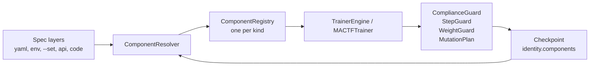

---

## 1. Purpose, non-goals, glossary, invariants

### 1.1 Purpose

A researcher or an operator must be able to do each of the following without editing
the framework, and without being able to break a compliance guarantee while doing it:

1. **Add** a scoring stage, a reward term, a training policy, an optimizer, a scheduler,
   a weight-update rule, a peer strategy, an RL function or a peer.
2. **Modify** the parameters of any of them, in a spec file, on the command line, over
   the API, or in code, at the granularity the component's mutability class allows.
3. **Create** new component types and register them by decorator, by module, by entry
   point or by import path.
4. **Replace** a registered component, subject to origin and lock rules.
5. **Delete** a registered component, a running peer's optimizer, or a peer.
6. **Inspect** exactly which components a run used, from a terminal, from the API and
   from a checkpoint.

### 1.2 Non-goals

| Not in scope | Why |
|---|---|
| Changing the precedence tiers, the rule catalog (`P1`..`P23`, `R*`), or `compliance.constrain` | These *are* the compliance guarantees. A component is allowed to compute *more* penalty, never less. |
| Changing `Orchestrator` | It is the frozen oracle (D1). |
| Sandboxing arbitrary plugin code | Importing a module executes it. The import allow-list (section 5.4) controls *which* modules may be imported from untrusted surfaces; it is not a sandbox. |
| Customizing the points engine's guards and bindings (`mactf/scoring/guards.py`) | They encode the framework.md clause for each rule. A plugin that redefined them would redefine what a rule means. Points *weights* stay configurable. |
| Hot-reloading source files | A component is swapped by name and spec, not by re-importing code. |
| A GUI | The API in section 16 is the surface a GUI would use. |

### 1.3 Glossary

| Term | Meaning |
|---|---|
| **Kind** | The category of a component: `scorer`, `reward_term`, `rl_function.<family>`, `optimizer`, `scheduler`, `peer_strategy`, `weight_update`, `aggregator`, `trainer_policy`, `peer_factory`. A kind owns one `ComponentRegistry`. |
| **Component** | A registered, named, versioned factory of one kind, with an origin and a mutability class (`Component`, section 3.3). |
| **Slot** | A place in a run where one component is used: `TRAINER.POLICY`, `SCORING.CHAIN[1]`, `TRAINER.OPTIMIZER.default`, `TRAINER.WEIGHT_UPDATE_OVERRIDES["root/team-a"]`. A slot has a kind, a name and a lock state. |
| **Spec** | The serializable description of a slot's component: `{type: "x", params: {...}}` or `{import: "pkg.mod:Class", params: {...}}` (section 5). |
| **Origin** | Where a component came from: `builtin`, `plugin`, `project`, `runtime`. Decides replaceability (section 4). |
| **Mutability class** | `static` (fixed for the life of a run), `episode` (may change at an episode boundary), `step` (may change between optimizer steps). |
| **Overlay** | A per-run, per-thread layer of registrations stacked over the process-wide registry; discarded when the run ends (section 3.5). |
| **Hub** | The process singleton `HUB` owning one registry per kind, the policy, and the overlay stack. |
| **Guard** | A wrapper that validates a component's *output* against an invariant. |
| **Fingerprint** | `{kind, name, origin, version, spec_hash, source_digest}`; what a checkpoint records about a component. |
| **Topology epoch** | A counter in the trainer that increments on every committed peer-tree mutation. |
| **Reference floor** | The recomputed lower bound on a peer's penalty for non-offsettable rules: `m_k * max(lambda_k, MIN_FLOOR_LAMBDA)` (section 6). |

### 1.4 Design invariants

Every later section cites these by number. Each one has at least one test in section 19.

| ID | Invariant | Enforced by |
|---|---|---|
| **I1** | *Default identity.* With no `COMPONENTS` configuration and no registration, every score, weight, parameter update, scorecard and checkpoint content hash is bit-identical to the pre-change framework. | `test_default_identity` (section 19.4); a built-in component never goes through a guard that can alter its output. |
| **I2** | *Compliance monotonicity.* For every peer and episode, a non-offsettable breach lowers `final_score` by at least the reference floor `sum_k m_k * max(lambda_k, MIN_FLOOR_LAMBDA)`, whatever the rewards are; an offsettable penalty is amplified by at least the reference Omega; and a peer that is void stays void. A reward stage may change *how much* reward is paid (it is bounded by `COMPLIANCE.REWARD_CEILING`), never what a breach costs. | `ComplianceGuard` (6.4). |
| **I3** | *Simplex validity.* Weights are non-negative, sum to 1 over eligible peers, respect `WEIGHT_FLOOR` and `WEIGHT_CAP`, and give a void or ineligible peer exactly 0. | `WeightGuard` (10.3) over `_project_bounded` (`mactf/coopetition/aggregation.py:366`). |
| **I4** | *Atomic mutation.* A tree mutation either commits completely or leaves the trainer unchanged. | `MutationPlan.apply` (12.4). |
| **I5** | *Explicit opt-in.* A component is available only if it is built in or is named by `COMPONENTS.MODULES`, a plugin entry point, a spec `import`, or a direct `register_*` call. | Section 4.2. |
| **I6** | *Reproducibility.* A checkpoint records the fingerprint of every non-built-in component in use, and restore refuses a missing one. | Section 14. |
| **I7** | *Mutability honored.* A component is never swapped more often than its class permits. | `Slot.swap` (4.4). |
| **I8** | *No silent fallback.* Unknown names and unknown params raise. | `ComponentRegistry.build` (3.4). |
| **I9** | *Per-run isolation.* Two runs in one process (the API runs several) never see each other's overlays. | `contextvars` overlay stack (3.5). |
| **I10** | *Built-ins are immutable by default.* Replacing a built-in needs `COMPONENTS.ALLOW_BUILTIN_OVERRIDE` and is logged as `W001`. | `ComponentRegistry.register` (3.4). |

---

## 2. Current-state audit

Everything below was read in the tree, not inferred.

### 2.1 Extension points

| Extension point | Location | Open? | Gap |
|---|---|---|---|
| Scorer types | `mactf/scoring/registry.py:26-50` (`SCORER_TYPES`, `register_scorer`) | Add only | No `unregister`, no origin, no scoping, no output guard. A custom stage is trusted: `_compose` reads its `amounts`, `omega` and `void_rules` as given (`mactf/scoring/pipeline.py:499-550`). |
| Scorer chain | `mactf/scoring/pipeline.py:73-146` (`__init__`, add/remove) | Yes | One stage per `ScoringKind`; `REQUIRED_KINDS` fixes REWARD, PENALTY, WARNING. Nothing checks a replacement stage against the floor. |
| Non-offsettable set | `mactf/scoring/pipeline.py:329`, `mactf/scoring/penalty.py:52-56`, `mactf/conf.py:672-678` | Configurable | `PenaltyScorer.non_offsettable` returns the configured set verbatim; `conf.py` rejects a missing rule at config load, but a programmatic `score_config` bypasses it. `HierarchicalScorer.__init__` (`mactf/scoring/hierarchy.py:145-172`, `_own_void` at `296-317`) lets a non-empty custom set *narrow* the catalog default. |
| Penalty lambdas | `mactf/conf.py` (`PENALTY_LAMBDAS`), `mactf/scoring/penalty.py:70-118` | Configurable | Only negatives are rejected. A lambda of `0` zeroes a non-offsettable floor. |
| RL functions | `mactf/rl/functions/registry.py:28-90` (`FUNCTION_TYPES`, `register_function`) | Add only | 12 families. No `unregister`, no decorator form, no per-peer override, no contract probe. `build_from_kwargs` (`mactf/rl/functions/_spec.py`) rejects unknown keys, which is correct and is kept. |
| Rollup strategies | `mactf/scoring/hierarchy.py:97-106` (`ROLLUP_STRATEGIES`, `ROLLUP_TYPES`), `build_rollup` at `109-` | **Closed** (second table) | `build_rollup` checks its *own* dict, so a rollup registered through `register_function("rollup", ...)` is rejected by `HIERARCHY.ROLLUP`. The dict also holds a `kappa_weighted` alias the `rl_function.rollup` registry lacks. Section 8.6 merges the two. |
| Points guards and bindings | `mactf/scoring/guards.py:474-515` (`GUARDS`), `603` (`BINDINGS`) | Closed on purpose | The points engine is a pure projection of the ledger that encodes framework.md clauses rule by rule. Customizing it would let a plugin redefine what a rule *means*, so it stays built in (non-goal in section 1.2, open question Q1). Its weights remain configuration (`SCORING.POINTS`). |
| Peer strategies | `mactf/coopetition/strategy.py:376-422` (`PEER_STRATEGIES`, `build_peer_strategy`) | **Closed** | Plain dict, no `register_*`. `mactf/conf.py:706-712` hard-codes `_PEER_STRATEGY_NAMES`; serializers use `choices=[...]`. |
| Weight updates | `mactf/coopetition/weights.py:464-521` (`WEIGHT_STRATEGIES`, `build_weight_update`) | **Closed** | Same. `_WEIGHT_STRATEGY_NAMES` in `mactf/conf.py:706-712`. |
| Aggregator | `mactf/coopetition/aggregation.py:44-298` | Constructor only | No name-based selection. `Aggregator.aggregate` does **not** project weights; only `compute_weights` does, so a custom strategy that bypasses it can hand `aggregate` an invalid simplex. |
| Optimizers | `mactf/training/optimizer.py:66-92` (`OptimizerBackend`), `1129-1193` (`from_spec`, `from_block`) | Callable only | Three backends are chosen by `if` chains in `from_spec`; a fourth means editing the file. Routing (`Route`, `ParamGroupRouter`, `649-845`) is configurable but cannot be hot-swapped. |
| Schedulers | `mactf/training/optimizer.py:929-948` (`attach_scheduler`) | Closed | A fixed set of names. |
| Training policy | `mactf/training/trainer.py:349`, `1506-1541` (`train_step`), `1543-1605` (`_builtin_step`), `1613-1631` (`_apply_custom_loss`) | Yes (callable/protocol) | A custom `train_step` is trusted: no finite check, no required compliance term, no quarantine. |
| Tree | `mactf/coopetition/tree.py:571-640` (`add_node`, `remove_node`) | Structural only | The tree can be edited, but the trainer's optimizers, controllers, weights and group aggregators are not rebound. |
| Engine | `mactf/management/driver.py:162-190`, `mactf/orchestration/live.py:436-781` | **Closed** | `RunDriver` and `RunManager` drive `Orchestrator` only. `MACTFTrainer` is reachable only from code. |
| Checkpoint | `mactf/training/trainer.py:1921-1947` (`_observe`), `mactf/orchestration/checkpoint_v2.py:56-114` | Gap | The periodic checkpoint is saved with a `CheckpointContext` that carries no `identity_extra`, so trainer-owned state is missing from periodic checkpoints. |

### 2.2 Dead settings

`TRAINER.PEER_STRATEGY` and `TRAINER.WEIGHT_UPDATE` are validated by
`mactf/conf.py:739-745` and declared in `TRAINER_DEFAULTS` (`mactf/conf.py:37-56`), but:

- `MACTFTrainer.build` takes the strategy from its **constructor argument**
  (`self._peer_strategy_spec`, `self._weight_update_spec`, `mactf/training/trainer.py:611-615`)
  and never reads the settings, and
- `Orchestrator` has no strategy slot at all.

A user who sets `TRAINER.PEER_STRATEGY: cooperative` in YAML gets `independent` or
`kappa_softmax` and no warning. Section 11.5 makes the setting real; section 17 adds
check `mactf.components.W002` for the transition window.

### 2.3 The four compliance holes this document closes

| # | Hole | Where | Fix | Section |
|---|---|---|---|---|
| H1 | `SCORING.NON_OFFSETTABLE` can be a subset | `penalty.py:52-56` returns the configured set verbatim | `PenaltyScorer` and `HierarchicalScorer` always use `configured | catalog` | 6.6 |
| H2 | A lambda of `0` zeroes a floor | `conf.py` rejects only negatives | `PENALTY_LAMBDAS[rule] >= COMPLIANCE.MIN_FLOOR_LAMBDA` for every non-offsettable rule | 6.6 |
| H3 | A custom stage's output is trusted | `_compose` copies `amounts`, `omega`, `rules` | `ComplianceGuard` recomputes the reference floor and compares | 6.4 |
| H4 | A custom `train_step` is trusted | `train_step` accepts any `StepResult` | `StepGuard` | 7.4 |

### 2.4 What stays untouched

`ScoringPipeline._walk` (`pipeline.py:472-492`), `compliance.constrain`
(`mactf/compliance.py:108-183`), `_INHERITED_VOID_FLOOR = 1000.0`
(`mactf/compliance.py:35`), `PeerTree.branch_void` (`tree.py:1013-1029`), the precedence
resolver and the points engine are not modified. The guards sit *around* them.

---

## 3. The unified component model

### 3.1 Package layout

```text
mactf/components/
    __init__.py        public surface: HUB, register_*, unregister, get_component, Origin, ...
    kinds.py           ComponentKind, Origin, Mutability, KindSpec, KIND_SPECS
    reflect.py         constructor_keys, source_digest, canonical_json, spec_hash
    params.py          ParamSpec
    registry.py        Component, Overlay, HubPolicy, ComponentRegistry, Hub, HUB
    legacy.py          LegacyTable (MutableMapping view over a registry)
    decorators.py      register_scorer, register_function, register_optimizer, ...
    contracts.py       one contract function per kind (register-time and instance-time)
    resolver.py        ComponentSpec, ComponentResolver, import allow-list      (section 5)
    slots.py           Slot, SlotTable, swap rules                                (section 4)
    guards/
        compliance.py  ComplianceGuard, ReadOnlyLedger                           (section 6)
        step.py        StepGuard, VoidProbe, GuardedPolicy                       (section 7)
        weights.py     WeightGuard                                               (section 10)
    plugins.py         entry-point discovery, COMPONENTS.MODULES loading         (section 4.2)
    fingerprint.py     fingerprint(), diff()                                     (section 14)
```

`mactf/components/` imports from `mactf.exceptions` and the standard library only at
module import time. Contracts import `Scorer`, `PeerStrategy` and the rest lazily, inside
the contract function, so that `mactf.scoring`, `mactf.coopetition` and
`mactf.rl.functions` can import `mactf.components` without a cycle.

### 3.2 Kinds, origins, mutability (`mactf/components/kinds.py`)

```python
from __future__ import annotations

import enum
from dataclasses import dataclass, field
from typing import Any, Callable, Mapping

from ..exceptions import ValidationError

#: The twelve RL function families, in the order ``CAPABILITY_ORDER`` fixes
#: (``mactf/rl/functions/registry.py:56-70``).
RL_FAMILIES: tuple[str, ...] = (
    "value", "advantage", "loss", "rollup", "return", "reward",
    "regularization", "objective", "gradient", "metric", "action", "synthesis",
)


class Origin(str, enum.Enum):
    """Where a component came from. The rank decides who may replace whom."""

    BUILTIN = "builtin"
    PLUGIN = "plugin"
    PROJECT = "project"
    RUNTIME = "runtime"

    @property
    def rank(self) -> int:
        return _ORIGIN_RANK[self]


_ORIGIN_RANK: dict[Origin, int] = {
    Origin.BUILTIN: 0,
    Origin.PLUGIN: 1,
    Origin.PROJECT: 2,
    Origin.RUNTIME: 3,
}


class Mutability(str, enum.Enum):
    """How often the slot holding this component may be swapped."""

    STATIC = "static"      # fixed for the life of a run
    EPISODE = "episode"    # may change at an episode boundary
    STEP = "step"          # may change between optimizer steps

    @property
    def rank(self) -> int:
        return _MUTABILITY_RANK[self]


_MUTABILITY_RANK: dict[Mutability, int] = {
    Mutability.STATIC: 0,
    Mutability.EPISODE: 1,
    Mutability.STEP: 2,
}


class Boundary(str, enum.Enum):
    """The moment at which a swap is attempted. Same ordering as ``Mutability``."""

    RUN_START = "run_start"
    EPISODE = "episode"
    STEP = "step"

    @property
    def rank(self) -> int:
        return {"run_start": 0, "episode": 1, "step": 2}[self.value]


class ComponentKind(str, enum.Enum):
    SCORER = "scorer"
    REWARD_TERM = "reward_term"
    RL_FUNCTION = "rl_function"
    OPTIMIZER = "optimizer"
    SCHEDULER = "scheduler"
    PEER_STRATEGY = "peer_strategy"
    WEIGHT_UPDATE = "weight_update"
    AGGREGATOR = "aggregator"
    TRAINER_POLICY = "trainer_policy"
    PEER_FACTORY = "peer_factory"

    def kind_id(self, family: str | None = None) -> str:
        """``"scorer"``, ``"rl_function.loss"``, ... The registry key."""
        if self is ComponentKind.RL_FUNCTION:
            if family not in RL_FAMILIES:
                raise ValidationError(
                    f"rl_function needs a family, one of: {', '.join(RL_FAMILIES)}; got {family!r}"
                )
            return f"rl_function.{family}"
        if family is not None:
            raise ValidationError(f"kind {self.value!r} takes no family; got {family!r}")
        return self.value


def parse_kind_id(text: str) -> tuple[ComponentKind, str | None]:
    """Inverse of :meth:`ComponentKind.kind_id`."""
    head, _, family = str(text).partition(".")
    try:
        kind = ComponentKind(head)
    except ValueError:
        raise ValidationError(
            f"unknown component kind {text!r}; kinds: "
            + ", ".join(sorted(all_kind_ids()))
        ) from None
    if kind is ComponentKind.RL_FUNCTION:
        kind.kind_id(family or None)  # raises ValidationError for a missing or unknown family
        return kind, family
    if family:
        raise ValidationError(f"kind {head!r} takes no family; got {text!r}")
    return kind, None


@dataclass(frozen=True)
class KindSpec:
    """Static facts about one kind. ``contract`` and ``instance_contract`` return
    a list of problems (empty = fine); they live in :mod:`mactf.components.contracts`.
    """

    kind_id: str
    kind: ComponentKind
    family: str | None
    #: The root name used by ``COMPONENTS.LOCKED``: ``scorer``, ``weight_update``, ...
    slot: str
    default_mutability: Mutability
    contract: Callable[[Any], list[str]]
    instance_contract: Callable[[Any], list[str]]
    #: Dotted path of the legacy dict this kind mirrors, informational only.
    legacy_table: str | None = None
    description: str = ""
    #: ``builder(component, values, injected) -> instance``. ``None`` means "call the
    #: factory with ``**values, **injected``". A kind whose registered factories are not
    #: all directly callable (an optimizer may be a ``torch.optim.Optimizer`` subclass that
    #: needs parameters first) supplies one. Resolved in ``mactf.components.contracts``.
    builder: Callable[[Any, dict[str, Any], dict[str, Any]], Any] | None = None


# Filled by ``mactf.components.contracts`` at import; see section 3.7.
KIND_SPECS: dict[str, KindSpec] = {}


def all_kind_ids() -> tuple[str, ...]:
    ids = [k.value for k in ComponentKind if k is not ComponentKind.RL_FUNCTION]
    ids.extend(f"rl_function.{family}" for family in RL_FAMILIES)
    return tuple(ids)
```

`parse_kind_id` for an RL kind returns `(ComponentKind.RL_FUNCTION, family)`, running
the family check on the way.

Default mutability per kind (`KIND_DEFAULTS` in `contracts.py`):

| Kind | Default | Why |
|---|---|---|
| `scorer`, `reward_term` | `episode` | A scorer is read once per episode, in `score()`; changing it mid-episode would make two peers in one episode be judged by different rules. |
| `rl_function.loss`, `.regularization`, `.gradient`, `.metric` | `step` | Read on every step and carry no cross-step state beyond what they declare. |
| other `rl_function.*` | `episode` | Advantage, value, return, reward and rollup shape one episode's batch. |
| `optimizer` | `episode` | Swapping optimizers between steps of one episode mixes two update rules into one rollout; the swap also needs a state-migration policy (section 9.5). |
| `scheduler` | `episode` | Same reasoning, and the scheduler's step counter must line up with episodes. |
| `weight_update`, `peer_strategy` | `episode` | They run at epoch end. |
| `aggregator`, `trainer_policy` | `static` | They own controller state (`AdaptiveKappa`) or distillation state; a swap would orphan it. |
| `peer_factory` | `episode` | Only called when a tree mutation commits, which is an episode-boundary action. |

A component may declare a **stricter** class than its kind's default (a policy that
cannot be hot-swapped declares `static`) but never a looser one; `register` rejects a
`mutability` whose rank exceeds the kind default's rank.

### 3.3 Params, reflection, `Component` (`params.py`, `reflect.py`, `registry.py`)

```python
# mactf/components/params.py
from __future__ import annotations

from dataclasses import dataclass
from typing import Any

MISSING: Any = object()


@dataclass(frozen=True)
class ParamSpec:
    """Optional, declarative description of one constructor parameter.

    A component that supplies a ``params_schema`` gets typed validation *before* its
    constructor runs. A component that does not still gets unknown-key rejection from
    constructor reflection.
    """

    type: type | tuple[type, ...] | None = None
    default: Any = MISSING
    required: bool = False
    choices: tuple[Any, ...] = ()
    minimum: float | None = None
    maximum: float | None = None
    doc: str = ""

    def problems(self, name: str, value: Any) -> list[str]:
        found: list[str] = []
        if self.type is not None:
            allowed = self.type if isinstance(self.type, tuple) else (self.type,)
            numeric_only = all(t in (int, float) for t in allowed)
            if isinstance(value, bool) and numeric_only:
                found.append(f"{name}: expected a number, got bool")
            elif not isinstance(value, allowed):
                names = "/".join(t.__name__ for t in allowed)
                found.append(f"{name}: expected {names}, got {type(value).__name__}")
        if self.choices and value not in self.choices:
            found.append(f"{name}: {value!r} is not one of {list(self.choices)}")
        if isinstance(value, (int, float)) and not isinstance(value, bool):
            if self.minimum is not None and value < self.minimum:
                found.append(f"{name}: {value} is below the minimum {self.minimum}")
            if self.maximum is not None and value > self.maximum:
                found.append(f"{name}: {value} is above the maximum {self.maximum}")
        return found

    def describe(self) -> dict[str, Any]:
        payload: dict[str, Any] = {"required": self.required, "doc": self.doc}
        if self.type is not None:
            allowed = self.type if isinstance(self.type, tuple) else (self.type,)
            payload["type"] = "/".join(t.__name__ for t in allowed)
        if self.default is not MISSING:
            payload["default"] = self.default
        if self.choices:
            payload["choices"] = list(self.choices)
        if self.minimum is not None:
            payload["minimum"] = self.minimum
        if self.maximum is not None:
            payload["maximum"] = self.maximum
        return payload
```

```python
# mactf/components/reflect.py
from __future__ import annotations

import functools
import hashlib
import inspect
import json
from dataclasses import dataclass
from typing import Any, Mapping


@dataclass(frozen=True)
class Reflection:
    keys: frozenset[str]
    required: frozenset[str]
    var_keyword: bool


def reflect(factory: Any) -> Reflection:
    """Constructor keyword reflection for a class, function or ``functools.partial``.

    For a class, ``__init__`` signatures are read along the MRO. A base class is
    consulted only while the class before it takes ``**kwargs`` (it forwards), which is
    the rule ``mactf.scoring.base._constructor_keys`` and
    ``mactf.rl.functions._spec.constructor_keys`` already apply, so the three agree.
    ``var_keyword`` is true when the chain is still forwarding ``**kwargs`` after the
    last real ``__init__``: the factory then accepts arbitrary keys.
    """
    bound: frozenset[str] = frozenset()
    target = factory
    if isinstance(target, functools.partial):
        bound = frozenset(target.keywords)
        target = target.func
    keys: set[str] = set()
    required: set[str] = set()
    var_keyword = False
    named = (inspect.Parameter.POSITIONAL_OR_KEYWORD, inspect.Parameter.KEYWORD_ONLY)
    if inspect.isclass(target):
        forwarding = False
        for klass in target.__mro__:
            if klass is object:
                continue
            init = klass.__dict__.get("__init__")
            if init is None:
                continue
            forwarding = False
            for parameter in list(inspect.signature(init).parameters.values())[1:]:
                if parameter.kind is inspect.Parameter.VAR_KEYWORD:
                    forwarding = True
                elif parameter.kind in named and parameter.name not in keys:
                    keys.add(parameter.name)
                    if parameter.default is inspect.Parameter.empty:
                        required.add(parameter.name)
            if not forwarding:
                break
        var_keyword = forwarding
    else:
        for parameter in inspect.signature(target).parameters.values():
            if parameter.kind is inspect.Parameter.VAR_KEYWORD:
                var_keyword = True
            elif parameter.kind in named:
                keys.add(parameter.name)
                if parameter.default is inspect.Parameter.empty:
                    required.add(parameter.name)
    return Reflection(
        keys=frozenset(keys) - bound,
        required=frozenset(required) - bound,
        var_keyword=var_keyword,
    )

def constructor_keys(factory: Any) -> frozenset[str]:
    return reflect(factory).keys


def canonical_json(value: Any) -> str:
    """Stable JSON: sorted keys, no whitespace, floats via ``repr``."""
    return json.dumps(value, sort_keys=True, separators=(",", ":"), default=_default)


def _default(value: Any) -> Any:
    if isinstance(value, (set, frozenset)):
        return sorted(value, key=repr)
    if hasattr(value, "value") and hasattr(value, "name"):  # enum
        return value.value
    return repr(value)


def spec_hash(spec: Mapping[str, Any]) -> str:
    return hashlib.sha256(canonical_json(dict(spec)).encode("utf-8")).hexdigest()[:16]


def source_digest(factory: Any) -> str | None:
    """sha256 of the factory's source text, or ``None`` when it is not available
    (built-in extension, REPL, ``exec``). Only computed for non-built-in components.
    """
    target = factory.func if isinstance(factory, functools.partial) else factory
    try:
        text = inspect.getsource(target)
    except (OSError, TypeError):
        return None
    return hashlib.sha256(text.encode("utf-8")).hexdigest()[:16]
```

`Reflection.var_keyword` is `True` when the factory accepts arbitrary keywords (a function
with `**kwargs`, or a class whose whole `__init__` chain forwards `**kwargs` up to
`object`). Unknown-key rejection is then skipped for that component, and it should supply
a `params_schema` to get any validation. A class that names its keywords and forwards
`**kwargs` only to a base class that does not take them is validated against the union
of both sets of names, which is what the MRO walk computes.

```python
# mactf/components/registry.py  (part 1: data types)
from __future__ import annotations

import contextlib
import contextvars
import fnmatch
import itertools
import logging
import threading
from dataclasses import dataclass, field
from typing import Any, Callable, Generic, Iterator, Mapping, TypeVar

from ..exceptions import (
    ComponentBuildError,
    ComponentCollision,
    ComponentContractError,
    ComponentLocked,
    ComponentMissing,
    ComponentParamError,
    ValidationError,
)
from .kinds import KIND_SPECS, KindSpec, Mutability, Origin, RL_FAMILIES, all_kind_ids
from .params import ParamSpec
from .reflect import reflect, source_digest

log = logging.getLogger("mactf.components")
T = TypeVar("T")

#: Kinds whose names ``mactf/conf.py`` lower-cases before comparing (``conf.py:739-745``).
_LOWERCASE_KINDS = frozenset({"peer_strategy", "weight_update"})


@dataclass(frozen=True)
class Component:
    """One registered, named factory. Immutable: replacing means registering a new one."""

    kind: str
    name: str
    factory: Any
    origin: Origin
    mutability: Mutability
    version: str = "0"
    module: str = ""
    qualname: str = ""
    description: str = ""
    params_schema: Mapping[str, ParamSpec] | None = None
    capabilities: Mapping[str, Any] = field(default_factory=dict)
    #: Names of other components of any kind this one needs, as ``"kind:name"``.
    requires: frozenset[str] = frozenset()
    overrides_builtin: bool = False
    seq: int = 0

    # -- reflection ------------------------------------------------------
    def accepted_params(self) -> frozenset[str]:
        if self.params_schema is not None:
            return frozenset(self.params_schema)
        return reflect(self.factory).keys

    def check_params(self, params: Mapping[str, Any], *, ignore: frozenset[str] = frozenset()) -> list[str]:
        """Problems with ``params``, empty when fine. ``ignore`` names keys the
        resolver injects (for example ``config`` for a scorer) and are not user params."""
        problems: list[str] = []
        reflection = reflect(self.factory)
        accepted = self.accepted_params() | ignore
        schema = self.params_schema
        if not (reflection.var_keyword and schema is None):
            for key in sorted(params):
                if key not in accepted:
                    problems.append(
                        f"{self.name} does not accept {key!r}; accepted keys: {sorted(accepted - ignore)}"
                    )
        if schema is not None:
            for key, spec in schema.items():
                if key in params:
                    problems.extend(spec.problems(key, params[key]))
                elif spec.required:
                    problems.append(f"missing required parameter {key!r}")
        else:
            for key in sorted(reflection.required - ignore):
                if key not in params:
                    problems.append(f"missing required parameter {key!r}")
        return problems

    # -- reporting -------------------------------------------------------
    def fingerprint(self, *, spec_hash: str | None = None, with_source: bool = True) -> dict[str, Any]:
        payload: dict[str, Any] = {
            "kind": self.kind,
            "name": self.name,
            "origin": self.origin.value,
            "version": self.version,
        }
        if spec_hash is not None:
            payload["spec_hash"] = spec_hash
        if self.origin is not Origin.BUILTIN and with_source:
            payload["source_digest"] = source_digest(self.factory)
        if self.overrides_builtin:
            payload["overrides_builtin"] = True
        return payload

    def describe(self) -> dict[str, Any]:
        payload: dict[str, Any] = {
            "kind": self.kind,
            "name": self.name,
            "origin": self.origin.value,
            "mutability": self.mutability.value,
            "version": self.version,
            "class": self.qualname or getattr(self.factory, "__name__", repr(self.factory)),
            "module": self.module,
            "description": self.description,
            "kwargs": sorted(self.accepted_params()),
            "requires": sorted(self.requires),
            "overrides_builtin": self.overrides_builtin,
        }
        if self.params_schema is not None:
            payload["params"] = {k: v.describe() for k, v in self.params_schema.items()}
        if self.capabilities:
            payload["capabilities"] = dict(self.capabilities)
        return payload


class Overlay:
    """A per-run layer of registrations and hidden names, stacked over the base."""

    __slots__ = ("label", "_entries", "_hidden", "_lock")

    def __init__(self, label: str) -> None:
        self.label = label
        self._entries: dict[str, dict[str, Component]] = {}
        self._hidden: dict[str, set[str]] = {}
        self._lock = threading.RLock()

    def put(self, component: Component) -> None:
        with self._lock:
            self._entries.setdefault(component.kind, {})[component.name] = component
            self._hidden.get(component.kind, set()).discard(component.name)

    def hide(self, kind: str, name: str) -> None:
        with self._lock:
            self._entries.get(kind, {}).pop(name, None)
            self._hidden.setdefault(kind, set()).add(name)

    def entry(self, kind: str, name: str) -> Component | None:
        return self._entries.get(kind, {}).get(name)

    def is_hidden(self, kind: str, name: str) -> bool:
        return name in self._hidden.get(kind, ())

    def entries(self, kind: str) -> Mapping[str, Component]:
        return dict(self._entries.get(kind, {}))

    def hidden(self, kind: str) -> frozenset[str]:
        return frozenset(self._hidden.get(kind, ()))

    def is_empty(self) -> bool:
        return not any(self._entries.values()) and not any(self._hidden.values())


@dataclass(frozen=True)
class HubPolicy:
    """What the hub enforces. Resolved from ``COMPONENTS`` (section 15)."""

    allow_builtin_override: bool = False
    #: ``"kind:name"`` patterns (``fnmatch``); ``"scorer:*"`` locks a whole kind.
    locked: frozenset[str] = frozenset()
    strict_legacy: bool = False
    allow_import: bool = False
    import_allowlist: tuple[str, ...] = ()
    max_components_per_kind: int = 512

    def is_locked(self, kind: str, name: str) -> bool:
        key = f"{kind}:{name}"
        return any(fnmatch.fnmatchcase(key, pattern) for pattern in self.locked)
```

### 3.4 `ComponentRegistry`

```python
# mactf/components/registry.py  (part 2: the registry)
class ComponentRegistry(Generic[T]):
    """Name -> :class:`Component` for one kind. Thread-safe; overlay-aware."""

    def __init__(self, spec: KindSpec, hub: "Hub") -> None:
        self.spec = spec
        self._hub = hub
        self._entries: dict[str, Component] = {}
        self._lock = threading.RLock()
        self._frozen = False
        self._mirror: dict[str, Any] | None = None
        self._seq = itertools.count(1)

    @property
    def kind(self) -> str:
        return self.spec.kind_id

    # -- mirror (section 3.6) --------------------------------------------
    def attach_mirror(self, table: dict[str, Any]) -> None:
        """Keep ``table`` equal to the base layer's ``name -> factory``."""
        with self._lock:
            self._mirror = table
            dict.clear(table)
            for name, component in self._entries.items():
                dict.__setitem__(table, name, component.factory)

    # -- lookup ----------------------------------------------------------
    def find(self, name: str) -> Component | None:
        for overlay in reversed(self._hub.active_overlays()):
            if overlay.is_hidden(self.kind, name):
                return None
            found = overlay.entry(self.kind, name)
            if found is not None:
                return found
        return self._entries.get(name)

    def get(self, name: str) -> Component:
        found = self.find(str(name))
        if found is None:
            raise ComponentMissing(self.kind, str(name), self.names())
        return found

    def has(self, name: str) -> bool:
        return self.find(str(name)) is not None

    def names(self) -> list[str]:
        visible = dict.fromkeys(self._entries)
        for overlay in self._hub.active_overlays():
            for name in overlay.hidden(self.kind):
                visible.pop(name, None)
            for name in overlay.entries(self.kind):
                visible[name] = None
        return sorted(visible)

    def components(self) -> list[Component]:
        return [self.get(name) for name in self.names()]

    def capabilities(self) -> list[dict[str, Any]]:
        return [component.describe() for component in self.components()]

    # -- registration ----------------------------------------------------
    def register(
        self,
        name: str,
        factory: Any,
        *,
        origin: Origin | None = None,
        mutability: Mutability | None = None,
        version: str = "0",
        description: str = "",
        params_schema: Mapping[str, ParamSpec] | None = None,
        capabilities: Mapping[str, Any] | None = None,
        requires: Any = (),
        replace: bool = False,
        scope: str = "global",
        via: str = "api",
    ) -> Component:
        origin = origin or self._hub.default_origin()
        name = self._check_name(name)
        problems = self.spec.contract(factory)
        if problems:
            raise ComponentContractError(self.kind, name, problems)
        default = self.spec.default_mutability
        chosen = mutability or default
        if chosen.rank > default.rank:
            raise ComponentContractError(
                self.kind, name,
                [f"mutability {chosen.value!r} is looser than the kind default {default.value!r}"],
            )
        policy = self._hub.effective_policy()
        if policy.is_locked(self.kind, name):
            raise ComponentLocked(self.kind, name, "the slot is locked by COMPONENTS.LOCKED")
        with self._lock:
            if scope == "run":
                overlay = self._hub.current_overlay(required=True)
                existing = self.find(name)
            else:
                if self._frozen:
                    raise ComponentLocked(self.kind, name, "the registry is frozen")
                if len(self._entries) >= policy.max_components_per_kind and name not in self._entries:
                    raise ComponentContractError(
                        self.kind, name,
                        [f"registry is full ({policy.max_components_per_kind} components)"],
                    )
                overlay = None
                existing = self._entries.get(name)
            overrides = self._check_replace(name, existing, origin, replace, policy, via)
            component = Component(
                kind=self.kind,
                name=name,
                factory=factory,
                origin=origin,
                mutability=chosen,
                version=str(version),
                module=getattr(factory, "__module__", "") or "",
                qualname=getattr(factory, "__qualname__", "") or "",
                description=description or (getattr(factory, "__doc__", "") or "").strip().split("\n")[0],
                params_schema=dict(params_schema) if params_schema is not None else None,
                capabilities=dict(capabilities or {}),
                requires=frozenset(requires or ()),
                overrides_builtin=overrides,
                seq=next(self._seq),
            )
            if overlay is not None:
                overlay.put(component)
            else:
                self._entries[name] = component
                self._mirror_set(name, factory)
                self._hub._bump()
        if overrides:
            log.warning("W001 %s:%s replaces a built-in component (origin=%s)", self.kind, name, origin.value)
        return component

    def _check_replace(
        self, name: str, existing: Component | None, origin: Origin,
        replace: bool, policy: HubPolicy, via: str,
    ) -> bool:
        if existing is None:
            return False
        if not replace:
            raise ComponentCollision(
                self.kind, name,
                f"already registered by origin {existing.origin.value} "
                f"({existing.module}.{existing.qualname}); pass replace=True to override",
            )
        if existing.origin is Origin.BUILTIN:
            legacy_ok = via == "legacy" and not policy.strict_legacy
            if not (policy.allow_builtin_override or legacy_ok):
                raise ComponentCollision(
                    self.kind, name,
                    "is built in; replacing it needs COMPONENTS.ALLOW_BUILTIN_OVERRIDE",
                )
            if via == "legacy":
                log.warning("W005 %s:%s replaced through a legacy registry write", self.kind, name)
            return True
        if origin.rank < existing.origin.rank:
            raise ComponentCollision(
                self.kind, name,
                f"origin {origin.value} cannot replace a component from origin {existing.origin.value}",
            )
        return False

    def unregister(self, name: str, *, scope: str = "global", via: str = "api") -> Component:
        policy = self._hub.effective_policy()
        if policy.is_locked(self.kind, name):
            raise ComponentLocked(self.kind, name, "the slot is locked by COMPONENTS.LOCKED")
        with self._lock:
            if scope == "run":
                overlay = self._hub.current_overlay(required=True)
                existing = self.find(name)
                if existing is None:
                    raise ComponentMissing(self.kind, name, self.names())
                self._check_unregister(existing, policy, via)
                overlay.hide(self.kind, name)
                return existing
            if self._frozen:
                raise ComponentLocked(self.kind, name, "the registry is frozen")
            existing = self._entries.get(name)
            if existing is None:
                raise ComponentMissing(self.kind, name, self.names())
            self._check_unregister(existing, policy, via)
            del self._entries[name]
            self._mirror_del(name)
            self._hub._bump()
            return existing

    def _check_unregister(self, existing: Component, policy: HubPolicy, via: str) -> None:
        if existing.origin is Origin.BUILTIN:
            legacy_ok = via == "legacy" and not policy.strict_legacy
            if not (policy.allow_builtin_override or legacy_ok):
                raise ComponentLocked(
                    self.kind, existing.name,
                    "is built in; removing it needs COMPONENTS.ALLOW_BUILTIN_OVERRIDE",
                )

    def freeze(self) -> None:
        with self._lock:
            self._frozen = True

    def unfreeze(self) -> None:
        with self._lock:
            self._frozen = False

    @property
    def frozen(self) -> bool:
        return self._frozen

    # -- construction ----------------------------------------------------
    def build(
        self,
        name: str,
        params: Mapping[str, Any] | None = None,
        *,
        inject: Mapping[str, Any] | None = None,
    ) -> T:
        """Validate ``params``, call the factory, check the instance contract.

        ``inject`` carries keys the framework offers (a scorer's ``config``, a warning
        stage's ``warning_policy``); the factory receives those it declares, and a spec may
        not set them.
        """
        component = self.get(name)
        values = dict(params or {})
        reflection = reflect(component.factory)
        accepted = component.accepted_params()
        takes_any = reflection.var_keyword and component.params_schema is None
        # Injection is an offer: the factory receives only the keys it declares.
        extra = {
            key: value for key, value in dict(inject or {}).items()
            if key in accepted or takes_any
        }
        clash = sorted(set(values) & set(extra))
        if clash:
            raise ComponentParamError(
                self.kind, component.name,
                [f"parameter {key!r} is supplied by the framework and cannot be set in a spec"
                 for key in clash],
            )
        problems = component.check_params(values, ignore=frozenset(extra))
        if problems:
            raise ComponentParamError(self.kind, component.name, problems)
        try:
            builder = self.spec.builder
            if builder is not None:
                instance = builder(component, values, extra)
            else:
                instance = component.factory(**values, **extra)
        except (TypeError, ValueError) as error:
            raise ComponentBuildError(self.kind, component.name, error) from error
        bad = self.spec.instance_contract(instance)
        if bad:
            raise ComponentContractError(self.kind, component.name, bad)
        return instance

    # -- helpers ---------------------------------------------------------
    def _check_name(self, name: str) -> str:
        """The rule every ``register_*`` already applies: ``name.replace("_", "").isalnum()``."""
        text = str(name)
        if not text or not text.replace("_", "").isalnum():
            noun = "function" if self.spec.family else self.kind
            raise ComponentContractError(
                self.kind, text,
                [f"invalid {noun} type name {text!r}: letters, digits and underscores only"],
            )
        if self.kind in _LOWERCASE_KINDS and text != text.lower():
            raise ComponentContractError(
                self.kind, text,
                ["names of this kind are lower-case: the configuration layer lower-cases them"],
            )
        return text

    def _mirror_set(self, name: str, factory: Any) -> None:
        if self._mirror is not None:
            dict.__setitem__(self._mirror, name, factory)

    def _mirror_del(self, name: str) -> None:
        if self._mirror is not None:
            dict.pop(self._mirror, name, None)
```

`ComponentBuildError` wraps only `TypeError`/`ValueError` from the factory. A
`ValidationError` or `ImproperlyConfigured` raised by the component's own constructor
is a better message than anything this layer can write and propagates unchanged
(invariant I8: the user sees the component's own reason).

### 3.5 `Hub`, overlays and per-run activation

```python
# mactf/components/registry.py  (part 3: the hub)
_OVERLAYS: contextvars.ContextVar[tuple[Overlay, ...]] = contextvars.ContextVar(
    "mactf_component_overlays", default=()
)
_POLICY: contextvars.ContextVar[HubPolicy | None] = contextvars.ContextVar(
    "mactf_component_policy", default=None
)
_DEFAULT_ORIGIN: contextvars.ContextVar[Origin] = contextvars.ContextVar(
    "mactf_component_default_origin", default=Origin.PROJECT
)


class Hub:
    """Process singleton: one registry per kind, a policy and an overlay stack."""

    def __init__(self) -> None:
        self._registries: dict[str, ComponentRegistry[Any]] = {}
        self._policy = HubPolicy()
        self._lock = threading.RLock()
        self._generation = 0

    # -- registries ------------------------------------------------------
    def registry(self, kind_id: str) -> ComponentRegistry[Any]:
        with self._lock:
            found = self._registries.get(kind_id)
            if found is None:
                spec = KIND_SPECS.get(kind_id)
                if spec is None:
                    raise ValidationError(
                        f"unknown component kind {kind_id!r}; kinds: "
                        + ", ".join(all_kind_ids())
                    )
                found = ComponentRegistry(spec, self)
                self._registries[kind_id] = found
            return found

    def kinds(self) -> tuple[str, ...]:
        return all_kind_ids()

    # -- policy ----------------------------------------------------------
    @property
    def policy(self) -> HubPolicy:
        return self._policy

    def configure(self, policy: HubPolicy) -> None:
        with self._lock:
            self._policy = policy

    def effective_policy(self) -> HubPolicy:
        return _POLICY.get() or self._policy

    # -- default origin --------------------------------------------------
    def default_origin(self) -> Origin:
        """The origin a ``register_*`` call gets when it names none: ``PROJECT`` unless
        a loader (plugin discovery, a runtime spec import) has scoped another one."""
        return _DEFAULT_ORIGIN.get()

    @contextlib.contextmanager
    def loading(self, origin: Origin) -> Iterator[None]:
        token = _DEFAULT_ORIGIN.set(origin)
        try:
            yield
        finally:
            _DEFAULT_ORIGIN.reset(token)

    # -- overlays --------------------------------------------------------
    def active_overlays(self) -> tuple[Overlay, ...]:
        return _OVERLAYS.get()

    def current_overlay(self, *, required: bool = False) -> Overlay | None:
        stack = _OVERLAYS.get()
        if stack:
            return stack[-1]
        if required:
            raise ComponentLocked("overlay", "-", "no run scope is active; use HUB.scoped()")
        return None

    @contextlib.contextmanager
    def scoped(self, label: str = "run", *, policy: HubPolicy | None = None) -> Iterator[Overlay]:
        """Activate a fresh overlay for the current thread/task; discard it on exit."""
        overlay = Overlay(label)
        stack_token = _OVERLAYS.set(_OVERLAYS.get() + (overlay,))
        policy_token = _POLICY.set(policy) if policy is not None else None
        try:
            yield overlay
        finally:
            if policy_token is not None:
                _POLICY.reset(policy_token)
            _OVERLAYS.reset(stack_token)

    def activate(self, overlay: Overlay) -> contextvars.Token:
        """Re-enter an existing overlay (a worker thread that must see a run's parts)."""
        return _OVERLAYS.set(_OVERLAYS.get() + (overlay,))

    def deactivate(self, token: contextvars.Token) -> None:
        _OVERLAYS.reset(token)

    # -- generation, snapshots -------------------------------------------
    def _bump(self) -> None:
        self._generation += 1

    @property
    def generation(self) -> int:
        return self._generation

    def freeze_all(self) -> None:
        for kind_id in all_kind_ids():
            self.registry(kind_id).freeze()

    def snapshot(self) -> dict[str, dict[str, dict[str, Any]]]:
        """Every visible component of every kind: the data behind ``mactf components list``."""
        return {kind_id: {c.name: c.describe() for c in self.registry(kind_id).components()}
                for kind_id in all_kind_ids()}


HUB = Hub()
```

**Threads.** `contextvars` propagate into `asyncio` tasks and into
`contextvars.copy_context().run`, but a plain `threading.Thread` starts with an empty
context. `RunManager._run` therefore captures `ctx = contextvars.copy_context()` on the
request thread and starts its worker as `Thread(target=ctx.run, args=(self._run, ...))`
(section 13.4). Without that, a run would silently lose its overlay.

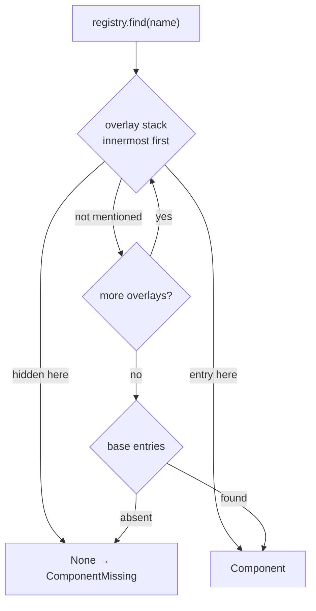

### 3.6 Backward-compatible views (`mactf/components/legacy.py`)

The dicts the rest of the code and the tests already import stay as objects with the same
names. Each becomes a `LegacyTable`: a real `dict` subclass (so `isinstance(x, dict)`,
`json.dumps`, `sorted(x)` and `dict(x)` keep working) whose **reads** are plain dict reads
of a mirror kept in step by the registry, and whose **writes** are routed through the
registry so they get origin tracking, collision rules and lock checks.

```python
# mactf/components/legacy.py
from __future__ import annotations

from typing import Any, Iterable, Mapping

from .kinds import Origin
from .registry import HUB, ComponentRegistry

_UNSET: Any = object()


class LegacyTable(dict):
    """``name -> factory`` view of the *base layer* of one registry.

    Overlays are deliberately invisible here: this object is shared, process-wide state
    and a run's private parts must not leak into it. Framework code reads the registry
    (``HUB.registry(kind).get``); only third-party code that still holds the dict sees
    this view.
    """

    __slots__ = ("_kind",)

    def __init__(self, kind_id: str, builtins: Mapping[str, Any] | None = None) -> None:
        super().__init__()
        self._kind = kind_id
        registry = self._registry()
        registry.attach_mirror(self)
        for name, factory in (builtins or {}).items():
            registry.register(name, factory, origin=Origin.BUILTIN)

    def _registry(self) -> ComponentRegistry[Any]:
        return HUB.registry(self._kind)

    # -- writes route through the registry --------------------------------
    def __setitem__(self, name: str, factory: Any) -> None:
        self._registry().register(
            name, factory, origin=Origin.RUNTIME, replace=name in self, via="legacy"
        )

    def __delitem__(self, name: str) -> None:
        if name not in self:
            raise KeyError(name)
        self._registry().unregister(name, via="legacy")

    def pop(self, name: str, default: Any = _UNSET) -> Any:
        if name not in self:
            if default is _UNSET:
                raise KeyError(name)
            return default
        factory = dict.__getitem__(self, name)
        self._registry().unregister(name, via="legacy")
        return factory

    def popitem(self) -> tuple[str, Any]:
        if not self:
            raise KeyError("popitem(): table is empty")
        name = next(reversed(list(self)))
        return name, self.pop(name)

    def clear(self) -> None:
        for name in list(self):
            self._registry().unregister(name, via="legacy")

    def setdefault(self, name: str, default: Any = None) -> Any:
        if name not in self:
            self[name] = default
        return dict.__getitem__(self, name)

    def update(self, *args: Any, **kwargs: Any) -> None:
        merged: dict[str, Any] = dict(*args, **kwargs)
        for name, factory in merged.items():
            self[name] = factory

    def __ior__(self, other: Mapping[str, Any]) -> "LegacyTable":
        self.update(other)
        return self

    def __reduce__(self) -> tuple[Any, ...]:
        # Pickle as a plain snapshot; a table cannot be re-attached in another process.
        return (dict, (dict(self),))

    def copy(self) -> dict[str, Any]:
        return dict(self)
```

Registry writes to the mirror use `dict.__setitem__` / `dict.pop` directly
(`ComponentRegistry._mirror_set`, `_mirror_del`), which bypass the overrides above and so
cannot recurse.

**Where the views are installed (Phase P0).**

| Today | After |
|---|---|
| `SCORER_TYPES = {...}` (`mactf/scoring/registry.py:26`) | `SCORER_TYPES = LegacyTable("scorer", {...})` |
| `PEER_STRATEGIES = {...}` (`mactf/coopetition/strategy.py:376`) | `LegacyTable("peer_strategy", {...})` |
| `WEIGHT_STRATEGIES = {...}` (`mactf/coopetition/weights.py:464`) | `LegacyTable("weight_update", {...})` |
| `VALUE_FUNCTION_TYPES`, `ADVANTAGE_FUNCTION_TYPES`, `LOSS_FUNCTION_TYPES` in their modules; the `rollup` dict in `registry.py:32-39`; the eight `*_TYPES` dicts in `rl/functions/support.py:759-805` | `LegacyTable("rl_function.<family>", {...})` at the same definition site, so the aliases in `registry.py:43-52` (`VALUE_TYPES = VALUE_FUNCTION_TYPES`, ...) stay the same object |
| `FUNCTION_TYPES: dict[str, dict[str, type]]` (`registry.py:28-40`) | Unchanged: a plain outer dict whose values are now `LegacyTable`s |

`register_scorer(name, cls, replace=...)` and `register_function(family, name, cls, replace=...)`
keep their signatures. Called with a positional class they run with `via="legacy"` (so
the legacy built-in-replacement tolerance in `_check_replace` applies and `W005` is
logged); called as decorators they run with `via="api"`. Section 3.8 defines them.

**Ordering constraint.** `LegacyTable(...)` registers the built-ins immediately, which runs
each kind's `contract`, which imports the base class it checks (`Scorer`, `PeerStrategy`,
`Aggregator`). The table must therefore be constructed at the *bottom* of the module that
defines the classes it lists, where the dict literal already sits today. For
`SCORER_TYPES` the `hierarchy` entry is a built-in whose `kind` is
`ScoringKind.HIERARCHY`; `scorer_contract` accepts that kind and
`ScoringPipeline._validate_chain` continues to reject it anywhere but the root.

Behavior that is **not** preserved, and why it is safe: a legacy write that replaced a
built-in used to be silent; it now logs `W001`/`W005`. A legacy write of an invalid
factory (not a `Scorer` subclass, abstract) used to fail later at build time; it now fails
at write time with `ComponentContractError`. Both are strictly earlier failures of the
same wrong input.

### 3.7 Contracts per kind (`mactf/components/contracts.py`)

A contract has two functions: `contract(factory)` at registration and
`instance_contract(instance)` after construction. Both return a list of problem strings.
They import framework classes lazily.

```python
# mactf/components/contracts.py
from __future__ import annotations

import inspect
from typing import Any, Callable

from .kinds import (
    KIND_SPECS, RL_FAMILIES, ComponentKind, KindSpec, Mutability, all_kind_ids,
)
from .reflect import reflect


def _is_class(factory: Any) -> bool:
    return inspect.isclass(factory)


def _callable_problems(factory: Any, what: str) -> list[str]:
    if not callable(factory):
        return [f"{what} must be a class or a callable factory, got {type(factory).__name__}"]
    return []


def _method_problems(cls: Any, methods: tuple[str, ...]) -> list[str]:
    found: list[str] = []
    for method in methods:
        attr = getattr(cls, method, None)
        if not callable(attr):
            found.append(f"missing method {method}()")
        elif getattr(attr, "__isabstractmethod__", False):
            found.append(f"abstract method {method}() is not implemented")
    return found


# -- scorer -----------------------------------------------------------------
def scorer_contract(factory: Any) -> list[str]:
    from ..scoring.base import Scorer, ScoringKind

    if not _is_class(factory) or not issubclass(factory, Scorer):
        return [f"{factory!r} is not a Scorer subclass (mactf.scoring.base.Scorer)"]
    problems: list[str] = []
    if inspect.isabstract(factory):
        problems.append(f"abstract methods not implemented: {sorted(factory.__abstractmethods__)}")
    kind = getattr(factory, "kind", None)
    if not isinstance(kind, ScoringKind):
        problems.append("class attribute 'kind' must be a ScoringKind")
    elif kind is ScoringKind.PIPELINE:
        problems.append(
            "kind PIPELINE is reserved for the built-in pipeline; a custom stage is "
            "REWARD, PENALTY or WARNING (HIERARCHY is accepted but is root-only, "
            "as `ScoringPipeline._validate_chain` already enforces)"
        )
    order = getattr(factory, "order", None)
    if not isinstance(order, int) or isinstance(order, bool) or order < 0:
        problems.append("class attribute 'order' must be a non-negative int")
    return problems


def scorer_instance_contract(instance: Any) -> list[str]:
    from ..scoring.base import Scorer

    return [] if isinstance(instance, Scorer) else [f"built {type(instance).__name__}, not a Scorer"]


# -- reward term -------------------------------------------------------------
def reward_term_contract(factory: Any) -> list[str]:
    if not _is_class(factory):
        return ["a reward term must be a class"]
    problems = _method_problems(factory, ("contribution",))
    rules = getattr(factory, "rule_ids", None)
    if not isinstance(rules, (frozenset, set, tuple, list)) or not rules:
        problems.append("class attribute 'rule_ids' must be a non-empty collection of rule ids")
    return problems


def reward_term_instance_contract(instance: Any) -> list[str]:
    return [] if callable(getattr(instance, "contribution", None)) else ["no contribution() method"]


# -- rl functions -------------------------------------------------------------
#: The entry method each family's protocol defines (verified against
#: ``rl/functions/{value,advantage,loss,rollup,support}.py``).
RL_ENTRY: dict[str, str] = {
    "value": "__call__", "advantage": "__call__", "loss": "compute", "rollup": "rollup",
    "return": "__call__", "reward": "__call__", "regularization": "__call__",
    "objective": "__call__", "gradient": "__call__", "metric": "__call__",
    "action": "__call__", "synthesis": "__call__",
}


def rl_function_contract(family: str) -> Callable[[Any], list[str]]:
    def contract(factory: Any) -> list[str]:
        if not _is_class(factory):
            return [f"{factory!r} is not a class"]
        entry = RL_ENTRY[family]
        problems = _method_problems(factory, (entry,))
        if family == "loss":
            required = getattr(factory, "required_fields", None)
            if not isinstance(required, (frozenset, set)):
                problems.append("a loss declares required_fields as a frozenset of batch keys")
        return problems

    return contract


def rl_function_instance_contract(family: str) -> Callable[[Any], list[str]]:
    entry = RL_ENTRY[family]

    def contract(instance: Any) -> list[str]:
        return [] if callable(getattr(instance, entry, None)) else [f"no {entry}() method"]

    return contract


# -- optimizer / scheduler -----------------------------------------------------
def optimizer_contract(factory: Any) -> list[str]:
    """Two registrable forms, both classes: a ``BackendBase`` subclass (the shared base of
    ``TorchOptimizer``, ``ScipyOptimizer``, ``CallableOptimizer`` and ``ParamGroupRouter``,
    exported by section 9.1) or a ``torch.optim.Optimizer`` subclass, which the builder
    wraps in a ``TorchOptimizer``. ``OptimizerBackend`` is a structural ``Protocol`` with
    property members, so ``issubclass`` cannot be used against it."""
    import torch

    from ..training.optimizer import BackendBase

    if not _is_class(factory):
        return [f"{factory!r} is not a class"]
    if issubclass(factory, BackendBase) or issubclass(factory, torch.optim.Optimizer):
        return []
    return [
        f"{factory!r} is neither a subclass of mactf.training.optimizer.BackendBase "
        "nor of torch.optim.Optimizer"
    ]


#: Names under which a torch optimizer receives its parameters. ``MACTFOptimizer`` binds
#: parameters after construction, so the resolver offers a placeholder under these names.
BIND_KEYS: frozenset[str] = frozenset({"params", "parameters"})


def optimizer_builder(component: Any, values: dict[str, Any], injected: dict[str, Any]) -> Any:
    """Instantiate a registered optimizer factory into a ``BackendBase``."""
    import torch

    from ..training.optimizer import BackendBase, TorchOptimizer

    factory = component.factory
    if issubclass(factory, torch.optim.Optimizer):
        # A torch optimizer takes its parameters as the first argument, named ``params``
        # (or ``parameters``). The facade binds them later, so the resolver offers a
        # placeholder under both names only to let constructor reflection treat the
        # argument as framework-supplied (section 9.2.1); it never reaches the class here.
        injected = {k: v for k, v in injected.items() if k not in BIND_KEYS}
        lr = values.pop("lr", None)
        weight_decay = float(values.pop("weight_decay", 0.0))
        return TorchOptimizer(factory, lr=lr, weight_decay=weight_decay, **values, **injected)
    return factory(**values, **{k: v for k, v in injected.items() if k not in BIND_KEYS})


def optimizer_instance_contract(instance: Any) -> list[str]:
    from ..training.optimizer import BackendBase

    return [] if isinstance(instance, BackendBase) else [f"built {type(instance).__name__}"]


def scheduler_contract(factory: Any) -> list[str]:
    problems = _callable_problems(factory, "a scheduler factory")
    if problems:
        return problems
    keys = reflect(factory)
    if "optimizer" not in keys.keys and not keys.var_keyword:
        problems.append("a scheduler factory takes the torch optimizer as its 'optimizer' argument")
    return problems


def scheduler_instance_contract(instance: Any) -> list[str]:
    return [] if callable(getattr(instance, "step", None)) else ["no step() method"]


# -- strategies, weights, aggregator, policy, peer factory ----------------------
def peer_strategy_contract(factory: Any) -> list[str]:
    from ..coopetition.strategy import PeerStrategy

    if not _is_class(factory) or not issubclass(factory, PeerStrategy):
        return [f"{factory!r} is not a subclass of mactf.coopetition.strategy.PeerStrategy"]
    problems: list[str] = []
    if inspect.isabstract(factory):
        problems.append(f"abstract methods not implemented: {sorted(factory.__abstractmethods__)}")
    if not isinstance(getattr(factory, "name", None), str):
        problems.append("class attribute 'name' must be a str")
    return problems


def peer_strategy_instance_contract(instance: Any) -> list[str]:
    from ..coopetition.strategy import PeerStrategy

    return [] if isinstance(instance, PeerStrategy) else [f"built {type(instance).__name__}"]


def weight_update_contract(factory: Any) -> list[str]:
    if not _is_class(factory):
        return [f"{factory!r} is not a class"]
    problems = _method_problems(factory, ("apply", "describe", "from_spec"))
    if not isinstance(getattr(factory, "name", None), str):
        problems.append("class attribute 'name' must be a str")
    return problems


def weight_update_instance_contract(instance: Any) -> list[str]:
    return [] if callable(getattr(instance, "apply", None)) else ["no apply() method"]


def aggregator_contract(factory: Any) -> list[str]:
    from ..coopetition.aggregation import Aggregator

    if not _is_class(factory) or not issubclass(factory, Aggregator):
        return [f"{factory!r} is not a subclass of mactf.coopetition.aggregation.Aggregator"]
    return []


def aggregator_instance_contract(instance: Any) -> list[str]:
    from ..coopetition.aggregation import Aggregator

    return [] if isinstance(instance, Aggregator) else [f"built {type(instance).__name__}"]


def trainer_policy_contract(factory: Any) -> list[str]:
    if not _is_class(factory):
        return ["a trainer policy must be a class"]
    return _method_problems(factory, ("train_step",))


def trainer_policy_instance_contract(instance: Any) -> list[str]:
    return [] if callable(getattr(instance, "train_step", None)) else ["no train_step() method"]


def peer_factory_contract(factory: Any) -> list[str]:
    problems = _callable_problems(factory, "a peer factory")
    if problems:
        return problems
    keys = reflect(factory)
    if "spec" not in keys.keys and not keys.var_keyword:
        problems.append("a peer factory takes a 'spec' (PeerSpec) argument")
    return problems


def peer_factory_instance_contract(instance: Any) -> list[str]:
    import torch.nn as nn

    return [] if isinstance(instance, nn.Module) else [f"a peer factory returns an nn.Module, not {type(instance).__name__}"]


def _spec(
    kind: ComponentKind, family: str | None, contract: Callable[[Any], list[str]],
    instance_contract: Callable[[Any], list[str]], mutability: Mutability,
    legacy: str | None, description: str,
    builder: Callable[[Any, dict[str, Any], dict[str, Any]], Any] | None = None,
) -> KindSpec:
    kind_id = kind.kind_id(family)
    return KindSpec(
        kind_id=kind_id, kind=kind, family=family,
        slot=kind.value if family is None else f"rl_function.{family}",
        default_mutability=mutability, contract=contract,
        instance_contract=instance_contract, legacy_table=legacy, description=description,
        builder=builder,
    )


_STEP_FAMILIES = frozenset({"loss", "regularization", "gradient", "metric"})


def install() -> None:
    """Populate ``KIND_SPECS``. Called once, from ``mactf/components/__init__.py``."""
    table = [
        _spec(ComponentKind.SCORER, None, scorer_contract, scorer_instance_contract,
              Mutability.EPISODE, "mactf.scoring.registry.SCORER_TYPES", "A scoring stage."),
        _spec(ComponentKind.REWARD_TERM, None, reward_term_contract, reward_term_instance_contract,
              Mutability.EPISODE, None, "A per-rule reward reshaping term."),
        _spec(ComponentKind.OPTIMIZER, None, optimizer_contract, optimizer_instance_contract,
              Mutability.EPISODE, None, "An optimizer backend.", builder=optimizer_builder),
        _spec(ComponentKind.SCHEDULER, None, scheduler_contract, scheduler_instance_contract,
              Mutability.EPISODE, None, "A learning-rate scheduler factory."),
        _spec(ComponentKind.PEER_STRATEGY, None, peer_strategy_contract, peer_strategy_instance_contract,
              Mutability.EPISODE, "mactf.coopetition.strategy.PEER_STRATEGIES", "A coordination policy."),
        _spec(ComponentKind.WEIGHT_UPDATE, None, weight_update_contract, weight_update_instance_contract,
              Mutability.EPISODE, "mactf.coopetition.weights.WEIGHT_STRATEGIES", "A weight-update rule."),
        _spec(ComponentKind.AGGREGATOR, None, aggregator_contract, aggregator_instance_contract,
              Mutability.STATIC, None, "A parameter aggregator."),
        _spec(ComponentKind.TRAINER_POLICY, None, trainer_policy_contract, trainer_policy_instance_contract,
              Mutability.STATIC, None, "A training step policy."),
        _spec(ComponentKind.PEER_FACTORY, None, peer_factory_contract, peer_factory_instance_contract,
              Mutability.EPISODE, None, "A peer module factory."),
    ]
    for family in RL_FAMILIES:
        table.append(
            _spec(
                ComponentKind.RL_FUNCTION, family, rl_function_contract(family),
                rl_function_instance_contract(family),
                Mutability.STEP if family in _STEP_FAMILIES else Mutability.EPISODE,
                f"mactf.rl.functions.registry.FUNCTION_TYPES[{family!r}]",
                f"An RL {family} function.",
            )
        )
    for entry in table:
        KIND_SPECS[entry.kind_id] = entry
    missing = set(all_kind_ids()) - set(KIND_SPECS)
    if missing:  # pragma: no cover - guards a future kind added without a contract
        raise RuntimeError(f"kinds without a contract: {sorted(missing)}")
```

**`reward_term`.** A reward term is not a `Scorer`. It is the unit by which a custom
reward is expressed without replacing the REWARD stage; section 6.3 defines
`RewardTerm` and the `composed_reward` scorer that consumes them.

### 3.8 Decorators and the generic API (`mactf/components/decorators.py`)

```python
# mactf/components/decorators.py
from __future__ import annotations

from typing import Any, Callable, Mapping

from .kinds import ComponentKind, Mutability, Origin
from .params import ParamSpec
from .registry import HUB, Component


def register(
    kind: ComponentKind | str,
    name: str,
    obj: Any = None,
    *,
    family: str | None = None,
    origin: Origin | None = None,
    mutability: Mutability | None = None,
    version: str = "0",
    description: str = "",
    params_schema: Mapping[str, ParamSpec] | None = None,
    capabilities: Mapping[str, Any] | None = None,
    requires: Any = (),
    replace: bool = False,
    scope: str = "global",
    via: str | None = None,
) -> Any:
    """Register ``obj`` under ``kind``/``name``; or return a decorator when ``obj`` is None.

    Called with an object it returns that object's :class:`Component`. Used as
    ``@register(ComponentKind.SCORER, "x")`` it returns the decorated class unchanged.
    """
    kind_enum = ComponentKind(kind) if not isinstance(kind, ComponentKind) else kind
    kind_id = kind_enum.kind_id(family)
    registry = HUB.registry(kind_id)

    def apply(target: Any, resolved_via: str) -> Component:
        return registry.register(
            name, target, origin=origin, mutability=mutability, version=version,
            description=description, params_schema=params_schema, capabilities=capabilities,
            requires=requires, replace=replace, scope=scope, via=resolved_via,
        )

    if obj is not None:
        return apply(obj, via or "api")

    def decorator(target: Any) -> Any:
        apply(target, via or "api")
        return target

    return decorator


def unregister(
    kind: ComponentKind | str, name: str, *, family: str | None = None,
    scope: str = "global", via: str = "api",
) -> Component:
    kind_enum = ComponentKind(kind) if not isinstance(kind, ComponentKind) else kind
    return HUB.registry(kind_enum.kind_id(family)).unregister(name, scope=scope, via=via)


def get_component(kind: ComponentKind | str, name: str, *, family: str | None = None) -> Component:
    kind_enum = ComponentKind(kind) if not isinstance(kind, ComponentKind) else kind
    return HUB.registry(kind_enum.kind_id(family)).get(name)


def _kind_decorator(kind: ComponentKind) -> Callable[..., Any]:
    def register_kind(name: str, obj: Any = None, **options: Any) -> Any:
        return register(kind, name, obj, **options)

    register_kind.__name__ = f"register_{kind.value}"
    register_kind.__doc__ = f"Register a {kind.value} component. See ``register``."
    return register_kind


register_reward_term = _kind_decorator(ComponentKind.REWARD_TERM)
register_optimizer = _kind_decorator(ComponentKind.OPTIMIZER)
register_scheduler = _kind_decorator(ComponentKind.SCHEDULER)
register_peer_strategy = _kind_decorator(ComponentKind.PEER_STRATEGY)
register_weight_update = _kind_decorator(ComponentKind.WEIGHT_UPDATE)
register_aggregator = _kind_decorator(ComponentKind.AGGREGATOR)
register_policy = _kind_decorator(ComponentKind.TRAINER_POLICY)
register_peer_factory = _kind_decorator(ComponentKind.PEER_FACTORY)


def register_scorer(name: str, scorer: Any = None, *, replace: bool = False, **options: Any) -> Any:
    """``register_scorer("n", Cls, replace=...)`` (legacy, returns ``None``) or ``@register_scorer("n")``."""
    if scorer is not None:
        register(ComponentKind.SCORER, name, scorer, replace=replace, via="legacy", **options)
        return None
    return register(ComponentKind.SCORER, name, None, replace=replace, **options)


def register_function(family: str, name: str, cls: Any = None, *, replace: bool = False, **options: Any) -> Any:
    """``register_function("loss", "n", Cls)`` (legacy, returns ``None``) or ``@register_function("loss", "n")``."""
    if cls is not None:
        register(ComponentKind.RL_FUNCTION, name, cls, family=family, replace=replace,
                 via="legacy", **options)
        return None
    return register(ComponentKind.RL_FUNCTION, name, None, family=family, replace=replace, **options)
```

`mactf.scoring.registry.register_scorer` and
`mactf.rl.functions.registry.register_function` become re-exports of the two functions
above, keeping their import paths. The legacy forms keep returning `None`.
`register_function`'s existing `ValidationError` for an unknown family is preserved:
`ComponentKind.kind_id` raises `ValidationError` with the same accepted-families text.

| Decorator | Kind | Applies to | Returns |
|---|---|---|---|
| `@register_scorer("n")` | `scorer` | `Scorer` subclass | the class |
| `@register_reward_term("n")` | `reward_term` | `RewardTerm` class | the class |
| `@register_function("loss", "n")` | `rl_function.loss` | class with `compute` | the class |
| `@register_optimizer("n")` | `optimizer` | `OptimizerBackend` subclass | the class |
| `@register_scheduler("n")` | `scheduler` | factory taking `optimizer` | the callable |
| `@register_peer_strategy("n")` | `peer_strategy` | `PeerStrategy` subclass | the class |
| `@register_weight_update("n")` | `weight_update` | class with `apply` | the class |
| `@register_aggregator("n")` | `aggregator` | `Aggregator` subclass | the class |
| `@register_policy("n")` | `trainer_policy` | class with `train_step` | the class |
| `@register_peer_factory("n")` | `peer_factory` | factory taking `spec` | the callable |

Every decorator accepts `origin`, `mutability`, `version`, `description`,
`params_schema`, `capabilities`, `requires`, `replace`, `scope` (`"global"` or `"run"`).
`scope="run"` registers into the innermost active overlay and raises `ComponentLocked`
when none is active.

### 3.9 Invariants of the model

1. `registry.names()` is sorted, so a listing and a hash are stable.
2. A `LegacyTable` equals `{name: component.factory}` for the base layer at all times.
3. `register` is atomic: a contract failure, a collision or a lock leaves both the
   registry and its mirror untouched.
4. A `frozen` registry rejects base-layer `register` and `unregister` and still accepts
   `scope="run"` overlay writes, except for locked slots. Freezing is how a deployment
   says "no new global components after startup" while still letting a run bring its own.
5. Registration performs no I/O and does not import anything except the contract's
   lazy imports.

---

## 4. Origins, mutability, locking

### 4.1 Origins

| Origin | Registered by | Rank | Typical content | Replaceable by |
|---|---|---|---|---|
| `builtin` | the framework, at import | 0 | `KappaSoftmaxAverage`, `PenaltyScorer`, `GAEAdvantage`, ... | Only with `COMPONENTS.ALLOW_BUILTIN_OVERRIDE` (or a legacy write, section 3.4). Recorded as `overrides_builtin`; logged `W001`. |
| `plugin` | a package exposing the `mactf.components` entry-point group | 1 | An installed `mactf-extras` distribution | `plugin`, `project`, `runtime` |
| `project` | modules named in `COMPONENTS.MODULES`, and `register_*` calls in project code | 2 | A team's scorer, policy or strategy | `project`, `runtime` |
| `runtime` | a spec `import`, the API, a legacy dict write | 3 | A one-off experiment | `runtime` |

The rule: an origin may replace an existing component only if its rank is **at least** the
existing component's rank (builtin excepted). A plugin therefore cannot silently shadow a
project's component, and nothing but an explicit flag can shadow a built-in.

### 4.2 Loading (`mactf/components/plugins.py`)

Nothing is registered by being importable (invariant I5). Loading is a single function
called once per process, by `mactf.setup()` after settings are configured and before the
registry-backed validators in `conf.py` run (section 15.4).

```python
# mactf/components/plugins.py
from __future__ import annotations

import importlib
import logging
import threading
from dataclasses import dataclass, field
from importlib import metadata
from typing import Any, Mapping, Sequence

from ..exceptions import ImproperlyConfigured
from .kinds import Origin
from .registry import HUB, HubPolicy

log = logging.getLogger("mactf.components")

ENTRY_POINT_GROUP = "mactf.components"

_LOCK = threading.Lock()
_LOADED: dict[str, Origin] = {}


@dataclass
class LoadReport:
    plugins: list[str] = field(default_factory=list)
    modules: list[str] = field(default_factory=list)
    skipped: list[str] = field(default_factory=list)
    policy: HubPolicy | None = None

    def as_dict(self) -> dict[str, Any]:
        return {"plugins": list(self.plugins), "modules": list(self.modules),
                "skipped": list(self.skipped)}


def policy_from_settings(components: Mapping[str, Any], *, locked: bool = True) -> HubPolicy:
    """Build a :class:`HubPolicy` from the ``COMPONENTS`` block (defaults in section 15.1)."""
    return HubPolicy(
        allow_builtin_override=bool(components.get("ALLOW_BUILTIN_OVERRIDE", False)),
        locked=frozenset(str(p) for p in components.get("LOCKED", ())) if locked else frozenset(),
        strict_legacy=bool(components.get("STRICT_LEGACY", False)),
        allow_import=bool(components.get("ALLOW_IMPORT", False)),
        import_allowlist=tuple(str(p) for p in components.get("IMPORT_ALLOWLIST", ())),
        max_components_per_kind=int(components.get("MAX_PER_KIND", 512)),
    )


def _import(name: str, origin: Origin) -> None:
    with HUB.loading(origin):
        try:
            importlib.import_module(name)
        except ImportError as error:
            raise ImproperlyConfigured(
                f"COMPONENTS could not import module {name!r}: {error}"
            ) from error


def _load_entry_point(entry: metadata.EntryPoint) -> None:
    with HUB.loading(Origin.PLUGIN):
        target = entry.load()
        if callable(target):
            # ``entry = "pkg.module:install"``: ``install(hub)`` performs the registrations.
            target(HUB)


def load_components(components: Mapping[str, Any]) -> LoadReport:
    """Two-phase, idempotent load.

    Phase 1 applies the policy *without* locks so plugins and project modules can
    register. Phase 2 applies the full policy (locks) and optionally freezes the
    registries. Calling it again with the same settings imports nothing twice.
    """
    report = LoadReport()
    with _LOCK:
        HUB.configure(policy_from_settings(components, locked=False))

        setting = components.get("PLUGINS", "auto")
        if isinstance(setting, (list, tuple)):
            names: set[str] | None = {str(n) for n in setting}
        elif str(setting).lower() == "auto":
            names = None
        elif str(setting).lower() == "off":
            names = set()
        else:
            raise ImproperlyConfigured(
                "COMPONENTS.PLUGINS must be 'auto', 'off' or a list of entry-point names"
            )
        for entry in metadata.entry_points(group=ENTRY_POINT_GROUP):
            if names is not None and entry.name not in names:
                report.skipped.append(entry.name)
                continue
            key = f"plugin:{entry.name}={entry.value}"
            if key in _LOADED:
                report.plugins.append(entry.name)
                continue
            _load_entry_point(entry)
            _LOADED[key] = Origin.PLUGIN
            report.plugins.append(entry.name)

        for module in components.get("MODULES", ()):
            name = str(module)
            if name not in _LOADED:
                _import(name, Origin.PROJECT)
                _LOADED[name] = Origin.PROJECT
            report.modules.append(name)

        final = policy_from_settings(components, locked=True)
        HUB.configure(final)
        report.policy = final
        if bool(components.get("FREEZE_AFTER_LOAD", False)):
            HUB.freeze_all()
    log.info("components loaded: %s", report.as_dict())
    return report


def reset_for_tests() -> None:
    """Forget what was loaded. Test-only: registrations themselves are not undone."""
    with _LOCK:
        _LOADED.clear()
        HUB.configure(HubPolicy())
```

A distribution advertises itself in its `pyproject.toml`:

```toml
[project.entry-points."mactf.components"]
mactf-extras = "mactf_extras.components:install"
```

and `install(hub)` calls `register_*` as usual. Registrations made while a plugin loads
get `origin="plugin"` because `HUB.loading(Origin.PLUGIN)` sets the default origin the
decorators fall back to.

### 4.3 Replacement and removal rules, in one table

| Action | builtin target | plugin target | project target | runtime target | Locked | Registry frozen |
|---|---|---|---|---|---|---|
| `register(replace=False)` on a free name | n/a | ok | ok | ok | `ComponentLocked` | `ComponentLocked` (global) / ok (`scope="run"`) |
| `register(replace=False)` on a taken name | `ComponentCollision` | `ComponentCollision` | `ComponentCollision` | `ComponentCollision` | `ComponentLocked` | as above |
| `register(replace=True)`, new origin `plugin` | needs flag | ok | `ComponentCollision` | `ComponentCollision` | `ComponentLocked` | as above |
| `register(replace=True)`, new origin `project` | needs flag | ok | ok | `ComponentCollision` | `ComponentLocked` | as above |
| `register(replace=True)`, new origin `runtime` | needs flag | ok | ok | ok | `ComponentLocked` | as above |
| `unregister` | needs flag | ok | ok | ok | `ComponentLocked` | as above |
| legacy dict write / old-signature `register_*(replace=True)` on a built-in | allowed, `W005` + `W001`, unless `COMPONENTS.STRICT_LEGACY` | as above | as above | as above | `ComponentLocked` | as above |

"needs flag" is `COMPONENTS.ALLOW_BUILTIN_OVERRIDE = true`. Unregistering a component that a
live run's slot is using does not affect that run: a slot holds the built **instance** and
its `Component` record, not a registry reference (section 4.4).

### 4.4 Mutability and slots (`mactf/components/slots.py`)

A **slot** is a place in a run where a component is in use. A run has a fixed table of
slots, created when the engine builds, and every runtime change goes through one method:
`SlotTable.swap`.

| Slot path | Kind | Default component |
|---|---|---|
| `SCORING.CHAIN.reward` / `.penalty` / `.warning` | `scorer` | `reward`, `penalty`, `warning` |
| `SCORING.REWARD_TERMS.<rule_id>` | `reward_term` | none |
| `TRAINER.POLICY` | `trainer_policy` | `default` |
| `TRAINER.LOSS` | `rl_function.loss` | from `LOSS` block |
| `TRAINER.OPTIMIZER.<node_path>` or `.default` | `optimizer` | from `OPTIMIZER` block |
| `TRAINER.SCHEDULER.<node_path>` or `.default` | `scheduler` | from `OPTIMIZER.SCHEDULER` |
| `TRAINER.WEIGHT_UPDATE` and `TRAINER.WEIGHT_UPDATE_OVERRIDES.<glob>` | `weight_update` | `kappa_softmax` |
| `TRAINER.PEER_STRATEGY` and `TRAINER.PEER_STRATEGY_OVERRIDES.<path>` | `peer_strategy` | `kappa_softmax` (flat) / `hierarchical` |
| `TRAINER.AGGREGATOR` | `aggregator` | `default` |
| `RL.<family>` / `RL.<family>.<node_path>` | `rl_function.<family>` | from settings |

```python
# mactf/components/slots.py
from __future__ import annotations

import fnmatch
import logging
import threading
import time
from dataclasses import dataclass, field
from typing import Any, Callable, Mapping

from ..exceptions import ComponentLocked, ComponentMissing
from .kinds import Boundary
from .registry import HUB, Component
from .resolver import ComponentResolver, ComponentSpec, Resolved

log = logging.getLogger("mactf.components")

#: ``migrate(old_instance, new_instance) -> None`` carries state across a swap.
Migrate = Callable[[Any, Any], None]


@dataclass
class Slot:
    path: str
    kind_id: str
    resolved: Resolved

    @property
    def component(self) -> Component:
        return self.resolved.component

    @property
    def instance(self) -> Any:
        return self.resolved.instance


@dataclass(frozen=True)
class SwapRecord:
    slot: str
    kind_id: str
    from_name: str
    to_name: str
    from_spec_hash: str
    to_spec_hash: str
    boundary: str
    episode: int
    at: float

    def as_dict(self) -> dict[str, Any]:
        return dict(self.__dict__)


class SlotTable:
    """The slots of one run, plus the queue of swaps waiting for a boundary."""

    def __init__(self, resolver: ComponentResolver, *, trusted: bool = True) -> None:
        self._resolver = resolver
        self._trusted = trusted
        self._slots: dict[str, Slot] = {}
        self._pending: dict[str, tuple[ComponentSpec, Migrate | None]] = {}
        self._history: list[SwapRecord] = []
        self._lock = threading.RLock()
        self.episode = 0

    # -- construction ----------------------------------------------------
    def install(self, path: str, kind_id: str, raw: Any, *, inject: Mapping[str, Any] | None = None) -> Slot:
        spec = ComponentSpec.parse(kind_id, raw)
        resolved = self._resolver.resolve(spec, trusted=self._trusted, inject=inject)
        slot = Slot(path=path, kind_id=kind_id, resolved=resolved)
        with self._lock:
            self._slots[path] = slot
        return slot

    def adopt(self, path: str, kind_id: str, instance: Any, *, name: str = "instance") -> Slot:
        """Record an in-code instance (highest precedence) without building it."""
        resolved = self._resolver.adopt(kind_id, instance, name=name)
        slot = Slot(path=path, kind_id=kind_id, resolved=resolved)
        with self._lock:
            self._slots[path] = slot
        return slot

    def get(self, path: str) -> Slot:
        try:
            return self._slots[path]
        except KeyError:
            raise ComponentMissing("slot", path, sorted(self._slots)) from None

    def paths(self) -> list[str]:
        return sorted(self._slots)

    def match(self, pattern: str) -> list[Slot]:
        return [self._slots[p] for p in sorted(self._slots) if fnmatch.fnmatchcase(p, pattern)]

    @property
    def history(self) -> tuple[SwapRecord, ...]:
        return tuple(self._history)

    # -- locking ---------------------------------------------------------
    @staticmethod
    def _slot_locked(path: str) -> bool:
        patterns = HUB.effective_policy().locked
        return any(
            fnmatch.fnmatchcase(f"slot:{path}", pattern)
            for pattern in patterns
            if pattern.startswith("slot:")
        )

    # -- swapping --------------------------------------------------------
    def swap(
        self,
        path: str,
        raw: Any,
        *,
        boundary: Boundary,
        migrate: Migrate | None = None,
        inject: Mapping[str, Any] | None = None,
    ) -> SwapRecord:
        """Replace a slot's component *now*, if the boundary permits it.

        Order matters: everything that can fail (lock, mutability, spec parse, build,
        contract, migration) happens before the slot is rewritten, so a failed swap
        leaves the old component in place and running (invariant I4's analogue here).
        """
        with self._lock:
            slot = self.get(path)
            if self._slot_locked(path):
                raise ComponentLocked(slot.kind_id, path, "the slot is locked by COMPONENTS.LOCKED")
            spec = ComponentSpec.parse(slot.kind_id, raw)
            new = self._resolver.resolve(spec, trusted=self._trusted, inject=inject)
            allowed = min(slot.component.mutability.rank, new.component.mutability.rank)
            if boundary.rank > allowed:
                needs = {0: "run_start", 1: "episode", 2: "step"}[allowed]
                raise ComponentLocked(
                    slot.kind_id, path,
                    f"{slot.component.name!r}->{new.component.name!r} may only change at "
                    f"{needs} boundaries, not {boundary.value}",
                )
            if migrate is not None:
                migrate(slot.instance, new.instance)
            record = SwapRecord(
                slot=path, kind_id=slot.kind_id,
                from_name=slot.component.name, to_name=new.component.name,
                from_spec_hash=slot.resolved.spec_hash, to_spec_hash=new.spec_hash,
                boundary=boundary.value, episode=self.episode, at=time.time(),
            )
            slot.resolved = new
            self._history.append(record)
        log.info("slot %s: %s -> %s at %s", path, record.from_name, record.to_name, boundary.value)
        return record

    def request(self, path: str, raw: Any, *, migrate: Migrate | None = None) -> None:
        """Queue a swap for the next episode boundary. Validates eagerly: an invalid
        spec fails the request, not the next episode."""
        with self._lock:
            slot = self.get(path)
            if self._slot_locked(path):
                raise ComponentLocked(slot.kind_id, path, "the slot is locked by COMPONENTS.LOCKED")
            spec = ComponentSpec.parse(slot.kind_id, raw)
            self._resolver.validate(spec, trusted=self._trusted)
            self._pending[path] = (spec, migrate)

    def apply_pending(self, boundary: Boundary, *, inject: Mapping[str, Any] | None = None) -> list[SwapRecord]:
        """Apply every queued swap that the boundary permits; keep the rest queued."""
        applied: list[SwapRecord] = []
        with self._lock:
            for path in sorted(self._pending):
                spec, migrate = self._pending[path]
                try:
                    applied.append(
                        self.swap(path, spec, boundary=boundary, migrate=migrate, inject=inject)
                    )
                except ComponentLocked:
                    continue  # a stricter boundary is needed; stays queued
                del self._pending[path]
        return applied

    def pending(self) -> dict[str, dict[str, Any]]:
        with self._lock:
            return {path: spec.canonical() for path, (spec, _m) in self._pending.items()}

    def drop_pending(self, path: str) -> bool:
        with self._lock:
            return self._pending.pop(path, None) is not None

    # -- reporting -------------------------------------------------------
    def fingerprints(self) -> dict[str, dict[str, Any]]:
        return {path: slot.resolved.fingerprint() for path, slot in sorted(self._slots.items())}
```

`swap` accepts either a raw spec or an already-parsed `ComponentSpec`
(`ComponentSpec.parse` is the identity on a `ComponentSpec`). A *patch* (params only,
no `type`) is applied by the caller with `ComponentSpec.merged_over(current.spec)` before
calling `swap`; `PATCH /runs/{id}/components` does exactly that (section 16.3).

**Boundary rule.** A swap at boundary `b` is allowed iff
`rank(b) <= min(rank(old.mutability), rank(new.mutability))`. `run_start` is rank 0, so
anything may be chosen before a run starts; `episode` is 1; `step` is 2. Two consequences:
an `episode` component can never be swapped between steps even if its replacement is
`step`, and a `static` component can only be chosen at run start.

**Who calls what.**

| Caller | Method | Boundary |
|---|---|---|
| Engine build | `install` | `run_start` |
| `TrainerEngine`, top of every episode | `apply_pending(Boundary.EPISODE)` | `episode` |
| Trainer, between steps (only for `step` slots) | `swap(..., boundary=Boundary.STEP)` | `step` |
| `PATCH /runs/{id}/components`, `mactf runs components set` | `request` | queued until the next `episode` boundary |
| Tests, notebooks | `swap` directly | the caller's choice |

### 4.5 Locking

`COMPONENTS.LOCKED` is a list of patterns with two forms, both `fnmatch`:

| Pattern | Locks | Example |
|---|---|---|
| `<kind>:<name>` | A *component*: it cannot be registered, replaced or removed | `scorer:penalty`, `weight_update:*`, `rl_function.loss:ppo` |
| `slot:<slot path>` | A *slot*: the component it uses cannot be swapped, queued or overridden | `slot:SCORING.CHAIN.penalty`, `slot:TRAINER.WEIGHT_UPDATE*` |

A locked component is also not shadowed by a run overlay. Locks are applied in phase 2 of
`load_components` (after plugins and project modules have registered), so they restrict
**later** changes, which is what an operator means by "pin this".

Recommended production pin (shipped as a commented block in `conf/components.yaml`,
section 15.2):

```yaml
COMPONENTS:
  LOCKED:
    - "scorer:penalty"                  # nobody replaces the penalty stage
    - "slot:SCORING.CHAIN.penalty"      # nor swaps it at run time
    - "slot:SCORING.CHAIN.warning"
  FREEZE_AFTER_LOAD: true               # no new global components after startup
```

---

## 5. Uniform spec and resolution order

### 5.1 Shape

Every slot is described the same way:

```yaml
type: kappa_softmax          # a registered name
params: {temperature: 2.0}   # constructor keywords; unknown keys are rejected
```

```yaml
import: "myproject.strategies:TrimmedMean"   # a dotted path to a class or callable
type: trimmed_mean                           # optional: the name to register it under
params: {trim: 0.2}
```

A bare string is shorthand for `{type: <string>}`. For the RL function families, whose
specs today are *flat* (`{"type": "gae", "gamma": 0.99}`, see `build_function`,
`mactf/rl/functions/registry.py:115-136`), the flat form stays valid: when a mapping has
`type` and keys other than `params`/`import`, those keys are the params. Giving both a
flat key and a `params` mapping is an error (`E012`).

### 5.2 `ComponentSpec` and `ComponentResolver` (`mactf/components/resolver.py`)

```python
# mactf/components/resolver.py
from __future__ import annotations

import fnmatch
import importlib
import re
from dataclasses import dataclass, field
from typing import Any, Mapping

from ..exceptions import (
    ComponentCollision,
    ComponentContractError,
    ComponentImportDenied,
    ComponentParamError,
    ComponentSpecError,
)
from .kinds import KIND_SPECS, Mutability, Origin
from .registry import HUB, Component
from .reflect import canonical_json, spec_hash

_RESERVED = frozenset({"type", "params", "import"})
_IMPORT = re.compile(r"^[A-Za-z_][A-Za-z0-9_.]*:[A-Za-z_][A-Za-z0-9_.]*$")


@dataclass(frozen=True)
class ComponentSpec:
    kind_id: str
    type: str | None = None
    import_path: str | None = None
    params: Mapping[str, Any] = field(default_factory=dict)

    # -- parsing ---------------------------------------------------------
    @classmethod
    def parse(cls, kind_id: str, raw: Any, *, allow_patch: bool = False) -> "ComponentSpec":
        if isinstance(raw, ComponentSpec):
            if raw.kind_id != kind_id:
                raise ComponentSpecError(kind_id, f"a {raw.kind_id} spec was given for a {kind_id} slot")
            return raw
        if isinstance(raw, str):
            if not raw:
                raise ComponentSpecError(kind_id, "an empty component name")
            return cls(kind_id=kind_id, type=raw)
        if not isinstance(raw, Mapping):
            raise ComponentSpecError(
                kind_id, f"a spec is a name or a mapping, got {type(raw).__name__}"
            )
        data = dict(raw)
        type_name = data.pop("type", None)
        import_path = data.pop("import", None)
        params = data.pop("params", None)
        flat = data
        if params is not None and flat:
            raise ComponentSpecError(
                kind_id, f"E012: give params under 'params' or flat, not both; flat keys: {sorted(flat)}"
            )
        if params is None:
            params = flat
        if not isinstance(params, Mapping):
            raise ComponentSpecError(kind_id, "'params' must be a mapping")
        if type_name is None and import_path is None and not allow_patch:
            raise ComponentSpecError(kind_id, "a spec needs 'type' or 'import'")
        if import_path is not None and not _IMPORT.match(str(import_path)):
            raise ComponentSpecError(kind_id, f"'import' must look like 'pkg.mod:Name', got {import_path!r}")
        return cls(
            kind_id=kind_id,
            type=None if type_name is None else str(type_name),
            import_path=None if import_path is None else str(import_path),
            params=dict(params),
        )

    # -- canonical form --------------------------------------------------
    def canonical(self) -> dict[str, Any]:
        payload: dict[str, Any] = {}
        if self.type is not None:
            payload["type"] = self.type
        if self.import_path is not None:
            payload["import"] = self.import_path
        payload["params"] = dict(self.params)
        return payload

    def hash(self) -> str:
        return spec_hash(self.canonical())

    @property
    def is_patch(self) -> bool:
        """A patch names no component: it only carries params for a lower layer's."""
        return self.type is None and self.import_path is None

    def merged_over(self, base: "ComponentSpec | None") -> "ComponentSpec":
        """Layer ``self`` on ``base``. The same ``type``/``import`` (or a patch) merges
        params key by key; a different one replaces the lower layer wholesale, because
        the lower layer's params belong to another component."""
        if base is None:
            return self
        same = (self.type, self.import_path) == (base.type, base.import_path)
        if not (same or self.is_patch):
            return self
        return ComponentSpec(
            kind_id=self.kind_id,
            type=self.type if self.type is not None else base.type,
            import_path=self.import_path if self.import_path is not None else base.import_path,
            params={**dict(base.params), **dict(self.params)},
        )


@dataclass
class Resolved:
    """A built component: the instance, its registry record and the spec it came from."""

    spec: ComponentSpec
    component: Component
    instance: Any
    spec_hash: str

    def fingerprint(self) -> dict[str, Any]:
        return self.component.fingerprint(spec_hash=self.spec_hash)


class ComponentResolver:
    """Turns specs into instances through the registries, honouring the import policy."""

    def validate(self, spec: ComponentSpec, *, trusted: bool) -> Component:
        """Everything short of building: the name exists, params are acceptable."""
        component = self._component(spec, trusted=trusted)
        problems = component.check_params(dict(spec.params))
        if problems:
            raise ComponentParamError(spec.kind_id, component.name, problems)
        return component

    def resolve(
        self, spec: ComponentSpec, *, trusted: bool, inject: Mapping[str, Any] | None = None
    ) -> Resolved:
        component = self._component(spec, trusted=trusted)
        instance = HUB.registry(spec.kind_id).build(component.name, dict(spec.params), inject=inject)
        return Resolved(spec=spec, component=component, instance=instance, spec_hash=spec.hash())

    def adopt(self, kind_id: str, instance: Any, *, name: str = "instance") -> Resolved:
        """Wrap an in-code instance (highest precedence). It is not in a registry, so it
        is recorded as a ``runtime`` component whose fingerprint carries a source digest."""
        bad = KIND_SPECS[kind_id].instance_contract(instance)
        if bad:
            raise ComponentContractError(kind_id, name, bad)
        factory = type(instance)
        component = Component(
            kind=kind_id,
            name=str(getattr(instance, "name", None) or name),
            factory=factory,
            origin=Origin.RUNTIME,
            mutability=(
                Mutability.STATIC
                if KIND_SPECS[kind_id].default_mutability is Mutability.STATIC
                else Mutability.EPISODE
            ),
            module=factory.__module__,
            qualname=factory.__qualname__,
        )
        spec = ComponentSpec(kind_id=kind_id, type=component.name, params={})
        return Resolved(spec=spec, component=component, instance=instance,
                        spec_hash=spec_hash({"adopted": f"{factory.__module__}.{factory.__qualname__}"}))

    # -- internals -------------------------------------------------------
    def _component(self, spec: ComponentSpec, *, trusted: bool) -> Component:
        registry = HUB.registry(spec.kind_id)
        if spec.import_path is not None:
            return self._import(spec, trusted=trusted)
        assert spec.type is not None
        return registry.get(spec.type)

    def _import(self, spec: ComponentSpec, *, trusted: bool) -> Component:
        assert spec.import_path is not None
        module_name, _, attr = spec.import_path.partition(":")
        policy = HUB.effective_policy()
        if not trusted:
            if not policy.allow_import:
                raise ComponentImportDenied(
                    spec.import_path, "imports are disabled on this surface (COMPONENTS.ALLOW_IMPORT is false)"
                )
            if not any(fnmatch.fnmatchcase(module_name, p) for p in policy.import_allowlist):
                raise ComponentImportDenied(
                    spec.import_path,
                    f"module {module_name!r} is not in COMPONENTS.IMPORT_ALLOWLIST "
                    f"{list(policy.import_allowlist)}",
                )
        registry = HUB.registry(spec.kind_id)
        with HUB.loading(Origin.RUNTIME):
            module = importlib.import_module(module_name)
        target: Any = module
        for part in attr.split("."):
            try:
                target = getattr(target, part)
            except AttributeError:
                raise ComponentSpecError(
                    spec.kind_id, f"{module_name!r} has no attribute {attr!r}"
                ) from None
        name = spec.type or _snake(attr.rsplit(".", 1)[-1])
        existing = registry.find(name)
        if existing is not None:
            if existing.factory is target:
                return existing
            raise ComponentCollision(
                spec.kind_id, name,
                f"already registered to {existing.module}.{existing.qualname}; "
                f"{spec.import_path} cannot take the same name",
            )
        return registry.register(name, target, origin=Origin.RUNTIME, scope=_scope())


def _scope() -> str:
    """Imports register into the active run overlay when there is one, else globally."""
    return "run" if HUB.current_overlay() is not None else "global"


def _snake(text: str) -> str:
    return re.sub(r"(?<!^)(?=[A-Z])", "_", text).lower()
```

`merged_over` is how two spec layers combine: when the higher layer names the *same*
component (same `type`/`import`) its params are merged key by key over the lower layer's;
when it names a different one it replaces the lower layer wholesale; when it names neither
(only `params`) it is a patch onto the lower layer's component. That last form (parsed with
`ComponentSpec.parse(kind, raw, allow_patch=True)`) is what
`--set TRAINER.WEIGHT_UPDATE.params.temperature=2` produces when no lower layer names the
component in the same file.

### 5.3 Resolution order

Slot values are resolved from nine layers, lowest to highest precedence. Layers 1-7 are
**already merged by the settings machinery** (doc 15's layout and doc 16's `--config` and
`--set`, `mactf/conf.py`, `mactf/conf_files.py`) into one `COMPONENTS`/`TRAINER`/`SCORING`/
`OPTIMIZER`/`LOSS` mapping; the resolver sees the merged result. Layers 8 and 9 happen
after, inside the engine build.

| # | Layer | Merged by | Example |
|---|---|---|---|
| 1 | Built-in defaults (`TRAINER_DEFAULTS` etc., `mactf/conf.py:37-169`) | `conf.py` | `WEIGHT_UPDATE: kappa_softmax` |
| 2 | `settings.py` | `conf.py` | `TRAINER = {"WEIGHT_UPDATE": "uniform"}` |
| 3 | `conf/*.yaml` (doc 15) | `conf_files.py` | `conf/components.yaml` |
| 4 | `CONFIG_FILES` | `conf_files.py` | `conf/experiments/foo.yaml` |
| 5 | `MACTF_*` environment | `conf.py` | `MACTF_TRAINER__WEIGHT_UPDATE=uniform` |
| 6 | `--config PATH` (doc 16) | CLI | `--config exp.yaml` |
| 7 | `--set KEY=VALUE` (doc 16) | CLI | `--set TRAINER.WEIGHT_UPDATE.params.temperature=2` |
| 8 | API request spec | `RunManager` | `{"components": {"weight_update": {"type": "uniform"}}}` |
| 9 | In-code instance | `MACTFTrainer(...)` arguments | `MACTFTrainer(weight_update=MyAverage())` |

Layer 9 wins outright and is adopted without a build (`SlotTable.adopt`). Layer 8 is merged
over layer 7's result with `ComponentSpec.merged_over`.

### 5.4 Import allow-list

`import:` executes a module. Two trust levels:

| Surface | `trusted` | Behavior |
|---|---|---|
| settings, `conf/*.yaml`, `--config`, `--set`, `mactf run`, in-code | `True` | Any importable path. The operator who writes the file owns the process. |
| HTTP API request bodies, `PATCH /runs/{id}/components` | `False` | Refused unless `COMPONENTS.ALLOW_IMPORT` is true **and** the module matches `COMPONENTS.IMPORT_ALLOWLIST` (`fnmatch`; default empty, so a default deployment cannot import anything over HTTP). |

An API caller can always use a *registered* name (`{"type": "trimmed_mean"}`): registration
by an operator is the trust decision, not the request.

### 5.5 Worked resolution

Given `conf/components.yaml` with `WEIGHT_UPDATE: {type: trimmed_mean, params: {trim: 0.1}}`
and `--set TRAINER.WEIGHT_UPDATE.params.trim=0.2`:

1. Layers 1-7 merge to `{type: trimmed_mean, params: {trim: 0.2}}` (same `type`: params
   merged key by key).
2. `ComponentSpec.parse("weight_update", ...)` yields that spec; its hash is
   `spec_hash({"type": "trimmed_mean", "params": {"trim": 0.2}})`.
3. `ComponentResolver.resolve` calls `HUB.registry("weight_update").build("trimmed_mean",
   {"trim": 0.2})`: reflection accepts `trim`, the instance contract finds `apply`.
4. `SlotTable.install("TRAINER.WEIGHT_UPDATE", "weight_update", spec)` records it.
5. The checkpoint's `identity["components"]["weight_update"]["TRAINER.WEIGHT_UPDATE"]` (14.2: kind, then slot) is
   `{kind, name: "trimmed_mean", origin: "project", version, spec_hash, source_digest}`.

---

## 6. Scoring functions

A scoring *stage* is a `Scorer` (`mactf/scoring/base.py:190-290`). The pipeline owns three
of them per node, one per kind, in a fixed order, and everything else (precedence, the
floor, the scorecard, the points projection) is computed by the pipeline from what the
stages return. That split is what makes customization safe to open: a custom stage
returns *numbers*, and the pipeline decides what they are allowed to mean.

### 6.1 What each stage controls, and what the pipeline still owns

| Stage | `kind` / `order` | Reads | Returns | `ScoringPipeline` uses it for |
|---|---|---|---|---|
| `WarningScorer` | `WARNING` / 5 | ledger, `warning_policy`, `severity_weights` | `prepare()` returns a new context carrying `warning_total`, `warning_events`, `escalated_rules`, `extras["warning_mutations"]`; `score()` reports them | `ctx.warning_only_rules` (the W1 exclusion), `ContinuousScore.warning`, `warnings_issued`, `warnings_escalated` |
| `RewardScorer` | `REWARD` / 10 | reward events, `REWARD_WEIGHTS`, severity table | `breakdown` keys `r_task`, `r_epi`, `r_collab`, `r_align`, `weights`, `by_rule`; `rules` | `_compose` builds `RewardBreakdown` from exactly those keys (`pipeline.py:511-523`) |
| `PenaltyScorer` | `PENALTY` / 20 | penalty events, `PENALTY_LAMBDAS`, `OMEGA_*`, `NON_OFFSETTABLE`, `allowed_rules`, `warning_only_rules` | `breakdown` keys `amounts`, `omega`, `omega_rules`, `rules`; `void_rules` | `_compose` builds `PenaltyBreakdown` (`pipeline.py:525-531`); `ScoringPipeline.score` reads `void_rules` (`pipeline.py:590-594`) |
| the pipeline | `PIPELINE` / 0 | the three outputs | `ContinuousScore`, `ComplianceResult` (through `compliance.constrain`), `PeerScorecard`, the points breakdown | owns precedence (`resolve`, `pipeline.py:308-311`), strict-mode reward suppression (`pipeline.py:532-541`), the floor (`pipeline.py:329-334`) and `void_rules` (`pipeline.py:352-359`) |

Three facts from the code decide the design of the guard:

1. `constrain` computes the non-offsettable floor as `-sum(amounts[k] for k in NO)`
   (`mactf/compliance.py:129-139`). It trusts `penalty.amounts` entirely. A custom penalty
   stage that leaves `P1` out of `amounts` removes the floor, and nothing else in the
   pipeline would notice, because `void_rule_ids` is also derived from `amounts`
   (`mactf/compliance.py:198-203`).
2. `_compose` copies `omega` and `rules` from the stage as given (`pipeline.py:528-530`).
3. The points engine (`mactf/scoring/guards.py:700-933`) reads the **ledger**, not the stage
   outputs. A custom stage therefore cannot change the 0-100 points breakdown, and the
   points projection is not a customization surface (section 1.2).

### 6.2 Selecting, adding, replacing and removing stages

**Names.** The scorer registry's built-ins are `reward`, `penalty`, `warning` and
`hierarchy` (`mactf/scoring/registry.py:26-31`). This document adds four built-in
names, each defined in this section: `composed_reward` (6.3), `zero_reward` and
`no_warnings` (6.8), and nothing for the penalty stage, because there is no safe way to
write a weaker one (6.4).

**Selecting.** A new `SCORING.STAGES` mapping assigns a spec to each per-node kind. A
missing entry means the built-in of that kind, so `STAGES: {}` (the default) is today's
behaviour exactly:

```yaml
SCORING:
  STAGES:
    reward:
      type: composed_reward
      params:
        terms:
          - {type: severity_scaled, weight: 1.0}
          - {type: capped, weight: 0.5, params: {limit: 2.0, rules: [R10, R11]}}
    penalty: penalty                    # a string is {type: penalty}
    warning: {import: "acme.scoring:StrictWarnings", params: {grace_episodes: 1}}
```

**Adding.** Register a class with `@register_scorer("name")` (3.8). The contract
(3.7) requires a concrete `Scorer` subclass with a `ScoringKind` and a non-negative
integer `order`; a `WARNING` stage must also subclass `WarningScorer`, because the
pipeline, the engine and the checkpoint all reach the warning state through its
`registries` (`pipeline.py:216-233`). The contract function in 3.7 gains that line:

```python
# mactf/components/contracts.py  (addition inside scorer_contract, after the `order` check)
    if kind is ScoringKind.WARNING:
        from ..scoring.warning_scorer import WarningScorer

        if not issubclass(factory, WarningScorer):
            problems.append(
                "a WARNING stage subclasses WarningScorer: the pipeline, the engine and "
                "checkpoints reach warning state through its registries"
            )
```

**Replacing and removing.** The chain admits exactly one stage per kind and requires all
three (`pipeline.py:155-192`). So the verbs map as follows:

| Verb | Meaning for scoring | How |
|---|---|---|
| Add a stage | Not possible beyond the three kinds | Extra *behaviour* is added as reward terms (6.3), not as stages |
| Modify | Change a stage's parameters | `SCORING.STAGES.<kind>.params`, or `PATCH /runs/{id}/components` |
| Replace | Use another stage for a kind | `SCORING.STAGES.<kind>`; `ScoringPipeline.replace` (6.8) at an episode boundary |
| Delete | Turn a kind off | Replace it with a null stage: `zero_reward` and `no_warnings` exist (6.8); **no** null penalty stage exists, because zero penalty is exactly what the guard forbids (6.4) |

**Resolution.** `build_stages` is the one construction site (`pipeline.py:681-697`). The
new version keeps the old body as its fast path, so a settings file with no
`SCORING.STAGES` builds the same three objects as before:

```python
# mactf/scoring/pipeline.py  (replaces build_stages, lines 681-697)
STAGE_KINDS: tuple[str, ...] = ("warning", "reward", "penalty")


def build_stages(
    *,
    score_config: Mapping[str, Any] | None = None,
    severity_weights: Mapping[str, Any] | None = None,
    warning_policy: WarningPolicy | None = None,
    registries: dict[str, WarningRegistry] | None = None,
    specs: Mapping[str, Any] | None = None,
    slots: Any = None,
    trusted: bool = True,
) -> list[Scorer]:
    """The three stages, in the order document 07 mandates.

    ``specs`` is ``SCORING.STAGES``. When it is empty the three built-ins are built
    directly, exactly as before. When it is not, each stage is installed into
    ``slots`` (a ``SlotTable``) under ``scoring.<kind>``, so it can be swapped and
    fingerprinted later; ``trusted`` is false for stages named by an untrusted
    surface (the API), which refuses ``import:`` specs outside the allow-list.
    """
    config = dict(score_config or {})
    policy = warning_policy or WarningPolicy.from_settings(dict(config.get("WARNINGS", {})))
    if not specs:
        return [
            WarningScorer(config=config, policy=policy, registries=registries),
            RewardScorer(config=config),
            PenaltyScorer(config=config),
        ]

    unknown = sorted(set(specs) - set(STAGE_KINDS))
    if unknown:
        raise ImproperlyConfigured(
            f"SCORING.STAGES has unknown kind(s) {unknown}; per-node stages are "
            f"{list(STAGE_KINDS)} (a hierarchy is selected by HIERARCHY.ROLLUP)"
        )
    if slots is None:
        from ..components.resolver import ComponentResolver
        from ..components.slots import SlotTable

        slots = SlotTable(ComponentResolver(), trusted=trusted)
    inject = {
        "config": config,
        "policy": policy,
        "registries": registries,
        "trusted": trusted,
    }
    stages: list[Scorer] = []
    for kind in STAGE_KINDS:
        slot = slots.install(f"scoring.{kind}", "scorer", specs.get(kind, kind), inject=inject)
        stage = slot.instance
        if stage.kind.value != kind:
            raise ImproperlyConfigured(
                f"SCORING.STAGES.{kind} resolves to {type(stage).__name__}, whose kind is "
                f"{stage.kind.value!r}, not {kind!r}"
            )
        stages.append(stage)
    return stages
```

`inject` is an *offer*: `ComponentRegistry.build` (3.4) hands a factory only the keys its
`__init__` declares, so `WarningScorer` receives `policy` and `registries`,
`PenaltyScorer` receives only `config`, and a plugin stage that declares none of them
receives none. A spec may not set an injected key (it would be silently overridden), so
that is rejected as `E011`.

`Scorer.from_spec` (`mactf/scoring/base.py:222-253`) and `register_scorer`
(`mactf/scoring/registry.py:34-49`) become thin wrappers over the registry, keeping
their messages, because tests match on them (`tests/scoring/test_pipeline_validation.py:203-253`):

```python
# mactf/scoring/base.py  (replaces Scorer.from_spec and Scorer._build_from_kwargs)
    @classmethod
    def from_spec(cls, spec: Mapping[str, Any]) -> "Scorer":
        """Build a stage from ``{"type": <registry key>, **kwargs}``.

        Resolved through the ``scorer`` component registry, so a stage registered by a
        plugin or a project is addressable here exactly like a built-in one.
        """
        from ..components import HUB
        from ..components.resolver import ComponentResolver, ComponentSpec

        payload = dict(spec or {})
        if payload.get("type") is None and payload.get("import") is None:
            raise ValidationError(
                f"{cls.__name__}.from_spec requires a 'type' key; accepted types: "
                + ", ".join(HUB.registry("scorer").names())
            )
        resolved = ComponentResolver().resolve(
            ComponentSpec.parse("scorer", payload), trusted=True
        )
        stage = resolved.instance
        if not isinstance(stage, cls) and cls is not Scorer:
            raise ValidationError(
                f"spec type {resolved.component.name!r} resolves to {type(stage).__name__}, "
                f"which is not a {cls.__name__}"
            )
        return stage

    @classmethod
    def _build_from_kwargs(cls, kwargs: Mapping[str, Any]) -> "Scorer":
        """Construct ``cls`` with ``kwargs``, rejecting anything ``__init__`` cannot take."""
        from ..components.reflect import reflect

        accepted = reflect(cls).keys
        unknown = sorted(set(kwargs) - accepted)
        if unknown:
            raise ValidationError(
                f"{cls.__name__} does not accept {', '.join(repr(key) for key in unknown)}; "
                f"accepted keys: {', '.join(sorted(accepted)) or '(none)'}"
            )
        return cls(**dict(kwargs))
```

`_constructor_keys` (`base.py:310-331`) stays, as a deprecated alias of
`reflect(cls).keys`, because `reflect` implements the same MRO walk (3.3).

### 6.3 Reward terms and `composed_reward`

The reward stage is the one stage where a researcher legitimately wants different
*numbers*: a different shape for credit (diminishing returns, caps, bonuses for specific
rules). A whole replacement stage is too much surface for that. A **reward term** is the
unit: it answers one question, "how much does this one reward event contribute to its
bucket?", and a `composed_reward` stage sums the terms.

A term cannot move a rule into another bucket, cannot touch penalties, and cannot change
the bucket weights. It sees one event and the read-only context, and returns a finite,
non-negative number.

```python
# mactf/scoring/reward_terms.py
"""Reward terms and the stage that composes them (document 17 section 6.3)."""

from __future__ import annotations

import math
from abc import ABC, abstractmethod
from typing import Any, ClassVar, Iterable, Mapping, Sequence

from ..components import register_reward_term, register_scorer
from ..exceptions import ComplianceError, ImproperlyConfigured, ValidationError
from ..rules.catalog import REWARDS
from .base import ScoreContext, ScorerDiagnostic, ScorerOutput, ScoringKind, severity_fraction
from .ledger import RuleEvent
from .reward_scorer import RewardScorer

#: Every reward rule id: the default ``rule_ids`` of a term that applies everywhere.
REWARD_IDS: frozenset[str] = frozenset(rule.id for rule in REWARDS)


class RewardTerm(ABC):
    """One factor of a reward: ``contribution(event, ctx) -> float >= 0``.

    ``rule_ids`` names the reward rules the term applies to. The contract (3.7) needs
    a non-empty ``rule_ids`` and a ``contribution`` method; subclassing this class is a
    convenience, not a requirement.
    """

    #: Registry-facing name; the decorator's name wins when they differ.
    name: ClassVar[str] = ""
    rule_ids: ClassVar[frozenset[str]] = REWARD_IDS

    @abstractmethod
    def contribution(self, event: RuleEvent, ctx: ScoreContext) -> float:
        """The event's contribution before the term's weight. Finite and non-negative."""

    def describe(self) -> dict[str, Any]:
        return {"name": self.name or type(self).__name__, "rule_ids": sorted(self.rule_ids)}


def _severity_table(ctx: ScoreContext) -> Mapping[str, Any]:
    return ctx.severity_weights or ctx.config.get("SEVERITY_WEIGHTS") or {}


def _rules(rules: Iterable[str] | None, *, owner: str) -> frozenset[str]:
    if rules is None:
        return REWARD_IDS
    chosen = frozenset(str(rule) for rule in rules)
    unknown = sorted(chosen - REWARD_IDS)
    if unknown:
        raise ValidationError(
            f"{owner}: {unknown} are not reward rules; reward terms apply to {sorted(REWARD_IDS)}"
        )
    if not chosen:
        raise ValidationError(f"{owner}: 'rules' is empty; omit it to apply to every reward rule")
    return chosen


@register_reward_term("severity_scaled")
class SeverityScaledTerm(RewardTerm):
    """``magnitude * severity_fraction``: the term the built-in ``RewardScorer`` embodies.

    ``composed_reward`` with this one term at weight 1 returns the same breakdown as
    ``RewardScorer`` for every ledger (test ``test_composed_matches_builtin``).
    """

    name = "severity_scaled"

    def __init__(self, *, rules: Sequence[str] | None = None) -> None:
        self.rule_ids = _rules(rules, owner="severity_scaled")

    def contribution(self, event: RuleEvent, ctx: ScoreContext) -> float:
        scale = severity_fraction(event.resolved_severity(), _severity_table(ctx), default=1.0)
        return event.magnitude * scale


@register_reward_term("capped")
class CappedTerm(RewardTerm):
    """``min(magnitude, limit) * severity_fraction``: stops one noisy rule dominating."""

    name = "capped"

    def __init__(self, *, limit: float, rules: Sequence[str] | None = None) -> None:
        number = float(limit)
        if not math.isfinite(number) or number < 0.0:
            raise ValidationError(f"capped: 'limit' must be finite and >= 0, got {limit!r}")
        self.limit = number
        self.rule_ids = _rules(rules, owner="capped")

    def contribution(self, event: RuleEvent, ctx: ScoreContext) -> float:
        scale = severity_fraction(event.resolved_severity(), _severity_table(ctx), default=1.0)
        return min(event.magnitude, self.limit) * scale


@register_scorer("composed_reward")
class ComposedRewardScorer(RewardScorer):
    """A reward stage whose contribution per event is a weighted sum of terms.

    ``terms`` is a list of ``{type | import, params, weight}`` mappings (or built
    ``RewardTerm`` instances). The weight multiplies the term's contribution and must
    be finite and non-negative: a negative weight would let a reward event reduce a
    score, which the reward stage may not do (``reward_scorer.py:120-131``).

    Output shape is the ``RewardScorer`` shape plus ``terms`` (per-term totals), because
    ``ScoringPipeline._compose`` reads ``r_task``, ``r_epi``, ``r_collab``, ``r_align``,
    ``weights`` and ``by_rule`` and nothing else (``pipeline.py:511-523``).
    """

    def __init__(
        self,
        *,
        config: Mapping[str, Any] | None = None,
        terms: Sequence[Any] | None = None,
        admitted_only: bool = False,
        trusted: bool = False,
    ) -> None:
        super().__init__(config=config)
        self.admitted_only = bool(admitted_only)
        self._trusted = bool(trusted)
        self.terms: list[tuple[str, float, Any]] = self._build_terms(
            [{"type": "severity_scaled"}] if terms is None else list(terms)
        )
        if not self.terms:
            raise ImproperlyConfigured("composed_reward needs at least one term")

    # -- construction ----------------------------------------------------
    def _build_terms(self, raw_terms: Sequence[Any]) -> list[tuple[str, float, Any]]:
        from ..components.resolver import ComponentResolver, ComponentSpec

        resolver = ComponentResolver()
        built: list[tuple[str, float, Any]] = []
        seen: dict[str, int] = {}
        for index, raw in enumerate(raw_terms):
            weight = 1.0
            if isinstance(raw, Mapping):
                entry = dict(raw)
                weight = self._weight(entry.pop("weight", 1.0), index)
                term = resolver.resolve(
                    ComponentSpec.parse("reward_term", entry), trusted=self._trusted
                ).instance
            else:
                term = raw
                if not callable(getattr(term, "contribution", None)) or not getattr(
                    term, "rule_ids", None
                ):
                    raise ImproperlyConfigured(
                        f"composed_reward term #{index} is neither a spec nor a RewardTerm"
                    )
            label = str(getattr(term, "name", "") or type(term).__name__)
            count = seen.get(label, 0)
            seen[label] = count + 1
            built.append((label if count == 0 else f"{label}#{count + 1}", weight, term))
        return built

    @staticmethod
    def _weight(value: Any, index: int) -> float:
        try:
            weight = float(value)
        except (TypeError, ValueError):
            raise ImproperlyConfigured(
                f"composed_reward term #{index}: weight {value!r} is not numeric"
            ) from None
        if not math.isfinite(weight) or weight < 0.0:
            raise ImproperlyConfigured(
                f"composed_reward term #{index}: weight must be finite and >= 0, got {weight!r}"
            )
        return weight

    # -- scoring ---------------------------------------------------------
    def score(self, ctx: ScoreContext) -> ScorerOutput:
        weights = self.bucket_weights()
        buckets = dict.fromkeys(self.BUCKETS, 0.0)
        by_rule: dict[str, float] = {}
        term_totals = {label: 0.0 for label, _weight, _term in self.terms}
        fired: list[str] = []
        ignored: list[str] = []
        skipped: list[str] = []
        allowed = ctx.allowed_rules if self.admitted_only else None

        for event in ctx.ledger.rewards():
            bucket = event.rule.bucket
            if bucket not in buckets:
                ignored.append(event.rule_id)
                continue
            if allowed is not None and event.rule_id not in allowed:
                skipped.append(event.rule_id)
                continue
            paid = 0.0
            matched = False
            for label, weight, term in self.terms:
                if event.rule_id not in term.rule_ids:
                    continue
                matched = True
                value = float(term.contribution(event, ctx))
                if not math.isfinite(value) or value < 0.0:
                    raise ComplianceError(
                        f"reward term {label!r} returned {value!r} for {event.rule_id}; a reward "
                        "contribution is finite and non-negative"
                    )
                amount = weight * value
                term_totals[label] += amount
                paid += amount
            if not matched:
                continue
            buckets[bucket] += paid
            by_rule[event.rule_id] = by_rule.get(event.rule_id, 0.0) + weights[bucket] * paid
            fired.append(event.rule_id)

        total = sum(weights[bucket] * buckets[bucket] for bucket in self.BUCKETS)
        rules = tuple(dict.fromkeys(fired))
        breakdown = {
            **buckets,
            "weights": dict(weights),
            "rules": list(rules),
            "by_rule": dict(by_rule),
            "ignored_rules": list(dict.fromkeys(ignored)),
            "total": total,
            "terms": dict(term_totals),
        }
        return ScorerOutput(
            kind=self.kind,
            amount=total,
            breakdown=breakdown,
            rules=rules,
            metadata={
                "ignored_rules": tuple(dict.fromkeys(ignored)),
                "skipped_not_admitted": tuple(dict.fromkeys(skipped)),
                "terms": [label for label, _weight, _term in self.terms],
            },
        )

    # -- introspection ---------------------------------------------------
    def validate(self, settings: Mapping[str, Any]) -> list[ScorerDiagnostic]:
        diagnostics = super().validate(settings)
        covered: set[str] = set()
        for _label, _weight, term in self.terms:
            covered |= set(term.rule_ids)
        if not covered:
            diagnostics.append(
                ScorerDiagnostic(
                    level="error",
                    code="rewards.no_rules_covered",
                    message="no term applies to any reward rule, so every reward would be zero",
                )
            )
        if all(weight == 0.0 for _label, weight, _term in self.terms):
            diagnostics.append(
                ScorerDiagnostic(
                    level="warning",
                    code="rewards.all_terms_zero_weight",
                    message="every term has weight 0, so every reward is zero",
                    hint="use the 'zero_reward' stage to say so on purpose",
                )
            )
        return diagnostics

    def describe(self) -> dict[str, Any]:
        payload = super().describe()
        payload["terms"] = [
            {"label": label, "weight": weight, **_describe_term(term)}
            for label, weight, term in self.terms
        ]
        payload["admitted_only"] = self.admitted_only
        return payload


def _describe_term(term: Any) -> dict[str, Any]:
    """``describe()`` when the term has one, else a derived description. A term that
    satisfies the contract without subclassing ``RewardTerm`` need not define it."""
    describe = getattr(term, "describe", None)
    if callable(describe):
        return dict(describe())
    return {"name": type(term).__name__, "rule_ids": sorted(term.rule_ids)}
```

`mactf.components` imports nothing from `mactf.scoring`, so importing `register_scorer` at
the top of this module is cycle-free. The registration itself is the
`@register_scorer("composed_reward")` decorator on the class above.

`admitted_only` is the one switch that differs from the built-in on purpose. The built-in
reward stage pays an event whether or not the controlling tier admitted it; only the
all-or-nothing strict suppression in `_compose` zeroes it (`pipeline.py:532-541`). With
`admitted_only: true` a composed stage skips events whose rule is not in
`ctx.allowed_rules`, which is the stricter reading. It is off by default so that
`composed_reward` with one `severity_scaled` term is numerically identical to
`RewardScorer`.

### 6.4 `ComplianceGuard`

#### 6.4.1 What it proves

For every stage output, per node and per episode, the guard establishes:

| Code | Violation | Applies to | Check |
|---|---|---|---|
| **C001** | A non-finite or negative number | every stage | `amount`, every bucket, every weight, every `amounts[k]`, `omega` must be finite and `>= 0` (`omega >= 1`) |
| **C002** | Floor below reference | PENALTY | For every `k` in `NO` (the effective non-offsettable set) with a reference amount: `amounts[k] >= m_k * max(lambda_k, MIN_FLOOR_LAMBDA)` within tolerance, where `m_k` is the sum of the magnitudes of the admitted events of rule `k` |
| **C003** | Omega below reference | PENALTY | `omega >= 1.0` and `omega >= omega_ref`, where `omega_ref` is the reference stage's bounded product |
| **C004** | `void_rules` too small | PENALTY | `void_rules` is a superset of `{k in NO : reference amount exists}` |
| **C005** | Warning-first violation | WARNING | `ctx.warning_only_rules` contains no rule in `NEVER_WARNING_FIRST` or `NO` (framework.md W9) |
| **C006** | Out-of-role output | every stage | A REWARD or PENALTY stage returned `mutations`, `void_rules` (REWARD) or changed a protected context field in `prepare` |
| **C007** | Ledger tampering | every stage | The ledger's event tuple changed during the walk, or `prepare` replaced the ledger |
| **C008** | Reward above ceiling | REWARD | `sum(weights[b] * bucket[b]) <= COMPLIANCE.REWARD_CEILING` |
| **C009** | Amount for an event not admitted | REWARD, PENALTY | `by_rule` / `amounts` keys are within the ledger's rules for that side; a penalty key must also be tier-admitted and not warning-only |

`NO` is `NON_OFFSETTABLE | configured`, never the configured set alone (6.6). The
reference amounts come from running a **reference `PenaltyScorer`** over the same
prepared context, with `NO` forced to its superset and the lambda of every
non-offsettable rule raised to at least `MIN_FLOOR_LAMBDA`. The guard does not
re-implement the penalty arithmetic; it reuses the one implementation and compares.

The guarantee is one-sided on purpose. A custom penalty stage may charge **more** than the
reference for any rule, and may charge a different amount for an *offsettable* rule;
that is configuration (`PENALTY_LAMBDAS` is already free). It may not charge less for a
non-offsettable one, and it may not hide that one applied.

#### 6.4.2 Modes

`COMPLIANCE.GUARD_MODE` has two values:

- `enforce` (default): any REWARD or PENALTY violation raises `ComplianceGuardViolation`
  with every violation attached. The episode is not scored.
- `fallback`: a REWARD or PENALTY violation is replaced by the reference stage's output
  (`RewardScorer`, or the hardened `PenaltyScorer`), the violation is written to
  `card.metadata["compliance_guard"]`, and scoring continues. A WARNING violation, a C006
  or a C007 always raises, because there is no reference to substitute for them (warning
  state cannot be recomputed without mutating registries).

`fallback` exists so a long run is not lost to a plugin bug; it never lets a weakened score
through. `W003` (section 17) is emitted when a run starts in `fallback`.

#### 6.4.3 Code

```python
# mactf/components/guards/compliance.py
"""ComplianceGuard and ReadOnlyLedger (document 17 section 6.4)."""

from __future__ import annotations

import math
from dataclasses import dataclass, field
from typing import Any, Iterable, Mapping, Sequence

from ...compliance import DEFAULT_MIN_FLOOR_LAMBDA, effective_non_offsettable
from ...exceptions import ComplianceGuardViolation, ImproperlyConfigured, LedgerReadOnlyError
from ...rules.catalog import NEVER_WARNING_FIRST
from ...scoring.base import ScoreContext, Scorer, ScorerOutput, ScoringKind
from ...scoring.ledger import Ledger, RuleEvent
from ...scoring.penalty import PenaltyScorer
from ...scoring.reward_scorer import BUCKETS, RewardScorer
from ...scoring.warning_scorer import WarningScorer

GUARD_MODES: tuple[str, ...] = ("enforce", "fallback")

#: Context fields no stage may change in ``prepare``, except the ones named per kind.
_PROTECTED_FIELDS: tuple[str, ...] = (
    "peer", "episode", "node_path", "depth", "config", "severity_weights",
    "warning_policy", "known_rules", "branch_void",
)
_PROTECTED_EXTRAS: tuple[str, ...] = ("allowed_rules", "precedence")
_WARNING_OWNED_FIELDS: tuple[str, ...] = ("warning_total", "warning_events", "escalated_rules")
_WARNING_OWNED_EXTRAS: tuple[str, ...] = ("warning_mutations",)

_BUILTIN_STAGES: tuple[type, ...] = (PenaltyScorer, RewardScorer, WarningScorer)


def _number(value: Any) -> float | None:
    """``value`` as a finite float, or ``None``. Booleans are not numbers here."""
    if isinstance(value, bool):
        return None
    try:
        number = float(value)
    except (TypeError, ValueError):
        return None
    return number if math.isfinite(number) else None


def _non_negative(value: Any) -> float | None:
    number = _number(value)
    return number if number is not None and number >= 0.0 else None


@dataclass(frozen=True)
class GuardPolicy:
    """Tunables of the guard. ``from_settings`` reads the ``COMPLIANCE`` block."""

    mode: str = "enforce"
    min_floor_lambda: float = DEFAULT_MIN_FLOOR_LAMBDA
    reward_ceiling: float = 1.0e4
    tolerance: float = 1.0e-9
    trust_builtin: bool = True

    def __post_init__(self) -> None:
        if self.mode not in GUARD_MODES:
            raise ImproperlyConfigured(
                f"COMPLIANCE.GUARD_MODE must be one of {list(GUARD_MODES)}, got {self.mode!r}"
            )
        if not math.isfinite(self.min_floor_lambda) or self.min_floor_lambda <= 0.0:
            raise ImproperlyConfigured(
                f"COMPLIANCE.MIN_FLOOR_LAMBDA must be finite and > 0, got {self.min_floor_lambda!r}"
            )
        if not math.isfinite(self.reward_ceiling) or self.reward_ceiling <= 0.0:
            raise ImproperlyConfigured(
                f"COMPLIANCE.REWARD_CEILING must be finite and > 0, got {self.reward_ceiling!r}"
            )
        if not math.isfinite(self.tolerance) or not 0.0 <= self.tolerance <= 1.0e-3:
            raise ImproperlyConfigured(
                f"COMPLIANCE.TOLERANCE must be within [0, 1e-3], got {self.tolerance!r}"
            )

    @classmethod
    def from_settings(cls, settings: Any) -> "GuardPolicy":
        block: Mapping[str, Any] = {}
        if hasattr(settings, "get"):
            block = settings.get("COMPLIANCE") or {}
        return cls(
            mode=str(block.get("GUARD_MODE", "enforce")).lower(),
            min_floor_lambda=float(block.get("MIN_FLOOR_LAMBDA", DEFAULT_MIN_FLOOR_LAMBDA)),
            reward_ceiling=float(block.get("REWARD_CEILING", 1.0e4)),
            tolerance=float(block.get("TOLERANCE", 1.0e-9)),
            trust_builtin=bool(block.get("TRUST_BUILTIN", True)),
        )


@dataclass(frozen=True)
class GuardViolation:
    code: str
    stage: str
    kind: str
    message: str
    rule_id: str | None = None
    observed: float | None = None
    required: float | None = None

    def as_dict(self) -> dict[str, Any]:
        return {
            "code": self.code, "stage": self.stage, "kind": self.kind,
            "rule_id": self.rule_id, "message": self.message,
            "observed": self.observed, "required": self.required,
        }


@dataclass(frozen=True)
class GuardReport:
    mode: str
    violations: tuple[GuardViolation, ...] = ()
    substituted: tuple[str, ...] = ()

    def as_dict(self) -> dict[str, Any]:
        return {
            "mode": self.mode,
            "violations": [item.as_dict() for item in self.violations],
            "substituted": list(self.substituted),
        }


class ReadOnlyLedger(Ledger):
    """A live, read-only view of a ledger.

    It *is a* ``Ledger`` (so ``isinstance`` checks and every query method in stages
    keep working) that shares the source's event list and refuses to change it. The
    guard additionally compares the event tuple before and after every stage (C007), so
    a stage reaching for ``_events`` is caught rather than trusted.
    """

    def __init__(self, source: Ledger) -> None:
        super().__init__(peer=source.peer)
        self._events = source._events  # shared on purpose: a view, not a copy
        self._source = source

    def unwrap(self) -> Ledger:
        return self._source

    def record(self, *args: Any, **kwargs: Any) -> RuleEvent:
        raise LedgerReadOnlyError("record")

    def extend(self, events: Iterable[RuleEvent]) -> None:
        raise LedgerReadOnlyError("extend")

    def clear(self) -> None:
        raise LedgerReadOnlyError("clear")


class ComplianceGuard:
    """Checks every stage's output against the reference floor. See 6.4.1."""

    def __init__(self, policy: GuardPolicy | None = None) -> None:
        self.policy = policy or GuardPolicy()

    # -- ledger ----------------------------------------------------------
    @staticmethod
    def view(ledger: Ledger) -> ReadOnlyLedger:
        return ledger if isinstance(ledger, ReadOnlyLedger) else ReadOnlyLedger(ledger)

    @staticmethod
    def snapshot(ledger: Ledger) -> tuple[RuleEvent, ...]:
        source = ledger.unwrap() if isinstance(ledger, ReadOnlyLedger) else ledger
        return tuple(source.events)

    def _trusted(self, stage: Scorer) -> bool:
        return self.policy.trust_builtin and type(stage) in _BUILTIN_STAGES

    # -- structural checks (never substitutable) -------------------------
    def check_prepare(
        self, stage: Scorer, before: ScoreContext, after: ScoreContext, source: Ledger
    ) -> list[GuardViolation]:
        name, kind = type(stage).__name__, stage.kind.value
        found: list[GuardViolation] = []
        if not isinstance(after.ledger, ReadOnlyLedger) or after.ledger.unwrap() is not source:
            found.append(GuardViolation(
                "C007", name, kind, "prepare() replaced the ledger it was given"))
        fields = list(_PROTECTED_FIELDS)
        extras = list(_PROTECTED_EXTRAS)
        if stage.kind is not ScoringKind.WARNING:
            fields += _WARNING_OWNED_FIELDS
            extras += _WARNING_OWNED_EXTRAS
        for field_name in fields:
            if getattr(before, field_name) != getattr(after, field_name):
                found.append(GuardViolation(
                    "C006", name, kind,
                    f"prepare() changed ScoreContext.{field_name}, which this stage does not own"))
        for key in extras:
            if before.extras.get(key) != after.extras.get(key):
                found.append(GuardViolation(
                    "C006", name, kind,
                    f"prepare() changed ScoreContext.extras[{key!r}], which this stage does not own"))
        return found

    def check_after_stage(
        self, stage: Scorer, source: Ledger, snapshot: tuple[RuleEvent, ...]
    ) -> list[GuardViolation]:
        if tuple(source.events) != snapshot:
            return [GuardViolation(
                "C007", type(stage).__name__, stage.kind.value,
                f"the ledger changed while {type(stage).__name__} ran "
                f"({len(snapshot)} -> {len(source.events)} events)")]
        return []

    # -- the reference ---------------------------------------------------
    def reference_penalty(self, ctx: ScoreContext, config: Mapping[str, Any]) -> ScorerOutput:
        """The built-in penalty stage over ``ctx``, with the floor forced to its minimum."""
        hardened = dict(config)
        hardened["NON_OFFSETTABLE"] = sorted(
            effective_non_offsettable(config.get("NON_OFFSETTABLE"))
        )
        hardened["MIN_FLOOR_LAMBDA"] = max(
            self.policy.min_floor_lambda,
            float(config.get("MIN_FLOOR_LAMBDA", self.policy.min_floor_lambda)),
        )
        return PenaltyScorer(config=hardened).score(ctx)

    # -- per-kind inspection --------------------------------------------
    def _inspect_penalty(
        self, stage: Scorer, output: ScorerOutput, ctx: ScoreContext,
        config: Mapping[str, Any], reference: ScorerOutput,
    ) -> list[GuardViolation]:
        name, kind, tol = type(stage).__name__, stage.kind.value, self.policy.tolerance
        found: list[GuardViolation] = []
        breakdown = output.breakdown
        raw_amounts = breakdown.get("amounts", {})
        amounts: dict[str, float] = {}
        if not isinstance(raw_amounts, Mapping):
            found.append(GuardViolation("C001", name, kind, "breakdown['amounts'] is not a mapping"))
            raw_amounts = {}
        for rule_id, value in raw_amounts.items():
            number = _non_negative(value)
            if number is None:
                found.append(GuardViolation(
                    "C001", name, kind,
                    f"amounts[{rule_id!r}] is {value!r}; a penalty is finite and non-negative",
                    rule_id=str(rule_id)))
            else:
                amounts[str(rule_id)] = number
        if _non_negative(output.amount) is None:
            found.append(GuardViolation(
                "C001", name, kind, f"amount is {output.amount!r}; expected finite and >= 0"))
        if output.mutations:
            found.append(GuardViolation(
                "C006", name, kind, "a PENALTY stage returned warning mutations"))

        ref_amounts: Mapping[str, float] = reference.breakdown["amounts"]
        for rule_id in sorted(set(amounts) - set(ref_amounts)):
            found.append(GuardViolation(
                "C009", name, kind,
                f"amount for {rule_id}, which is not an admitted penalty event of this ledger "
                "(absent, outside the controlling tier, or warning-only)", rule_id=rule_id))

        no = effective_non_offsettable(config.get("NON_OFFSETTABLE"))
        for rule_id in sorted(no & set(ref_amounts)):
            required = float(ref_amounts[rule_id])
            observed = amounts.get(rule_id, 0.0)
            if observed + tol < required:
                found.append(GuardViolation(
                    "C002", name, kind,
                    f"{rule_id} is non-offsettable and its floor is {required:g}; the stage "
                    f"charged {observed:g}", rule_id=rule_id, observed=observed, required=required))

        omega = _number(breakdown.get("omega", 1.0))
        omega_ref = float(reference.breakdown["omega"])
        if omega is None or omega < 1.0 - tol:
            found.append(GuardViolation(
                "C003", name, kind,
                f"omega is {breakdown.get('omega')!r}; Omega is an amplifier and is >= 1",
                observed=omega, required=1.0))
        elif omega + tol < omega_ref:
            found.append(GuardViolation(
                "C003", name, kind,
                f"omega {omega:g} is below the reference {omega_ref:g} for the same rules",
                observed=omega, required=omega_ref))

        missing = sorted((no & set(ref_amounts)) - set(output.void_rules))
        if missing:
            found.append(GuardViolation(
                "C004", name, kind,
                f"void_rules omits {missing}; a non-offsettable breach must void the episode"))
        return found

    def _inspect_reward(
        self, stage: Scorer, output: ScorerOutput, ctx: ScoreContext
    ) -> list[GuardViolation]:
        name, kind, tol = type(stage).__name__, stage.kind.value, self.policy.tolerance
        found: list[GuardViolation] = []
        breakdown = output.breakdown
        if output.mutations or output.void_rules:
            found.append(GuardViolation(
                "C006", name, kind, "a REWARD stage returned mutations or void_rules"))
        if _non_negative(output.amount) is None:
            found.append(GuardViolation(
                "C001", name, kind, f"amount is {output.amount!r}; expected finite and >= 0"))
        weights = breakdown.get("weights", {})
        if not isinstance(weights, Mapping):
            found.append(GuardViolation("C001", name, kind, "breakdown['weights'] is not a mapping"))
            weights = {}
        values: dict[str, float] = {}
        for bucket in BUCKETS:
            number = _non_negative(breakdown.get(bucket, 0.0))
            if number is None:
                found.append(GuardViolation(
                    "C001", name, kind,
                    f"bucket {bucket} is {breakdown.get(bucket)!r}; expected finite and >= 0"))
                number = 0.0
            values[bucket] = number
        total = 0.0
        for bucket in BUCKETS:
            weight = _non_negative(weights.get(bucket, 1.0))
            if weight is None:
                found.append(GuardViolation(
                    "C001", name, kind,
                    f"weights[{bucket!r}] is {weights.get(bucket)!r}; expected finite and >= 0"))
                weight = 0.0
            total += weight * values[bucket]
        if total > self.policy.reward_ceiling + tol:
            found.append(GuardViolation(
                "C008", name, kind,
                f"reward total {total:g} exceeds COMPLIANCE.REWARD_CEILING "
                f"{self.policy.reward_ceiling:g}", observed=total,
                required=self.policy.reward_ceiling))
        rewarded = {event.rule_id for event in ctx.ledger.rewards()}
        by_rule = breakdown.get("by_rule", {})
        for rule_id, value in (by_rule.items() if isinstance(by_rule, Mapping) else ()):
            if rule_id not in rewarded:
                found.append(GuardViolation(
                    "C009", name, kind,
                    f"by_rule pays {rule_id}, which has no reward event in this ledger",
                    rule_id=str(rule_id)))
            if _non_negative(value) is None:
                found.append(GuardViolation(
                    "C001", name, kind, f"by_rule[{rule_id!r}] is {value!r}",
                    rule_id=str(rule_id)))
        return found

    def _inspect_warning(
        self, stage: Scorer, output: ScorerOutput, ctx: ScoreContext, config: Mapping[str, Any]
    ) -> list[GuardViolation]:
        name, kind = type(stage).__name__, stage.kind.value
        found: list[GuardViolation] = []
        if _non_negative(output.amount) is None:
            found.append(GuardViolation(
                "C001", name, kind, f"amount is {output.amount!r}; expected finite and >= 0"))
        banned = NEVER_WARNING_FIRST | effective_non_offsettable(config.get("NON_OFFSETTABLE"))
        for rule_id in sorted(ctx.warning_only_rules & banned):
            found.append(GuardViolation(
                "C005", name, kind,
                f"{rule_id} was scored as warning-only, but it is never warning-first "
                "(framework.md W9)", rule_id=rule_id))
        return found

    # -- the entry point -------------------------------------------------
    def enforce(
        self,
        ctx: ScoreContext,
        outputs: Mapping[ScoringKind, ScorerOutput],
        chain: Sequence[Scorer],
    ) -> tuple[dict[ScoringKind, ScorerOutput], GuardReport]:
        """Return the outputs the pipeline may use, and what the guard did."""
        config = dict(ctx.config)
        result = dict(outputs)
        cached: dict[str, ScorerOutput] = {}

        def reference() -> ScorerOutput:
            if "penalty" not in cached:
                cached["penalty"] = self.reference_penalty(ctx, config)
            return cached["penalty"]

        found: list[GuardViolation] = []
        by_kind: dict[ScoringKind, list[GuardViolation]] = {}
        for stage in chain:
            output = outputs.get(stage.kind)
            if output is None or self._trusted(stage):
                continue
            if stage.kind is ScoringKind.PENALTY:
                items = self._inspect_penalty(stage, output, ctx, config, reference())
            elif stage.kind is ScoringKind.REWARD:
                items = self._inspect_reward(stage, output, ctx)
            elif stage.kind is ScoringKind.WARNING:
                items = self._inspect_warning(stage, output, ctx, config)
            else:
                items = []
            if items:
                by_kind[stage.kind] = items
                found.extend(items)

        if not found:
            return result, GuardReport(self.policy.mode)
        if self.policy.mode == "enforce" or ScoringKind.WARNING in by_kind:
            raise ComplianceGuardViolation([item.as_dict() for item in found])

        substituted: list[str] = []
        if ScoringKind.PENALTY in by_kind:
            result[ScoringKind.PENALTY] = reference()
            substituted.append("penalty")
        if ScoringKind.REWARD in by_kind:
            result[ScoringKind.REWARD] = RewardScorer(config=config).score(ctx)
            substituted.append("reward")
        return result, GuardReport(self.policy.mode, tuple(found), tuple(substituted))
```

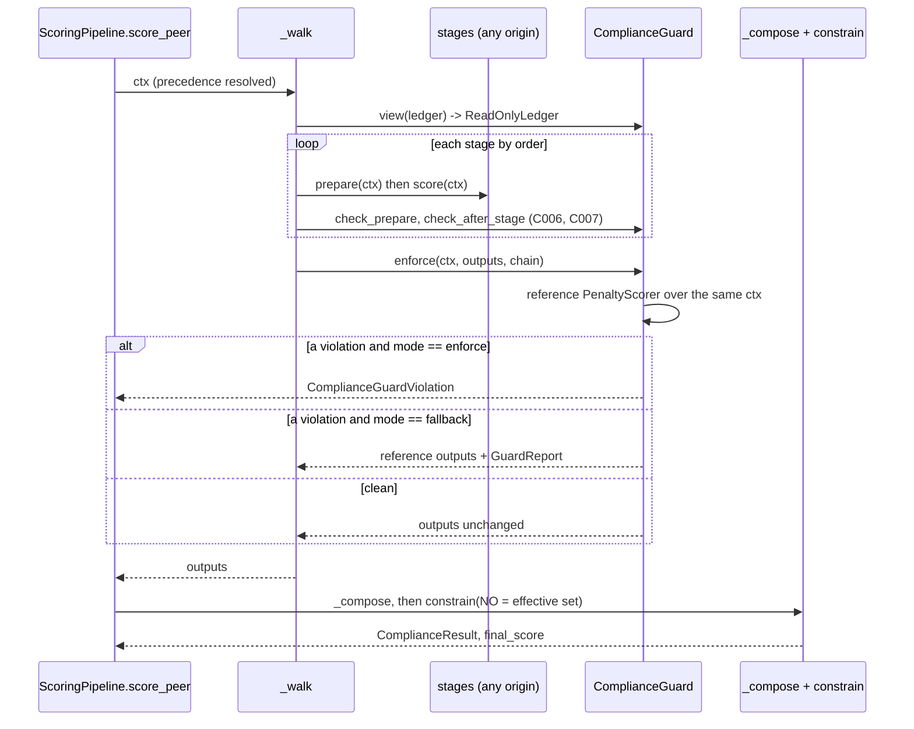

### 6.5 Pipeline changes

Only `ScoringPipeline` changes; `_compose`, `constrain` and the points projection do not.
All edits are additive: with the built-in stages, the guard trusts them
(`trust_builtin`), the ledger view is read-only but the stages never write, and no new
key reaches `metadata` unless a violation was recorded. The test
`test_default_pipeline_is_byte_identical` (section 19) pins that.

```python
# mactf/scoring/pipeline.py  (constructor: new keyword, new attributes)
    def __init__(
        self,
        scorers: Sequence[Scorer] | None = None,
        *,
        score_config: Mapping[str, Any] | None = None,
        severity_weights: Mapping[str, Any] | None = None,
        warning_policy: WarningPolicy | None = None,
        registries: dict[str, WarningRegistry] | None = None,
        pool: CooperativePool | None = None,
        engine_config: Mapping[str, Any] | None = None,
        points_engine: Any = None,
        guard: Any = None,
    ) -> None:
        # ... existing body unchanged, then, before ``self._validate_chain()``:
        self._guard: Any = guard
        #: What the guard did for the most recent ``_walk`` (set even when clean).
        self._last_guard_report: Any = None
```

```python
# mactf/scoring/pipeline.py  (new members, after ``_validate_chain``)
    @property
    def guard(self) -> Any:
        """The compliance guard, built lazily so importing the pipeline never imports it."""
        if self._guard is None:
            from ..components.guards.compliance import ComplianceGuard, GuardPolicy

            self._guard = ComplianceGuard(
                GuardPolicy(
                    min_floor_lambda=float(
                        self.score_config.get("MIN_FLOOR_LAMBDA", DEFAULT_MIN_FLOOR_LAMBDA)
                    )
                )
            )
        return self._guard

    @guard.setter
    def guard(self, value: Any) -> None:
        self._guard = value

    def replace(
        self, scorer: Scorer, *, migrate: Callable[[Scorer, Scorer], None] | None = None
    ) -> Scorer:
        """Swap the stage of ``scorer.kind`` for ``scorer`` and return the old one.

        Atomic: ``migrate(old, new)`` runs first and may only write to ``new``; the chain is
        then validated, and a failure restores the old stage, so a rejected swap leaves the
        pipeline exactly as it was.
        """
        if not isinstance(scorer, _ScorerABC):
            raise ImproperlyConfigured(
                f"a scoring stage must be a Scorer subclass, got {type(scorer).__name__}"
            )
        old = self.get(scorer.kind)
        index = self._chain.index(old)
        if migrate is not None:
            migrate(old, scorer)
        self._chain[index] = scorer
        try:
            self._validate_chain()
        except ImproperlyConfigured:
            self._chain[index] = old
            raise
        return old

    def stage_inject(self, *, trusted: bool = True) -> dict[str, Any]:
        """The offer ``SlotTable.swap`` makes to a stage factory (see ``build_stages``)."""
        return {
            "config": dict(self.score_config),
            "policy": self.warning_policy,
            "trusted": trusted,
        }

    def sync_from_slots(self, slots: Any) -> list[ScoringKind]:
        """Make the chain match ``scoring.<kind>`` slots. Call at an episode boundary,
        after ``slots.apply_pending(Boundary.EPISODE, inject=self.stage_inject())``."""
        changed: list[ScoringKind] = []
        for kind in self.REQUIRED_KINDS:
            stage = slots.get(f"scoring.{kind.value}").instance
            if stage is not self.get(kind):
                self.replace(stage, migrate=migrate_stage_state)
                changed.append(kind)
        return changed
```

```python
# mactf/scoring/pipeline.py  (replaces _walk, lines 472-492)
    def _walk(self, ctx: ScoreContext) -> dict[ScoringKind, ScorerOutput]:
        """Run every stage in ascending order, threading the context through.

        Stages see a read-only ledger. ``prepare`` may change only the fields its kind
        owns. After the walk the guard checks every non-built-in output (6.4).
        """
        guard = self.guard
        source = ctx.ledger.unwrap() if hasattr(ctx.ledger, "unwrap") else ctx.ledger
        snapshot = guard.snapshot(source)
        ctx = ctx.evolve(ledger=guard.view(source))
        structural: list[Any] = []
        outputs: dict[ScoringKind, ScorerOutput] = {}
        for stage in self.chain:
            prepared = stage.prepare(ctx)
            if not isinstance(prepared, ScoreContext):
                raise ImproperlyConfigured(
                    f"{type(stage).__name__}.prepare() returned "
                    f"{type(prepared).__name__}, not a ScoreContext"
                )
            if type(stage) not in _BUILTIN_STAGE_TYPES:
                structural.extend(guard.check_prepare(stage, ctx, prepared, source))
            ctx = prepared
            output = stage.score(ctx)
            output = stage.finalize(ctx, output)
            if not isinstance(output, ScorerOutput):
                raise ImproperlyConfigured(
                    f"{type(stage).__name__}.score() returned "
                    f"{type(output).__name__}, not a ScorerOutput"
                )
            if type(stage) not in _BUILTIN_STAGE_TYPES:
                structural.extend(guard.check_after_stage(stage, source, snapshot))
            outputs[stage.kind] = output
        if structural:
            raise ComplianceGuardViolation([item.as_dict() for item in structural])
        outputs, report = guard.enforce(ctx, outputs, self.chain)
        self._last_guard_report = report
        # Stash the prepared context so callers and the pipeline can read it.
        self._last_context = ctx
        return outputs
```

`_BUILTIN_STAGE_TYPES` is `(WarningScorer, RewardScorer, PenaltyScorer)`, defined at module
level in `pipeline.py` beside the imports it already has. It is a performance shortcut
only: the guard's own `_trusted` applies the same rule and `COMPLIANCE.TRUST_BUILTIN =
false` makes `guard.enforce` inspect built-ins too (the structural checks are cheap and
stay on for custom stages).

```python
# mactf/scoring/pipeline.py  (score_peer: the three edits)
# 1. line 329: the effective set is a superset of the catalog set, always.
        non_offsettable = effective_non_offsettable(self.score_config.get("NON_OFFSETTABLE"))

# 2. in the PeerScorecard(...) call, replace ``metadata={"compliance": result.as_dict()}`` with:
            metadata=self._card_metadata(result),

# 3. new helper next to _mutations:
    def _card_metadata(self, result: ComplianceResult) -> dict[str, Any]:
        metadata: dict[str, Any] = {"compliance": result.as_dict()}
        report = self._last_guard_report
        if report is not None and report.violations:
            metadata["compliance_guard"] = report.as_dict()
        return metadata
```

`ScoringPipeline.score` (`pipeline.py:551-594`) needs no edit: it reaches `_walk`, so the
guard runs, and the `void_rules` it returns is already the guard-checked superset.

```python
# mactf/scoring/pipeline.py  (module level, next to the other helpers)
def migrate_stage_state(old: Scorer, new: Scorer) -> None:
    """Carry state from ``old`` to ``new`` for a same-kind swap. Writes only to ``new``.

    Only the warning stage has state worth keeping: its registries hold every peer's
    warnings, clean streaks and expiry, which framework.md W1-W9 require to survive.
    The reward and penalty stages are stateless, so for them this is a kind check.
    """
    from ..exceptions import ComponentContractError

    if old.kind is not new.kind:
        raise ComponentContractError(
            "scorer", type(new).__name__,
            [f"cannot replace a {old.kind.value} stage with a {new.kind.value} stage"],
        )
    if old.kind is ScoringKind.WARNING:
        registries = getattr(old, "registries", None)
        if registries is None or not hasattr(new, "registries"):
            raise ComponentContractError(
                "scorer", type(new).__name__,
                ["a replacement WARNING stage exposes `registries` so warning state survives"],
            )
        new.registries = registries  # the live dict moves; ``new`` owns it from now on
        if hasattr(old, "policy") and hasattr(new, "policy"):
            new.policy = old.policy
```

### 6.6 Closing H1 and H2: configuration hardening

**H1: the non-offsettable set is a superset, always.** One helper, in the module that
already owns the catalog default:

```python
# mactf/compliance.py  (additions, after _INHERITED_VOID_FLOOR)
#: ``COMPLIANCE.MIN_FLOOR_LAMBDA``'s default. 1.0 equals ``SCORING.DEFAULT_LAMBDA``, and
#: every built-in lambda of a non-offsettable rule is >= 5, so the default changes nothing.
DEFAULT_MIN_FLOOR_LAMBDA = 1.0


def effective_non_offsettable(configured: Iterable[str] | None = None) -> frozenset[str]:
    """The non-offsettable set in force: the catalog's, plus anything configured.

    A configuration may *widen* the set (make another rule non-offsettable); it can never
    narrow it. This is the one place that rule is written; ``PenaltyScorer``,
    ``ScoringPipeline`` and ``HierarchicalScorer`` all call it.
    """
    return NON_OFFSETTABLE | frozenset(str(rule_id) for rule_id in (configured or ()))
```

(`from typing import Iterable` joins the existing `typing` import in that module.)

```python
# mactf/scoring/penalty.py  (replaces lines 52-56, and the lambda line in score())
    @property
    def non_offsettable(self) -> frozenset[str]:
        return effective_non_offsettable(self.config.get("NON_OFFSETTABLE"))

    @property
    def min_floor_lambda(self) -> float:
        return float(self.config.get("MIN_FLOOR_LAMBDA", DEFAULT_MIN_FLOOR_LAMBDA))

# in score(), before the loop:
        non_offsettable = self.non_offsettable
        floor_lambda = self.min_floor_lambda
# ... and replacing ``lam = float(lambdas.get(event.rule_id, default_lambda))``:
            lam = float(lambdas.get(event.rule_id, default_lambda))
            if event.rule_id in non_offsettable:
                lam = max(lam, floor_lambda)  # H2: a floor can never be configured to zero
# ... and ``void_rules = tuple(sorted(self.non_offsettable & set(amounts)))`` is unchanged,
# because ``self.non_offsettable`` is now the superset.
```

`PenaltyScorer.validate` (`penalty.py:134-184`) reports both problems *before* a run, so
a bad configuration is an error message and not a silently corrected number:

```python
# mactf/scoring/penalty.py  (appended inside validate(), before ``return diagnostics``)
        configured = settings.get("NON_OFFSETTABLE", self.config.get("NON_OFFSETTABLE"))
        if configured is not None:
            narrowed = sorted(NON_OFFSETTABLE - frozenset(configured))
            if narrowed:
                diagnostics.append(
                    ScorerDiagnostic(
                        level="error",
                        code="penalties.non_offsettable_narrowed",
                        message=f"NON_OFFSETTABLE omits {narrowed}; it may only add rules",
                        hint="remove the key to use the catalog set, or list a superset of it",
                    )
                )
        floor = float(settings.get("MIN_FLOOR_LAMBDA", self.config.get("MIN_FLOOR_LAMBDA",
                                                                      DEFAULT_MIN_FLOOR_LAMBDA)))
        default = float(settings.get("DEFAULT_LAMBDA", self.default_lambda))
        for rule_id in sorted(effective_non_offsettable(configured)):
            effective = float((raw or {}).get(rule_id, default))
            if effective < floor:
                diagnostics.append(
                    ScorerDiagnostic(
                        level="error",
                        code="penalties.floor_lambda_below_minimum",
                        message=(
                            f"PENALTY_LAMBDAS[{rule_id!r}] resolves to {effective:g}, below "
                            f"MIN_FLOOR_LAMBDA {floor:g}; a non-offsettable floor cannot be "
                            "weakened"
                        ),
                        hint=f"raise the lambda to at least {floor:g}",
                    )
                )
```

(`raw` is the `PENALTY_LAMBDAS` mapping the method already binds at its top.)

```python
# mactf/scoring/hierarchy.py  (line 172 and _own_void, lines 296-317)
        self.non_offsettable: frozenset[str] = effective_non_offsettable(non_offsettable)

    def _own_void(
        self,
        tree: PeerTree,
        ledgers: Mapping[str, Ledger],
        *,
        non_offsettable: frozenset[str],
    ) -> dict[str, frozenset[str]]:
        """Each node's own non-offsettable rule ids, from its own ledger only.

        ``non_offsettable`` is the effective superset, so a custom set can add rules but
        can no longer narrow the catalog default (the old ``catalog_defaults`` branch let a
        non-empty set do exactly that).
        """
        result: dict[str, frozenset[str]] = {}
        for node in tree.walk("leaves-first"):
            ledger = ledgers.get(node.path)
            if ledger is None:
                result[node.path] = frozenset()
                continue
            result[node.path] = frozenset(
                event.rule_id for event in ledger.events if event.rule_id in non_offsettable
            )
        return result
```

**H2 at configuration load.** `conf.py` gains the `COMPLIANCE` defaults and a validator
beside the existing check at `conf.py:671-678`:

```python
# mactf/conf.py  (new default block, beside "SCORING")
    "COMPLIANCE": {
        "MIN_FLOOR_LAMBDA": 1.0,      # lambda floor for every non-offsettable rule; > 0
        "GUARD_MODE": "enforce",      # "enforce" | "fallback"  (6.4.2)
        "REWARD_CEILING": 10000.0,    # matches compliance.constrain's value_cap
        "TOLERANCE": 1e-9,            # floating-point slack in guard comparisons; [0, 1e-3]
        "TRUST_BUILTIN": True,        # skip inspection of the three built-in stage classes
    },

# mactf/conf.py  (called right after the NON_OFFSETTABLE check, before _validate_points)
def _validate_compliance(settings: Any) -> None:
    block = dict(settings.get("COMPLIANCE") or {})
    mode = str(block.get("GUARD_MODE", "enforce")).lower()
    if mode not in {"enforce", "fallback"}:
        raise ImproperlyConfigured("COMPLIANCE.GUARD_MODE must be 'enforce' or 'fallback'")
    # (key, default, lowest allowed, highest allowed, lowest is inclusive)
    for key, default_value, low, high, inclusive in (
        ("MIN_FLOOR_LAMBDA", 1.0, 0.0, math.inf, False),  # a zero floor would erase a penalty
        ("REWARD_CEILING", 1e4, 0.0, math.inf, False),
        ("TOLERANCE", 1e-9, 0.0, 1e-3, True),
    ):
        try:
            value = float(block.get(key, default_value))
        except (TypeError, ValueError):
            raise ImproperlyConfigured(f"COMPLIANCE.{key} must be a number") from None
        too_low = value < low if inclusive else value <= low
        if not math.isfinite(value) or too_low or value > high:
            raise ImproperlyConfigured(f"COMPLIANCE.{key} is out of range: {value!r}")
    scoring = settings["SCORING"]
    floor = float(block.get("MIN_FLOOR_LAMBDA", 1.0))
    lambdas = dict(scoring.get("PENALTY_LAMBDAS") or {})
    default = float(scoring.get("DEFAULT_LAMBDA", 1.0))
    for rule_id in sorted(set(scoring["NON_OFFSETTABLE"]) | {"P1", "P2", "P17", "P20", "P21", "P22"}):
        effective = float(lambdas.get(rule_id, default))
        if effective < floor:
            raise ImproperlyConfigured(
                f"SCORING.PENALTY_LAMBDAS.{rule_id} is {effective:g}, below "
                f"COMPLIANCE.MIN_FLOOR_LAMBDA {floor:g}; a non-offsettable floor cannot be weakened"
            )
```

`build_scorer` hands the floor to the stages and the guard (`pipeline.py:700-722`):

```python
# mactf/scoring/pipeline.py  (build_scorer gains two keyword parameters, and the body after ``policy = ...`` is replaced)
# def build_scorer(settings, *, scorers=None, slots=None, trusted=True) -> ScoringPipeline:
    from ..components.guards.compliance import ComplianceGuard, GuardPolicy

    score_config = dict(settings["SCORING"])
    guard_policy = GuardPolicy.from_settings(settings)
    if guard_policy.min_floor_lambda != DEFAULT_MIN_FLOOR_LAMBDA:
        # Recorded in the pipeline's config (and so its state dict) on purpose: the floor a
        # run was scored under is part of the run's identity. The default leaves it out,
        # which keeps default checkpoints byte-identical.
        score_config["MIN_FLOOR_LAMBDA"] = guard_policy.min_floor_lambda
    severity_weights = dict(settings["SEVERITY"]["WEIGHTS"])
    pool = build_pool(settings)
    stage_specs = dict(score_config.get("STAGES") or {})
    stages = scorers
    if stages is None and stage_specs:
        stages = build_stages(
            score_config=score_config,
            severity_weights=severity_weights,
            warning_policy=policy,
            specs=stage_specs,
            slots=slots,
            trusted=trusted,
        )
    return ScoringPipeline(
        stages,
        score_config=score_config,
        severity_weights=severity_weights,
        warning_policy=policy,
        pool=pool,
        engine_config=dict(settings["ENGINE"]) if "ENGINE" in settings else {},
        guard=ComplianceGuard(guard_policy),
    )
```

`SCORING.STAGES` lives under `SCORING`, so it is part of `score_config`, which
`ScoringPipeline.state_dict` serializes. That is wanted (a checkpoint records which stages
scored the run) and costs nothing by default, because the default is the key being absent
(`DEFAULTS["SCORING"]` does not list it).

### 6.7 Diagnostics: validate a chain before a run

`ScoringPipeline._validate_chain` raises on the first problem. A caller assembling a
chain from user input (the API, `mactf components validate`) wants *all* the problems, each
with a code and a hint. `validate_stage_chain` collects them with the same rules, and adds
the guard's static checks:

```python
# mactf/scoring/chain_validation.py
"""Collect every problem in a stage chain without raising (document 17 section 6.7)."""

from __future__ import annotations

from typing import Any, Mapping, Sequence

from ..compliance import DEFAULT_MIN_FLOOR_LAMBDA, effective_non_offsettable
from .base import Scorer, ScorerDiagnostic, ScoringKind

#: Context keys a stage may name in ``requires``: the ``ScoreContext`` fields plus the
#: hierarchical inputs. Anything else is a typo or an input nobody supplies.
PROVIDED_CONTEXT_KEYS: frozenset[str] = frozenset({
    "ledger", "config", "severity_weights", "warning_policy", "known_rules",
    "warning_total", "warning_events", "escalated_rules", "children", "branch_void",
    "extras", "allowed_rules", "tree", "ledgers", "peer", "episode", "node_path", "depth",
})

REQUIRED_KINDS = (ScoringKind.WARNING, ScoringKind.REWARD, ScoringKind.PENALTY)


def _error(code: str, message: str, hint: str = "") -> ScorerDiagnostic:
    return ScorerDiagnostic(level="error", code=code, message=message, hint=hint)


def validate_stage_chain(
    stages: Sequence[Scorer], settings: Mapping[str, Any] | None = None
) -> list[ScorerDiagnostic]:
    """Every problem in ``stages`` under ``settings``, in a stable order."""
    settings = dict(settings or {})
    found: list[ScorerDiagnostic] = []
    by_kind: dict[ScoringKind, list[Scorer]] = {}
    for stage in stages:
        if not isinstance(stage, Scorer):
            found.append(_error("chain.not_a_scorer", f"{type(stage).__name__} is not a Scorer"))
            continue
        by_kind.setdefault(stage.kind, []).append(stage)
        if stage.order < 0:
            found.append(_error(
                "chain.negative_order", f"{type(stage).__name__} declares order={stage.order}"))
        if stage.kind is ScoringKind.HIERARCHY:
            found.append(_error(
                "chain.hierarchy_nested",
                f"{type(stage).__name__} scores a whole tree and cannot be a per-node stage",
                "build a HierarchicalScorer around the pipeline"))
        if stage.kind is ScoringKind.PIPELINE:
            found.append(_error(
                "chain.pipeline_nested", "a ScoringPipeline cannot be a stage of another"))
        unknown = sorted(set(stage.requires) - PROVIDED_CONTEXT_KEYS)
        if unknown:
            found.append(ScorerDiagnostic(
                level="warning", code="chain.unknown_requirement",
                message=f"{type(stage).__name__}.requires names {unknown}, which no pipeline supplies",
                hint=f"known keys: {sorted(PROVIDED_CONTEXT_KEYS)}"))
        found.extend(stage.validate(settings))

    for kind, group in by_kind.items():
        if len(group) > 1:
            found.append(_error(
                "chain.duplicate_kind",
                f"{len(group)} stages of kind {kind.value!r}: "
                + ", ".join(type(item).__name__ for item in group)))
    orders: dict[int, Scorer] = {}
    for stage in (item for group in by_kind.values() for item in group):
        clash = orders.get(stage.order)
        if clash is not None:
            found.append(_error(
                "chain.order_collision",
                f"{type(stage).__name__} and {type(clash).__name__} both declare order={stage.order}",
                "set an explicit order on one of them"))
        orders[stage.order] = stage
    for kind in REQUIRED_KINDS:
        if kind not in by_kind:
            found.append(_error(
                "chain.missing_stage", f"no {kind.value} stage",
                "use 'zero_reward' or 'no_warnings' to turn a kind off on purpose"))
    warning = (by_kind.get(ScoringKind.WARNING) or [None])[0]
    if warning is not None:
        for kind in (ScoringKind.REWARD, ScoringKind.PENALTY):
            for stage in by_kind.get(kind, []):
                if stage.order <= warning.order:
                    found.append(_error(
                        "chain.warning_order",
                        f"{type(warning).__name__} (order {warning.order}) must run before "
                        f"{type(stage).__name__} (order {stage.order})",
                        "an escalated rule would be excluded from P and counted twice"))

    scoring = dict(settings.get("SCORING", settings) or {})
    floor = float(settings.get("COMPLIANCE", {}).get("MIN_FLOOR_LAMBDA", DEFAULT_MIN_FLOOR_LAMBDA))
    lambdas = dict(scoring.get("PENALTY_LAMBDAS") or {})
    default = float(scoring.get("DEFAULT_LAMBDA", 1.0))
    for rule_id in sorted(effective_non_offsettable(scoring.get("NON_OFFSETTABLE"))):
        if float(lambdas.get(rule_id, default)) < floor:
            found.append(_error(
                "chain.floor_lambda",
                f"the lambda of non-offsettable {rule_id} is below MIN_FLOOR_LAMBDA {floor:g}"))
    return found
```

`ScoringPipeline._validate_chain` keeps raising (its messages are asserted by
`tests/scoring/test_pipeline_validation.py:55-179`); the two share no code on purpose, and
`test_chain_validation_agrees` (section 19) asserts that for every chain the first error
`validate_stage_chain` reports corresponds to the exception `_validate_chain` raises.

### 6.8 Mid-run swap, and turning a stage off

A stage is an `episode`-mutability component: it is read once per episode, so it may be
changed only at an episode boundary, and all peers in one episode are judged by the same
stage. The flow:

1. `PATCH /runs/{id}/components` or the engine API calls
   `slots.request("scoring.reward", spec, migrate=migrate_stage_state)`. The spec is parsed
   and built eagerly, so a bad spec fails the request, not the next episode (4.4).
2. At the next episode boundary the engine runs
   `slots.apply_pending(Boundary.EPISODE, inject=pipeline.stage_inject())`, then
   `pipeline.sync_from_slots(slots)`, which calls `replace` for each changed kind.
3. `replace` validates the chain; a failure restores the old stage and the swap is
   reported as failed in `SwapRecord` history. The run continues with the old stage.
4. The next `score_peer` runs the new stage under the same guard.

Swapping the WARNING stage moves the live registries (`migrate_stage_state`), so no peer's
warning count, clean streak or expiry is lost. That is invariant I6.

Two built-in null stages exist so that "turn it off" is a first-class, guarded choice
rather than a stage that returns zeros and hopes:

```python
# mactf/scoring/null_stages.py
"""Stages that switch a kind off on purpose (document 17 section 6.8)."""

from __future__ import annotations

from typing import Any

from ..components import register_scorer
from .base import ScoreContext, ScorerOutput
from .reward_scorer import RewardScorer
from .warning_scorer import WarningScorer


@register_scorer("zero_reward")
class ZeroRewardScorer(RewardScorer):
    """Every reward is zero: training on penalties alone, or an ablation of the reward side.

    Zero is a legal reward, so the guard accepts it. The breakdown keeps the weights so
    ``RewardBreakdown`` renders as it does when strict precedence suppresses the reward
    (``pipeline.py:532-537``).
    """

    def score(self, ctx: ScoreContext) -> ScorerOutput:
        weights = self.bucket_weights()
        breakdown: dict[str, Any] = {
            **dict.fromkeys(self.BUCKETS, 0.0),
            "weights": dict(weights),
            "rules": [],
            "by_rule": {},
            "ignored_rules": [],
            "total": 0.0,
        }
        return ScorerOutput(kind=self.kind, amount=0.0, breakdown=breakdown, rules=())


@register_scorer("no_warnings")
class NoWarningScorer(WarningScorer):
    """The warning-first regime off: every offence is scored at full penalty.

    This only ever *raises* a score's penalty side (a rule that would have been
    warning-only now scores), so it cannot weaken compliance. It subclasses
    ``WarningScorer`` so the registries, ``begin_episode`` and the checkpoint keep working;
    its registries stay empty.
    """

    def prepare(self, ctx: ScoreContext) -> ScoreContext:
        return ctx.evolve(
            warning_total=0.0,
            warning_events=(),
            escalated_rules=frozenset(),
            extras={**dict(ctx.extras), "warning_mutations": ()},
        )
```

There is deliberately no `zero_penalty` and no way to write one that passes: it fails C002
the first time a non-offsettable rule fires, and the hardened built-in already
exposes every legitimate lever (`PENALTY_LAMBDAS`, `OMEGA_RULES`, `SANDBOX_MULTIPLIER`).

### 6.9 Scoring: what each verb does

| Part | Add | Modify | Replace | Delete |
|---|---|---|---|---|
| Reward stage | `@register_scorer`, kind REWARD | `SCORING.STAGES.reward.params`, `REWARD_WEIGHTS` | `SCORING.STAGES.reward`, `replace` at an episode boundary | `zero_reward` |
| Reward term | `@register_reward_term` | `terms[i].params`, `weight` | change `type` | remove the entry (at least one must remain) |
| Penalty stage | `@register_scorer`, kind PENALTY, guarded | `PENALTY_LAMBDAS`, `OMEGA_*`, `SANDBOX_MULTIPLIER` (within the floor) | same as reward; the guard compares against the reference | not allowed |
| Warning stage | `@register_scorer`, kind WARNING, must subclass `WarningScorer` | `WARNINGS.*` | same; registries migrate | `no_warnings` |
| Non-offsettable set | widen only | `SCORING.NON_OFFSETTABLE` (superset) | not allowed | not allowed |
| Hierarchy rollup | `register_function("rollup", ...)` (8.6) | `HIERARCHY.ROLLUP` | same | n/a |


---

## 7. Training policies

A **training policy** decides what one optimizer step is for one node: which loss is
computed, how advantages are formed, who calls `backward`, when the optimizer steps, what is
logged. Today there are three ways to supply one and they differ in how much the trainer
protects the run from the result. This section makes the step a first-class, registered,
guarded component, and turns today's hard-coded `_builtin_step` into its default.

### 7.1 What exists today

| # | Form | Where it is accepted | What the trainer does with the result |
|---|---|---|---|
| 1 | *No policy* (`trainer=None`) | `MACTFTrainer.train_step` runs `_builtin_step` (`mactf/training/trainer.py:1505`, `:1543`) | The built-in step does forward, loss, backward, optimizer step itself and returns a detached loss. |
| 2 | An object with `train_step(node, batch)` | `trainer.py:1517-1519` | `coerce_step_result` (`protocol.py`); if `result.loss.requires_grad`, `_apply_custom_loss` (`trainer.py:1614`) runs `backward` and `optimizer.step()` on the policy's behalf. |
| 3 | A callable `(node, batch, trainer=self)` | `trainer.py:1520-1521` | Same as 2. |
| 4 | `CoDistillStep` | installed by `_attach_distillation` (`trainer.py:1194-1214`) when `DISTILLATION.ENABLED` | It is form 2 with `attach`, `setup`, `on_epoch_end`, `card_metadata`, `state_dict`, `load_state_dict` (`mactf/distill/step.py:576`, `:600`, `:716`, `:1916`, `:1961`, `:1982`) and a `{"pending": 1.0}` result while a cohort is buffering (`step.py:667-671`). |

What is missing, in the order it bites:

| Gap | Consequence |
|---|---|
| A policy is an **instance** passed in code (`trainer.py:349`). There is no registry, no spec, no way to name one in YAML or over the API. | A policy cannot be selected the way a scorer is. |
| **Nothing validates the result.** A policy that returns a `nan` loss gets `backward` called on it; `optimizer.step()` then writes `nan` into every parameter and into the optimizer's moment buffers. | One bad batch destroys a run, and a restore from the periodic checkpoint is the only way back. |
| A policy that steps itself (returns a detached loss) is **never checked at all**. | The same, with no hook to catch it. |
| A policy can ignore `batch["void"]` and `batch["floor"]`. Nothing says it must not. | A void peer's penalty can be washed out by a policy that rewards it anyway (invariant I2). |
| Four of the twelve RL function families are used by `_builtin_step` implicitly (advantage via `penalise_void_advantage`, action via `argmax`) and cannot be replaced. | "Customize the advantage" means "write a whole policy". |
| `on_epoch_end` and `card_metadata` exist only by convention (`trainer.py:1912-1915`, `:1639-1646`). | They are not part of any protocol, so a third-party policy cannot know to implement them. |
| `state_dict` is read only when distillation is on (`trainer.py:2201-2205`, `:2249-2252`). | A custom policy's state is never checkpointed. |

### 7.2 The `TrainerPolicy` protocol and the `PolicyHost`

`TrainerPolicy` is structural. **Only `train_step` is required** (this is what
`trainer_policy_contract` in section 3.7 checks); every other member is optional and the
trainer reads it with `getattr`, exactly as it does today. The protocol is written down so a
policy author has one place to read.

```python
# mactf/training/policy.py
from __future__ import annotations

import logging
from dataclasses import dataclass
from typing import TYPE_CHECKING, Any, ClassVar, Iterable, Mapping, Protocol, runtime_checkable

import torch

from ..exceptions import ContractError, ValidationError
from ..rl.advantage import penalise_void_advantage
from ..rl.loss import LossBreakdown
from ..rl.policy import greedy_action, make_policy
from ..runtime import autocast
from .protocol import EpochResult, StepResult

if TYPE_CHECKING:  # pragma: no cover - typing only
    from ..coopetition.peer import Peer
    from ..coopetition.tree import PeerNode, PeerTree
    from .optimizer import MACTFOptimizer

log = logging.getLogger("mactf.training.policy")

#: The advantage a void node is held to, from ``_builtin_step`` (trainer.py:1573).
VOID_ADVANTAGE_FLOOR = -1.0


@runtime_checkable
class PolicyHost(Protocol):
    """What a policy may rely on. ``MACTFTrainer`` implements it; nothing else is promised.

    Everything here is a public attribute or method. A policy that reaches for an
    underscore name has left the contract and needs ``unsafe = True`` (section 7.7).
    """

    tree: "PeerTree"
    reference: "Peer"
    optimizers: Mapping[str, "MACTFOptimizer"]
    settings: Any
    runtime: Any
    functions: Any          # FunctionBook, section 8.4
    slots: Any              # SlotTable, section 4.4
    global_step: int
    distill: Any            # the CoDistillStep when DISTILLATION.ENABLED, else None

    def resolve_node(self, node: Any) -> tuple["PeerNode | None", "Peer"]: ...

    def loss_for(self, path: str) -> Any:
        """The loss function in force for ``path`` (``RL.loss`` override, else ``LOSS``)."""

    def backward(self, loss: torch.Tensor, optimizer: "MACTFOptimizer") -> None:
        """Scale for accumulation and AMP, then ``backward``. The only sanctioned way."""


@runtime_checkable
class TrainerPolicy(Protocol):
    """The full surface. Optional members are marked; absent ones are skipped."""

    #: Registry name; used in cards and checkpoints.
    name: ClassVar[str]
    #: True if the policy bypasses the facade (reads private trainer state, writes
    #: parameters directly). Needs ``TRAINER.ALLOW_UNSAFE_POLICY``. Default False.
    unsafe: ClassVar[bool]
    #: True: the policy calls ``backward`` and steps the optimizer itself (it returns a
    #: detached loss). False: it returns a live loss and the trainer steps for it.
    #: ``None`` means "decided per call"; the guard then snapshots defensively.
    self_stepping: ClassVar[bool | None]
    #: Terms the policy promises to honour; the guard verifies them (section 7.6.4).
    requires_terms: ClassVar[frozenset[str]]
    #: True if the policy delegates to the distillation step when distillation is on.
    composes_distillation: ClassVar[bool]
    #: RL function families the policy reads through `host.functions` (section 8.5.3). A family
    #: configured in `RL` that no active consumer lists is a configuration error (`E041`).
    #: Absent means ``{"loss"}``, which is what a plain callable policy uses.
    consumes_functions: ClassVar[frozenset[str]]

    def train_step(self, node: Any, batch: Mapping[str, Any]) -> StepResult: ...

    # -- optional ----------------------------------------------------------
    def attach(self, host: PolicyHost) -> None: ...
    def setup(self, node: Any) -> None: ...
    def on_epoch_end(self, tree: Any, result: EpochResult) -> None: ...
    def card_metadata(self, path: str) -> dict[str, Any]: ...
    def state_dict(self) -> dict[str, Any]: ...
    def load_state_dict(self, payload: Mapping[str, Any]) -> None: ...
    def describe(self) -> dict[str, Any]: ...


def policy_flag(policy: Any, name: str, default: Any) -> Any:
    """Read an optional class attribute with a default (a plain callable has none)."""
    return getattr(policy, name, default)


def policy_name(policy: Any) -> str:
    explicit = getattr(policy, "name", None)
    if isinstance(explicit, str) and explicit:
        return explicit
    return getattr(policy, "__name__", type(policy).__name__)
```

`PolicyHost` adds four public members to `MACTFTrainer` (section 7.4): `resolve_node`
(a rename-with-alias of `_resolve_node`, `trainer.py:1235`), `loss_for`, `backward` (an
alias of `_backward`, `trainer.py:1606`), and the `functions` and `slots` attributes.
`optimizers`, `reference`, `tree`, `settings`, `global_step` already exist.

### 7.3 `DefaultTrainPolicy`: the current step, moved

`DefaultTrainPolicy` is `_builtin_step` (`trainer.py:1543-1604`) with four optional
function hooks. **With no hook configured the arithmetic is the same statements in the same
order**, so `test_default_identity` (section 19.4) can assert bit equality against the
frozen `Orchestrator` and against the pre-change `MACTFTrainer`.

| Hook | Family | Replaces | Default (no hook) |
|---|---|---|---|
| `advantage` | `rl_function.advantage` | `penalise_void_advantage(signal, void, floor=-1.0)` (`trainer.py:1573`) | the same expression |
| `action` | `rl_function.action` | `policy.probs.argmax(dim=-1)` (`trainer.py:1564`) | the same expression |
| `regularization` | `rl_function.regularization` | nothing (added to the loss) | none |
| `metric` | `rl_function.metric` | nothing (extra reported numbers) | none |

Two rules keep a hook from becoming a bypass:

1. **The void floor is applied after a custom advantage.** Whatever `advantage` returns,
   `penalise_void_advantage(result, void, floor=-1.0)` runs on it, so a void node's advantage is
   at most `-1.0` (`mactf/rl/advantage.py:89-102` takes `minimum(advantage, floor)` where the
   mask is set). A custom advantage can shape *how* a healthy node learns; it cannot make a
   void node learn to repeat the breach.
2. **`masks` has a declared meaning.** The advantage family is inconsistent about it:
   `TDAdvantage` multiplies by `masks.bool()` (a *validity* mask, `advantage.py:111`),
   while `VoidMaskedAdvantage` requires a *void* mask (`advantage.py:236-246`). Passing the
   wrong one silently inverts the result. The policy therefore takes `advantage_masks` in
   `{"none", "void", "valid"}` (default `"none"`) and passes `void`, `~void` or nothing.

```python
# mactf/training/policy.py   (continued)
@dataclass(frozen=True)
class _Hooks:
    advantage: Any = None
    action: Any = None
    regularization: Any = None
    metric: Any = None


class DefaultTrainPolicy:
    """The policy-gradient step, i.e. ``_builtin_step`` behind the policy protocol."""

    name: ClassVar[str] = "default"
    unsafe: ClassVar[bool] = False
    self_stepping: ClassVar[bool | None] = True
    requires_terms: ClassVar[frozenset[str]] = frozenset()
    composes_distillation: ClassVar[bool] = False
    consumes_functions: ClassVar[frozenset[str]] = frozenset(
        {"loss", "advantage", "action", "regularization", "metric"}
    )

    ADVANTAGE_MASKS: ClassVar[tuple[str, ...]] = ("none", "void", "valid")

    def __init__(
        self,
        *,
        advantage: Any = None,
        action: Any = None,
        regularization: Any = None,
        metric: Any = None,
        advantage_masks: str = "none",
        gamma: float = 0.99,
        lam: float = 0.95,
    ) -> None:
        if advantage_masks not in self.ADVANTAGE_MASKS:
            raise ValidationError(
                f"advantage_masks must be one of {', '.join(self.ADVANTAGE_MASKS)}; "
                f"got {advantage_masks!r}"
            )
        if not 0.0 <= float(gamma) <= 1.0 or not 0.0 <= float(lam) <= 1.0:
            raise ValidationError("gamma and lam must be in [0, 1]")
        self._spec_hooks = _Hooks(advantage, action, regularization, metric)
        self.advantage_masks = advantage_masks
        self.gamma = float(gamma)
        self.lam = float(lam)
        self._host: PolicyHost | None = None

    # -- lifecycle -----------------------------------------------------------
    def attach(self, host: PolicyHost) -> None:
        self._host = host

    def setup(self, node: Any) -> None:
        """Nothing to prepare: the default step owns no per-node state."""
        return None

    def describe(self) -> dict[str, Any]:
        return {
            "name": self.name,
            "advantage_masks": self.advantage_masks,
            "hooks": sorted(
                key for key, value in vars(self._spec_hooks).items() if value is not None
            ),
        }

    # -- hook resolution: per node, through the FunctionBook ------------------
    def _hook(self, family: str, path: str) -> Any:
        """A constructor-supplied hook wins; otherwise ask the host's FunctionBook.

        ``FunctionBook.get`` returns ``None`` when neither ``RL.<family>`` nor an override
        for ``path`` is configured, which is the default-identity case.
        """
        explicit = getattr(self._spec_hooks, family)
        if explicit is not None:
            return explicit
        host = self._host
        if host is None:
            return None
        return host.functions.get(family, path)

    # -- the step --------------------------------------------------------------
    def train_step(self, node: Any, batch: Mapping[str, Any]) -> StepResult:
        host = self._require_host()
        tree_node, peer = host.resolve_node(node)
        path = peer.name
        optimizer = host.optimizers.get(path)
        if optimizer is None:
            raise ContractError(f"no optimizer is bound for node {path!r}")

        advantage_fn = self._hook("advantage", path)
        action_fn = self._hook("action", path)
        regularizer = self._hook("regularization", path)
        metric_fn = self._hook("metric", path)
        loss_function = host.loss_for(path)
        reference_peer = host.reference
        runtime = host.runtime

        states = batch["states"]
        adapter = peer.adapter
        adapter.train()
        if getattr(optimizer, "_accumulated", 0) == 0:
            optimizer.zero_grad()
        count = int(states.shape[0])
        fixed: dict[str, torch.Tensor] = {}
        seen: dict[str, Any] = {}

        def evaluate() -> tuple[torch.Tensor, Any]:
            with autocast(runtime):
                logits, values = adapter(states)
            policy = make_policy(logits)
            with torch.no_grad():
                ref_logits, _ = reference_peer.adapter(states)
            reference_policy = make_policy(ref_logits)
            if "actions" not in fixed:
                # Chosen once so a closure-driven optimizer sees one smooth objective.
                if action_fn is None:
                    fixed["actions"] = policy.probs.argmax(dim=-1).detach()
                else:
                    chosen = action_fn(logits.detach(), sample=False)
                    fixed["actions"] = torch.as_tensor(chosen, device=logits.device).long()
            signal = torch.full(
                (count,), float(batch.get("signal", 0.0)),
                device=logits.device, dtype=logits.dtype,
            )
            void = torch.full(
                (count,), bool(batch.get("void", False)),
                device=logits.device, dtype=torch.bool,
            )
            if advantage_fn is None:
                advantages = penalise_void_advantage(signal, void, floor=VOID_ADVANTAGE_FLOOR)
            else:
                advantages = self._custom_advantage(advantage_fn, signal, values, void, count)
            loss_batch = {
                "policy": policy,
                "reference": reference_policy,
                "actions": fixed["actions"],
                "advantages": advantages,
                "values": values,
                "value_targets": signal.unsqueeze(-1),
                "compliance_floor": torch.tensor(
                    float(batch.get("floor", 0.0)), device=logits.device
                ),
                "void_mask": void,
            }
            total, breakdown = loss_function.compute(loss_batch)
            if regularizer is not None:
                penalty = torch.as_tensor(regularizer(adapter.module), device=total.device)
                total = total + penalty.to(total.dtype)
                breakdown.extras["regularization"] = float(penalty.detach().item())
                breakdown.total = float(total.detach().item())
            seen["loss_batch"] = loss_batch
            return total, breakdown

        if optimizer.closure_based:
            total, breakdown = evaluate()
            outcome = optimizer.step(closure=lambda: evaluate()[0])
            total, breakdown = evaluate()
        else:
            total, breakdown = evaluate()
            host.backward(total, optimizer)
            outcome = optimizer.step()
        metrics = {"lr": float(outcome.lr)}
        if outcome.grad_norm is not None:
            metrics["grad_norm"] = float(outcome.grad_norm)
        if metric_fn is not None:
            extra = metric_fn(seen["loss_batch"], total.detach())
            for key, value in dict(extra or {}).items():
                metrics[f"metric.{key}"] = float(value)
        return StepResult(
            loss=total.detach(),
            breakdown=breakdown,
            stepped=bool(outcome.stepped),
            metrics=metrics,
        )

    # -- internals -------------------------------------------------------------
    def _require_host(self) -> PolicyHost:
        if self._host is None:
            raise ContractError(
                "DefaultTrainPolicy.train_step was called before attach(); the trainer "
                "attaches policies in build()"
            )
        return self._host

    def _custom_advantage(
        self,
        advantage_fn: Any,
        signal: torch.Tensor,
        values: torch.Tensor,
        void: torch.Tensor,
        count: int,
    ) -> torch.Tensor:
        masks: torch.Tensor | None
        if self.advantage_masks == "void":
            masks = void
        elif self.advantage_masks == "valid":
            masks = ~void
        else:
            masks = None
        produced = advantage_fn(
            signal,
            values.detach().reshape(count),
            masks=masks,
            gamma=self.gamma,
            lam=self.lam,
        )
        raw = getattr(produced, "advantages", produced)
        advantages = torch.as_tensor(raw, device=signal.device, dtype=signal.dtype).reshape(count)
        if not bool(torch.isfinite(advantages).all()):
            raise ContractError(
                f"advantage function {type(advantage_fn).__name__} produced a non-finite value"
            )
        # Rule 1: whatever the function did, a void node is held at or below the floor.
        return penalise_void_advantage(advantages, void, floor=VOID_ADVANTAGE_FLOOR)
```

Notes a reader will otherwise trip on:

* `evaluate()` is called twice for closure-based optimizers, as `_builtin_step` does
  (`trainer.py:1589-1592`); the chosen actions are cached in `fixed` for that reason.
* The `regularization` hook adds to the loss **inside** `evaluate()` so closure-based
  backends (`lbfgs`, scipy) optimise the regularised objective, not the bare one.
* `adapter.module` is the peer's `nn.Module` (the object `ModuleValueFunction` and
  `L2Regularization` take). A regularizer receives a module, never a peer.
* `DefaultTrainPolicy` is origin `builtin`, so it is **never wrapped** in a `StepGuard`
  (section 7.6.5): the guard exists for code the framework did not write.

### 7.4 Changes to `MACTFTrainer`

All changes are additive, and each is a no-op when no policy is configured.

| Change | Where | Detail |
|---|---|---|
| Public aliases | `trainer.py:1235`, `:1606` | `resolve_node = _resolve_node` and `backward = _backward` defined next to the originals; the underscore names stay. |
| `loss_for(path)` | new method beside `loss_function` (`trainer.py:1162`) | Returns the `RL.loss.<glob>` override's instance when one matches, else `self.loss_function`. Overrides live in the `FunctionBook` (8.4). |
| `functions`, `slots`, `distill` | `__init__` | `self.functions = FunctionBook(...)`, `self.slots = SlotTable(...)`, `self.distill = None`; the first two are created empty when `COMPONENTS` is unconfigured. |
| Policy attach | `build()` before `_setup_custom_trainer()` (`trainer.py:650` region) | `_attach_policy()` below. |
| `train_step` | `trainer.py:1505-1541` | Replaces the `if policy is None ... else ...` ladder with a single dispatch; the `pending` early return learns about `quarantined`. |
| Policy metadata | `_stamp_distillation_metadata` (`trainer.py:1633`) | Generalised to `_stamp_policy_metadata`: writes `metadata["policy"]` for every policy that implements `card_metadata`, and keeps writing `metadata["distillation"]` when distillation is on. |
| Policy state | `state_dict` / `load_state_dict` (`trainer.py:2198`, `:2249`) | `state["policy"]` and `state["components"]` are read and written whenever the policy implements them, not only when distillation is on (14.3). |

```python
# mactf/training/trainer.py   (changed regions; everything else is untouched)

    # ``_trainer_policy`` keeps its name and meaning: the object ``train_step`` calls.
    # ``_policy_origin`` and ``_policy_guard`` record how it got there.

    def resolve_node(self, node: Any) -> tuple[PeerNode | None, Peer]:
        return self._resolve_node(node)

    def backward(self, loss: torch.Tensor, optimizer: MACTFOptimizer) -> None:
        self._backward(loss, optimizer)

    def loss_for(self, path: str) -> LossFunction:
        override = self.functions.get("loss", path)
        return override if override is not None else self.loss_function

    def _attach_policy(self) -> None:
        """Decide the one policy this run uses and attach it.

        Order, highest first: an in-code ``trainer=`` instance, the ``TRAINER.POLICY`` spec,
        distillation (``CoDistillStep``), the default. ``resolve_policy`` (7.5) applies
        the unsafe flag, the guard and the distillation conflict rule.
        """
        from ..components.policy_resolver import resolve_policy

        choice = resolve_policy(
            code_instance=self._trainer_policy,
            settings=self.settings,
            distillation=self._distillation,
            slots=self.slots,
            host=self,
            distill_factory=self._build_distillation_step,
        )
        self._trainer_policy = choice.policy
        self._policy_origin = choice.origin
        self._policy_guard = choice.guard

    def _build_distillation_step(self) -> Any:
        """The former body of ``_attach_distillation`` (trainer.py:1194-1214), returning the step."""
        from ..distill import CoDistillStep

        policy = CoDistillStep.from_settings(
            self._distillation,
            tree=self.tree,
            optimizers=self.optimizers,
            reference=self.reference,
            runtime=self._runtime,
            settings=self.settings,
        )
        policy.attach(self)
        return policy

    def train_step(self, node: Any, batch: Mapping[str, Any]) -> StepResult:
        """One gradient step for one node against its own card."""
        self._require_built()
        tree_node, peer = self._resolve_node(node)
        path = peer.name
        optimizer = self.optimizers.get(path)
        if optimizer is None:
            raise ContractError(f"no optimizer is bound for node {path!r}")
        policy = self._trainer_policy
        handler = getattr(policy, "train_step", None)
        if callable(handler):
            raw = handler(tree_node or peer, batch)
        elif callable(policy):
            raw = policy(tree_node or peer, batch, trainer=self)
        else:
            raise ContractError("trainer must be a TrainerProtocol or a callable")
        result = coerce_step_result(raw, node=tree_node or peer)
        if result.loss.requires_grad and not getattr(policy, "self_stepping", False):
            result = self._apply_custom_loss(result, optimizer)
            judge = getattr(policy, "after_step", None)
            if callable(judge):
                # A guarded policy checks the step the trainer just took on its behalf.
                result = judge(tree_node or peer, result)
        if result.metrics and (result.metrics.get("pending") or result.metrics.get("quarantined")):
            # A rendezvous policy has no cohort result yet, and a quarantined step has no
            # loss to record; recording either placeholder would pollute the history.
            return result
        self.global_step += 1
        # ... bookkeeping unchanged (trainer.py:1531-1541)
        return result
```

Two behaviours differ from the ladder they replace, and both are deliberate:

1. `policy is None` no longer exists after `build()`: `_attach_policy` always installs a
   policy (`DefaultTrainPolicy` when nothing else applies), so there is one code path, not
   two. A trainer used **before** `build()` was never supported (`_require_built`).
2. `if result.loss.requires_grad` gains `and not self_stepping`, and a new `after_step`
   hook runs once the trainer has stepped for a live-loss policy. The clause covers a policy
   that declares `self_stepping = True` yet returns a loss that still requires grad (a bug):
   without it the trainer would step a second time on top of the policy's own step. The
   `StepGuard` reports that case as `S007` (section 7.6.1). `after_step` is how a guard
   judges a step it did not take itself (7.6.3); an unguarded policy has none and the line
   is skipped. For a legacy callable, `getattr(policy, "self_stepping", False)` is `False`
   and the condition is today's.

### 7.5 Resolving the policy: `TRAINER.POLICY`, precedence, conflicts

```python
# mactf/components/policy_resolver.py
from __future__ import annotations

import logging
from dataclasses import dataclass
from typing import Any, Callable, Mapping

from ..exceptions import ImproperlyConfigured, UnsafePolicyDenied, ValidationError
from .guards.step import GuardedPolicy, StepGuard, StepGuardConfig
from .kinds import Origin
from .resolver import ComponentSpec

log = logging.getLogger("mactf.components.policy")

POLICY_SLOT = "TRAINER.POLICY"
POLICY_KIND = "trainer_policy"


@dataclass(frozen=True)
class PolicyChoice:
    policy: Any
    origin: Origin
    guard: StepGuard | None
    source: str          # "code" | "spec" | "distillation" | "default"
    fingerprint: dict[str, Any]


def _trainer_block(settings: Any) -> Mapping[str, Any]:
    block = settings.get("TRAINER", {}) if hasattr(settings, "get") else {}
    return block or {}


def _unsafe_allowed(settings: Any) -> bool:
    return bool(_trainer_block(settings).get("ALLOW_UNSAFE_POLICY", False))


def _guard_config(settings: Any, *, default_mode: str) -> StepGuardConfig:
    block = dict(_trainer_block(settings).get("STEP_GUARD", {}) or {})
    block.setdefault("MODE", default_mode)
    return StepGuardConfig.from_settings(block)


def _wrap(policy: Any, *, origin: Origin, source: str, settings: Any, host: Any) -> tuple[Any, StepGuard | None]:
    """Wrap everything the framework did not write in a ``StepGuard``.

    A built-in policy is returned as is (invariant I1). An unsafe policy is returned as
    is too, *after* the flag check: it has declared that it manages its own safety, and the
    guard's snapshot would not cover a policy that rewrites parameters outside the step.
    """
    if origin is Origin.BUILTIN:
        return policy, None
    unsafe = bool(getattr(policy, "unsafe", False))
    if unsafe:
        if not _unsafe_allowed(settings):
            raise UnsafePolicyDenied(
                getattr(policy, "name", type(policy).__name__),
                "the policy declares unsafe=True; set TRAINER.ALLOW_UNSAFE_POLICY=true to run it",
            )
        log.warning(
            "policy %r runs unsafe: no StepGuard snapshot or quarantine applies",
            getattr(policy, "name", type(policy).__name__),
        )
        return policy, None
    # An in-code ``trainer=`` instance predates this document; it is checked in "warn" mode
    # by default so an existing project is told, not broken. A spec-resolved policy is new
    # code and defaults to "quarantine".
    default_mode = "warn" if source == "code" else "quarantine"
    guard = StepGuard(_guard_config(settings, default_mode=default_mode))
    wrapped = GuardedPolicy(policy, guard, origin=origin)
    return wrapped, guard


def resolve_policy(
    *,
    code_instance: Any,
    settings: Any,
    distillation: Any,
    slots: Any,
    host: Any,
    distill_factory: Callable[[], Any],
) -> PolicyChoice:
    """Pick, validate, guard and attach the run's training policy."""
    block = _trainer_block(settings)
    raw_spec = block.get("POLICY")
    distill_on = bool(getattr(distillation, "enabled", False))
    # One distillation step per run, built once and reachable as ``host.distill`` by
    # whichever policy owns or composes it (``co_distill`` and any ``composes_distillation``
    # policy read it in ``attach``). Built first so ``attach`` order cannot matter.
    distill_step = distill_factory() if distill_on else None
    host.distill = distill_step

    if code_instance is not None:
        policy, source, origin = code_instance, "code", Origin.RUNTIME
        if raw_spec not in (None, "", {}):
            raise ImproperlyConfigured(
                "a trainer= instance and TRAINER.POLICY were both given; the instance would "
                "silently win. Remove one."
            )
        slot = slots.adopt(POLICY_SLOT, POLICY_KIND, code_instance, name=_name_of(code_instance))
    elif raw_spec not in (None, "", {}):
        slot = slots.install(POLICY_SLOT, POLICY_KIND, raw_spec, inject={"host": host})
        policy, source, origin = slot.instance, "spec", slot.component.origin
    elif distill_on:
        policy, source, origin = distill_step, "distillation", Origin.BUILTIN
        slot = slots.adopt(POLICY_SLOT, POLICY_KIND, policy, name="co_distill")
    else:
        slot = slots.install(POLICY_SLOT, POLICY_KIND, "default", inject={"host": host})
        policy, source, origin = slot.instance, "default", Origin.BUILTIN

    if distill_on and source in ("code", "spec"):
        if not bool(getattr(policy, "composes_distillation", False)):
            raise ImproperlyConfigured(
                f"DISTILLATION.ENABLED is true and policy {_name_of(policy)!r} does not declare "
                "composes_distillation=True; two policies cannot both own the step. Disable "
                "distillation, choose TRAINER.POLICY=co_distill, or set composes_distillation "
                "and delegate through host.distill."
            )

    wrapped, guard = _wrap(policy, origin=origin, source=source, settings=settings, host=host)
    attach = getattr(wrapped, "attach", None)
    if callable(attach):
        attach(host)
    return PolicyChoice(
        policy=wrapped,
        origin=origin,
        guard=guard,
        source=source,
        fingerprint=slot.resolved.fingerprint(),
    )


def _name_of(policy: Any) -> str:
    named = getattr(policy, "name", None)
    return named if isinstance(named, str) and named else type(policy).__name__
```

**Precedence table.**

| Present | Wins | Distillation |
|---|---|---|
| `trainer=` instance in code | the instance | conflict unless `composes_distillation` |
| `TRAINER.POLICY` spec | the spec's component | conflict unless `composes_distillation` |
| `DISTILLATION.ENABLED` only | `co_distill` (built-in, wraps `CoDistillStep`) | the policy *is* distillation |
| nothing | `default` | n/a |

`co_distill` is registered as a built-in `trainer_policy` so doc 14's step is selectable by
name and listed by `mactf components list`. The registered class is a thin delegate,
because `CoDistillStep` is built from settings and a tree, not from `params`:

```python
# mactf/distill/policy.py
from __future__ import annotations

from typing import Any, ClassVar, Mapping

from ..components import Origin, register_policy
from ..exceptions import ImproperlyConfigured
from ..training.protocol import EpochResult, StepResult


@register_policy("co_distill", origin=Origin.BUILTIN, version="1",
                 description="Contrastive co-distillation (document 14)")
class CoDistillPolicy:
    name: ClassVar[str] = "co_distill"
    unsafe: ClassVar[bool] = False
    self_stepping: ClassVar[bool | None] = True
    requires_terms: ClassVar[frozenset[str]] = frozenset()
    composes_distillation: ClassVar[bool] = True

    def __init__(self) -> None:
        self._step: Any = None

    def attach(self, host: Any) -> None:
        if getattr(host, "distill", None) is None:
            raise ImproperlyConfigured(
                "TRAINER.POLICY is 'co_distill' but DISTILLATION.ENABLED is false"
            )
        self._step = host.distill

    def setup(self, node: Any) -> None:
        self._step.setup(node)

    def train_step(self, node: Any, batch: Mapping[str, Any]) -> StepResult:
        return self._step.train_step(node, batch)

    def on_epoch_end(self, tree: Any, result: EpochResult) -> None:
        self._step.on_epoch_end(tree, result)

    def card_metadata(self, path: str) -> dict[str, Any]:
        return self._step.card_metadata(path)

    def state_dict(self) -> dict[str, Any]:
        return self._step.state_dict()

    def load_state_dict(self, payload: Mapping[str, Any]) -> Any:
        return self._step.load_state_dict(payload)
```

When `DISTILLATION.ENABLED` is true and nothing else names a policy, the run uses the
`CoDistillStep` **itself** (no delegate), exactly as today. A policy that sets
`composes_distillation = True` finds the step at `host.distill` and calls
`host.distill.train_step(node, batch)` for the cohort part of its own step. Neither doc 14's
tests nor its on-disk state change: the step is constructed by the same `from_settings`,
attached to the same trainer, and its `state_dict` is stored under the same
`extra["distillation"]` key (`trainer.py:2198`).

Mutability is `static`: a policy is chosen at run start and a request to swap it is
rejected with `ComponentLocked` (`SlotTable.swap`, section 4.4). The reason is state: a
policy owns distillation buffers or per-node optimizer wrappers that a swap would orphan.
To change *what a step optimises* mid-run use the `step`-mutable slots instead: `RL.loss`,
`RL.regularization`, `RL.gradient`, `RL.metric` (section 8).

### 7.6 `StepGuard`

#### 7.6.1 What it guarantees

For every policy the framework did not write, and for every step:

| Code | Check | On violation |
|---|---|---|
| `S001` | `result.loss` is finite | the step is not allowed to stand |
| `S002` | `result.metrics["grad_norm"]`, when present, is finite and at most `GRAD_NORM_CEILING` | same |
| `S003` | after the step (taken by the policy, or by the trainer for a live-loss policy), every floating parameter and buffer of the node is finite | same |
| `S004` | every `required_terms` entry is evidenced in the result (7.6.4) | same |
| `S005` | every number in `result.breakdown` is finite | same |
| `S006` | `MAX_CONSECUTIVE` steps in a row for one node were quarantined | `StepGuardViolation` is raised even in `quarantine` mode: the run is not making progress |
| `S007` | a policy declared `self_stepping=True` returned a loss that still requires grad, or a `self_stepping=False` policy returned a detached one | same |
| `S008` | on a void node, the reported `advantage_mean` is positive, or (with `REQUIRE_VOID_EVIDENCE`) none was reported | same |
| `S009` | the policy raised | the node is restored from the snapshot, then the exception propagates unchanged |

"The step is not allowed to stand" means, per mode:

| Mode | Behaviour | Parameters and optimizer state |
|---|---|---|
| `off` | no checks | untouched |
| `warn` | record a `StepEvent`, log `WARNING`, return the result | untouched |
| `enforce` | restore, then raise `StepGuardViolation` | **restored** |
| `quarantine` | restore, record, return a neutral `StepResult` flagged `quarantined`, continue | **restored** |

Restoration is the point. `optimizer.step()` on a non-finite gradient writes `nan` into the
parameters *and* into Adam's `exp_avg` / `exp_avg_sq` buffers; restoring only the
parameters would leave a poisoned momentum that corrupts the next healthy step. The guard
snapshots the model's parameters and buffers **and** `optimizer.state_dict()` before the
policy runs, and restores both (`MACTFOptimizer.state_dict` / `load_state_dict`,
`mactf/training/optimizer.py:1076`, `:1093`).

What the snapshot costs: one clone of the node's parameters and a deep copy of the optimizer
state per step. *When* it is taken depends on who steps:

| Policy | Snapshot taken | Judged |
|---|---|---|
| steps itself (`self_stepping` is `True` or unknown) | before the policy runs | `run`: S001, S002, S003, S004, S005, S007, S008 |
| returns a live loss (`self_stepping=False`) | after the policy returns (it has not touched a parameter), only if `run` found nothing wrong | `run` judges the loss before `backward`; `after_step` then judges the step the trainer took: S002, S003 |

`SNAPSHOT = "auto"` and `"always"` behave as the table says; `"never"` is for very large
models where the operator accepts `enforce` without restoration (a violation then zeroes
the gradients but cannot undo a parameter write).

#### 7.6.2 Configuration

| Key (`TRAINER.STEP_GUARD.`) | Type | Default | Meaning |
|---|---|---|---|
| `MODE` | `off`/`warn`/`enforce`/`quarantine` | `quarantine` for spec/plugin policies, `warn` for an in-code `trainer=` | see above |
| `SNAPSHOT` | `auto`/`always`/`never` | `auto` | when to snapshot |
| `MAX_CONSECUTIVE` | int >= 1 | `3` | `S006` threshold per node |
| `GRAD_NORM_CEILING` | float > 0 | `1e6` | `S002` bound |
| `MAX_GRAD_NORM` | float > 0 or null | null | caps each node optimizer's `max_grad_norm` at this value (never raises it) |
| `CHECK_PARAMS` | bool | `true` | `S003` |
| `VOID_CLAMP` | bool | `true` | clamp `batch["signal"]` to `VOID_ADVANTAGE_FLOOR` on void nodes before the policy sees it |
| `REQUIRE_VOID_EVIDENCE` | bool | `false` | make a missing `advantage_mean` on a void node an `S008` |

#### 7.6.3 Code

```python
# mactf/components/guards/step.py
from __future__ import annotations

import copy
import logging
import math
from dataclasses import dataclass, field, replace
from types import MappingProxyType
from typing import Any, Callable, Mapping

import torch

from ...exceptions import StepGuardViolation, ValidationError
from ...rl.loss import LossBreakdown
from ...training.protocol import EpochResult, StepResult, coerce_step_result
from ..kinds import Origin

log = logging.getLogger("mactf.components.step_guard")

MODES: tuple[str, ...] = ("off", "warn", "enforce", "quarantine")
SNAPSHOTS: tuple[str, ...] = ("auto", "always", "never")
VOID_ADVANTAGE_FLOOR = -1.0

#: Codes a ``StepViolation`` may carry; the table in section 7.6.1.
CODES: dict[str, str] = {
    "S001": "non-finite loss",
    "S002": "non-finite or excessive gradient norm",
    "S003": "non-finite parameters after the step",
    "S004": "required term not evidenced",
    "S005": "non-finite loss breakdown",
    "S006": "too many consecutive quarantined steps",
    "S007": "self_stepping declaration contradicted by the result",
    "S008": "positive advantage reported on a void node",
    "S009": "the policy raised",
}


@dataclass(frozen=True)
class StepGuardConfig:
    mode: str = "quarantine"
    snapshot: str = "auto"
    max_consecutive: int = 3
    grad_norm_ceiling: float = 1.0e6
    max_grad_norm: float | None = None
    check_params: bool = True
    void_clamp: bool = True
    require_void_evidence: bool = False

    def __post_init__(self) -> None:
        if self.mode not in MODES:
            raise ValidationError(f"STEP_GUARD.MODE must be one of {', '.join(MODES)}; got {self.mode!r}")
        if self.snapshot not in SNAPSHOTS:
            raise ValidationError(
                f"STEP_GUARD.SNAPSHOT must be one of {', '.join(SNAPSHOTS)}; got {self.snapshot!r}"
            )
        if int(self.max_consecutive) < 1:
            raise ValidationError(f"STEP_GUARD.MAX_CONSECUTIVE must be >= 1, got {self.max_consecutive!r}")
        if not float(self.grad_norm_ceiling) > 0.0:
            raise ValidationError("STEP_GUARD.GRAD_NORM_CEILING must be > 0")
        if self.max_grad_norm is not None and not float(self.max_grad_norm) > 0.0:
            raise ValidationError("STEP_GUARD.MAX_GRAD_NORM must be > 0 when set")

    @classmethod
    def from_settings(cls, block: Mapping[str, Any] | None) -> "StepGuardConfig":
        data = {str(key).upper(): value for key, value in dict(block or {}).items()}
        known = {
            "MODE", "SNAPSHOT", "MAX_CONSECUTIVE", "GRAD_NORM_CEILING", "MAX_GRAD_NORM",
            "CHECK_PARAMS", "VOID_CLAMP", "REQUIRE_VOID_EVIDENCE",
        }
        unknown = sorted(set(data) - known)
        if unknown:
            raise ValidationError(
                "unknown TRAINER.STEP_GUARD key(s): " + ", ".join(unknown)
                + "; accepted: " + ", ".join(sorted(known))
            )
        defaults = cls()
        cap = data.get("MAX_GRAD_NORM", defaults.max_grad_norm)
        return cls(
            mode=str(data.get("MODE", defaults.mode)).lower(),
            snapshot=str(data.get("SNAPSHOT", defaults.snapshot)).lower(),
            max_consecutive=int(data.get("MAX_CONSECUTIVE", defaults.max_consecutive)),
            grad_norm_ceiling=float(data.get("GRAD_NORM_CEILING", defaults.grad_norm_ceiling)),
            max_grad_norm=None if cap is None else float(cap),
            check_params=bool(data.get("CHECK_PARAMS", defaults.check_params)),
            void_clamp=bool(data.get("VOID_CLAMP", defaults.void_clamp)),
            require_void_evidence=bool(
                data.get("REQUIRE_VOID_EVIDENCE", defaults.require_void_evidence)
            ),
        )

    def as_dict(self) -> dict[str, Any]:
        return dict(self.__dict__)


@dataclass(frozen=True)
class StepViolation:
    code: str
    path: str
    step: int
    message: str

    def as_dict(self) -> dict[str, Any]:
        return {"code": self.code, "path": self.path, "step": self.step, "message": self.message}


@dataclass(frozen=True)
class StepEvent:
    violations: tuple[StepViolation, ...]
    action: str                       # "warned" | "raised" | "quarantined"
    restored: bool

    def as_dict(self) -> dict[str, Any]:
        return {
            "action": self.action,
            "restored": self.restored,
            "violations": [violation.as_dict() for violation in self.violations],
        }


# -- required-term evidence -----------------------------------------------------------
TermCheck = Callable[[StepResult, Mapping[str, Any]], str | None]


def _check_compliance_floor(result: StepResult, batch: Mapping[str, Any]) -> str | None:
    """A breached floor (negative ``floor``) must show up as a compliance term."""
    floor = float(batch.get("floor", 0.0))
    if floor >= 0.0:
        return None
    if float(result.breakdown.compliance) > 0.0:
        return None
    return (
        f"the node's floor is {floor:g} (a breach) but breakdown.compliance is "
        f"{result.breakdown.compliance:g}; the loss does not charge the breach"
    )


def _check_void_mask(result: StepResult, batch: Mapping[str, Any]) -> str | None:
    """A void node must show that its mask was honoured (``VoidMaskLoss`` reports it)."""
    if not bool(batch.get("void", False)):
        return None
    if "void_masked" in result.breakdown.extras or "advantage_mean" in result.breakdown.extras:
        return None
    return "the node is void but the result reports neither void_masked nor advantage_mean"


#: Name -> check. ``requires_terms`` entries must be keys here; extend with ``register_term_check``.
TERM_CHECKS: dict[str, TermCheck] = {
    "compliance_floor": _check_compliance_floor,
    "void_mask": _check_void_mask,
}


def register_term_check(name: str, check: TermCheck, *, replace: bool = False) -> None:
    if name in TERM_CHECKS and not replace:
        raise ValidationError(f"term check {name!r} already exists; pass replace=True")
    if not callable(check):
        raise ValidationError(f"term check {name!r} is not callable")
    TERM_CHECKS[name] = check


# -- void probe -------------------------------------------------------------------------
class VoidProbe:
    """Keeps a void node's learning signal from being positive.

    ``apply`` runs *before* the policy and hands it a read-only batch whose ``signal`` is at
    most ``VOID_ADVANTAGE_FLOOR`` when the node is void, so a policy that derives its
    advantage from ``batch["signal"]`` cannot see a reward on a void node. ``check`` runs
    *after* and looks at the one number a loss reports about advantages
    (``breakdown.extras["advantage_mean"]``, written by ``CompositeLoss``): positive on a
    void node is a violation. A policy that reports nothing cannot be checked; that is
    ``REQUIRE_VOID_EVIDENCE``'s job.
    """

    def __init__(self, *, clamp: bool = True, require_evidence: bool = False) -> None:
        self.clamp = bool(clamp)
        self.require_evidence = bool(require_evidence)

    def apply(self, batch: Mapping[str, Any]) -> Mapping[str, Any]:
        data = dict(batch)
        void = bool(data.get("void", False))
        if void and self.clamp:
            data["signal"] = min(float(data.get("signal", 0.0)), VOID_ADVANTAGE_FLOOR)
        data["void_advantage_ceiling"] = VOID_ADVANTAGE_FLOOR if void else math.inf
        return MappingProxyType(data)

    def check(self, result: StepResult, batch: Mapping[str, Any]) -> str | None:
        if not bool(batch.get("void", False)):
            return None
        reported = result.breakdown.extras.get("advantage_mean")
        if reported is None:
            if self.require_evidence:
                return "the node is void and the policy reported no advantage_mean to verify"
            return None
        if float(reported) > 1e-9:
            return f"the node is void but the policy reported advantage_mean={float(reported):g} > 0"
        return None


# -- snapshot ---------------------------------------------------------------------------
@dataclass
class _Snapshot:
    parameters: dict[str, torch.Tensor]
    buffers: dict[str, torch.Tensor]
    optimizer: dict[str, Any]
    accumulated: int


def _take_snapshot(module: torch.nn.Module, optimizer: Any) -> _Snapshot:
    return _Snapshot(
        parameters={name: p.detach().clone() for name, p in module.named_parameters()},
        buffers={name: b.detach().clone() for name, b in module.named_buffers()},
        optimizer=copy.deepcopy(optimizer.state_dict()),
        accumulated=int(getattr(optimizer, "_accumulated", 0)),
    )


def _restore_snapshot(module: torch.nn.Module, optimizer: Any, snap: _Snapshot) -> None:
    with torch.no_grad():
        for name, parameter in module.named_parameters():
            parameter.copy_(snap.parameters[name])
        for name, buffer in module.named_buffers():
            buffer.copy_(snap.buffers[name])
    optimizer.load_state_dict(snap.optimizer)
    optimizer.zero_grad()
    optimizer._accumulated = snap.accumulated


def _finite_tensor(value: torch.Tensor) -> bool:
    return bool(torch.isfinite(value.detach()).all())


def _breakdown_numbers(breakdown: LossBreakdown) -> list[tuple[str, float]]:
    numbers = [
        ("policy", breakdown.policy), ("value", breakdown.value), ("kl", breakdown.kl),
        ("entropy", breakdown.entropy), ("compliance", breakdown.compliance),
        ("total", breakdown.total),
    ]
    numbers.extend((f"extras.{key}", value) for key, value in breakdown.extras.items())
    return numbers


class StepGuard:
    """Runs one policy step inside the invariants of section 7.6.1."""

    def __init__(self, config: StepGuardConfig | None = None) -> None:
        self.config = config or StepGuardConfig()
        self._probe = VoidProbe(
            clamp=self.config.void_clamp, require_evidence=self.config.require_void_evidence
        )
        self._trainer: Any = None
        self._consecutive: dict[str, int] = {}
        #: path -> (snapshot, step) taken after a live-loss policy returned, consumed by after_step
        self._held: dict[str, tuple[_Snapshot, int]] = {}
        self.events: list[StepEvent] = []
        self.checked = 0
        self.quarantined = 0
        self.restored = 0

    # -- binding ---------------------------------------------------------------------
    def bind(self, trainer: Any) -> None:
        self._trainer = trainer
        for path, optimizer in dict(trainer.optimizers).items():
            self.rebind(path, optimizer)

    def rebind(self, path: str, optimizer: Any) -> None:
        """Apply ``MAX_GRAD_NORM`` to an optimizer. Called again after any optimizer swap."""
        cap = self.config.max_grad_norm
        if cap is None:
            return
        current = getattr(optimizer, "max_grad_norm", None)
        optimizer.max_grad_norm = float(cap) if not current else min(float(current), float(cap))

    # -- one step ---------------------------------------------------------------------
    def run(self, policy: Any, node: Any, batch: Mapping[str, Any]) -> StepResult:
        cfg = self.config
        trainer = self._trainer
        if cfg.mode == "off" or trainer is None:
            return coerce_step_result(self._invoke(policy, node, batch), node=node)

        tree_node, peer = trainer.resolve_node(node)
        path = peer.name
        optimizer = trainer.optimizers[path]
        step_no = int(getattr(trainer, "global_step", 0))
        declared = getattr(policy, "self_stepping", None)
        snapshot = None
        if cfg.snapshot == "always" or (cfg.snapshot == "auto" and declared is not False):
            snapshot = _take_snapshot(peer.adapter.module, optimizer)

        guarded = self._probe.apply(batch)
        try:
            raw = self._invoke(policy, tree_node or peer, guarded)
            result = coerce_step_result(raw, node=tree_node or peer)
        except Exception as error:  # noqa: BLE001 - S009: restore, then re-raise unchanged
            if snapshot is not None and cfg.mode in ("enforce", "quarantine"):
                _restore_snapshot(peer.adapter.module, optimizer, snapshot)
                self.restored += 1
            self._record(
                (StepViolation("S009", path, step_no, f"{type(error).__name__}: {error}"),),
                action="raised", restored=snapshot is not None,
            )
            raise

        if result.metrics and result.metrics.get("pending"):
            return result  # a rendezvous placeholder carries no step to judge

        self.checked += 1
        violations = self._inspect(policy, result, guarded, peer, snapshot is not None, path, step_no)
        if (
            not violations
            and snapshot is None
            and result.loss.requires_grad
            and cfg.mode in ("enforce", "quarantine")
            and cfg.snapshot != "never"
        ):
            # A live loss: the trainer is about to ``backward`` and ``step`` for the policy.
            # The policy has not touched the parameters, so a snapshot taken now is the
            # pre-step state; ``after_step`` uses it to judge the step the trainer takes.
            self._held[path] = (_take_snapshot(peer.adapter.module, optimizer), step_no)
        return self._settle(violations, result, peer, optimizer, snapshot, path, step_no)

    def after_step(self, node: Any, result: StepResult) -> StepResult:
        """Judge the step the *trainer* took for a live-loss policy.

        Called by ``MACTFTrainer.train_step`` right after ``_apply_custom_loss``. Checks the
        gradient norm that step produced and that the parameters are still finite; on a
        violation restores the snapshot held by :meth:`run`.
        """
        trainer = self._trainer
        if trainer is None:
            return result
        _, peer = trainer.resolve_node(node)
        path = peer.name
        held = self._held.pop(path, None)
        if held is None:
            return result
        snapshot, step_no = held
        optimizer = trainer.optimizers[path]
        violations = self._inspect_applied(result, peer, path, step_no)
        return self._settle(violations, result, peer, optimizer, snapshot, path, step_no)

    def _inspect_applied(
        self, result: StepResult, peer: Any, path: str, step_no: int
    ) -> tuple[StepViolation, ...]:
        cfg = self.config
        found: list[StepViolation] = []
        grad_norm = result.metrics.get("grad_norm") if result.metrics else None
        if grad_norm is not None:
            norm = float(grad_norm)
            if not math.isfinite(norm) or norm > cfg.grad_norm_ceiling:
                found.append(
                    StepViolation("S002", path, step_no, f"grad_norm {norm!r} exceeds {cfg.grad_norm_ceiling:g}")
                )
        if cfg.check_params:
            module = peer.adapter.module
            bad = [
                name for name, tensor in (*module.named_parameters(), *module.named_buffers())
                if tensor.is_floating_point() and not _finite_tensor(tensor)
            ]
            if bad:
                shown = ", ".join(bad[:3]) + ("..." if len(bad) > 3 else "")
                found.append(
                    StepViolation("S003", path, step_no, f"non-finite parameters after the step: {shown}")
                )
        return tuple(found)

    def _settle(
        self, violations: tuple[StepViolation, ...], result: StepResult, peer: Any,
        optimizer: Any, snapshot: _Snapshot | None, path: str, step_no: int,
    ) -> StepResult:
        """Apply the mode to a set of violations (possibly empty)."""
        cfg = self.config
        if not violations:
            self._consecutive[path] = 0
            return result
        if cfg.mode == "warn":
            self._record(violations, action="warned", restored=False)
            return result

        restored = False
        if snapshot is not None:
            _restore_snapshot(peer.adapter.module, optimizer, snapshot)
            self.restored += 1
            restored = True
        else:
            optimizer.zero_grad()
        self._held.pop(path, None)

        if cfg.mode == "enforce":
            self._record(violations, action="raised", restored=restored)
            raise StepGuardViolation(path, [violation.as_dict() for violation in violations])

        count = self._consecutive.get(path, 0) + 1
        self._consecutive[path] = count
        self.quarantined += 1
        self._record(violations, action="quarantined", restored=restored)
        if count >= cfg.max_consecutive:
            tripped = StepViolation(
                "S006", path, step_no,
                f"{count} consecutive quarantined steps (limit {cfg.max_consecutive})",
            )
            self._record((tripped,), action="raised", restored=restored)
            raise StepGuardViolation(
                path, [violation.as_dict() for violation in (*violations, tripped)]
            )
        return self._neutral(result, violations)

    # -- checks -----------------------------------------------------------------------
    def _inspect(
        self, policy: Any, result: StepResult, batch: Mapping[str, Any], peer: Any,
        snapshotted: bool, path: str, step_no: int,
    ) -> tuple[StepViolation, ...]:
        cfg = self.config
        found: list[StepViolation] = []

        def add(code: str, message: str) -> None:
            found.append(StepViolation(code, path, step_no, message))

        if not _finite_tensor(result.loss):
            add("S001", f"loss is {float(result.loss.detach().float().sum().item())!r}")
        for name, value in _breakdown_numbers(result.breakdown):
            if not math.isfinite(float(value)):
                add("S005", f"breakdown.{name} is {value!r}")
        grad_norm = result.metrics.get("grad_norm") if result.metrics else None
        if grad_norm is not None:
            norm = float(grad_norm)
            if not math.isfinite(norm) or norm > cfg.grad_norm_ceiling:
                add("S002", f"grad_norm {norm!r} exceeds {cfg.grad_norm_ceiling:g}")

        declared = getattr(policy, "self_stepping", None)
        if declared is True and result.loss.requires_grad:
            add("S007", "the policy declares self_stepping=True but returned a loss that requires grad")
        if declared is False and not result.loss.requires_grad:
            add("S007", "the policy declares self_stepping=False but returned a detached loss")

        if cfg.check_params and snapshotted and declared is not False:
            module = peer.adapter.module
            bad = [
                name for name, tensor in (*module.named_parameters(), *module.named_buffers())
                if tensor.is_floating_point() and not _finite_tensor(tensor)
            ]
            if bad:
                shown = ", ".join(bad[:3]) + ("..." if len(bad) > 3 else "")
                add("S003", f"non-finite parameters after the step: {shown}")

        for term in sorted(getattr(policy, "requires_terms", frozenset())):
            check = TERM_CHECKS.get(term)
            if check is None:
                add("S004", f"unknown required term {term!r}; known: {', '.join(sorted(TERM_CHECKS))}")
                continue
            problem = check(result, batch)
            if problem:
                add("S004", f"{term}: {problem}")

        void_problem = self._probe.check(result, batch)
        if void_problem:
            add("S008", void_problem)
        return tuple(found)

    # -- helpers ----------------------------------------------------------------------
    @staticmethod
    def _invoke(policy: Any, node: Any, batch: Mapping[str, Any]) -> Any:
        handler = getattr(policy, "train_step", None)
        if callable(handler):
            return handler(node, batch)
        if callable(policy):
            return policy(node, batch)
        raise ValidationError("a trainer policy needs train_step() or must be callable")

    @staticmethod
    def _neutral(result: StepResult, violations: tuple[StepViolation, ...]) -> StepResult:
        """The result a quarantined step reports: zero loss, not stepped, flagged."""
        zero = torch.zeros((), device=result.loss.device, dtype=torch.float32)
        return StepResult(
            loss=zero,
            breakdown=LossBreakdown(extras={"quarantined_codes": float(len(violations))}),
            stepped=False,
            metrics={"quarantined": 1.0},
        )

    def _record(self, violations: tuple[StepViolation, ...], *, action: str, restored: bool) -> None:
        event = StepEvent(violations=violations, action=action, restored=restored)
        self.events.append(event)
        log.warning(
            "step guard %s: %s",
            action, "; ".join(f"{v.code} {v.path}: {v.message}" for v in violations),
        )

    # -- reporting / state -------------------------------------------------------------
    def summary(self) -> dict[str, Any]:
        return {
            "mode": self.config.mode,
            "checked": self.checked,
            "quarantined": self.quarantined,
            "restored": self.restored,
            "events": [event.as_dict() for event in self.events[-20:]],
        }

    def state_dict(self) -> dict[str, Any]:
        return {
            "consecutive": dict(self._consecutive),
            "checked": self.checked,
            "quarantined": self.quarantined,
            "restored": self.restored,
        }

    def load_state_dict(self, payload: Mapping[str, Any]) -> None:
        self._consecutive = {str(k): int(v) for k, v in dict(payload.get("consecutive", {})).items()}
        self.checked = int(payload.get("checked", 0))
        self.quarantined = int(payload.get("quarantined", 0))
        self.restored = int(payload.get("restored", 0))


class GuardedPolicy:
    """A policy behind a :class:`StepGuard`. Delegates every optional member."""

    def __init__(self, inner: Any, guard: StepGuard, *, origin: Origin) -> None:
        self._inner = inner
        self._guard = guard
        self.origin = origin

    @property
    def inner(self) -> Any:
        return self._inner

    @property
    def guard(self) -> StepGuard:
        return self._guard

    @property
    def name(self) -> str:
        named = getattr(self._inner, "name", None)
        return named if isinstance(named, str) and named else type(self._inner).__name__

    def __getattr__(self, attribute: str) -> Any:
        # Only reached for names not defined above: flags such as ``self_stepping``,
        # ``requires_terms``, ``unsafe`` and the optional protocol members.
        return getattr(self._inner, attribute)

    def attach(self, host: Any) -> None:
        self._guard.bind(host)
        attach = getattr(self._inner, "attach", None)
        if callable(attach):
            attach(host)

    def setup(self, node: Any) -> None:
        setup = getattr(self._inner, "setup", None)
        if callable(setup):
            setup(node)

    def train_step(self, node: Any, batch: Mapping[str, Any]) -> StepResult:
        return self._guard.run(self._inner, node, batch)

    def after_step(self, node: Any, result: StepResult) -> StepResult:
        return self._guard.after_step(node, result)

    def on_epoch_end(self, tree: Any, result: EpochResult) -> None:
        handler = getattr(self._inner, "on_epoch_end", None)
        if callable(handler):
            handler(tree, result)

    def card_metadata(self, path: str) -> dict[str, Any]:
        recorder = getattr(self._inner, "card_metadata", None)
        payload = dict(recorder(path)) if callable(recorder) else {}
        payload["step_guard"] = {
            "mode": self._guard.config.mode,
            "quarantined": self._guard.quarantined,
            "checked": self._guard.checked,
        }
        return payload

    def state_dict(self) -> dict[str, Any]:
        state = getattr(self._inner, "state_dict", None)
        return {
            "inner": dict(state()) if callable(state) else {},
            "guard": self._guard.state_dict(),
        }

    def load_state_dict(self, payload: Mapping[str, Any]) -> Any:
        restore = getattr(self._inner, "load_state_dict", None)
        report = restore(payload.get("inner", {})) if callable(restore) else None
        self._guard.load_state_dict(payload.get("guard", {}))
        return report
```

#### 7.6.4 Why each check is shaped this way

* **Finite checks use `torch.isfinite(...).all()`**, not `math.isfinite(float(loss))`: a
  vector loss (which `coerce_step_result` accepts) must not pass because its mean is finite.
* **`S003` is checked where a parameter could have changed.** In `run` only for a policy
  that may have stepped itself (a `self_stepping=False` policy has not written a parameter
  when it returns, so a check there tests nothing); in `after_step` for the step the trainer
  takes for a live-loss policy. The loss checks of a live-loss policy fire *before*
  `_apply_custom_loss` runs `backward` and `step`, so a `nan` loss never reaches the
  optimizer.
* **`requires_terms` verifies evidence, not intent.** The guard cannot see which tensors a
  policy read, and a policy can read `batch["floor"]` and ignore it. The only observable
  is what the result reports, so `compliance_floor` is "a negative floor must produce a
  positive `breakdown.compliance`" (the number `ComplianceFloorLoss` writes,
  `mactf/rl/functions/loss.py:204-210`). A policy that satisfies the check without computing
  the term has hidden a bug from the guard but not from the numbers: its loss then
  disagrees with `ComplianceFloorLoss` in the equivalence tests of section 19.
* **`VoidProbe` has two halves because the guard sees neither the advantage nor the
  gradient.** The pre-clamp removes the easy mistake (using `signal` as an advantage). The
  post-check catches a loss that *reports* a positive mean advantage for a void node.
  Nothing more is claimed: a policy that fabricates its own advantage and reports nothing is
  invisible, which is why `REQUIRE_VOID_EVIDENCE` exists and why such a policy is the
  case the `unsafe` flag is for (7.7).
* **The quarantine result is `stepped=False` with `metrics["quarantined"]`.** That is what
  `MACTFTrainer.train_step` keys on to skip the loss history (7.4), so a quarantined step
  does not appear as a zero-loss step in `mean_loss`.
* **`S006` raises even in `quarantine` mode.** Quarantine keeps one bad batch from ending a
  run. Three bad batches in a row on one node is not bad luck.

#### 7.6.5 What is and is not wrapped

| Policy | Origin | Wrapped | Why |
|---|---|---|---|
| `default`, `co_distill` | `builtin` | no | invariant I1; the framework's own code, tested by the equivalence suite |
| plugin or project policy (spec or entry point) | `plugin`/`project` | yes, `quarantine` | new code |
| `trainer=` instance in code | `runtime` | yes, `warn` | predates the guard; warns first so an existing project is told, not broken (risk R5, section 21) |
| any policy with `unsafe = True` | any | no | it declared it manages its own safety; needs `TRAINER.ALLOW_UNSAFE_POLICY` |

### 7.7 `unsafe` policies

A policy sets `unsafe = True` when it needs something the facade does not give it: it reads
`trainer._something`, writes parameters outside `optimizer.step()`, replaces the optimizer
mid-step, or runs a second backward. The framework's answer is "you may, explicitly":

1. `TRAINER.ALLOW_UNSAFE_POLICY` must be `true`; the default is `false`, and the flag is
   **not settable over the API** (`CONFIG_FILES` or code only, section 15.3).
2. It is logged at `WARNING` at build time and recorded in the checkpoint identity
   (`identity["components"]["trainer_policy"]["TRAINER.POLICY"]["unsafe"] = true`, section 14.2) and
   in `metadata["policy"]["unsafe"]` on every card.
3. It is never wrapped by `StepGuard` and its steps are not snapshotted.
4. `mactf components validate` reports `W004` (section 17) whenever one is configured.

`UnsafePolicyDenied` (a `ComponentLocked` subclass, section 17) is raised at
`_attach_policy` time, i.e. at `build()`, **never** mid-run.

### 7.8 Composed losses: the objective as data

Most "custom training policy" requests are really "a different loss". That should not need a
policy class. The loss family (`rl_function.loss`) already has `ChainedLoss` and
`CallableLoss` (`mactf/rl/functions/loss.py:397-509`) and `build_function` resolves
`LOSS: {TYPE, ARGS}` (`trainer.py:1056-1066`). What is missing is a **weighted** sum, a
**compliance guarantee** and a way to reach terms by registry name.

```python
# mactf/rl/functions/loss.py   (additions)
class WeightedSumLoss(_LossBase):
    """``sum_i weight_i * term_i``, each term a registered loss.

    ``ChainedLoss`` adds terms with weight 1; a term that needs a coefficient has to scale
    itself. This takes the coefficients out of the terms so the same ``kl`` term can be
    used at 0.01 in one run and 0.1 in another by changing a spec, not a class.
    """

    spec_type = "weighted_sum"

    def __init__(
        self,
        terms: Sequence[Any] | None = None,
        *,
        weights: Sequence[float] | None = None,
    ) -> None:
        raw = list(terms or [])
        if not raw:
            raise ValidationError("WeightedSumLoss needs at least one term")
        resolved = list(weights) if weights is not None else [1.0] * len(raw)
        if len(resolved) != len(raw):
            raise ValidationError(
                f"WeightedSumLoss has {len(raw)} terms but {len(resolved)} weights"
            )
        for index, weight in enumerate(resolved):
            if not isinstance(weight, (int, float)) or isinstance(weight, bool):
                raise ValidationError(f"WeightedSumLoss weight {index} is not a number: {weight!r}")
            if not math.isfinite(float(weight)):
                raise ValidationError(f"WeightedSumLoss weight {index} is not finite: {weight!r}")
        built = []
        for term in raw:
            if isinstance(term, Mapping):
                from .registry import build_function

                term = build_function(term, family="loss")
            if not callable(getattr(term, "compute", None)):
                raise ValidationError(f"WeightedSumLoss term {type(term).__name__} has no compute()")
            built.append(term)
        self.terms: list[Any] = built
        self.weights: list[float] = [float(weight) for weight in resolved]
        self.required_fields = frozenset(
            key for term in built for key in getattr(term, "required_fields", ())
        )

    def _compute(self, batch):
        breakdown = LossBreakdown()
        total = None
        for term, weight in zip(self.terms, self.weights):
            component, part = term.compute(batch)
            scaled = component * weight
            total = scaled if total is None else total + scaled
            breakdown.policy += weight * part.policy
            breakdown.value += weight * part.value
            breakdown.kl += weight * part.kl
            breakdown.entropy += weight * part.entropy
            breakdown.compliance += weight * part.compliance
            label = getattr(term, "spec_type", type(term).__name__)
            breakdown.extras[f"term:{label}"] = float(weight * part.total)
            for key, value in part.extras.items():
                breakdown.extras[f"{label}.{key}"] = value
        assert total is not None  # the constructor rejects an empty term list
        breakdown.total = float(total.detach().item())
        return total, breakdown

    def describe(self):
        return {
            **super().describe(),
            "weights": list(self.weights),
            "terms": [term.describe() for term in self.terms],
        }

    @classmethod
    def from_spec(cls, spec: Mapping[str, Any]) -> "WeightedSumLoss":
        payload = dict(spec or {})
        kind = payload.pop("type", None)
        if kind is not None and kind != cls.spec_type:
            raise ValidationError(
                f"WeightedSumLoss.from_spec cannot build type {kind!r}; it builds 'weighted_sum'"
            )
        return build_from_kwargs(cls, payload)


LOSS_FUNCTION_TYPES["weighted_sum"] = WeightedSumLoss
```

Spec form (a nested spec is built through `build_function`, so every term is validated
against its real constructor):

```yaml
LOSS:
  TYPE: weighted_sum
  ARGS:
    terms:
      - {type: policy_gradient, clip_epsilon: 0.2}
      - {type: value_regression}
      - {type: kl}
      - {type: entropy}
      - {type: my_proximity_penalty, radius: 0.5}     # a registered custom loss
    weights: [1.0, 0.5, 0.02, 0.01, 0.1]
```

**The compliance guarantee for losses.** A loss that omits `compliance_floor` cannot
charge a breach through the loss, and the advantage clamp alone does not make the loss
non-zero. `CompositeLoss` includes the term automatically when the batch carries a
`compliance_floor` (`loss.py:290-297`); a hand-assembled `weighted_sum` does not. So the
resolver applies a rule at build time, before the first step:

```python
# mactf/components/loss_compliance.py
from __future__ import annotations

from typing import Any, Iterator

from ..exceptions import ValidationError

#: Term types that, anywhere in a loss tree, carry the compliance charge.
CARRIES_COMPLIANCE = frozenset({"compliance_floor", "composite"})


def iter_terms(loss: Any) -> Iterator[Any]:
    """Depth-first walk of a composed loss (``terms`` on ``chained`` / ``weighted_sum``)."""
    yield loss
    for term in getattr(loss, "terms", ()) or ():
        yield from iter_terms(term)


def carries_compliance(loss: Any) -> bool:
    return any(
        getattr(term, "spec_type", None) in CARRIES_COMPLIANCE for term in iter_terms(loss)
    )


def ensure_compliance(loss: Any, *, mode: str, coefficient: float) -> Any:
    """Apply ``TRAINER.LOSS_COMPLIANCE`` to a resolved loss.

    ``mode``: ``"require"`` (default) adds ``compliance_floor`` when it is missing, so a
    custom objective is *extended*, never rejected; ``"enforce"`` raises instead, for an
    operator who wants the author to say so; ``"off"`` leaves the loss alone (a research
    run on a node tree with no non-offsettable rules).
    """
    if mode == "off" or carries_compliance(loss):
        return loss
    if mode == "enforce":
        raise ValidationError(
            f"loss {getattr(loss, 'spec_type', type(loss).__name__)!r} has no compliance_floor "
            "term and TRAINER.LOSS_COMPLIANCE is 'enforce'. Add {type: compliance_floor} or "
            "use TYPE: composite."
        )
    if mode != "require":
        raise ValidationError(f"TRAINER.LOSS_COMPLIANCE must be off, require or enforce; got {mode!r}")
    from ..rl.functions.loss import ComplianceFloorLoss, WeightedSumLoss

    return WeightedSumLoss(
        [loss, ComplianceFloorLoss(coefficient=coefficient)], weights=[1.0, 1.0]
    )
```

`MACTFTrainer._resolve_loss` (`trainer.py:1056`) calls `ensure_compliance` on whatever it
resolved **unless the result is a `CompositeLoss`** (which already carries it), with
`TRAINER.LOSS_COMPLIANCE` defaulting to `"require"` and `coefficient` taken from
`LossConfig.compliance_coef` (`trainer.py:1098`). So with no `LOSS` block the loss is the
same `CompositeLoss` object as today (invariant I1) and a custom `callable` loss gains
exactly one extra term that is zero whenever the floor is not breached.

### 7.9 Distillation (doc 14) and the policy model

Doc 14's `CoDistillStep` is the one shipped policy that already has every optional member.
Under this document it becomes a built-in `trainer_policy` named `co_distill` and nothing
about its behaviour changes:

| Doc 14 behaviour | Under doc 17 |
|---|---|
| Installed by `_attach_distillation` when `DISTILLATION.ENABLED` | Installed by `_attach_policy` through `_build_distillation_step`; same constructor |
| Replaces whatever `trainer=` was | Conflicts with an in-code or spec policy unless it declares `composes_distillation` (7.5) |
| `{"pending": 1.0}` while buffering | Passed through unchanged by the guard and by `train_step` (7.4) |
| `state_dict` under `extra["distillation"]` | Unchanged key; also stored in `state["policy"]` when the policy is not distillation (14.3) |
| `card_metadata` stamps `metadata["distillation"]` | Unchanged; `metadata["policy"]` is written additionally |

A custom policy that wants contrastive distillation as *part* of its step sets
`composes_distillation = True` and calls `host.distill.train_step(node, batch)`; it owns the
rest of the step. It does not re-implement the cohort rendezvous.

### 7.10 Worked example: a custom policy

A policy that runs the default step and adds an auxiliary loss on a node-specific
reference, with the compliance term it promises:

```python
# my_project/policies.py
from __future__ import annotations

from typing import Any, ClassVar, Mapping

import torch

from mactf.components import register_policy
from mactf.rl.loss import LossBreakdown
from mactf.training.policy import PolicyHost
from mactf.training.protocol import StepResult


@register_policy("anchored", version="1", description="Default-style step plus an anchor to the reference")
class AnchoredPolicy:
    name: ClassVar[str] = "anchored"
    unsafe: ClassVar[bool] = False
    self_stepping: ClassVar[bool | None] = False       # returns a live loss; the trainer steps
    requires_terms: ClassVar[frozenset[str]] = frozenset({"compliance_floor"})
    composes_distillation: ClassVar[bool] = False

    def __init__(self, *, anchor_coefficient: float = 0.05) -> None:
        if anchor_coefficient < 0:
            raise ValueError("anchor_coefficient must be >= 0")
        self.anchor_coefficient = float(anchor_coefficient)
        self._host: PolicyHost | None = None

    def attach(self, host: PolicyHost) -> None:
        self._host = host

    def train_step(self, node: Any, batch: Mapping[str, Any]) -> StepResult:
        host = self._host
        assert host is not None, "attach() runs in build(); train_step before build is unsupported"
        _, peer = host.resolve_node(node)
        states = batch["states"]
        logits, values = peer.adapter(states)
        with torch.no_grad():
            ref_logits, _ = host.reference.adapter(states)
        anchor = self.anchor_coefficient * torch.nn.functional.mse_loss(logits, ref_logits)
        floor = float(batch.get("floor", 0.0))
        compliance = torch.tensor(max(-floor, 0.0), device=logits.device)
        signal = float(batch.get("signal", 0.0))
        task = -signal * torch.log_softmax(logits, dim=-1).mean()
        total = task + anchor + compliance
        breakdown = LossBreakdown(
            policy=float(task.detach()),
            compliance=float(compliance.detach()),
            total=float(total.detach()),
            extras={"anchor": float(anchor.detach())},
        )
        return StepResult(loss=total, breakdown=breakdown, stepped=True)
```

```yaml
# conf/components.yaml
COMPONENTS:
  MODULES: ["my_project.policies"]
TRAINER:
  POLICY: {type: anchored, params: {anchor_coefficient: 0.1}}
  STEP_GUARD: {MODE: quarantine, MAX_CONSECUTIVE: 5}
```

What the framework does with it: `my_project.policies` is imported in phase 1 of
`load_components` (4.2) and registers `anchored` with origin `project`;
`TRAINER.POLICY` is resolved to a `trainer_policy` slot; `resolve_policy` wraps it in a
`StepGuard` in `quarantine` mode; `self_stepping=False` means no snapshot is taken (the
trainer's `_apply_custom_loss` steps for it **after** the guard has checked the loss is
finite); and `requires_terms={"compliance_floor"}` means a step on a node with a breached
floor whose `breakdown.compliance` is zero would be quarantined as `S004`.

---

---

## 8. RL functions

The twelve function families are the largest *open* extension surface in the repository:
`register_function(family, name, cls)` exists, `build_function` validates every keyword against
the real constructor, and every wrapper has a `from_spec`. What they lack is the same four
things every other kind lacks (origin, removal, scoping, a way to be *used*), plus one thing
only they suffer from: **most of them are never called by the engine.** This section fixes
all of it.

### 8.1 What exists, and who calls it

| Family | Entry method (protocol) | Built-in `type` names | Protocol at | Who calls it today | Who calls it after this document |
|---|---|---|---|---|---|
| `value` | `__call__(states, **kw) -> ValueEstimate` | `module`, `critic`, `reference`, `zero`, `image`, `nested`, `callable` | `rl/functions/value.py:24-27` | Nothing in the engine. `NestedValueFunction` calls a *rollup* (`value.py:390`). | A policy that declares `consumes_functions` ⊇ `{"value"}` (8.5.3). |
| `advantage` | `__call__(rewards, values, *, next_values, masks, reference, gamma, lam) -> AdvantageBatch` | `td`, `gae`, `reference`, `void_masked`, `normalised`, `chain`, `callable` | `advantage.py:27-40` | Nothing. `_builtin_step` calls `penalise_void_advantage` directly (`trainer.py:1573`). | `DefaultTrainPolicy` hook (7.3), with the void floor re-applied after it. |
| `loss` | `compute(batch) -> (Tensor, LossBreakdown)` | `policy_gradient`, `value_regression`, `kl`, `entropy`, `compliance_floor`, `void_mask`, `composite`, `causal_lm`, `callable`, `chained` | `rl/functions/loss.py:25-30` | `MACTFTrainer._resolve_loss` (`trainer.py:1056-1086`), the distillation step (`distill/step.py:130`). | The same, plus per-node overrides through `loss_for(path)` (7.4). |
| `rollup` | `rollup(parent, children, *, weights, scores) -> ScorerOutput` | `kappa`, `mean`, `sum`, `minimum`, `worst_case`, `explicit` (+ the `kappa_weighted` alias, 8.6) | `rollup.py:20-34` | `HierarchicalScorer.score` (`hierarchy.py:368`) and `NestedValueFunction`. **Not configurable**: `_build_scorer` builds `HierarchicalScorer(pipeline)` with the default (`trainer.py:1008-1009`). | `HierarchicalScorer(pipeline, rollup=...)` from `RL.ROLLUP`, behind a `RollupGuard` (8.6). |
| `return` | `__call__(rewards, *, gamma, masks) -> Tensor` | `discounted`, `monte_carlo` | `support.py:41-50` | Nothing. | A policy that declares it. |
| `reward` | `__call__(episode, *, peer) -> float` | `scorecard`, `signal`, `callable` | `support.py:99-101` | Nothing. | A policy that declares it. **It reads a score; it never writes one** (8.1.1). |
| `regularization` | `__call__(module) -> Tensor` | `l2`, `weight_decay`, `kl_to_reference` | `support.py:170-172` | `distill/objective.py:239-260` builds them from `DISTILLATION` settings. | `DefaultTrainPolicy` hook, added inside `evaluate()` (7.3). |
| `objective` | `__call__(batch) -> (Tensor, dict)` | `loss`, `callable` | `support.py:285-287` | Nothing. | A policy that declares it. |
| `gradient` | `__call__(parameters, *, max_norm, scaler) -> float` | `clip`, `accumulate`, `scale` | `support.py:346-356` | Nothing. | A policy that declares it. |
| `metric` | `__call__(batch, output) -> Mapping[str, float]` | `accuracy`, `loss`, `perplexity`, `callable` | `support.py:476-478` | Nothing. | `DefaultTrainPolicy` hook; values appear as `metric.<key>` in `StepResult.metrics` (7.3). |
| `action` | `__call__(logits, *, sample) -> LongTensor` | `greedy`, `sampled` | `support.py:563-565` | Nothing. | `DefaultTrainPolicy` hook, replacing `argmax` (7.3). |
| `synthesis` | tensor level: `__call__(proposals, *, weights) -> Tensor` | `consensus`, `weighted`, `best`, `learned`, `explicit` | `support.py:600-610` | Not directly: the trainer uses a **second, node-aware** layer, `coopetition/synthesis.py` (`trainer.py:626`, `:1373`). | Both layers behind one name (8.7). |

The registry tables are `FUNCTION_TYPES` (`registry.py:27-43`): the first three families are
imported from their modules, `rollup` is a literal dict in `registry.py` itself, and the
other eight come from `SUPPORT_FAMILIES` (`support.py:793-805`).

Three facts this table makes plain, and the rest of the section answers:

1. **Eight of the twelve families had no consumer.** A project could register a custom
   `value` function and nothing would ever call it. Section 8.5 gives each family a named
   consumer, and makes configuring a family *nobody consumes* an error (`E041`), so there
   are no new dead settings.
2. **Two families have a hard-coded or duplicated second table.** `rollup` is also in
   `scoring/hierarchy.py:97-106` and `synthesis` is also in `coopetition/synthesis.py:331-338`.
   A registration in one is invisible to the other (8.6, 8.7).
3. **Nothing checks that a custom function behaves.** `build_from_kwargs` checks that the
   *constructor keys* are real; it cannot know that your `advantage` returns the wrong
   shape, or that your `loss` is a constant. 8.3 adds a contract probe.

#### 8.1.1 What a function can and cannot do to compliance

A function is *shaping*, not *judging*. The score a peer receives, and the void set it
inherits, come from the scoring pipeline (section 6). The functions here consume those
results. The places where a custom function could still launder a breach, and what stops it:

| Function | Could it hide a breach? | Mechanism that stops it |
|---|---|---|
| `advantage` | Yes: return a positive advantage for a void trajectory. | `DefaultTrainPolicy` re-applies `penalise_void_advantage(..., floor=-1.0)` **after** the function (7.3 rule 1). |
| `loss` | Yes: drop the `compliance_floor` term. | `ensure_compliance` wraps every resolved loss, including a per-node override (7.8, 8.4). |
| `rollup` | Yes: average a voided child away. | `RollupGuard` (C010, 8.6): the output's `void_rules` must contain every child's. `branch_void` already propagates the void independently (`hierarchy.py:259-262`); the guard makes the *rollup output* honest too. |
| `reward` | No: it reads `PeerScorecard.final_score`; it cannot change the ledger. | Structural: the signature has no ledger. |
| `synthesis` | No: it builds a *proposal*. The task judge runs **after** synthesis (`trainer.py:1380`) and records rules from the parent's own output. | Structural. |
| `value`, `return`, `objective`, `gradient`, `metric`, `action`, `regularization` | They change learning dynamics, not the score. | The `StepGuard` (7.6) bounds the numerical effect (finite loss, gradient norm, non-finite parameters). |

### 8.2 The registry integration

All twelve tables become `LegacyTable`s over `rl_function.<family>` (3.6). That is a change
at the *definition sites*, so `FUNCTION_TYPES[family]` is the same live mapping it has always
been and `registry.ROLLUP_TYPES is FUNCTION_TYPES["rollup"]` still holds
(`tests/rl/test_function_registry.py:155-157`). `registry.py` is otherwise rewritten around
the generic registry, and every public name is kept:

```python
# mactf/rl/functions/registry.py   (replaces the file; every name in __all__ is kept)
"""The function spec registry (document 07 section 10, document 17 section 8.2).

One registry per family, now backed by ``mactf.components``. Specs are
``{"type": <key>, **kwargs}`` (flat, as before) or ``{"type": ..., "params": {...}}`` or
``{"import": "pkg.mod:Class", ...}``. There is still no silent fallback: a typo must never
train the wrong objective.
"""

from __future__ import annotations

from typing import Any, Mapping

from ...components import HUB
from ...components.decorators import register_function, unregister
from ...components.kinds import RL_FAMILIES, ComponentKind
from ...components.legacy import LegacyTable
from ...components.resolver import ComponentResolver, ComponentSpec
from ...exceptions import ValidationError
from .advantage import ADVANTAGE_FUNCTION_TYPES
from .loss import LOSS_FUNCTION_TYPES
from .rollup import (
    ExplicitRollup,
    KappaWeightedRollup,
    MeanRollup,
    MinimumRollup,
    SumRollup,
    WorstCaseRollup,
)
from .support import SUPPORT_FAMILIES
from .value import VALUE_FUNCTION_TYPES

#: Names that are second spellings of another entry. ``function_capabilities`` reports them
#: with ``alias_of`` so a UI can fold them. ``kappa_weighted`` is the name
#: ``scoring/hierarchy.py:97-104`` always accepted and ``HierarchicalScorer`` defaults to.
ALIASES: dict[tuple[str, str], str] = {("rollup", "kappa_weighted"): "kappa"}

#: Family name -> ``spec["type"]`` -> class. Each value is a live view of its registry.
FUNCTION_TYPES: dict[str, dict[str, type]] = {
    "value": VALUE_FUNCTION_TYPES,
    "advantage": ADVANTAGE_FUNCTION_TYPES,
    "loss": LOSS_FUNCTION_TYPES,
    "rollup": LegacyTable(
        "rl_function.rollup",
        {
            "kappa": KappaWeightedRollup,
            "kappa_weighted": KappaWeightedRollup,
            "mean": MeanRollup,
            "sum": SumRollup,
            "minimum": MinimumRollup,
            "worst_case": WorstCaseRollup,
            "explicit": ExplicitRollup,
        },
    ),
    **SUPPORT_FAMILIES,
}

#: Convenience aliases so ``from ...registry import LOSS_TYPES`` reads well.
VALUE_TYPES = VALUE_FUNCTION_TYPES
ADVANTAGE_TYPES = ADVANTAGE_FUNCTION_TYPES
LOSS_TYPES = LOSS_FUNCTION_TYPES
ROLLUP_TYPES = FUNCTION_TYPES["rollup"]
RETURN_TYPES = FUNCTION_TYPES["return"]
REWARD_TYPES = FUNCTION_TYPES["reward"]
REGULARIZATION_TYPES = FUNCTION_TYPES["regularization"]
OBJECTIVE_TYPES = FUNCTION_TYPES["objective"]
GRADIENT_TYPES = FUNCTION_TYPES["gradient"]
METRIC_TYPES = FUNCTION_TYPES["metric"]
ACTION_TYPES = FUNCTION_TYPES["action"]
SYNTHESIS_TYPES = FUNCTION_TYPES["synthesis"]

#: Families exposed by ``function_capabilities()``; the tuple fixes the order.
CAPABILITY_ORDER: tuple[str, ...] = RL_FAMILIES

_RESOLVER = ComponentResolver()


def _kind_id(family: str) -> str:
    """``rl_function.<family>``; raises the historical message for an unknown family."""
    if family not in FUNCTION_TYPES:
        raise ValidationError(
            f"unknown function family {family!r}; accepted families: "
            + ", ".join(sorted(FUNCTION_TYPES))
        )
    return ComponentKind.RL_FUNCTION.kind_id(family)


def unregister_function(family: str, name: str, *, scope: str = "global") -> None:
    """Remove a custom function. Built-ins are refused (``ComponentLocked``, section 4.3)."""
    unregister(ComponentKind.RL_FUNCTION, name, family=family, scope=scope)


def resolve_family(type_name: str) -> str:
    """Find the family that owns ``type_name``, for ``build_function(spec)``.

    A name that appears in more than one family (``callable`` is in six) is
    ambiguous and is rejected rather than guessed: the caller must pass
    ``family=``. The search sees run-scoped overlays, so a function registered with
    ``scope="run"`` resolves inside that run only.
    """
    matches = [
        family for family in CAPABILITY_ORDER
        if HUB.registry(_kind_id(family)).has(type_name)
    ]
    if not matches:
        known = sorted({
            name for family in CAPABILITY_ORDER for name in HUB.registry(_kind_id(family)).names()
        })
        raise ValidationError(
            f"unknown function type {type_name!r}; accepted types: " + ", ".join(known)
        )
    if len(matches) > 1:
        raise ValidationError(
            f"function type {type_name!r} is ambiguous between families "
            + ", ".join(sorted(matches))
            + "; pass family= to disambiguate"
        )
    return matches[0]


def build_function(
    spec: Mapping[str, Any], *, family: str | None = None, inject: Mapping[str, Any] | None = None,
) -> Any:
    """Construct a wrapper from ``{"type": <key>, **kwargs}`` (or the ``params`` / ``import`` forms).

    Every error ``ValidationError`` raised before is raised with the same text; the
    component errors it can additionally raise subclass ``ValidationError`` (17.1).
    """
    payload = dict(spec or {})
    type_name = payload.get("type")
    import_path = payload.get("import")
    if type_name is None and import_path is None:
        raise ValidationError(
            "a function spec requires a 'type' key; families: " + ", ".join(sorted(FUNCTION_TYPES))
        )
    if family is None:
        if type_name is None:
            raise ValidationError(
                "an 'import' spec cannot name its own family; pass family= to build_function"
            )
        family = resolve_family(str(type_name))
    kind_id = _kind_id(family)
    registry = HUB.registry(kind_id)
    if import_path is None and not registry.has(str(type_name)):
        raise ValidationError(
            f"unknown {family} type {type_name!r}; accepted types: " + ", ".join(registry.names())
        )
    parsed = ComponentSpec.parse(kind_id, payload)
    return _RESOLVER.resolve(parsed, trusted=True, inject=inject).instance


def function_capabilities() -> dict[str, list[dict[str, Any]]]:
    """The catalog backing ``GET /trainers/capabilities`` and ``GET /components``.

    The keys ``type``, ``class``, ``kwargs`` and ``required_fields`` are unchanged; each
    entry gains ``origin``, ``version``, ``mutability`` and, for an alias, ``alias_of``.
    """
    payload: dict[str, list[dict[str, Any]]] = {}
    for family in CAPABILITY_ORDER:
        entries: list[dict[str, Any]] = []
        for component in HUB.registry(_kind_id(family)).components():
            cls = component.factory
            entry: dict[str, Any] = {
                "type": component.name,
                "class": getattr(cls, "__name__", component.qualname),
                "origin": component.origin.value,
                "version": component.version,
                "mutability": component.mutability.value,
            }
            required = getattr(cls, "required_fields", None)
            if required:
                entry["required_fields"] = sorted(required)
            entry["kwargs"] = sorted(component.accepted_params())
            alias = ALIASES.get((family, component.name))
            if alias is not None:
                entry["alias_of"] = alias
            entries.append(entry)
        payload[family] = entries
    return payload


__all__ = [
    "ACTION_TYPES", "ADVANTAGE_TYPES", "ALIASES", "CAPABILITY_ORDER", "FUNCTION_TYPES",
    "GRADIENT_TYPES", "LOSS_TYPES", "METRIC_TYPES", "OBJECTIVE_TYPES", "REGULARIZATION_TYPES",
    "RETURN_TYPES", "REWARD_TYPES", "ROLLUP_TYPES", "SYNTHESIS_TYPES", "VALUE_TYPES",
    "build_function", "function_capabilities", "register_function", "resolve_family",
    "unregister_function",
]
```

Compatibility, exactly:

* `register_function` is the function from `components/decorators.py` (3.8). Called as
  `register_function("loss", "x", Cls)` it returns `None` as before; called as
  `@register_function("loss", "x")` it returns a decorator.
* Every `ValidationError` text that `tests/rl/test_function_registry.py` matches survives
  unchanged: `requires a 'type' key` (`:62`), `unknown function family` (`:67`),
  `unknown loss type` (`:72`), `does not accept` (`:78`, from `Component.check_params`),
  `ambiguous between families` (`:90`), `unknown function type` (`:95`),
  `already registered` (`:117`, from `ComponentCollision`), `invalid function type name`
  (`:134`, from `_check_name`) and `is not a class` (`:139`, from the contract).
* The `rollup` table gains one *key*, `kappa_weighted`, which `build_rollup` always
  accepted. `function_capabilities()["rollup"]` therefore lists seven entries, one flagged
  `alias_of: "kappa"`. `test_every_registered_type_builds_from_capabilities` still holds.
  No other test enumerates the rollup names (`rg "worst_case|kappa_weighted" tests`).
* `SpecMixin.from_spec` (`_spec.py:55-66`) is unchanged; it already routes through
  `build_function`, so every nested spec (`ChainedLoss.terms`, `ChainAdvantage.steps`,
  `loss.py:507`, `advantage.py:391`) now resolves custom components as well.

### 8.3 `FunctionContract`: verifying that a function behaves

The contract in 3.7 is *structural*: the class has the entry method. Structure is not
behaviour. A `loss` whose `compute` returns a Python float, an `advantage` that returns
`B x B` instead of `B`, an `action` that returns floats, a `rollup` that forgets the void
set: each is structurally valid and each corrupts a run silently. The probe feeds a
**synthetic, seeded batch** through the function and reports findings with stable codes.

| Code | Finding | Applies to | Can a function opt out? |
|---|---|---|---|
| **F001** | The entry method raised on a well-formed input | all | no |
| **F002** | Wrong return type (not a tensor, not a mapping, not a `ScorerOutput`, ...) | all | no |
| **F003** | Wrong shape or size | all | no |
| **F004** | A non-finite value in the output, or in a loss `breakdown` | all | no |
| **F005** | Not differentiable: the output does not depend on the parameters or inputs it claims | `value`, `loss`, `regularization`, `objective` | yes (`probe["skip"]`) |
| **F006** | Not deterministic: the same input gave a different output | all except sampling | yes |
| **F007** | The function mutated an input it was handed | all | yes |
| **F008** | A loss `breakdown.total` disagrees with the returned tensor | `loss` | no |
| **F009** | A loss requires a batch key the probe cannot supply and the loss provides no `probe_batch` | `loss` | no |
| **F010** | A rollup dropped a child's `void_rules` | `rollup` | no |
| **F011** | `probe["skip"]` names a code that cannot be skipped | all | no |
| **F012** | A synthesis output has the wrong shape for its declared shape rule | `synthesis` | no |

A function may adjust the *probe*, never the *standard*, with an optional class attribute:

```python
class MyLoss:
    required_fields = frozenset({"policy", "advantages"})
    probe = {
        "state_dim": 8,          # probe input sizes: batch, classes, state_dim
        "skip": ("F006",),       # only F005, F006, F007 may be skipped
    }
```

`probe_batch(ctx) -> (batch, tracked_tensors)` may be defined for a loss or an objective that
needs keys outside the probe vocabulary (`policy`, `reference`, `actions`, `advantages`,
`values`, `value_targets`, `compliance_floor`, `void_mask`, `rewards`).

```python
# mactf/components/function_probes.py
"""Synthetic-batch probes for RL functions (document 17 section 8.3)."""

from __future__ import annotations

import contextlib
import dataclasses
import math
from dataclasses import dataclass, replace
from typing import Any, Callable, Iterator, Mapping, Sequence

import torch
import torch.nn as nn

from ..exceptions import ComponentContractError

#: Codes a function may skip through ``probe["skip"]``. Everything else is a standard.
EXEMPTABLE: frozenset[str] = frozenset({"F005", "F006", "F007"})

_LOSS_VOCABULARY: frozenset[str] = frozenset({
    "policy", "reference", "actions", "advantages", "values", "value_targets",
    "compliance_floor", "void_mask", "rewards",
})


@dataclass(frozen=True)
class Finding:
    code: str
    family: str
    name: str
    message: str

    def render(self) -> str:
        return f"{self.code}: {self.message}"

    def as_dict(self) -> dict[str, str]:
        return {"code": self.code, "family": self.family, "name": self.name, "message": self.message}


@dataclass(frozen=True)
class ProbeContext:
    """Sizes and tolerances of the synthetic inputs. Seeded: a probe is reproducible."""

    batch: int = 6
    classes: int = 3
    state_dim: int = 4
    seed: int = 20260101
    rtol: float = 1.0e-5
    atol: float = 1.0e-6

    def generator(self) -> torch.Generator:
        generator = torch.Generator()
        generator.manual_seed(self.seed)
        return generator

    def adjusted(self, declared: Mapping[str, Any]) -> "ProbeContext":
        sizes = {key: int(declared[key]) for key in ("batch", "classes", "state_dim") if key in declared}
        return replace(self, **sizes) if sizes else self


class _Run:
    """Accumulates the findings of one probe and swallows an entry-method exception."""

    def __init__(self, family: str, name: str, skip: frozenset[str]) -> None:
        self.family = family
        self.name = name
        self.skip = skip
        self.findings: list[Finding] = []

    def add(self, code: str, message: str) -> None:
        if code in self.skip:
            return
        self.findings.append(Finding(code, self.family, self.name, message))

    def call(self, label: str, fn: Callable[..., Any], *args: Any, **kwargs: Any) -> tuple[bool, Any]:
        try:
            return True, fn(*args, **kwargs)
        except Exception as error:  # noqa: BLE001 - the probe's whole job is to catch this
            self.add("F001", f"{label} raised {type(error).__name__}: {error}")
            return False, None


# -- comparison helpers --------------------------------------------------------------
def _snapshot(value: Any) -> Any:
    """A deep copy of every tensor inside ``value`` (tensors, mappings, sequences, dataclasses)."""
    if torch.is_tensor(value):
        return value.detach().clone()
    if isinstance(value, Mapping):
        return {key: _snapshot(item) for key, item in value.items()}
    if isinstance(value, (list, tuple)):
        items = [_snapshot(item) for item in value]
        return tuple(items) if isinstance(value, tuple) else items
    if dataclasses.is_dataclass(value) and not isinstance(value, type):
        return {field.name: _snapshot(getattr(value, field.name)) for field in dataclasses.fields(value)}
    return value


def _equal(left: Any, right: Any) -> bool:
    if torch.is_tensor(left) and torch.is_tensor(right):
        return left.shape == right.shape and torch.equal(left.detach(), right.detach())
    if isinstance(left, Mapping) and isinstance(right, Mapping):
        return left.keys() == right.keys() and all(_equal(left[key], right[key]) for key in left)
    if isinstance(left, (list, tuple)) and isinstance(right, (list, tuple)):
        return len(left) == len(right) and all(_equal(a, b) for a, b in zip(left, right))
    return left == right


def _close(left: Any, right: Any, ctx: ProbeContext) -> bool:
    if torch.is_tensor(left) and torch.is_tensor(right):
        return left.shape == right.shape and torch.allclose(
            left.detach().float(), right.detach().float(), rtol=ctx.rtol, atol=ctx.atol, equal_nan=True
        )
    if isinstance(left, (int, float)) and isinstance(right, (int, float)):
        return math.isclose(float(left), float(right), rel_tol=ctx.rtol, abs_tol=ctx.atol)
    if isinstance(left, Mapping) and isinstance(right, Mapping):
        return left.keys() == right.keys() and all(_close(left[key], right[key], ctx) for key in left)
    if isinstance(left, (list, tuple)) and isinstance(right, (list, tuple)):
        return len(left) == len(right) and all(_close(a, b, ctx) for a, b in zip(left, right))
    return left == right


def _finite(tensor: torch.Tensor) -> bool:
    return bool(torch.isfinite(tensor.detach().float()).all())


def _is_number(value: Any) -> bool:
    return isinstance(value, (int, float)) and not isinstance(value, bool)


def _parameters(instance: Any) -> list[nn.Parameter]:
    accessor = getattr(instance, "parameters", None)
    if not callable(accessor):
        return []
    try:
        return [parameter for parameter in accessor() if isinstance(parameter, nn.Parameter)]
    except TypeError:
        return []


@contextlib.contextmanager
def _evaluating(instance: Any) -> Iterator[None]:
    """Switch a wrapper to evaluation mode for the probe and restore it afterwards."""
    toggle = getattr(instance, "train", None)
    was = getattr(instance, "training", getattr(instance, "_training", None))
    if callable(toggle) and isinstance(was, bool):
        toggle(False)
        try:
            yield
        finally:
            toggle(was)
    else:
        yield


def _check_grad(run: _Run, label: str, instance: Any, output: torch.Tensor, tracked: Sequence[torch.Tensor] = ()) -> None:
    """F005: the output must depend on the parameters (or tracked inputs) it claims to."""
    leaves: list[torch.Tensor] = [*tracked, *_parameters(instance)]
    if not leaves:
        return
    for leaf in leaves:
        leaf.grad = None
    if not output.requires_grad:
        run.add("F005", f"{label} does not require grad although the function owns trainable inputs")
        return
    try:
        output.float().sum().backward(retain_graph=True)
    except RuntimeError as error:
        run.add("F005", f"{label} could not be differentiated: {error}")
        return
    if all(leaf.grad is None for leaf in leaves):
        run.add("F005", f"{label} is not connected to any of its trainable inputs")
    for leaf in leaves:
        leaf.grad = None


def _loss_batch(ctx: ProbeContext) -> tuple[dict[str, Any], tuple[torch.Tensor, ...]]:
    """The batch ``DefaultTrainPolicy`` builds (``trainer.py:1575-1585``), at probe size."""
    from ..rl.policy import make_policy

    generator = ctx.generator()
    logits = torch.randn(ctx.batch, ctx.classes, generator=generator, requires_grad=True)
    reference = torch.randn(ctx.batch, ctx.classes, generator=generator)
    values = torch.randn(ctx.batch, 1, generator=generator, requires_grad=True)
    batch = {
        "policy": make_policy(logits),
        "reference": make_policy(reference),
        "actions": torch.randint(0, ctx.classes, (ctx.batch,), generator=generator),
        "advantages": torch.randn(ctx.batch, generator=generator),
        "values": values,
        "value_targets": torch.randn(ctx.batch, 1, generator=generator),
        "compliance_floor": torch.tensor(-0.5),
        "void_mask": torch.zeros(ctx.batch, dtype=torch.bool),
        "rewards": torch.randn(ctx.batch, generator=generator),
    }
    return batch, (logits, values)


def _scalar_result(run: _Run, label: str, result: Any) -> torch.Tensor | None:
    """The shared checks for ``loss.compute`` and ``objective.__call__``: ``(Tensor, extras)``."""
    if not isinstance(result, tuple) or len(result) != 2:
        run.add("F002", f"{label} returned {type(result).__name__}; expected a (tensor, breakdown) pair")
        return None
    total, breakdown = result
    if not torch.is_tensor(total):
        run.add("F002", f"{label} returned {type(total).__name__} as the loss; expected a tensor")
        return None
    if total.numel() != 1:
        run.add("F003", f"{label} loss has shape {tuple(total.shape)}; expected a single element")
        return None
    if not _finite(total):
        run.add("F004", f"{label} loss is not finite ({float(total.detach()):g})")
    as_dict = getattr(breakdown, "as_dict", None)
    values = as_dict() if callable(as_dict) else (dict(breakdown) if isinstance(breakdown, Mapping) else {})
    for key, value in values.items():
        if _is_number(value) and not math.isfinite(float(value)):
            run.add("F004", f"{label} breakdown[{key!r}] is not finite")
    reported = getattr(breakdown, "total", None)
    if _is_number(reported) and math.isfinite(float(total.detach())):
        actual = float(total.detach())
        if abs(float(reported) - actual) > 1.0e-4 * max(1.0, abs(actual)):
            run.add("F008", f"{label} breakdown.total is {float(reported):g} but the loss is {actual:g}")
    return total


# -- the probes -----------------------------------------------------------------------
def _probe_value(instance: Any, ctx: ProbeContext, run: _Run) -> None:
    generator = ctx.generator()
    states = torch.randn(ctx.batch, ctx.state_dim, generator=generator)
    held = states.clone()
    with _evaluating(instance):
        ok, estimate = run.call("__call__(states)", instance, states)
        if not ok:
            return
        values = getattr(estimate, "values", None)
        if not torch.is_tensor(values):
            run.add("F002", f"returned {type(estimate).__name__}; a value function returns a "
                            "ValueEstimate whose .values is a tensor")
            return
        if values.dim() == 0 or values.shape[0] != ctx.batch:
            run.add("F003", f"values has shape {tuple(values.shape)}; the leading dimension must be "
                            f"the batch size {ctx.batch}")
        elif not _finite(values):
            run.add("F004", "values contain a non-finite entry")
        if not torch.equal(states, held):
            run.add("F007", "the function modified the states tensor it was given")
        _check_grad(run, "values", instance, values)
        again_ok, again = run.call("__call__(states) (second call)", instance, states)
        second = getattr(again, "values", None)
        if again_ok and torch.is_tensor(second) and not _close(values, second, ctx):
            run.add("F006", "two calls on the same states returned different values in evaluation mode")


def _probe_advantage(instance: Any, ctx: ProbeContext, run: _Run) -> None:
    generator = ctx.generator()
    rewards = torch.randn(ctx.batch, generator=generator)
    values = torch.randn(ctx.batch, generator=generator)
    held = (rewards.clone(), values.clone())
    first: torch.Tensor | None = None
    for label, masks in (("masks=None", None), ("masks=ones", torch.ones(ctx.batch, dtype=torch.bool))):
        ok, produced = run.call(f"__call__(rewards, values, {label})", instance, rewards, values,
                                masks=masks, gamma=0.99, lam=0.95)
        if not ok:
            return
        raw = getattr(produced, "advantages", produced)
        if not torch.is_tensor(raw):
            run.add("F002", f"returned {type(produced).__name__}; expected an AdvantageBatch or a tensor")
            return
        if raw.numel() != ctx.batch:
            run.add("F003", f"advantages has {raw.numel()} elements; expected one per sample ({ctx.batch})")
            return
        if not _finite(raw):
            run.add("F004", f"advantages contain a non-finite entry ({label})")
        if first is None:
            first = raw
    if not (torch.equal(rewards, held[0]) and torch.equal(values, held[1])):
        run.add("F007", "the function modified the rewards or values tensor it was given")
    ok, again = run.call("__call__ (second call)", instance, rewards, values,
                         masks=None, gamma=0.99, lam=0.95)
    second = getattr(again, "advantages", again)
    if ok and first is not None and torch.is_tensor(second) and not _close(first, second, ctx):
        run.add("F006", "two calls on the same inputs returned different advantages")


def _probe_loss(instance: Any, ctx: ProbeContext, run: _Run) -> None:
    hook = getattr(instance, "probe_batch", None)
    if callable(hook):
        batch, tracked = hook(ctx)
    else:
        required = frozenset(getattr(instance, "required_fields", ()) or ())
        missing = sorted(required - _LOSS_VOCABULARY)
        if missing:
            run.add("F009", f"requires batch keys {missing} that the probe cannot supply; "
                            "define probe_batch(ctx) -> (batch, tracked_tensors) on the loss")
            return
        batch, tracked = _loss_batch(ctx)
    held = _snapshot(batch)
    ok, result = run.call("compute(batch)", instance.compute, batch)
    if not ok:
        return
    total = _scalar_result(run, "compute(batch)", result)
    if total is None:
        return
    if not _equal(held, _snapshot(batch)):
        run.add("F007", "compute() modified a tensor in the batch it was given")
    _check_grad(run, "the loss", instance, total, tracked)
    fresh, _ = _loss_batch(ctx) if not callable(hook) else hook(ctx)
    ok, again = run.call("compute(batch) (second call)", instance.compute, fresh)
    if ok and isinstance(again, tuple) and torch.is_tensor(again[0]) and not _close(total, again[0], ctx):
        run.add("F006", "two calls on identical batches returned different losses")


def _probe_rollup(instance: Any, ctx: ProbeContext, run: _Run) -> None:
    from ..scoring.base import ScorerOutput, ScoringKind

    children = (
        ScorerOutput(kind=ScoringKind.HIERARCHY, amount=1.0, rules=("a",)),
        ScorerOutput(kind=ScoringKind.HIERARCHY, amount=2.0, rules=("b",), void_rules=("P1",)),
        ScorerOutput(kind=ScoringKind.HIERARCHY, amount=0.5, rules=("c",), void_rules=("P20",)),
    )
    before = [child.as_dict() for child in children]
    weights = {"a": 0.2, "b": 0.3, "c": 0.5}
    for label, kwargs in (("no weights", {}), ("weights", {"weights": weights}), ("scores", {"scores": weights})):
        ok, output = run.call(f"rollup(parent, children, {label})", instance.rollup, "root", list(children), **kwargs)
        if not ok:
            return
        if not isinstance(output, ScorerOutput):
            run.add("F002", f"returned {type(output).__name__}; a rollup returns a ScorerOutput")
            return
        if not _is_number(output.amount) or not math.isfinite(float(output.amount)):
            run.add("F004", f"amount is not a finite number ({label})")
        dropped = sorted({"P1", "P20"} - set(output.void_rules))
        if dropped:
            run.add("F010", f"output.void_rules is missing {dropped} from the children ({label}); "
                            "a rollup must carry every child's void set upward")
    if [child.as_dict() for child in children] != before:
        run.add("F007", "the rollup modified a child output")
    ok, empty = run.call("rollup(parent, [])", instance.rollup, "root", [])
    if ok and not isinstance(empty, ScorerOutput):
        run.add("F002", f"an empty child list returned {type(empty).__name__}; expected a ScorerOutput")
    ok, first = run.call("rollup (first)", instance.rollup, "root", list(children))
    ok2, second = run.call("rollup (second)", instance.rollup, "root", list(children))
    if ok and ok2 and isinstance(first, ScorerOutput) and isinstance(second, ScorerOutput) \
            and not _close(float(first.amount), float(second.amount), ctx):
        run.add("F006", "two calls on the same children returned different amounts")


def _probe_return(instance: Any, ctx: ProbeContext, run: _Run) -> None:
    generator = ctx.generator()
    rewards = torch.randn(ctx.batch, generator=generator)
    held = rewards.clone()
    for label, masks in (("masks=None", None), ("masks=ones", torch.ones(ctx.batch, dtype=torch.bool))):
        ok, result = run.call(f"__call__(rewards, gamma=0.9, {label})", instance, rewards, gamma=0.9, masks=masks)
        if not ok:
            return
        if not torch.is_tensor(result):
            run.add("F002", f"returned {type(result).__name__}; expected a tensor")
            return
        if result.shape != rewards.shape:
            run.add("F003", f"returned shape {tuple(result.shape)}; expected {tuple(rewards.shape)}")
            return
        if not _finite(result):
            run.add("F004", f"returns contain a non-finite entry ({label})")
    if not torch.equal(rewards, held):
        run.add("F007", "the function modified the rewards tensor it was given")
    ok, first = run.call("__call__ (first)", instance, rewards, gamma=0.9, masks=None)
    ok2, second = run.call("__call__ (second)", instance, rewards, gamma=0.9, masks=None)
    if ok and ok2 and torch.is_tensor(first) and torch.is_tensor(second) and not _close(first, second, ctx):
        run.add("F006", "two calls on the same rewards returned different returns")


def _probe_reward(instance: Any, ctx: ProbeContext, run: _Run) -> None:
    from types import SimpleNamespace

    card = SimpleNamespace(final_score=0.25)
    episode = SimpleNamespace(scorecard=SimpleNamespace(peers={"probe": card}))
    before = card.final_score
    for peer in ("probe", "absent-peer"):
        ok, value = run.call(f"__call__(episode, peer={peer!r})", instance, episode, peer=peer)
        if not ok:
            return
        if not _is_number(value):
            run.add("F002", f"returned {type(value).__name__}; a reward is a number")
            return
        if not math.isfinite(float(value)):
            run.add("F004", f"reward for {peer!r} is not finite")
    if card.final_score != before:
        run.add("F007", "the function modified the scorecard it was given")
    ok, first = run.call("__call__ (first)", instance, episode, peer="probe")
    ok2, second = run.call("__call__ (second)", instance, episode, peer="probe")
    if ok and ok2 and _is_number(first) and _is_number(second) and not _close(first, second, ctx):
        run.add("F006", "two calls on the same episode returned different rewards")


def _probe_regularization(instance: Any, ctx: ProbeContext, run: _Run) -> None:
    torch.manual_seed(ctx.seed)
    module = nn.Linear(ctx.state_dim, ctx.classes)
    held = {key: value.detach().clone() for key, value in module.state_dict().items()}
    ok, penalty = run.call("__call__(module)", instance, module)
    if not ok:
        return
    if not torch.is_tensor(penalty):
        run.add("F002", f"returned {type(penalty).__name__}; a regularizer returns a tensor")
        return
    if penalty.numel() != 1:
        run.add("F003", f"penalty has shape {tuple(penalty.shape)}; expected a single element")
        return
    if not _finite(penalty):
        run.add("F004", "penalty is not finite")
    if not _equal(held, {key: value.detach() for key, value in module.state_dict().items()}):
        run.add("F007", "the regularizer modified the module's parameters")
    _check_grad(run, "the penalty", _ModuleHandle(module), penalty)


class _ModuleHandle:
    """Lets ``_check_grad`` treat a bare ``nn.Module`` as the owner of trainable inputs."""

    def __init__(self, module: nn.Module) -> None:
        self._module = module

    def parameters(self) -> list[nn.Parameter]:
        return list(self._module.parameters())


def _probe_objective(instance: Any, ctx: ProbeContext, run: _Run) -> None:
    batch, tracked = _loss_batch(ctx)
    held = _snapshot(batch)
    ok, result = run.call("__call__(batch)", instance, batch)
    if not ok:
        return
    total = _scalar_result(run, "__call__(batch)", result)
    if total is None:
        return
    if not _equal(held, _snapshot(batch)):
        run.add("F007", "the objective modified a tensor in the batch it was given")
    _check_grad(run, "the objective", instance, total, tracked)
    fresh, _ = _loss_batch(ctx)
    ok, again = run.call("__call__(batch) (second call)", instance, fresh)
    if ok and isinstance(again, tuple) and torch.is_tensor(again[0]) and not _close(total, again[0], ctx):
        run.add("F006", "two calls on identical batches returned different objectives")


def _probe_gradient(instance: Any, ctx: ProbeContext, run: _Run) -> None:
    generator = ctx.generator()
    torch.manual_seed(ctx.seed)
    module = nn.Linear(ctx.state_dim, ctx.classes)
    module(torch.randn(ctx.batch, ctx.state_dim, generator=generator)).sum().backward()
    parameters = list(module.parameters())
    held = [parameter.detach().clone() for parameter in parameters]
    ok, norm = run.call("__call__(parameters, max_norm=1.0)", instance, parameters, max_norm=1.0, scaler=None)
    if not ok:
        return
    if not _is_number(norm):
        run.add("F002", f"returned {type(norm).__name__}; a gradient function returns the norm as a number")
        return
    if not math.isfinite(float(norm)):
        run.add("F004", "the reported gradient norm is not finite")
    elif float(norm) < 0.0:
        run.add("F003", f"the reported gradient norm {float(norm):g} is negative")
    if not all(torch.equal(parameter.detach(), before) for parameter, before in zip(parameters, held)):
        run.add("F007", "a gradient function changed parameter values; it may only touch .grad")


def _probe_metric(instance: Any, ctx: ProbeContext, run: _Run) -> None:
    batch, _ = _loss_batch(ctx)
    generator = ctx.generator()
    batch["targets"] = torch.randint(0, ctx.classes, (ctx.batch,), generator=generator)
    output = torch.randn(ctx.batch, ctx.classes, generator=generator)
    held = _snapshot(batch)
    ok, produced = run.call("__call__(batch, output)", instance, batch, output)
    if not ok:
        return
    if not isinstance(produced, Mapping):
        run.add("F002", f"returned {type(produced).__name__}; a metric returns a mapping of numbers")
        return
    for key, value in produced.items():
        if not isinstance(key, str):
            run.add("F002", f"metric key {key!r} is not a string")
        elif not _is_number(value):
            run.add("F002", f"metric {key!r} is a {type(value).__name__}; expected a number")
        elif not math.isfinite(float(value)):
            run.add("F004", f"metric {key!r} is not finite")
    if not _equal(held, _snapshot(batch)):
        run.add("F007", "the metric modified a tensor in the batch it was given")
    ok, again = run.call("__call__ (second call)", instance, batch, output)
    if ok and isinstance(again, Mapping) and not _close(dict(produced), dict(again), ctx):
        run.add("F006", "two calls on the same inputs returned different metrics")


def _probe_action(instance: Any, ctx: ProbeContext, run: _Run) -> None:
    generator = ctx.generator()
    logits = torch.randn(ctx.batch, ctx.classes, generator=generator)
    held = logits.clone()
    greedy: torch.Tensor | None = None
    for sample in (False, True):
        ok, actions = run.call(f"__call__(logits, sample={sample})", instance, logits, sample=sample)
        if not ok:
            return
        if not torch.is_tensor(actions):
            run.add("F002", f"returned {type(actions).__name__}; an action function returns a tensor")
            return
        if actions.is_floating_point() or actions.is_complex():
            run.add("F002", f"returned dtype {actions.dtype}; actions are integer class indices")
            return
        if tuple(actions.shape) != (ctx.batch,):
            run.add("F003", f"returned shape {tuple(actions.shape)}; expected ({ctx.batch},)")
            return
        if int(actions.min()) < 0 or int(actions.max()) >= ctx.classes:
            run.add("F003", f"an action lies outside [0, {ctx.classes - 1}]")
        if not sample:
            greedy = actions
    if not torch.equal(logits, held):
        run.add("F007", "the function modified the logits tensor it was given")
    ok, again = run.call("__call__(logits, sample=False) (second call)", instance, logits, sample=False)
    if ok and greedy is not None and torch.is_tensor(again) and not torch.equal(greedy, again):
        run.add("F006", "sample=False is not deterministic")


class _ProbeNode:
    """The few attributes a node-aware synthesis reads (``coopetition/synthesis.py``)."""

    def __init__(self, path: str, children: Sequence[str]) -> None:
        self.path = path
        self.children = tuple(children)
        self.depth = 0
        self.status = "ready"


def _probe_synthesis(instance: Any, ctx: ProbeContext, run: _Run) -> None:
    generator = ctx.generator()
    names = ("a", "b", "c")
    proposals = {name: torch.randn(ctx.batch, ctx.classes, generator=generator) for name in names}
    held = _snapshot(proposals)
    weights = {"a": 0.5, "b": 0.3, "c": 0.2}
    node_level = callable(getattr(instance, "synthesize", None))
    free_shape = getattr(instance, "output_shape_rule", "same") == "free"

    def invoke(use_weights: bool) -> tuple[bool, Any]:
        if node_level:
            return run.call(
                "synthesize(node, proposals)", instance.synthesize, _ProbeNode("root", names), dict(proposals),
                scores={"a": 1.0, "b": 0.5, "c": 0.1}, weights=weights if use_weights else None, task=None,
            )
        return run.call("__call__(proposals)", instance, dict(proposals), weights=weights if use_weights else None)

    first: Any = None
    for use_weights in (False, True):
        ok, result = invoke(use_weights)
        if not ok:
            return
        if not torch.is_tensor(result):
            run.add("F002", f"returned {type(result).__name__}; a synthesis returns a tensor")
            return
        if not free_shape and tuple(result.shape) != (ctx.batch, ctx.classes):
            run.add("F012", f"returned shape {tuple(result.shape)}; expected {(ctx.batch, ctx.classes)} "
                            "(set output_shape_rule = 'free' if the shape legitimately changes)")
            return
        if free_shape and result.shape[0] != ctx.batch:
            run.add("F003", f"returned leading dimension {result.shape[0]}; expected the batch {ctx.batch}")
            return
        if not _finite(result):
            run.add("F004", "synthesis output contains a non-finite entry")
        if first is None:
            first = result
    if not _equal(held, _snapshot(proposals)):
        run.add("F007", "the synthesis modified a proposal tensor it was given")
    ok, again = invoke(False)
    if ok and torch.is_tensor(again) and torch.is_tensor(first) and not _close(first, again, ctx):
        run.add("F006", "two calls on the same proposals returned different tensors")


PROBES: dict[str, Callable[[Any, ProbeContext, _Run], None]] = {
    "value": _probe_value, "advantage": _probe_advantage, "loss": _probe_loss,
    "rollup": _probe_rollup, "return": _probe_return, "reward": _probe_reward,
    "regularization": _probe_regularization, "objective": _probe_objective,
    "gradient": _probe_gradient, "metric": _probe_metric, "action": _probe_action,
    "synthesis": _probe_synthesis,
}


def verify_function(
    family: str, instance: Any, *, name: str | None = None, ctx: ProbeContext | None = None,
) -> list[Finding]:
    """Run the family's probe on a *built* instance. Empty means it behaves."""
    probe = PROBES.get(family)
    if probe is None:
        raise ComponentContractError(f"rl_function.{family}", name or "?", [f"no probe for family {family!r}"])
    declared = getattr(instance, "probe", None)
    declared = dict(declared) if isinstance(declared, Mapping) else {}
    requested = frozenset(str(code) for code in declared.get("skip", ()) or ())
    label = name or getattr(instance, "name", None) or type(instance).__name__
    run = _Run(family, str(label), requested & EXEMPTABLE)
    for code in sorted(requested - EXEMPTABLE):
        run.findings.append(Finding("F011", family, str(label),
                                    f"probe['skip'] names {code}, which cannot be skipped "
                                    f"(only {sorted(EXEMPTABLE)} can)"))
    probe(instance, (ctx or ProbeContext()).adjusted(declared), run)
    return run.findings


def check_function(
    family: str, instance: Any, *, name: str | None = None, ctx: ProbeContext | None = None,
) -> None:
    """``verify_function`` that raises ``ComponentContractError`` (``E047``) on any finding."""
    findings = verify_function(family, instance, name=name, ctx=ctx)
    if findings:
        raise ComponentContractError(
            f"rl_function.{family}", name or type(instance).__name__,
            [finding.render() for finding in findings],
        )
```

When it runs:

| Trigger | Probe applied to | Failure |
|---|---|---|
| `register_function` | nothing (registration is structural; probing needs a built instance) | none |
| `FunctionBook.install` and `.swap` (8.4) | the instance built for the slot, **before the slot is committed** | `ComponentContractError` (`E047`) lists every finding |
| `mactf components validate --kind rl_function.<family> --name <n> [--param k=v]` (16.1) | a throwaway instance | the same findings, exit code 1 |
| `POST /components/validate` (16.3) | a throwaway instance, **only when the spec carries no callables** | `422` with the findings |
| tests | `verify_function` directly | assertions on codes |

`RL.VERIFY` selects which slots are probed: `custom` (default: every component whose origin
is not `builtin`), `all`, or `off`. `off` is allowed, and costs a `W013` at startup: the
probe is a check for authors, not a guard, but silencing it should be visible.

### 8.4 `FunctionBook`: defaults, per-node overrides, and the instances that serve them

`FunctionBook` is the thing a policy talks to. It answers one question,
`get(family, node_path) -> instance | None`, and it is built from the slots of section 4.4:

* `RL.<family>` is the **default** for every node.
* `RL.<family>.<glob>` is an **override** for the nodes whose path matches `glob`.

Resolution for one node, in order: an override whose glob equals the path; else the matching
glob with the highest *specificity*; else the default; else `None`, which every consumer
reads as "use the built-in behaviour" (so an empty `RL` block changes nothing, invariant I1).
Specificity is the number of characters in the pattern that are not wildcard characters
(`*`, `?`, `[`, `]`, `!`). Two *different* matching globs of equal specificity are
ambiguous and rejected when the book is validated against the tree (`E043`), not guessed at
run time. `*` crosses `/`, as `fnmatch` does everywhere else in the framework, so
`root/*` means every descendant of `root` and `root/*/leaf*` means any leaf below any
child.

Three rules about instances:

1. **One instance per (slot, node).** `AccumulateGradient` holds a counter and
   `LearnedSynthesizer` holds parameters; sharing one object across nodes would leak state
   between peers. The slot stores the *prototype* built at install; `get` builds a private
   instance from the slot's spec on first use and caches it against the slot's `Resolved`
   object, so a swap invalidates the cache without any bookkeeping.
2. **An in-code instance is shared.** `adopt`ed instances (the highest-precedence layer)
   are returned as given for every node they match. That is the caller's choice and is
   recorded in the fingerprint as `origin: runtime`.
3. **A `loss` is always wrapped, and so is a `rollup`.** Whatever the book builds for the
   `loss` family goes through `ensure_compliance` (7.8) before it is cached, so no override
   can omit the compliance term. A `rollup` goes through `guard_rollup` (8.6), which leaves the
   five built-in strategies that union voids by construction untouched and wraps anything
   else, `ExplicitRollup` included, in a `RollupGuard`.

`SlotTable` needs one method it did not have, because *deleting* a slot is a real operation
(8.8):

```python
# mactf/components/slots.py   (addition to SlotTable; 4.4)
    def remove(self, path: str, *, boundary: Boundary) -> SwapRecord:
        """Delete a slot. Allowed on the same boundary rule as ``swap``; recorded in history."""
        with self._lock:
            slot = self.get(path)
            if self._slot_locked(path):
                raise ComponentLocked(slot.kind_id, path, "the slot is locked by COMPONENTS.LOCKED")
            allowed = slot.component.mutability.rank
            if boundary.rank > allowed:
                needs = {0: "run_start", 1: "episode", 2: "step"}[allowed]
                raise ComponentLocked(
                    slot.kind_id, path,
                    f"{slot.component.name!r} may only be removed at {needs} boundaries, "
                    f"not {boundary.value}",
                )
            record = SwapRecord(
                slot=path, kind_id=slot.kind_id,
                from_name=slot.component.name, to_name="<removed>",
                from_spec_hash=slot.resolved.spec_hash, to_spec_hash="",
                boundary=boundary.value, episode=self.episode, at=time.time(),
            )
            del self._slots[path]
            self._pending.pop(path, None)
            self._history.append(record)
        log.info("slot %s: %s removed at %s", path, record.from_name, boundary.value)
        return record
```

```python
# mactf/components/function_book.py
"""FunctionBook: per-node RL function resolution (document 17 section 8.4)."""

from __future__ import annotations

import fnmatch
import logging
import threading
from dataclasses import dataclass, field
from typing import Any, Callable, Iterable, Mapping

from ..exceptions import (
    ComponentLocked,
    ComponentSpecError,
    ImproperlyConfigured,
)
from .function_probes import ProbeContext, check_function
from .kinds import RL_FAMILIES, Boundary, Origin
from .registry import HUB
from .resolver import ComponentResolver, ComponentSpec, Resolved
from .migrations import is_stateful, migration_for
from .slots import Slot, SlotTable

log = logging.getLogger("mactf.components")

#: Families a single global object serves; a per-node override is meaningless for them.
GLOBAL_ONLY: frozenset[str] = frozenset({"rollup"})

VERIFY_MODES: tuple[str, ...] = ("custom", "all", "off")
UNCONSUMED_MODES: tuple[str, ...] = ("error", "warn")

_WILDCARDS = frozenset("*?[]!")
_RESERVED_KEYS = frozenset({"OVERRIDES", "UNCONSUMED", "STRICT_GLOBS", "VERIFY", "MIGRATE"})


def specificity(pattern: str) -> int:
    """How specific a glob is: its count of non-wildcard characters."""
    return sum(1 for char in pattern if char not in _WILDCARDS)


def _is_glob(pattern: str) -> bool:
    return any(char in _WILDCARDS for char in pattern)


def _default_path(family: str) -> str:
    return f"RL.{family}"


def _override_path(family: str, glob: str) -> str:
    return f"RL.{family}.{glob}"


@dataclass(frozen=True)
class BookSettings:
    """The non-spec keys of the ``RL`` block, plus the loss-compliance policy."""

    unconsumed: str = "error"
    strict_globs: bool = True
    verify: str = "custom"
    loss_compliance: str = "require"
    compliance_coefficient: float = 1.0
    guard_mode: str = "enforce"
    migrate: Mapping[str, str] = field(default_factory=dict)   # RL.MIGRATE, family -> mode (8.8.1)

    def __post_init__(self) -> None:
        if self.unconsumed not in UNCONSUMED_MODES:
            raise ImproperlyConfigured(f"RL.UNCONSUMED must be one of {list(UNCONSUMED_MODES)}, got {self.unconsumed!r}")
        if self.verify not in VERIFY_MODES:
            raise ImproperlyConfigured(f"RL.VERIFY must be one of {list(VERIFY_MODES)}, got {self.verify!r}")


@dataclass
class _Cached:
    resolved: Resolved
    raw: Any        # what the component built; migrations operate on it (8.8.2)
    instance: Any   # raw wrapped by the compliance or rollup guard, when the family has one


class FunctionBook:
    """Resolves ``(family, node path)`` to an instance, and owns the RL function slots."""

    def __init__(
        self,
        slots: SlotTable,
        resolver: ComponentResolver | None = None,
        *,
        settings: BookSettings | None = None,
        trusted: bool = True,
        probe_context: ProbeContext | None = None,
    ) -> None:
        self._slots = slots
        self._resolver = resolver or ComponentResolver()
        self._trusted = trusted
        self.settings = settings or BookSettings()
        self._probe_context = probe_context or ProbeContext()
        self._cache: dict[tuple[str, str, str], _Cached] = {}
        # queued swaps: slot path -> (family, parsed spec, migration mode); see 8.8.3
        self._pending: dict[str, tuple[str, ComponentSpec, str | None]] = {}
        #: queued swaps that failed when applied, for the episode metadata
        self.failed_swaps: list[dict[str, str]] = []
        self._lock = threading.RLock()

    # -- construction from the ``RL`` block ------------------------------------------
    @classmethod
    def from_settings(
        cls, slots: SlotTable, rl_block: Mapping[str, Any] | None, *,
        loss_compliance: str = "require", compliance_coefficient: float = 1.0,
        guard_mode: str = "enforce",
        resolver: ComponentResolver | None = None, trusted: bool = True,
    ) -> "FunctionBook":
        block = dict(rl_block or {})
        settings = BookSettings(
            unconsumed=str(block.get("UNCONSUMED", "error")).lower(),
            strict_globs=bool(block.get("STRICT_GLOBS", True)),
            verify=str(block.get("VERIFY", "custom")).lower(),
            loss_compliance=loss_compliance,
            compliance_coefficient=float(compliance_coefficient),
            guard_mode=str(guard_mode).lower(),
            migrate={str(k).lower(): str(v).lower() for k, v in dict(block.get("MIGRATE") or {}).items()},
        )
        return cls(slots, resolver, settings=settings, trusted=trusted)

    def configure(self, rl_block: Mapping[str, Any] | None) -> None:
        """Install every default and override named in the ``RL`` block. Run-start only."""
        block = {str(key).upper(): value for key, value in dict(rl_block or {}).items()}
        families = {name.lower(): name for name in RL_FAMILIES}
        unknown = sorted(
            key for key in block if key not in _RESERVED_KEYS and key.lower() not in families
        )
        if unknown:
            raise ImproperlyConfigured(
                f"unknown RL keys {unknown}; accepted: {sorted(_RESERVED_KEYS)} and the families "
                f"{[name.upper() for name in RL_FAMILIES]}"
            )
        for family in RL_FAMILIES:
            raw = block.get(family.upper())
            if raw is not None:
                self.install_default(family, raw)
        overrides = block.get("OVERRIDES") or {}
        if not isinstance(overrides, Mapping):
            raise ImproperlyConfigured("RL.OVERRIDES must map FAMILY -> {glob: spec}")
        for family_key, table in dict(overrides).items():
            family = str(family_key).lower()
            if family not in families:
                raise ImproperlyConfigured(
                    f"RL.OVERRIDES.{family_key}: unknown family; accepted: {sorted(families)}"
                )
            if not isinstance(table, Mapping):
                raise ImproperlyConfigured(f"RL.OVERRIDES.{family_key} must map glob -> spec")
            for glob, raw in dict(table).items():
                if raw is not None:
                    self.install_override(family, str(glob), raw)

    # -- installing -------------------------------------------------------------------
    def install_default(self, family: str, raw: Any) -> Slot:
        return self._install(family, _default_path(family), raw)

    def install_override(self, family: str, glob: str, raw: Any) -> Slot:
        if family in GLOBAL_ONLY:
            raise ImproperlyConfigured(
                f"E042: {family!r} is served by one global object; RL.OVERRIDES.{family.upper()} "
                f"cannot target {glob!r}. Use RL.{family.upper()}."
            )
        if not glob:
            raise ImproperlyConfigured("an override glob cannot be empty")
        return self._install(family, _override_path(family, glob), raw)

    def adopt_default(self, family: str, instance: Any, *, name: str = "instance") -> Slot:
        """An in-code instance for the default slot (highest precedence)."""
        return self._slots.adopt(_default_path(family), f"rl_function.{family}", instance, name=name)

    def _install(self, family: str, path: str, raw: Any) -> Slot:
        kind_id = f"rl_function.{family}"
        spec = ComponentSpec.parse(kind_id, raw)
        resolved = self._resolver.resolve(spec, trusted=self._trusted)
        self._verify(family, resolved)
        slot = self._slots.install(path, kind_id, spec)
        return slot

    def _verify(self, family: str, resolved: Resolved) -> None:
        mode = self.settings.verify
        if mode == "off":
            return
        if mode == "custom" and resolved.component.origin is Origin.BUILTIN:
            return
        check_function(family, resolved.instance, name=resolved.component.name, ctx=self._probe_context)

    # -- lookup -----------------------------------------------------------------------
    def spec(self, family: str) -> dict[str, Any] | None:
        """The default slot's canonical spec, or ``None``; for consumers that build their own."""
        path = _default_path(family)
        if path not in self._slots.paths():
            return None
        return self._slots.get(path).resolved.spec.canonical()

    def has(self, family: str, path: str = "") -> bool:
        return self._select(family, path) is not None

    def get(self, family: str, path: str = "") -> Any | None:
        """The instance serving ``path``, or ``None`` when nothing is configured for it."""
        slot = self._select(family, path)
        if slot is None:
            return None
        return self._instance(family, slot, path)

    def slot_for(self, family: str, path: str = "") -> Slot | None:
        return self._select(family, path)

    def _candidates(self, family: str) -> list[tuple[str, Slot]]:
        prefix = f"RL.{family}."
        found = []
        for slot_path in self._slots.paths():
            if slot_path.startswith(prefix):
                found.append((slot_path[len(prefix):], self._slots.get(slot_path)))
        return found

    def _select(self, family: str, path: str) -> Slot | None:
        best: tuple[int, str, Slot] | None = None
        tied: list[str] = []
        for glob, slot in self._candidates(family):
            if glob == path:
                return slot
            if not fnmatch.fnmatchcase(path, glob):
                continue
            score = specificity(glob)
            if best is None or score > best[0]:
                best, tied = (score, glob, slot), []
            elif score == best[0]:
                tied.append(glob)
        if best is not None:
            if tied:
                raise ComponentSpecError(
                    f"rl_function.{family}",
                    f"E043: node {path!r} is matched by equally specific overrides "
                    f"{sorted([best[1], *tied])}",
                )
            return best[2]
        default = _default_path(family)
        return self._slots.get(default) if default in self._slots.paths() else None

    # _adopted, _build_raw, _guard and _instance are given in 8.8.3: they build the raw
    # instance, apply the loss-compliance or rollup guard, and cache both.

    # -- changing at runtime ----------------------------------------------------------
    # swap_default, swap_override, _swap, _stage, request, apply_pending, drop_pending,
    # pending, remove_default, remove_override, _remove, forget, state_dict and
    # load_state_dict are given in 8.8.3 - 8.8.5, with the migrations they depend on.

    # -- validation against a tree and a policy -----------------------------------------
    def validate(
        self, node_paths: Iterable[str], *, policy: Any = None, hierarchy: bool = False,
        loss_block_authored: bool = False, in_code: Iterable[str] = (), initial: bool = True,
    ) -> list[str]:
        """Return warnings; raise ``ImproperlyConfigured`` for errors. Run at build and after mutation.

        ``in_code`` names the families the caller already supplied as constructor arguments
        (``"synthesis"`` for ``synthesis=``, ``"rollup"`` for ``hierarchical_scorer=``), see 8.5.4.
        """
        warnings: list[str] = []
        paths = sorted(set(node_paths))
        configured = {family for family in RL_FAMILIES if self._family_configured(family)}

        if "loss" in configured and loss_block_authored and _default_path("loss") in self._slots.paths():
            raise ImproperlyConfigured(
                "E040: both LOSS and RL.LOSS are set; they name the same slot. Keep one "
                "(RL.LOSS is the form that supports overrides)."
            )
        for family in sorted({f for f in set(in_code) if _default_path(f) in self._slots.paths()}):
            raise ImproperlyConfigured(
                f"E040: RL.{family.upper()} is set and the {family} was also supplied in code; "
                f"they name the same default. Keep one (a per-node RL.OVERRIDES.{family.upper()} "
                "entry may still sit on top of the in-code default)."
            )
        for family in sorted(configured & {"rollup", "synthesis"}):
            if not hierarchy:
                raise ImproperlyConfigured(
                    f"E045: RL.{family.upper()} is set but this run has no hierarchy; "
                    f"{family} only exists in a hierarchy (trainer.py:304-310)"
                )
        for family in sorted(configured):
            for glob, _slot in self._candidates(family):
                if not any(fnmatch.fnmatchcase(path, glob) for path in paths):
                    message = f"RL.{family}.{glob} matches no node in the tree {paths}"
                    if self.settings.strict_globs and initial:
                        raise ImproperlyConfigured(f"E044: {message}")
                    warnings.append(f"W011: {message}")
            for path in paths:
                self._select(family, path)  # raises E043 for an ambiguous pair
        consumed = self._consumed_by(policy, hierarchy)
        for family in sorted(configured - consumed):
            message = (
                f"RL.{family.upper()} is configured but nothing consumes it: policy "
                f"{getattr(policy, 'name', type(policy).__name__)!r} declares "
                f"consumes_functions={sorted(getattr(policy, 'consumes_functions', ()))}"
            )
            if self.settings.unconsumed == "error":
                raise ImproperlyConfigured(f"E041: {message}. Choose a policy that consumes it, "
                                           "or set RL.UNCONSUMED: warn")
            warnings.append(f"W010: {message}")
        for text in warnings:
            log.warning(text)
        return warnings

    def _family_configured(self, family: str) -> bool:
        return _default_path(family) in self._slots.paths() or bool(self._candidates(family))

    @staticmethod
    def _consumed_by(policy: Any, hierarchy: bool) -> frozenset[str]:
        declared = getattr(policy, "consumes_functions", None)
        families = set(declared) if declared is not None else {"loss"}
        if hierarchy:
            families |= {"rollup", "synthesis"}
        return frozenset(families)

    # -- reporting ----------------------------------------------------------------------
    def fingerprints(self) -> dict[str, dict[str, Any]]:
        return {
            path: fingerprint for path, fingerprint in self._slots.fingerprints().items()
            if path.startswith("RL.")
        }

    def describe(self) -> dict[str, Any]:
        return {
            "settings": {
                "unconsumed": self.settings.unconsumed, "strict_globs": self.settings.strict_globs,
                "verify": self.settings.verify,
            },
            "slots": {
                path: {"component": slot.component.name, "origin": slot.component.origin.value,
                       "spec": slot.resolved.spec.canonical()}
                for path in self._slots.paths() if path.startswith("RL.")
                for slot in [self._slots.get(path)]
            },
        }
```

Two details worth stating. `validate` is also called by `MutationPlan.apply` (12.5) after
a tree change, with `initial=False`: a glob that *used* to match a node that was retired
becomes `W011`, not a failure, so retiring the last node under a pattern cannot brick a
running training. And `FunctionBook.get("rollup", "")` is the only call a global family
makes; passing a path to it is harmless (`_select` finds no override and returns the
default).

### 8.5 The `RL` block, and the rule that every configured family has a consumer

#### 8.5.1 Shape

`RL` is a new top-level settings block. Its keys are the twelve family names (each takes a
spec, section 5.1), `OVERRIDES`, and three switches. It is optional: **an absent or empty
`RL` block changes nothing** (invariant I1).

| Key | Value | Default | Meaning |
|---|---|---|---|
| `RL.<FAMILY>` | spec: `"name"`, `{type, params}` or `{import, params}` | unset | The default function of that family for every node. `ADVANTAGE`, `LOSS`, `ROLLUP`, ... |
| `RL.OVERRIDES.<FAMILY>` | mapping `glob -> spec` | unset | A different function for the nodes whose path matches `glob` (8.4). **Not allowed for `ROLLUP`** (`E042`): one rollup serves the whole tree. |
| `RL.UNCONSUMED` | `"error"` or `"warn"` | `"error"` | What to do when a family is configured that no active consumer reads (8.5.3). |
| `RL.STRICT_GLOBS` | bool | `true` | An override glob that matches no node at build time is an error (`E044`). After a tree mutation it is a warning (`W011`) whatever this says. |
| `RL.VERIFY` | `"custom"`, `"all"`, `"off"` | `"custom"` | Which functions the contract probe runs on (8.3). |
| `RL.MIGRATE` | mapping `FAMILY -> reset \| carry \| fail` | per-family defaults (8.8.1) | What a mid-run swap does with the old function's state (8.8.2). |

```yaml
# conf/rl.yaml
RL:
  ADVANTAGE:                       # default for every node
    type: clipped
    params: {clip: 3.0}
  REGULARIZATION:
    type: elastic_net
    params: {coefficient: 0.0005, l1_ratio: 0.3}
  OVERRIDES:
    ADVANTAGE:
      "peer-b*": {type: clipped, params: {clip: 1.0}}   # a tighter clip for the b peers
      "peer-b-reviewer": {type: gae}                    # exact name beats the glob (8.4)
  STRICT_GLOBS: true
  VERIFY: custom
```

`conf/rl.yaml` joins the `conf/` layout of document 15 (section 15.2). `LOSS` keeps its
meaning and its place; `RL.LOSS` is the form that supports overrides, and setting both is
`E040` (the loss has one default slot).

#### 8.5.2 Validation at load: `conf.py`

`conf.py` validates settings without importing torch (`conf.py:700-701`), so it checks the
**shape** of the block here and leaves names to resolution time, when plugins and project
modules have registered what they will register (4.2). `mactf.components.kinds` imports
`mactf.exceptions` and the standard library only (3.1), so reading `RL_FAMILIES` from it keeps
that property.

```python
# mactf/conf.py  (new default block, beside "SCORING")
    "RL": {
        "UNCONSUMED": "error",
        "STRICT_GLOBS": True,
        "VERIFY": "custom",
    },

# mactf/conf.py  (new function; called from _validate_blocks after the LOSS block, line 777)
_RL_RESERVED = frozenset({"OVERRIDES", "UNCONSUMED", "STRICT_GLOBS", "VERIFY", "MIGRATE"})


def _spec_shape_problem(raw: Any) -> str | None:
    """``None`` if ``raw`` can be a component spec, else why not. Names are not checked here."""
    if raw is None or isinstance(raw, str):
        return None if raw is None or raw.strip() else "an empty string is not a type name"
    if not isinstance(raw, dict):
        return f"a spec is a string or a mapping, not {type(raw).__name__}"
    has_type, has_import = "type" in raw, "import" in raw
    if has_type == has_import:
        return "a spec needs exactly one of 'type' and 'import'"
    params = raw.get("params")
    if params is not None and not isinstance(params, dict):
        return "'params' must be a mapping"
    return None


def _validate_rl(settings: Any) -> None:
    block = settings.get("RL")
    if block is None:
        return
    if not isinstance(block, dict):
        raise ImproperlyConfigured("RL must be a mapping")
    from .components.kinds import RL_FAMILIES

    families = {name.upper(): name for name in RL_FAMILIES}
    unknown = sorted(
        str(key) for key in block
        if str(key).upper() not in _RL_RESERVED and str(key).upper() not in families
    )
    if unknown:
        raise ImproperlyConfigured(
            f"RL has unknown key(s) {unknown}; accepted: {sorted(_RL_RESERVED)} and {sorted(families)}"
        )
    if str(block.get("UNCONSUMED", "error")).lower() not in {"error", "warn"}:
        raise ImproperlyConfigured("RL.UNCONSUMED must be 'error' or 'warn'")
    if str(block.get("VERIFY", "custom")).lower() not in {"custom", "all", "off"}:
        raise ImproperlyConfigured("RL.VERIFY must be 'custom', 'all' or 'off'")
    if not isinstance(block.get("STRICT_GLOBS", True), bool):
        raise ImproperlyConfigured("RL.STRICT_GLOBS must be a boolean")
    for key, raw in block.items():
        if str(key).upper() in families:
            problem = _spec_shape_problem(raw)
            if problem is not None:
                raise ImproperlyConfigured(f"RL.{key}: {problem}")
    overrides = block.get("OVERRIDES")
    if overrides is None:
        return
    if not isinstance(overrides, dict):
        raise ImproperlyConfigured("RL.OVERRIDES must map FAMILY -> {glob: spec}")
    for family_key, table in overrides.items():
        family = str(family_key).upper()
        if family not in families:
            raise ImproperlyConfigured(
                f"RL.OVERRIDES.{family_key}: unknown family; accepted: {sorted(families)}"
            )
        if family == "ROLLUP":
            raise ImproperlyConfigured(
                "E042: 'rollup' is served by one global object; RL.OVERRIDES.ROLLUP cannot target "
                "nodes. Use RL.ROLLUP."
            )
        if not isinstance(table, dict):
            raise ImproperlyConfigured(f"RL.OVERRIDES.{family_key} must map glob -> spec")
        for glob, raw in table.items():
            if not str(glob).strip():
                raise ImproperlyConfigured(f"RL.OVERRIDES.{family_key}: a glob cannot be empty")
            problem = _spec_shape_problem(raw)
            if problem is not None:
                raise ImproperlyConfigured(f"RL.OVERRIDES.{family_key}.{glob}: {problem}")
```

`"RL"` is added to `_NEW_BLOCKS` (`conf.py:714-717`) so `RL: 3` is rejected by the generic
mapping check before `_validate_rl` runs. The per-key checks above are the whole of what a
settings load can know; everything else is `FunctionBook.configure` and `validate` (8.4).

#### 8.5.3 Consumers: who reads each family

A family is **consumed** when an active component calls it. The policy declares what it
reads with the class attribute `consumes_functions` (7.2). The trainer itself consumes the
two hierarchy families whenever there is a hierarchy.

| Family | Read by | Where it is read | When the family is unset |
|---|---|---|---|
| `loss` | the policy, through `host.loss_for(path)` (7.4) | `DefaultTrainPolicy.train_step`, `evaluate()` | the trainer's `loss_function` (`LOSS` block) |
| `advantage` | `DefaultTrainPolicy` hook | replaces `penalise_void_advantage(signal, void)`; the void floor is re-applied after it (7.3 rule 1) | the original expression |
| `action` | `DefaultTrainPolicy` hook | replaces `argmax` (7.3) | `argmax` |
| `regularization` | `DefaultTrainPolicy` hook | added inside `evaluate()` (7.3) | none |
| `metric` | `DefaultTrainPolicy` hook | `StepResult.metrics["metric.<key>"]` (7.3) | none |
| `rollup` | the trainer, through `HierarchicalScorer.rollup_source` (8.6) | every `score_tree` call, once per parent | `KappaWeightedRollup` |
| `synthesis` | the trainer, through `synthesis_for(path)` (8.7) | step 3 of every hierarchical episode | `ConsensusSynthesis` |
| `value`, `return`, `reward`, `objective`, `gradient` | **only a custom policy that lists them** in `consumes_functions` | the policy's own `train_step`, through `host.functions.get(family, path)` | the policy's own behaviour |

`DefaultTrainPolicy.consumes_functions` is `{"loss", "advantage", "action", "regularization",
"metric"}`. `co_distill` (7.5) declares `{"loss"}`. A plain callable policy declares nothing
and is treated as `{"loss"}`. The set the check uses is therefore:

```text
consumed = policy.consumes_functions (default {"loss"})  ∪  {"rollup", "synthesis"} if hierarchy
```

The consequence is the point of the rule: **`RL.GRADIENT: {type: clip}` under the default
policy is `E041`**, because nothing would ever call it. Before this document that exact
configuration was accepted and silently did nothing, which is how `TRAINER.PEER_STRATEGY`
became a dead setting (2.2). `RL.UNCONSUMED: warn` downgrades it to `W010` for a team that
is mid-migration. A policy author makes the family live by listing it:

```python
class MyPolicy:
    name = "mine"
    consumes_functions = frozenset({"loss", "gradient", "return"})
    ...
    def train_step(self, node, batch):
        host = self._host
        clip = host.functions.get("gradient", node.name)      # None when unset: do your default
        ...
```

`GuardedPolicy` (7.6) forwards `consumes_functions` to the policy it wraps, so wrapping a
policy in a `StepGuard` does not change what it consumes.

#### 8.5.4 Wiring: building, validating and the legacy-conflict rule

`E040` is generalized from "both `LOSS` and `RL.LOSS`" to "a configured default and its
in-code equivalent are both set". A caller that passes `synthesis=` or `hierarchical_scorer=`
to the constructor has already chosen that default; an `RL.SYNTHESIS` or `RL.ROLLUP` next to it
would be a second, silently losing, source of truth. The two **cannot** both be honoured, so
the combination is refused. A per-node override (`RL.OVERRIDES.SYNTHESIS.<glob>`) is not a
default and is allowed on top of an in-code one.

``The alidate signature and its E040 loop are the ones given in 8.4 (in_code parameter); the
rest of alidate (E045, E044, E043, E041/W010) is as listed there.

The trainer builds the book next to the slot table and validates it after the policy exists:

```python
# mactf/training/trainer.py  (in __init__, where 7.4 creates ``self.slots``)
        guard_policy = GuardPolicy.from_settings(self.settings)
        self.functions = FunctionBook.from_settings(
            self.slots,
            self.settings.get("RL"),
            loss_compliance=str(self.settings.get("TRAINER", {}).get("LOSS_COMPLIANCE", "require")),
            compliance_coefficient=float(self.settings.get("TRAINER", {}).get("COMPLIANCE_COEFFICIENT", 1.0)),
            guard_mode=guard_policy.mode,
            trusted=self._components_trusted,
        )
        self.functions.configure(self.settings.get("RL"))

# mactf/training/trainer.py  (in build(), immediately after self._attach_policy())
        in_code = [
            name for name, supplied in (
                ("synthesis", self._synthesis_spec is not None),
                ("rollup", self._hierarchical_scorer is not None),
            ) if supplied
        ]
        self._function_warnings = self.functions.validate(
            self.node_paths,
            policy=self._trainer_policy,
            hierarchy=self._hierarchy is not None,
            loss_block_authored=is_authored(self.settings, "LOSS"),
            in_code=in_code,
        )
```

`TRAINER.LOSS_COMPLIANCE` and `TRAINER.COMPLIANCE_COEFFICIENT` are the two keys section 7.8
introduced for `ensure_compliance`; they are read here only to hand to the book.
`_components_trusted` is `True` for a run started by the CLI or from code and `False` for a
run created through the API without `COMPONENTS.API_ALLOW_IMPORT` (5.4), so an HTTP caller's
`{import: ...}` spec is refused by the resolver, not by this wiring.

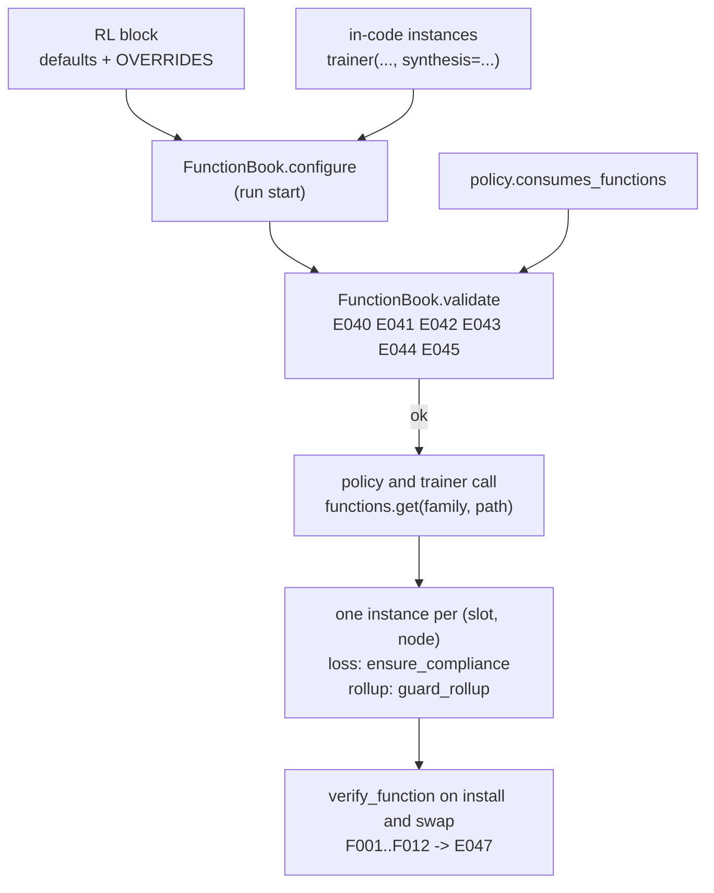

### 8.6 Rollup unification and the `RollupGuard`

#### 8.6.1 The two tables

`rollup` is the one family with a second hand-written registry: `ROLLUP_STRATEGIES` in
`mactf/scoring/hierarchy.py:97-106` (seven keys, including `kappa_weighted`) next to
`FUNCTION_TYPES["rollup"]` in `rl/functions/registry.py:32-39` (six keys, no
`kappa_weighted`). A rollup registered through `register_function("rollup", ...)` was
invisible to `build_rollup`, and a key added to `ROLLUP_STRATEGIES` was invisible to every
spec. After 8.2 there is one registry: `FUNCTION_TYPES["rollup"]` is a `LegacyTable` over
`rl_function.rollup` and carries `kappa_weighted` as a flagged alias. `ROLLUP_STRATEGIES`
becomes **the same object**:

```python
# mactf/scoring/hierarchy.py  (imports; replaces lines 97-127)
from ..components import HUB
from ..components.guards.rollup import guard_rollup
from ..rl.functions.registry import FUNCTION_TYPES, build_function

#: Registry keys used by ``RL.ROLLUP`` and by spec resolution: the same live object as
#: ``rl.functions.registry.ROLLUP_TYPES`` (a ``LegacyTable`` over ``rl_function.rollup``),
#: so a rollup registered anywhere is available everywhere.
ROLLUP_STRATEGIES = FUNCTION_TYPES["rollup"]
ROLLUP_TYPES = ROLLUP_STRATEGIES


def build_rollup(spec: Any, *, guard_mode: str = "enforce") -> Any:
    """Resolve a rollup from a strategy, a name, or a spec mapping.

    A rollup that is not one of the six built-in classes is wrapped in a ``RollupGuard``
    (8.6.2). The built-ins are returned as they are, ``ExplicitRollup`` included: an
    ``ExplicitRollup(fn)`` constructed in code is the documented "I own the whole output"
    exception (``rl/functions/rollup.py:293-301``). The ``RL.ROLLUP`` path is stricter and
    guards it too (``FunctionBook``, 8.4).
    """
    if spec is None:
        return KappaWeightedRollup()
    if isinstance(spec, RollupStrategy) or hasattr(spec, "rollup"):
        return guard_rollup(spec, mode=guard_mode, include_explicit=False)
    payload: dict[str, Any] = {"type": spec} if isinstance(spec, str) else dict(spec)
    if "import" not in payload:
        payload.setdefault("type", "kappa_weighted")
        registry = HUB.registry("rl_function.rollup")
        if not registry.has(str(payload["type"])):
            raise ValidationError(
                f"unknown rollup {payload['type']!r}; accepted: " + ", ".join(registry.names())
            )
    built = build_function(payload, family="rollup")
    return guard_rollup(built, mode=guard_mode, include_explicit=False)
```

Three compatibility facts, each tied to an existing test:

* `tests/hierarchy/test_rollup.py:131-142` builds every key and asserts
  `isinstance(built, ROLLUP_STRATEGIES[name])`. The six built-ins come back unwrapped, so it
  holds, and iterating the table still yields `kappa_weighted`.
* `tests/hierarchy/test_rollup.py:145-147` expects `requires an 'fn'` from
  `build_rollup("explicit")`. `build_function` constructs `ExplicitRollup()`, whose own
  `ValidationError` propagates unchanged.
* `tests/hierarchy/test_rollup.py:150-153` expects `unknown rollup` for `"median"`. The
  explicit registry check above produces that exact prefix, and now lists the registered
  names (a custom `median` registered earlier makes the same call succeed, which is the
  feature).

`HierarchicalScorer` gains one constructor argument and turns `rollup` into a property, so a
swap of the rollup slot takes effect without rebuilding the scorer:

```python
# mactf/scoring/hierarchy.py  (HierarchicalScorer: constructor and one property; line 146 onward)
    def __init__(
        self,
        pipeline_factory: Callable[[str], ScoringPipeline] | ScoringPipeline | None = None,
        *,
        rollup: Any = None,
        attribution: str = "rollup",
        non_offsettable: Iterable[str] | None = None,
        rollup_source: Callable[[], Any] | None = None,
    ) -> None:
        super().__init__()
        # ... pipeline_factory handling unchanged (lines 153-164)
        self._rollup: Any = build_rollup(rollup)
        self._rollup_source = rollup_source
        # ... attribution and non_offsettable unchanged (lines 166-173)

    @property
    def rollup(self) -> Any:
        """The strategy in force now: the source's choice when it has one, else the default."""
        if self._rollup_source is not None:
            chosen = self._rollup_source()
            if chosen is not None:
                return chosen
        return self._rollup

    @rollup.setter
    def rollup(self, value: Any) -> None:
        self._rollup = build_rollup(value)
```

Every reader of `self.rollup` (`score`, line 372; `describe`, line 383; the `score_tree`
metadata, line 289; the clone at line 882) goes through the property and needs no change.
`rollup_source` is `None` for every existing caller, so the property returns `_rollup`, which
is what the attribute held (invariant I1). The trainer passes the book:

```python
# mactf/training/trainer.py  (_build_scorer, lines 1001-1010)
    def _build_scorer(self) -> Any:
        if self._hierarchical_scorer is not None:
            return self._hierarchical_scorer
        if self._scorers_spec is not None:
            pipeline = build_scorer(self.settings, scorers=_as_scorers(self._scorers_spec))
        else:
            pipeline = build_scorer(self.settings)
        if self._hierarchy is not None:
            return HierarchicalScorer(pipeline, rollup_source=self._rollup_choice)
        return pipeline

    def _rollup_choice(self) -> Any:
        """The book's guarded rollup, or ``None`` so the scorer keeps its default."""
        return self.functions.get("rollup", "")
```

`self.functions` exists before `_build_scorer` runs because 8.5.4 creates it in
`__init__`. With `RL.ROLLUP` unset, `get` returns `None` and the scorer uses the
`KappaWeightedRollup` it always did.

#### 8.6.2 What the guard proves, and what it does not

A rollup's job is arithmetic over its children's amounts. Its *obligation*, from
`rl/functions/rollup.py:1-8` and `scoring/hierarchy.py:10-15`, is that it never launders a
void: the output's `void_rules` contain every child's. Every built-in except `ExplicitRollup`
meets that by construction through `_void_union` (`rollup.py:64-70`). A custom one can forget.

Two independent mechanisms protect the run:

1. `branch_void(tree, own_void)` (`coopetition/tree.py:1013-1029`) computes the void union from
   the **ledgers**, not from the rollup output, and `score_tree` passes it to every node's
   `score_peer` (`hierarchy.py:238-254`), which hands it to `constrain`. A node whose
   descendant breached a non-offsettable rule **takes the floor whatever the rollup says.**
   A custom rollup cannot change this.
2. The `RollupGuard` makes the *rollup's own output* honest, because that output is what the
   stage interface returns (`HierarchicalScorer.score`, `hierarchy.py:368-376`) and what a
   scorecard decomposition shows. Without it a plugin could report `void_rules=()` for a branch
   that is in fact void, and every dashboard reading that output would say the branch was
   clean.

| Code | Violation | Detected by |
|---|---|---|
| **C010** | `output.void_rules` is missing a rule that a child reported | set difference against the union of the children's `void_rules` |
| **C011** | The rollup raised, returned something other than a `ScorerOutput`, or returned a non-finite or non-numeric `amount` | exception, `isinstance`, `math.isfinite` |
| **C012** | The output carries `mutations` | `output.mutations` is non-empty; only the warning stage may emit them (6.4.1) |

`COMPLIANCE.GUARD_MODE` (6.4.2) selects the response, so one setting governs every guard:
`enforce` raises `ComplianceGuardViolation`; `fallback` returns what the reference
`KappaWeightedRollup` produces from the same inputs and records the substitution in
`RollupGuard.reports`. Neither mode lets a flawed output through, and `fallback` can only
**add** voids (the reference output carries the full union).

What the guard does **not** claim: that the rollup's *number* is a good aggregate. That is the
author's property and the contract probe (F001..F012) checks its shape and determinism.
A rollup that returns a large positive amount for a void branch changes the amount carried in
the `HIERARCHY` output; the node's `final_score` still comes from `constrain` with the full
`branch_void`, so the compliance floor holds.

```python
# mactf/components/guards/rollup.py
"""RollupGuard (document 17 section 8.6)."""

from __future__ import annotations

import logging
import math
from collections import deque
from typing import Any, Mapping, Sequence

from ...exceptions import ComplianceGuardViolation, ImproperlyConfigured
from ...rl.functions.rollup import (
    ExplicitRollup,
    KappaWeightedRollup,
    MeanRollup,
    MinimumRollup,
    SumRollup,
    WorstCaseRollup,
)
from ...scoring.base import ScorerOutput
from .compliance import GUARD_MODES, GuardReport, GuardViolation

log = logging.getLogger("mactf.components")

#: The built-in strategies that union their children's voids by construction
#: (``rl/functions/rollup.py:111-143`` ``_output`` and ``_void_union``).
UNION_BY_CONSTRUCTION: tuple[type, ...] = (
    KappaWeightedRollup, MeanRollup, MinimumRollup, SumRollup, WorstCaseRollup,
)


def _finite_number(value: Any) -> float | None:
    if isinstance(value, bool):
        return None
    try:
        number = float(value)
    except (TypeError, ValueError):
        return None
    return number if math.isfinite(number) else None


class RollupGuard:
    """Wraps a rollup and checks every output it produces.

    The wrapper answers to the same name as the strategy it wraps, so
    ``HierarchicalScorer.describe`` and the scorecard's ``rollup`` metadata read as before.
    """

    spec_family = "rollup"

    def __init__(self, inner: Any, *, mode: str = "enforce", label: str | None = None) -> None:
        if mode not in GUARD_MODES:
            raise ImproperlyConfigured(
                f"COMPLIANCE.GUARD_MODE must be one of {list(GUARD_MODES)}, got {mode!r}"
            )
        if not callable(getattr(inner, "rollup", None)):
            raise ImproperlyConfigured(
                f"RollupGuard needs an object with rollup(), got {type(inner).__name__}"
            )
        self.inner = inner
        self.mode = mode
        self.name = str(getattr(inner, "name", None) or type(inner).__name__)
        self.label = label or self.name
        self._reference = KappaWeightedRollup()
        #: The last 64 reports with a violation, newest last; empty on a clean run.
        self.reports: deque[GuardReport] = deque(maxlen=64)

    # -- the protocol method ------------------------------------------------------
    def rollup(
        self,
        parent: str,
        children: Sequence[ScorerOutput],
        *,
        weights: Mapping[str, float] | None = None,
        scores: Mapping[str, float] | None = None,
    ) -> ScorerOutput:
        failure: Exception | None = None
        try:
            produced = self.inner.rollup(parent, children, weights=weights, scores=scores)
        except Exception as error:  # noqa: BLE001 - a plugin's failure is a violation, not a crash
            failure = error
            produced = None
            violations = [self._violation(
                "C011", f"raised {type(error).__name__}: {error}", parent,
            )]
        else:
            violations = self._check(parent, children, produced)
        if not violations:
            return produced
        return self._resolve(parent, children, weights, scores, violations, failure)

    # -- checks ----------------------------------------------------------------
    def _violation(self, code: str, message: str, parent: str) -> GuardViolation:
        return GuardViolation(
            code=code, stage=f"rollup:{self.label}", kind="hierarchy",
            message=f"{message} (parent {parent!r})",
        )

    def _check(
        self, parent: str, children: Sequence[ScorerOutput], produced: Any,
    ) -> list[GuardViolation]:
        if not isinstance(produced, ScorerOutput):
            return [self._violation(
                "C011", f"returned {type(produced).__name__}; a rollup returns a ScorerOutput", parent,
            )]
        found: list[GuardViolation] = []
        if _finite_number(produced.amount) is None:
            found.append(self._violation(
                "C011", f"amount {produced.amount!r} is not a finite number", parent,
            ))
        required = {rule for child in children for rule in child.void_rules}
        missing = sorted(required - set(produced.void_rules))
        if missing:
            found.append(self._violation(
                "C010",
                f"void_rules is missing {missing} reported by the children; a rollup must carry "
                "every child's void set upward",
                parent,
            ))
        if produced.mutations:
            found.append(self._violation(
                "C012", "emitted warning mutations; only the warning stage may", parent,
            ))
        return found

    def _resolve(
        self,
        parent: str,
        children: Sequence[ScorerOutput],
        weights: Mapping[str, float] | None,
        scores: Mapping[str, float] | None,
        violations: list[GuardViolation],
        failure: Exception | None,
    ) -> ScorerOutput:
        report = GuardReport(
            mode=self.mode,
            violations=tuple(violations),
            substituted=(self.label,) if self.mode == "fallback" else (),
        )
        self.reports.append(report)
        if self.mode == "enforce":
            raise ComplianceGuardViolation([item.as_dict() for item in violations]) from failure
        log.warning(
            "rollup %s violated %s at %s; using the reference kappa rollup",
            self.label, [item.code for item in violations], parent,
        )
        return self._reference.rollup(parent, children, weights=weights, scores=scores)

    # -- reporting ------------------------------------------------------------------
    def describe(self) -> dict[str, Any]:
        inner = self.inner.describe() if callable(getattr(self.inner, "describe", None)) else {}
        return {
            "type": "guarded", "guard": "rollup", "mode": self.mode,
            "name": self.name, "inner": inner,
        }

    def __repr__(self) -> str:
        return f"<RollupGuard {self.label} mode={self.mode}>"


def guard_rollup(instance: Any, *, mode: str = "enforce", include_explicit: bool = True) -> Any:
    """Return ``instance`` unchanged if it is trusted, else wrapped in a ``RollupGuard``.

    ``None`` stays ``None`` (the caller reads it as "use the default"); an existing guard is
    not wrapped twice. ``include_explicit=False`` is the legacy ``build_rollup`` behaviour,
    where an in-code ``ExplicitRollup`` is the documented exception.
    """
    if instance is None or isinstance(instance, RollupGuard):
        return instance
    trusted = UNION_BY_CONSTRUCTION + (() if include_explicit else (ExplicitRollup,))
    if type(instance) in trusted:  # exact type: a subclass may override rollup()
        return instance
    return RollupGuard(instance, mode=mode)
```

`guard_rollup` tests `type(instance) in trusted`, not `isinstance`, because a subclass of
`MeanRollup` may override `rollup` and drop the union; an exact-type check keeps the fast path
for precisely the classes whose code the framework controls. `GuardViolation` and
`GuardReport` are the dataclasses of 6.4.3; the guard module imports them from the compliance
guard so a violation looks the same in every report.

`NestedValueFunction` (`rl/functions/value.py:351-390`) takes its own rollup argument and is
**not** guarded: it rolls *value estimates* up a tree, which shapes learning and never touches
a score or a void set. The `StepGuard` bounds what a bad value does to a step.

### 8.7 Synthesis unification and the `TensorSynthesisAdapter`

#### 8.7.1 Two layers, one name

`synthesis` has two protocols that share names and nothing else:

| | Tensor level | Node level |
|---|---|---|
| File | `rl/functions/support.py:600-610`, `630-750` | `coopetition/synthesis.py:82-107`, `110-325` |
| Call | `__call__(proposals, *, weights=None) -> Tensor` | `synthesize(node, proposals, *, scores, weights, task) -> Tensor` |
| Knows about | tensors | a `PeerNode`, child scores, kappa weights, the task |
| Registry | `FUNCTION_TYPES["synthesis"]` (5 built-ins) | `SYNTHESIS_TYPES` in `coopetition/synthesis.py:331-338` (6 built-ins, adds `concat`) |
| Who calls it | nothing in the engine | `MACTFTrainer` (`trainer.py:626`, `:1373`) |

The node-level built-ins already *delegate* to the tensor-level ones for the arithmetic
(`synthesis.py:122`, `:143`, `:211`), so the two layers agree on the maths today. What is
missing is any way for a **custom** tensor-level function to be used by the trainer, which is
the thing a researcher writing a new aggregation actually has.

The decision (recorded in D6's spirit, no silent fallback): **keep both layers and bridge them.**
The node-level table stays where it is and keeps its six built-ins, so `build_synthesis`,
`SYNTHESIS_TYPES` and every test that uses them are untouched. A function registered under
`rl_function.synthesis` that is *not* in the node-level table is wrapped in a
`TensorSynthesisAdapter` that supplies the node-level call. A **node-aware custom function**
(a class with `synthesize`) is also registered under `rl_function.synthesis`, because
the contract (below) accepts either entry method; it needs no adapter.

```python
# mactf/coopetition/synthesis.py  (imports; one new class attribute; new class and helper)
import inspect

# ConcatSynthesis (line 291) declares its own shape contract, so the probe must not demand
# the proposals' trailing shape back:
#     output_shape_rule = "free"          # new class attribute on ConcatSynthesis
# Every other built-in keeps the default, "same".


_ADAPTER_KEYWORDS = ("weights", "scores", "node", "task")


def _accepted_keywords(function: Any) -> tuple[frozenset[str], bool]:
    """The keyword names ``function`` declares among the four the adapter can offer, and
    whether it takes ``**kwargs``. Unknown signatures (builtins) are treated as ``weights``
    only, the protocol's one keyword."""
    try:
        signature = inspect.signature(function)
    except (TypeError, ValueError):
        return frozenset({"weights"}), False
    names: set[str] = set()
    var_keyword = False
    for name, parameter in signature.parameters.items():
        if parameter.kind is inspect.Parameter.VAR_KEYWORD:
            var_keyword = True
        elif parameter.kind in (inspect.Parameter.KEYWORD_ONLY, inspect.Parameter.POSITIONAL_OR_KEYWORD):
            if name in _ADAPTER_KEYWORDS:
                names.add(name)
    return frozenset(names), var_keyword


class TensorSynthesisAdapter(SynthesisFunction):
    """A tensor-level function (``__call__(proposals, *, weights=None)``) as a node-level one.

    Offered to the function, by keyword, when it declares them: ``weights`` (always, if it
    takes ``weights`` or ``**kwargs``), ``scores``, ``node`` and ``task``. A function that
    declares only ``proposals`` and ``weights`` is the common case and gets exactly the
    protocol call. ``weights`` is the kappa weight map when the trainer has one, else the
    child scores: a tensor-level function has one weight argument, and "how much to trust each
    child" is what both of them mean.
    """

    name = "tensor"

    def __init__(self, function: Any, *, name: str | None = None) -> None:
        if not callable(function):
            raise ValidationError(f"TensorSynthesisAdapter needs a callable, got {function!r}")
        rule = str(getattr(function, "output_shape_rule", "same"))
        if rule not in ("same", "free"):
            raise ValidationError(
                f"output_shape_rule must be 'same' or 'free', got {rule!r} on {type(function).__name__}"
            )
        self.function = function
        self.name = str(name or getattr(function, "name", None) or type(function).__name__)
        self.output_shape_rule = rule
        self._keywords, self._var_keyword = _accepted_keywords(function)

    def synthesize(self, node, proposals, *, scores=None, weights=None, task=None):
        if not proposals:
            raise ContractError(f"no proposals to synthesize for {node.path}")
        if self.output_shape_rule == "same":
            check_aligned(proposals, node=node.path)
        else:
            batch = None
            for path, tensor in proposals.items():
                if not torch.is_tensor(tensor):
                    raise ContractError(
                        f"synthesis at {node.path}: proposal from {path!r} is a "
                        f"{type(tensor).__name__}, not a tensor"
                    )
                size = int(tensor.shape[0]) if tensor.dim() else -1
                if batch is None:
                    batch = size
                elif size != batch:
                    raise ContractError(
                        f"synthesis at {node.path}: proposal from {path!r} has batch {size}, "
                        f"expected {batch}"
                    )
        offered: dict[str, Any] = {}
        if "weights" in self._keywords or self._var_keyword:
            merged = dict(weights) if weights else (dict(scores) if scores else None)
            offered["weights"] = merged
        if "scores" in self._keywords:
            offered["scores"] = dict(scores or {})
        if "node" in self._keywords:
            offered["node"] = node
        if "task" in self._keywords:
            offered["task"] = task
        result = self.function(dict(proposals), **offered)
        if not torch.is_tensor(result):
            raise ContractError(
                f"synthesis {self.name!r} returned {type(result).__name__}, expected a tensor"
            )
        first = next(iter(proposals.values()))
        if result.dim() == 0 or int(result.shape[0]) != int(first.shape[0]):
            raise ContractError(
                f"synthesis {self.name!r} at {node.path} returned shape {tuple(result.shape)}; "
                f"the leading dimension must be the batch ({int(first.shape[0])})"
            )
        if self.output_shape_rule == "same" and tuple(result.shape) != tuple(first.shape):
            raise ContractError(
                f"synthesis {self.name!r} at {node.path} returned shape {tuple(result.shape)}; "
                f"expected {tuple(first.shape)} (declare output_shape_rule = 'free' to change it)"
            )
        if not bool(torch.isfinite(result).all()):
            raise ContractError(f"synthesis {self.name!r} at {node.path} returned a non-finite value")
        return result

    # A learned tensor-level function owns parameters; expose them the way
    # ``LearnedSynthesizer`` (this module, line 221) does.
    def parameters(self):
        getter = getattr(self.function, "parameters", None)
        return tuple(getter()) if callable(getter) else ()

    def train(self, mode: bool = True):
        setter = getattr(self.function, "train", None)
        if callable(setter):
            setter(mode)
        return self

    def describe(self) -> dict[str, Any]:
        return {
            **super().describe(),
            "type": self.name,
            "function": type(self.function).__name__,
            "output_shape_rule": self.output_shape_rule,
        }


def adapt_synthesis(candidate: Any, *, name: str | None = None) -> SynthesisFunction:
    """Return a node-level function for ``candidate`` (a node-level object, or a tensor-level one)."""
    if isinstance(candidate, SynthesisFunction) or callable(getattr(candidate, "synthesize", None)):
        return candidate
    if inspect.isfunction(candidate) or inspect.ismethod(candidate) or inspect.isbuiltin(candidate):
        raise ValidationError(
            "a bare function is ambiguous between the tensor-level and node-level synthesis "
            "protocols; wrap it with ExplicitSynthesis(fn) for the node-level call, or register "
            "a class under rl_function.synthesis"
        )
    if callable(candidate):
        return TensorSynthesisAdapter(candidate, name=name)
    raise ContractError(f"{type(candidate).__name__} is not a synthesis function")
```

`ConcatSynthesis` is the only built-in that legitimately changes the trailing shape, which is
why it gets `output_shape_rule = "free"`. With `RL.VERIFY: all` the probe runs on built-ins
too (8.3); without that attribute it would report `F012` against a class that is correct.

#### 8.7.2 `build_synthesis`

The existing function (`synthesis.py:345-377`) resolves a name against the node-level table
only. It keeps doing exactly that first, and then consults the registry:

```python
# mactf/coopetition/synthesis.py  (replaces build_synthesis, lines 345-377)
def build_synthesis(spec: Mapping[str, Any] | str | SynthesisFunction | Any | None) -> SynthesisFunction:
    """Resolve a function from a name, a ``{"type": ..., **kwargs}`` spec, or an instance.

    Order: the node-level built-ins, then ``rl_function.synthesis`` (tensor-level or
    node-aware custom components), then an error that lists both. A custom component whose
    name equals a node-level built-in is refused (``E046``) instead of being silently
    shadowed.
    """
    from ..components import HUB
    from ..components.kinds import Origin

    if spec is None:
        return ConsensusSynthesis()
    if isinstance(spec, str):
        payload: dict[str, Any] = {"type": spec}
    elif isinstance(spec, Mapping):
        payload = dict(spec)
    else:
        return adapt_synthesis(spec)
    registry = HUB.registry("rl_function.synthesis")

    if "import" in payload:
        from ..rl.functions.registry import build_function

        return adapt_synthesis(build_function(payload, family="synthesis"), name=str(payload["import"]))

    type_name = payload.pop("type", None)
    if type_name is None:
        raise ValidationError(
            "a synthesis spec requires a 'type' key; accepted types: "
            + ", ".join(sorted(set(SYNTHESIS_TYPES) | set(registry.names())))
        )
    type_name = _ALIASES.get(str(type_name), str(type_name))
    registered = registry.find(type_name)

    if type_name in SYNTHESIS_TYPES:
        if registered is not None and registered.origin is not Origin.BUILTIN:
            raise ValidationError(
                f"E046: synthesis type {type_name!r} names both a node-level built-in and a "
                f"custom rl_function.synthesis component ({registered.origin.value}); the "
                "built-in would silently win. Register the custom function under another name."
            )
        cls = SYNTHESIS_TYPES[type_name]
        accepted = _constructor_keys(cls)
        unknown = sorted(set(payload) - accepted)
        if unknown:
            raise ValidationError(
                f"{cls.__name__} does not accept "
                + ", ".join(repr(key) for key in unknown)
                + f"; accepted keys: {', '.join(sorted(accepted)) or '(none)'}"
            )
        return cls(**payload)

    if registered is not None:
        return adapt_synthesis(registry.build(type_name, payload), name=type_name)
    raise ValidationError(
        f"unknown synthesis type {type_name!r}; accepted types: "
        + ", ".join(sorted(set(SYNTHESIS_TYPES) | set(registry.names())))
    )


# synthesis_capabilities() (line 381): node-level entries gain "level": "node"; one entry per
# registered component that is not already a node-level name is appended:
def synthesis_capabilities() -> list[dict[str, Any]]:
    from ..components import HUB

    entries: list[dict[str, Any]] = []
    for name in sorted(SYNTHESIS_TYPES):
        cls = SYNTHESIS_TYPES[name]
        entries.append({
            "type": name, "class": cls.__name__, "kwargs": sorted(_constructor_keys(cls)),
            "level": "node", "origin": "builtin",
        })
    for component in HUB.registry("rl_function.synthesis").components():
        if component.name in SYNTHESIS_TYPES:
            continue
        node_aware = callable(getattr(component.factory, "synthesize", None))
        entries.append({
            "type": component.name,
            "class": getattr(component.factory, "__name__", component.qualname),
            "kwargs": sorted(component.accepted_params()),
            "level": "node" if node_aware else "tensor",
            "origin": component.origin.value,
        })
    return entries
```

Existing behaviour is preserved case by case: the unknown-key text (`does not accept ...;
accepted keys: ...`) is the one at `synthesis.py:372-378`; `synthesis_capabilities()` keeps
the keys `type`, `class` and `kwargs` and adds `level` and `origin`. The `"best"` and
`"consensus"` names resolve to the node-level classes even though the tensor-level registry
also holds entries with those names, because those entries are `builtin` and the E046 check
exempts them: two built-ins that share a name were *already* the case and are intended to be
the same arithmetic.

#### 8.7.3 The contract accepts either entry method

The structural contract of 3.7 (`rl_function_contract`) required `__call__` for every family.
Synthesis alone has two legal entry methods, so its contract is replaced:

```python
# mactf/components/contracts.py  (new helpers; rl_function_contract and
# rl_function_instance_contract return these two for family == "synthesis")
def _defines(cls: Any, name: str) -> bool:
    """True if ``cls`` or a base other than ``object`` defines ``name`` in its own namespace.

    ``getattr(cls, "__call__")`` is *always* callable (it is ``type.__call__``), so asking the
    attribute proves nothing; the class dictionaries are what say whether the author wrote one.
    """
    return any(name in vars(klass) for klass in cls.__mro__ if klass is not object)


def synthesis_contract(factory: Any) -> list[str]:
    if not _is_class(factory):
        return [f"{factory!r} is not a class"]
    problems: list[str] = []
    if inspect.isabstract(factory):
        problems.append(f"abstract methods not implemented: {sorted(factory.__abstractmethods__)}")
    node_level = _defines(factory, "synthesize")
    tensor_level = _defines(factory, "__call__")
    if not node_level and not tensor_level:
        problems.append(
            "define synthesize(node, proposals, *, scores, weights, task) (node-aware) or "
            "__call__(proposals, *, weights=None) (tensor-level)"
        )
    if node_level:
        try:
            names = [
                name for name, parameter in inspect.signature(factory.synthesize).parameters.items()
                if name != "self" and parameter.kind in (
                    inspect.Parameter.POSITIONAL_ONLY, inspect.Parameter.POSITIONAL_OR_KEYWORD,
                )
            ]
        except (TypeError, ValueError):
            names = []
        if names[:2] != ["node", "proposals"]:
            problems.append(
                f"synthesize() must take (node, proposals, ...), found {names[:2] or 'no positional parameters'}"
            )
    rule = getattr(factory, "output_shape_rule", "same")
    if rule not in ("same", "free"):
        problems.append("class attribute 'output_shape_rule' must be 'same' or 'free'")
    return problems


def synthesis_instance_contract(instance: Any) -> list[str]:
    if callable(getattr(instance, "synthesize", None)) or callable(instance):
        return []
    return ["no synthesize() method and the instance is not callable"]


# in rl_function_contract(family) and rl_function_instance_contract(family), first line:
#     if family == "synthesis":
#         return synthesis_contract            # / synthesis_instance_contract
```

Rule `E046` and the contract together mean there is exactly one way to be a synthesis function
and no way to be one that the trainer cannot use.

#### 8.7.4 The trainer reads synthesis per node

```python
# mactf/training/trainer.py  (new method beside loss_for, section 7.4)
    def synthesis_for(self, path: str) -> Any:
        """The synthesis function in force for the parent ``path``: an ``RL.SYNTHESIS``
        override or default, else the one built from ``synthesis=`` (``ConsensusSynthesis``
        when that is unset)."""
        chosen = self.functions.get("synthesis", path)
        return chosen if chosen is not None else self.synthesis_function


# mactf/training/trainer.py  (step 3 of the episode, lines 1356-1381; the two edited lines marked)
        if self.synthesis_function is not None:
            for node in tree.walk("leaves-first"):
                # ... unchanged: skip leaves and failed nodes, build ``proposals`` (lines 1358-1371)
                synthesizer = self.synthesis_for(node.path)                    # new
                try:
                    synthesized = synthesizer.synthesize(                      # was self.synthesis_function.synthesize
                        node,
                        proposals,
                        scores=dict(self.signal_by_peer),
                        weights=dict(self._last_weights),
                        task=task,
                    )
                except Exception as error:  # noqa: BLE001
                    failed[node.path] = f"{type(error).__name__}: {error}"
                    self._fail_node(episode, node, failed[node.path])
                    continue
                # ... unchanged: replace the parent's logits when the shape matches (lines 1384-1390)
```

Two properties of the surrounding code carry the compliance argument, and neither changes.
Synthesis builds a **proposal**; the verifiable-rules judge (`TaskJudge`, `trainer.py:1392`)
runs *after* every synthesis and records rule events from the parent's own output, so a custom
function cannot pre-empt a rule. And a synthesis that raises fails **that node** through
`_fail_node` (a recorded, penalised failure, the same path a failed rollout takes), so a bad
plugin degrades one parent and does not abort the episode.

`self.synthesis_function` is still built from `synthesis=` at `trainer.py:626` and is now
resolved by the extended `build_synthesis`, so `MACTFTrainer(..., synthesis="median")` works
for a registered `median`, and `synthesis=MedianSynthesis()` (an instance) is adapted.

### 8.8 Changing a function while a run is live: swap, migrate, delete

#### 8.8.1 When each family may change

The boundary rule of 4.4 applies unchanged: a swap at boundary `b` is allowed iff
`rank(b) <= min(rank(old.mutability), rank(new.mutability))`. The mutability of a family comes
from `_STEP_FAMILIES` in `contracts.py` (3.7). A component may *declare itself stricter* than
its family (a `static` advantage that holds a fitted running statistic) and may not declare
itself looser.

| Family | Mutability | Swappable at | Typical state | Default migration |
|---|---|---|---|---|
| `loss`, `regularization`, `gradient`, `metric` | `step` | run start, episode boundary, between steps | `AccumulateGradient` holds a counter; a `metric` may hold a running mean | `carry`, falling back to `reset` when the old one has no state |
| `value` | `episode` | run start, episode boundary | parameters (`LinearValue`, `MLPValue`) and `state_dict` | `fail` (a value network is expensive to throw away and cannot be silently reset) |
| `advantage`, `return`, `reward`, `objective`, `action` | `episode` | run start, episode boundary | usually none | `reset` |
| `rollup` | `episode` | run start, episode boundary | none in the built-ins | `reset` |
| `synthesis` | `episode` | run start, episode boundary | parameters (`LearnedSynthesizer`, and a tensor-level `learned`) | `fail` when the old one has parameters, else `reset` |

`RL.MIGRATE` is the per-family override of the last column, `{FAMILY: reset | carry | fail}`;
the keys are added to the `RL` block's reserved set (8.5.2). It is a mapping and is
validated by `_validate_rl` like `OVERRIDES`:

```python
# mactf/conf.py  (_RL_RESERVED gains "MIGRATE"; _validate_rl gains this block after VERIFY)
    migrate = block.get("MIGRATE")
    if migrate is not None:
        if not isinstance(migrate, dict):
            raise ImproperlyConfigured("RL.MIGRATE must map FAMILY -> reset|carry|fail")
        for family_key, mode in migrate.items():
            if str(family_key).upper() not in families:
                raise ImproperlyConfigured(
                    f"RL.MIGRATE.{family_key}: unknown family; accepted: {sorted(families)}"
                )
            if str(mode).lower() not in {"reset", "carry", "fail"}:
                raise ImproperlyConfigured(
                    f"RL.MIGRATE.{family_key} must be 'reset', 'carry' or 'fail', got {mode!r}"
                )
```

A swap request names its own mode (`migrate: carry` in the API body, `migrate=` in code) and
that wins over `RL.MIGRATE`, which wins over the table above.

#### 8.8.2 `mactf/components/migrations.py`

A migration is a function `migrate(old, new) -> None` that runs **before** the slot is
rewritten and raises to abort the swap (the `Migrate` type of 4.4). There are four of them and
a selector. They operate on the *raw* instance, the one the component built, never on a guard
or compliance wrapper; the function book keeps the raw instance beside the wrapped one for
exactly this reason (8.8.3).

```python
# mactf/components/migrations.py
"""State migrations for a component swap (document 17 section 8.8)."""

from __future__ import annotations

import logging
from typing import Any, Callable, Mapping

import torch

from ..exceptions import ComponentMigrationError

log = logging.getLogger("mactf.components")

Migrate = Callable[[Any, Any], None]

MIGRATE_MODES: tuple[str, ...] = ("reset", "carry", "fail")

#: Defaults by family, the last column of the 8.8.1 table. A family not listed here uses "reset".
FAMILY_DEFAULTS: Mapping[str, str] = {
    "loss": "carry",
    "regularization": "carry",
    "gradient": "carry",
    "metric": "carry",
    "value": "fail",
    "synthesis": "fail",
}


def _parameters(instance: Any) -> list[torch.nn.Parameter]:
    getter = getattr(instance, "parameters", None)
    if not callable(getter):
        return []
    return [parameter for parameter in getter() if isinstance(parameter, torch.nn.Parameter)]


def _state(instance: Any) -> Any:
    getter = getattr(instance, "state_dict", None)
    if not callable(getter):
        return None
    return getter()


def is_stateful(instance: Any) -> bool:
    """True if discarding ``instance`` would lose something a run produced.

    An instance is stateful if it owns trainable parameters, or if it defines both
    ``state_dict`` and ``load_state_dict``: a class that can load state has declared that it
    has some. ``AccumulateGradient``, the learned value functions and a learned synthesizer
    qualify; ``ClipGradient`` and the other stateless built-ins do not.
    """
    if _parameters(instance):
        return True
    return callable(getattr(instance, "state_dict", None)) and callable(
        getattr(instance, "load_state_dict", None)
    )


def reset(old: Any, new: Any) -> None:
    """Discard the old state. The new instance starts from its own constructor state.

    Calls ``new.reset()`` when it exists, so an instance that was built eagerly and then
    touched (a probe, a dry run) is clean at the moment it takes over.
    """
    if is_stateful(old):
        log.warning(
            "swap discards the state of %s (reset); use carry or fail to keep or refuse",
            type(old).__name__,
        )
    clear = getattr(new, "reset", None)
    if callable(clear):
        clear()


def carry_parameters(old: Any, new: Any) -> None:
    """Copy trainable parameters from ``old`` to ``new`` by position.

    Both must expose the same number of parameters with equal shapes; anything else is a
    ``ComponentMigrationError``, never a partial copy. Used for value networks and learned
    synthesizers whose replacement has the same architecture and a different rule.
    """
    source, target = _parameters(old), _parameters(new)
    if not source:
        return
    if len(source) != len(target):
        raise ComponentMigrationError(
            f"cannot carry parameters: {type(old).__name__} has {len(source)}, "
            f"{type(new).__name__} has {len(target)}"
        )
    for index, (left, right) in enumerate(zip(source, target)):
        if tuple(left.shape) != tuple(right.shape):
            raise ComponentMigrationError(
                f"cannot carry parameters: parameter {index} is {tuple(left.shape)} in "
                f"{type(old).__name__} and {tuple(right.shape)} in {type(new).__name__}"
            )
    with torch.no_grad():
        for left, right in zip(source, target):
            right.copy_(left.detach().to(right.device, right.dtype))


def carry_state(old: Any, new: Any) -> None:
    """Load ``old.state_dict()`` into ``new``; copy parameters when there is no state to load.

    The old instance being stateless is fine (nothing to carry). The old instance being
    stateful and the new one unable to load it is not: that is exactly the silent loss the
    mode exists to prevent, so it raises.
    """
    if not is_stateful(old):
        return
    payload = _state(old)
    loader = getattr(new, "load_state_dict", None)
    if isinstance(payload, Mapping) and payload and callable(loader):
        try:
            loader(dict(payload))
        except Exception as error:  # noqa: BLE001 - surfaced as a migration failure
            raise ComponentMigrationError(
                f"{type(new).__name__}.load_state_dict rejected the state of "
                f"{type(old).__name__}: {error}"
            ) from error
        return
    if _parameters(old):
        carry_parameters(old, new)
        return
    raise ComponentMigrationError(
        f"{type(old).__name__} carries state but {type(new).__name__} has no load_state_dict; "
        "choose migrate: reset to discard it explicitly"
    )


def fail_if_stateful(old: Any, new: Any) -> None:
    """Refuse the swap when the old instance holds state."""
    if is_stateful(old):
        raise ComponentMigrationError(
            f"{type(old).__name__} holds state and the swap was requested with migrate: fail; "
            "use migrate: carry or migrate: reset to proceed"
        )


_MODES: Mapping[str, Migrate] = {
    "reset": reset,
    "carry": carry_state,
    "fail": fail_if_stateful,
}


def migration_for(mode: str | None, *, family: str = "", override: Mapping[str, str] | None = None) -> Migrate:
    """Pick the migration. Order: the request's ``mode``, ``RL.MIGRATE[family]``, the family default."""
    chosen = mode or (dict(override or {}).get(family)) or FAMILY_DEFAULTS.get(family, "reset")
    chosen = str(chosen).lower()
    if chosen not in _MODES:
        raise ComponentMigrationError(
            f"unknown migration {chosen!r}; accepted: {list(MIGRATE_MODES)}"
        )
    return _MODES[chosen]


def state_digest(instance: Any) -> str:
    """A short stable digest of ``instance``'s state, for swap records and tests."""
    import hashlib
    import json

    state = _state(instance)
    parameters = [parameter.detach().cpu().flatten().tolist() for parameter in _parameters(instance)]
    blob = json.dumps({"state": state, "parameters": parameters}, sort_keys=True, default=str)
    return hashlib.sha256(blob.encode("utf-8")).hexdigest()[:16]
```

`ComponentMigrationError` is added to `mactf/exceptions.py` beside `ComponentLocked` (17.1) with
the code `E048`. A migration that raises leaves the old function in place and running: the
function book runs every migration before it commits anything, as 8.8.3 shows.

`carry_state` on the two stateful built-ins that matter:

| Old | New | Result |
|---|---|---|
| `AccumulateGradient(n=4)` at `count=3` | `AccumulateGradient(n=8)` | `load_state_dict` sets `_count = 3` (`support.py:435`); the next call is the 4th of an 8-call window, and an accumulation window is neither dropped nor restarted |
| `AccumulateGradient` | `ClipGradient` | the old is stateful, the new has no `load_state_dict`, no parameters: `ComponentMigrationError` (E048) with the hint to use `migrate: reset` |
| `LearnedSynthesizer` | `LearnedSynthesizer` of the same width | no `load_state_dict` in the node-level class (it exposes `parameters()`), so `carry_parameters` copies by position |
| `LearnedSynthesizer` | `LearnedSynthesizer` of another width | `carry_parameters` shape check: `ComponentMigrationError`, swap aborted |
| `ClipGradient` | anything | stateless, nothing to carry |

#### 8.8.3 The book swaps per-node instances atomically

The slot stores a **prototype**; the instances doing the work are the per-node ones in the
book's cache (8.4 rule 1). A migration that ran on prototypes would migrate nothing real:
`AccumulateGradient`'s counter lives on the instance built for `peer-b`, not on the
prototype. The book therefore stages the migration on the per-node instances and commits
only if every node migrated:

```python
# mactf/components/function_book.py  (replaces _Cached, _adopted, _build_for_node, _instance,
# swap_default, swap_override, _swap, remove_default, remove_override, forget; adds request,
# apply_pending, drop_pending, state_dict, load_state_dict)
from .migrations import migration_for


@dataclass
class _Cached:
    resolved: Resolved
    raw: Any          # what the component built; migrations operate on this
    instance: Any     # raw wrapped by the compliance or rollup guard, if the family has one
```

```python
    # -- building ------------------------------------------------------------------
    @staticmethod
    def _adopted(resolved: Resolved) -> bool:
        existing = HUB.registry(resolved.component.kind_id).find(resolved.component.name)
        return existing is None or existing.factory is not resolved.component.factory

    def _build_raw(self, family: str, resolved: Resolved) -> Any:
        """The raw instance one node uses for ``resolved`` (no guards applied)."""
        if self._adopted(resolved):
            if family == "synthesis":
                from ..coopetition.synthesis import adapt_synthesis

                return adapt_synthesis(resolved.instance, name=resolved.component.name)
            return resolved.instance
        params = dict(resolved.spec.params)
        if family == "synthesis":
            from ..coopetition.synthesis import build_synthesis

            return build_synthesis({"type": resolved.component.name, **params})
        return HUB.registry(resolved.component.kind_id).build(resolved.component.name, params)

    def _guard(self, family: str, raw: Any) -> Any:
        if family == "loss":
            from .loss_compliance import ensure_compliance

            return ensure_compliance(
                raw, mode=self.settings.loss_compliance,
                coefficient=self.settings.compliance_coefficient,
            )
        if family == "rollup":
            from .guards.rollup import guard_rollup

            return guard_rollup(raw, mode=self.settings.guard_mode, include_explicit=True)
        return raw

    def _instance(self, family: str, slot: Slot, path: str) -> Any:
        key = (family, slot.path, path)
        with self._lock:
            cached = self._cache.get(key)
            if cached is not None and cached.resolved is slot.resolved:
                return cached.instance
            raw = self._build_raw(family, slot.resolved)
            instance = self._guard(family, raw)
            self._cache[key] = _Cached(slot.resolved, raw, instance)
            return instance

    # -- swapping ---------------------------------------------------------------------
    def swap_default(
        self, family: str, raw: Any, *, boundary: Boundary, migrate: str | None = None,
    ) -> Any:
        return self._swap(family, _default_path(family), raw, boundary, migrate)

    def swap_override(
        self, family: str, glob: str, raw: Any, *, boundary: Boundary, migrate: str | None = None,
    ) -> Any:
        if family in GLOBAL_ONLY:
            raise ImproperlyConfigured(f"E042: {family!r} has no per-node overrides")
        return self._swap(family, _override_path(family, glob), raw, boundary, migrate)

    def _swap(self, family: str, path: str, raw: Any, boundary: Boundary, mode: str | None) -> Any:
        kind_id = f"rl_function.{family}"
        with self._lock:
            if path not in self._slots.paths():
                # Adding a slot is an install, allowed only where the family can be installed.
                if boundary.rank > Boundary.EPISODE.rank:
                    raise ComponentLocked(kind_id, path, "a new slot can only be installed at run_start or episode")
                return self._install(family, path, raw)
            spec = ComponentSpec.parse(kind_id, raw)
            candidate = self._resolver.resolve(spec, trusted=self._trusted)
            self._verify(family, candidate)            # 1. the probe (E047), nothing committed yet
            migrate = migration_for(mode, family=family, override=self.settings.migrate)
            staged = self._stage(family, path, candidate, migrate)  # 2. migrate every live node (E048)
            record = self._slots.swap(path, spec, boundary=boundary)  # 3. lock, mutability, commit
            slot = self._slots.get(path)
            for node, (old_raw, new_raw) in staged.items():  # 4. adopt the staged instances
                self._cache[(family, path, node)] = _Cached(
                    slot.resolved, new_raw, self._guard(family, new_raw),
                )
            return record

    def _stage(
        self, family: str, path: str, candidate: Resolved, migrate: Callable[[Any, Any], None],
    ) -> dict[str, tuple[Any, Any]]:
        """Build and migrate a new instance for every node that already has a live one.

        Nodes that never called the function have nothing to migrate and will build from the
        new slot on first use. Any exception propagates out of ``_swap`` before step 3, so a
        failed migration leaves every node on its old instance.
        """
        staged: dict[str, tuple[Any, Any]] = {}
        for (cached_family, cached_path, node), cached in list(self._cache.items()):
            if cached_family != family or cached_path != path:
                continue
            new_raw = self._build_raw(family, candidate)
            migrate(cached.raw, new_raw)
            staged[node] = (cached.raw, new_raw)
        return staged
```

If step 3 raises (`ComponentLocked` because the boundary is too early, or the slot is in
`COMPONENTS.LOCKED`), the staged instances are never installed: the old per-node instances are
untouched in the cache and the slot still points at the old `Resolved`. If a migration at step
2 raised, step 3 never ran. In both cases **the failed swap has no observable effect**,
which is what `test_swap_is_atomic` pins (19.6).

A swap that is requested mid-episode is queued and applied at the next boundary. The book owns
its own queue, because per-node migration needs the cache; it does not use `SlotTable.request`:

```python
    # -- queued swaps ---------------------------------------------------------------------
    def request(
        self, family: str, glob: str | None, raw: Any, *, migrate: str | None = None,
    ) -> str:
        """Queue a swap for the next episode boundary. Validates and probes *now*.

        ``glob=None`` addresses the family default. Returns the slot path that was queued.
        """
        kind_id = f"rl_function.{family}"
        path = _default_path(family) if glob is None else _override_path(family, glob)
        if glob is not None and family in GLOBAL_ONLY:
            raise ImproperlyConfigured(f"E042: {family!r} has no per-node overrides")
        with self._lock:
            if path in self._slots.paths() and self._slots._slot_locked(path):
                raise ComponentLocked(kind_id, path, "the slot is locked by COMPONENTS.LOCKED")
            spec = ComponentSpec.parse(kind_id, raw)
            candidate = self._resolver.resolve(spec, trusted=self._trusted)
            self._verify(family, candidate)
            migration_for(migrate, family=family, override=self.settings.migrate)  # validates the mode
            self._pending[path] = (family, spec, migrate)
        return path

    def drop_pending(self, path: str) -> bool:
        with self._lock:
            return self._pending.pop(path, None) is not None

    def pending(self) -> dict[str, dict[str, Any]]:
        with self._lock:
            return {
                path: {"family": family, "spec": spec.canonical(), "migrate": migrate}
                for path, (family, spec, migrate) in self._pending.items()
            }

    def apply_pending(self, boundary: Boundary) -> list[Any]:
        """Apply every queued swap the boundary permits. A swap that fails stays reported, not queued."""
        applied: list[Any] = []
        with self._lock:
            for path in sorted(self._pending):
                family, spec, migrate = self._pending[path]
                try:
                    applied.append(self._swap(family, path, spec, boundary, migrate))
                except ComponentLocked:
                    continue              # a stricter boundary is needed; stays queued
                except Exception as error:  # noqa: BLE001 - one bad swap must not block the others
                    log.error("queued swap of %s failed and was dropped: %s", path, error)
                    self.failed_swaps.append({"slot": path, "error": f"{type(error).__name__}: {error}"})
                del self._pending[path]
        return applied
```

`self._pending: dict[str, tuple[str, ComponentSpec, str | None]]`, `self.failed_swaps: list[dict]`
and `BookSettings.migrate: Mapping[str, str]` (default empty, filled from `RL.MIGRATE`) are
declared in `__init__` and `BookSettings`. The engine reads `failed_swaps` into the episode
metadata, so a queued swap that could not be applied is visible rather than silent.

#### 8.8.4 Deleting a function slot

`remove_default` and `remove_override` (8.4) delete a slot. What the nodes use afterwards is
defined, per family, as "the behaviour with no `RL` block at all":

```python
    # -- deleting ---------------------------------------------------------------------------
    def remove_default(self, family: str, *, boundary: Boundary) -> Any:
        """Delete the default: nodes without an override go back to the built-in behaviour."""
        return self._remove(family, _default_path(family), boundary)

    def remove_override(self, family: str, glob: str, *, boundary: Boundary) -> Any:
        """Delete one override: its nodes fall back to the next most specific match, or the default."""
        return self._remove(family, _override_path(family, glob), boundary)

    def _remove(self, family: str, path: str, boundary: Boundary) -> Any:
        with self._lock:
            record = self._slots.remove(path, boundary=boundary)
            for key in [key for key in self._cache if key[0] == family and key[1] == path]:
                dropped = self._cache.pop(key)
                if is_stateful(dropped.raw):
                    log.warning("removing %s discards the state of node %r", path, key[2])
            self._pending.pop(path, None)
            return record

    def forget(self, node_path: str) -> None:
        """Drop cached instances of a node that left the tree (called by MutationPlan, 12.5)."""
        with self._lock:
            for key in [key for key in self._cache if key[2] == node_path]:
                del self._cache[key]
```

(`is_stateful` is imported from `migrations`.) Deleting is **never** a way to turn compliance
off, and the table says why for each family:

| Family | After `remove_default` | Compliance consequence |
|---|---|---|
| `loss` | the trainer's `loss_function` (the `LOSS` block, `CompositeLoss` by default) | none: that one carries `compliance_floor` |
| `advantage`, `action`, `regularization`, `metric` | the `DefaultTrainPolicy` original expression (7.3) | none: the void floor is re-applied around any advantage |
| `rollup` | `KappaWeightedRollup` | none |
| `synthesis` | the trainer's `synthesis_function`, `ConsensusSynthesis` by default | none |
| `value`, `return`, `reward`, `objective`, `gradient` | the consuming policy's own behaviour | the policy's `StepGuard` still applies (7.6) |

Removal re-runs `validate(initial=False)` (the engine does this, 12.5), so removing the *only*
override under an `RL.OVERRIDES.ADVANTAGE` glob produces `W011`, not an error, and a removal
that leaves a family configured but unconsumed cannot happen: removing slots never adds a
configured family.

#### 8.8.5 Function state in the checkpoint

`FunctionBook` is the only place that knows which per-node instances hold state, so it owns
their persistence. The result is stored by the trainer under `state["functions"]` (14.3).

```python
    # -- persistence ------------------------------------------------------------------------
    def state_dict(self) -> dict[str, Any]:
        """State of every live per-node instance that has any, keyed by slot and node."""
        entries: list[dict[str, Any]] = []
        with self._lock:
            for (family, path, node), cached in sorted(self._cache.items()):
                getter = getattr(cached.raw, "state_dict", None)
                if not callable(getter) or not is_stateful(cached.raw):
                    continue
                entries.append({
                    "family": family, "slot": path, "node": node,
                    "spec_hash": cached.resolved.spec_hash,
                    "component": cached.resolved.component.name,
                    "state": getter(),
                })
        return {"version": 1, "entries": entries}

    def load_state_dict(self, payload: Mapping[str, Any], *, strict: bool = False) -> list[str]:
        """Restore per-node state. Returns warnings; raises on mismatch when ``strict``.

        A saved entry is applied only when the slot still exists and still has the spec it
        had when the state was saved. State from a different spec is not loadable (a counter
        from ``n=4`` is not a counter for ``n=8``): that is ``W012``, or ``E049`` when strict.
        """
        warnings: list[str] = []
        for entry in list(dict(payload or {}).get("entries", [])):
            family, path, node = str(entry["family"]), str(entry["slot"]), str(entry["node"])
            problem: str | None = None
            if path not in self._slots.paths():
                problem = f"slot {path} is not configured any more"
            else:
                slot = self._slots.get(path)
                if slot.resolved.spec_hash != entry.get("spec_hash"):
                    problem = (
                        f"slot {path} now holds {slot.component.name!r} with a different spec "
                        f"than the saved {entry.get('component')!r}"
                    )
            if problem is not None:
                if strict:
                    raise ComponentMigrationError(f"E049: cannot restore state for {node!r}: {problem}")
                warnings.append(f"W012: state for {family}/{node} dropped: {problem}")
                continue
            self._instance(family, self._slots.get(path), node)         # builds and caches it
            cached = self._cache[(family, path, node)]
            loader = getattr(cached.raw, "load_state_dict", None)
            if not callable(loader):
                warnings.append(f"W012: {family}/{node}: {type(cached.raw).__name__} has no load_state_dict")
                continue
            loader(dict(entry.get("state") or {}))
        for text in warnings:
            log.warning(text)
        return warnings
```

`strict` is `COMPONENTS.STRICT_RESTORE` (14.4). A run restored with the same settings gets the
same spec hashes, so the common case loads everything; a team that edits `RL` between
save and resume gets a warning for each function whose configuration changed instead of
having its counters loaded into a different rule.

```mermaid
sequenceDiagram
    participant API as caller (API / code)
    participant Book as FunctionBook
    participant Slots as SlotTable
    participant Node as per-node instances

    API->>Book: request(family, glob, spec, migrate)
    Book->>Book: resolve + verify_function (E047)
    Note over Book: queued until the episode boundary
    Book->>Book: apply_pending(EPISODE)
    Book->>Book: resolve + verify again
    Book->>Node: migrate(old raw, new raw) for every live node (E048)
    alt a migration or the probe fails
        Book-->>API: error recorded in failed_swaps; old instances untouched
    else all nodes migrated
        Book->>Slots: swap(path, spec, boundary)
        alt locked or too early
            Slots-->>Book: ComponentLocked; staged instances discarded
        else committed
            Book->>Node: install staged instances (guards re-applied)
            Slots-->>API: SwapRecord
        end
    end
```

### 8.9 Worked examples

All four are complete modules. Each is shown with its registration, the YAML that selects it
and the test that proves it. They are written so they pass `check_function` (8.3) with
`RL.VERIFY: all`, which is the property a reader can copy.

#### 8.9.1 `ClippedAdvantage`: an advantage that bounds its tails

```python
# my_project/rl_functions.py
from __future__ import annotations

from typing import Any, ClassVar

import torch

from mactf.components import register_function
from mactf.exceptions import ValidationError
from mactf.rl.advantage import AdvantageBatch
from mactf.rl.functions.advantage import GAEAdvantage


@register_function("advantage", "clipped", version="1",
                   description="GAE advantages clipped to [-clip, clip]")
class ClippedAdvantage:
    """Generalised advantage estimation with symmetric clipping.

    Delegates to ``GAEAdvantage`` so the estimator is the framework's, and clips afterwards.
    Returns are rebuilt as ``advantages + values`` so ``returns - values == advantages`` still
    holds, which is the identity the training step relies on.
    """

    spec_family: ClassVar[str] = "advantage"
    spec_type: ClassVar[str] = "clipped"

    def __init__(self, *, clip: float = 5.0) -> None:
        if float(clip) <= 0.0:
            raise ValidationError(f"clip must be positive, got {clip!r}")
        self.clip = float(clip)
        self._inner = GAEAdvantage()

    def __call__(
        self, rewards, values, *, next_values=None, masks=None, reference=None,
        gamma: float = 0.99, lam: float = 0.95,
    ) -> AdvantageBatch:
        base = self._inner(
            rewards, values, next_values=next_values, masks=masks, reference=reference,
            gamma=gamma, lam=lam,
        )
        advantages = base.advantages.clamp(min=-self.clip, max=self.clip)
        returns = advantages + torch.as_tensor(values).float().reshape_as(advantages)
        return AdvantageBatch(advantages=advantages, returns=returns)

    def describe(self) -> dict[str, Any]:
        return {"type": self.spec_type, "class": type(self).__name__, "clip": self.clip}
```

```yaml
RL:
  ADVANTAGE: {type: clipped, params: {clip: 3.0}}
  OVERRIDES:
    ADVANTAGE:
      "peer-b*": {type: clipped, params: {clip: 1.0}}
```

```python
# tests/components/test_clipped_advantage.py
import torch

from my_project.rl_functions import ClippedAdvantage


def test_clip_bounds_and_identity() -> None:
    function = ClippedAdvantage(clip=0.5)
    rewards = torch.tensor([[10.0, -10.0, 0.1]])
    values = torch.zeros(1, 3)
    batch = function(rewards, values, next_values=torch.zeros(1, 3))
    assert float(batch.advantages.abs().max()) <= 0.5 + 1e-6
    assert torch.allclose(batch.returns - values, batch.advantages)
```

Under the default policy, `advantage` is consumed (8.5.3), the void floor is re-applied after
the function returns (7.3 rule 1), and the clip therefore can only shrink what the function
reports; the floor still takes void rows to the least advantage.

#### 8.9.2 `L1AnnealRegularization`: a regularizer with a coefficient schedule

```python
# my_project/rl_functions.py   (continued)
@register_function("regularization", "l1_anneal", version="1",
                   description="L1 penalty whose coefficient decays linearly over `steps` calls")
class L1AnnealRegularization:
    """``coefficient * (1 - t/steps) * sum(|p|)`` over trainable parameters.

    The call counter ``t`` is real state, so it implements ``state_dict`` / ``load_state_dict``
    and ``reset`` (8.8.2): a resumed run continues the schedule, and a swap with
    ``migrate: carry`` into another ``l1_anneal`` keeps the position.
    """

    spec_family: ClassVar[str] = "regularization"
    spec_type: ClassVar[str] = "l1_anneal"

    def __init__(self, *, coefficient: float = 1e-4, steps: int = 1000) -> None:
        if float(coefficient) < 0.0:
            raise ValidationError(f"coefficient must be >= 0, got {coefficient!r}")
        if int(steps) < 1:
            raise ValidationError(f"steps must be >= 1, got {steps!r}")
        self.coefficient = float(coefficient)
        self.steps = int(steps)
        self._calls = 0

    def _scale(self) -> float:
        return max(0.0, 1.0 - self._calls / self.steps)

    def __call__(self, module: torch.nn.Module) -> torch.Tensor:
        total = None
        for parameter in module.parameters():
            if not parameter.requires_grad:
                continue
            term = parameter.abs().sum()
            total = term if total is None else total + term
        scale = self._scale()
        self._calls += 1
        if total is None:
            return torch.zeros(())
        return self.coefficient * scale * total

    def reset(self) -> None:
        self._calls = 0

    def state_dict(self) -> dict[str, Any]:
        return {"type": self.spec_type, "class": type(self).__name__,
                "coefficient": self.coefficient, "steps": self.steps, "calls": self._calls}

    def load_state_dict(self, payload) -> None:
        self._calls = int(payload.get("calls", 0))

    def describe(self) -> dict[str, Any]:
        return {"type": self.spec_type, "class": type(self).__name__,
                "coefficient": self.coefficient, "steps": self.steps, "calls": self._calls}
```

`is_stateful` (8.8.2) reads this class as stateful because it defines both `state_dict` and
`load_state_dict`, so `migrate: carry` copies the counter and `migrate: fail` refuses the swap.

```yaml
RL:
  REGULARIZATION: {type: l1_anneal, params: {coefficient: 0.001, steps: 500}}
  MIGRATE: {REGULARIZATION: carry}
```

```python
# tests/components/test_l1_anneal.py
import torch

from mactf.components.migrations import carry_state, fail_if_stateful, is_stateful
from my_project.rl_functions import L1AnnealRegularization


def test_schedule_decays_and_state_carries() -> None:
    module = torch.nn.Linear(2, 2)
    old = L1AnnealRegularization(coefficient=1.0, steps=4)
    first = float(old(module))
    old(module)
    assert is_stateful(old)
    new = L1AnnealRegularization(coefficient=1.0, steps=4)
    carry_state(old, new)
    assert float(new(module)) < first                      # picks up at step 2, not step 0
    try:
        fail_if_stateful(old, new)
    except Exception as error:
        assert "migrate: fail" in str(error)
    else:  # pragma: no cover
        raise AssertionError("fail_if_stateful must refuse a stateful instance")
```

#### 8.9.3 `TrimmedMeanRollup`: a rollup that guards itself and passes the guard

```python
# my_project/rollups.py
from __future__ import annotations

from typing import Any, ClassVar, Mapping, Sequence

from mactf.components import register_function
from mactf.exceptions import ValidationError
from mactf.rl.functions.rollup import _RollupBase
from mactf.scoring.base import ScorerOutput


@register_function("rollup", "trimmed_mean", version="1",
                   description="Mean of child amounts after dropping the highest and lowest `trim`")
class TrimmedMeanRollup(_RollupBase):
    """A robust aggregate: one wild child cannot move the parent.

    Built on ``_RollupBase`` so ``void_rules`` comes from ``_output`` (the union of every
    child's), which is what ``RollupGuard`` C010 checks. A rollup that builds its own
    ``ScorerOutput`` must write ``void_rules`` as the union of its children's itself.
    """

    spec_type: ClassVar[str] = "trimmed_mean"
    name: ClassVar[str] = "trimmed_mean"

    def __init__(self, *, trim: int = 1, **base: Any) -> None:
        super().__init__(**base)
        if int(trim) < 0:
            raise ValidationError(f"trim must be >= 0, got {trim!r}")
        self.trim = int(trim)

    def rollup(
        self, parent: str, children: Sequence[ScorerOutput], *,
        weights: Mapping[str, float] | None = None, scores: Mapping[str, float] | None = None,
    ) -> ScorerOutput:
        resolved, _ = self._prepare(parent, children, weights)
        if not children:
            return self._output(parent, 0.0, children, weights=[], extras={"trim": self.trim})
        order = sorted(range(len(children)), key=lambda index: float(children[index].amount))
        keep = order[self.trim: len(order) - self.trim] if len(order) > 2 * self.trim else order
        amount = sum(float(children[index].amount) for index in keep) / len(keep)
        used = [resolved[index] if index in keep else 0.0 for index in range(len(children))]
        return self._output(
            parent, amount, children, weights=used,
            extras={"trim": self.trim, "kept": len(keep), "dropped": len(children) - len(keep)},
        )

    def describe(self) -> dict[str, Any]:
        return {**super().describe(), "trim": self.trim}
```

A version that returns `ScorerOutput(...)` without the union is what `C010` rejects, and the
guard test builds exactly that to show the response:

```python
# tests/components/test_trimmed_mean_rollup.py
import pytest

from mactf.components.guards.rollup import RollupGuard
from mactf.exceptions import ComplianceGuardViolation
from mactf.scoring.base import ScorerOutput, ScoringKind
from my_project.rollups import TrimmedMeanRollup


def _child(amount: float, void=()) -> ScorerOutput:
    return ScorerOutput(kind=ScoringKind.PENALTY, amount=amount, void_rules=tuple(void))


def test_union_survives_trimming() -> None:
    guard = RollupGuard(TrimmedMeanRollup(trim=1))
    children = [_child(9.0, ["P1"]), _child(2.0), _child(3.0), _child(4.0), _child(1.0)]
    out = guard.rollup("root", children)
    assert out.amount == 3.0                   # 9.0 and 1.0 trimmed; mean of 2, 3, 4
    assert out.void_rules == ("P1",)           # the trimmed child's void is still carried up


class Forgetful:
    name = "forgetful"

    def rollup(self, parent, children, *, weights=None, scores=None):
        return ScorerOutput(kind=ScoringKind.HIERARCHY, amount=0.0)   # drops every void


def test_laundering_is_caught_in_enforce_mode_and_repaired_in_fallback() -> None:
    children = [_child(1.0, ["P2"])]
    with pytest.raises(ComplianceGuardViolation):
        RollupGuard(Forgetful(), mode="enforce").rollup("root", children)
    repaired = RollupGuard(Forgetful(), mode="fallback").rollup("root", children)
    assert repaired.void_rules == ("P2",)
```

In the first test the child that breached `P1` has the **highest** amount, so it is exactly the
one the trim drops from the average. The void is still in the output because `_output` takes
the union from **all** `children`, not from the ones it kept. That is the property that makes
a trimmed aggregate safe to use at all, and what `C010` would catch in an implementation that
took the union from `keep`.

```yaml
RL:
  ROLLUP: {type: trimmed_mean, params: {trim: 1}}
```

#### 8.9.4 `MedianSynthesis`: a tensor-level synthesis through the adapter

```python
# my_project/synthesis.py
from __future__ import annotations

from typing import Any, ClassVar, Mapping

import torch

from mactf.components import register_function


@register_function("synthesis", "median", version="1",
                   description="Element-wise median of the children's proposals")
class MedianSynthesis:
    """Tensor-level: ``__call__(proposals, *, weights=None) -> Tensor``.

    ``weights`` is accepted and ignored (a median is unweighted), which the protocol allows.
    ``TensorSynthesisAdapter`` (8.7.1) supplies the node-level call, so this class needs no
    knowledge of nodes, scores or the task.
    """

    spec_family: ClassVar[str] = "synthesis"
    spec_type: ClassVar[str] = "median"

    def __call__(
        self, proposals: Mapping[str, torch.Tensor], *, weights: Mapping[str, float] | None = None,
    ) -> torch.Tensor:
        stacked = torch.stack([proposals[key] for key in sorted(proposals)], dim=0)
        return stacked.median(dim=0).values

    def describe(self) -> dict[str, Any]:
        return {"type": self.spec_type, "class": type(self).__name__}
```

```python
# tests/components/test_median_synthesis.py
import torch

from mactf.coopetition.synthesis import TensorSynthesisAdapter, build_synthesis
from my_project.synthesis import MedianSynthesis


class _Node:
    path = "root"


def test_adapter_runs_the_node_level_call() -> None:
    adapter = TensorSynthesisAdapter(MedianSynthesis())
    proposals = {
        "a": torch.tensor([[1.0, 5.0]]),
        "b": torch.tensor([[2.0, 4.0]]),
        "c": torch.tensor([[9.0, 0.0]]),
    }
    out = adapter.synthesize(_Node(), proposals, scores={"a": 1.0, "b": 1.0, "c": 1.0}, weights=None)
    assert torch.equal(out, torch.tensor([[2.0, 4.0]]))


def test_registered_name_resolves_through_build_synthesis() -> None:
    built = build_synthesis("median")
    assert isinstance(built, TensorSynthesisAdapter)
    assert built.describe()["function"] == "MedianSynthesis"
```

```yaml
RL:
  SYNTHESIS: {type: median}
  OVERRIDES:
    SYNTHESIS:
      "root": {type: weighted}      # the node-level built-in `weighted`, at the root only
```

The first test passes the **adapter** a `weights=None` and `scores`; `MedianSynthesis` declares
only `proposals` and `weights`, so the adapter offers it just those, with `weights` falling
back to `scores` (8.7.1). The second passes because `"median"` is not a node-level name
(`SYNTHESIS_TYPES`), so `build_synthesis` takes the registry path and adapts the result.

### 8.10 Invariants and error taxonomy for the RL function layer

#### 8.10.1 Invariants

| # | Invariant | Enforced by | Pinned by |
|---|---|---|---|
| **R1** | With no `RL` block and no in-code function arguments, every consumer runs exactly the object it ran before this document | `FunctionBook.get` returns `None` for an unconfigured family; every consumer falls back to its original expression (8.5.3) | `test_default_run_unchanged`, `test_orchestrator_trainer_equivalence` (19.5) |
| **R2** | A configured family has a consumer, or the run does not start | `FunctionBook.validate` (`E041`) | `test_unconsumed_family_is_error` |
| **R3** | Every `loss` the trainer uses carries `compliance_floor` unless the operator turned that off with `TRAINER.LOSS_COMPLIANCE: off` | `FunctionBook._guard` calls `ensure_compliance` for every `loss` instance, default or override | `test_override_loss_gets_compliance` |
| **R4** | No rollup can report a void set smaller than its children's | `RollupGuard` (`C010`) on every non-built-in rollup, `ExplicitRollup` included on the `RL.ROLLUP` path | `test_rollup_guard_*` |
| **R5** | A node whose descendant breached a non-offsettable rule takes the compliance floor whatever the rollup or synthesis returns | `branch_void` computed from ledgers (`tree.py`), passed to `constrain` | `test_branch_void_beats_custom_rollup` |
| **R6** | A synthesis function never runs after the rule judge, and a raising one fails one node, not the episode | order of steps 3 and 4 in `train_episode`; `_fail_node` | `test_synthesis_failure_is_node_local` |
| **R7** | An override glob resolves deterministically: exact path, else strictly most specific glob, else the default; a tie is an error at validation time | `FunctionBook._select`, `specificity` | `test_override_specificity_*` |
| **R8** | One instance per `(slot, node)`; an adopted instance is the one object the caller passed | `FunctionBook._instance`, `_adopted` | `test_instances_are_per_node` |
| **R9** | A swap, a queued swap and a removal are atomic: after any failure the old instances and the old slot are exactly as before | `_swap` ordering (probe, migrate, commit) | `test_swap_is_atomic` (19.6) |
| **R10** | A migration never silently drops state: `carry` either carries or raises, `fail` raises on state, `reset` logs it | `migrations.py` | `test_migration_*` |
| **R11** | A stateful function's state is saved and restored per `(slot, node)` under the spec that produced it; a changed spec is a warning (or `E049` when strict), never a wrong load | `FunctionBook.state_dict/load_state_dict` | `test_function_state_roundtrip` |
| **R12** | A custom function is probed before its slot is committed, at build and at every swap | `FunctionBook._verify` (`F001..F012`, `E047`) | `test_probe_runs_before_commit` |

#### 8.10.2 The codes introduced by this section

The final, consolidated table, with the exception classes, is section 17; the codes below are
the ones this section's code raises, so a reader of 8 can find their meaning here.

| Code | Severity | Raised by | Meaning |
|---|---|---|---|
| **E040** | error | `FunctionBook.validate`, `conf._validate_rl` | Two sources name the same default (`LOSS` and `RL.LOSS`; `RL.SYNTHESIS` and `synthesis=`; `RL.ROLLUP` and `hierarchical_scorer=`) |
| **E041** | error | `FunctionBook.validate` | A family is configured that no active consumer reads (`W010` when `RL.UNCONSUMED: warn`) |
| **E042** | error | `conf._validate_rl`, `FunctionBook.install_override`, `swap_override` | A per-node override for a global-only family (`rollup`) |
| **E043** | error | `FunctionBook._select` | Two overrides of equal specificity match the same node |
| **E044** | error | `FunctionBook.validate` | An override glob matches no node at build (`W011` after a tree mutation or when `STRICT_GLOBS: false`) |
| **E045** | error | `FunctionBook.validate` | `RL.ROLLUP` or `RL.SYNTHESIS` is set on a run with no hierarchy |
| **E046** | error | `build_synthesis` | A custom `rl_function.synthesis` name equals a node-level built-in name |
| **E047** | error | `verify_function` | A function failed its contract probe (`F001..F012` in the message) |
| **E048** | error | `migrations.py` | A migration refused or failed (`ComponentMigrationError`) |
| **E049** | error | `FunctionBook.load_state_dict` | Strict restore: saved function state does not match the configured spec |
| **W010** | warning | `FunctionBook.validate` | An unconsumed family under `RL.UNCONSUMED: warn` |
| **W011** | warning | `FunctionBook.validate` | A glob that matches no node, after mutation or with `STRICT_GLOBS: false` |
| **W012** | warning | `FunctionBook.load_state_dict` | Saved function state was dropped because the slot or its spec changed |
| **W013** | warning | `FunctionBook` at build | `RL.VERIFY: off`: custom functions run without a contract probe |
| **F001..F012** | finding | `function_probes.py` | One probe finding each: shape, finiteness, differentiability, determinism, mutation resistance, loss-breakdown agreement, required fields, void sets, shape rules (8.3) |
| **C010** | violation | `RollupGuard` | A rollup dropped a void a child reported |
| **C011** | violation | `RollupGuard` | A rollup raised, returned a non-`ScorerOutput`, or returned a non-finite amount |
| **C012** | violation | `RollupGuard` | A rollup emitted warning mutations |

The section's compliance claim, in one place: no function in these twelve families can change
what a rule violation costs. The score floor is applied by `constrain` from `branch_void`
(R5); a loss always carries the compliance term (R3); a rollup cannot hide a void (R4); a
synthesis runs before the judge (R6); and every function is probed before it takes a slot
(R12). What a custom function *can* change is everything compliance leaves free: how
advantages are shaped, how parameters are regularized, how a parent's proposal is formed,
and how child scores are summarized.


---

## 9. Optimizers and schedulers

An optimizer is the part of a run that turns a gradient into a parameter change, and a
scheduler is the part that moves its learning rate. Today both are chosen once, for every
node alike, from a closed list. This section opens both lists, lets a node (or a subtree of
nodes) use a different optimizer or scheduler than its siblings, lets either be replaced or
removed while a run is live, and makes the choice part of what a checkpoint records.

**Terms used below.** *Backend* is an object of the `BackendBase` family
(`TorchOptimizer`, `ScipyOptimizer`, `CallableOptimizer`, `ParamGroupRouter`, and the two new
ones): it owns the update rule. *Facade* is `MACTFOptimizer`: it owns accumulation, clipping,
AMP ordering and the scheduler, and it is what the trainer holds in `trainer.optimizers[path]`.
An *entry* is one `OPTIMIZER` block (default or override) compiled and validated: backend
spec, facade settings, scheduler spec, migration mode, spec hash.

### 9.1 What exists and what is missing

| # | Fact (verified) | Where | Consequence |
|---|---|---|---|
| O-G1 | `MACTFOptimizer.from_spec` dispatches on three hard-coded names (`torch`, `scipy`, `callable`) and raises on any other | `optimizer.py:1139-1177` | A new optimizer must be a torch class reachable by `getattr(torch.optim, ...)` or an in-code object |
| O-G2 | `conf._validate_blocks` rejects every `OPTIMIZER.TYPE` outside `{torch, scipy, callable}` | `conf.py:755-759` | Even a registry could not be reached from YAML |
| O-G3 | `attach_scheduler` accepts only classes of `torch.optim.lr_scheduler`; a scheduler with warmup, which language-model training wants, cannot be named | `optimizer.py:929-948` | Every project writes the same `LambdaLR` lambda by hand |
| O-G4 | `ReduceLROnPlateau` passes the `getattr` check and then fails with a `TypeError` on the first `scheduler.step()`, because `MACTFOptimizer.step` calls `step()` with no metric | `optimizer.py:1021-1022` | A config error surfaces at step 1 of a run, not at build |
| O-G5 | `_bind_optimizers` builds every node's optimizer from one spec; only `node_path` differs | `trainer.py:907-955` | Nothing like "the LoRA specialists use Lion at 3e-4, the generalist uses AdamW at 1e-4" |
| O-G6 | `ParamGroupRouter` is real but unreachable: `from_spec` has no `router` kind, so only in-code construction uses it | `optimizer.py:672-844` | Per-parameter routing is invisible to configuration |
| O-G7 | `MACTFOptimizer.move_to` rebinds a router with `bind(parameters)`, which drops the parameter *names* a route matches on, so after a device move every parameter falls to the default route | `optimizer.py:1066-1073`, `:723-761` | A latent bug a registry-driven router would make common |
| O-G8 | `checkpoint_v2` calls `trainer._ensure_optimizer(path)` for a node with stored optimizer state and no live optimizer, but `MACTFTrainer` defines no such method | `checkpoint_v2.py:1041-1049` | Non-strict restore silently skips that node's state ("skipped optimizer state for ..."); strict restore raises |
| O-G9 | The optimizer state records its backend and class but not the spec that built it, so a resume under a different `OPTIMIZER` block loads state into an incompatible optimizer: torch's `load_state_dict` copies `param_groups` hyper-parameters over the new spec's and does not check state keys | `optimizer.py:1074-1110`, `:360-369` | Resume with `SGD` over an `Adam` checkpoint fails at the first `step()` of epoch 2, not at load |
| O-G10 | `RESET_OPTIMIZERS` clears momentum with `native.state.clear()` on `_instance`, so a custom backend without `_instance` is never reset | `trainer.py:2350-2363` | A registered optimizer would keep momentum computed for pre-aggregation weights |
| O-G11 | There is no way to say "this node does not learn" through the optimizer layer; freezing exists only in finetuning | `trainer.py:559-586` | "Delete a peer's optimizer" has no meaning today |
| O-G12 | `MACTFOptimizer.load_state_dict` calls `set_lr(saved lr)`, which raises for a rate <= 0; a callable or scipy backend built with the default `learning_rate=0.0` writes exactly that | `optimizer.py:415,592,1045-1048,1081,1103` | A checkpoint of such a run cannot be resumed |

Decisions for this section, in the order the rest of it implements them:

1. `_Backend` is renamed `BackendBase` and the old name stays as an alias (the contract in
   3.7 and 9.2 needs a public base class). Behaviour does not change.
2. Optimizer backends and schedulers register in the registries of section 3. The torch
   optimizers, the three legacy backends and the new `null` and `router` backends are
   registered as built-ins, so a listing is complete and a spec is validated before
   construction. The legacy `type: torch` + `class: X` form keeps working unchanged.
3. Per-node choice is `OPTIMIZER.OVERRIDES`, a map from a node-path glob to an `OPTIMIZER`
   block. Resolution is the rule of 8.4: exact path, else strictly most specific glob, else
   the default; a tie is an error.
4. Changing an entry live is a *swap* of the facade of every node it selects, with a
   migration policy (`reset | carry | fail`) and atomic commit.
5. Removing an optimizer means the node resolves to the `null` backend and is frozen by the
   freeze set of 11.4. A run in which nothing can learn is refused.
6. The optimizer state records the hash of the entry that built it; a mismatch is a warning,
   or `E055` under `COMPONENTS.STRICT_RESTORE`.
7. With no override, no registered type and no registered scheduler, the code path, the
   facade, and the checkpoint bytes are exactly those of today (invariant O1).

### 9.2 Backends: one base class, one registry

#### 9.2.1 `BackendBase`, `NullOptimizer`, `RouterOptimizer`, built-in registration

Three small additions to `BackendBase` (today `_Backend`, `optimizer.py:139-222`):
`reset_state` (fixes O-G10), `rebind` and the class flag `rebinds_on_move` (fixes O-G7).

```python
# mactf/training/optimizer.py   (rename at line 139; additions inside the class)

class BackendBase:  # was ``_Backend``
    """Shared plumbing: binding, learning-rate access, and honest ``describe``."""

    name: str = "backend"
    requires_parameters: bool = True
    #: True for a backend whose state lives in objects bound to parameters (torch, router)
    #: and that therefore must be rebuilt and reloaded after ``Peer.to`` moves them.
    rebinds_on_move: bool = False

    # ... __init__, bound, parameters, bind, name_parameters, parameter_names,
    # learning_rate, param_groups, zero_grad, add_param_group, state_dict,
    # load_state_dict, describe: unchanged (optimizer.py:146-222) ...

    def reset_state(self) -> None:
        """Drop state computed against weights that no longer exist (momentum, history).

        Called after an aggregation write-back when ``COOPETITION.RESET_OPTIMIZERS`` is
        true (``trainer.py:1803``). Parameters and hyper-parameters are not touched.
        """
        return None

    def rebind(self) -> "BackendBase":
        """Bind again to the parameters already held, keeping any name table."""
        return self.bind(self._parameters)


_Backend = BackendBase  # the pre-17 name; kept so ``isinstance(x, _Backend)`` still works
```

`TorchOptimizer` and `ParamGroupRouter` implement the two hooks; `ParamGroupRouter` also
remembers the names it was last bound with, which is what O-G7 needed:

```python
# mactf/training/optimizer.py   (TorchOptimizer, after load_state_dict at line 369)

    rebinds_on_move = True

    def reset_state(self) -> None:
        if self._instance is not None:
            self._instance.state.clear()

# mactf/training/optimizer.py   (ParamGroupRouter; replaces bind_named at lines 768-777
#                                and adds reset_state / rebind)

    rebinds_on_move = True
    _named_pairs: list[tuple[str, nn.Parameter]] = []

    def bind_named(
        self, named_parameters: Iterable[tuple[str, nn.Parameter]]
    ) -> "ParamGroupRouter":
        """Bind using fully qualified names, which is what routes match on."""
        pairs = [(str(name), parameter) for name, parameter in named_parameters]
        self._named_source = pairs
        self._named_pairs = list(pairs)
        try:
            return self.bind([parameter for _, parameter in pairs])
        finally:
            self._named_source = []

    def rebind(self) -> "ParamGroupRouter":
        if self._named_pairs:
            return self.bind_named(self._named_pairs)
        return self.bind(self._parameters)

    def reset_state(self) -> None:
        for backend in self._backends.values():
            backend.reset_state()
```

`MACTFOptimizer.move_to` (`optimizer.py:1062-1073`) becomes backend-agnostic, which also
fixes O-G7 because `rebind` replays the names:

```python
# mactf/training/optimizer.py   (replaces the body of MACTFOptimizer.move_to)

    def move_to(self, runtime: Any) -> "MACTFOptimizer":
        """Rebind onto the moved parameters, preserving the backend's class.

        ``Peer.to()`` rebuilds Adam unconditionally, which discards the user's
        choice; this is the substitute that keeps an SGD(momentum=0.9) an SGD.
        """
        del runtime
        if getattr(self.backend, "rebinds_on_move", False):
            state = self.backend.state_dict()
            self.backend.rebind()
            self.backend.load_state_dict(_cpu_state(state))
        return self

    def reset_state(self) -> None:
        """What ``trainer._clear_optimizer_state`` did, for every backend, not only torch."""
        self.backend.reset_state()
```

Two new built-in backends. `NullOptimizer` is what "no optimizer" means: it accepts
parameters (so `zero_grad` still clears stray gradients), takes no step, and says so in
`describe()`. `RouterOptimizer` is `ParamGroupRouter` described by data, so a router can be
written in YAML:

```python
# mactf/training/optimizer_builtins.py
"""Built-in optimizer registrations and the two data-described backends (document 17 section 9.2)."""

from __future__ import annotations

from typing import Any, Callable, Iterator, Mapping, Sequence

import torch

from ..components.kinds import Mutability, Origin
from ..components.registry import HUB
from ..exceptions import ContractError, ValidationError
from .optimizer import (
    BackendBase,
    CallableOptimizer,
    MACTFOptimizer,
    ParamGroupRouter,
    Route,
    ScipyOptimizer,
)

#: torch classes that cannot work behind ``MACTFOptimizer.step`` (it passes no closure
#: to a non-scipy backend and the loss is dense), so they are not offered.
_TORCH_EXCLUDED = frozenset({"Optimizer", "LBFGS", "SparseAdam"})


class NullOptimizer(BackendBase):
    """No update rule. The node whose optimizer is ``null`` does not learn.

    ``bind`` keeps the trainable parameters so ``zero_grad`` can clear gradients a stray
    backward pass left; ``step`` is a no-op. Freezing the *node* (so it is skipped by the
    training loop and by write-back aggregation) is the freeze set's job (11.4); this
    backend only guarantees that nothing here moves a weight.
    """

    name = "null"
    requires_parameters = False

    def __init__(self) -> None:
        super().__init__()

    def step(self, closure: Callable[[], torch.Tensor] | None = None) -> Any:
        return None

    def state_dict(self) -> dict[str, Any]:
        return {}

    def load_state_dict(self, state: Mapping[str, Any]) -> None:
        if state:
            raise ContractError(
                "NullOptimizer has no state to restore; the checkpoint was written by a real "
                "optimizer (see E055 and COMPONENTS.STRICT_RESTORE)"
            )

    def describe(self) -> dict[str, Any]:
        payload = super().describe()
        payload.update({"stateful": False, "frozen": True, "lr": 0.0})
        return payload


def _nested_backend(spec: Any) -> BackendBase:
    """One route's optimizer, from a name, a mapping, or an existing backend."""
    if isinstance(spec, BackendBase):
        return spec
    if isinstance(spec, str):
        spec = {"type": spec}
    if not isinstance(spec, Mapping):
        raise ValidationError(
            f"a router optimizer is a name, a mapping or a backend, got {type(spec).__name__}"
        )
    data = {str(key).lower(): value for key, value in dict(spec).items() if value is not None}
    if str(data.get("type", "torch")).lower() == "router":
        raise ValidationError("a router cannot contain another router")
    return MACTFOptimizer.from_spec(data).backend


class RouterOptimizer(ParamGroupRouter):
    """``type: router``: a :class:`ParamGroupRouter` whose routes are data.

    .. code-block:: yaml

        OPTIMIZER:
          TYPE: router
          DEFAULT: {TYPE: AdamW, LR: 1.0e-4}
          ROUTES:
            - {PATTERN: ".*lora_.*", TYPE: Lion, LR: 3.0e-4, PRIORITY: 10}

    ``default`` is mandatory (a router with none silently drops a parameter no route claims),
    a pattern may appear once (``state_dict`` is keyed by pattern), and a router cannot hold
    a router.
    """

    name = "router"

    def __init__(self, *, default: Any, routes: Sequence[Mapping[str, Any]] = ()) -> None:
        built: list[Route] = []
        seen: set[str] = set()
        for index, entry in enumerate(routes):
            if not isinstance(entry, Mapping):
                raise ValidationError(
                    f"router route {index} must be a mapping, got {type(entry).__name__}"
                )
            data = {str(key).lower(): value for key, value in dict(entry).items()}
            pattern = data.pop("pattern", None)
            if not isinstance(pattern, str) or not pattern:
                raise ValidationError(f"router route {index} needs a non-empty 'pattern'")
            if pattern in seen:
                raise ValidationError(
                    f"router pattern {pattern!r} appears twice; the router's state is keyed by pattern"
                )
            seen.add(pattern)
            priority = int(data.pop("priority", 0))
            built.append(Route(pattern=pattern, optimizer=_nested_backend(data), priority=priority))
        super().__init__(built, default=_nested_backend(default))


def _torch_classes() -> Iterator[tuple[str, type]]:
    for name in sorted(dir(torch.optim)):
        candidate = getattr(torch.optim, name)
        if (
            isinstance(candidate, type)
            and issubclass(candidate, torch.optim.Optimizer)
            and name not in _TORCH_EXCLUDED
        ):
            yield name, candidate


def register_builtins() -> None:
    """Register every built-in optimizer. Idempotent; called once at the end of ``optimizer.py``."""
    registry = HUB.registry("optimizer")
    table: dict[str, type] = {
        "scipy": ScipyOptimizer,
        "callable": CallableOptimizer,
        "null": NullOptimizer,
        "router": RouterOptimizer,
    }
    table.update(dict(_torch_classes()))
    with HUB.loading(Origin.BUILTIN):
        for name, factory in table.items():
            if registry.find(name) is None:
                registry.register(
                    name, factory, origin=Origin.BUILTIN, version="1",
                    mutability=Mutability.EPISODE,
                )
```

The last two lines of `mactf/training/optimizer.py` are

```python
from .optimizer_builtins import NullOptimizer, RouterOptimizer, register_builtins  # noqa: E402

register_builtins()
```

and `NullOptimizer`, `RouterOptimizer` and `BackendBase` join `__all__`. The cycle is safe:
`optimizer_builtins` imports names that are already defined above the import line.

**Torch classes and `params`.** A `torch.optim.Optimizer` subclass takes its parameters as the
first constructor argument, but `MACTFOptimizer` binds parameters after construction. The
resolver therefore *offers* a placeholder under the two torch spellings, `params` and
`parameters` (`BIND_KEYS`, 3.7). The offer is what lets constructor reflection treat the
argument as framework-supplied rather than as a required user parameter, and
`optimizer_builder` strips it before it reaches the class. Without the offer, `Lion`'s
`params` would be reported as a missing required parameter.

```python
# mactf/components/contracts.py   (next to BIND_KEYS)
class _Unbound:
    """Placeholder offered to a torch optimizer's ``params`` argument (never reaches the class)."""

    __slots__ = ()

    def __repr__(self) -> str:
        return "<unbound parameters>"


UNBOUND: Any = _Unbound()
```

#### 9.2.2 `MACTFOptimizer`: construction, spec identity, restore check

`from_spec` keeps its three legacy branches byte for byte and replaces its final `raise`
(`optimizer.py:1176-1178`) with a registry lookup. `kind` is lower-cased by the legacy code, so
the original spelling is kept for the lookup (`type: AdamW`, `type: Lion`).

```python
# mactf/training/optimizer.py   (MACTFOptimizer.from_spec; the lines marked NEW)

    @classmethod
    def from_spec(cls, spec: Mapping[str, Any] | Any) -> "MACTFOptimizer":
        if spec is None:
            return cls(TorchOptimizer(torch.optim.Adam, lr=1e-3))
        if isinstance(spec, MACTFOptimizer):
            return spec
        if not isinstance(spec, Mapping):
            return cls(spec)

        payload = {key: value for key, value in dict(spec).items() if value is not None}
        raw_kind = str(payload.get("type", payload.get("backend", "torch")))            # NEW
        kind = str(payload.pop("type", payload.pop("backend", "torch"))).lower()
        lr = payload.pop("lr", payload.pop("learning_rate", None))
        weight_decay = float(payload.pop("weight_decay", 0.0))
        grad_accumulation = int(payload.pop("grad_accumulation", 1))
        max_grad_norm = payload.pop("max_grad_norm", None)
        node_path = str(payload.pop("node_path", ""))
        common = {
            "lr": lr,
            "weight_decay": weight_decay,
            "grad_accumulation": grad_accumulation,
            "max_grad_norm": max_grad_norm,
            "node_path": node_path,
        }

        if kind == "torch":
            name = str(
                payload.pop("class", payload.pop("class_name", payload.pop("name", "Adam")))
            )
            for stale in ("method", "max_iter", "tol"):
                payload.pop(stale, None)
            factory = getattr(torch.optim, name, None)
            if factory is None:                                                          # NEW
                return cls._from_registry(name, payload, common)                         # NEW
            return cls(
                TorchOptimizer(factory, lr=lr, weight_decay=weight_decay, **payload),
                **common,
            )
        if kind == "scipy":
            method = str(payload.pop("method", "L-BFGS-B"))
            return cls(ScipyOptimizer(method, **payload), **common)
        if kind == "callable":
            fn = payload.pop("fn", payload.pop("function", None))
            if fn is None:
                raise ValidationError("a callable optimizer spec requires 'fn'")
            return cls(CallableOptimizer(fn, **payload), **common)
        return cls._from_registry(raw_kind, payload, common)                             # NEW

    @classmethod
    def _from_registry(
        cls, name: str, params: dict[str, Any], common: dict[str, Any]
    ) -> "MACTFOptimizer":
        """Build a registered backend (``type: Lion``, ``type: null``, ``type: router``).

        ``lr`` and ``weight_decay`` are facade-common keys: they are forwarded when the
        backend accepts them and dropped otherwise, which is what the legacy scipy and
        callable branches already do with the shipped ``LR`` and ``WEIGHT_DECAY`` defaults.
        """
        from ..components.contracts import BIND_KEYS, UNBOUND
        from ..components.registry import HUB

        registry = HUB.registry("optimizer")
        component = registry.find(name) or registry.find(name.lower())
        if component is None:
            raise ValidationError(
                f"unknown optimizer {name!r}; accepted: torch, scipy, callable, "
                + ", ".join(registry.names())
            )
        accepted = component.accepted_params()
        torch_class = isinstance(component.factory, type) and issubclass(
            component.factory, torch.optim.Optimizer
        )
        values = dict(params)
        for key, wanted in (("lr", common["lr"]), ("weight_decay", common["weight_decay"])):
            if wanted is None or key in values:
                continue
            if key in accepted or (torch_class and key == "lr"):
                values[key] = wanted
            elif torch_class and key == "weight_decay" and wanted:
                values[key] = wanted
        # ``learning_rate`` is the backend spelling used by ScipyOptimizer and CallableOptimizer.
        if common["lr"] is not None and "learning_rate" in accepted and "learning_rate" not in values:
            values["learning_rate"] = common["lr"]
        backend = registry.build(
            component.name, values, inject={key: UNBOUND for key in BIND_KEYS}
        )
        return cls(backend, **common)
```

Four additive members on the facade (the constructor gains the attributes, `describe` and
`state_dict` report them, and `load_state_dict` verifies them):

```python
# mactf/training/optimizer.py   (MACTFOptimizer.__init__, after ``self._pending_scheduler = None``)
        #: Hash of the plan entry that built this optimizer. Empty when the facade was built
        #: the legacy way (an in-code spec, the default block, the inline Adam): such a
        #: facade writes the same checkpoint keys as before (invariant O1).
        self.spec_hash: str = ""
        self.slot: str = ""
        self.scheduler_name: str | None = None
        #: ``COMPONENTS.STRICT_RESTORE``: a spec-hash mismatch on restore raises E055.
        self.strict_restore: bool = False

    def plan_scheduler(self, scheduler: tuple[str, dict[str, Any]] | None) -> None:
        """Name the scheduler ``bind`` will build; ``from_block`` does this with its own tuple."""
        self._pending_scheduler = scheduler
        self.scheduler_name = scheduler[0] if scheduler else None
```

```python
# mactf/training/optimizer.py   (MACTFOptimizer.attach_scheduler; replaces lines 929-948)

    def attach_scheduler(self, name: str, **kwargs: Any) -> Any:
        """Build the scheduler ``name`` over the bound torch optimizer.

        ``name`` is a registered scheduler (a built-in such as ``warmup_cosine``, or a plugin's)
        or, as before, any class of ``torch.optim.lr_scheduler``. A scheduler is named, not
        constructed from YAML, because its parameters differ per class.
        """
        from .schedulers import build_scheduler

        instance = getattr(self.backend, "_instance", None)
        if instance is None:
            raise ValidationError(
                f"E052: scheduler {name!r} needs a bound torch optimizer; the "
                f"{type(self.backend).__name__} backend has none"
            )
        self.scheduler = build_scheduler(name, instance, kwargs)
        self.scheduler_name = str(name)
        self._pending_scheduler = None
        return self.scheduler
```

```python
# mactf/training/optimizer.py   (MACTFOptimizer.state_dict: two keys appended; describe: same two)

        if self.spec_hash:
            payload["spec_hash"] = self.spec_hash
            payload["slot"] = self.slot
        if self.scheduler_name and self.spec_hash:
            payload["scheduler_name"] = self.scheduler_name
        return payload   # existing return, after the ``router`` key

# mactf/training/optimizer.py   (MACTFOptimizer.load_state_dict: the first statements after the
#                                ``bound`` check, before ``self.backend.load_state_dict``)

        state = self._reconcile(state)
```

`_reconcile` is the restore check. It runs only when both the saved state and this facade
carry a hash, so every pre-17 checkpoint and every legacy facade loads exactly as before.

| Saved hash vs this entry's | Same backend class and compatible state keys | Result |
|---|---|---|
| equal | (not checked) | Full load: state, learning rate, scheduler |
| different | yes | **Carry**: optimizer state loads, hyper-parameters and learning rate stay those of the *new* spec, scheduler position is replayed; `W015` |
| different | no | **Drop**: state is not loaded, the optimizer starts fresh; `W015` says what was dropped |
| different, `strict_restore` | any | `E055`: restore raises `ContractMismatch` and nothing is loaded |

```python
# mactf/training/optimizer.py   (new MACTFOptimizer method)

    def _reconcile(self, state: dict[str, Any]) -> dict[str, Any]:
        """Return the state to load, after comparing the saved spec hash with this one."""
        saved = str(state.get("spec_hash") or "")
        if not saved or not self.spec_hash or saved == self.spec_hash:
            return state
        from ..orchestration.checkpoint_v2 import ContractMismatch
        from .optimizer_migrations import compatible_state, hyper_parameters

        if self.strict_restore:
            raise ContractMismatch(
                f"E055: optimizer state for {self.node_path!r} was written under spec "
                f"{saved} ({state.get('class')}), this run uses {self.spec_hash} "
                f"({self.describe().get('class')}); COMPONENTS.STRICT_RESTORE is on"
            )
        reason = compatible_state(state.get("state"), self.backend, state.get("class"))
        if reason is not None:
            log.warning(
                "W015 optimizer state for %r dropped: %s (saved spec %s, current %s)",
                self.node_path, reason, saved, self.spec_hash,
            )
            return {
                key: value for key, value in state.items()
                if key not in ("state", "lr", "scheduler", "param_groups")
            }
        log.warning(
            "W015 optimizer state for %r carried across a spec change (saved %s, current %s); "
            "hyper-parameters stay those of the current spec",
            self.node_path, saved, self.spec_hash,
        )
        carried = dict(state)
        carried["lr"] = self.backend.learning_rate
        carried["_hyper"] = hyper_parameters(self.backend)
        saved_scheduler = state.get("scheduler")
        if isinstance(saved_scheduler, dict):
            # A LambdaLR-style state counts ``step()`` calls in ``last_epoch``: that is the position.
            carried["scheduler_position"] = int(saved_scheduler.get("last_epoch", 0) or 0)
        return carried
```

and in `load_state_dict` the `"_hyper"` entry, when present, is re-applied after the backend
loads (torch copies the saved groups' hyper-parameters over the new ones):

```python
# mactf/training/optimizer.py   (MACTFOptimizer.load_state_dict; replaces lines 1100-1103)

        if state.get("state"):
            self.backend.load_state_dict(_cpu_state(state["state"]))
        hyper = state.get("_hyper")
        if hyper:
            from .optimizer_migrations import apply_hyper_parameters

            apply_hyper_parameters(self.backend, hyper)
        if float(state.get("lr") or 0.0) > 0.0:     # a 0.0 rate is a backend with no rate (O-G12)
            self.set_lr(float(state["lr"]))
        if self.scheduler is not None and state.get("scheduler") and not hyper:
            self.scheduler.load_state_dict(state["scheduler"])
        elif self.scheduler is not None and hyper and state.get("scheduler_position") is not None:
            from .schedulers import fast_forward

            fast_forward(self.scheduler, int(state["scheduler_position"]))
```

`log` is `logging.getLogger("mactf.training.optimizer")`, added at the top of the module. The
`float(state.get("lr") or 0.0) > 0.0` guard is O-G12: today `load_state_dict` calls `set_lr`
with the saved rate, and `set_lr` rejects a rate of 0 or less, which is the rate a
`CallableOptimizer`, a default `ScipyOptimizer` or the new `NullOptimizer` reports, so a
checkpoint of such a run cannot be resumed.

### 9.3 Schedulers

A scheduler factory is any callable `factory(optimizer, **params)` returning an object with
`step()`; `optimizer` is the torch optimizer the backend built. `scheduler_contract` (3.7)
already checks that the factory takes `optimizer`. The registry holds:

| Name | Origin | Parameters | Shape |
|---|---|---|---|
| `warmup_cosine` | builtin | `warmup_steps=0`, `total_steps`, `min_lr_ratio=0.0`, `cycles=0.5` | linear warmup, then cosine to `min_lr_ratio` |
| `warmup_linear` | builtin | `warmup_steps=0`, `total_steps`, `min_lr_ratio=0.0` | linear warmup, then linear decay |
| `constant_with_warmup` | builtin | `warmup_steps` | linear warmup, then flat |
| `inverse_sqrt` | builtin | `warmup_steps=1` | linear warmup, then `sqrt((W+1)/(t+1))` |
| `StepLR`, `MultiStepLR`, `ConstantLR`, `LinearLR`, `ExponentialLR`, `PolynomialLR`, `CosineAnnealingLR`, `CosineAnnealingWarmRestarts`, `CyclicLR`, `OneCycleLR` | builtin | the torch class's own | registered so that unknown keywords fail before torch's `TypeError` and so a listing is complete |
| any other class of `torch.optim.lr_scheduler` | (fallback, not registered) | the class's own | the pre-17 behaviour |
| `ReduceLROnPlateau` | refused | | `E052`: it needs a metric and `MACTFOptimizer.step` has none (fixes O-G4) |

All four built-in factories return a `LambdaLR`, so their state is a step counter and
`last_epoch` is the scheduler *position*: the number of `step()` calls so far. That is what
carry-by-replay in 9.6 relies on.

```python
# mactf/training/schedulers.py
"""Scheduler factories and the one place a scheduler is built (document 17 section 9.3)."""

from __future__ import annotations

import math
import warnings
from typing import Any, Mapping

import torch
from torch.optim.lr_scheduler import LambdaLR

from ..components.kinds import Mutability, Origin
from ..components.registry import HUB
from ..exceptions import ComponentBuildError, ComponentMissing, ValidationError

#: ``ReduceLROnPlateau`` and friends take a metric in ``step``; the facade calls ``step()``.
UNSUPPORTED: frozenset[str] = frozenset({"ReduceLROnPlateau", "LRScheduler", "_LRScheduler", "ChainedScheduler", "SequentialLR"})

#: Replaying more steps than this to reach a carried position is refused (about a second).
MAX_FAST_FORWARD = 1_000_000

_TORCH_REGISTERED: tuple[str, ...] = (
    "StepLR", "MultiStepLR", "ConstantLR", "LinearLR", "ExponentialLR", "PolynomialLR",
    "CosineAnnealingLR", "CosineAnnealingWarmRestarts", "CyclicLR", "OneCycleLR",
)


def horizon(epochs: int, steps_per_epoch: int, grad_accumulation: int) -> int:
    """Optimizer steps one node takes in a whole run, an upper bound (a node that sits out an
    episode takes fewer). ``MACTFOptimizer.step`` calls ``scheduler.step()`` once per
    *effective* step, so accumulation divides the count."""
    micro = max(1, int(epochs)) * max(1, int(steps_per_epoch))
    return max(1, math.ceil(micro / max(1, int(grad_accumulation))))


def _check_horizon(name: str, warmup_steps: int, total_steps: int | None, min_lr_ratio: float = 0.0) -> None:
    if total_steps is None or int(total_steps) < 1:
        raise ValueError(f"{name}: total_steps must be >= 1, got {total_steps!r}")
    if int(warmup_steps) < 0 or int(warmup_steps) >= int(total_steps):
        raise ValueError(
            f"{name}: warmup_steps must be in [0, total_steps), got {warmup_steps!r} with "
            f"total_steps={total_steps!r}"
        )
    if not 0.0 <= float(min_lr_ratio) <= 1.0:
        raise ValueError(f"{name}: min_lr_ratio must be in [0, 1], got {min_lr_ratio!r}")


def _warmup(step: int, warmup_steps: int) -> float | None:
    """The warmup factor while warming up, else ``None``. Never 0, so step 0 trains."""
    if step < warmup_steps:
        return (step + 1) / (warmup_steps + 1)
    return None


def warmup_cosine(
    optimizer: torch.optim.Optimizer, *, warmup_steps: int = 0, total_steps: int,
    min_lr_ratio: float = 0.0, cycles: float = 0.5,
) -> LambdaLR:
    """Linear warmup, then cosine decay to ``min_lr_ratio`` of the base rate."""
    _check_horizon("warmup_cosine", warmup_steps, total_steps, min_lr_ratio)
    warmup_steps, total_steps = int(warmup_steps), int(total_steps)

    def factor(step: int) -> float:
        warm = _warmup(step, warmup_steps)
        if warm is not None:
            return warm
        span = max(1, total_steps - warmup_steps)
        progress = min(1.0, (step - warmup_steps) / span)
        cosine = 0.5 * (1.0 + math.cos(math.pi * 2.0 * float(cycles) * progress))
        return float(min_lr_ratio) + (1.0 - float(min_lr_ratio)) * cosine

    return LambdaLR(optimizer, factor)


def warmup_linear(
    optimizer: torch.optim.Optimizer, *, warmup_steps: int = 0, total_steps: int,
    min_lr_ratio: float = 0.0,
) -> LambdaLR:
    """Linear warmup, then linear decay to ``min_lr_ratio`` of the base rate."""
    _check_horizon("warmup_linear", warmup_steps, total_steps, min_lr_ratio)
    warmup_steps, total_steps = int(warmup_steps), int(total_steps)

    def factor(step: int) -> float:
        warm = _warmup(step, warmup_steps)
        if warm is not None:
            return warm
        span = max(1, total_steps - warmup_steps)
        progress = min(1.0, (step - warmup_steps) / span)
        return float(min_lr_ratio) + (1.0 - float(min_lr_ratio)) * (1.0 - progress)

    return LambdaLR(optimizer, factor)


def constant_with_warmup(optimizer: torch.optim.Optimizer, *, warmup_steps: int) -> LambdaLR:
    """Linear warmup, then the base rate."""
    if int(warmup_steps) < 0:
        raise ValueError(f"constant_with_warmup: warmup_steps must be >= 0, got {warmup_steps!r}")
    warmup_steps = int(warmup_steps)

    def factor(step: int) -> float:
        warm = _warmup(step, warmup_steps)
        return 1.0 if warm is None else warm

    return LambdaLR(optimizer, factor)


def inverse_sqrt(optimizer: torch.optim.Optimizer, *, warmup_steps: int = 1) -> LambdaLR:
    """Linear warmup, then decay as the inverse square root of the step (Vaswani et al.)."""
    if int(warmup_steps) < 0:
        raise ValueError(f"inverse_sqrt: warmup_steps must be >= 0, got {warmup_steps!r}")
    warmup_steps = int(warmup_steps)

    def factor(step: int) -> float:
        warm = _warmup(step, warmup_steps)
        if warm is not None:
            return warm
        return math.sqrt((warmup_steps + 1) / (step + 1))

    return LambdaLR(optimizer, factor)


def register_builtins() -> None:
    """Register the built-in schedulers. Idempotent; called once at import."""
    registry = HUB.registry("scheduler")
    table: dict[str, Any] = {
        "warmup_cosine": warmup_cosine,
        "warmup_linear": warmup_linear,
        "constant_with_warmup": constant_with_warmup,
        "inverse_sqrt": inverse_sqrt,
    }
    for name in _TORCH_REGISTERED:
        factory = getattr(torch.optim.lr_scheduler, name, None)
        if isinstance(factory, type):
            table[name] = factory
    with HUB.loading(Origin.BUILTIN):
        for name, factory in table.items():
            if registry.find(name) is None:
                registry.register(
                    name, factory, origin=Origin.BUILTIN, version="1",
                    mutability=Mutability.EPISODE,
                )


def accepts_total_steps(name: str) -> bool:
    """True when the scheduler named ``name`` takes a ``total_steps`` argument."""
    registry = HUB.registry("scheduler")
    component = registry.find(name)
    if component is not None:
        return "total_steps" in component.accepted_params()
    factory = getattr(torch.optim.lr_scheduler, name, None)
    if isinstance(factory, type):
        from ..components.reflect import constructor_keys

        return "total_steps" in constructor_keys(factory)
    return False


def build_scheduler(name: str, native: torch.optim.Optimizer, params: Mapping[str, Any] | None = None) -> Any:
    """Build the scheduler ``name`` over the torch optimizer ``native``.

    Lookup order: the scheduler registry, then ``torch.optim.lr_scheduler`` (the pre-17
    behaviour, so a class that is not registered still works).
    """
    if name in UNSUPPORTED:
        raise ValidationError(
            f"E052: scheduler {name!r} cannot be used: it needs a metric or another scheduler, "
            "and MACTFOptimizer calls step() with no arguments once per optimizer step"
        )
    values = dict(params or {})
    registry = HUB.registry("scheduler")
    if registry.find(name) is not None:
        return registry.build(name, values, inject={"optimizer": native})
    torch_class = getattr(torch.optim.lr_scheduler, str(name), None)
    if isinstance(torch_class, type):
        try:
            return torch_class(native, **values)
        except (TypeError, ValueError) as error:
            raise ComponentBuildError("scheduler", str(name), error) from error
    raise ComponentMissing("scheduler", str(name), registry.names())


def position_of(scheduler: Any) -> int | None:
    """How many ``step()`` calls a scheduler has seen, or ``None`` when it will not say."""
    value = getattr(scheduler, "last_epoch", None)
    if isinstance(value, int) and not isinstance(value, bool):
        return max(0, value)
    getter = getattr(scheduler, "state_dict", None)
    if callable(getter):
        try:
            stored = getter().get("last_epoch")
        except Exception:  # noqa: BLE001 - a plugin scheduler's state_dict may be strict
            return None
        if isinstance(stored, int) and not isinstance(stored, bool):
            return max(0, stored)
    return None


def fast_forward(scheduler: Any, steps: int) -> None:
    """Replay ``steps`` ``step()`` calls so a fresh scheduler stands where an old one stood.

    Replay rather than ``load_state_dict`` because a state dict also carries ``base_lrs``,
    and loading it would silently put the *old* base learning rate back over the new spec's.
    """
    if steps < 0:
        raise ValueError(f"cannot fast-forward a scheduler by {steps} steps")
    if steps > MAX_FAST_FORWARD:
        raise ValueError(
            f"refusing to replay {steps} scheduler steps (limit {MAX_FAST_FORWARD}); "
            "swap with migrate: reset instead"
        )
    with warnings.catch_warnings():
        warnings.simplefilter("ignore")  # torch warns "step() before optimizer.step()"
        for _ in range(steps):
            scheduler.step()
```

`schedulers.register_builtins()` is called from the last line of `schedulers.py`, and
`MACTFOptimizer.from_block` is unchanged: it still returns `(name, kwargs)` through
`_scheduler_of`, and `bind` still calls `attach_scheduler`.

**`total_steps` is filled in, not injected.** A scheduler that accepts `total_steps`
(`warmup_cosine`, `warmup_linear`, torch's `OneCycleLR`) and was given none receives the
plan's `horizon` when the entry is compiled (9.4). The value therefore appears in the spec
and in its hash, so a resume under a different run length is a visible spec change rather
than a silent schedule change. An explicit `SCHEDULER_KWARGS.total_steps` always wins. It
is not an `inject` key because `OneCycleLR` already has a parameter of that name and the
resolver rejects a spec that sets an injected key (3.4).

### 9.4 Blocks, overrides and entries

#### 9.4.1 The block, extended

The `OPTIMIZER` block keeps every key it has today (`conf.py:58-72`) and gains six:

| Key | Type | Default | Meaning |
|---|---|---|---|
| `OVERRIDES` | map glob → block | `{}` | Per-node blocks; 9.4.2 |
| `MIGRATE` | `reset \| carry \| fail` | `reset` | Default migration for a live swap; a request's own mode wins |
| `VERIFY` | `custom \| all \| off` | `custom` | Probe optimizers before use: only non-built-in (`custom`), every one (`all`), or none |
| `STRICT_GLOBS` | bool | `true` | An override that matches no node is `E050`; `false` makes it `W011` |
| `PARAMS` | mapping | `{}` | Backend keyword arguments, spelled exactly as the class takes them. Flat keys also work (lower-cased); the same key in both is an error |
| `TYPE` | name | `torch` | Now any registered optimizer: `AdamW`, `Lion`, `null`, `router`, ... as well as `torch`, `scipy`, `callable` |

An override is an `OPTIMIZER` block written the same way. **What it inherits** is the
only rule worth stating twice:

* The *facade keys* `LR`, `WEIGHT_DECAY`, `GRAD_ACCUMULATION`, `MAX_GRAD_NORM`, `SCHEDULER`,
  `SCHEDULER_KWARGS` inherit one by one from the default block. An override that sets only
  `LR: 3e-4` changes only the learning rate.
* The *backend keys* (`TYPE`, `CLASS`, `BETAS`, `EPS`, `METHOD`, `DEFAULT`, `ROUTES`, every
  `PARAMS` entry) belong together. An override that sets `TYPE` or `CLASS` replaces **all**
  of the default's backend keys, because `BETAS` means nothing to `Lion` and `METHOD` nothing
  to `AdamW`. An override that sets neither keeps the default's backend and merges `PARAMS`.
* `SCHEDULER` inherits like a facade key, so a node that changes only its optimizer keeps the
  scheduler. `SCHEDULER: null` in an override clears it.

```python
# mactf/training/optimizer_plan.py  (part 1: blocks, compilation)
"""Per-node optimizer selection, compilation and live swaps (document 17 section 9.4-9.6)."""

from __future__ import annotations

import fnmatch
import logging
import threading
import time
from dataclasses import dataclass, field
from typing import Any, Callable, Iterable, Mapping, Sequence

import torch

from ..components.contracts import BIND_KEYS
from ..components.function_book import specificity
from ..components.kinds import Boundary, Origin
from ..components.reflect import spec_hash
from ..components.registry import HUB, Component
from ..components.resolver import ComponentResolver
from ..components.slots import SwapRecord
from ..exceptions import (
    ComponentLocked,
    ComponentMigrationError,
    ImproperlyConfigured,
    ValidationError,
)
from . import schedulers
from .optimizer import MACTFOptimizer, optimizer_spec
from .optimizer_migrations import migration_for

log = logging.getLogger("mactf.training.optimizer_plan")

#: Keys of the block that configure the plan, not an optimizer. ``optimizer_spec`` drops them.
PLAN_KEYS: frozenset[str] = frozenset({"OVERRIDES", "MIGRATE", "VERIFY", "STRICT_GLOBS", "PARAMS"})
#: Keys an override inherits one by one.
FACADE_KEYS: frozenset[str] = frozenset(
    {"LR", "WEIGHT_DECAY", "GRAD_ACCUMULATION", "MAX_GRAD_NORM", "SCHEDULER", "SCHEDULER_KWARGS"}
)
_BACKEND_SELECTORS: tuple[str, ...] = ("TYPE", "BACKEND", "CLASS", "CLASS_NAME", "NAME")
LEGACY_KINDS: frozenset[str] = frozenset({"torch", "scipy", "callable"})
VERIFY_MODES: tuple[str, ...] = ("custom", "all", "off")
MIGRATE_MODES: tuple[str, ...] = ("reset", "carry", "fail")
DEFAULT_SLOT = "OPTIMIZER"

#: The shipped values of the keys the sieve may drop (``conf.OPTIMIZER_DEFAULTS``).
_SHIPPED: Mapping[str, Any] = {"betas": (0.9, 0.999), "eps": 1e-8}


def _upper(block: Mapping[str, Any]) -> dict[str, Any]:
    return {str(key).upper(): value for key, value in dict(block or {}).items()}


def merge_blocks(base: Mapping[str, Any], override: Mapping[str, Any]) -> dict[str, Any]:
    """The effective block of an override: the default's, changed by the override's keys."""
    over = {key: value for key, value in _upper(override).items() if key not in PLAN_KEYS - {"PARAMS"}}
    swaps_backend = any(key in over and over[key] is not None for key in _BACKEND_SELECTORS)
    merged: dict[str, Any] = {}
    for key, value in _upper(base).items():
        if key in PLAN_KEYS - {"PARAMS"}:
            continue
        if swaps_backend and key not in FACADE_KEYS:
            continue
        merged[key] = value
    for key, value in over.items():
        if value is None and key in FACADE_KEYS:
            merged.pop(key, None)        # ``SCHEDULER: null`` clears; ``LR: null`` unsets
        elif value is not None:
            merged[key] = value
    if "PARAMS" in over and not swaps_backend:
        merged["PARAMS"] = {**dict(merged.get("PARAMS") or {}), **dict(over["PARAMS"] or {})}
    return merged


@dataclass(frozen=True)
class OptimizerEntry:
    """One compiled, validated ``OPTIMIZER`` block."""

    slot: str                                   # "OPTIMIZER" or "OPTIMIZER.<glob>"
    glob: str | None
    kind: str                                   # "block" | "code" | "inline"
    block: Mapping[str, Any]                    # effective block, UPPER keys
    payload: Mapping[str, Any]                  # ``from_spec`` payload, lower keys, sieved
    scheduler: tuple[str, dict[str, Any]] | None
    backend: str                                # registry name or legacy kind
    migrate: str | None
    spec_hash: str
    customized: bool                            # false => byte-identical to the pre-17 path
    explicit: frozenset[str]                    # facade keys the override itself set
    origin: str                                 # builtin | project | plugin | runtime

    @property
    def frozen(self) -> bool:
        return self.backend == "null"

    def describe(self) -> dict[str, Any]:
        return {
            "slot": self.slot, "kind": self.kind, "backend": self.backend,
            "scheduler": self.scheduler[0] if self.scheduler else None,
            "migrate": self.migrate, "spec_hash": self.spec_hash,
            "customized": self.customized, "origin": self.origin, "frozen": self.frozen,
        }


def _backend_component(payload: Mapping[str, Any]) -> tuple[str, Component | None]:
    """``(name, component)`` for the payload's backend; ``component`` is ``None`` only for the
    three legacy kinds that have no registry entry of their own beyond the built-ins."""
    registry = HUB.registry("optimizer")
    kind = str(payload.get("type", "torch"))
    if kind.lower() == "torch":
        name = str(payload.get("class", "Adam"))
        return name, registry.find(name)
    return kind, registry.find(kind) or registry.find(kind.lower())


def _facade_error(code: str, slot: str, message: str) -> ImproperlyConfigured:
    return ImproperlyConfigured(f"{code}: {slot}: {message}")


def compile_entry(
    slot: str,
    block: Mapping[str, Any],
    *,
    glob: str | None,
    horizon: int,
    written: frozenset[str] | None,
    explicit: frozenset[str] = frozenset(),
    migrate: str | None = None,
    kind: str = "block",
) -> OptimizerEntry:
    """Validate and freeze one block. Everything that can fail fails here, before any run.

    ``written`` is the set of keys the project itself wrote in the *default* block (the
    shipped ``AdamW``/``BETAS``/``EPS`` defaults are always present beside them). A shipped
    default the chosen backend does not accept is dropped; a written one is an error.
    ``None`` means "every key was written" (an override).
    """
    upper = _upper(block)
    extra = dict(upper.get("PARAMS") or {})
    payload = optimizer_spec({k: v for k, v in upper.items() if k != "PARAMS"})
    clash = sorted(set(extra) & set(payload))
    if clash:
        raise _facade_error("E057", slot, f"{clash} set both flat and under PARAMS")
    payload.update(extra)

    name, component = _backend_component(payload)
    plain_torch = str(payload.get("type", "torch")).lower() == "torch" and isinstance(
        getattr(torch.optim, name, None), type
    )
    if component is None and not plain_torch:
        raise ValidationError(
            f"{slot}: unknown optimizer {name!r}; accepted: torch, scipy, callable, "
            + ", ".join(HUB.registry("optimizer").names())
        )
    if component is not None:
        accepted = component.accepted_params()
        facade = {"type", "class", "lr", "learning_rate", "weight_decay", "grad_accumulation",
                  "max_grad_norm", "node_path"}
        for key, shipped in _SHIPPED.items():
            if key in payload and key not in accepted and written is not None:
                if key.upper() not in written and payload[key] == shipped:
                    payload.pop(key)
        values = {k: v for k, v in payload.items() if k not in facade}
        problems = component.check_params(values, ignore=BIND_KEYS)
        if problems:
            raise _facade_error("E057", slot, f"optimizer {name!r}: " + "; ".join(problems))

    scheduler = _compile_scheduler(slot, upper, horizon)
    backend_is_torch = name in {c for c, _ in _torch_names()} or (
        component is not None
        and isinstance(component.factory, type)
        and issubclass(component.factory, torch.optim.Optimizer)
    )
    if scheduler is not None and not backend_is_torch:
        raise _facade_error(
            "E052", slot, f"scheduler {scheduler[0]!r} needs a torch backend; {name!r} has none"
        )
    accumulation = int(payload.get("grad_accumulation", 1))
    if name == "scipy" and accumulation > 1:
        raise _facade_error("E057", slot, f"scipy is full-batch and cannot use GRAD_ACCUMULATION={accumulation}")
    if migrate is not None and migrate not in MIGRATE_MODES:
        raise _facade_error("E057", slot, f"MIGRATE must be one of {list(MIGRATE_MODES)}, got {migrate!r}")

    sched_component = HUB.registry("scheduler").find(scheduler[0]) if scheduler else None
    customized = (
        slot != DEFAULT_SLOT
        or kind != "block"
        or (component is not None and component.origin is not Origin.BUILTIN)
        or str(payload.get("type", "torch")).lower() not in LEGACY_KINDS
        or (
            scheduler is not None
            and getattr(torch.optim.lr_scheduler, scheduler[0], None) is None
        )
        or (sched_component is not None and sched_component.origin is not Origin.BUILTIN)
    )
    identity = {
        "payload": {k: v for k, v in payload.items() if k != "node_path"},
        "scheduler": [scheduler[0], scheduler[1]] if scheduler else None,
    }
    return OptimizerEntry(
        slot=slot, glob=glob, kind=kind, block=dict(upper), payload=dict(payload),
        scheduler=scheduler, backend=name, migrate=migrate,
        spec_hash=spec_hash(identity), customized=customized, explicit=explicit,
        origin=(component.origin.value if component is not None else "builtin"),
    )


def _torch_names() -> Iterable[tuple[str, type]]:
    from .optimizer_builtins import _torch_classes

    return _torch_classes()


def _compile_scheduler(slot: str, upper: Mapping[str, Any], horizon: int) -> tuple[str, dict[str, Any]] | None:
    name = upper.get("SCHEDULER")
    if not name:
        return None
    kwargs = dict(upper.get("SCHEDULER_KWARGS") or {})
    name = str(name)
    registry = HUB.registry("scheduler")
    component = registry.find(name)
    if component is None and not isinstance(getattr(torch.optim.lr_scheduler, name, None), type):
        raise ValidationError(
            f"{slot}: unknown scheduler {name!r}; registered: {registry.names()}, or any class "
            "of torch.optim.lr_scheduler"
        )
    if name in schedulers.UNSUPPORTED:
        raise _facade_error("E052", slot, f"scheduler {name!r} needs a metric; it cannot be used here")
    if "total_steps" not in kwargs and schedulers.accepts_total_steps(name):
        kwargs["total_steps"] = int(horizon)
    if component is not None:
        problems = component.check_params(kwargs, ignore=frozenset({"optimizer"}))
        if problems:
            raise _facade_error("E053", slot, f"scheduler {name!r}: " + "; ".join(problems))
    return name, kwargs
```

**The sieve, once more, in one table.** Compilation sees the project's `OPTIMIZER` block
merged with the shipped defaults, so `OPTIMIZER: {TYPE: Lion, LR: 3.0e-4}` arrives with
`CLASS: AdamW`, `BETAS`, `EPS`, `WEIGHT_DECAY: 0.01` beside it.

| Key | Written by the project | Shipped default only |
|---|---|---|
| `CLASS` | ignored for a non-`torch` `TYPE` (legacy rule, `optimizer.py:1241-1245`) | same |
| `BETAS`, `EPS` | passed on; an unaccepted key is `E057` | dropped when the backend does not accept it (legacy rule at `optimizer.py:1262-1265`, now for registry types too) |
| `LR`, `WEIGHT_DECAY` | forwarded when accepted, dropped otherwise | same |
| any other key | passed on; an unaccepted key is `E057` | not present |

### 9.5 `OptimizerPlan`

The plan holds the compiled entries, selects one per node, instantiates facades, validates the
whole against a tree, and stages live swaps. It does not hold the trainer: everything that
touches live objects goes through callables the trainer passes in, so the plan is testable
with no trainer at all.

**Why not `SlotTable`.** A slot (4.4) holds one component spec and one shared instance. An
optimizer entry is three coupled pieces (backend, scheduler, facade settings) that must swap
as a unit, and its instance is per node and bound to that node's parameters. The plan reuses
what is shared: `SwapRecord` for history, the boundary rule of 4.4 for permission, the
`slot:` lock patterns of `COMPONENTS.LOCKED` for pinning (`slot:OPTIMIZER*` locks all entries,
`slot:OPTIMIZER.root/lora-*` one), and the glob rule of 8.4.

```python
# mactf/training/optimizer_plan.py  (part 2: the plan)

@dataclass
class StagedSwap:
    """A swap that has been built and migrated but not yet installed."""

    slot: str
    entry: OptimizerEntry | None             # None: the entry is being removed
    previous: OptimizerEntry | None
    optimizers: dict[str, MACTFOptimizer] = field(default_factory=dict)
    frozen: set[str] = field(default_factory=set)
    thawed: set[str] = field(default_factory=set)
    records: list[SwapRecord] = field(default_factory=list)


class OptimizerPlan:
    """Compiled ``OPTIMIZER`` entries plus the rules that choose and change them."""

    def __init__(
        self,
        *,
        horizon: int,
        strict_globs: bool = True,
        verify: str = "custom",
        migrate: str = "reset",
        strict_restore: bool = False,
        resolver: ComponentResolver | None = None,
        trusted: bool = True,
    ) -> None:
        if verify not in VERIFY_MODES:
            raise ImproperlyConfigured(f"OPTIMIZER.VERIFY must be one of {list(VERIFY_MODES)}, got {verify!r}")
        if migrate not in MIGRATE_MODES:
            raise ImproperlyConfigured(f"OPTIMIZER.MIGRATE must be one of {list(MIGRATE_MODES)}, got {migrate!r}")
        self.horizon = int(horizon)
        self.strict_globs = bool(strict_globs)
        self.verify = verify
        self.migrate = migrate
        self.strict_restore = bool(strict_restore)
        self._resolver = resolver or ComponentResolver()
        self._trusted = trusted
        self._entries: dict[str, OptimizerEntry] = {}
        self._pending: dict[str, tuple[Mapping[str, Any] | None, str | None]] = {}
        self._history: list[SwapRecord] = []
        self._lock = threading.RLock()
        self.episode = 0

    # -- construction ----------------------------------------------------
    @classmethod
    def from_settings(
        cls,
        settings: Mapping[str, Any],
        *,
        block: Mapping[str, Any],
        written: frozenset[str] | None,
        horizon: int,
        code_spec: Any = None,
        inline_lr: float = 1e-3,
        resolver: ComponentResolver | None = None,
        trusted: bool = True,
    ) -> "OptimizerPlan":
        """Compile the default entry and every override.

        ``block`` is ``trainer._optimizer_block()``: ``{}`` unless the project wrote the
        ``OPTIMIZER`` block. ``code_spec`` is the ``optimizer=`` constructor argument. The
        default entry is, in the order the trainer has always used: the in-code spec, else the
        block, else Adam at ``inline_lr``. Overrides apply on top of whichever it is.
        """
        raw = _upper(settings.get("OPTIMIZER") or {})
        components = dict(settings.get("COMPONENTS") or {})
        plan = cls(
            horizon=horizon,
            strict_globs=bool(raw.get("STRICT_GLOBS", True)),
            verify=str(raw.get("VERIFY", "custom")).lower(),
            migrate=str(raw.get("MIGRATE", "reset")).lower(),
            strict_restore=bool(components.get("STRICT_RESTORE", False)),
            resolver=resolver,
            trusted=trusted,
        )
        if code_spec is not None:
            plan._entries[DEFAULT_SLOT] = plan._code_entry(code_spec)
            base: Mapping[str, Any] = {}
        elif block:
            base = _upper(block)
            plan._entries[DEFAULT_SLOT] = compile_entry(
                DEFAULT_SLOT, base, glob=None, horizon=horizon, written=written,
                migrate=plan.migrate,
            )
        else:
            plan._entries[DEFAULT_SLOT] = plan._inline_entry(inline_lr)
            base = {}
        overrides = raw.get("OVERRIDES") or {}
        if not isinstance(overrides, Mapping):
            raise ImproperlyConfigured("OPTIMIZER.OVERRIDES must map a node-path glob to an OPTIMIZER block")
        # An in-code spec is opaque (``block == {}``): an override then starts from the shipped
        # defaults. An inline default exposes only its learning rate, which overrides inherit.
        default_block = base or dict(plan._entries[DEFAULT_SLOT].block)
        for glob, override in sorted(overrides.items(), key=lambda item: str(item[0])):
            plan._entries[f"{DEFAULT_SLOT}.{glob}"] = plan._override_entry(
                str(glob), override, default_block
            )
        return plan

    def _code_entry(self, spec: Any) -> OptimizerEntry:
        """The ``optimizer=`` argument. It is built by ``MACTFOptimizer.from_spec`` exactly as
        before, so it is not compiled: its hash is that of its ``describe()``."""
        probe = MACTFOptimizer.from_spec(spec) if isinstance(spec, Mapping) else None
        described = probe.describe() if probe is not None else {"class": type(spec).__name__}
        return OptimizerEntry(
            slot=DEFAULT_SLOT, glob=None, kind="code", block={}, payload={"spec": spec},
            scheduler=None, backend=str(described.get("class", "code")), migrate=self.migrate,
            spec_hash=spec_hash({"code": str(described.get("class")), "lr": described.get("lr")}),
            customized=False, explicit=frozenset(), origin="runtime",
        )

    def _inline_entry(self, lr: float) -> OptimizerEntry:
        payload = {"type": "torch", "class": "Adam", "lr": float(lr)}
        return OptimizerEntry(
            slot=DEFAULT_SLOT, glob=None, kind="inline", block={"LR": float(lr)}, payload=payload,
            scheduler=None, backend="Adam", migrate=self.migrate,
            spec_hash=spec_hash({"payload": payload}), customized=False,
            explicit=frozenset(), origin="builtin",
        )

    def _override_entry(self, glob: str, override: Any, default_block: Mapping[str, Any]) -> OptimizerEntry:
        slot = f"{DEFAULT_SLOT}.{glob}"
        if not isinstance(override, Mapping):
            raise ImproperlyConfigured(f"OPTIMIZER.OVERRIDES[{glob!r}] must be a mapping, got {type(override).__name__}")
        migrate = _upper(override).get("MIGRATE")
        explicit = frozenset(k for k in _upper(override) if k in FACADE_KEYS)
        return compile_entry(
            slot, merge_blocks(default_block, override), glob=glob, horizon=self.horizon,
            written=None, explicit=explicit,
            migrate=None if migrate is None else str(migrate).lower(),
        )

    # -- reading ---------------------------------------------------------
    @property
    def entries(self) -> Mapping[str, OptimizerEntry]:
        return dict(self._entries)

    @property
    def default(self) -> OptimizerEntry:
        return self._entries[DEFAULT_SLOT]

    @property
    def history(self) -> tuple[SwapRecord, ...]:
        return tuple(self._history)

    def customized(self) -> bool:
        return any(entry.customized for entry in self._entries.values())

    def _candidates(self) -> list[tuple[str, OptimizerEntry]]:
        prefix = DEFAULT_SLOT + "."
        return [
            (slot[len(prefix):], entry)
            for slot, entry in sorted(self._entries.items())
            if slot.startswith(prefix)
        ]

    def select(self, path: str, entries: Mapping[str, OptimizerEntry] | None = None) -> OptimizerEntry:
        """The entry for a node: exact glob, else strictly most specific, else the default.

        Two *different* matching globs of equal specificity are ``E051``. The same rule as
        ``FunctionBook._select`` (8.4), so a reader learns it once.
        """
        pool = dict(self._entries if entries is None else entries)
        best: tuple[int, str, OptimizerEntry] | None = None
        tied: list[str] = []
        prefix = DEFAULT_SLOT + "."
        for slot, entry in sorted(pool.items()):
            if not slot.startswith(prefix):
                continue
            glob = slot[len(prefix):]
            if glob == path:
                return entry
            if not fnmatch.fnmatchcase(path, glob):
                continue
            score = specificity(glob)
            if best is None or score > best[0]:
                best, tied = (score, glob, entry), []
            elif score == best[0]:
                tied.append(glob)
        if best is not None:
            if tied:
                raise ImproperlyConfigured(
                    f"E051: node {path!r} is matched by equally specific optimizer overrides "
                    f"{sorted([best[1], *tied])}"
                )
            return best[2]
        return pool[DEFAULT_SLOT]

    def instantiate(self, path: str, entry: OptimizerEntry | None = None) -> MACTFOptimizer:
        """A fresh, unbound facade for ``path``. The trainer finishes and binds it (9.7)."""
        entry = entry or self.select(path)
        if entry.kind == "code":
            optimizer = MACTFOptimizer.from_spec(entry.payload["spec"])
        elif entry.kind == "inline":
            optimizer = MACTFOptimizer.from_spec(dict(entry.payload))
        else:
            payload = dict(entry.payload)
            payload["node_path"] = path
            optimizer = MACTFOptimizer.from_spec(payload)
            optimizer.plan_scheduler(entry.scheduler)
        if entry.customized:
            optimizer.spec_hash = entry.spec_hash
            optimizer.slot = entry.slot
        optimizer.strict_restore = self.strict_restore
        return optimizer

    # -- validation ------------------------------------------------------
    def validate(self, node_paths: Sequence[str], *, initial: bool = True) -> list[str]:
        """Return warnings; raise ``ImproperlyConfigured`` for errors. Run at build and after a mutation.

        * ``E050`` an override glob matches no node (``W011`` after a mutation, or with
          ``STRICT_GLOBS: false``);
        * ``E051`` two overrides of equal specificity match one node;
        * ``E054`` every node would be frozen, so nothing could learn;
        * ``W016`` a ``null`` entry selects the only node of a group (it would never be updated).
        """
        warnings_: list[str] = []
        paths = list(node_paths)
        for glob, entry in self._candidates():
            if not any(fnmatch.fnmatchcase(path, glob) or glob == path for path in paths):
                message = f"optimizer override {glob!r} matches no node of {paths[:6]}..."
                if initial and self.strict_globs:
                    raise ImproperlyConfigured(f"E050: {message}")
                warnings_.append(f"W011: {message}")
        chosen = {path: self.select(path) for path in paths}      # raises E051
        if paths and all(entry.frozen for entry in chosen.values()):
            raise ImproperlyConfigured(
                "E054: every node resolves to the null optimizer, so nothing in this run can learn"
            )
        return warnings_

    def frozen_paths(self, node_paths: Iterable[str]) -> list[str]:
        return [path for path in node_paths if self.select(path).frozen]

    # -- changing a plan live --------------------------------------------
    def _boundary_allowed(self, slot: str, boundary: Boundary) -> None:
        if boundary.rank > Boundary.EPISODE.rank:
            raise ComponentLocked(
                "optimizer", slot,
                f"an optimizer may change at run_start or an episode boundary, not {boundary.value}",
            )
        for pattern in HUB.effective_policy().locked:
            if pattern.startswith("slot:") and fnmatch.fnmatchcase(f"slot:{slot}", pattern):
                raise ComponentLocked("optimizer", slot, "the slot is locked by COMPONENTS.LOCKED")

    def request(self, slot: str, block: Mapping[str, Any] | None, *, mode: str | None = None) -> None:
        """Queue a swap (or, with ``block=None``, a removal) for the next episode boundary.

        Validated eagerly: an invalid block fails the request, not the next episode.
        """
        with self._lock:
            self._boundary_allowed(slot, Boundary.EPISODE)
            if block is not None:
                self._compile_for(slot, block, mode)
            elif slot == DEFAULT_SLOT:
                raise ImproperlyConfigured("E054: the default optimizer entry cannot be removed; replace it")
            elif slot not in self._entries:
                raise ComponentLocked("optimizer", slot, f"no such entry; entries: {sorted(self._entries)}")
            if mode is not None and mode not in MIGRATE_MODES:
                raise ComponentMigrationError(f"unknown migration {mode!r}; accepted: {list(MIGRATE_MODES)}")
            self._pending[slot] = (None if block is None else dict(block), mode)

    def pending(self) -> dict[str, dict[str, Any]]:
        with self._lock:
            return {
                slot: {"block": None if block is None else dict(block), "migrate": mode}
                for slot, (block, mode) in sorted(self._pending.items())
            }

    def drop_pending(self, slot: str) -> bool:
        with self._lock:
            return self._pending.pop(slot, None) is not None

    def pending_slots(self) -> list[str]:
        with self._lock:
            return sorted(self._pending)

    def take_pending(self, slot: str) -> tuple[Mapping[str, Any] | None, str | None]:
        with self._lock:
            return self._pending.pop(slot)

    def _compile_for(self, slot: str, block: Mapping[str, Any], mode: str | None) -> OptimizerEntry:
        if slot == DEFAULT_SLOT:
            return compile_entry(
                slot, merge_blocks({}, block), glob=None, horizon=self.horizon, written=None,
                migrate=mode or self.default.migrate,
            )
        glob = slot[len(DEFAULT_SLOT) + 1:]
        if not slot.startswith(DEFAULT_SLOT + ".") or not glob:
            raise ComponentLocked("optimizer", slot, "an optimizer slot is OPTIMIZER or OPTIMIZER.<glob>")
        return self._override_entry(glob, {**dict(block), **({"MIGRATE": mode} if mode else {})}, self.default.block)

    def stage(
        self,
        slot: str,
        block: Mapping[str, Any] | None,
        *,
        boundary: Boundary,
        node_paths: Sequence[str],
        live: Mapping[str, MACTFOptimizer],
        make: Callable[[str, OptimizerEntry], MACTFOptimizer],
        mode: str | None = None,
    ) -> StagedSwap:
        """Build and migrate every affected node's facade. Mutates nothing that is live.

        ``make(path, entry)`` is the trainer's ``_make_optimizer``: it builds, finishes and
        binds a facade over the node's parameters. ``live`` is ``trainer.optimizers``.
        A failure anywhere (a lock, a bad block, a refusing migration, a bind error) raises
        before any facade is installed, so the old optimizers keep running (invariant O6).
        """
        with self._lock:
            self._boundary_allowed(slot, boundary)
            previous = self._entries.get(slot)
            if block is None:
                if previous is None:
                    raise ComponentLocked("optimizer", slot, f"no such entry; entries: {sorted(self._entries)}")
                if slot == DEFAULT_SLOT:
                    raise ImproperlyConfigured("E054: the default optimizer entry cannot be removed; replace it")
                entry = None
                after = {k: v for k, v in self._entries.items() if k != slot}
            else:
                entry = self._compile_for(slot, block, mode)
                after = {**self._entries, slot: entry}
            staged = StagedSwap(slot=slot, entry=entry, previous=previous)
            affected: list[str] = []
            for path in node_paths:
                old_entry = self.select(path)
                new_entry = self.select(path, after)               # may raise E051
                if old_entry.spec_hash == new_entry.spec_hash and old_entry.slot == new_entry.slot:
                    continue
                affected.append(path)
                if new_entry.frozen and not old_entry.frozen:
                    staged.frozen.add(path)
                if old_entry.frozen and not new_entry.frozen:
                    staged.thawed.add(path)
            if node_paths and all(self.select(path, after).frozen for path in node_paths):
                raise ImproperlyConfigured("E054: the change would leave no node able to learn")
            chosen = migration_for(mode or (entry.migrate if entry is not None else None) or self.migrate)
            for path in affected:
                new_entry = self.select(path, after)
                old = live.get(path)
                fresh = make(path, new_entry)
                if old is not None:
                    chosen(old, fresh)
                staged.optimizers[path] = fresh
                staged.records.append(
                    SwapRecord(
                        slot=slot, kind_id="optimizer",
                        from_name=old.describe().get("class", "none") if old is not None else "none",
                        to_name=fresh.describe().get("class", "none"),
                        from_spec_hash=getattr(old, "spec_hash", "") if old is not None else "",
                        to_spec_hash=new_entry.spec_hash, boundary=boundary.value,
                        episode=self.episode, at=time.time(),
                    )
                )
            return staged

    def commit(self, staged: StagedSwap) -> None:
        """Make a staged swap the plan's truth. Cannot fail: it only assigns."""
        with self._lock:
            if staged.entry is None:
                self._entries.pop(staged.slot, None)
            else:
                self._entries[staged.slot] = staged.entry
            self._history.extend(staged.records)
            self._pending.pop(staged.slot, None)

    # -- persistence -----------------------------------------------------
    def state_dict(self) -> dict[str, Any]:
        """Enough to rebuild the entries a run has swapped to, and what it swapped from."""
        return {
            "version": 1,
            "entries": {
                slot: {"block": dict(entry.block), "migrate": entry.migrate, "spec_hash": entry.spec_hash}
                for slot, entry in sorted(self._entries.items())
                if entry.kind == "block"
            },
            "history": [record.as_dict() for record in self._history],
            "episode": self.episode,
        }

    def load_state_dict(self, payload: Mapping[str, Any], *, strict: bool = False) -> list[str]:
        """Re-apply swapped entries so a resumed run continues under the optimizer it had.

        An entry whose stored hash equals the configured one is left alone; one that differs
        replaces the configured entry (the checkpoint wins over the file, as for functions,
        8.8.5) and ``W015`` says so; with ``strict`` it is ``E055``. Returns the warnings.
        """
        notes: list[str] = []
        stored = dict((payload or {}).get("entries") or {})
        for slot, data in sorted(stored.items()):
            current = self._entries.get(slot)
            if current is not None and current.spec_hash == data.get("spec_hash"):
                continue
            message = (
                f"optimizer entry {slot!r} was swapped during the checkpointed run "
                f"(saved spec {data.get('spec_hash')}, configured "
                f"{getattr(current, 'spec_hash', 'none')})"
            )
            if strict:
                raise ImproperlyConfigured(f"E055: {message}; COMPONENTS.STRICT_RESTORE is on")
            notes.append(f"W015: {message}; the checkpoint's entry is used")
            self._entries[slot] = self._compile_for(slot, data["block"], data.get("migrate"))
        for slot in [s for s in self._entries if s != DEFAULT_SLOT and s not in stored]:
            current = self._entries[slot]
            if current.kind == "block" and stored:
                notes.append(f"W015: optimizer entry {slot!r} was removed during the checkpointed run; it stays removed")
                del self._entries[slot]
        self.episode = int(payload.get("episode", self.episode)) if payload else self.episode
        return notes
```

`_compile_for` for a stored entry passes the stored effective block through `_override_entry`,
which re-merges it over the *current* default block. That is deliberate and harmless: the
stored block is already effective, so every key it holds wins over the default's.

### 9.6 Migration: what survives a swap

A swap replaces the facade of every node whose selected entry changed (a node whose entry has
the same hash and slot is skipped, so swapping `OPTIMIZER.root/a*` leaves `root/b` alone). The
state that could survive, by layer:

| State | Lives in | `reset` | `carry` | `fail` |
|---|---|---|---|---|
| Backend state (momentum, second moments, step counts) | backend | dropped | loaded when the state keys match | refused when any exists |
| Hyper-parameters (`lr`, `betas`, `weight_decay`) | backend `param_groups` | the new spec's | **the new spec's** (never the old's) | n/a |
| Scheduler position | scheduler | restarts at 0 | replayed to the old position (`fast_forward`) | refused when position > 0 |
| Accumulation window | facade `_accumulated`, `.grad` | gradients zeroed, counter 0 | counter and gradients kept when `GRAD_ACCUMULATION` is unchanged, else as `reset` | refused when the window is open |
| AMP scaler | facade `scaler` | the trainer's, shared (finish step, 9.7) | same | same |
| Parameters | the module | untouched | untouched | untouched |

`COOPETITION.RESET_OPTIMIZERS` (default `true`) already clears backend state after every
aggregation, so in a default run the only state worth carrying is the scheduler position,
and `carry` is what a swap that changes a learning rate should use. `reset` is the default
because a restart is always valid, and `fail` exists for the node whose optimizer state is
expensive (a router with many LoRA routes) and must not be thrown away by a typo.

```python
# mactf/training/optimizer_migrations.py
"""State migration for an optimizer swap (document 17 section 9.6)."""

from __future__ import annotations

import logging
from typing import Any, Callable, Mapping

import torch

from ..exceptions import ComponentMigrationError
from . import schedulers

log = logging.getLogger("mactf.training.optimizer_migrations")

Migrate = Callable[[Any, Any], None]


def _native(backend: Any) -> torch.optim.Optimizer | None:
    return getattr(backend, "_instance", None)


def _signature(state: Mapping[str, Any] | None) -> frozenset[str]:
    """The set of per-parameter state keys of a torch ``state_dict()['state']``."""
    keys: set[str] = set()
    for entry in dict((state or {}).get("state") or {}).values():
        if isinstance(entry, Mapping):
            keys.update(str(key) for key in entry)
    return frozenset(keys)


def _backend_holds_state(state: Any) -> bool:
    """Whether a backend ``state_dict`` carries something a run produced.

    A torch state holds something once any parameter has stepped. A router's is a mapping of
    its members' states and holds something when any member does. Any other backend (scipy's
    iterate vector) holds something whenever its dict is non-empty.
    """
    if not isinstance(state, Mapping) or not state:
        return False
    if "state" in state and "param_groups" in state:
        return bool(_signature(state))
    nested = [value for value in state.values() if isinstance(value, Mapping)]
    if nested and len(nested) == len(state):
        return any(_backend_holds_state(value) for value in nested)
    return True


def has_state(optimizer: Any) -> bool:
    """True if discarding ``optimizer`` would lose something a run produced."""
    backend = optimizer.backend
    if getattr(backend, "name", "") == "null":
        return False
    if _backend_holds_state(backend.state_dict()):
        return True
    scheduler = optimizer.scheduler
    position = schedulers.position_of(scheduler) if scheduler is not None else 0
    return bool(position) or bool(getattr(optimizer, "_accumulated", 0))


def hyper_parameters(backend: Any) -> list[dict[str, Any]]:
    """The non-parameter entries of every param group, in order."""
    return [
        {key: value for key, value in group.items() if key != "params"}
        for group in backend.param_groups
    ]


def apply_hyper_parameters(backend: Any, hyper: list[dict[str, Any]]) -> None:
    """Put ``hyper`` back over the groups, after a ``load_state_dict`` copied the old ones in."""
    groups = backend.param_groups
    if len(groups) != len(hyper):
        raise ComponentMigrationError(
            f"cannot re-apply hyper-parameters: the optimizer has {len(groups)} groups, "
            f"the new spec {len(hyper)}"
        )
    for group, values in zip(groups, hyper):
        group.update(values)


def compatible_state(saved: Any, backend: Any, saved_class: Any = None) -> str | None:
    """``None`` when ``saved`` can be loaded into ``backend``, else why not.

    torch's ``load_state_dict`` checks only the number and size of parameter groups; it
    does not check which state keys exist, so Adam state loaded into SGD passes and fails at
    the next ``step()``. This is the check it lacks.
    """
    if not isinstance(saved, Mapping) or not saved:
        return None
    native = _native(backend)
    if native is None:
        if getattr(backend, "name", "") == "router":
            return None
        return f"{type(backend).__name__} cannot restore another optimizer's state"
    if "state" not in saved:
        return "the saved state is not a torch optimizer state"
    here = native.state_dict()
    if len(saved.get("param_groups", [])) != len(here["param_groups"]):
        return (
            f"parameter-group count differs ({len(saved.get('param_groups', []))} saved, "
            f"{len(here['param_groups'])} now)"
        )
    saved_groups, here_groups = saved.get("param_groups") or [], here["param_groups"]
    if saved_groups and here_groups:
        # An optimizer that has not stepped has no state keys to compare, but its group keys
        # name its algorithm: Adam and AdamW share them, Adam and SGD or Lion do not.
        saved_keys = set(saved_groups[0]) - {"params"}
        here_keys = set(here_groups[0]) - {"params"}
        if saved_keys != here_keys:
            return (
                f"hyper-parameter sets differ ({sorted(saved_keys ^ here_keys)} are in only one "
                f"of {saved_class or 'the saved optimizer'} and {type(native).__name__})"
            )
    wanted, found = _signature(saved), _signature(here)
    if wanted and found and wanted != found:
        return f"state keys differ ({sorted(wanted)} saved, {sorted(found)} expected)"
    return None


def reset(old: Any, new: Any) -> None:
    """The new facade starts clean. Partial gradients of the old window are dropped."""
    if has_state(old):
        log.warning(
            "optimizer swap on %r discards the state of %s (reset); use carry or fail to keep or refuse",
            getattr(old, "node_path", ""), old.describe().get("class"),
        )
    new.zero_grad()


def carry(old: Any, new: Any) -> None:
    """Move state from ``old`` to ``new``; raise rather than lose any silently."""
    if not has_state(old):
        return
    reason = compatible_state(old.backend.state_dict(), new.backend, old.describe().get("class"))
    if reason is not None:
        raise ComponentMigrationError(
            f"cannot carry optimizer state from {old.describe().get('class')} to "
            f"{new.describe().get('class')}: {reason}; choose migrate: reset to discard it explicitly"
        )
    hyper = hyper_parameters(new.backend)
    payload = old.backend.state_dict()
    if payload:
        try:
            new.backend.load_state_dict(payload)
        except Exception as error:  # noqa: BLE001 - surfaced as a migration failure
            raise ComponentMigrationError(
                f"{type(new.backend).__name__}.load_state_dict rejected the old state: {error}"
            ) from error
        apply_hyper_parameters(new.backend, hyper)
    position = schedulers.position_of(old.scheduler) if old.scheduler is not None else 0
    if position and new.scheduler is not None:
        try:
            schedulers.fast_forward(new.scheduler, int(position))
        except ValueError as error:
            raise ComponentMigrationError(str(error)) from error
    elif position and new.scheduler is None:
        log.warning(
            "W014 swap on %r carried optimizer state but the new entry has no scheduler; its "
            "position %s is dropped", getattr(old, "node_path", ""), position,
        )
    if old.grad_accumulation == new.grad_accumulation:
        new._accumulated = old._accumulated
    else:
        new.zero_grad()
        log.warning(
            "W014 swap on %r changed GRAD_ACCUMULATION %s -> %s; the open window was dropped",
            getattr(old, "node_path", ""), old.grad_accumulation, new.grad_accumulation,
        )


def fail(old: Any, new: Any) -> None:
    """Refuse when the old facade holds anything worth keeping."""
    if has_state(old):
        raise ComponentMigrationError(
            f"optimizer {old.describe().get('class')} on {getattr(old, 'node_path', '')!r} holds "
            "state and the swap was requested with migrate: fail; use migrate: carry or "
            "migrate: reset to proceed"
        )


_MODES: Mapping[str, Migrate] = {"reset": reset, "carry": carry, "fail": fail}


def migration_for(mode: str | None) -> Migrate:
    chosen = str(mode or "reset").lower()
    if chosen not in _MODES:
        raise ComponentMigrationError(f"unknown migration {chosen!r}; accepted: {list(_MODES)}")
    return _MODES[chosen]
```

`carry` from a frozen node to a thawed one (`null` → `AdamW`) has nothing to carry
(`has_state(old)` is false for `null`) and succeeds. The reverse, `AdamW` → `null`, is refused
by `carry` and by `fail` whenever the old optimizer holds state: `compatible_state` reports
that the `null` backend cannot restore another optimizer's state. Only `reset` gets through.
That is intended: freezing a node is the one swap that always loses state, so it is never
implicit.

### 9.7 Trainer integration

`_bind_optimizers` (`trainer.py:907-955`) keeps the work that is not about *which* optimizer:
accumulation, clipping, scaler, binding. The choice moves into the plan. The legacy default
entry reproduces lines 913-927 exactly; the loop body is split in two so a swap can call the
same code for one node.

```python
# mactf/training/trainer.py   (__init__, beside ``self.optimizers`` at line 384)
        self.optimizer_plan: OptimizerPlan | None = None

# mactf/training/trainer.py   (replaces _bind_optimizers, lines 907-955)

    def _default_block_authored(self) -> frozenset[str] | None:
        """Keys the project wrote in ``OPTIMIZER``, *excluding* the plan keys.

        Authoring only ``OVERRIDES`` (or ``MIGRATE``, ``VERIFY``, ``STRICT_GLOBS``) does not
        author the default optimizer: the nodes the overrides do not select keep the legacy
        Adam at ``TRAINING.LEARNING_RATE`` (invariant O1).
        """
        written = authored_keys(self.settings, "OPTIMIZER")
        if written is None:
            return None
        return frozenset(written) - PLAN_KEYS

    def _optimizer_block(self) -> dict[str, Any]:
        """The ``OPTIMIZER`` block when the project wrote a default optimizer, else ``{}``.

        Same as ``trainer.py:883-905`` except that writing only plan keys (``OVERRIDES`` and
        friends) does not count as writing the default optimizer.
        """
        written = self._default_block_authored()
        if not is_authored(self.settings, "OPTIMIZER") or written == frozenset():
            return {}
        block = dict(self.settings.get("OPTIMIZER", {}) or {})
        if not block:
            return {}
        training = self._training_settings()
        if written is not None:
            if "LR" not in written and "LEARNING_RATE" in training:
                block["LR"] = training["LEARNING_RATE"]
            if "MAX_GRAD_NORM" not in written and "MAX_GRAD_NORM" in training:
                block["MAX_GRAD_NORM"] = training["MAX_GRAD_NORM"]
        return block

    def _build_optimizer_plan(self) -> OptimizerPlan:
        from .optimizer_plan import OptimizerPlan
        from .schedulers import horizon

        training = self._training_settings()
        steps = self._steps_override or 1
        accumulation = max(
            int(self.grad_accumulation or 1),
            int(training.get("GRAD_ACCUMULATION", 1) or 1),
        )
        plan = OptimizerPlan.from_settings(
            self.settings,
            block=self._optimizer_block(),
            written=self._default_block_authored(),
            horizon=horizon(int(training.get("EPOCHS", 1)), steps, accumulation),
            code_spec=self._optimizer_spec,
            inline_lr=float(training.get("LEARNING_RATE", 1e-3)),
            trusted=self._components_trusted,
        )
        self.optimizer_plan = plan
        return plan

    def _make_optimizer(self, path: str, entry: OptimizerEntry, runtime: Runtime) -> MACTFOptimizer:
        """Build, finish and bind the facade of one node for one entry."""
        peer = self.peers[path]
        module = peer.adapter
        optimizer = self.optimizer_plan.instantiate(path, entry)
        training = self._training_settings()
        explicit = entry.explicit
        # Precedence, highest first: a per-node override's own key, the constructor argument,
        # the block, ``TRAINING``. The first two lines are the original code (trainer.py:929-945).
        if "GRAD_ACCUMULATION" not in explicit:
            if self.grad_accumulation != 1:
                optimizer.grad_accumulation = self.grad_accumulation
            elif entry.kind != "code" and optimizer.grad_accumulation == 1:
                configured = int(training.get("GRAD_ACCUMULATION", 1) or 1)
                if configured > 1:
                    optimizer.grad_accumulation = configured
        if "MAX_GRAD_NORM" not in explicit:
            if self.max_grad_norm is not None:
                optimizer.max_grad_norm = self.max_grad_norm
            elif optimizer.max_grad_norm is None:
                configured_norm = float(training.get("MAX_GRAD_NORM", 0.0) or 0.0)
                optimizer.max_grad_norm = configured_norm if configured_norm > 0 else None
        optimizer.scaler = runtime.grad_scaler
        optimizer.node_path = path
        optimizer.bind(list(module.parameters()), named=list(module.named_parameters()))
        return optimizer

    def _install_optimizer(self, path: str, optimizer: MACTFOptimizer) -> None:
        self.optimizers[path] = optimizer
        # The facade replaces the legacy Adam on the peer so ``Peer.state_dict`` carries it.
        self.peers[path].optimizer = optimizer  # type: ignore[assignment]

    def _bind_optimizers(self, runtime: Runtime) -> None:
        plan = self._build_optimizer_plan()
        self._optimizer_warnings = plan.validate(self.node_paths, initial=True)
        for path in self.peers:
            entry = plan.select(path)
            self._verify_optimizer(entry)
            self._install_optimizer(path, self._make_optimizer(path, entry, runtime))
            if entry.frozen:
                self.freeze.add(path, "optimizer:null")
        self._validate_tied_parameters()
```

`self.freeze` is the freeze set of 11.4 (created in `__init__` before `build`). `_verify_optimizer(entry)` runs the probe once per distinct `spec_hash`:

```python
# mactf/training/trainer.py   (new method)

    def _verify_optimizer(self, entry: OptimizerEntry) -> None:
        from .optimizer_plan import verify_entry

        mode = self.optimizer_plan.verify
        if mode == "off" or entry.spec_hash in self._verified_optimizers:
            return
        if mode == "custom" and not entry.customized:
            return
        verify_entry(entry)
        self._verified_optimizers.add(entry.spec_hash)
```

The probe builds the entry's facade over a scratch two-parameter module, takes two steps with a
fixed gradient, and checks that the contract the trainer relies on holds. It never touches a
node's parameters.

```python
# mactf/training/optimizer_plan.py  (part 3: the probe)

_PROBE_FINDINGS = {
    "O001": "bind raised",
    "O002": "step raised",
    "O003": "a parameter became non-finite after a step",
    "O004": "state_dict is not a mapping or cannot be serialised with torch.save",
    "O005": "load_state_dict did not accept the optimizer's own state_dict",
    "O006": "learning_rate is not a finite float",
}


def verify_entry(entry: OptimizerEntry) -> None:
    """Probe ``entry`` on a scratch module; raise ``E056`` listing every finding."""
    import io

    if entry.frozen or entry.backend in {"scipy", "callable"}:
        return                      # closure-driven or user-function backends cannot be stepped blind
    findings: list[str] = []
    module = torch.nn.Sequential(torch.nn.Linear(3, 2), torch.nn.Tanh(), torch.nn.Linear(2, 1))
    optimizer = MACTFOptimizer.from_spec({**dict(entry.payload), "node_path": "probe"})
    optimizer.plan_scheduler(entry.scheduler)
    try:
        optimizer.bind(list(module.parameters()), named=list(module.named_parameters()))
    except Exception as error:  # noqa: BLE001 - reported as a finding
        raise ImproperlyConfigured(f"E056: {entry.slot}: O001 {_PROBE_FINDINGS['O001']}: {error}") from error
    generator = torch.Generator().manual_seed(0)
    batch = torch.randn(8, 3, generator=generator)
    for _ in range(2):
        optimizer.zero_grad()
        module(batch).pow(2).mean().backward()
        try:
            optimizer.step()
        except Exception as error:  # noqa: BLE001
            findings.append(f"O002 {_PROBE_FINDINGS['O002']}: {error}")
            break
        if any(not torch.isfinite(p).all() for p in module.parameters()):
            findings.append(f"O003 {_PROBE_FINDINGS['O003']}")
            break
    state = optimizer.backend.state_dict()
    if not isinstance(state, Mapping):
        findings.append(f"O004 {_PROBE_FINDINGS['O004']}")
    else:
        try:
            torch.save(state, io.BytesIO())
        except Exception as error:  # noqa: BLE001
            findings.append(f"O004 {_PROBE_FINDINGS['O004']}: {error}")
        try:
            optimizer.backend.load_state_dict(state)
        except Exception as error:  # noqa: BLE001
            findings.append(f"O005 {_PROBE_FINDINGS['O005']}: {error}")
    rate = optimizer.backend.learning_rate
    if not isinstance(rate, (int, float)) or isinstance(rate, bool) or rate != rate or rate in (float("inf"), float("-inf")):
        findings.append(f"O006 {_PROBE_FINDINGS['O006']}: {rate!r}")
    if findings:
        raise ImproperlyConfigured(f"E056: {entry.slot} ({entry.backend}): " + "; ".join(findings))
```

**Live changes.** The trainer's boundary hook (the same call site that applies the slot
table's, the function book's and the policy's pending swaps at the top of `run_epoch`,
`trainer.py:1864`) gains one line, and the public methods call the same two helpers:

```python
# mactf/training/trainer.py   (new methods; run_epoch calls ``self._apply_pending_optimizers()``
#                              beside the other ``apply_pending`` calls)

    def swap_optimizer(
        self, slot: str, block: Mapping[str, Any] | None, *,
        boundary: Boundary = Boundary.EPISODE, mode: str | None = None,
    ) -> list[SwapRecord]:
        """Replace (``block``) or remove (``None``) an optimizer entry, now.

        ``slot`` is ``"OPTIMIZER"`` or ``"OPTIMIZER.<glob>"``. Atomic: on any failure the old
        optimizers, the plan and the freeze set are exactly as they were.
        """
        self._require_built()
        plan = self.optimizer_plan
        runtime = self._runtime
        staged = plan.stage(
            slot, block, boundary=boundary, node_paths=list(self.peers),
            live=self.optimizers,
            make=lambda path, entry: self._make_optimizer(path, entry, runtime),
            mode=mode,
        )
        if staged.entry is not None:           # a replacement entry is probed before it is committed
            self._verify_optimizer(staged.entry)
        plan.commit(staged)
        for path, optimizer in staged.optimizers.items():
            self._install_optimizer(path, optimizer)
        for path in staged.frozen:
            self.freeze.add(path, "optimizer:null")
        for path in staged.thawed:
            self.freeze.discard(path, "optimizer:null")
        self.optimizer_warnings = plan.validate(list(self.peers), initial=False)
        return list(staged.records)

    def _apply_pending_optimizers(self) -> list[SwapRecord]:
        applied: list[SwapRecord] = []
        for slot in self.optimizer_plan.pending_slots():
            block, mode = self.optimizer_plan.take_pending(slot)
            try:
                applied.extend(self.swap_optimizer(slot, block, mode=mode))
            except Exception as error:  # noqa: BLE001 - a failed queued swap must not end the run
                self.failures.append(f"queued optimizer swap {slot!r} failed: {error}")
                log.error("queued optimizer swap %s failed: %s", slot, error)
        return applied

    def _ensure_optimizer(self, path: str) -> MACTFOptimizer | None:
        """What ``checkpoint_v2.restore`` calls (``checkpoint_v2.py:1041``) for a node with
        stored optimizer state and no live optimizer. Fixes O-G8."""
        peer = self.peers.get(path)
        if peer is None or self.optimizer_plan is None:
            return None
        optimizer = self._make_optimizer(path, self.optimizer_plan.select(path), self._runtime)
        self._install_optimizer(path, optimizer)
        return optimizer
```

The order inside `swap_optimizer` is the atomicity argument: `stage` builds and migrates every
affected facade without touching live state; `_verify_optimizer` probes the new entry;
`commit` only assigns the plan's entries; the install loop only assigns facades. Nothing
before the `commit` line can leave a half-applied swap, and nothing after it can fail.

`_clear_optimizer_state` (`trainer.py:2350`) becomes one line and is kept as a module
function for the distillation step (`distill/step.py:1909`) that imports it:

```python
# mactf/training/trainer.py   (replaces lines 2350-2363)
def _clear_optimizer_state(optimizer: MACTFOptimizer | None) -> None:
    """Drop momentum computed for pre-aggregation weights."""
    if optimizer is not None:
        optimizer.reset_state()
```

**What a frozen node means to the loop.** `_train_epoch` (`trainer.py:1646-1668`) skips a node
that `self.freeze` contains, and write-back skips its parameters; both are specified in 11.4,
because a freeze caused by `optimizer:null` and a freeze caused by `FrozenPeerStrategy` are
the same thing to the loop. This section's contribution is the *reason string* `optimizer:null`,
so removing the null entry thaws exactly the nodes it froze and no others.

### 9.8 Checkpoint and resume

| What | Where it is written | Change |
|---|---|---|
| Per-node optimizer state, scheduler state, scaler | `stored.optimizers[path]` (`MACTFOptimizer.state_dict`) | Gains `spec_hash`, `slot`, `scheduler_name` **only** for a facade built from a customized entry (O1) |
| The plan (entries swapped at runtime, swap history, episode) | `identity["trainer"]["optimizer_plan"]` via `_trainer_state()` | New; written only when the plan is customized or has history |
| Spec hash of the whole `OPTIMIZER` configuration | `identity["components"]["optimizer"]` (14.2) | The default entry's fingerprint, plus one per override; absent for an all-built-in legacy run |

Resume order matters and is the reason `MACTFTrainer.load_state_dict` (`trainer.py:2227-2255`)
gains a step *before* `checkpoint.restore`:

```python
# mactf/training/trainer.py   (MACTFTrainer.load_state_dict, immediately after ``extra = ...``)

        saved_plan = extra.get("optimizer_plan")
        if saved_plan and self.optimizer_plan is not None:
            notes = self.optimizer_plan.load_state_dict(saved_plan, strict=self._strict_restore)
            self._optimizer_warnings.extend(notes)
            for path in self.peers:        # the swapped entries may select different optimizers
                entry = self.optimizer_plan.select(path)
                current = self.optimizers.get(path)
                if current is None or getattr(current, "spec_hash", "") != (entry.spec_hash if entry.customized else ""):
                    self._install_optimizer(path, self._make_optimizer(path, entry, self._runtime))
                    if entry.frozen:
                        self.freeze.add(path, "optimizer:null")
```

and `_trainer_state()` adds `"optimizer_plan": self.optimizer_plan.state_dict()` when
`plan.customized() or plan.history`. Then `checkpoint.restore` loads each node's state into
the optimizer the plan now selects, and `MACTFOptimizer._reconcile` (9.2.2) decides, per
node, between a full load, a carry and a drop.

| Checkpoint | Run now | Outcome |
|---|---|---|
| legacy (no hashes) | legacy | identical to today |
| legacy | an override on `root/a*` | `root/a*` has a hash and the saved state has none: `_reconcile` does nothing (a missing saved hash means "unknown, trust the position"), the state loads; `root/b` loads as before |
| customized, hashes equal | same | full load |
| customized | `OPTIMIZER` block edited | `W015` per affected node, carry or drop by state-key compatibility; `E055` under `STRICT_RESTORE` |
| written after `swap_optimizer` | same file, no swap | the plan's stored entry wins (`W015`), so the run continues under the swapped optimizer |
| node has state, no live optimizer (a grafted node) | | `_ensure_optimizer` builds it; no more silent skip (O-G8) |

### 9.9 Configuration

```yaml
# conf/trainer.yaml  (the default block exactly as before; the new keys are all optional)
OPTIMIZER:
  TYPE: torch
  CLASS: AdamW
  LR: 1.0e-4
  WEIGHT_DECAY: 0.01
  GRAD_ACCUMULATION: 4
  MAX_GRAD_NORM: 1.0
  SCHEDULER: warmup_cosine
  SCHEDULER_KWARGS: {warmup_steps: 20}        # total_steps is filled in from EPOCHS x STEPS_PER_EPOCH
  MIGRATE: carry                              # the default for a live swap
  OVERRIDES:
    "root/specialist-*":                      # a different optimizer, same scheduler and clip
      TYPE: Lion                              # a plugin's, registered with @register_optimizer("Lion")
      LR: 3.0e-4
      PARAMS: {betas: [0.9, 0.99]}
    "root/specialist-7":                      # more specific than the glob above: wins for this node
      LR: 1.0e-4                              # only the learning rate changes; Lion stays
    "root/baseline":
      TYPE: "null"                            # frozen; the key is quoted so YAML does not read it as null
    "root/lora-*":
      TYPE: router
      DEFAULT: {TYPE: AdamW, LR: 1.0e-4}
      ROUTES:
        - {PATTERN: ".*lora_.*", TYPE: AdamW, LR: 5.0e-4, WEIGHT_DECAY: 0.0, PRIORITY: 10}
      SCHEDULER: null                         # routers have no single torch optimizer: no scheduler
```

`TYPE: null` must be quoted because YAML reads a bare `null` as the null value, which the
block loader drops as "unset". `TYPE: none` is accepted as a synonym, normalised to `null`
by `optimizer_spec`.

```python
# mactf/training/optimizer.py   (optimizer_spec; two edits)
    payload.pop("scheduler", None)
    payload.pop("scheduler_kwargs", None)
    for plan_key in ("overrides", "migrate", "verify", "strict_globs", "params"):   # NEW
        payload.pop(plan_key, None)                                                    # NEW
    written = str(payload.pop("type", payload.pop("backend", "torch")))
    kind = written.lower()
    if kind == "none":                                                                # NEW
        kind = "null"                                                                  # NEW
    # A built-in kind is normalised; a registered name keeps the spelling the project wrote,
    # because registry names are case-sensitive ("Lion" is not "lion").
    payload["type"] = kind if kind in LEGACY_KINDS or kind == "null" else written    # NEW
    # ... betas handling unchanged ...
    if kind not in {"torch"}:
        # Adam's knobs mean nothing to a scipy, callable or null backend, which would
        # receive them as unexpected keywords. A registered backend keeps ``eps``.
        drop = ("class", "class_name", "name", "eps") if kind in {"scipy", "callable", "null"} else ("class", "class_name", "name")
        for key in drop:
            payload.pop(key, None)
        return payload
```

The payload therefore carries `torch`, `scipy`, `callable`, `router`, `null` in lower case and
a registered name exactly as written. `from_spec` looks a registered name up as written first
and lower-cased second (`_from_registry`), so a plugin that registers `lion` is still found by
a project that writes `Lion`.

```python
# mactf/conf.py   (OPTIMIZER_DEFAULTS gains four keys; _validate_blocks replaces lines 753-766)

OPTIMIZER_DEFAULTS: dict[str, Any] = {
    # ... TYPE .. SCHEDULER_KWARGS unchanged (conf.py:58-72) ...
    "OVERRIDES": {},
    "MIGRATE": "reset",
    "VERIFY": "custom",
    "STRICT_GLOBS": True,
}


def _validate_optimizer(settings: Mapping[str, Any]) -> None:
    """Shape checks only. Whether a ``TYPE`` is registered is the plan's check (9.5): the
    registry is not populated until components load, which is after this runs on some paths."""
    optimizer = dict(settings.get("OPTIMIZER") or {})
    if not optimizer:
        return
    _validate_optimizer_block(optimizer, "OPTIMIZER")
    mode = str(optimizer.get("MIGRATE", "reset")).lower()
    if mode not in {"reset", "carry", "fail"}:
        raise ImproperlyConfigured(f"OPTIMIZER.MIGRATE must be 'reset', 'carry' or 'fail', got {mode!r}")
    verify = str(optimizer.get("VERIFY", "custom")).lower()
    if verify not in {"custom", "all", "off"}:
        raise ImproperlyConfigured(f"OPTIMIZER.VERIFY must be 'custom', 'all' or 'off', got {verify!r}")
    if not isinstance(optimizer.get("STRICT_GLOBS", True), bool):
        raise ImproperlyConfigured("OPTIMIZER.STRICT_GLOBS must be a boolean")
    overrides = optimizer.get("OVERRIDES") or {}
    if not isinstance(overrides, dict):
        raise ImproperlyConfigured("OPTIMIZER.OVERRIDES must map a node-path glob to an OPTIMIZER block")
    for glob, block in overrides.items():
        if not isinstance(glob, str) or not glob:
            raise ImproperlyConfigured(f"OPTIMIZER.OVERRIDES keys must be non-empty strings, got {glob!r}")
        if not isinstance(block, dict):
            raise ImproperlyConfigured(f"OPTIMIZER.OVERRIDES[{glob!r}] must be a mapping")
        if "OVERRIDES" in {str(k).upper() for k in block}:
            raise ImproperlyConfigured(f"OPTIMIZER.OVERRIDES[{glob!r}] cannot contain OVERRIDES")
        _validate_optimizer_block(block, f"OPTIMIZER.OVERRIDES[{glob!r}]")


def _validate_optimizer_block(block: Mapping[str, Any], where: str) -> None:
    upper = {str(k).upper(): v for k, v in block.items()}
    kind = upper.get("TYPE")
    if kind is not None and (not isinstance(kind, str) or not kind.strip()):
        raise ImproperlyConfigured(f"{where}.TYPE must be a non-empty string, got {kind!r}")
    lr = upper.get("LR")
    if lr is not None and float(lr) < 0.0:
        raise ImproperlyConfigured(f"{where}.LR must be >= 0")
    if float(upper.get("WEIGHT_DECAY", 0.0) or 0.0) < 0.0:
        raise ImproperlyConfigured(f"{where}.WEIGHT_DECAY must be >= 0")
    if int(upper.get("GRAD_ACCUMULATION", 1) or 1) < 1:
        raise ImproperlyConfigured(f"{where}.GRAD_ACCUMULATION must be >= 1")
    norm = upper.get("MAX_GRAD_NORM")
    if norm is not None and float(norm) < 0.0:
        raise ImproperlyConfigured(f"{where}.MAX_GRAD_NORM must be >= 0")
    params = upper.get("PARAMS")
    if params is not None and not isinstance(params, dict):
        raise ImproperlyConfigured(f"{where}.PARAMS must be a mapping")
    kwargs = upper.get("SCHEDULER_KWARGS")
    if kwargs is not None and not isinstance(kwargs, dict):
        raise ImproperlyConfigured(f"{where}.SCHEDULER_KWARGS must be a mapping")
```

The old `OPTIMIZER.TYPE must be 'torch', 'scipy', or 'callable'` message and test
(`test_conf` expectations for that string) change to the registry-aware message raised by
`compile_entry`; the shape-only tests are unaffected.

A plugin registers its optimizer and scheduler like this (a complete example lives in 18.5):

```python
from mactf.components import register_optimizer, register_scheduler

@register_optimizer("Lion", version="1.0")
class Lion(torch.optim.Optimizer):
    def __init__(self, params, lr=1e-4, betas=(0.9, 0.99), weight_decay=0.0): ...

@register_scheduler("step_then_flat")
def step_then_flat(optimizer, *, drop_at: int, factor: float = 0.1):
    return torch.optim.lr_scheduler.LambdaLR(optimizer, lambda step: 1.0 if step < drop_at else factor)
```

### 9.10 Invariants and error taxonomy

#### 9.10.1 Invariants

| # | Invariant | Enforced by | Pinned by |
|---|---|---|---|
| **O1** | With no override, no registered optimizer or scheduler type, and no `OVERRIDES`-only authoring side effect, a run builds the same facades as before and writes the same checkpoint keys and bytes | `OptimizerEntry.customized` is false for the default entry of a legacy run; `spec_hash`, `slot`, `scheduler_name` are written only when it is true; `_optimizer_block` ignores plan keys when deciding "authored" | `test_default_run_unchanged`, `test_checkpoint_bytes_unchanged_when_all_builtin` |
| **O2** | A node's optimizer is chosen by one deterministic rule: exact path, else strictly most specific glob, else default; a tie is an error at build | `OptimizerPlan.select`, `validate` (`E051`) | `test_override_specificity_*` |
| **O3** | An override changes only what it states: facade keys inherit one by one, backend keys travel together | `merge_blocks` | `test_override_inherits_facade_keys`, `test_override_backend_replaces_backend_keys` |
| **O4** | An invalid entry never reaches a run: unknown type, unaccepted key, incompatible scheduler, probe failure | `compile_entry` (`E052`, `E053`, `E057`), `verify_entry` (`E056`) | `test_bad_entry_fails_at_build` |
| **O5** | Optimizer state is never loaded into an incompatible optimizer, and a new spec's hyper-parameters are never overwritten by an old checkpoint's | `compatible_state`, `hyper_parameters` / `apply_hyper_parameters`, `_reconcile` | `test_resume_with_changed_optimizer_*` |
| **O6** | A swap, a queued swap and a removal are atomic: after any failure the old facades, the plan and the freeze set are exactly as before | `OptimizerPlan.stage` builds and migrates everything first; `commit` only assigns | `test_optimizer_swap_is_atomic` |
| **O7** | A migration never silently drops state: `carry` carries or raises, `fail` raises on state, `reset` logs it | `optimizer_migrations.py` | `test_optimizer_migration_*` |
| **O8** | A run in which every node is frozen is refused, at build and at every change | `validate`, `stage` (`E054`) | `test_all_null_is_refused` |
| **O9** | A node frozen by `optimizer:null` is thawed by removing exactly that entry, and by nothing else | the reason string on the freeze set (11.4) | `test_null_entry_removal_thaws_only_its_nodes` |
| **O10** | Every backend honours `COOPETITION.RESET_OPTIMIZERS` and survives `Peer.to` with its routes intact | `BackendBase.reset_state`, `rebinds_on_move`, `ParamGroupRouter.rebind` | `test_custom_backend_is_reset`, `test_router_survives_device_move` |

#### 9.10.2 The codes introduced by this section

| Code | Severity | Raised by | Meaning |
|---|---|---|---|
| **E050** | error | `OptimizerPlan.validate` | An `OPTIMIZER.OVERRIDES` glob matches no node at build (`W011` after a mutation or with `STRICT_GLOBS: false`) |
| **E051** | error | `OptimizerPlan.select` | Two overrides of equal specificity match the same node |
| **E052** | error | `compile_entry`, `attach_scheduler`, `build_scheduler` | A scheduler cannot be used: the backend has no torch optimizer, or the scheduler needs a metric (`ReduceLROnPlateau`) |
| **E053** | error | `_compile_scheduler` | A scheduler's parameters are invalid (unknown key, `warmup_steps >= total_steps`, `total_steps < 1`) |
| **E054** | error | `OptimizerPlan.validate`, `stage`, `request` | Every node would be frozen, or the default entry would be removed |
| **E055** | error | `MACTFOptimizer._reconcile`, `OptimizerPlan.load_state_dict` | Strict restore: saved optimizer state or plan entry does not match the configured spec |
| **E056** | error | `verify_entry` | An optimizer failed its probe (`O001..O006` in the message) |
| **E057** | error | `compile_entry` | An entry is inconsistent: an unaccepted key, a key given flat and under `PARAMS`, scipy with accumulation, a bad `MIGRATE` |
| **W011** | warning | `OptimizerPlan.validate` | (shared with 8.10) a glob that matches no node, after a mutation or with `STRICT_GLOBS: false` |
| **W014** | warning | `optimizer_migrations.carry` | A carry dropped something it could not move (the scheduler position onto a scheduler-less entry; an open accumulation window when `GRAD_ACCUMULATION` changed) |
| **W015** | warning | `MACTFOptimizer._reconcile`, `OptimizerPlan.load_state_dict` | Optimizer state or a swapped entry in the checkpoint differs from the configured spec; says whether it was carried or dropped |
| **O001..O006** | finding | `verify_entry` | One probe finding each: bind, step, finiteness, `state_dict` serialisable, `load_state_dict` round trip, learning rate |
| **E048** | error | `optimizer_migrations` | (shared with 8.10) a migration refused or failed (`ComponentMigrationError`) |

What this section guarantees, in one place: an operator can give any node, or any subtree, its
own optimizer, scheduler, clipping and accumulation without a code change; can add an
optimizer or scheduler by registering a class or a function; can swap or delete either while
the run is live without ever losing state implicitly or leaving the run half-changed; and can
resume from a checkpoint knowing the state went into an optimizer it fits, or was told it did
not. What it does not touch: the loss, the compliance term, and the weights the optimizer
moves are all upstream of the optimizer, so no optimizer can change what a rule violation costs.


---

## 10. Weight update, aggregation and temperature

Sections 6 to 9 made the *inputs* of aggregation customizable (scores, losses, functions,
optimizers). This section makes the *combination rule* customizable: which strategy turns
peer scores into weights, which `Aggregator` blends the parameter vectors, and how the
softmax temperature (`kappa`) is controlled, per aggregation group. It also makes
`TRAINER.WEIGHT_UPDATE` real: today it is validated and then ignored (section 2.3).

The design has one idea. **A custom strategy proposes; the framework disposes.** A strategy
returns an `AggregationReport`; a `WeightGuard` checks it against the invariants the
framework owns (finite, non-negative, sums to one, zero on void peers, floor and cap on
every participant) and either lets it through, repairs it by projection onto the bounded
simplex, or rejects it. Weights that reach `Aggregator.aggregate` are therefore always legal,
whoever wrote the strategy.

### 10.1 What exists, and what is missing

| Piece | Where | State today |
|---|---|---|
| `WeightUpdateStrategy` protocol: `apply`, `describe`, `from_spec` | `coopetition/weights.py:38-58` | Structural, runtime-checkable. Any object with `apply` and `describe` is accepted (`weights.py:519-520`) |
| Six strategies | `weights.py:86-452` | `kappa_softmax`, `uniform`, `score_weighted`, `reference_only`, `none`, `explicit` |
| `WEIGHT_STRATEGIES` | `weights.py:464-471` | A plain `dict`; no `register_*` |
| `build_weight_update` | `weights.py:474-524` | Names, mappings, instances. An `isinstance` tuple of the six built-ins decides what is "already a strategy" |
| `_WEIGHT_STRATEGY_NAMES` | `conf.py:710-712` | A hard-coded frozenset; the validator at `conf.py:743-745` rejects any other name and, because it calls `str(...)`, any mapping |
| `Aggregator` | `coopetition/aggregation.py:44-345` | `compute_weights` (the default rule), `aggregate`, `apply`, `from_settings` |
| `feasible_bounds`, `_project_bounded` | `aggregation.py:347-410` | Exact projection onto `{w: sum(w) = 1, floor <= w <= cap}` |
| `AdaptiveKappa` | `coopetition/temperature.py:53-248` | Entropy-targeting controller; `from_settings` builds it from one `COOPETITION` dict |
| Trainer wiring | `training/trainer.py:610-613` (build), `:989-999` (`_build_controllers`), `:1671-1697` (`_group_aggregator`), `:1699-1751` (`_weights_for`), `:1753-1769` (`update_weights`, `_group_strategy`) | One strategy for the whole tree; per-group aggregators are copied field by field |

The gaps, each of which the design below closes:

| ID | Gap | Evidence |
|---|---|---|
| **W-G1** | The set of strategies is closed | `WEIGHT_STRATEGIES` is a dict; `_WEIGHT_STRATEGY_NAMES` is a frozenset; the serializer uses `choices=[...]` |
| **W-G2** | A mapping spec silently ignores unknown keys | `build_weight_update` calls `target.from_spec(payload)`, and every built-in `from_spec` reads only the keys it knows (`weights.py:268-270`, `:326-330`). `{"type": "uniform", "tolrance": 1}` is accepted |
| **W-G3** | One strategy instance serves every group | `_group_strategy` returns `self.weight_strategy` itself for anything but the default (`trainer.py:1766-1769`), so a stateful strategy shares state across groups, and `explicit` weights naming root peers fail at every child group |
| **W-G4** | Nothing validates a custom strategy's output | `Aggregator.aggregate` multiplies by `report.weights` as given and skips only `weight <= 0.0` (`aggregation.py:270-290`). Weights summing to 3 scale the parameters by 3; a `NaN` passes `nan <= 0.0` and poisons every peer. `_write` tests only `positive` (`trainer.py:1781-1786`) |
| **W-G5** | An intentional fallback is masked | `ReferenceOnlyAverage` returns `fallback=True` by design (`weights.py:307-315`). `_weights_for` treats any `report.fallback` from a non-default strategy as a failure and replaces the report with `kappa_softmax` (`trainer.py:1738-1744`). `reference_only` therefore never runs |
| **W-G6** | A custom strategy cannot hold state across a resume | `_trainer_state` (`trainer.py:2190-2199`) writes the peer strategy, callbacks and distillation, never the weight strategy |
| **W-G7** | Every group shares one temperature configuration | `_build_controllers` passes one `coopetition` dict to every group (`trainer.py:994-998`), and `AdaptiveKappa.load_state_dict` does not restore `num_peers` (`temperature.py:184-197`), so an entropy target computed for a shrunk participant set is paired with a stale arity |
| **W-G8** | `TRAINER.WEIGHT_UPDATE` is dead | Validated (`conf.py:743`), never read by `Orchestrator`; `MACTFTrainer` reads only its constructor argument (`trainer.py:354`, `:611`) |
| **W-G9** | A custom `Aggregator` is downcast for child groups | `_group_aggregator` rebuilds `Aggregator(...)` from eight named fields (`trainer.py:1686-1695`); a subclass, and any state it carries, is lost for every group except the root |
| **W-G10** | A saved controller state can land in the wrong controller | `checkpoint_v2.restore` loads `controllers.get(name, root_controller)` (`checkpoint_v2.py:1081-1088`): a stored label with no live group is loaded into the **root** controller |
| **W-G11** | A raising custom strategy ends the run | `_weights_for` catches only `ComplianceError` and `NotImplementedError` (`trainer.py:1731-1734`); a `KeyError` or `RuntimeError` from third-party code propagates out of `run_epoch` |

### 10.2 Invariants

| ID | Invariant | Enforced by | Test |
|---|---|---|---|
| **A1** | *Default identity.* With nothing configured the built-ins, the per-group controllers and every report are bit-identical to today's (
eference_only excepted: 10.12, change 1) | The guard never covers a built-in under `SCOPE: custom`; `build_weight_update` returns the same classes | `test_weights_default_identity` |
| **A2** | *Legal weights.* For every group that a custom strategy serves, the weights written are finite, non-negative, sum to 1 (within `TOLERANCE`), are 0 on ineligible and trimmed peers, and lie in `[floor, cap]` on every other participant; or the report is an intentional reset (`fallback=True` with `may_fallback`) | `WeightGuard.check` | `test_guard_property_*` (Hypothesis) |
| **A3** | *The framework owns the bounds.* `WEIGHT_FLOOR`, `WEIGHT_CAP`, `CONFIDENCE_FLOOR`, `TRIM_FRACTION` and the rest come from `COOPETITION` only; a spec cannot set them | `ComponentRegistry.build` rejects a spec key the resolver injects (`ComponentParamError`, section 3.3) | `test_spec_cannot_set_floor` |
| **A4** | *One instance per (slot, group).* State never crosses groups | `WeightPlan.strategy_for` | `test_group_state_isolated` |
| **A5** | *Deterministic selection.* Exact label, else the strictly most specific matching glob, else the default; a tie is an error at build | `pick_glob`, `WeightPlan.validate` (`E061`) | `test_override_specificity_*` |
| **A6** | *Atomic, episode-bounded swap.* A swap that fails at any step leaves the old strategy, its state and its cache untouched | `WeightPlan.set` ordering (10.6) | `test_swap_atomic` |
| **A7** | *A rejected proposal costs nothing.* If a strategy's output is rejected, the controller is restored to its pre-call state before the fallback runs, so `kappa` is never advanced twice for one epoch | `AdaptiveKappa.snapshot` / `restore` in `_weights_for` | `test_fallback_does_not_double_step` |
| **A8** | *Restore is exact or loud.* Persisted plan and state are restored exactly, or dropped with a code; never half-loaded, never into another group | `WeightPlan.load_state_dict`, `checkpoint_v2` label fix | `test_resume_*` |
| **A9** | *Fail at build.* An unknown name, an unaccepted parameter, a failed `validate`, a failed probe and an ambiguous glob are all raised from `build()`, before epoch 1 | `WeightPlan.validate`, `verify_weight_update` | `test_bad_spec_fails_at_build` |

### 10.3 Strategy contract, traits and registration

The protocol is unchanged. Three additions make a custom strategy easy to write and safe to
run: a `WeightTraits` declaration, an optional base class that supplies `describe` and
`from_spec`, and two report helpers. All are additive.

```python
# mactf/coopetition/weights.py   (additions; the six built-in bodies are unchanged)
from __future__ import annotations

from dataclasses import dataclass
from typing import Any, ClassVar, Mapping, Sequence

import torch

from ..exceptions import ComplianceError, ValidationError
from .aggregation import Aggregator
from .report import AggregationReport


@dataclass(frozen=True)
class WeightTraits:
    """What a strategy promises about its output. Read by ``WeightGuard``."""

    #: ``False`` for a strategy that deliberately writes nothing (``NoAggregation``).
    #: The guard skips it entirely.
    aggregates: bool = True
    #: ``True`` when ``report.fallback = True`` is the *intended* outcome: a reset to the
    #: reference peer. ``Aggregator.aggregate`` then copies the reference parameters and
    #: the weights are informational. Without this declaration a fallback report is read as
    #: the strategy failing, which is the rule the trainer has always applied (W-G5).
    may_fallback: bool = False


def traits_of(strategy: Any) -> WeightTraits:
    """The declared traits of ``strategy``; the default (aggregates, no reset) otherwise."""
    found = getattr(strategy, "traits", None)
    return found if isinstance(found, WeightTraits) else WeightTraits()


@dataclass(frozen=True)
class GroupView:
    """One aggregation group, as a strategy's optional ``validate`` sees it."""

    label: str                       # "root", or the parent node's path
    parent: str | None
    members: tuple[str, ...]
    level: int                       # 0 for the root group, the parent's depth otherwise
    floor: float
    cap: float


class WeightStrategy:
    """Optional base class for custom strategies.

    It supplies ``describe`` and ``from_spec`` so that a subclass has to write ``apply``
    and nothing else. A subclass may also define:

    * ``validate(group: GroupView) -> Sequence[str]``: problems with serving ``group``
      (``E064`` at build, and again after a tree mutation);
    * ``state_dict() -> dict`` / ``load_state_dict(payload) -> None``: JSON-serializable
      state carried across a resume;
    * ``clone() -> WeightStrategy``: only for an in-code *instance* that must not be shared
      between groups (a strategy built from a spec is built once per group anyway);
    * ``traits``: a ``WeightTraits``.
    """

    name: ClassVar[str] = ""
    traits: ClassVar[WeightTraits] = WeightTraits()

    def apply(
        self,
        vectors: Mapping[str, torch.Tensor],
        scores: Mapping[str, float],
        *,
        kappa: float,
        level: int = 0,
        eligible: Mapping[str, bool] | None = None,
        confidence: Mapping[str, float] | None = None,
    ) -> AggregationReport:
        raise NotImplementedError(f"{type(self).__name__} must implement apply()")

    def describe(self) -> dict[str, Any]:
        return {"name": self.name or type(self).__name__, "class": type(self).__name__}

    @classmethod
    def from_spec(cls, spec: Any) -> "WeightStrategy":
        if isinstance(spec, Mapping):
            return cls(**{k: v for k, v in spec.items() if k not in ("type", "name")})
        return cls()


def make_report(
    weights: Mapping[str, float],
    names: Sequence[str],
    *,
    kappa: float,
    eligible: Mapping[str, bool] | None = None,
    raw: Mapping[str, float] | None = None,
    adjustments: Sequence[str] = (),
    trimmed: Sequence[str] = (),
    fallback: bool = False,
    entropy: float | None = None,
) -> AggregationReport:
    """Build an ``AggregationReport`` for ``names`` from partial ``weights``.

    Peers absent from ``weights`` get 0. ``gated_peers`` is derived from ``eligible`` so a
    custom strategy cannot forget to list the peers it zeroed. ``entropy`` defaults to the
    Shannon entropy (nats) of the positive weights.
    """
    ordered = _ordered(names)
    full = {name: float(weights.get(name, 0.0)) for name in ordered}
    source = raw if raw is not None else weights
    gated = tuple(
        name for name in ordered if eligible is not None and not bool(eligible.get(name, True))
    )
    measured = entropy if entropy is not None else _entropy([v for v in full.values() if v > 0.0])
    return AggregationReport(
        weights=full,
        raw_weights={name: float(source.get(name, 0.0)) for name in ordered},
        kappa=float(kappa),
        entropy=float(measured),
        adjustments=list(adjustments),
        fallback=bool(fallback),
        gated_peers=gated,
        trimmed_peers=tuple(trimmed),
        order=tuple(ordered),
    )


# Declared after the class bodies, so the built-ins need no edit beyond one line each.
NoAggregation.traits = WeightTraits(aggregates=False)
ReferenceOnlyAverage.traits = WeightTraits(may_fallback=True)
```

**Registration.** The module-level dict becomes a view of the `weight_update` registry
(section 3.9), and the set of built-in classes is remembered so the guard can tell a framework
strategy from anyone else's:

```python
# mactf/coopetition/weights.py   (replaces lines 463-471; the import sits at the bottom of the
#                                 module because components.legacy imports nothing from here)
from ..components.legacy import LegacyTable        # noqa: E402

#: Every strategy addressable by name. A view of ``HUB.registry("weight_update")``: writes
#: route through the registry, so ``register_weight_update`` and a legacy
#: ``WEIGHT_STRATEGIES["mine"] = Mine`` are the same act.
WEIGHT_STRATEGIES = LegacyTable("weight_update", {
    "kappa_softmax": KappaSoftmaxAverage,
    "uniform": UniformAverage,
    "score_weighted": ScoreWeightedAverage,
    "reference_only": ReferenceOnlyAverage,
    "none": NoAggregation,
    "explicit": ExplicitWeightStrategy,
})

#: The framework's own classes: what ``WeightGuard`` leaves alone under ``SCOPE: custom``.
BUILTIN_WEIGHT_TYPES: frozenset[type] = frozenset(dict.values(WEIGHT_STRATEGIES))
```

The registry's `weight_update` contract (3.7) accepts a class that defines `apply`,
`describe`, `from_spec` and a string `name`; a subclass of `WeightStrategy` satisfies it by
inheritance. Names are lower-case (the registry rejects an upper-case name, because the
configuration layer lower-cases them; section 3.3).

**`build_weight_update`.** It becomes a thin adapter over the resolver. Its signature gains
two optional keywords and its documented behaviour is kept (a bad name still raises
`ValidationError` naming the accepted set, because `ComponentMissing` derives from
`ValidationError`, section 17.1):

```python
# mactf/coopetition/weights.py   (replaces lines 474-524)
def _split_spec(
    spec: Any, aggregator: Aggregator | None
) -> tuple[Any, dict[str, Any]]:
    """The raw spec the resolver wants, plus what the framework injects.

    ``aggregator`` is *injected*, never a spec key: a built-in that wants one declares an
    ``aggregator`` parameter and receives it, and a custom class that declares none does not.
    The legacy form ``{"type": "kappa_softmax", "aggregator": <Aggregator>}`` is still read.
    """
    inject: dict[str, Any] = {"aggregator": aggregator} if aggregator is not None else {}
    if isinstance(spec, str):
        return spec.strip().lower(), inject
    if isinstance(spec, Mapping):
        payload = dict(spec)
        nested = payload.pop("aggregator", None)
        if isinstance(nested, Aggregator):
            inject["aggregator"] = nested
        written = payload.pop("name", None)
        if "type" not in payload and "import" not in payload:
            payload["type"] = str(written or "kappa_softmax")
        if "type" in payload:
            payload["type"] = str(payload["type"]).strip().lower()
        return payload, inject
    return spec, inject          # an already-parsed ComponentSpec


def build_weight_update(
    spec: "WeightUpdateStrategy | str | Mapping[str, Any] | None",
    *,
    aggregator: Aggregator | None = None,
    resolver: Any | None = None,
    trusted: bool = True,
) -> WeightUpdateStrategy:
    """Resolve a strategy from an instance, a name, a spec, or ``None``.

    ``None`` returns ``KappaSoftmaxAverage`` bound to ``aggregator``, the documented default.
    A name or mapping goes through the component registry, so it may name a built-in, a
    project component or a plugin, and an unknown name or an unaccepted key raises at
    construction (``ComponentMissing`` / ``ComponentParamError``, both ``ValidationError``)
    with the accepted list, never at epoch 4. A mapping may use flat keys
    (``{"type": "explicit", "weights": {...}}``) or ``params``.
    """
    from ..components.resolver import ComponentResolver, ComponentSpec

    if spec is None:
        return KappaSoftmaxAverage(aggregator)
    if isinstance(spec, (str, Mapping, ComponentSpec)):
        raw, inject = _split_spec(spec, aggregator)
        parsed = ComponentSpec.parse("weight_update", raw)
        return (resolver or ComponentResolver()).resolve(
            parsed, trusted=trusted, inject=inject
        ).instance
    if isinstance(spec, KappaSoftmaxAverage):
        if spec.aggregator is None and aggregator is not None:
            return KappaSoftmaxAverage(aggregator)
        return spec
    if callable(getattr(spec, "apply", None)) and callable(getattr(spec, "describe", None)):
        return spec  # an instance: structural, any class
    raise ValidationError(
        f"weight_update must be a strategy, a name, or a mapping; got {type(spec).__name__}"
    )
```

Two deliberate behaviour changes, both toward I8 (nothing is silently ignored):

1. A mapping with an unaccepted key is now an error (W-G2). Every previously valid spec of
   the six built-ins keeps its meaning, because each reads exactly its constructor's keywords.
2. The `isinstance` tuple of built-ins is gone: any instance with `apply` and `describe` is
   returned as is, which is what the structural branch did for everyone but the six.

### 10.4 `WeightGuard`: the compliance boundary

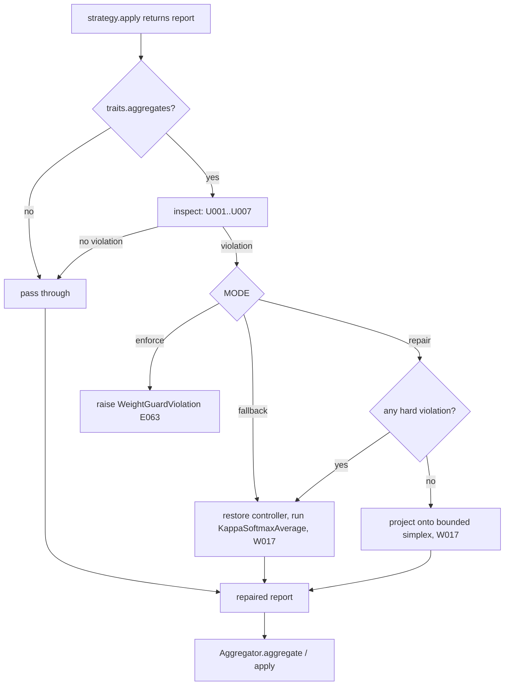

Violation codes. *Hard* violations cannot be repaired without guessing what the strategy meant;
*soft* ones have exactly one lawful repair.

| Code | Class | Meaning | Repair in `repair` mode |
|---|---|---|---|
| `U001` | hard | A weight is not a finite number | none: fall back |
| `U002` | hard | A weight is negative (below `-TOLERANCE`) | none: fall back |
| `U003` | hard | `report.weights` does not name exactly the peers of the group | none: fall back |
| `U004` | soft | An ineligible or trimmed peer carries weight above `TOLERANCE` | zero it, renormalize |
| `U005` | soft | A participant is outside `[floor, cap]`, or the weights do not sum to 1 within `TOLERANCE` | project (`_project_bounded`) |
| `U006` | hard | `fallback=True` without `WeightTraits.may_fallback` (the strategy did not mean to reset) | none: fall back |
| `U007` | hard | `apply()` raised | none: fall back |

*Participants* are the eligible peers that the strategy did not list in `report.trimmed_peers`.
A strategy that wants an eligible peer at weight 0 says so by trimming it, exactly as
`Aggregator.compute_weights` does (`aggregation.py:160-181`). An eligible peer at weight 0 that
is *not* trimmed is a `U005` violation: framework.md 10.1.2 gives every participant the floor,
including a peer whose softmax mass rounded to zero (`aggregation.py:184-195`).

```python
# mactf/exceptions.py   (new; section 17.1 lists it with the others)
class WeightGuardViolation(ComplianceError):
    """``E063``: a weight strategy's output broke a framework invariant under MODE=enforce."""

    code = "E063"

    def __init__(self, strategy: str, violations: "Sequence[Any]") -> None:
        self.strategy = strategy
        self.violations = tuple(violations)
        listed = "; ".join(str(item) for item in self.violations)
        super().__init__(f"E063: weight_update {strategy!r} broke the weight contract: {listed}")
```

```python
# mactf/coopetition/weight_guard.py   (new)
from __future__ import annotations

import dataclasses
import logging
import math
from dataclasses import dataclass
from typing import Any, Callable, Mapping, Sequence

from ..exceptions import ComplianceError, ImproperlyConfigured, WeightGuardViolation
from .aggregation import Aggregator, _project_bounded
from .report import AggregationReport
from .weights import (
    BUILTIN_WEIGHT_TYPES,
    KappaSoftmaxAverage,
    WeightTraits,
    traits_of,
)

log = logging.getLogger("mactf.weights")

GUARD_MODES = ("repair", "fallback", "enforce")
GUARD_SCOPES = ("custom", "all", "off")
_GUARD_KEYS = frozenset({"MODE", "SCOPE", "TOLERANCE", "PROBE"})

CODES: dict[str, str] = {
    "U001": "a weight is not a finite number",
    "U002": "a weight is negative",
    "U003": "the weights do not name exactly the peers of the group",
    "U004": "an ineligible or trimmed peer carries weight",
    "U005": "a participant is outside [floor, cap], or the weights do not sum to 1",
    "U006": "the strategy reported fallback without declaring may_fallback",
    "U007": "apply() raised",
}
_HARD = frozenset({"U001", "U002", "U003", "U006", "U007"})


@dataclass(frozen=True)
class Violation:
    code: str
    peer: str | None
    detail: str

    @property
    def hard(self) -> bool:
        return self.code in _HARD

    def __str__(self) -> str:
        where = "" if self.peer is None else f" [{self.peer}]"
        return f"{self.code}{where}: {self.detail}"


@dataclass
class GuardOutcome:
    #: The report to use; ``None`` when ``action == "fallback"`` (the caller runs the fallback).
    report: AggregationReport | None
    violations: tuple[Violation, ...]
    action: str                       # "pass" | "repaired" | "fallback"


class WeightGuard:
    """Checks, and under ``repair`` fixes, what a weight strategy returned."""

    def __init__(
        self,
        *,
        mode: str = "repair",
        scope: str = "custom",
        tolerance: float = 1e-6,
        probe: bool = True,
    ) -> None:
        if mode not in GUARD_MODES:
            raise ImproperlyConfigured(
                f"E060: TRAINER.WEIGHT_GUARD.MODE must be one of {list(GUARD_MODES)}, got {mode!r}"
            )
        if scope not in GUARD_SCOPES:
            raise ImproperlyConfigured(
                f"E060: TRAINER.WEIGHT_GUARD.SCOPE must be one of {list(GUARD_SCOPES)}, got {scope!r}"
            )
        if not (isinstance(tolerance, (int, float)) and math.isfinite(tolerance) and 0.0 < tolerance < 0.1):
            raise ImproperlyConfigured(
                f"E060: TRAINER.WEIGHT_GUARD.TOLERANCE must be in (0, 0.1), got {tolerance!r}"
            )
        self.mode = mode
        self.scope = scope
        self.tolerance = float(tolerance)
        self.probe = bool(probe)

    # -- construction ----------------------------------------------------
    @classmethod
    def from_settings(cls, block: Mapping[str, Any] | None) -> "WeightGuard":
        raw = {str(key).upper(): value for key, value in dict(block or {}).items()}
        unknown = sorted(set(raw) - _GUARD_KEYS)
        if unknown:
            raise ImproperlyConfigured(
                f"E060: TRAINER.WEIGHT_GUARD has unknown keys {unknown}; accepted: {sorted(_GUARD_KEYS)}"
            )
        return cls(
            mode=str(raw.get("MODE", "repair")).lower(),
            scope=str(raw.get("SCOPE", "custom")).lower(),
            tolerance=raw.get("TOLERANCE", 1e-6),
            probe=bool(raw.get("PROBE", True)),
        )

    def describe(self) -> dict[str, Any]:
        return {
            "mode": self.mode,
            "scope": self.scope,
            "tolerance": self.tolerance,
            "probe": self.probe,
        }

    # -- scope -----------------------------------------------------------
    def covers(self, strategy: Any, aggregator: Aggregator | None = None) -> bool:
        """Whether ``strategy``'s output is checked.

        Under ``custom`` that is everything the framework did not write, **and** the default
        strategy when the aggregator it delegates to is a subclass: a custom
        ``Aggregator.compute_weights`` is custom code on the default path.
        """
        if self.scope == "off" or not traits_of(strategy).aggregates:
            return False
        if self.scope == "all":
            return True
        if type(strategy) not in BUILTIN_WEIGHT_TYPES:
            return True
        if isinstance(strategy, KappaSoftmaxAverage):
            bound = strategy.aggregator if strategy.aggregator is not None else aggregator
            return bound is not None and type(bound) is not Aggregator
        return False

    # -- the check -------------------------------------------------------
    @staticmethod
    def participants(
        report: AggregationReport, names: Sequence[str], eligible: Mapping[str, bool]
    ) -> list[str]:
        trimmed = set(report.trimmed_peers)
        return [
            name for name in sorted(names)
            if bool(eligible.get(name, True)) and name not in trimmed
        ]

    def inspect(
        self,
        report: AggregationReport,
        *,
        names: Sequence[str],
        eligible: Mapping[str, bool],
        floor: float,
        cap: float,
        traits: WeightTraits,
    ) -> list[Violation]:
        """Every violation in ``report``. Pure: nothing is changed."""
        tol = self.tolerance
        found: list[Violation] = []
        expected, got = set(names), set(report.weights)
        if got != expected:
            found.append(Violation(
                "U003", None,
                f"missing {sorted(expected - got)}, unexpected {sorted(got - expected)}",
            ))
            return found                         # nothing else is meaningful
        for name in sorted(names):
            value = report.weights[name]
            if isinstance(value, bool) or not isinstance(value, (int, float)) or not math.isfinite(value):
                found.append(Violation("U001", name, f"weight is {value!r}"))
        if found:
            return found
        for name in sorted(names):
            if report.weights[name] < -tol:
                found.append(Violation("U002", name, f"weight is {report.weights[name]:.6g}"))
        if found:
            return found
        if report.fallback and not traits.may_fallback:
            found.append(Violation("U006", None, "report.fallback is True"))
            return found
        if report.fallback:
            return found                         # an intended reset: weights are informational
        participants = self.participants(report, names, eligible)
        chosen = set(participants)
        for name in sorted(names):
            if name not in chosen and report.weights[name] > tol:
                found.append(Violation(
                    "U004", name,
                    f"carries weight {report.weights[name]:.6g} but is ineligible or trimmed",
                ))
        if participants:
            for name in participants:
                value = report.weights[name]
                if value < floor - tol or value > cap + tol:
                    found.append(Violation(
                        "U005", name,
                        f"weight {value:.6g} is outside [{floor:g}, {cap:g}]",
                    ))
            total = sum(report.weights.values())
            if abs(total - 1.0) > max(tol, 1e-9) * max(1, len(names)):
                found.append(Violation("U005", None, f"weights sum to {total:.9g}, not 1"))
        return found

    def repair(
        self,
        report: AggregationReport,
        violations: Sequence[Violation],
        *,
        names: Sequence[str],
        eligible: Mapping[str, bool],
        floor: float,
        cap: float,
    ) -> AggregationReport:
        """The one lawful repair of soft violations: project onto the bounded simplex.

        Order: zero everyone who is not a participant; renormalize the participants'
        proposed weights (uniform when they sum to 0); project with ``_project_bounded``.
        Raises ``ComplianceError`` when the bounds are infeasible for this participant count;
        the caller then falls back.
        """
        participants = self.participants(report, names, eligible)
        if not participants:
            weights = {name: 0.0 for name in names}
        else:
            proposed = {name: max(0.0, float(report.weights[name])) for name in participants}
            total = sum(proposed.values())
            if total <= 0.0:
                proposed = {name: 1.0 / len(participants) for name in participants}
            else:
                proposed = {name: value / total for name, value in proposed.items()}
            projected = _project_bounded(proposed, floor=floor, cap=cap)
            weights = {name: float(projected.get(name, 0.0)) for name in names}
        codes = ",".join(sorted({item.code for item in violations}))
        gated = set(report.gated_peers) | {
            name for name in names if not bool(eligible.get(name, True))
        }
        return dataclasses.replace(
            report,
            weights=weights,
            adjustments=[*report.adjustments, f"weight_guard repaired weights ({codes})"],
            gated_peers=tuple(sorted(gated)),
        )

    def check(
        self,
        strategy: Any,
        report: AggregationReport,
        *,
        names: Sequence[str],
        eligible: Mapping[str, bool],
        floor: float,
        cap: float,
    ) -> GuardOutcome:
        label = getattr(strategy, "name", None) or type(strategy).__name__
        found = self.inspect(
            report, names=names, eligible=eligible, floor=floor, cap=cap,
            traits=traits_of(strategy),
        )
        if not found:
            return GuardOutcome(report, (), "pass")
        if self.mode == "enforce":
            raise WeightGuardViolation(label, found)
        if self.mode == "fallback" or any(item.hard for item in found):
            log.warning("W017: weight_update %r rejected (%s); falling back to kappa_softmax",
                        label, "; ".join(str(item) for item in found))
            return GuardOutcome(None, tuple(found), "fallback")
        try:
            repaired = self.repair(
                report, found, names=names, eligible=eligible, floor=floor, cap=cap
            )
        except ComplianceError as error:
            found.append(Violation("U005", None, f"repair impossible: {error}"))
            log.warning("W017: weight_update %r could not be repaired (%s); falling back", label, error)
            return GuardOutcome(None, tuple(found), "fallback")
        log.warning("W017: weight_update %r repaired (%s)", label,
                    "; ".join(str(item) for item in found))
        return GuardOutcome(repaired, tuple(found), "repaired")

    def run(
        self,
        strategy: Any,
        call: Callable[[Any], AggregationReport],
        *,
        names: Sequence[str],
        eligible: Mapping[str, bool],
        floor: float,
        cap: float,
    ) -> GuardOutcome:
        """Call the strategy and check what it returns. Covers ``apply`` raising (W-G11)."""
        label = getattr(strategy, "name", None) or type(strategy).__name__
        try:
            report = call(strategy)
        except Exception as error:  # noqa: BLE001 - third-party code; reported, never fatal
            found = Violation("U007", None, f"{type(error).__name__}: {error}")
            if self.mode == "enforce":
                raise WeightGuardViolation(label, [found]) from error
            log.warning("W017: weight_update %r raised (%s); falling back to kappa_softmax", label, found)
            return GuardOutcome(None, (found,), "fallback")
        return self.check(strategy, report, names=names, eligible=eligible, floor=floor, cap=cap)
```

Why `repair` is the default and not `enforce`: a research strategy that is *almost* right
(weights that sum to 0.999 after rounding, a peer at 0.01 when the floor is 0.02) should
produce a legal run and a `W017` in the log, not a stopped one. `enforce` is for CI and for
authors debugging a strategy; `fallback` for a run that must never use weights a strategy
did not produce exactly.

### 10.5 `WeightPlan`: per-group strategies, overrides and live changes

`WeightPlan` owns the `weight_update` slots. It answers one question, "which strategy
instance serves aggregation group *g* now?", and it is the only code that changes the answer.

**Group labels.** A group is labelled `"root"` when its members are the tree's roots
(`parent is None`) and by the parent's node path otherwise. These are the labels
`MACTFTrainer.controllers` already uses (`trainer.py:601-604`), so strategies, temperatures
and checkpoints agree on one vocabulary.

**Slots.**

| Slot path | Holds |
|---|---|
| `TRAINER.WEIGHT_UPDATE` | The default strategy (a *prototype*: see below) |
| `TRAINER.WEIGHT_UPDATE_OVERRIDES.<glob>` | A strategy for every group whose label matches `<glob>` |

**Selection** is the rule 8.4 and 9.5 already use: an override whose glob equals the label;
else the matching glob with the highest *specificity* (count of non-wildcard characters,
`specificity` in `components/function_book.py`); else the default. Two different matching
globs of equal specificity are `E061`, raised at build. `*` crosses `/`.

**Instances.** The slot stores a *prototype* built at install time with the run's aggregator
injected. That instance is what `describe()`, `verify` and the API show. A group never uses
the prototype: `strategy_for(label, aggregator)` builds a private instance from the slot's spec
with the *group's* aggregator injected, and caches it against the slot's `Resolved` object, so
a swap invalidates every affected group without bookkeeping. Two exceptions, both for
in-code instances (`weight_update=MyStrategy()` or `swap_weight_update(None, instance)`),
which the framework cannot rebuild:

* a `KappaSoftmaxAverage` instance is rebound to each group's aggregator (what
  `_group_strategy` does today, `trainer.py:1766-1769`);
* any other instance is **shared** by every group it serves unless it defines `clone()`, in
  which case each group gets a clone. This is documented, not hidden: pass a spec instead of
  an instance to get per-group state for free.

```python
# mactf/components/weight_plan.py   (new)
from __future__ import annotations

import copy
import fnmatch
import logging
import threading
from dataclasses import dataclass
from typing import Any, Mapping, Sequence

from ..coopetition.aggregation import Aggregator
from ..coopetition.weight_guard import WeightGuard
from ..coopetition.weight_probe import verify_weight_update
from ..coopetition.weights import GroupView, KappaSoftmaxAverage, traits_of
from ..exceptions import (
    ComponentLocked,
    ComponentMissing,
    ImproperlyConfigured,
)
from .function_book import specificity
from .kinds import Boundary
from .resolver import ComponentResolver, ComponentSpec, Resolved
from .slots import Slot, SlotTable, SwapRecord

log = logging.getLogger("mactf.weights")

KIND = "weight_update"
DEFAULT_PATH = "TRAINER.WEIGHT_UPDATE"
OVERRIDE_PREFIX = "TRAINER.WEIGHT_UPDATE_OVERRIDES."
ROOT_LABEL = "root"
MIGRATE_MODES = ("reset", "carry", "fail")
_REMOVE = object()


def group_label(parent: str | None) -> str:
    return ROOT_LABEL if parent is None else parent


def pick_glob(label: str, globs: Sequence[str], *, what: str, code: str) -> str | None:
    """Exact label, else the strictly most specific matching glob, else ``None``.

    Shared by ``WeightPlan`` (``E061``) and ``KappaPlan`` (``E062``); it is the rule of
    8.4 and 9.5 with the error code as a parameter.
    """
    if label in globs:
        return label
    best_score, best, tied = -1, None, []
    for glob in sorted(globs):
        if not fnmatch.fnmatchcase(label, glob):
            continue
        score = specificity(glob)
        if score > best_score:
            best_score, best, tied = score, glob, []
        elif score == best_score:
            tied.append(glob)
    if tied:
        raise ImproperlyConfigured(
            f"{code}: group {label!r} is matched by equally specific {what} "
            f"{sorted([best, *tied])}"
        )
    return best


@dataclass
class _Built:
    slot_path: str
    resolved: Resolved
    aggregator: Aggregator
    instance: Any


class WeightPlan:
    """The ``weight_update`` slots of one run and the rules that choose and change them."""

    def __init__(
        self,
        slots: SlotTable,
        *,
        resolver: ComponentResolver | None = None,
        trusted: bool = True,
        guard: WeightGuard | None = None,
        strict_globs: bool = True,
        migrate: str = "reset",
        strict_restore: bool = False,
    ) -> None:
        if migrate not in MIGRATE_MODES:
            raise ImproperlyConfigured(
                f"E060: TRAINER.WEIGHT_OPTIONS.MIGRATE must be one of {list(MIGRATE_MODES)}, got {migrate!r}"
            )
        self._slots = slots
        self._resolver = resolver or ComponentResolver()
        self._trusted = trusted
        self.guard = guard or WeightGuard()
        self.strict_globs = bool(strict_globs)
        self.migrate = migrate
        self.strict_restore = bool(strict_restore)
        self._aggregator: Aggregator | None = None
        self._adopted: dict[str, Any] = {}
        self._cache: dict[str, _Built] = {}
        self._pending: dict[str, tuple[Any, str | None]] = {}
        self._carry: dict[str, dict[str, Any]] = {}
        self._restore: dict[str, Mapping[str, Any]] = {}
        self._lock = threading.RLock()

    # -- construction ----------------------------------------------------
    @classmethod
    def from_settings(
        cls,
        settings: Mapping[str, Any],
        slots: SlotTable,
        *,
        aggregator: Aggregator,
        code_spec: Any = None,
        resolver: ComponentResolver | None = None,
        trusted: bool = True,
    ) -> "WeightPlan":
        """Install the default and every override.

        Precedence for the default, highest first: the ``weight_update=`` constructor
        argument (an instance is *adopted*, a name or mapping is a spec), then
        ``TRAINER.WEIGHT_UPDATE``, then ``kappa_softmax``.
        """
        trainer = dict(settings.get("TRAINER") or {})
        options = {str(k).upper(): v for k, v in dict(trainer.get("WEIGHT_OPTIONS") or {}).items()}
        unknown = sorted(set(options) - {"STRICT_GLOBS", "MIGRATE"})
        if unknown:
            raise ImproperlyConfigured(
                f"E060: TRAINER.WEIGHT_OPTIONS has unknown keys {unknown}; accepted: MIGRATE, STRICT_GLOBS"
            )
        components = dict(settings.get("COMPONENTS") or {})
        plan = cls(
            slots,
            resolver=resolver,
            trusted=trusted,
            guard=WeightGuard.from_settings(trainer.get("WEIGHT_GUARD")),
            strict_globs=bool(options.get("STRICT_GLOBS", True)),
            migrate=str(options.get("MIGRATE", "reset")).lower(),
            strict_restore=bool(components.get("STRICT_RESTORE", False)),
        )
        plan.bind(aggregator)
        if code_spec is not None and not isinstance(code_spec, (str, Mapping, ComponentSpec)):
            plan.adopt_default(code_spec)
        else:
            plan.install_default(code_spec if code_spec is not None
                                 else trainer.get("WEIGHT_UPDATE", "kappa_softmax"))
        overrides = trainer.get("WEIGHT_UPDATE_OVERRIDES") or {}
        if not isinstance(overrides, Mapping):
            raise ImproperlyConfigured("E060: TRAINER.WEIGHT_UPDATE_OVERRIDES must be a mapping of glob to spec")
        for glob, raw in overrides.items():
            plan.install_override(str(glob), raw)
        return plan

    def bind(self, aggregator: Aggregator) -> None:
        """The aggregator prototypes are built with (the root's)."""
        self._aggregator = aggregator

    def _inject(self) -> dict[str, Any]:
        return {"aggregator": self._aggregator} if self._aggregator is not None else {}

    def install_default(self, raw: Any) -> Slot:
        return self._slots.install(DEFAULT_PATH, KIND, raw, inject=self._inject())

    def adopt_default(self, instance: Any) -> Slot:
        slot = self._slots.adopt(DEFAULT_PATH, KIND, instance, name=type(instance).__name__)
        self._adopted[DEFAULT_PATH] = instance
        return slot

    def install_override(self, glob: str, raw: Any) -> Slot:
        if not glob or glob != glob.strip():
            raise ImproperlyConfigured(f"E060: invalid override glob {glob!r}")
        path = OVERRIDE_PREFIX + glob
        if isinstance(raw, (str, Mapping, ComponentSpec)):
            return self._slots.install(path, KIND, raw, inject=self._inject())
        slot = self._slots.adopt(path, KIND, raw, name=type(raw).__name__)
        self._adopted[path] = raw
        return slot

    # -- reading ---------------------------------------------------------
    def override_globs(self) -> list[str]:
        return sorted(p[len(OVERRIDE_PREFIX):] for p in self._slots.paths()
                      if p.startswith(OVERRIDE_PREFIX))

    def select(self, label: str) -> str:
        """The slot path serving ``label``. ``E061`` on an ambiguous tie."""
        glob = pick_glob(label, self.override_globs(), what="weight_update overrides", code="E061")
        return DEFAULT_PATH if glob is None else OVERRIDE_PREFIX + glob

    def customized(self) -> bool:
        """Whether anything here differs from the built-in default (decides what is persisted)."""
        if any(p.startswith(OVERRIDE_PREFIX) for p in self._slots.paths()):
            return True
        if DEFAULT_PATH in self._adopted:
            return True
        slot = self._slots.get(DEFAULT_PATH)
        return not (slot.resolved.spec.type == "kappa_softmax" and not slot.resolved.spec.params
                    and slot.resolved.spec.import_path is None)

    def history(self) -> list[SwapRecord]:
        return [r for r in self._slots.history if r.slot.startswith(DEFAULT_PATH)]

    def strategy_for(self, label: str, aggregator: Aggregator) -> Any:
        """The instance serving group ``label``, built on first use. Never the prototype."""
        with self._lock:
            path = self.select(label)
            slot = self._slots.get(path)
            built = self._cache.get(label)
            if (built is not None and built.resolved is slot.resolved
                    and built.aggregator is aggregator):
                return built.instance
            instance = self._build_group(label, path, slot, aggregator)
            self._cache[label] = _Built(path, slot.resolved, aggregator, instance)
            return instance

    def _build_group(self, label: str, path: str, slot: Slot, aggregator: Aggregator) -> Any:
        if path in self._adopted:
            proto = self._adopted[path]
            if isinstance(proto, KappaSoftmaxAverage):
                instance = KappaSoftmaxAverage(aggregator)
            else:
                clone = getattr(proto, "clone", None)
                instance = clone() if callable(clone) else proto
        else:
            instance = self._resolver.resolve(
                slot.resolved.spec, trusted=self._trusted, inject={"aggregator": aggregator}
            ).instance
        self._seed_state(label, path, instance)
        return instance

    def _seed_state(self, label: str, path: str, instance: Any) -> None:
        entry = self._restore.pop(label, None) or self._carry.pop(label, None)
        if entry is None:
            return
        load = getattr(instance, "load_state_dict", None)
        if (not callable(load) or entry.get("class") != type(instance).__name__
                or entry.get("slot") != path):
            if entry.get("state"):
                log.warning(
                    "W021: state saved for group %r (%s) does not fit %s at %s; dropped",
                    label, entry.get("class"), type(instance).__name__, path,
                )
            return
        load(copy.deepcopy(entry["state"]))

    def _scratch(self, path: str) -> Any:
        """A throwaway instance of slot ``path`` for probing and validation."""
        if path in self._adopted:
            proto = self._adopted[path]
            clone = getattr(proto, "clone", None)
            if callable(clone):
                return clone()
            try:
                return copy.deepcopy(proto)
            except Exception:  # noqa: BLE001 - a user object that cannot be copied is probed as is
                return proto
        slot = self._slots.get(path)
        return self._resolver.resolve(
            slot.resolved.spec, trusted=self._trusted, inject=self._inject()
        ).instance

    # -- validation ------------------------------------------------------
    def validate(self, views: Sequence[GroupView], *, initial: bool) -> list[str]:
        """Check the plan against the groups that exist. Returns warnings; raises on errors.

        ``E060`` an override matches no group, or two groups share a label;
        ``E061`` ambiguous overrides; ``E064`` a strategy's ``validate`` or probe failed.
        """
        labels = [view.label for view in views]
        if len(set(labels)) != len(labels):
            duplicates = sorted({label for label in labels if labels.count(label) > 1})
            raise ImproperlyConfigured(
                f"E060: aggregation group labels collide: {duplicates}; the label {ROOT_LABEL!r} is "
                "reserved for the top group and cannot also be a node path with children"
            )
        notes: list[str] = []
        for glob in self.override_globs():
            if any(label == glob or fnmatch.fnmatchcase(label, glob) for label in labels):
                continue
            message = f"override {glob!r} matches no aggregation group; groups are {labels}"
            if initial and self.strict_globs:
                raise ImproperlyConfigured(f"E060: TRAINER.WEIGHT_UPDATE_OVERRIDES: {message}")
            notes.append(f"W022: {message}")
        probed: set[str] = set()
        for view in views:
            path = self.select(view.label)                     # E061
            self._check_group(path, view)
            if initial and path not in probed:
                probed.add(path)
                self._probe(path)
        for note in notes:
            log.warning(note)
        return notes

    def _check_group(self, path: str, view: GroupView, instance: Any | None = None) -> None:
        strategy = instance if instance is not None else self._scratch(path)
        check = getattr(strategy, "validate", None)
        if not callable(check):
            return
        problems = [str(item) for item in (check(view) or ())]
        if problems:
            raise ImproperlyConfigured(
                f"E064: {path} cannot serve group {view.label!r}: " + "; ".join(problems)
            )

    def _probe(self, path: str, instance_factory: Any | None = None) -> None:
        if not self.guard.probe or self._aggregator is None:
            return
        slot = self._slots.get(path)
        if not self.guard.covers(slot.instance, self._aggregator):
            return
        verify_weight_update(
            instance_factory or (lambda: self._scratch(path)),
            floor=self._aggregator.weight_floor,
            cap=self._aggregator.weight_cap,
            tolerance=self.guard.tolerance,
            slot=path,
        )

    # -- live changes ----------------------------------------------------
    def _selected_after(self, label: str, globs: Sequence[str]) -> str:
        glob = pick_glob(label, globs, what="weight_update overrides", code="E061")
        return DEFAULT_PATH if glob is None else OVERRIDE_PREFIX + glob

    def _mode(self, mode: str | None) -> str:
        chosen = (mode or self.migrate).lower()
        if chosen not in MIGRATE_MODES:
            raise ImproperlyConfigured(f"E064: migrate must be one of {list(MIGRATE_MODES)}, got {mode!r}")
        return chosen

    def set(
        self,
        glob: str | None,
        raw: Any,
        *,
        views: Sequence[GroupView],
        boundary: Boundary = Boundary.EPISODE,
        mode: str | None = None,
    ) -> SwapRecord | None:
        """Replace the default (``glob=None``), replace one override, or add an override. Now.

        Order is the atomicity argument: everything that can fail (parse, build, probe,
        per-group ``validate``, ambiguity, state migration, lock, boundary) happens first;
        the slot write is the single mutation; cache invalidation after it cannot fail.
        """
        chosen_mode = self._mode(mode)
        path = DEFAULT_PATH if glob is None else OVERRIDE_PREFIX + glob
        with self._lock:
            adding = path not in self._slots.paths()
            if glob is not None and (not glob or glob != glob.strip()):
                raise ImproperlyConfigured(f"E060: invalid override glob {glob!r}")
            if boundary.rank > Boundary.EPISODE.rank:
                raise ComponentLocked(KIND, path, "weight_update may only change at episode boundaries")
            if self._slots._slot_locked(path):
                raise ComponentLocked(KIND, path, "the slot is locked by COMPONENTS.LOCKED")
            adopted = not isinstance(raw, (str, Mapping, ComponentSpec))
            if adopted:
                candidate_instance, spec = raw, None
            else:
                spec = ComponentSpec.parse(KIND, raw)
                candidate_instance = self._resolver.resolve(
                    spec, trusted=self._trusted, inject=self._inject()
                ).instance
            globs = sorted(set(self.override_globs()) | ({glob} if glob is not None else set()))
            affected = [view for view in views if self._selected_after(view.label, globs) == path]
            for view in affected:
                self._check_group(path, view, candidate_instance)
            if self.guard.probe and self._aggregator is not None and self.guard.covers(
                candidate_instance, self._aggregator
            ):
                verify_weight_update(
                    (lambda: self._clone_for_probe(candidate_instance, spec)),
                    floor=self._aggregator.weight_floor, cap=self._aggregator.weight_cap,
                    tolerance=self.guard.tolerance, slot=path,
                )
            carried = self._collect_state(path, [v.label for v in affected], chosen_mode,
                                          candidate_instance)
            # -- the single mutation ---------------------------------------
            if adding:
                if adopted:
                    self._slots.adopt(path, KIND, raw, name=type(raw).__name__)
                else:
                    self._slots.install(path, KIND, spec, inject=self._inject())
                record = None
            elif adopted:
                self._slots.adopt(path, KIND, raw, name=type(raw).__name__)
                record = None
            else:
                record = self._slots.swap(path, spec, boundary=boundary, inject=self._inject())
            # -- cannot fail beyond this line ------------------------------
            if adopted:
                self._adopted[path] = raw
            else:
                self._adopted.pop(path, None)
            for view in views:
                if self._selected_after(view.label, globs) == path:
                    self._cache.pop(view.label, None)
            self._carry.update(carried)
            return record

    def _clone_for_probe(self, instance: Any, spec: ComponentSpec | None) -> Any:
        if spec is not None:
            return self._resolver.resolve(spec, trusted=self._trusted, inject=self._inject()).instance
        clone = getattr(instance, "clone", None)
        if callable(clone):
            return clone()
        try:
            return copy.deepcopy(instance)
        except Exception:  # noqa: BLE001
            return instance

    def _collect_state(
        self, path: str, labels: Sequence[str], mode: str, candidate: Any
    ) -> dict[str, dict[str, Any]]:
        carried: dict[str, dict[str, Any]] = {}
        for label in sorted(labels):
            built = self._cache.get(label)
            if built is None:
                continue
            read = getattr(built.instance, "state_dict", None)
            state = dict(read()) if callable(read) else {}
            if not state:
                continue
            if mode == "fail":
                raise ImproperlyConfigured(
                    f"E064: group {label!r} holds {type(built.instance).__name__} state and "
                    "migrate is 'fail'"
                )
            if mode == "carry" and type(built.instance) is type(candidate):
                carried[label] = {
                    "slot": path, "class": type(candidate).__name__,
                    "state": copy.deepcopy(state),
                }
            else:
                log.info("weight_update state of group %r is discarded by the swap (mode=%s)", label, mode)
        return carried

    def remove(
        self, glob: str, *, views: Sequence[GroupView], boundary: Boundary = Boundary.EPISODE
    ) -> SwapRecord:
        """Delete one override; its groups fall back to the next most specific, or the default."""
        path = OVERRIDE_PREFIX + glob
        with self._lock:
            if path not in self._slots.paths():
                raise ComponentMissing("slot", path, self._slots.paths())
            if self._slots._slot_locked(path):
                raise ComponentLocked(KIND, path, "the slot is locked by COMPONENTS.LOCKED")
            if boundary.rank > Boundary.EPISODE.rank:
                raise ComponentLocked(KIND, path, "weight_update may only change at episode boundaries")
            before = self.override_globs()
            after = [g for g in before if g != glob]
            moved = [v for v in views if self._selected_after(v.label, before) == path]
            for view in moved:
                target = self._selected_after(view.label, after)          # E061 if it now ties
                self._check_group(target, view)
            record = self._slots.remove(path, boundary=boundary)
            self._adopted.pop(path, None)
            for view in moved:
                self._cache.pop(view.label, None)
            return record

    def request(self, glob: str | None, raw: Any, *, mode: str | None = None) -> None:
        """Queue a replacement for the next episode boundary. Validated eagerly."""
        self._mode(mode)
        path = DEFAULT_PATH if glob is None else OVERRIDE_PREFIX + glob
        if isinstance(raw, (str, Mapping, ComponentSpec)):
            self._resolver.validate(ComponentSpec.parse(KIND, raw), trusted=self._trusted)
        with self._lock:
            self._pending[path] = (raw, mode)

    def request_remove(self, glob: str) -> None:
        path = OVERRIDE_PREFIX + glob
        if path not in self._slots.paths():
            raise ComponentMissing("slot", path, self._slots.paths())
        with self._lock:
            self._pending[path] = (_REMOVE, None)

    def pending(self) -> dict[str, str]:
        with self._lock:
            return {path: ("remove" if value is _REMOVE else "set")
                    for path, (value, _mode) in self._pending.items()}

    def take_pending(self) -> list[tuple[str | None, Any, str | None]]:
        """Drain the queue as ``(glob, raw_or__REMOVE, mode)``, defaults first."""
        with self._lock:
            items = sorted(self._pending.items(), key=lambda kv: (kv[0] != DEFAULT_PATH, kv[0]))
            self._pending.clear()
        out: list[tuple[str | None, Any, str | None]] = []
        for path, (value, mode) in items:
            glob = None if path == DEFAULT_PATH else path[len(OVERRIDE_PREFIX):]
            out.append((glob, value, mode))
        return out

    @staticmethod
    def is_removal(value: Any) -> bool:
        return value is _REMOVE

    # -- persistence -----------------------------------------------------
    def state_dict(self) -> dict[str, Any]:
        slots: dict[str, Any] = {}
        for path in self._slots.paths():
            if not (path == DEFAULT_PATH or path.startswith(OVERRIDE_PREFIX)):
                continue
            resolved = self._slots.get(path).resolved
            if path in self._adopted:
                comp = resolved.component
                slots[path] = {"adopted": f"{comp.module}.{comp.qualname}"}
            else:
                slots[path] = {"spec": resolved.spec.canonical(), "hash": resolved.spec_hash}
        groups: dict[str, Any] = {}
        for label, built in sorted(self._cache.items()):
            read = getattr(built.instance, "state_dict", None)
            state = dict(read()) if callable(read) else {}
            if state:
                groups[label] = {
                    "slot": built.slot_path,
                    "class": type(built.instance).__name__,
                    "state": state,
                }
        return {
            "version": 1,
            "slots": slots,
            "groups": groups,
            "history": [r.as_dict() for r in self.history()][-64:],
        }

    def load_state_dict(self, payload: Mapping[str, Any], *, strict: bool = False) -> list[str]:
        """Reconcile the live plan with a saved one. The saved plan wins (``W021``); under
        ``strict`` (``COMPONENTS.STRICT_RESTORE``) any difference is ``E066``."""
        notes: list[str] = []
        saved = dict(payload.get("slots") or {})
        with self._lock:
            for path, entry in sorted(saved.items()):
                if "spec" not in entry:
                    notes.append(
                        f"W021: {path} held an in-code instance ({entry.get('adopted')}) when saved; "
                        "the configured strategy is kept"
                    )
                    continue
                live = self._slots.get(path) if path in self._slots.paths() else None
                if live is not None and path not in self._adopted and live.resolved.spec_hash == entry.get("hash"):
                    continue
                message = f"{path}: the saved run used {entry['spec']}, this run is configured differently"
                if strict:
                    raise ImproperlyConfigured(f"E066: {message}; COMPONENTS.STRICT_RESTORE is on")
                self._slots.install(path, KIND, entry["spec"], inject=self._inject())
                self._adopted.pop(path, None)
                notes.append(f"W021: {message}; the saved plan wins")
            for path in [p for p in self._slots.paths()
                         if p.startswith(OVERRIDE_PREFIX) and p not in saved]:
                message = f"{path} exists now but not in the saved run (it had been removed)"
                if strict:
                    raise ImproperlyConfigured(f"E066: {message}; COMPONENTS.STRICT_RESTORE is on")
                self._slots.remove(path, boundary=Boundary.RUN_START)
                self._adopted.pop(path, None)
                notes.append(f"W021: {message}; the saved plan wins")
            self._cache.clear()
            self._restore = {label: dict(entry) for label, entry in dict(payload.get("groups") or {}).items()}
        for note in notes:
            log.warning(note)
        return notes

    # -- reporting -------------------------------------------------------
    def describe(self, labels: Sequence[str] = ()) -> dict[str, Any]:
        slots = {
            path: self._slots.get(path).resolved.fingerprint()
            for path in self._slots.paths()
            if path == DEFAULT_PATH or path.startswith(OVERRIDE_PREFIX)
        }
        return {
            "slots": slots,
            "serving": {label: self.select(label) for label in labels},
            "guard": self.guard.describe(),
            "pending": self.pending(),
        }
```

`SlotTable.remove(path, *, boundary)` is the slot-removal method specified in 8.9 and used
unchanged here.

### 10.6 The probe: a strategy proves itself before it runs

A strategy that raises on a four-peer group where one peer is void, or that returns weights
summing to 3, should not wait for epoch 4 to say so (invariant A9). `verify_weight_update`
runs a fresh instance of the candidate through a fixed set of synthetic groups and applies
the *same* `inspect` the runtime guard uses, so a probe pass is a promise about the guard.

```python
# mactf/coopetition/weight_probe.py   (new)
from __future__ import annotations

import json
from typing import Any, Callable

import torch

from ..exceptions import ComplianceError, ImproperlyConfigured
from .report import AggregationReport
from .weight_guard import CODES, Violation, WeightGuard
from .weights import traits_of

_NAMES = ("p0", "p1", "p2", "p3")
_SPREAD = {"p0": 0.9, "p1": 0.1, "p2": -0.4, "p3": 0.3}
_TIES = {name: 5.0 for name in _NAMES}
_NEGATIVE = {name: -3.0 for name in _NAMES}

#: ``(label, scores, eligible)``. Chosen to cover: spread, exact ties, all-negative scores,
#: one void peer, two void peers.
_CASES: tuple[tuple[str, dict[str, float], dict[str, bool]], ...] = (
    ("spread", _SPREAD, {n: True for n in _NAMES}),
    ("ties", _TIES, {n: True for n in _NAMES}),
    ("negative", _NEGATIVE, {n: True for n in _NAMES}),
    ("one_void", _SPREAD, {"p0": True, "p1": False, "p2": True, "p3": True}),
    ("two_void", _SPREAD, {"p0": True, "p1": False, "p2": False, "p3": True}),
)


def verify_weight_update(
    make: Callable[[], Any],
    *,
    floor: float,
    cap: float,
    tolerance: float,
    slot: str,
) -> None:
    """Probe ``make()``'s strategy; raise ``E064`` (output) or ``E067`` (state) with every finding.

    ``make`` returns a *fresh* instance each call, so a stateful strategy starts clean in
    every case and the probe leaves nothing behind. A case whose bounds are infeasible for its
    participant count (``cap * n < 1`` or ``floor * n > 1``) is skipped: the aggregator
    itself refuses those, and the strategy is not at fault.
    """
    inspector = WeightGuard(mode="fallback", scope="all", tolerance=tolerance)
    findings: list[str] = []
    vectors = {name: torch.full((8,), float(index)) for index, name in enumerate(_NAMES)}
    for label, scores, eligible in _CASES:
        participants = [name for name in _NAMES if eligible[name]]
        if cap * len(participants) < 1.0 - 1e-9 or floor * len(participants) > 1.0 + 1e-9:
            continue
        strategy = make()
        traits = traits_of(strategy)
        if not traits.aggregates:
            return
        try:
            report = strategy.apply(
                vectors, scores, kappa=1.0, level=0, eligible=eligible, confidence=None
            )
        except ComplianceError:
            continue                    # refusing a case it cannot serve is allowed
        except Exception as error:  # noqa: BLE001 - reported as a finding
            findings.append(f"{label}: {Violation('U007', None, f'{type(error).__name__}: {error}')}")
            continue
        if not isinstance(report, AggregationReport):
            findings.append(f"{label}: apply() returned {type(report).__name__}, not an AggregationReport")
            continue
        for item in inspector.inspect(
            report, names=_NAMES, eligible=eligible, floor=floor, cap=cap, traits=traits
        ):
            findings.append(f"{label}: {item} ({CODES[item.code]})")
    if findings:
        raise ImproperlyConfigured(f"E064: {slot} failed its probe: " + "; ".join(findings))
    _verify_state(make, slot=slot, vectors=vectors)


def _verify_state(make: Callable[[], Any], *, slot: str, vectors: dict[str, torch.Tensor]) -> None:
    """A strategy with ``state_dict`` must serialise to JSON and reload to the same state."""
    probe = make()
    read = getattr(probe, "state_dict", None)
    if not callable(read):
        return
    problems: list[str] = []
    try:
        probe.apply(
            vectors, _SPREAD, kappa=1.0, level=0,
            eligible={name: True for name in _NAMES}, confidence=None,
        )
    except Exception:  # noqa: BLE001 - output problems were reported above
        pass
    try:
        text = json.dumps(read(), sort_keys=True, allow_nan=False)
    except (TypeError, ValueError) as error:
        raise ImproperlyConfigured(
            f"E067: {slot}: state_dict() is not JSON-serialisable ({error}); checkpoints store it as JSON"
        ) from error
    fresh = make()
    load = getattr(fresh, "load_state_dict", None)
    if not callable(load):
        problems.append("defines state_dict() but no load_state_dict()")
    else:
        try:
            load(json.loads(text))
            again = json.dumps(fresh.state_dict(), sort_keys=True, allow_nan=False)
        except Exception as error:  # noqa: BLE001
            problems.append(f"load_state_dict() rejected its own state_dict(): {error}")
        else:
            if again != text:
                problems.append("state_dict() changed across a load_state_dict() round trip")
    if problems:
        raise ImproperlyConfigured(f"E067: {slot}: " + "; ".join(problems))
```

### 10.7 Aggregators and the temperature

**Aggregator.** `Aggregator` becomes a registered kind (`aggregator`, `static`: it owns a
controller, and swapping it mid-run would orphan that controller's state). Three additions make
it subclassable without silent loss (W-G9):

```python
# mactf/coopetition/aggregation.py   (new methods on Aggregator, after ``__init__``)
    def options(self) -> dict[str, Any]:
        """The constructor keywords other than ``controller``.

        A subclass with extra constructor state overrides this, returning
        ``{**super().options(), "my_arg": self.my_arg}``. ``clone_with`` and ``pristine``
        rely on it, and ``verify_aggregator`` checks it round-trips.
        """
        return {
            "weight_floor": self.weight_floor,
            "weight_cap": self.weight_cap,
            "confidence_floor": self.confidence_floor,
            "trim_fraction": self.trim_fraction,
            "disagreement_max": self.disagreement_max,
            "fallback_to_reference": self.fallback_to_reference,
            "aggregate_buffers": self.aggregate_buffers,
        }

    def clone_with(self, controller: AdaptiveKappa) -> "Aggregator":
        """A sibling for another aggregation group: same class, same bounds, own controller."""
        return type(self)(controller=controller, **self.options())

    def pristine(self) -> "Aggregator":
        """The framework's own ``Aggregator`` with this one's bounds and controller.

        What the guard falls back to when a custom ``compute_weights`` is the thing that
        failed: the fallback must not run the code that just misbehaved.
        """
        return Aggregator(controller=self.controller, **self.options())
```

```python
# mactf/coopetition/aggregation.py   (new function and registration, end of module)
def build_aggregator(
    spec: Any,
    coopetition: dict[str, Any],
    *,
    num_peers: int,
    resolver: Any | None = None,
    trusted: bool = True,
) -> Aggregator:
    """``TRAINER.AGGREGATOR`` to an ``Aggregator``.

    ``None`` is the built-in, built exactly as ``Aggregator.from_settings`` does. A name or
    mapping goes through the ``aggregator`` registry with the controller and every bound
    (``weight_floor``, ``weight_cap``, ...) *injected*, so a spec carries only the class's own
    extra parameters and can never loosen a bound (invariant A3).
    """
    from ..components.resolver import ComponentResolver, ComponentSpec

    if isinstance(spec, Aggregator):
        return spec
    if spec is None:
        return Aggregator.from_settings(dict(coopetition), num_peers=num_peers)
    controller = AdaptiveKappa.from_settings(dict(coopetition), num_peers=num_peers)
    injected = {
        "controller": controller,
        "weight_floor": float(coopetition.get("WEIGHT_FLOOR", 0.02)),
        "weight_cap": float(coopetition.get("WEIGHT_CAP", 0.60)),
        "confidence_floor": float(coopetition.get("CONFIDENCE_FLOOR", 0.10)),
        "trim_fraction": float(coopetition.get("TRIM_FRACTION", 0.0)),
        "disagreement_max": float(coopetition.get("DISAGREEMENT_MAX", 0.75)),
        "fallback_to_reference": bool(coopetition.get("FALLBACK_TO_REFERENCE", True)),
        "aggregate_buffers": str(coopetition.get("AGGREGATE_BUFFERS", "top")),
    }
    parsed = ComponentSpec.parse("aggregator", spec)
    built = (resolver or ComponentResolver()).resolve(parsed, trusted=trusted, inject=injected).instance
    verify_aggregator(built)
    return built


def verify_aggregator(aggregator: Aggregator) -> None:
    """``E065`` unless ``clone_with`` returns the same class with the same options."""
    from ..exceptions import ImproperlyConfigured

    probe = AdaptiveKappa(num_peers=2)
    try:
        sibling = aggregator.clone_with(probe)
    except Exception as error:  # noqa: BLE001 - reported with the cure
        raise ImproperlyConfigured(
            f"E065: {type(aggregator).__name__}.clone_with() failed ({error}); a subclass with "
            "extra constructor arguments must override options() to return them"
        ) from error
    if type(sibling) is not type(aggregator) or sibling.options() != aggregator.options():
        raise ImproperlyConfigured(
            f"E065: {type(aggregator).__name__}.clone_with() does not reproduce the class and "
            f"options (got {type(sibling).__name__} / {sibling.options()!r}); override options()"
        )
    if sibling.controller is not probe:
        raise ImproperlyConfigured(
            f"E065: {type(aggregator).__name__}.clone_with() must use the controller it is given"
        )


from ..components.kinds import Origin                      # noqa: E402
from ..components.registry import HUB                      # noqa: E402

HUB.registry("aggregator").register("default", Aggregator, origin=Origin.BUILTIN)
```

Only `compute_weights`, `aggregate` and `apply` are meant to be overridden. The guard
covers the *weights* a subclass produces on the default path (10.4, `covers`); it does not
cover a subclass's `aggregate` or `apply`, which write parameters. That is the one place where
this section trusts a component: an `Aggregator` subclass is `static`, `origin`-recorded in
the checkpoint (14.2), subject to `COMPONENTS.IMPORT_ALLOWLIST` when it comes from a spec, and
is the documented "I know what I am doing" extension point for parameter blending. A policy
that must not trust it sets `COMPONENTS.LOCKED: ["slot:TRAINER.AGGREGATOR"]`.

**Temperature.** `AdaptiveKappa` gains three small methods and one fix:

```python
# mactf/coopetition/temperature.py   (additions to AdaptiveKappa; ``import copy`` at the top)
    def snapshot(self) -> dict[str, Any]:
        """A deep copy of everything ``step`` mutates, for ``restore`` (invariant A7)."""
        return {"state": copy.deepcopy(self.state), "num_peers": self.num_peers}

    def restore(self, snapshot: dict[str, Any]) -> None:
        """Put the controller back exactly as ``snapshot`` found it.

        Fields are copied *into* the existing ``TemperatureState`` so a caller that holds a
        reference to ``controller.state`` still sees the controller's state.
        """
        saved = copy.deepcopy(snapshot["state"])
        for key, value in vars(saved).items():
            setattr(self.state, key, value)
        self.num_peers = int(snapshot["num_peers"])

    def resize(self, num_peers: int) -> None:
        """Re-target the entropy for a group that gained or lost members (section 12)."""
        if num_peers < 1:
            raise ValueError("num_peers must be >= 1")
        self.num_peers = int(num_peers)
        max_entropy = math.log(self.num_peers) if self.num_peers > 1 else 0.0
        self.state.target_entropy = max_entropy * self.target_ratio
```

```python
# mactf/coopetition/temperature.py   (load_state_dict, first statement; fixes W-G7's resume half)
        saved_peers = payload.get("num_peers")
        if isinstance(saved_peers, int) and not isinstance(saved_peers, bool) and saved_peers >= 1:
            # The saved target_entropy was computed for this arity; restoring one without the
            # other makes ``step`` skip its recompute (numel == num_peers) and keep a stale target.
            self.num_peers = saved_peers
```

`state_dict()` is not changed, so a default run's `kappa` checkpoint section is byte-identical (A1).
`load_state_dict` of a payload without `num_peers` (an older checkpoint) behaves as before.

**Per-group temperature.** `COOPETITION.KAPPA_OVERRIDES` maps a group-label glob to a partial
`COOPETITION` temperature block. Only the six controller keys may appear; the bounds
(`WEIGHT_FLOOR`, `WEIGHT_CAP`, ...) and `SIGNAL_SOURCE` may not, because a per-group bound
would break the invariant that the floor is one number for the run (A3) and a per-group signal
source would put two score ranges in one tree.

```python
# mactf/components/kappa_plan.py   (new)
from __future__ import annotations

import math
from typing import Any, Mapping, Sequence

from ..coopetition.temperature import AdaptiveKappa
from ..exceptions import ImproperlyConfigured
from .weight_plan import ROOT_LABEL, pick_glob

KAPPA_KEYS = (
    "KAPPA_INIT", "KAPPA_MIN", "KAPPA_MAX",
    "TARGET_ENTROPY_RATIO", "BETA_MOMENTUM", "ETA_KAPPA",
)
_FORBIDDEN = {
    "SIGNAL_SOURCE": "one score range per tree",
    "WEIGHT_FLOOR": "the floor is one number for the run",
    "WEIGHT_CAP": "the cap is one number for the run",
}


def _number(value: Any, where: str) -> float:
    if isinstance(value, bool) or not isinstance(value, (int, float)) or not math.isfinite(value):
        raise ImproperlyConfigured(f"E062: {where} must be a finite number, got {value!r}")
    return float(value)


class KappaPlan:
    """Per-group ``AdaptiveKappa`` settings: the base block plus the most specific override."""

    def __init__(
        self, overrides: Mapping[str, Mapping[str, Any]] | None = None, *, strict_globs: bool = True
    ) -> None:
        self.strict_globs = bool(strict_globs)
        self._overrides: dict[str, dict[str, float]] = {}
        for glob, block in dict(overrides or {}).items():
            self._overrides[str(glob)] = self._check(str(glob), block)

    @classmethod
    def from_settings(cls, coopetition: Mapping[str, Any]) -> "KappaPlan":
        raw = coopetition.get("KAPPA_OVERRIDES") or {}
        if not isinstance(raw, Mapping):
            raise ImproperlyConfigured("E062: COOPETITION.KAPPA_OVERRIDES must be a mapping of glob to block")
        return cls(raw, strict_globs=bool(coopetition.get("KAPPA_STRICT_GLOBS", True)))

    @staticmethod
    def _check(glob: str, block: Any) -> dict[str, float]:
        where = f"COOPETITION.KAPPA_OVERRIDES[{glob!r}]"
        if not glob or glob != glob.strip():
            raise ImproperlyConfigured(f"E062: invalid glob {glob!r} in COOPETITION.KAPPA_OVERRIDES")
        if not isinstance(block, Mapping) or not block:
            raise ImproperlyConfigured(f"E062: {where} must be a non-empty mapping")
        clean: dict[str, float] = {}
        for key, value in block.items():
            name = str(key).upper()
            if name in _FORBIDDEN:
                raise ImproperlyConfigured(f"E062: {where} may not set {name} ({_FORBIDDEN[name]})")
            if name not in KAPPA_KEYS:
                raise ImproperlyConfigured(f"E062: {where} has unknown key {name}; accepted: {list(KAPPA_KEYS)}")
            clean[name] = _number(value, f"{where}.{name}")
        return clean

    @property
    def overrides(self) -> dict[str, dict[str, float]]:
        return {glob: dict(block) for glob, block in self._overrides.items()}

    def settings_for(self, label: str, base: Mapping[str, Any]) -> dict[str, Any]:
        """``base`` with the winning override applied (``E062`` on a tie or a bad merge)."""
        merged = dict(base)
        glob = pick_glob(label, list(self._overrides), what="KAPPA_OVERRIDES", code="E062")
        if glob is not None:
            merged.update(self._overrides[glob])
        low, high = float(merged.get("KAPPA_MIN", 0.1)), float(merged.get("KAPPA_MAX", 10.0))
        if low <= 0 or high < low:
            raise ImproperlyConfigured(
                f"E062: group {label!r}: need 0 < KAPPA_MIN <= KAPPA_MAX, got {low:g} and {high:g}"
            )
        ratio = float(merged.get("TARGET_ENTROPY_RATIO", 0.8))
        if not 0.0 < ratio <= 1.0:
            raise ImproperlyConfigured(f"E062: group {label!r}: TARGET_ENTROPY_RATIO must be in (0, 1], got {ratio:g}")
        beta = float(merged.get("BETA_MOMENTUM", 0.9))
        if not 0.0 <= beta < 1.0:
            raise ImproperlyConfigured(f"E062: group {label!r}: BETA_MOMENTUM must be in [0, 1), got {beta:g}")
        return merged

    def build(
        self,
        label: str,
        base: Mapping[str, Any],
        *,
        num_peers: int,
        mean_abs_reference_signal: float | None = None,
    ) -> AdaptiveKappa:
        """The controller of group ``label``: ``AdaptiveKappa.from_settings`` on its merged block."""
        return AdaptiveKappa.from_settings(
            self.settings_for(label, base),
            num_peers=max(1, int(num_peers)),
            mean_abs_reference_signal=mean_abs_reference_signal,
        )

    def validate(self, labels: Sequence[str], *, initial: bool) -> list[str]:
        """``E062`` for a tie or an unmatched glob at build; ``W022`` for an unmatched glob later."""
        import fnmatch

        notes: list[str] = []
        for label in labels:
            self.settings_for(label, {})                      # E062 on ties and bad merges
        for glob in self._overrides:
            if any(label == glob or fnmatch.fnmatchcase(label, glob) for label in labels):
                continue
            message = f"KAPPA_OVERRIDES {glob!r} matches no aggregation group; groups are {list(labels)}"
            if initial and self.strict_globs:
                raise ImproperlyConfigured(f"E062: {message}")
            notes.append(f"W022: {message}")
        return notes
```

`KAPPA_STRICT_GLOBS` is a `COOPETITION` key with default `True`; both plans share the rule
"an unmatched glob is an error at build and a warning after a tree mutation".

### 10.8 Trainer integration

The trainer stops owning strategy construction, aggregator construction and group-controller
construction, and asks the plans. Every edit is local; the loop's order is unchanged.

| Site | Today | After |
|---|---|---|
| `__init__` (`trainer.py:354`, `:390`, `:440-441`) | `_weight_update_spec`, `weight_strategy`, `_group_aggregators`, `_level_controllers` | adds `weight_plan`, `weight_guard`, `kappa_plan`, `weight_warnings: list[str]`, `_aggregator_spec_value`; reuses `self.resolver` and `self.slots` from section 7 |
| `build()` (`trainer.py:588-613`) | controllers from one dict; `build_weight_update` | the plans (below) |
| `_build_controllers` (`trainer.py:989-999`) | one dict for every group | `kappa_plan.build(label, ...)` |
| `_group_aggregator` (`trainer.py:1671-1697`) | field-by-field `Aggregator(...)` | `self.aggregator.clone_with(controller)` |
| `_weights_for` (`trainer.py:1699-1751`) | fallback on two exception types, masks `reference_only` | guard-aware (10.4); honours `may_fallback`; restores the controller |
| `update_weights`, `_group_strategy`, `aggregate_group` (`trainer.py:1753-1769`, `:1824-1841`) | `self.weight_strategy` / `_group_strategy` | `weight_plan.strategy_for(label, aggregator)` |
| `_trainer_state` / `load_state_dict` (`trainer.py:2190-2199`, `:2227-2255`) | no weight state | persists and restores the plan (10.9) |
| `run_epoch` top (`trainer.py:1864`) | | `self._apply_pending_weights()` beside the other `apply_pending` calls |

```python
# mactf/training/trainer.py   (imports added at the top of the module)
from ..coopetition.aggregation import build_aggregator
from ..components.kappa_plan import KappaPlan
from ..components.weight_plan import ROOT_LABEL, WeightPlan, group_label
from ..coopetition.weight_guard import WeightGuard
from ..exceptions import WeightGuardViolation
from ..coopetition.weights import GroupView, traits_of
```

```python
# mactf/training/trainer.py   (build(), replacing lines 588-613)
        # Temperature, aggregator, strategies.
        roots = len(tree.root_paths)
        trainer_block = _trainer_block(self.settings)
        self.kappa_plan = KappaPlan.from_settings(coopetition)
        root_settings = self.kappa_plan.settings_for(ROOT_LABEL, coopetition)
        # One owner of the temperature: the aggregator's controller *is* the root
        # controller, so the checkpointed kappa is the kappa that was used.
        self.aggregator = self._aggregator or build_aggregator(
            trainer_block.get("AGGREGATOR"),
            root_settings,
            num_peers=max(1, roots),
            resolver=self.resolver,
            trusted=self._components_trusted,
        )
        if self._kappa is not None:
            self.aggregator.controller = self._kappa
        self.controller = self.aggregator.controller
        levels = self._build_controllers(coopetition)
        levels[None] = self.controller
        self._level_controllers = levels
        self.controllers = {
            (ROOT_LABEL if parent is None else parent): controller
            for parent, controller in levels.items()
        }
        for _parent, members in aggregation_groups(tree):
            feasible_bounds(
                max(1, len(members)),
                floor=float(coopetition.get("WEIGHT_FLOOR", 0.02)),
                cap=float(coopetition.get("WEIGHT_CAP", 0.6)),
            )
        self.weight_plan = WeightPlan.from_settings(
            self.settings, self.slots,
            aggregator=self.aggregator,
            code_spec=self._weight_update_spec,
            resolver=self.resolver,
            trusted=self._components_trusted,
        )
        self.weight_guard = self.weight_plan.guard
        self.weight_strategy = self.weight_plan.strategy_for(ROOT_LABEL, self.aggregator)
        self._validate_weight_plan(initial=True)
        # ``self.strategy = build_peer_strategy(...)`` continues unchanged (11.9 replaces it).
```

```python
# mactf/training/trainer.py   (new helpers; the group views feed ``validate`` and the swap checks)
    def _group_views(self) -> list[GroupView]:
        coopetition = self._coopetition_settings()
        floor = float(coopetition.get("WEIGHT_FLOOR", 0.02))
        cap = float(coopetition.get("WEIGHT_CAP", 0.6))
        views: list[GroupView] = []
        for parent, members in aggregation_groups(self.tree):
            views.append(GroupView(
                label=group_label(parent), parent=parent, members=tuple(members),
                level=0 if parent is None else int(self.tree[parent].depth),
                floor=floor, cap=cap,
            ))
        return views

    def _validate_weight_plan(self, *, initial: bool) -> None:
        views = self._group_views()
        labels = [view.label for view in views]
        notes = self.weight_plan.validate(views, initial=initial)
        notes += self.kappa_plan.validate(labels, initial=initial)
        self.weight_warnings = notes
        self.failures.extend(note for note in notes if note.startswith("W022"))
```

```python
# mactf/training/trainer.py   (_build_controllers, replacing lines 989-999)
    def _build_controllers(
        self, coopetition: Mapping[str, Any]
    ) -> dict[str | None, AdaptiveKappa]:
        if self._kappa is not None:
            return {None: self._kappa}
        controllers: dict[str | None, AdaptiveKappa] = {}
        for parent, members in aggregation_groups(self.tree):
            controllers[parent] = self.kappa_plan.build(
                group_label(parent), coopetition, num_peers=max(1, len(members))
            )
        return controllers
```

```python
# mactf/training/trainer.py   (_group_aggregator, replacing lines 1671-1697)
    def _group_aggregator(self, parent: str | None) -> Aggregator:
        if parent is None:
            return self.aggregator
        cached = self._group_aggregators.get(parent)
        if cached is not None:
            return cached
        controller = self._level_controllers.get(parent)
        if controller is None:
            children = len(self.tree[parent].children)
            controller = self.kappa_plan.build(
                parent, dict(self._coopetition_settings()), num_peers=max(1, children)
            )
            self._level_controllers[parent] = controller
            self.controllers[parent] = controller
        aggregator = self.aggregator.clone_with(controller)
        self._group_aggregators[parent] = aggregator
        return aggregator
```

```python
# mactf/training/trainer.py   (_weights_for, replacing lines 1699-1751)
    def _weights_for(
        self,
        parent: str | None,
        members: Sequence[str],
        aggregator: Aggregator,
        strategy: WeightUpdateStrategy,
        external_eligible: Mapping[str, bool] | None,
    ) -> AggregationReport:
        vectors = {name: self.peers[name].export_parameters() for name in members}
        scores = {name: float(self.signal_by_peer.get(name, 0.0)) for name in members}
        eligible = {
            name: (not self._void(name))
            and bool((external_eligible or {}).get(name, True))
            for name in members
        }
        confidence = {name: self._confidence(name) for name in members}
        level = 0 if parent is None else int(self.tree[parent].depth)
        controller = aggregator.controller

        def run(chosen: WeightUpdateStrategy) -> AggregationReport:
            return chosen.apply(
                vectors,
                scores,
                kappa=float(controller.kappa),
                level=level,
                eligible=eligible,
                confidence=confidence,
            )

        reason: str | None = None
        report: AggregationReport | None = None
        is_default = isinstance(strategy, KappaSoftmaxAverage)
        guard = self.weight_guard
        if guard.covers(strategy, aggregator):
            snapshot = controller.snapshot()
            outcome = guard.run(
                strategy, run,
                names=sorted(members), eligible=eligible,
                floor=aggregator.weight_floor, cap=aggregator.weight_cap,
            )
            if outcome.action == "fallback":
                controller.restore(snapshot)                       # invariant A7
                reason = "; ".join(str(item) for item in outcome.violations)
            else:
                report = outcome.report
        else:
            try:
                report = run(strategy)
            except (ComplianceError, NotImplementedError) as error:
                if is_default:
                    raise
                reason = str(error) or type(error).__name__
            # An intentional reset (``reference_only``) is not a failure (W-G5).
            if (report is not None and report.fallback and not is_default
                    and not traits_of(strategy).may_fallback):
                reason = "it reported fallback"
        if reason is not None:
            name = getattr(strategy, "name", type(strategy).__name__)
            trusted = aggregator if type(aggregator) is Aggregator else aggregator.pristine()
            report = run(KappaSoftmaxAverage(trusted))
            report.adjustments.append(
                f"weight_update {name!r} failed: {reason}; fell back to kappa_softmax"
            )
        assert report is not None
        report.signal_source = self.signal_source
        report.normalization = (
            self._normalization if self.signal_source == "points" else None
        )
        self._last_weights = dict(report.weights) if parent is None else self._last_weights
        return report
```

```python
# mactf/training/trainer.py   (update_weights and aggregate_group; _group_strategy is deleted)
    def update_weights(
        self, eligible: Mapping[str, bool] | None = None
    ) -> AggregationReport:
        """Step 6a: the root group's weights, with the documented fallback rule."""
        self._require_built()
        members = tuple(self.tree.root_paths)
        strategy = self.weight_plan.strategy_for(ROOT_LABEL, self.aggregator)
        self.weight_strategy = strategy
        report = self._weights_for(None, members, self.aggregator, strategy, eligible)
        self.reports.append(report)
        self._epoch_report = report
        return report

    def aggregate_group(
        self, parent: str | None, members: Sequence[str]
    ) -> AggregationReport:
        """Aggregate one child group. The reference is never touched here."""
        self._require_built()
        aggregator = self._group_aggregator(parent)
        strategy = self.weight_plan.strategy_for(group_label(parent), aggregator)
        report = self._weights_for(parent, tuple(members), aggregator, strategy, None)
        self.reports.append(report)
        self._write(
            aggregator, tuple(members), report, reference=None, reference_ema=0.0
        )
        self._dispatch_many("on_aggregate", self, report)
        return report
```

Public live-change methods, the same pattern as `swap_optimizer` (9.7):

```python
# mactf/training/trainer.py   (new methods)
    def swap_weight_update(
        self,
        glob: str | None,
        spec: Any,
        *,
        boundary: Boundary = Boundary.EPISODE,
        mode: str | None = None,
    ) -> SwapRecord | None:
        """Replace the default strategy (``glob=None``), replace an override, or add one. Now.

        ``spec`` is a name, a mapping, a ``ComponentSpec`` or an in-code instance. Atomic: on
        any failure the old strategy, its per-group state and the cache are untouched.
        """
        self._require_built()
        record = self.weight_plan.set(
            glob, spec, views=self._group_views(), boundary=boundary, mode=mode
        )
        self.weight_strategy = self.weight_plan.strategy_for(ROOT_LABEL, self.aggregator)
        self._validate_weight_plan(initial=False)
        return record

    def remove_weight_override(
        self, glob: str, *, boundary: Boundary = Boundary.EPISODE
    ) -> SwapRecord:
        self._require_built()
        record = self.weight_plan.remove(glob, views=self._group_views(), boundary=boundary)
        self.weight_strategy = self.weight_plan.strategy_for(ROOT_LABEL, self.aggregator)
        self._validate_weight_plan(initial=False)
        return record

    def request_weight_update(self, glob: str | None, spec: Any, *, mode: str | None = None) -> None:
        """Queue a replacement for the next episode boundary; an invalid spec fails *now*."""
        self._require_built()
        self.weight_plan.request(glob, spec, mode=mode)

    def request_remove_weight_override(self, glob: str) -> None:
        self._require_built()
        self.weight_plan.request_remove(glob)

    def _apply_pending_weights(self) -> None:
        for glob, value, mode in self.weight_plan.take_pending():
            try:
                if self.weight_plan.is_removal(value):
                    self.remove_weight_override(str(glob))
                else:
                    self.swap_weight_update(glob, value, mode=mode)
            except Exception as error:  # noqa: BLE001 - a failed queued swap must not end the run
                self.failures.append(f"queued weight_update change {glob!r} failed: {error}")
                log.error("queued weight_update change %r failed: %s", glob, error)
```

`swap_weight_update` is allowed only at `episode` (or run-start) boundaries because the
`weight_update` kind is `episode` mutable (3.4); `Boundary.STEP` raises `ComponentLocked`
naming the boundary the swap needs. `aggregator` and `controller` are `static`: there is no
swap method for them, and `COMPONENTS.LOCKED` is not needed to protect them.

### 10.9 Checkpoint and resume

| What | Where | Change |
|---|---|---|
| Per-group controller state | `kappa[label]` (`checkpoint_v2.py:662-674`) | unchanged bytes (`AdaptiveKappa.state_dict` is unchanged) |
| The weight plan: slots, per-group strategy state, swap history | `identity["trainer"]["weight_plan"]` via `_trainer_state()` | New. Written only when `plan.customized()` or the plan has history (A1) |
| Fingerprints of the strategy and aggregator | `identity["components"]["weight_update"]`, `["aggregator"]` (14.2) | New; absent for an all-built-in run |

```python
# mactf/training/trainer.py   (_trainer_state: one entry added)
    def _trainer_state(self) -> dict[str, Any]:
        state = {
            "spec": self.spec.as_dict() if self.spec is not None else {},
            "strategy": self.strategy.state_dict() if self.strategy else {},
            "callbacks": self.callbacks.state_dict(),
            "history": [item.as_dict() for item in self.history],
            "epoch": self._epoch,
            "signal_source": self.signal_source,
            "distillation": self._distillation_state(),
        }
        plan = self.weight_plan
        if plan is not None and (plan.customized() or plan.history()):
            state["weight_plan"] = plan.state_dict()
        return state
```

```python
# mactf/training/trainer.py   (MACTFTrainer.load_state_dict, after the optimizer-plan block of 9.8
#                              and before ``checkpoint.restore``)
        saved_weights = extra.get("weight_plan")
        if saved_weights and self.weight_plan is not None:
            notes = self.weight_plan.load_state_dict(saved_weights, strict=self._strict_restore)
            self.weight_warnings.extend(notes)
            self.weight_strategy = self.weight_plan.strategy_for(ROOT_LABEL, self.aggregator)
            self._validate_weight_plan(initial=False)
```

Controller states are restored by `checkpoint.restore`, which runs after this block, so the
group controllers exist and carry the right arity (`AdaptiveKappa.load_state_dict` now restores
`num_peers`). Per-group strategy state is applied lazily, at the moment `strategy_for` first
builds that group's instance (`_seed_state`), because the instance does not exist before.

The label bug (W-G10) is fixed where it lives:

```python
# mactf/orchestration/checkpoint_v2.py   (restore step 8, replacing lines 1079-1089)
            controllers = dict(getattr(trainer, "controllers", {}) or {})
            root_controller = getattr(trainer, "controller", None)
            for name, state in sorted((stored.kappa or {}).items()):
                controller = root_controller if name == "root" else controllers.get(name)
                if controller is None:
                    # A stored group with no live group (it was pruned, or the tree differs):
                    # loading it into the root controller would corrupt the root's temperature.
                    restored.append(f"kappa:{name}:dropped")
                    log.warning("W021: stored temperature of group %r has no live group; dropped", name)
                    continue
                if hasattr(controller, "load_state_dict"):
                    controller.load_state_dict(state)
                    restored.append(f"kappa:{name}")
```

| Checkpoint | Run now | Outcome |
|---|---|---|
| no `weight_plan` (legacy or all built-in) | all built-in | identical to today |
| no `weight_plan` | an override on `team-a` | the override is used; `team-a` has no saved state, so the strategy starts clean |
| `weight_plan`, same specs | same | slots equal; per-group state restored on first use |
| `weight_plan`, default changed in config | edited `TRAINER.WEIGHT_UPDATE` | `W021`, the saved plan wins so the run continues under what produced its state; `E066` under `STRICT_RESTORE` |
| written after `swap_weight_update` | same file, no swap | as above: the swapped strategy wins |
| saved group state, class changed | | `W021`, state dropped, strategy starts clean |
| saved override removed from config | | `W021` (override dropped), or `E066` under `STRICT_RESTORE` |
| stored group label with no live group | | controller state dropped with `W021`; the root controller is untouched (W-G10) |

### 10.10 Configuration

```yaml
# conf/trainer.yaml   (every key is optional; a project that writes none of them is unchanged)
TRAINER:
  WEIGHT_UPDATE:                       # the default strategy for every group
    type: ema_softmax                  # a project component, registered with @register_weight_update
    params: {alpha: 0.3, clip: 3.0}
  WEIGHT_UPDATE_OVERRIDES:             # glob over group labels ("root", or the parent node's path)
    "team-a": uniform                  # a name
    "team-*":                          # a spec; less specific than "team-a", so team-a keeps uniform
      type: score_weighted
      params: {epsilon: 1.0e-6}
    "root":
      type: explicit
      params: {weights: {team-a: 0.5, team-b: 0.5}}
  WEIGHT_GUARD:
    MODE: repair                       # repair (default) | fallback | enforce
    SCOPE: custom                      # custom (default) | all | off
    TOLERANCE: 1.0e-6
    PROBE: true                        # run verify_weight_update on a custom strategy at build
  WEIGHT_OPTIONS:
    STRICT_GLOBS: true                 # an override that matches no group is E060
    MIGRATE: reset                     # reset (default) | carry | fail, for a live swap
  AGGREGATOR:                          # optional; a registered Aggregator subclass
    type: softclip_aggregator
    params: {clip: 4.0}

COOPETITION:
  KAPPA_INIT: 1.0                      # the base block, as before
  KAPPA_OVERRIDES:
    "root": {ETA_KAPPA: 0.02}
    "team-*": {KAPPA_INIT: 3.0, TARGET_ENTROPY_RATIO: 0.95}
```

`mactf run --set TRAINER.WEIGHT_UPDATE.type=uniform` and the environment form
`MACTF_TRAINER__WEIGHT_UPDATE__TYPE=uniform` address the same keys (doc 15 layering; the dotted
override of a mapping key whose value was a string replaces the string with a mapping, which
`ComponentSpec.parse` accepts).

```python
# mactf/conf.py   (TRAINER_DEFAULTS gains four keys; the validator replaces lines 743-745)
TRAINER_DEFAULTS: dict[str, Any] = {
    # ... EPOCHS .. WATCHDOG_EVERY_EPOCHS unchanged (conf.py:37-56) ...
    "WEIGHT_UPDATE_OVERRIDES": {},
    "WEIGHT_GUARD": {"MODE": "repair", "SCOPE": "custom", "TOLERANCE": 1e-6, "PROBE": True},
    "WEIGHT_OPTIONS": {"STRICT_GLOBS": True, "MIGRATE": "reset"},
    "AGGREGATOR": None,
}


def _names_may_be_extended(settings: Mapping[str, Any]) -> bool:
    """Whether a component name the framework does not ship could legitimately exist.

    True when ``COMPONENTS.MODULES`` names a module or a ``mactf.components`` entry point is
    installed. Both checks are free of torch. When it is False, an unknown string is a typo
    and is rejected here, as it has always been; when True, the registry (at build) decides.
    """
    if dict(settings.get("COMPONENTS") or {}).get("MODULES"):
        return True
    from importlib.metadata import entry_points

    return bool(entry_points(group="mactf.components"))


def _validate_component_ref(
    where: str, value: Any, *, builtins: frozenset[str], settings: Mapping[str, Any]
) -> None:
    """Shape of a component reference: a name, or a mapping with ``type`` or ``import``."""
    if isinstance(value, str):
        text = value.strip().lower()
        if not text or not text.replace("_", "").isalnum():
            raise ImproperlyConfigured(f"{where}: {value!r} is not a component name")
        if text not in builtins and not _names_may_be_extended(settings):
            raise ImproperlyConfigured(f"{where} must be one of " + ", ".join(sorted(builtins)))
        return
    if isinstance(value, Mapping):
        if not ({"type", "name", "import"} & {str(key) for key in value}):
            raise ImproperlyConfigured(f"{where}: a spec mapping needs 'type' (or 'import')")
        return
    raise ImproperlyConfigured(f"{where} must be a name or a mapping, got {type(value).__name__}")


def _validate_weight_blocks(settings: Mapping[str, Any]) -> None:
    trainer = dict(settings.get("TRAINER") or {})
    if not trainer:
        return
    _validate_component_ref(
        "TRAINER.WEIGHT_UPDATE", trainer.get("WEIGHT_UPDATE", "kappa_softmax"),
        builtins=_WEIGHT_STRATEGY_NAMES, settings=settings,
    )
    overrides = trainer.get("WEIGHT_UPDATE_OVERRIDES") or {}
    if not isinstance(overrides, Mapping):
        raise ImproperlyConfigured("TRAINER.WEIGHT_UPDATE_OVERRIDES must be a mapping of glob to spec")
    for glob, value in overrides.items():
        _validate_component_ref(
            f"TRAINER.WEIGHT_UPDATE_OVERRIDES[{glob!r}]", value,
            builtins=_WEIGHT_STRATEGY_NAMES, settings=settings,
        )
    for key in ("WEIGHT_GUARD", "WEIGHT_OPTIONS"):
        if not isinstance(trainer.get(key) or {}, Mapping):
            raise ImproperlyConfigured(f"TRAINER.{key} must be a mapping")
    aggregator = trainer.get("AGGREGATOR")
    if aggregator is not None:
        _validate_component_ref(
            "TRAINER.AGGREGATOR", aggregator, builtins=frozenset({"default"}), settings=settings,
        )
```

`_WEIGHT_STRATEGY_NAMES` stays: it is the torch-free mirror of the built-ins that
`tests/cli/test_conf_mirrors.py` keeps equal to `WEIGHT_STRATEGIES` *as of import* (the test
reads the `LegacyTable` before any plugin loads). The deeper checks (accepted parameters,
`validate`, probe, ambiguity) are the plans', at build; the API serializer's `choices` become
the registry's names (16.3).

### 10.11 Worked example: a stateful, per-group strategy

A strategy that smooths each peer's score with an exponential moving average, centres the
scores on their median, clips the deviation, and applies a softmax at the controller's
temperature. It has parameters, state, and a `validate`.

```python
# myproject/components/ema_softmax.py
from __future__ import annotations

import math
import statistics
from typing import Any, Mapping

import torch

from mactf.components import register_weight_update
from mactf.coopetition.report import AggregationReport
from mactf.coopetition.weights import GroupView, WeightStrategy, WeightTraits, make_report
from mactf.exceptions import ComplianceError


@register_weight_update("ema_softmax")
class EmaSoftmax(WeightStrategy):
    """Softmax over EMA-smoothed, median-centred, clipped scores.

    The EMA lives per peer, per group (the plan builds one instance per group), so a peer
    that moves between groups after a tree mutation starts a fresh average there.
    """

    name = "ema_softmax"
    traits = WeightTraits()

    def __init__(self, *, alpha: float = 0.3, clip: float = 3.0) -> None:
        if not 0.0 < alpha <= 1.0:
            raise ValueError("alpha must be in (0, 1]")
        if not clip > 0.0:
            raise ValueError("clip must be > 0")
        self.alpha = float(alpha)
        self.clip = float(clip)
        self._ema: dict[str, float] = {}

    def validate(self, group: GroupView) -> list[str]:
        if len(group.members) < 2:
            return [f"needs at least two peers, group {group.label!r} has {len(group.members)}"]
        return []

    def apply(
        self,
        vectors: Mapping[str, torch.Tensor],
        scores: Mapping[str, float],
        *,
        kappa: float,
        level: int = 0,
        eligible: Mapping[str, bool] | None = None,
        confidence: Mapping[str, float] | None = None,
    ) -> AggregationReport:
        names = sorted(vectors)
        if not names:
            raise ComplianceError("cannot aggregate an empty peer set")
        flags = {name: bool(eligible.get(name, True)) if eligible else True for name in names}
        for name in names:
            if flags[name]:
                current = float(scores.get(name, 0.0))
                prior = self._ema.get(name, current)
                self._ema[name] = (1.0 - self.alpha) * prior + self.alpha * current
        active = [name for name in names if flags[name]]
        if not active:
            return make_report(
                {}, names, kappa=kappa, eligible=flags, fallback=True,
                adjustments=["no eligible peers; nothing to aggregate"],
            )
        values = [self._ema[name] for name in active]
        centre = statistics.median(values)
        deviations = [max(-self.clip, min(self.clip, value - centre)) for value in values]
        top = max(deviations)
        exps = [math.exp(float(kappa) * (value - top)) for value in deviations]
        total = sum(exps)
        weights = {name: exp / total for name, exp in zip(active, exps)}
        return make_report(
            weights, names, kappa=kappa, eligible=flags,
            adjustments=[f"ema_softmax alpha={self.alpha:g} clip={self.clip:g}"],
        )

    def describe(self) -> dict[str, Any]:
        return {"name": self.name, "class": type(self).__name__,
                "alpha": self.alpha, "clip": self.clip}

    def state_dict(self) -> dict[str, Any]:
        return {"ema": dict(sorted(self._ema.items()))}

    def load_state_dict(self, payload: Mapping[str, Any]) -> None:
        self._ema = {str(k): float(v) for k, v in dict(payload.get("ema", {})).items()}
```

What each framework step does with it:

| Step | Behaviour |
|---|---|
| Build | `ComponentSpec` `{type: ema_softmax, params: {alpha: 0.3}}` is resolved; unknown key `alhpa` is `ComponentParamError`. `validate(GroupView)` runs for every group that selects it (`E064` for a one-peer group). The probe runs five synthetic groups and applies `WeightGuard.inspect` to each report |
| Epoch | `strategy_for("team-a", aggregator)` builds an `EmaSoftmax` private to `team-a`. The guard checks the report; at weights that round outside `[0.02, 0.6]` it projects (`W017`) |
| Controller | This strategy ignores the entropy controller's *advance*: it reads `kappa` but never calls `compute_weights`, so `kappa` stays at `KAPPA_INIT`. A strategy that wants the adaptive temperature calls `aggregator.compute_weights(..., advance=True)` itself, or composes `KappaSoftmaxAverage` |
| Checkpoint | `identity["trainer"]["weight_plan"]` holds the slot spec and, per group, `{"slot", "class": "EmaSoftmax", "state": {"ema": ...}}` |
| Resume | Same spec: state restored on first use. Edited `alpha`: `W021`, the saved spec wins |
| `swap_weight_update("team-a", "uniform")` | Probe and validate pass; `mode=reset` drops `team-a`'s EMA (log line); the slot is swapped at the episode boundary; `team-a`'s cache is invalidated; other groups are untouched |

Python and API forms:

```python
trainer = MACTFTrainer(settings=settings, weight_update={"type": "ema_softmax", "params": {"alpha": 0.5}})
trainer.build()
trainer.fit()                                                      # EmaSoftmax for every group
trainer.request_weight_update("team-a", "uniform")                 # validated now, applied at the next episode
trainer.swap_weight_update("team-*", {"type": "score_weighted"})   # at an episode boundary, now
trainer.remove_weight_override("team-*")
```

### 10.12 Errors, warnings and files touched

| Code | Severity | Raised by | Meaning |
|---|---|---|---|
| `E060` | error | `WeightGuard`, `WeightPlan`, `conf` | Bad `WEIGHT_GUARD` / `WEIGHT_OPTIONS` / `WEIGHT_UPDATE_OVERRIDES` shape, an override glob that matches no group at build, or colliding group labels |
| `E061` | error | `pick_glob`, `WeightPlan.select` | Two weight overrides of equal specificity match one group |
| `E062` | error | `KappaPlan` | A bad `KAPPA_OVERRIDES` entry: unknown or forbidden key, non-finite value, bad merged bounds, tie, unmatched glob at build |
| `E063` | error | `WeightGuard.check` / `run` | A strategy broke the weight contract under `MODE: enforce` (`WeightGuardViolation`) |
| `E064` | error | `WeightPlan`, `verify_weight_update` | A strategy's `validate` rejected a group, its probe failed, or a swap under `MIGRATE: fail` would discard state |
| `E065` | error | `verify_aggregator` | An `Aggregator` subclass cannot be cloned for a child group (`options()` not overridden) |
| `E066` | error | `WeightPlan.load_state_dict` | The saved plan differs from the configured one and `COMPONENTS.STRICT_RESTORE` is on |
| `E067` | error | `verify_weight_update` | A strategy's `state_dict` is not JSON-serialisable, has no `load_state_dict`, or does not round-trip |
| `W017` | warning | `WeightGuard.check` / `run` | A custom strategy's output was repaired or replaced by `kappa_softmax` |
| `W021` | warning | `WeightPlan`, `checkpoint_v2.restore` | The saved plan won over the configured one, saved group state did not fit and was dropped, or a stored temperature had no live group |
| `W022` | warning | `WeightPlan.validate`, `KappaPlan.validate` | An override matches no group after a tree mutation |
| `U001`..`U007` | finding | `WeightGuard.inspect` | The seven violation classes of 10.4; carried inside `E063`, `E064`, `W017` and the report's `adjustments` |

| File | Change |
|---|---|
| `coopetition/weights.py` | `WeightTraits`, `GroupView`, `WeightStrategy`, `make_report`, `traits_of`; `WEIGHT_STRATEGIES` as a `LegacyTable`; `BUILTIN_WEIGHT_TYPES`; `build_weight_update` over the resolver |
| `coopetition/weight_guard.py` (new) | `WeightGuard`, `Violation`, `GuardOutcome`, `CODES` |
| `coopetition/weight_probe.py` (new) | `verify_weight_update` |
| `coopetition/aggregation.py` | `Aggregator.options`, `clone_with`, `pristine`; `build_aggregator`, `verify_aggregator`; builtin registration |
| `coopetition/temperature.py` | `snapshot`, `restore`, `resize`; `load_state_dict` restores `num_peers` |
| `components/weight_plan.py` (new) | `WeightPlan`, `pick_glob`, `group_label` |
| `components/kappa_plan.py` (new) | `KappaPlan` |
| `exceptions.py` | `WeightGuardViolation` |
| `training/trainer.py` | the sites in the 10.8 table, plus `swap_weight_update`, `remove_weight_override`, `request_*`, `_apply_pending_weights`, `_group_views`, `_validate_weight_plan`, and the `weight_plan` entry of `_trainer_state` / `load_state_dict` |
| `orchestration/checkpoint_v2.py` | restore step 8 no longer loads an unknown group's state into the root controller |
| `conf.py` | `TRAINER_DEFAULTS` four keys; `_validate_component_ref`, `_validate_weight_blocks`; `COOPETITION.KAPPA_OVERRIDES` shape check |

Behaviour changes that are not additive, collected so none is a surprise:

1. `reference_only` now resets to the reference instead of being replaced by `kappa_softmax` (W-G5). Anyone who passed it to `MACTFTrainer` was getting `kappa_softmax`.
2. A strategy spec with an unaccepted key is an error (W-G2).
3. `TRAINER.WEIGHT_UPDATE` and `TRAINER.PEER_STRATEGY` written in a project are honoured by `MACTFTrainer` and `TrainerEngine`; `Orchestrator` keeps ignoring them and `mactf check` reports `W002` for each (17.3).
4. A stored temperature for a group that no longer exists is dropped instead of being loaded into the root controller (W-G10).
5. A custom strategy that raises any `Exception` no longer ends the run under `MODE: repair` or `fallback`; it falls back with `W017` (W-G11).

The built-in strategies' numerical behaviour is unchanged (A1), and `WEIGHT_STRATEGIES`,
`build_weight_update` and `_WEIGHT_STRATEGY_NAMES` keep their names and meaning.


---

## 11. Peer training strategies

A peer strategy is the *coordination policy* of a run: whether peers mix parameters at all, in
which groups, in what order, and which peers sit out. It never does arithmetic. Weights come
from section 10 and parameters are written by `MACTFTrainer._write`. This section makes the
set of strategies open, lets different parts of the tree use different strategies, gives
"frozen" a single meaning that the training loop and aggregation both honour, and makes
`TRAINER.PEER_STRATEGY` real instead of dead (section 2.3).

The design has one idea, the dual of section 10's. **A strategy decides; the framework
executes.** A strategy never sees an adapter, a tensor or a tree it can edit. It is handed a
`CoordinationContext` whose few verbs (compute the root weights, aggregate a group, skip a
group, freeze a peer) are the only ways to change anything, every verb is recorded in an audit
trail, and a `StrategyGuard` checks the trail against invariants the framework owns: legal
reports, no write to a void group, one write per group per epoch, children before parents,
frozen peers untouched, the tree's shape untouched.

### 11.1 What exists, and what is missing

| Piece | Where | State today |
|---|---|---|
| `PeerStrategy` ABC | `coopetition/strategy.py:55-95` | `on_epoch_start`, `on_peer_step`, abstract `on_epoch_end`, `should_aggregate`, `describe`, `state_dict`, `load_state_dict`, `from_spec` |
| Five strategies | `strategy.py:97-373` | `independent`, `cooperative`, `kappa_softmax`, `frozen_peer`, `hierarchical` |
| `PEER_STRATEGIES` | `strategy.py:376-382` | A plain `dict`; no `register_*` |
| `build_peer_strategy` | `strategy.py:385-422` | Instances, names, mappings; `None` is `hierarchical` with a hierarchy, `independent` without |
| `_PEER_STRATEGY_NAMES` | `conf.py:707-709` | A hard-coded frozenset; the validator at `conf.py:739-742` rejects any other name and, because it calls `str(...)`, any mapping |
| Trainer wiring | `training/trainer.py:353` (`_peer_strategy_spec`), `:614-621` (build), `:1646-1668` (`_train_epoch`), `:1843-1859` (`_coordinate`), `:1879` (`on_epoch_start`) | One strategy for the whole tree; `_coordinate` dispatches on `isinstance` of three built-in classes |
| Tree status | `coopetition/tree.py:58` (`NODE_STATUSES`), `:955-961` (`mark`) | `active`, `failed`, `frozen`, `pruned`; `frozen` is a label and nothing reads it |

The gaps, each of which the design below closes:

| ID | Gap | Evidence |
|---|---|---|
| **P-G1** | The set of strategies is closed | `PEER_STRATEGIES` is a dict; `_PEER_STRATEGY_NAMES` is a frozenset; the serializer uses `choices=[...]` |
| **P-G2** | `TRAINER.PEER_STRATEGY` is dead, and naively reading it would change every hierarchy run | Validated (`conf.py:739`), never read by `Orchestrator`; `MACTFTrainer` reads only its constructor argument (`trainer.py:353`, `:614-615`). `TRAINER_DEFAULTS["PEER_STRATEGY"]` is `"kappa_softmax"` (`conf.py:46`), but a hierarchy's real default is `hierarchical` (`strategy.py:395-396`): a reader that cannot tell an *authored* value from the framework default would silently replace the hierarchical sweep with root-only mixing |
| **P-G3** | A custom strategy cannot act on a group | `_coordinate` (`trainer.py:1843-1859`) gives an unknown strategy `update_weights()` + `aggregate()` on the root group and nothing else; `aggregate_group` is reachable only by the string `"hierarchical"`. There is no per-group assignment at all |
| **P-G4** | A frozen peer still trains | `_train_epoch` skips only `status == "failed"` (`trainer.py:1651`); `FrozenPeerStrategy.on_epoch_start` only sets `status = "frozen"` (`strategy.py:194-206`) |
| **P-G5** | A frozen peer is overwritten | `_write` imports the blend into every adapter of the group (`trainer.py:1780`, `:1792-1802`; `aggregation.py:312-313`), whatever its weight. "Excluded from weight updates" means "does not contribute", not "keeps its parameters" |
| **P-G6** | A frozen peer below the root is never excluded | `FrozenPeerStrategy._eligibility` builds names from `trainer.peer_names` (`strategy.py:226-231`), which holds root paths only (`trainer.py:1152-1155`); a frozen `team-a/x` is validated and marked (`strategy.py:199-205`) but `aggregate_group` passes `eligible=None` (`trainer.py:1829-1833`) |
| **P-G7** | A mutable status makes a checkpoint unresumable | `_topology` stores `status` (`checkpoint_v2.py:1553-1561`) and the restore step raises `ContractMismatch` on any difference (`checkpoint_v2.py:995-999`). A `frozen` status set by the strategy at epoch start is still set when the epoch-end checkpoint is written; a freshly built trainer has `active` everywhere, so resuming a run that used `frozen_peer` fails. The same holds for `failed`, which `run_epoch` only resets on the next epoch (`trainer.py:1875-1877`) |
| **P-G8** | `HierarchicalStrategy.update_reference` is stored, persisted, described and read by nothing | `strategy.py:286-289`, `:353`; `_coordinate` calls `aggregate(report)`, which always passes `reference_ema` (`trainer.py:1811-1819`) |
| **P-G9** | A raising custom strategy ends the run half-written | Nothing in `_coordinate` catches; an exception from `on_epoch_end` after `aggregate_group` has written two groups propagates out of `run_epoch` with no record of what was written |
| **P-G10** | A custom strategy cannot hold state across a resume | `_trainer_state` writes the strategy's `state_dict()` (`trainer.py:2190-2199`) but `load_state_dict` of the trainer never passes it back to a *rebuilt* strategy of another class, and nothing reports the mismatch |

### 11.2 Invariants

| ID | Invariant | Enforced by | Test |
|---|---|---|---|
| **T1** | *Default identity.* With nothing configured, the five built-ins run the same calls in the same order as `_coordinate` does today, so reports, parameters and checkpoints are bit-identical (exceptions: 11.12, changes 1 to 4) | `StrategyPlan.run` reproduces the legacy dispatch for any strategy that does not define `coordinate`; the built-ins' `coordinate` bodies make the same calls in the same order | `test_strategy_default_identity` |
| **T2** | *Strategies decide, they do not compute.* A strategy cannot write a parameter, build a report, or edit the tree; the only mutating verbs are on `CoordinationContext` | The context's surface; `StrategyGuard` `Y005`, `Y006` | `test_strategy_cannot_write` |
| **T3** | *Eligibility can only shrink.* A strategy may exclude a peer from a group's weights; it cannot add one, and an excluded peer gets exactly 0 | `WeightGuard` `U004` on the report the context returns | `test_ineligible_gets_zero` |
| **T4** | *Children before parents.* A group is never written after a group that contains one of its members' ancestors | `StrategyPlan.run` order; context pre-check `Y004` | `test_parent_after_child` |
| **T5** | *One write per group per epoch, and the root weights are computed once.* The temperature never advances twice for one epoch | Context pre-check `Y003` | `test_group_written_once` |
| **T6** | *A void group is never blended.* A custom strategy cannot aggregate a group whose every member was voided | Context pre-check `Y002` | `test_void_group_not_mixed` |
| **T7** | *Frozen means frozen.* Under `TRAINER.FREEZE_MODE: strict` a frozen peer takes no training step, receives no write-back, and has weight 0; it still rolls out and is scored. Under `legacy` (the default) nothing changes except the reason bookkeeping | `FreezeSet`, `_train_epoch`, `_write` | `test_strict_freeze_*` |
| **T8** | *Reasons are tracked.* A peer is frozen by a *set of reasons*; thawing a reason removes only that reason's entries | `FreezeSet.discard`, `clear_reason` | `test_freeze_reasons_are_independent` |
| **T9** | *Somebody can learn.* A run in which no node would train is refused at build and at every change | `FreezeSet.check_learners` (`E075`) | `test_all_frozen_is_refused` |
| **T10** | *Atomic, episode-bounded swap.* A swap that fails at any step leaves the old strategy, its state and the freeze set untouched | `StrategyPlan.set` ordering (11.5) | `test_strategy_swap_atomic` |
| **T11** | *Restore is exact or loud.* Saved plan, strategy state and freeze set come back exactly, or are dropped with a code | `StrategyPlan.load_state_dict`, `FreezeSet.load_state_dict`, the `_topology` normalisation (11.10) | `test_resume_*` |
| **T12** | *No dead settings.* Every key under `TRAINER.PEER_STRATEGY*`, `TRAINER.STRATEGY_GUARD` and `TRAINER.FREEZE_MODE` is read by exactly one function, and `describe()` shows the resolved value | `StrategyPlan.from_settings`, the trainer's `build()` | `test_no_dead_strategy_settings` |

### 11.3 Strategy contract, traits and registration

The ABC keeps every method it has. Three things change, all additive for a strategy that
exists today:

1. `on_epoch_end` stops being abstract. A new-style strategy implements `coordinate(ctx)` and
   does not need to implement a method it does not use.
2. `coordinate(ctx)`, `attach(host)`, `detach(host)` and `validate(view)` are new, with no-op
   defaults.
3. `traits` declares what the strategy promises.

**Which entry point runs.** A strategy runs through `coordinate` when the class that defines
`coordinate` is the same as, or more derived than, the class that defines `on_epoch_end`
(`coordinates_via_context`). Everything else is *legacy-dispatched*, with exactly the calls
`_coordinate` makes today. A subclass of `HierarchicalStrategy` that overrides only
`on_epoch_end` is therefore still honoured, as it is today.

```python
# mactf/coopetition/strategy.py   (additions and changes; the five built-in classes keep their lines
#                                  except where marked)
from __future__ import annotations

from dataclasses import dataclass
from typing import Any, ClassVar, Mapping, Sequence

from ..exceptions import ContractError, ValidationError
from .tree import PeerNode, PeerTree, aggregation_groups

WALK_MODES = ("root", "tree")
ROOT_LABEL = "root"


@dataclass(frozen=True)
class StrategyTraits:
    """What a strategy promises. Read by ``StrategyPlan`` and ``StrategyGuard``."""

    #: The strategy mixes parameters (``should_aggregate`` for a legacy strategy).
    aggregates: bool = False
    #: The strategy adds entries to the freeze set; it must then release them in ``detach``.
    freezes: bool = False
    #: How far the strategy reaches when it is the *default*: ``"root"`` serves the root group
    #: only (the five built-ins' behaviour today, except ``hierarchical``); ``"tree"`` serves
    #: every group that no override claims. An *override* always serves exactly the groups
    #: its glob matches, whatever ``walk`` says.
    walk: str = "root"
    #: The root group's weights are computed before any child group is written, as
    #: ``_coordinate`` does for ``hierarchical`` (``trainer.py:1846-1848``). This fixes the
    #: order of ``trainer.reports`` and of the controllers' updates.
    precompute_root: bool = False
    #: One instance per group instead of one per slot. State then never crosses groups.
    per_group: bool = False

    def __post_init__(self) -> None:
        if self.walk not in WALK_MODES:
            raise ValidationError(f"StrategyTraits.walk must be one of {list(WALK_MODES)}, got {self.walk!r}")


@dataclass(frozen=True)
class GroupRef:
    """One aggregation group. ``label`` is ``"root"`` or the parent node's path."""

    label: str
    parent: str | None
    members: tuple[str, ...]
    level: int

    @property
    def is_root(self) -> bool:
        return self.parent is None


@dataclass(frozen=True)
class TreeView:
    """The tree as a strategy's ``validate`` sees it: groups in ``aggregation_groups`` order."""

    groups: tuple[GroupRef, ...]
    paths: tuple[str, ...]
    hierarchy: bool

    def group(self, label: str) -> GroupRef:
        for item in self.groups:
            if item.label == label:
                return item
        raise ValidationError(f"no aggregation group {label!r}; groups are {[g.label for g in self.groups]}")

    def labels(self) -> tuple[str, ...]:
        return tuple(item.label for item in self.groups)


def tree_view(tree: PeerTree, *, hierarchy: bool) -> TreeView:
    groups = tuple(
        GroupRef(
            label=ROOT_LABEL if parent is None else parent,
            parent=parent,
            members=tuple(members),
            level=0 if parent is None else int(tree[parent].depth),
        )
        for parent, members in aggregation_groups(tree)
    )
    return TreeView(groups=groups, paths=tuple(node.path for node in tree.walk("root-first")),
                    hierarchy=bool(hierarchy))


class PeerStrategy(ABC):
    """Coordination policy for a set of peers."""

    name: ClassVar[str]
    traits: ClassVar[StrategyTraits] = StrategyTraits()

    def on_epoch_start(self, trainer: Any, epoch: int) -> None:
        """Called at the top of every epoch. The default is a no-op."""

    def on_peer_step(self, trainer: Any, node: PeerNode, result: "StepResult") -> None:
        """Called after each node's training step. The default is a no-op."""

    # -- new -------------------------------------------------------------
    def coordinate(self, ctx: "CoordinationContext") -> None:
        """New-style entry point. Called once per group the strategy serves, deepest first.

        ``ctx.groups`` holds the group(s) of *this* call. The default is a no-op.
        """

    def attach(self, host: Any) -> None:
        """Called once when the strategy becomes live (build, swap-in, restore). No-op."""

    def detach(self, host: Any) -> None:
        """Called once when the strategy stops being live (swap-out, removal). A strategy
        that froze peers releases them here. No-op."""

    def validate(self, view: TreeView) -> Sequence[str]:
        """Problems with serving ``view`` (a missing frozen path, a hierarchy it needs and the
        tree lacks). Reported as ``E074`` at build and after every tree mutation."""
        return ()

    # -- legacy entry point (no longer abstract) ----------------------------
    def on_epoch_end(
        self, trainer: Any, epoch: int, report: "AggregationReport | None"
    ) -> None:
        """Called after every node has stepped, before logging. The default is a no-op."""

    def should_aggregate(self) -> bool:
        """Whether this strategy mixes parameters at all."""
        return self.traits.aggregates

    # describe / state_dict / load_state_dict / from_spec: unchanged (strategy.py:75-92)


def traits_of(strategy: Any) -> StrategyTraits:
    """The declared traits; for an object that declares none, derived from ``should_aggregate``."""
    found = getattr(strategy, "traits", None)
    if isinstance(found, StrategyTraits):
        return found
    probe = getattr(strategy, "should_aggregate", None)
    aggregates = False
    if callable(probe):
        try:
            aggregates = bool(probe())
        except Exception:  # noqa: BLE001 - a structural strategy that cannot answer is "no"
            aggregates = False
    return StrategyTraits(aggregates=aggregates)


def _owner(cls: type, attribute: str) -> type:
    for klass in cls.__mro__:
        if attribute in vars(klass):
            return klass
    return PeerStrategy  # pragma: no cover - PeerStrategy defines both


def coordinates_via_context(strategy: Any) -> bool:
    """Whether ``strategy`` is driven through ``coordinate(ctx)`` (else: legacy dispatch)."""
    if not isinstance(strategy, PeerStrategy):
        return False
    cls = type(strategy)
    by_context, by_epoch_end = _owner(cls, "coordinate"), _owner(cls, "on_epoch_end")
    if by_context is PeerStrategy:
        return False
    if by_epoch_end is PeerStrategy:
        return True
    mro = cls.__mro__
    return mro.index(by_context) <= mro.index(by_epoch_end)


def defines_nothing(strategy: Any) -> bool:
    """A ``PeerStrategy`` subclass that defines neither entry point (it would do nothing)."""
    if not isinstance(strategy, PeerStrategy):
        return False
    cls = type(strategy)
    return _owner(cls, "coordinate") is PeerStrategy and _owner(cls, "on_epoch_end") is PeerStrategy
```

The five built-ins gain a `traits` declaration and a `coordinate` body. Each body makes the same
calls, in the same order, as the matching `on_epoch_end` does today (T1); the existing
`on_epoch_end` bodies stay, because they are the legacy surface a subclass may extend.

```python
# mactf/coopetition/strategy.py   (additions inside the built-in classes)

class IndependentStrategy(PeerStrategy):
    name = "independent"
    traits = StrategyTraits(aggregates=False, walk="root")

    def coordinate(self, ctx: "CoordinationContext") -> None:
        for group in ctx.groups:
            ctx.skip(group, "peers train independently and are never mixed")


class CooperativeStrategy(PeerStrategy):
    name = "cooperative"
    traits = StrategyTraits(aggregates=False, walk="root")

    def coordinate(self, ctx: "CoordinationContext") -> None:
        for group in ctx.groups:
            signals = ctx.signals
            if not group.is_root:
                signals = {path: signals[path] for path in group.members if path in signals}
            ctx.record_signal_sharing(signals)


class KappaSoftmaxStrategy(PeerStrategy):
    name = "kappa_softmax"
    traits = StrategyTraits(aggregates=True, walk="root")

    def coordinate(self, ctx: "CoordinationContext") -> None:
        for group in ctx.groups:
            if group.is_root:
                ctx.aggregate_root(ctx.update_root())
            else:
                ctx.aggregate_group(group)


class FrozenPeerStrategy(PeerStrategy):
    name = "frozen_peer"
    traits = StrategyTraits(aggregates=True, freezes=True, walk="root")
    REASON = "strategy:frozen_peer"

    # on_epoch_start replaces strategy.py:194-206: the freeze set is the one place that
    # records the freeze, and it mirrors the status onto the tree.
    def on_epoch_start(self, trainer: Any, epoch: int) -> None:
        tree = getattr(trainer, "tree", None)
        if tree is None or not self.frozen:
            return
        freeze = getattr(trainer, "freeze", None)
        if freeze is not None:
            freeze.clear_reason(self.REASON)          # the set equals self.frozen, always
        self._marked = []
        for path in self.frozen:
            node = tree.get(path) if isinstance(tree, PeerTree) else None
            if node is None:
                raise ContractError(
                    f"FrozenPeerStrategy names {path!r}, which is not a node in this tree"
                )
            if freeze is not None:
                freeze.add(path, self.REASON)
            else:                                      # a duck-typed trainer without a freeze set
                tree.mark(path, "frozen")
            self._marked.append(path)

    def detach(self, host: Any) -> None:
        freeze = getattr(host, "freeze", None)
        if freeze is not None:
            freeze.clear_reason(self.REASON)

    def validate(self, view: TreeView) -> list[str]:
        known = set(view.paths)
        return [f"frozen path {path!r} is not a node in the tree" for path in self.frozen
                if path not in known]

    def coordinate(self, ctx: "CoordinationContext") -> None:
        for group in ctx.groups:
            eligible = ctx.eligible_for(group.members) if self.frozen else None
            if eligible is not None and not any(eligible.values()):
                ctx.skip(group, "every member is frozen")
                continue
            if group.is_root:
                ctx.aggregate_root(ctx.update_root(eligible=eligible))
            else:
                ctx.aggregate_group(group, eligible=eligible)


class HierarchicalStrategy(PeerStrategy):
    name = "hierarchical"
    traits = StrategyTraits(aggregates=True, walk="tree", precompute_root=True)

    def on_epoch_start(self, trainer: Any, epoch: int) -> None:
        self.last_reports = {}

    def coordinate(self, ctx: "CoordinationContext") -> None:
        for group in ctx.groups:
            if group.is_root:
                report = ctx.update_root()
                ctx.aggregate_root(report, update_reference=self.update_reference)
                self.last_reports[None] = report
                continue
            if not group.members:
                continue
            if self.skip_void_levels and ctx.peers_void(group.members):
                ctx.skip(group, "every member was voided this epoch")
                continue
            self.last_reports[group.parent] = ctx.aggregate_group(group)
```

`FrozenPeerStrategy.eligible(names)` and `_eligibility` stay for a subclass that overrides
them. `HierarchicalStrategy.update_reference` now has a reader (P-G8, 11.12 change 3).

**Registration.** `PEER_STRATEGIES` becomes a view of the `peer_strategy` registry, the set of
built-in classes is remembered so the guard can tell the framework's strategies from anyone
else's, and `build_peer_strategy` becomes an adapter over the resolver:

```python
# mactf/coopetition/strategy.py   (replaces lines 375-422; the import sits at the bottom of the module)
from ..components.legacy import LegacyTable        # noqa: E402

#: Every strategy addressable by name; a view of ``HUB.registry("peer_strategy")``.
PEER_STRATEGIES = LegacyTable("peer_strategy", {
    "independent": IndependentStrategy,
    "cooperative": CooperativeStrategy,
    "kappa_softmax": KappaSoftmaxStrategy,
    "frozen_peer": FrozenPeerStrategy,
    "hierarchical": HierarchicalStrategy,
})

#: The framework's own classes: what ``StrategyGuard`` leaves alone under ``SCOPE: custom``.
BUILTIN_STRATEGY_TYPES: frozenset[type] = frozenset(dict.values(PEER_STRATEGIES))


def build_peer_strategy(
    spec: "PeerStrategy | str | Mapping[str, Any] | None",
    *,
    hierarchy: bool = False,
    resolver: Any | None = None,
    trusted: bool = True,
) -> PeerStrategy:
    """Resolve a strategy from an instance, a name, a spec, or ``None``.

    ``None`` is ``hierarchical`` with a hierarchy and ``independent`` without, as before. A name
    or mapping goes through the component registry, so it may name a built-in, a project
    component or a plugin; an unknown name or unaccepted key raises here, with the accepted
    list (``ComponentMissing`` / ``ComponentParamError`` are ``ValidationError``, 17.1).
    """
    from ..components.resolver import ComponentResolver, ComponentSpec

    if spec is None:
        return HierarchicalStrategy() if hierarchy else IndependentStrategy()
    if isinstance(spec, PeerStrategy):
        return spec
    if isinstance(spec, (str, Mapping, ComponentSpec)):
        raw: Any = spec
        if isinstance(spec, str):
            raw = spec.strip().lower()
        elif isinstance(spec, Mapping):
            payload = dict(spec)
            written = payload.pop("name", None)
            if "type" not in payload and "import" not in payload and written is not None:
                payload["type"] = written
            if "type" in payload:
                payload["type"] = str(payload["type"]).strip().lower()
            raw = payload
        parsed = ComponentSpec.parse("peer_strategy", raw)
        return (resolver or ComponentResolver()).resolve(parsed, trusted=trusted).instance
    if hasattr(spec, "on_epoch_end") and hasattr(spec, "should_aggregate"):
        return spec  # structural custom strategy: legacy-dispatched
    raise ValidationError(
        f"peer_strategy must be a PeerStrategy, a name, or a mapping; got {type(spec).__name__}"
    )
```

Two things are deliberately different. A mapping with an unaccepted key is an error (the
legacy `from_spec` of each built-in read only the keys it knew, so
`{"type": "hierarchical", "skip_void": false}` was accepted and ignored: the same W-G2 hole
as section 10). The alias `path` for `frozen` that `FrozenPeerStrategy.from_spec` accepted
(`strategy.py:261-264`) is kept: the registry builds the class through its constructor, so the
alias moves to a declared parameter:

```python
# mactf/coopetition/strategy.py   (FrozenPeerStrategy.__init__, replacing lines 187-192)
    def __init__(
        self,
        frozen: str | Sequence[str] = (),
        *,
        still_scores: bool = True,
        path: str | Sequence[str] | None = None,     # legacy alias of ``frozen``
    ) -> None:
        if path is not None and frozen:
            raise ValidationError("FrozenPeerStrategy takes 'frozen' or its alias 'path', not both")
        chosen = path if path is not None else frozen
        if isinstance(chosen, str):
            chosen = (chosen,)
        self.frozen: tuple[str, ...] = tuple(str(item) for item in chosen)
        self.still_scores = bool(still_scores)
        self._marked: list[str] = []
```

The `peer_strategy` contract of 3.7 (`peer_strategy_contract`) keeps its checks; the one it
drops is `inspect.isabstract`, which can no longer fire for `on_epoch_end`. The check moves to
the probe (`defines_nothing`, 11.8), where it is an `E074` with a message that says what to
implement.

### 11.4 The freeze set

Four things today say "this peer is frozen": a status string set by `FrozenPeerStrategy`, the
optimizer plan's `null` entry (9.3), the retire operation of section 12, and a user who sets
`requires_grad_(False)`. None agrees with another and the loop reads none. `FreezeSet` is the
single record. A peer is frozen by a set of **reasons**; the loop and aggregation read the set.

| Reason | Owner | Added when | Removed when |
|---|---|---|---|
| `strategy:<name>` | a strategy, through `ctx.freeze_peer` or directly | the strategy's `on_epoch_start` | the strategy's `detach`, or the next `on_epoch_start` that no longer lists the peer |
| `optimizer:null` | `OptimizerPlan` (9.7) | build, swap, restore | the `null` entry is replaced or removed |
| `mutation:retired` | `MutationPlan` (12.6) | `retire` | `revive`, or `purge` (the node is gone) |

**Modes.** `TRAINER.FREEZE_MODE` is `legacy` (default) or `strict`. The table is the whole
behavioural difference; every other part of this section behaves the same in both.

| Effect | `legacy` | `strict` |
|---|---|---|
| Tree status mirrors the set (`frozen`; `pruned` for a retired peer) | yes | yes |
| A frozen peer rolls out and is scored | yes | yes |
| Weight 0 in its group's report | reason `strategy:*` or `mutation:*` | every reason |
| Takes training steps | yes (P-G4 kept); never when retired | no |
| Receives write-back from aggregation | yes (P-G5 kept); never when retired | no |

`legacy` exists so that a run that already uses `frozen_peer` keeps its numbers; `strict` is
what the strategy's documentation always implied. A `W034` at build tells a run that freezes
peers under `legacy` which two behaviours it is not getting.

```python
# mactf/training/freeze.py   (new)
from __future__ import annotations

import logging
import threading
from typing import Any, Iterable, Iterator, Mapping, Sequence

from ..exceptions import ImproperlyConfigured

log = logging.getLogger("mactf.freeze")

FREEZE_MODES = ("legacy", "strict")
RETIRED = "mutation:retired"
_KNOWN_PREFIXES = ("strategy:", "optimizer:", "mutation:")


def _check_reason(reason: str) -> str:
    if not isinstance(reason, str) or not reason.startswith(_KNOWN_PREFIXES) or reason.endswith(":"):
        raise ImproperlyConfigured(
            f"E075: freeze reason {reason!r} must look like one of "
            f"{[prefix + '<name>' for prefix in _KNOWN_PREFIXES]}"
        )
    return reason


class FreezeSet:
    """Which peers are frozen, and why. The training loop and ``_write`` read it."""

    def __init__(self, mode: str = "legacy") -> None:
        self._mode = "legacy"
        self.set_mode(mode)
        self._tree: Any = None
        self._by_path: dict[str, set[str]] = {}
        self._lock = threading.RLock()

    # -- configuration ---------------------------------------------------
    @property
    def mode(self) -> str:
        return self._mode

    def set_mode(self, mode: str) -> None:
        text = str(mode).lower()
        if text not in FREEZE_MODES:
            raise ImproperlyConfigured(
                f"E070: TRAINER.FREEZE_MODE must be one of {list(FREEZE_MODES)}, got {mode!r}"
            )
        self._mode = text

    def bind(self, tree: Any) -> None:
        """Attach the tree whose node statuses this set mirrors."""
        self._tree = tree

    # -- reading ---------------------------------------------------------
    def reasons(self, path: str) -> tuple[str, ...]:
        with self._lock:
            return tuple(sorted(self._by_path.get(path, ())))

    def paths(self, reason: str | None = None) -> list[str]:
        with self._lock:
            return sorted(
                path for path, held in self._by_path.items() if reason is None or reason in held
            )

    def __contains__(self, path: object) -> bool:
        return path in self._by_path

    def __len__(self) -> int:
        return len(self._by_path)

    def __iter__(self) -> Iterator[str]:
        return iter(self.paths())

    def _counts(self, path: str, *, legacy: tuple[str, ...]) -> bool:
        held = self._by_path.get(path)
        if not held:
            return False
        if self._mode == "strict":
            return True
        return any(reason.startswith(legacy) for reason in held)

    def excludes(self, path: str) -> bool:
        """Weight 0 in the group's report."""
        return self._counts(path, legacy=("strategy:", "mutation:"))

    def skips_training(self, path: str) -> bool:
        return self._counts(path, legacy=(RETIRED,))

    def skips_write(self, path: str) -> bool:
        return self._counts(path, legacy=(RETIRED,))

    def eligible_for(self, members: Sequence[str]) -> dict[str, bool] | None:
        """The eligibility mapping a weight update takes, or ``None`` when nobody is excluded.

        ``None`` (not an all-true mapping) keeps the call identical to the one made when no
        freeze exists, which is what the default-identity invariant needs.
        """
        with self._lock:
            excluded = {path for path in members if self.excludes(path)}
        if not excluded:
            return None
        return {path: path not in excluded for path in members}

    def learners(self, paths: Iterable[str]) -> list[str]:
        with self._lock:
            return [path for path in paths if not self.skips_training(path)]

    def check_learners(self, paths: Iterable[str]) -> None:
        """``E075`` when no node would take a training step."""
        everyone = list(paths)
        if everyone and not self.learners(everyone):
            raise ImproperlyConfigured(
                f"E075: every node ({len(everyone)}) is frozen under TRAINER.FREEZE_MODE={self._mode}, "
                f"so nothing could learn; reasons: "
                f"{ {path: list(self.reasons(path)) for path in sorted(everyone)} }"
            )

    # -- changing --------------------------------------------------------
    def _known(self, path: str) -> bool:
        return self._tree is None or path in self._tree

    def add(self, path: str, reason: str) -> bool:
        """Freeze ``path`` for ``reason``. ``True`` when the peer was not frozen before."""
        _check_reason(reason)
        with self._lock:
            if not self._known(path):
                raise ImproperlyConfigured(f"E075: cannot freeze {path!r} ({reason}): not a node in the tree")
            held = self._by_path.setdefault(path, set())
            fresh = not held
            held.add(reason)
            self._sync(path)
            return fresh

    def discard(self, path: str, reason: str) -> bool:
        """Remove one reason. ``True`` when the peer is no longer frozen by anything."""
        with self._lock:
            held = self._by_path.get(path)
            if not held or reason not in held:
                return False
            held.discard(reason)
            if not held:
                del self._by_path[path]
            self._sync(path)
            return path not in self._by_path

    def clear_reason(self, reason: str) -> list[str]:
        """Remove ``reason`` from every peer; the paths that became thawed."""
        with self._lock:
            return [path for path in self.paths(reason) if self.discard(path, reason)]

    def forget(self, path: str) -> None:
        """The node left the tree: drop every reason without touching a status."""
        with self._lock:
            self._by_path.pop(path, None)

    def _sync(self, path: str) -> None:
        node = self._tree.get(path) if self._tree is not None else None
        if node is None:
            return
        held = self._by_path.get(path)
        if held:
            if node.status in ("active", "frozen", "pruned"):
                self._tree.mark(path, "pruned" if RETIRED in held else "frozen")
        elif node.status in ("frozen", "pruned"):
            self._tree.mark(path, "active")

    def sync(self) -> None:
        """Re-mirror every status. ``run_epoch`` resets ``failed`` to ``active`` at its top and
        calls this straight after, so a frozen peer that failed stays frozen."""
        with self._lock:
            for path in list(self._by_path):
                self._sync(path)

    # -- persistence -----------------------------------------------------
    def state_dict(self) -> dict[str, Any]:
        with self._lock:
            return {
                "version": 1,
                "mode": self._mode,
                "entries": {path: sorted(held) for path, held in sorted(self._by_path.items())},
            }

    def load_state_dict(self, payload: Mapping[str, Any]) -> list[str]:
        """Restore the part of the set that cannot be re-derived: ``mutation:*`` reasons.

        ``strategy:*`` reasons are re-added by the strategy's ``on_epoch_start`` and
        ``optimizer:*`` reasons by the optimizer plan, from the configuration this run was
        built with, so a saved copy of either would only fight a changed configuration.
        Paths that are not in the tree are dropped with ``W036``. The saved *mode* is not
        applied: configuration wins, and a difference is reported (``W034``)."""
        notes: list[str] = []
        entries = dict(payload.get("entries") or {})
        with self._lock:
            for path in list(self._by_path):
                for reason in [item for item in self.reasons(path) if item.startswith("mutation:")]:
                    self.discard(path, reason)
            for path, reasons in sorted(entries.items()):
                kept = [str(item) for item in reasons if str(item).startswith("mutation:")]
                if not kept:
                    continue
                if not self._known(path):
                    notes.append(f"W036: saved freeze entry {path!r} {kept} has no node; dropped")
                    continue
                for reason in kept:
                    self.add(path, reason)
        saved_mode = str(payload.get("mode", self._mode))
        if saved_mode != self._mode:
            notes.append(
                f"W034: the saved run used TRAINER.FREEZE_MODE={saved_mode!r}; this run uses {self._mode!r}"
            )
        for note in notes:
            log.warning(note)
        return notes
```

`load_state_dict` restores only what cannot be re-derived, so a changed configuration is never
fought by a stale copy of what it now decides.

**The loop and the write-back read it.** The two edits are the whole of T7:

```python
# mactf/training/trainer.py   (_train_epoch, replacing line 1651)
            if node.peer is None or node.status == "failed" or self.freeze.skips_training(node.path):
                continue
```

```python
# mactf/training/trainer.py   (_write, replacing lines 1780-1802; the early returns keep their text)
        adapters = {name: self.peers[name].adapter for name in members}
        targets = {name: adapter for name, adapter in adapters.items()
                   if not self.freeze.skips_write(name)}
        if not targets:
            report.adjustments.append("every member is frozen; nothing was written")
            log.warning("W032: group %s skipped: every member is frozen", sorted(members))
            first = next(iter(adapters.values()))
            return AggregateResult(parameters=first.export_parameters(), report=report)
        positive = any(weight > 0.0 for weight in report.weights.values())
        if not positive and not report.fallback:
            first = next(iter(adapters.values()))
            return AggregateResult(parameters=first.export_parameters(), report=report)
        if report.fallback and reference is None:
            report.adjustments.append(
                "group fell back with no reference to restore; parameters unchanged"
            )
            first = next(iter(adapters.values()))
            return AggregateResult(parameters=first.export_parameters(), report=report)
        reference_adapter = reference.adapter if reference is not None else None
        result = aggregator.aggregate(
            adapters, report, reference=reference_adapter, device=self._runtime.device
        )
        aggregator.apply(
            targets,                     # readers are every member; writers are the non-frozen ones
            result,
            reference=reference_adapter,
            reference_ema=reference_ema if reference is not None else 0.0,
            reset_optimizers=False,
            optimizers=None,
        )
        if bool(self._coopetition_settings().get("RESET_OPTIMIZERS", True)):
            for name in targets:
                _clear_optimizer_state(self.optimizers.get(name))
        return result
```

Readers and writers are different sets on purpose. A frozen peer with weight 0 contributes
nothing to `result`; a frozen peer with weight above 0 (possible only under `legacy`, where an
`optimizer:null` peer is not excluded) still contributes, and in `strict` it is excluded from
the weights *and* the write-back, so it is neither read nor written.

### 11.5 `StrategyPlan`: default, overrides and live changes

`StrategyPlan` owns the `peer_strategy` slots. It answers "which strategy instance serves
group *g*?", runs the sweep of one epoch, and is the only code that changes the answer. It
shares the vocabulary of `WeightPlan` (10.5): group labels, `pick_glob`, the swap boundary
rule, `reset | carry | fail` migration.

**Slots.**

| Slot path | Holds |
|---|---|
| `TRAINER.PEER_STRATEGY` | The default strategy |
| `TRAINER.PEER_STRATEGY_OVERRIDES.<glob>` | A strategy for every group whose label matches `<glob>` |

**What the default is.** In order, highest first:

1. the `peer_strategy=` constructor argument (an instance is *adopted*; a name or mapping is a spec);
2. `TRAINER.PEER_STRATEGY` **if the project authored it** (`authored_keys(settings, "TRAINER")`,
   `conf_files.py:195`). `TRAINER_DEFAULTS` always carries the key (P-G2), so presence proves
   nothing. When the settings object has no authorship record (a plain mapping built by a test or
   a caller) a value other than the framework default `"kappa_softmax"` counts as authored, and
   `"kappa_softmax"` does not; the consequence is that `kappa_softmax` on a *hierarchy* needs a
   real `settings.py` / `conf/` write to take effect, which is how a hierarchy run has always
   behaved;
3. `hierarchical` for a hierarchy, `kappa_softmax` for a flat tree: the two defaults of
   `trainer.py:614-621`.

**Reach.** A slot's strategy serves:

* an **override**: exactly the groups whose label it is the most specific match for;
* the **default**: with `traits.walk == "tree"` every group no override claims; with
  `walk == "root"` the root group only. The groups the default does not reach are simply not
  coordinated, which is what `kappa_softmax` on a hierarchy does today.

**Order.** One sweep per epoch over `reversed(aggregation_groups(tree))`: deepest groups first,
the root group last, the order `HierarchicalStrategy` uses today and the order that makes a
parent blend already-blended children (T4). If the root group is served by a strategy with
`traits.precompute_root`, its weights are computed before the sweep (T1).

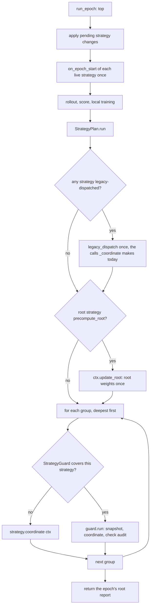

**Instances.** A non-`per_group` slot has one instance, `slot.instance`, shared by every group
the slot serves. A `per_group` strategy gets one instance per group, built from the slot's spec
(or `clone()`d for an in-code instance, else shared and documented as such). This differs from
`WeightPlan`, where state is per group by default, because a strategy's configuration (which
peers are frozen, how many rounds) is a property of the policy; a numeric state that must not
cross groups sets `per_group`.

```python
# mactf/components/strategy_plan.py   (new)
from __future__ import annotations

import copy
import fnmatch
import logging
import threading
from typing import Any, Mapping, Sequence

from ..coopetition.strategy import (
    BUILTIN_STRATEGY_TYPES,
    GroupRef,
    HierarchicalStrategy,
    KappaSoftmaxStrategy,
    FrozenPeerStrategy,
    PeerStrategy,
    TreeView,
    coordinates_via_context,
    defines_nothing,
    traits_of,
)
from ..exceptions import (
    ComponentLocked,
    ComponentMissing,
    ImproperlyConfigured,
)
from .kinds import Boundary
from .resolver import ComponentResolver, ComponentSpec, Resolved
from .slots import Slot, SlotTable, SwapRecord
from .weight_plan import ROOT_LABEL, group_label, pick_glob

log = logging.getLogger("mactf.strategy")

KIND = "peer_strategy"
DEFAULT_PATH = "TRAINER.PEER_STRATEGY"
OVERRIDE_PREFIX = "TRAINER.PEER_STRATEGY_OVERRIDES."
MIGRATE_MODES = ("reset", "carry", "fail")
FRAMEWORK_DEFAULT = "kappa_softmax"                     # TRAINER_DEFAULTS["PEER_STRATEGY"]
_REMOVE = object()


def legacy_dispatch(trainer: Any, epoch: int, strategy: Any) -> None:
    """The calls ``MACTFTrainer._coordinate`` made (``trainer.py:1843-1859``), unchanged.

    Used for a strategy that does not define ``coordinate``: a structural object, a
    subclass that overrides only ``on_epoch_end``, or a pre-existing custom class.
    """
    if isinstance(strategy, HierarchicalStrategy):
        report = trainer.update_weights()
        strategy.on_epoch_end(trainer, epoch, report)
    elif isinstance(strategy, (KappaSoftmaxStrategy, FrozenPeerStrategy)):
        strategy.on_epoch_end(trainer, epoch, None)
    elif strategy.should_aggregate():
        report = trainer.update_weights()
        trainer.aggregate(report)
        strategy.on_epoch_end(trainer, epoch, report)
    else:
        strategy.on_epoch_end(trainer, epoch, None)


def default_authored(settings: Mapping[str, Any]) -> bool:
    """Whether the project wrote ``TRAINER.PEER_STRATEGY`` (see 11.5, "What the default is")."""
    from ..conf_files import authored_keys

    written = authored_keys(settings, "TRAINER")
    if written is not None:
        return "PEER_STRATEGY" in written
    value = dict(settings.get("TRAINER") or {}).get("PEER_STRATEGY")
    if isinstance(value, str):
        return value.strip().lower() != FRAMEWORK_DEFAULT
    return value is not None


class StrategyPlan:
    """The ``peer_strategy`` slots of one run and the rules that choose and change them."""

    def __init__(
        self,
        slots: SlotTable,
        *,
        resolver: ComponentResolver | None = None,
        trusted: bool = True,
        guard: Any = None,
        strict_globs: bool = True,
        migrate: str = "reset",
        strict_restore: bool = False,
        hierarchy: bool = False,
    ) -> None:
        from ..components.guards.strategy import StrategyGuard

        if migrate not in MIGRATE_MODES:
            raise ImproperlyConfigured(
                f"E070: TRAINER.PEER_STRATEGY_OPTIONS.MIGRATE must be one of {list(MIGRATE_MODES)}, got {migrate!r}"
            )
        self._slots = slots
        self._resolver = resolver or ComponentResolver()
        self._trusted = trusted
        self.guard = guard or StrategyGuard()
        self.strict_globs = bool(strict_globs)
        self.migrate = migrate
        self.strict_restore = bool(strict_restore)
        self.hierarchy = bool(hierarchy)
        self._adopted: dict[str, Any] = {}
        self._pending: dict[str, tuple[Any, str | None]] = {}
        self._group_cache: dict[tuple[str, str], tuple[Resolved, Any]] = {}
        self._restore: dict[str, Mapping[str, Any]] = {}
        self._lock = threading.RLock()
        self.last_audit: list[Any] = []

    # -- construction ----------------------------------------------------
    @classmethod
    def from_settings(
        cls,
        settings: Mapping[str, Any],
        slots: SlotTable,
        *,
        code_spec: Any = None,
        hierarchy: bool = False,
        resolver: ComponentResolver | None = None,
        trusted: bool = True,
    ) -> "StrategyPlan":
        from ..components.guards.strategy import StrategyGuard

        trainer = dict(settings.get("TRAINER") or {})
        options = {str(k).upper(): v for k, v in dict(trainer.get("PEER_STRATEGY_OPTIONS") or {}).items()}
        unknown = sorted(set(options) - {"STRICT_GLOBS", "MIGRATE"})
        if unknown:
            raise ImproperlyConfigured(
                f"E070: TRAINER.PEER_STRATEGY_OPTIONS has unknown keys {unknown}; accepted: MIGRATE, STRICT_GLOBS"
            )
        components = dict(settings.get("COMPONENTS") or {})
        plan = cls(
            slots,
            resolver=resolver,
            trusted=trusted,
            guard=StrategyGuard.from_settings(trainer.get("STRATEGY_GUARD")),
            strict_globs=bool(options.get("STRICT_GLOBS", True)),
            migrate=str(options.get("MIGRATE", "reset")).lower(),
            strict_restore=bool(components.get("STRICT_RESTORE", False)),
            hierarchy=hierarchy,
        )
        if code_spec is not None and not isinstance(code_spec, (str, Mapping, ComponentSpec)):
            plan.adopt_default(code_spec)
        elif code_spec is not None:
            plan.install_default(code_spec)
        elif default_authored(settings):
            plan.install_default(trainer.get("PEER_STRATEGY"))
        else:
            plan.install_default("hierarchical" if hierarchy else FRAMEWORK_DEFAULT)
        overrides = trainer.get("PEER_STRATEGY_OVERRIDES") or {}
        if not isinstance(overrides, Mapping):
            raise ImproperlyConfigured("E070: TRAINER.PEER_STRATEGY_OVERRIDES must be a mapping of glob to spec")
        for glob, raw in overrides.items():
            plan.install_override(str(glob), raw)
        return plan

    def install_default(self, raw: Any) -> Slot:
        return self._slots.install(DEFAULT_PATH, KIND, raw)

    def adopt_default(self, instance: Any) -> Slot:
        slot = self._slots.adopt(DEFAULT_PATH, KIND, instance, name=type(instance).__name__)
        self._adopted[DEFAULT_PATH] = instance
        return slot

    def install_override(self, glob: str, raw: Any) -> Slot:
        if not glob or glob != glob.strip():
            raise ImproperlyConfigured(f"E070: invalid override glob {glob!r}")
        path = OVERRIDE_PREFIX + glob
        if isinstance(raw, (str, Mapping, ComponentSpec)):
            return self._slots.install(path, KIND, raw)
        slot = self._slots.adopt(path, KIND, raw, name=type(raw).__name__)
        self._adopted[path] = raw
        return slot

    # -- reading ---------------------------------------------------------
    def override_globs(self) -> list[str]:
        return sorted(p[len(OVERRIDE_PREFIX):] for p in self._slots.paths()
                      if p.startswith(OVERRIDE_PREFIX))

    def select(self, label: str) -> str:
        """The slot path serving ``label``. ``E071`` on an ambiguous tie."""
        glob = pick_glob(label, self.override_globs(), what="peer_strategy overrides", code="E071")
        return DEFAULT_PATH if glob is None else OVERRIDE_PREFIX + glob

    def default_instance(self) -> Any:
        return self._slots.get(DEFAULT_PATH).instance

    def customized(self) -> bool:
        """Whether anything differs from what a legacy run would have built."""
        if any(p.startswith(OVERRIDE_PREFIX) for p in self._slots.paths()) or self.history():
            return True
        if DEFAULT_PATH in self._adopted:
            return type(self._adopted[DEFAULT_PATH]) not in BUILTIN_STRATEGY_TYPES
        resolved = self._slots.get(DEFAULT_PATH).resolved
        return resolved.component.origin.value != "builtin"

    def history(self) -> list[SwapRecord]:
        return [r for r in self._slots.history if r.slot.startswith(DEFAULT_PATH)]

    def instance_for(self, label: str) -> Any:
        """The instance serving ``label``. One per slot, or one per group for ``per_group``."""
        with self._lock:
            path = self.select(label)
            slot = self._slots.get(path)
            if not traits_of(slot.instance).per_group:
                return slot.instance
            key = (path, label)
            cached = self._group_cache.get(key)
            if cached is not None and cached[0] is slot.resolved:
                return cached[1]
            if path in self._adopted:
                clone = getattr(self._adopted[path], "clone", None)
                instance = clone() if callable(clone) else self._adopted[path]
            else:
                instance = self._resolver.resolve(slot.resolved.spec, trusted=self._trusted).instance
            self._seed_state(label, path, instance)
            self._group_cache[key] = (slot.resolved, instance)
            return instance

    def live_instances(self) -> list[Any]:
        """Every distinct live instance, default first, then overrides by glob."""
        seen: set[int] = set()
        out: list[Any] = []
        paths = [DEFAULT_PATH] + [OVERRIDE_PREFIX + g for g in self.override_globs()]
        with self._lock:
            for path in paths:
                instances = [self._slots.get(path).instance]
                instances += [inst for (p, _l), (_r, inst) in sorted(self._group_cache.items()) if p == path]
                for instance in instances:
                    if id(instance) not in seen:
                        seen.add(id(instance))
                        out.append(instance)
        return out

    def reaches(self, path: str, instance: Any, group: GroupRef) -> bool:
        """The reach rule of 11.5."""
        if path != DEFAULT_PATH:
            return True
        return group.is_root or traits_of(instance).walk == "tree"

    def _seed_state(self, label: str, path: str, instance: Any) -> None:
        entry = self._restore.pop(f"{path}|{label}", None)
        if entry is None:
            return
        load = getattr(instance, "load_state_dict", None)
        if not callable(load) or entry.get("class") != type(instance).__name__:
            if entry.get("state"):
                log.warning("W031: state saved for %s at %s does not fit %s; dropped",
                            label, path, type(instance).__name__)
            return
        load(copy.deepcopy(entry["state"]))

    # -- the epoch -------------------------------------------------------
    def epoch_start(self, trainer: Any, epoch: int) -> None:
        for instance in self.live_instances():
            instance.on_epoch_start(trainer, epoch)

    def on_peer_step(self, trainer: Any, node: Any, result: Any) -> None:
        label = group_label(node.parent)
        self.instance_for(label).on_peer_step(trainer, node, result)

    def run(self, trainer: Any, epoch: int, view: TreeView) -> Any:
        """Step 6 of ``run_epoch``: coordinate every group. Returns the epoch's root report."""
        from ..training.coordination import CoordinationContext, CoordinationState

        trainer._epoch_report = None
        state = CoordinationState(epoch)
        served: list[tuple[GroupRef, str, Any]] = []
        for group in reversed(view.groups):
            path = self.select(group.label)
            instance = self.instance_for(group.label)
            if self.reaches(path, instance, group):
                served.append((group, path, instance))

        done: set[int] = set()
        for _group, _path, instance in served:
            if not coordinates_via_context(instance) and id(instance) not in done:
                done.add(id(instance))
                legacy_dispatch(trainer, epoch, instance)

        root = next((entry for entry in served if entry[0].is_root), None)
        if root is not None and coordinates_via_context(root[2]) and traits_of(root[2]).precompute_root:
            CoordinationContext(trainer, state, (root[0],), owner=self._owner(root[1], root[2]),
                                checks=False).update_root()

        for group, path, instance in served:
            if not coordinates_via_context(instance):
                continue
            owner = self._owner(path, instance)
            covered = self.guard.covers(instance)
            ctx = CoordinationContext(trainer, state, (group,), owner=owner, checks=covered)
            if covered:
                self.guard.run(owner, instance, ctx, state, backend=trainer)
            else:
                instance.coordinate(ctx)
        self.last_audit = list(state.events)
        return trainer._epoch_report

    @staticmethod
    def _owner(path: str, instance: Any) -> str:
        return str(getattr(instance, "name", None) or type(instance).__name__)

    # -- validation ------------------------------------------------------
    def validate(self, view: TreeView, *, initial: bool) -> list[str]:
        """Check the plan against the groups that exist. Returns warnings; raises on errors.

        ``E070`` an override matches no group at build, or two groups share a label;
        ``E071`` ambiguous overrides; ``E072`` a legacy strategy used where only a context-driven
        one can work; ``E074`` a strategy's ``validate`` rejected the tree, or it defines no entry point.
        """
        labels = list(view.labels())
        if len(set(labels)) != len(labels):
            duplicates = sorted({label for label in labels if labels.count(label) > 1})
            raise ImproperlyConfigured(
                f"E070: aggregation group labels collide: {duplicates}; the label {ROOT_LABEL!r} is "
                "reserved for the top group and cannot also be a node path with children"
            )
        notes: list[str] = []
        for glob in self.override_globs():
            if any(label == glob or fnmatch.fnmatchcase(label, glob) for label in labels):
                continue
            message = f"override {glob!r} matches no aggregation group; groups are {labels}"
            if initial and self.strict_globs:
                raise ImproperlyConfigured(f"E070: TRAINER.PEER_STRATEGY_OVERRIDES: {message}")
            notes.append(f"W033: {message}")
        for group in view.groups:
            self.select(group.label)                                       # E071
        self._check_legacy_placement()
        for path in [DEFAULT_PATH] + [OVERRIDE_PREFIX + g for g in self.override_globs()]:
            self._check_instance(path, self._slots.get(path).instance, view)
            if initial:
                self.probe(path, view=view)
        for note in notes:
            log.warning(note)
        return notes

    def _check_legacy_placement(self, candidate: Any = None, path: str | None = None) -> None:
        overrides = bool(self.override_globs()) or (path is not None and path != DEFAULT_PATH)
        for slot_path in [DEFAULT_PATH] + [OVERRIDE_PREFIX + g for g in self.override_globs()]:
            instance = candidate if (candidate is not None and slot_path == path) else self._slots.get(slot_path).instance
            if coordinates_via_context(instance):
                continue
            if slot_path != DEFAULT_PATH:
                raise ImproperlyConfigured(
                    f"E072: {slot_path} holds {type(instance).__name__}, which does not define coordinate(ctx); "
                    "a strategy that serves one group needs the context API (legacy strategies drive the whole trainer)"
                )
            if overrides:
                raise ImproperlyConfigured(
                    f"E072: {DEFAULT_PATH} holds {type(instance).__name__}, which does not define coordinate(ctx), "
                    "and overrides exist; a legacy strategy cannot share a tree with per-group strategies"
                )

    def _check_instance(self, path: str, instance: Any, view: TreeView) -> None:
        if defines_nothing(instance):
            raise ImproperlyConfigured(
                f"E074: {path}: {type(instance).__name__} defines neither coordinate(ctx) nor on_epoch_end(); "
                "it would do nothing"
            )
        check = getattr(instance, "validate", None)
        if not callable(check):
            return
        problems = [str(item) for item in (check(view) or ())]
        if problems:
            raise ImproperlyConfigured(f"E074: {path}: " + "; ".join(problems))

    def probe(self, path: str | None = None, *, view: TreeView, instance: Any = None,
              spec: ComponentSpec | None = None) -> None:
        """Run the section 11.8 probe on a slot's strategy (or a candidate), over the real tree's shape."""
        from ..coopetition.strategy_probe import verify_peer_strategy

        if not self.guard.probe:
            return
        target = path or DEFAULT_PATH
        live = instance if instance is not None else self._slots.get(target).instance
        if not self.guard.covers(live):
            return
        verify_peer_strategy(lambda: self._scratch(target, instance, spec), slot=target, view=view)

    def _scratch(self, path: str, instance: Any = None, spec: ComponentSpec | None = None) -> Any:
        if instance is not None and spec is None:
            clone = getattr(instance, "clone", None)
            if callable(clone):
                return clone()
            try:
                return copy.deepcopy(instance)
            except Exception:  # noqa: BLE001 - a user object that cannot be copied is probed as is
                return instance
        if spec is not None:
            return self._resolver.resolve(spec, trusted=self._trusted).instance
        if path in self._adopted:
            return self._scratch(path, self._adopted[path])
        return self._resolver.resolve(self._slots.get(path).resolved.spec, trusted=self._trusted).instance

    # -- live changes ----------------------------------------------------
    def _mode(self, mode: str | None) -> str:
        chosen = (mode or self.migrate).lower()
        if chosen not in MIGRATE_MODES:
            raise ImproperlyConfigured(f"E074: migrate must be one of {list(MIGRATE_MODES)}, got {mode!r}")
        return chosen

    def set(
        self,
        glob: str | None,
        raw: Any,
        *,
        view: TreeView,
        host: Any = None,
        boundary: Boundary = Boundary.EPISODE,
        mode: str | None = None,
    ) -> SwapRecord | None:
        """Replace the default (``glob=None``), replace one override, or add an override. Now.

        Order is the atomicity argument (T10): everything that can fail (parse, build, contract,
        ``validate``, placement, probe, ambiguity, lock, boundary, migration) happens before
        the slot write; the slot write is the single mutation; ``detach`` and ``attach`` after
        it cannot fail the swap (a raising ``detach`` is logged).
        """
        chosen = self._mode(mode)
        path = DEFAULT_PATH if glob is None else OVERRIDE_PREFIX + glob
        with self._lock:
            adding = path not in self._slots.paths()
            if glob is not None and (not glob or glob != glob.strip()):
                raise ImproperlyConfigured(f"E070: invalid override glob {glob!r}")
            if boundary.rank > Boundary.EPISODE.rank:
                raise ComponentLocked(KIND, path, "peer_strategy may only change at episode boundaries")
            if self._slots._slot_locked(path):
                raise ComponentLocked(KIND, path, "the slot is locked by COMPONENTS.LOCKED")
            adopted = not isinstance(raw, (str, Mapping, ComponentSpec))
            spec = None if adopted else ComponentSpec.parse(KIND, raw)
            candidate = raw if adopted else self._resolver.resolve(spec, trusted=self._trusted).instance
            if not adopted and not coordinates_via_context(candidate) and glob is not None:
                raise ImproperlyConfigured(f"E072: {path}: {type(candidate).__name__} does not define coordinate(ctx)")
            self._check_legacy_placement(candidate, path)
            self._check_instance(path, candidate, view)
            self.probe(path, view=view, instance=candidate, spec=spec)
            old = None if adding else self._slots.get(path).instance
            carried = self._collect_state(old, candidate, chosen, path)
            # -- the single mutation -----------------------------------------
            if adding:
                if adopted:
                    self._slots.adopt(path, KIND, raw, name=type(raw).__name__)
                else:
                    self._slots.install(path, KIND, spec)
                record = None
            elif adopted:
                self._slots.adopt(path, KIND, raw, name=type(raw).__name__)
                record = None
            else:
                record = self._slots.swap(path, spec, boundary=boundary)
            if adopted:
                self._adopted[path] = raw
            else:
                self._adopted.pop(path, None)
            for key in [k for k in self._group_cache if k[0] == path]:
                del self._group_cache[key]
            live = self._slots.get(path).instance
            if carried is not None:
                live.load_state_dict(copy.deepcopy(carried))
        self._after_change(old, live, host)
        return record

    def _collect_state(self, old: Any, new: Any, mode: str, path: str) -> dict[str, Any] | None:
        read = getattr(old, "state_dict", None) if old is not None else None
        state = dict(read()) if callable(read) else {}
        meaningful = {k: v for k, v in state.items() if k not in ("class", "name")}
        if not meaningful:
            return None
        if mode == "fail":
            raise ImproperlyConfigured(
                f"E074: replacing {type(old).__name__} at {path} would discard its state "
                f"({sorted(meaningful)}); TRAINER.PEER_STRATEGY_OPTIONS.MIGRATE is 'fail'"
            )
        if mode == "reset":
            return None
        if type(old) is not type(new) or not callable(getattr(new, "load_state_dict", None)):
            log.warning("W031: carry from %s to %s is impossible (different classes); state dropped",
                        type(old).__name__, type(new).__name__)
            return None
        return state

    def _after_change(self, old: Any, new: Any, host: Any) -> None:
        if host is None:
            return
        if old is not None and old is not new:
            try:
                old.detach(host)
            except Exception as error:  # noqa: BLE001 - the swap is done; report, do not undo
                log.error("detach of %s raised: %s", type(old).__name__, error)
        new.attach(host)

    def remove(
        self, glob: str, *, view: TreeView, host: Any = None, boundary: Boundary = Boundary.EPISODE
    ) -> SwapRecord:
        """Delete one override; its groups fall back to the next most specific, or the default."""
        path = OVERRIDE_PREFIX + glob
        with self._lock:
            if path not in self._slots.paths():
                raise ComponentMissing("slot", path, self._slots.paths())
            if self._slots._slot_locked(path):
                raise ComponentLocked(KIND, path, "the slot is locked by COMPONENTS.LOCKED")
            if boundary.rank > Boundary.EPISODE.rank:
                raise ComponentLocked(KIND, path, "peer_strategy may only change at episode boundaries")
            before = self.override_globs()
            after = [g for g in before if g != glob]
            for group in view.groups:                               # E071 if a tie appears
                pick_glob(group.label, after, what="peer_strategy overrides", code="E071")
            old = self._slots.get(path).instance
            record = self._slots.remove(path, boundary=boundary)
            self._adopted.pop(path, None)
            for key in [k for k in self._group_cache if k[0] == path]:
                del self._group_cache[key]
        self._after_change(old, self.default_instance(), host)
        return record

    def request(self, glob: str | None, raw: Any, *, mode: str | None = None) -> None:
        """Queue a replacement for the next episode boundary. Validated eagerly."""
        self._mode(mode)
        path = DEFAULT_PATH if glob is None else OVERRIDE_PREFIX + glob
        if isinstance(raw, (str, Mapping, ComponentSpec)):
            self._resolver.validate(ComponentSpec.parse(KIND, raw), trusted=self._trusted)
        with self._lock:
            self._pending[path] = (raw, mode)

    def request_remove(self, glob: str) -> None:
        path = OVERRIDE_PREFIX + glob
        if path not in self._slots.paths():
            raise ComponentMissing("slot", path, self._slots.paths())
        with self._lock:
            self._pending[path] = (_REMOVE, None)

    def pending(self) -> dict[str, str]:
        with self._lock:
            return {path: ("remove" if value is _REMOVE else "set")
                    for path, (value, _mode) in self._pending.items()}

    def take_pending(self) -> list[tuple[str | None, Any, str | None]]:
        with self._lock:
            items = sorted(self._pending.items(), key=lambda kv: (kv[0] != DEFAULT_PATH, kv[0]))
            self._pending.clear()
        out: list[tuple[str | None, Any, str | None]] = []
        for path, (value, mode) in items:
            glob = None if path == DEFAULT_PATH else path[len(OVERRIDE_PREFIX):]
            out.append((glob, value, mode))
        return out

    @staticmethod
    def is_removal(value: Any) -> bool:
        return value is _REMOVE

    # -- persistence -----------------------------------------------------
    def state_dict(self) -> dict[str, Any]:
        slots: dict[str, Any] = {}
        state: dict[str, Any] = {}
        for path in [DEFAULT_PATH] + [OVERRIDE_PREFIX + g for g in self.override_globs()]:
            resolved = self._slots.get(path).resolved
            if path in self._adopted:
                comp = resolved.component
                slots[path] = {"adopted": f"{comp.module}.{comp.qualname}"}
            else:
                slots[path] = {"spec": resolved.spec.canonical(), "hash": resolved.spec_hash}
            instance = self._slots.get(path).instance
            read = getattr(instance, "state_dict", None)
            body = dict(read()) if callable(read) else {}
            if {k for k in body} - {"class", "name"}:
                state[f"{path}|*"] = {"class": type(instance).__name__, "state": body}
        for (path, label), (_resolved, instance) in sorted(self._group_cache.items()):
            read = getattr(instance, "state_dict", None)
            body = dict(read()) if callable(read) else {}
            if {k for k in body} - {"class", "name"}:
                state[f"{path}|{label}"] = {"class": type(instance).__name__, "state": body}
        return {
            "version": 1,
            "slots": slots,
            "state": state,
            "history": [r.as_dict() for r in self.history()][-64:],
        }

    def load_state_dict(self, payload: Mapping[str, Any], *, strict: bool = False) -> list[str]:
        """Reconcile the live plan with a saved one. The saved plan wins (``W031``); under
        ``strict`` (``COMPONENTS.STRICT_RESTORE``) any difference is ``E076``."""
        notes: list[str] = []
        saved = dict(payload.get("slots") or {})
        with self._lock:
            for path, entry in sorted(saved.items()):
                if "spec" not in entry:
                    notes.append(
                        f"W031: {path} held an in-code instance ({entry.get('adopted')}) when saved; "
                        "the configured strategy is kept"
                    )
                    continue
                live = self._slots.get(path) if path in self._slots.paths() else None
                if live is not None and path not in self._adopted and live.resolved.spec_hash == entry.get("hash"):
                    continue
                message = f"{path}: the saved run used {entry['spec']}, this run is configured differently"
                if strict:
                    raise ImproperlyConfigured(f"E076: {message}; COMPONENTS.STRICT_RESTORE is on")
                self._slots.install(path, KIND, entry["spec"])
                self._adopted.pop(path, None)
                notes.append(f"W031: {message}; the saved plan wins")
            for path in [p for p in self._slots.paths()
                         if p.startswith(OVERRIDE_PREFIX) and p not in saved]:
                message = f"{path} exists now but not in the saved run (it had been removed)"
                if strict:
                    raise ImproperlyConfigured(f"E076: {message}; COMPONENTS.STRICT_RESTORE is on")
                self._slots.remove(path, boundary=Boundary.RUN_START)
                self._adopted.pop(path, None)
                notes.append(f"W031: {message}; the saved plan wins")
            self._group_cache.clear()
            self._restore = {}
            for key, entry in dict(payload.get("state") or {}).items():
                path, _, label = key.partition("|")
                if label == "*":
                    instance = self._slots.get(path).instance if path in self._slots.paths() else None
                    load = getattr(instance, "load_state_dict", None)
                    if instance is not None and callable(load) and entry.get("class") == type(instance).__name__:
                        load(copy.deepcopy(entry["state"]))
                    else:
                        notes.append(f"W031: state saved for {path} does not fit the live strategy; dropped")
                else:
                    self._restore[key] = dict(entry)
        for note in notes:
            log.warning(note)
        return notes

    # -- reporting -------------------------------------------------------
    def describe(self, labels: Sequence[str] = ()) -> dict[str, Any]:
        slots = {
            path: self._slots.get(path).resolved.fingerprint()
            for path in self._slots.paths()
            if path == DEFAULT_PATH or path.startswith(OVERRIDE_PREFIX)
        }
        return {
            "slots": slots,
            "serving": {label: self.select(label) for label in labels},
            "guard": self.guard.describe(),
            "pending": self.pending(),
        }
```

Three details that are easy to get wrong:

* `set` on an override *adds* the slot when it does not exist, and then `record` is `None`
  because `SlotTable.swap` records a *change* and an addition has no predecessor; the API
  reports additions through the plan's `describe()` instead.
* `request` validates by *resolving the spec*, never by building: the candidate's `validate` and
  probe need the live tree and so run at the boundary, inside `set`. A queued change that then
  fails is logged as a failure and does not end the run (`_apply_pending_strategies`, 11.9).
* `load_state_dict` restores per-slot state immediately, but per-group state lazily, in
  `instance_for` through `_seed_state`, because a `per_group` instance does not exist before its
  group is first coordinated.

### 11.6 `CoordinationContext`: the only verbs a strategy has

The context is a facade over the trainer (the *backend*). It is constructed once per group call
by `StrategyPlan.run`. It exposes reading verbs (groups, members, signals, void and eligibility
questions) and five mutating verbs. Each mutating verb appends an `AuditEvent` to the epoch's
`CoordinationState`, which is what `StrategyGuard` reads after the call.

| Verb | Effect | Audit kind | Pre-condition when `checks` is on |
|---|---|---|---|
| `update_root(eligible=None)` | Compute the root group's report. Memoised: it runs once per epoch, a second call returns the same report | `update_root` | A second call with a different `eligible` is `Y003` |
| `aggregate_root(report=None, *, update_reference=True)` | Write the root group's blend; `update_reference=False` leaves the reference peer alone | `aggregate_root` | group in scope (`Y008`); not written yet (`Y003`); no ancestor group written yet (`Y004`); a report the context did not produce must be legal (`Y001`) |
| `aggregate_group(group, *, eligible=None)` | Compute and write one child group's blend; the reference is never touched | `aggregate_group` | in scope (`Y008`); not void (`Y002`); not written (`Y003`); no ancestor group written (`Y004`) |
| `skip(group, reason)` | Record that the group was deliberately left alone | `skip` | in scope (`Y008`) |
| `freeze_peer(path)` / `thaw_peer(path)` | Add or remove the reason `strategy:<owner>` | `freeze` / `thaw` | `path` is a member of the group in scope (`Y008`) |
| `record_signal_sharing(signals)` | Record that signals were shared (the `cooperative` verb) | `signals` | none |

`Y004` is the ordering rule of T4: a group may not be written after the group that *contains
its parent node as a member* (or any group above that one). The context computes the chain of
ancestor group labels from the tree, so the rule needs no state from the strategy.

```python
# mactf/training/coordination.py   (new)
from __future__ import annotations

from dataclasses import dataclass, field
from typing import Any, Mapping, Protocol, Sequence

from ..coopetition.strategy import GroupRef
from ..exceptions import ContractError

ROOT_LABEL = "root"


class CoordinationBackend(Protocol):
    """What ``MACTFTrainer`` provides to the context (and what the probe's synthetic trainer fakes)."""

    tree: Any
    freeze: Any
    signal_by_peer: Mapping[str, float]
    #: Parameter writes performed so far (``_write`` increments it). The guard compares its
    #: delta over one call with the number of writes the context audited (``Y003``).
    write_count: int

    def update_weights(self, eligible: Mapping[str, bool] | None = None) -> Any: ...
    def aggregate(self, report: Any = None, *, update_reference: bool = True) -> Any: ...
    def aggregate_group(self, parent: str | None, members: Sequence[str], *,
                        eligible: Mapping[str, bool] | None = None) -> Any: ...
    def peers_void(self, members: Sequence[str]) -> bool: ...
    def legal_report(self, report: Any, parent: str | None, members: Sequence[str]) -> list[str]: ...
    def record_signal_sharing(self, signals_map: Mapping[str, float], *, epoch: int) -> None: ...
    def peer_digest(self, path: str) -> str: ...


class CoordinationError(ContractError):
    """A verb's pre-condition failed. ``code`` is a ``Y`` code (11.7); nothing was written."""

    def __init__(self, code: str, detail: str, *, peer: str | None = None) -> None:
        self.code = code
        self.detail = detail
        self.peer = peer
        super().__init__(f"{code}: {detail}")


@dataclass(frozen=True)
class AuditEvent:
    seq: int
    kind: str
    group: str | None
    members: tuple[str, ...] = ()
    detail: Mapping[str, Any] = field(default_factory=dict)


class CoordinationState:
    """What happened during one epoch's sweep; shared by every context of that sweep."""

    def __init__(self, epoch: int) -> None:
        self.epoch = int(epoch)
        self.events: list[AuditEvent] = []
        self.written: dict[str, int] = {}
        self.root_report: Any = None
        self.root_eligible: dict[str, bool] | None = None
        self.produced: set[int] = set()

    def record(self, kind: str, group: str | None, members: Sequence[str] = (), **detail: Any) -> AuditEvent:
        event = AuditEvent(len(self.events), kind, group, tuple(members), dict(detail))
        self.events.append(event)
        return event


class CoordinationContext:
    """The verbs of one group call. See the table in 11.6."""

    def __init__(
        self,
        backend: CoordinationBackend,
        state: CoordinationState,
        groups: Sequence[GroupRef],
        *,
        owner: str,
        checks: bool,
    ) -> None:
        self._backend = backend
        self.state = state
        self.groups: tuple[GroupRef, ...] = tuple(groups)
        self.owner = owner
        self.checks = bool(checks)

    # -- reading ---------------------------------------------------------
    @property
    def epoch(self) -> int:
        return self.state.epoch

    @property
    def group(self) -> GroupRef:
        return self.groups[0]

    @property
    def includes_root(self) -> bool:
        return any(group.is_root for group in self.groups)

    @property
    def tree(self) -> Any:
        return self._backend.tree

    @property
    def signals(self) -> dict[str, float]:
        return dict(self._backend.signal_by_peer or {})

    @property
    def freeze_mode(self) -> str:
        return self._backend.freeze.mode

    def peers_void(self, members: Sequence[str]) -> bool:
        return bool(self._backend.peers_void(list(members)))

    def eligible_for(self, members: Sequence[str]) -> dict[str, bool] | None:
        """Who may carry weight in a group of ``members``; ``None`` when everyone may."""
        return self._backend.freeze.eligible_for(list(members))

    def unchecked(self) -> "CoordinationContext":
        """The same context without pre-conditions (the guard's fallback uses it)."""
        return CoordinationContext(self._backend, self.state, self.groups, owner=self.owner, checks=False)

    # -- checks ----------------------------------------------------------
    def _in_scope(self, group: GroupRef) -> None:
        if self.checks and group.label not in {item.label for item in self.groups}:
            raise CoordinationError(
                "Y008", f"group {group.label!r} is outside the scope of this call "
                        f"({[item.label for item in self.groups]})",
            )

    def _ancestor_labels(self, group: GroupRef) -> list[str]:
        labels: list[str] = []
        node = group.parent
        tree = self._backend.tree
        while node is not None:
            above = tree.parent(node)
            labels.append(ROOT_LABEL if above is None else above)
            node = above
        return labels

    def _precheck_write(self, group: GroupRef) -> None:
        if not self.checks:
            return
        self._in_scope(group)
        if self.state.written.get(group.label):
            raise CoordinationError("Y003", f"group {group.label!r} was already written this epoch")
        for label in self._ancestor_labels(group):
            if self.state.written.get(label):
                raise CoordinationError(
                    "Y004", f"group {group.label!r} would be written after its ancestor group {label!r}"
                )

    # -- mutating verbs --------------------------------------------------
    def update_root(self, eligible: Mapping[str, bool] | None = None) -> Any:
        if self.state.root_report is not None:
            if eligible is not None and self.checks and dict(eligible) != (self.state.root_eligible or {}):
                raise CoordinationError("Y003", "the root weights were already computed with a different eligibility")
            return self.state.root_report
        report = self._backend.update_weights(eligible=eligible)
        self.state.root_report = report
        self.state.root_eligible = None if eligible is None else dict(eligible)
        self.state.produced.add(id(report))
        self.state.record("update_root", ROOT_LABEL, entries=len(getattr(report, "weights", {}) or {}))
        return report

    def aggregate_root(self, report: Any = None, *, update_reference: bool = True) -> Any:
        root = next((g for g in self.groups if g.is_root), None)
        if root is None:
            raise CoordinationError("Y008", "aggregate_root was called from a call that does not serve the root group")
        self._precheck_write(root)
        if report is None:
            report = self.update_root()
        if self.checks and id(report) not in self.state.produced:
            problems = self._backend.legal_report(report, None, root.members)
            if problems:
                raise CoordinationError("Y001", "the report is not legal: " + "; ".join(problems))
        result = self._backend.aggregate(report, update_reference=bool(update_reference))
        self.state.written[ROOT_LABEL] = self.state.written.get(ROOT_LABEL, 0) + 1
        self.state.record("aggregate_root", ROOT_LABEL, root.members, update_reference=bool(update_reference))
        return result

    def aggregate_group(self, group: GroupRef, *, eligible: Mapping[str, bool] | None = None) -> Any:
        if group.is_root:
            raise CoordinationError("Y008", "aggregate_group serves child groups; use aggregate_root for the root group")
        self._precheck_write(group)
        if self.checks and self._backend.peers_void(list(group.members)):
            raise CoordinationError("Y002", f"every member of group {group.label!r} was voided; it is never blended")
        report = self._backend.aggregate_group(group.parent, list(group.members), eligible=eligible)
        self.state.produced.add(id(report))
        self.state.written[group.label] = self.state.written.get(group.label, 0) + 1
        self.state.record("aggregate_group", group.label, group.members)
        return report

    def skip(self, group: GroupRef, reason: str) -> None:
        self._in_scope(group)
        self.state.record("skip", group.label, group.members, reason=str(reason))

    def freeze_peer(self, path: str) -> bool:
        self._member(path)
        fresh = self._backend.freeze.add(path, f"strategy:{self.owner}")
        self.state.record("freeze", self.group.label, (path,))
        return fresh

    def thaw_peer(self, path: str) -> bool:
        self._member(path)
        gone = self._backend.freeze.discard(path, f"strategy:{self.owner}")
        self.state.record("thaw", self.group.label, (path,))
        return gone

    def _member(self, path: str) -> None:
        if self.checks and not any(path in group.members for group in self.groups):
            raise CoordinationError("Y008", f"{path!r} is not a member of the group(s) of this call", peer=path)

    def record_signal_sharing(self, signals: Mapping[str, float]) -> None:
        self._backend.record_signal_sharing(dict(signals), epoch=self.state.epoch)
        self.state.record("signals", self.group.label, tuple(signals), count=len(signals))
```

`peers_void` is read through the backend on purpose: voidness is computed from the epoch's
scorecards (`trainer.py:1250-1262`) and a strategy has no business computing it.

### 11.7 `StrategyGuard`: what a custom strategy may not do

A strategy runs between the epoch's scores and the epoch's parameters, so a wrong one corrupts
the next epoch's weights silently. The context (11.6) refuses most mistakes before they happen
(`pre-conditions`); `StrategyGuard` is the second layer: it takes a **snapshot** before a
strategy runs, lets it run, and checks the **audit** the context kept and the **state** the
strategy was not allowed to touch. It is the strategy counterpart of `WeightGuard` (10.4) and
`ComplianceGuard` (6.3), and it answers the same question: "may this output be used?"

**What is checked.**

| Code | Rule | Found by | Class |
|---|---|---|---|
| `Y001` | A report a strategy hands to `aggregate_root` is a legal simplex for that group (finite, non-negative, names exactly the members, floor and cap, ineligible peers at 0). A report the context itself produced is already legal by `WeightGuard` and is not re-checked | context pre-condition | soft |
| `Y002` | A group whose members are all void is never blended | context pre-condition | soft |
| `Y003` | A group is written at most once per epoch; the root's weights are not recomputed under a different eligibility; **no parameter write bypasses the context** | pre-condition; and the `write_count` delta in the post-check | soft |
| `Y004` | A child group is written before its ancestor groups (T4) | context pre-condition | soft |
| `Y005` | The parameters of a peer that is frozen under `strict` did not change | digest of each such peer before and after | **hard** |
| `Y006` | The tree's paths, parents and roles did not change. Structure changes only through `MutationPlan` (12.5) | digest of the topology before and after | **hard** |
| `Y007` | `coordinate` raised | `except Exception` around the call | soft |
| `Y008` | A verb named a group or a peer outside the call's scope | context pre-condition | soft |

**Soft and hard.** A *soft* violation was refused, or left no damage the next epoch cannot
absorb; the guard's `MODE` decides what happens. A *hard* violation means state that cannot be
reconstructed was changed (a frozen peer's parameters, the tree itself), so the run stops with
`E073` in every mode. Skipping would only continue on top of the corruption.

| `MODE` | A soft violation | Use |
|---|---|---|
| `skip` (default) | The group's outcome stands as it is (writes already made cannot be undone), the audit records the violation, `W030` is logged, the epoch continues | production |
| `fallback` | As `skip`, then the standard mix runs for that group if the strategy declares `aggregates` and the group is unwritten, void-free and has an eligible member | production where progress matters more than the strategy's policy |
| `enforce` | `StrategyGuardViolation` (`E073`) | development, CI |

| `SCOPE` | Guarded | Use |
|---|---|---|
| `custom` (default) | every strategy the framework did not write (`type(strategy) not in BUILTIN_STRATEGY_TYPES`), including a subclass of a built-in | |
| `all` | every strategy, built-ins too | the equivalence tests |
| `off` | none; the context still enforces its pre-conditions unless `checks=False` | a benchmark that has already proven the strategy |

`SCOPE=off` does not disable the context's pre-conditions for a custom strategy on purpose: the
guard is the *reporting* layer, the pre-conditions are the *integrity* layer, and removing the
second would let a strategy write twice to one group with nobody noticing. `StrategyPlan.run`
builds the context with `checks=covered`, so `off` is the only way to run without them.

The exception class lives with the other framework errors:

```python
# mactf/exceptions.py   (added next to WeightGuardViolation)
class StrategyGuardViolation(ComplianceError):
    """``E073``: a peer strategy broke the coordination contract (hard rule, or ``MODE=enforce``)."""

    code = "E073"

    def __init__(self, strategy: str, violations: "Sequence[Any]") -> None:
        self.strategy = strategy
        self.violations = tuple(violations)
        listed = "; ".join(str(item) for item in self.violations)
        super().__init__(f"E073: peer_strategy {strategy!r} broke the coordination contract: {listed}")
```

```python
# mactf/components/guards/strategy.py   (new)
from __future__ import annotations

import hashlib
import logging
from dataclasses import dataclass
from typing import Any, Mapping

from ...coopetition.strategy import BUILTIN_STRATEGY_TYPES, traits_of
from ...exceptions import ImproperlyConfigured, StrategyGuardViolation
from ...training.coordination import CoordinationContext, CoordinationError, CoordinationState

log = logging.getLogger("mactf.strategy")

GUARD_MODES = ("skip", "fallback", "enforce")
GUARD_SCOPES = ("custom", "all", "off")
_GUARD_KEYS = frozenset({"MODE", "SCOPE", "PROBE", "CHECK_FROZEN"})

CODES: dict[str, str] = {
    "Y001": "a report handed to aggregate_root is not a legal simplex for its group",
    "Y002": "a group whose members are all void was blended",
    "Y003": "a group was written twice, the root weights were recomputed differently, or a write bypassed the context",
    "Y004": "a child group was written after its ancestor group",
    "Y005": "the parameters of a frozen peer changed under FREEZE_MODE=strict",
    "Y006": "the tree structure changed outside a MutationPlan",
    "Y007": "coordinate() raised",
    "Y008": "a verb named a group or peer outside the scope of the call",
}
_HARD = frozenset({"Y005", "Y006"})


@dataclass(frozen=True)
class Violation:
    code: str
    peer: str | None
    detail: str

    @property
    def hard(self) -> bool:
        return self.code in _HARD

    def __str__(self) -> str:
        where = "" if self.peer is None else f" [{self.peer}]"
        return f"{self.code}{where}: {self.detail}"


@dataclass(frozen=True)
class GuardOutcome:
    violations: tuple[Violation, ...]
    action: str                       # "pass" | "skipped" | "fallback"


@dataclass(frozen=True)
class _Snapshot:
    topology: str
    frozen: Mapping[str, str]
    writes: int | None
    audited: int


def topology_digest(tree: Any) -> str:
    """A digest of paths, parents and roles; statuses are excluded (they are transient)."""
    rows = sorted(
        (node.path, str(node.parent), str(getattr(node, "role", "")))
        for node in tree.walk("root-first")
    )
    return hashlib.sha256(repr(rows).encode("utf-8")).hexdigest()[:16]


class StrategyGuard:
    """Snapshots, runs and audits one ``coordinate`` call."""

    def __init__(
        self,
        *,
        mode: str = "skip",
        scope: str = "custom",
        probe: bool = True,
        check_frozen: bool = True,
    ) -> None:
        if mode not in GUARD_MODES:
            raise ImproperlyConfigured(
                f"E070: TRAINER.STRATEGY_GUARD.MODE must be one of {list(GUARD_MODES)}, got {mode!r}"
            )
        if scope not in GUARD_SCOPES:
            raise ImproperlyConfigured(
                f"E070: TRAINER.STRATEGY_GUARD.SCOPE must be one of {list(GUARD_SCOPES)}, got {scope!r}"
            )
        self.mode = mode
        self.scope = scope
        self.probe = bool(probe)
        self.check_frozen = bool(check_frozen)

    # -- construction ----------------------------------------------------
    @classmethod
    def from_settings(cls, block: Mapping[str, Any] | None) -> "StrategyGuard":
        raw = {str(key).upper(): value for key, value in dict(block or {}).items()}
        unknown = sorted(set(raw) - _GUARD_KEYS)
        if unknown:
            raise ImproperlyConfigured(
                f"E070: TRAINER.STRATEGY_GUARD has unknown keys {unknown}; accepted: {sorted(_GUARD_KEYS)}"
            )
        return cls(
            mode=str(raw.get("MODE", "skip")).lower(),
            scope=str(raw.get("SCOPE", "custom")).lower(),
            probe=bool(raw.get("PROBE", True)),
            check_frozen=bool(raw.get("CHECK_FROZEN", True)),
        )

    def describe(self) -> dict[str, Any]:
        return {"mode": self.mode, "scope": self.scope, "probe": self.probe,
                "check_frozen": self.check_frozen}

    # -- scope -----------------------------------------------------------
    def covers(self, instance: Any) -> bool:
        if self.scope == "off":
            return False
        if self.scope == "all":
            return True
        return type(instance) not in BUILTIN_STRATEGY_TYPES

    # -- the call --------------------------------------------------------
    def _snapshot(self, backend: Any, state: CoordinationState) -> _Snapshot:
        frozen: dict[str, str] = {}
        if self.check_frozen:
            freeze = backend.freeze
            for path in freeze.paths():
                if freeze.skips_write(path):
                    frozen[path] = backend.peer_digest(path)
        return _Snapshot(
            topology=topology_digest(backend.tree),
            frozen=frozen,
            writes=getattr(backend, "write_count", None),
            audited=sum(state.written.values()),
        )

    def _after(self, backend: Any, state: CoordinationState, before: _Snapshot) -> list[Violation]:
        found: list[Violation] = []
        if topology_digest(backend.tree) != before.topology:
            found.append(Violation("Y006", None, "paths, parents or roles of the tree changed"))
        for path, digest in sorted(before.frozen.items()):
            if backend.peer_digest(path) != digest:
                found.append(Violation("Y005", path, "its parameters changed while it was frozen"))
        if before.writes is not None:
            unaudited = (backend.write_count - before.writes) - (sum(state.written.values()) - before.audited)
            if unaudited != 0:
                found.append(Violation(
                    "Y003", None, f"{unaudited} parameter write(s) did not go through the context",
                ))
        return found

    def run(
        self,
        label: str,
        instance: Any,
        ctx: CoordinationContext,
        state: CoordinationState,
        *,
        backend: Any,
    ) -> GuardOutcome:
        """Run ``instance.coordinate(ctx)`` under the guard. Raises only ``E073``."""
        before = self._snapshot(backend, state)
        found: list[Violation] = []
        try:
            instance.coordinate(ctx)
        except CoordinationError as error:
            found.append(Violation(error.code, error.peer, error.detail))
        except Exception as error:  # noqa: BLE001 - a strategy is user code; Y007 reports it
            found.append(Violation("Y007", None, f"{type(error).__name__}: {error}"))
        found.extend(self._after(backend, state, before))
        if not found:
            return GuardOutcome((), "pass")
        if self.mode == "enforce" or any(item.hard for item in found):
            raise StrategyGuardViolation(label, found)
        listed = "; ".join(str(item) for item in found)
        fell_back = self.mode == "fallback" and self._fallback(instance, ctx)
        log.warning(
            "W030: peer_strategy %r broke the coordination contract (%s); %s", label, listed,
            "the standard mix ran for the group" if fell_back else "its outcome for the group stands",
        )
        state.record(
            "violation", ctx.group.label, ctx.group.members,
            codes=sorted({item.code for item in found}), action="fallback" if fell_back else "skipped",
        )
        return GuardOutcome(tuple(found), "fallback" if fell_back else "skipped")

    def _fallback(self, instance: Any, ctx: CoordinationContext) -> bool:
        """The standard mix for the call's group. True when something was written."""
        if not traits_of(instance).aggregates:
            return False
        free = ctx.unchecked()
        wrote = False
        for group in ctx.groups:
            if ctx.state.written.get(group.label):
                continue
            eligible = ctx.eligible_for(group.members)
            if eligible is not None and not any(eligible.values()):
                continue
            if group.is_root:
                free.aggregate_root(free.update_root(eligible))
                wrote = True
            elif not ctx.peers_void(group.members):
                free.aggregate_group(group, eligible=eligible)
                wrote = True
        return wrote
```

Three properties worth stating:

* **The guard never swallows a hard violation and never raises a soft one unless asked.** The
  only exception it can raise is `StrategyGuardViolation`; a bug in the guard itself is not
  caught by the `except Exception` (it is outside the `try`).
* **`Y003` catches the strategy that bypasses the context.** A strategy that calls
  `ctx._backend.aggregate_group` or `trainer.aggregate` directly moves `write_count` without
  moving the audit, and the post-check reports it. This is what makes "the context is the only
  verb set" (T2) checkable and not merely documented.
* **Fallback is a mix, not a repair.** A strategy that raised halfway through a group may have
  written part of it; the fallback does not know. It only runs for a group the audit says is
  unwritten, so a half-finished group is left as the strategy left it, and `W030` says so.

### 11.8 `verify_peer_strategy`: the build-time probe

A custom strategy is exercised once, on a **synthetic trainer shaped like the real tree**, before
the run starts and before a live swap takes effect. The probe uses the real tree's *shape*
(paths, groups, members) because a strategy may legitimately be configured with real node names
(`FrozenPeerStrategy(frozen=["team-a/x"])`); it has no peers, scores or parameters, so it costs
nothing and needs no GPU. It runs under `StrategyGuard(mode="enforce", scope="all")` so every
violation is a finding.

| Probe step | Finding when it fails |
|---|---|
| The strategy defines `coordinate` or `on_epoch_end` | `defines nothing` (`E074`) |
| `describe()` is JSON-serialisable | `E074` |
| For each case (below) and for two consecutive epochs: `on_epoch_start`, then every group deepest first through the guarded context (or `legacy_dispatch` for a legacy strategy) | each guard code, with the case name |
| A strategy that declares `traits.freezes` leaves no `strategy:*` reason behind after `detach` | `E074` |
| `state_dict()` is JSON and survives `load_state_dict` into a fresh instance unchanged | `E077` |

| Case | Setup | What it proves |
|---|---|---|
| `calm` | no void peers | the happy path writes each group at most once, children first |
| `void` | every member of every child group is void (only when the tree has child groups) | the strategy checks `ctx.peers_void` and never blends a void group (`Y002`) |

The synthetic trainer implements `CoordinationBackend` (11.6): `update_weights` returns a legal
uniform report over the eligible peers, `aggregate` and `aggregate_group` count a write, and
`peer_digest` is constant because there are no parameters.

```python
# mactf/coopetition/strategy_probe.py   (new)
from __future__ import annotations

import json
from typing import Any, Callable, Mapping, Sequence

from ..components.guards.strategy import StrategyGuard
from ..exceptions import ImproperlyConfigured, StrategyGuardViolation
from ..training.coordination import CoordinationContext, CoordinationError, CoordinationState
from ..training.freeze import FreezeSet
from .report import AggregationReport
from .strategy import (
    TreeView,
    coordinates_via_context,
    defines_nothing,
    legacy_dispatch,
    traits_of,
)
from .tree import PeerTree
from .weight_guard import WeightGuard
from .weights import WeightTraits, make_report


class _Synthetic:
    """A trainer with a tree and nothing else. Implements ``CoordinationBackend``."""

    def __init__(self, view: TreeView, void: frozenset[str]) -> None:
        size = len(view.paths) + 1
        self.tree = PeerTree(max_depth=max(8, size), max_nodes=max(64, size))
        for path in view.paths:                              # root-first: parents precede children
            self.tree.add_node(path)
        self.freeze = FreezeSet("strict")
        self.freeze.bind(self.tree)
        self.signal_by_peer: dict[str, float] = {
            path: 0.1 * (index + 1) for index, path in enumerate(view.paths)
        }
        self.write_count = 0
        self.void = set(void)
        self.shared: list[dict[str, float]] = []
        self._inspector = WeightGuard(mode="fallback", scope="all")

    def _report(self, names: Sequence[str], eligible: Mapping[str, bool] | None) -> AggregationReport:
        flags = {name: bool((eligible or {}).get(name, True)) for name in names}
        live = [name for name in names if flags[name]]
        share = 1.0 / len(live) if live else 0.0
        weights = {name: (share if flags[name] else 0.0) for name in names}
        return make_report(weights, names, kappa=1.0, eligible=flags, fallback=not live)

    def update_weights(self, eligible: Mapping[str, bool] | None = None) -> AggregationReport:
        return self._report(list(self.tree.root_paths), eligible)

    def aggregate(self, report: Any = None, *, update_reference: bool = True) -> Any:
        self.write_count += 1
        return report

    def aggregate_group(self, parent: str | None, members: Sequence[str], *,
                        eligible: Mapping[str, bool] | None = None) -> AggregationReport:
        self.write_count += 1
        return self._report(list(members), eligible)

    def peers_void(self, members: Sequence[str]) -> bool:
        return bool(members) and all(member in self.void for member in members)

    def legal_report(self, report: Any, parent: str | None, members: Sequence[str]) -> list[str]:
        found = self._inspector.inspect(
            report, names=sorted(members), eligible={name: True for name in members},
            floor=0.0, cap=1.0, traits=WeightTraits(may_fallback=True),
        )
        return [str(item) for item in found]

    def record_signal_sharing(self, signals_map: Mapping[str, float], *, epoch: int) -> None:
        self.shared.append(dict(signals_map))

    def peer_digest(self, path: str) -> str:
        return "synthetic"


def _cases(view: TreeView) -> list[tuple[str, frozenset[str]]]:
    cases: list[tuple[str, frozenset[str]]] = [("calm", frozenset())]
    voided = frozenset(path for group in view.groups if not group.is_root for path in group.members)
    if voided:
        cases.append(("void", voided))
    return cases


def _sweep(instance: Any, backend: _Synthetic, view: TreeView, epoch: int, guard: StrategyGuard,
           name: str) -> None:
    instance.on_epoch_start(backend, epoch)
    if not coordinates_via_context(instance):
        legacy_dispatch(backend, epoch, instance)
        return
    state = CoordinationState(epoch)
    for group in reversed(view.groups):                       # deepest first, as StrategyPlan.run
        ctx = CoordinationContext(backend, state, (group,), owner=name, checks=True)
        guard.run(name, instance, ctx, state, backend=backend)


def verify_peer_strategy(make: Callable[[], Any], *, slot: str, view: TreeView) -> None:
    """Probe ``make()``'s strategy over ``view``. ``E074`` for behaviour, ``E077`` for state.

    ``make`` returns a fresh instance each call, so the probe leaves nothing behind.
    """
    first = make()
    if defines_nothing(first):
        raise ImproperlyConfigured(
            f"E074: {slot}: {type(first).__name__} defines neither coordinate(ctx) nor on_epoch_end(); "
            "it would do nothing"
        )
    name = str(getattr(first, "name", None) or type(first).__name__)
    findings: list[str] = []
    try:
        json.dumps(first.describe(), sort_keys=True, allow_nan=False)
    except (TypeError, ValueError) as error:
        findings.append(f"describe() is not JSON-serialisable ({error})")

    guard = StrategyGuard(mode="enforce", scope="all", probe=False)
    used: Any = None
    for case, void in _cases(view):
        instance = make()
        backend = _Synthetic(view, void)
        for epoch in (1, 2):
            try:
                _sweep(instance, backend, view, epoch, guard, name)
            except StrategyGuardViolation as error:
                findings.append(f"{case}, epoch {epoch}: " + "; ".join(str(item) for item in error.violations))
                break
            except CoordinationError as error:
                findings.append(f"{case}, epoch {epoch}: {error}")
                break
            except Exception as error:  # noqa: BLE001 - user code
                findings.append(f"{case}, epoch {epoch}: {type(error).__name__}: {error}")
                break
        if case == "calm":
            used = instance
            if traits_of(instance).freezes:
                try:
                    instance.detach(backend)
                except Exception as error:  # noqa: BLE001
                    findings.append(f"detach() raised {type(error).__name__}: {error}")
                left = [path for path in backend.freeze
                        if any(reason.startswith("strategy:") for reason in backend.freeze.reasons(path))]
                if left:
                    findings.append(f"traits.freezes is set but detach() left {sorted(left)} frozen")
    if findings:
        raise ImproperlyConfigured(f"E074: {slot} failed its probe: " + "; ".join(findings))
    _verify_state(make, used, slot=slot)


def _verify_state(make: Callable[[], Any], used: Any, *, slot: str) -> None:
    """``state_dict`` must be JSON and reload into a fresh instance to the same state."""
    read = getattr(used, "state_dict", None)
    if not callable(read):
        return
    try:
        text = json.dumps(read(), sort_keys=True, allow_nan=False)
    except (TypeError, ValueError) as error:
        raise ImproperlyConfigured(
            f"E077: {slot}: state_dict() is not JSON-serialisable ({error}); checkpoints store it as JSON"
        ) from error
    fresh = make()
    load = getattr(fresh, "load_state_dict", None)
    if not callable(load):
        raise ImproperlyConfigured(f"E077: {slot}: defines state_dict() but no load_state_dict()")
    try:
        load(json.loads(text))
        again = json.dumps(fresh.state_dict(), sort_keys=True, allow_nan=False)
    except Exception as error:  # noqa: BLE001
        raise ImproperlyConfigured(
            f"E077: {slot}: load_state_dict() rejected its own state_dict(): {error}"
        ) from error
    if again != text:
        raise ImproperlyConfigured(f"E077: {slot}: state_dict() changed across a load_state_dict() round trip")
```

What the probe cannot know: whether the strategy is *good*. It proves the contract (legal
writes, order, void isolation, serialisable state), not the policy. A project that wants more
writes its own test with the same `_Synthetic` backend, which is exported as
`mactf.testing.synthetic_backend(view)` for that purpose (19.2).

### 11.9 Trainer integration

The trainer stops owning strategy construction, dispatch and freezing, and asks the plan and the
freeze set. The order of the epoch (document 08 section 5.2) does not change.

| Site | Today | After |
|---|---|---|
| `__init__` (`trainer.py:354`, `:407`, `:435`) | `self.strategy`, `signal_by_peer`, `_epoch_report` | adds `freeze`, `strategy_plan`, `strategy_warnings`, `write_count`, `signal_sharing`; `self.strategy` stays as the *default instance* so every reader of `trainer.strategy` keeps working |
| `build()` after `self.tree = tree` (`trainer.py:575`) | | `self.freeze.bind(self.tree)` and the mode, so the optimizer plan (9.7) can add `optimizer:null` reasons while it binds |
| `build()` (`trainer.py:614-621`) | `build_peer_strategy`, then the flat-run default override | `StrategyPlan.from_settings`, validate and probe, attach (below) |
| `_train_epoch` (`trainer.py:1651`, `:1664`) | status check; `self.strategy.on_peer_step` | the freeze check (11.4); `strategy_plan.on_peer_step` |
| `_write` (`trainer.py:1780-1802`) | all members written | non-frozen members written, `write_count` incremented (11.4 and below) |
| `aggregate`, `aggregate_group` (`trainer.py:1808-1841`) | no way to keep the reference, no eligibility | `update_reference`, `eligible` parameters |
| `_coordinate` (`trainer.py:1843-1859`) | a type-switch over the five built-ins | `strategy_plan.run` |
| `run_epoch` (`trainer.py:1864-1885`) | `self.strategy.on_epoch_start` | `_apply_pending_strategies()` first; `strategy_plan.epoch_start`; the learner check |
| backend methods | | `legal_report`, `record_signal_sharing`, `peer_digest` |
| live changes | | `swap_peer_strategy`, `remove_peer_override`, `request_*`, `_apply_pending_strategies` |
| `_trainer_state`, `load_state_dict` (`trainer.py:2190`, `:2227`) | `strategy` state only | the plan and the retired peers (11.10) |

```python
# mactf/training/trainer.py   (imports added at the top of the module)
from ..components.strategy_plan import DEFAULT_PATH, StrategyPlan
from ..coopetition.strategy import (
    FrozenPeerStrategy,
    TreeView,
    coordinates_via_context,
    traits_of as strategy_traits,
    tree_view,
)
from ..coopetition.weight_guard import WeightGuard
from ..coopetition.weights import WeightTraits
from .freeze import RETIRED, FreezeSet
```

```python
# mactf/training/trainer.py   (__init__: after ``self._epoch_report`` at line 435)
        self.freeze: FreezeSet = FreezeSet()
        self.strategy_plan: StrategyPlan | None = None
        self.strategy_warnings: list[str] = []
        self.write_count: int = 0
        self.signal_sharing: list[dict[str, Any]] = []
```

```python
# mactf/training/trainer.py   (build(): immediately after ``self.tree = tree``, line 575)
        trainer_block = _trainer_block(self.settings)
        self.freeze.bind(tree)
        self.freeze.set_mode(str(trainer_block.get("FREEZE_MODE", "legacy")).lower())
```

```python
# mactf/training/trainer.py   (build(), replacing lines 614-621; the weight plan of 10.8 sits above it)
        self.strategy_plan = StrategyPlan.from_settings(
            self.settings, self.slots,
            code_spec=self._peer_strategy_spec,
            hierarchy=self._hierarchy is not None,
            resolver=self.resolver,
            trusted=self._components_trusted,
        )
        self.strategy = self.strategy_plan.default_instance()
        self._validate_strategy_plan(initial=True)
        for instance in self.strategy_plan.live_instances():
            instance.attach(self)
```

`attach` runs for each slot's instance, not for the clones a `per_group` strategy builds later;
a `per_group` strategy that needs setup does it in `on_epoch_start`. The flat-run default that
`trainer.py:617-621` special-cased is now the plan's step 3 ("kappa_softmax for a flat tree"),
and the "equivalence gate" comment moves with it.

```python
# mactf/training/trainer.py   (new helpers)
    def _tree_view(self) -> TreeView:
        return tree_view(self.tree, hierarchy=self._hierarchy is not None)

    def _validate_strategy_plan(self, *, initial: bool) -> None:
        view = self._tree_view()
        plan = self.strategy_plan
        notes = plan.validate(view, initial=initial)
        unserved = [
            group.label for group in view.groups
            if not group.is_root
            and plan.select(group.label) == DEFAULT_PATH
            and not plan.reaches(DEFAULT_PATH, plan.default_instance(), group)
        ]
        if unserved and view.hierarchy:
            notes.append(
                f"W035: groups {unserved} are served by no strategy: the default "
                f"{type(plan.default_instance()).__name__} walks the root only; set "
                "TRAINER.PEER_STRATEGY_OVERRIDES or use a strategy with walk='tree'"
            )
        if self.freeze.mode == "legacy" and any(
            isinstance(instance, FrozenPeerStrategy) for instance in plan.live_instances()
        ):
            notes.append(
                "W034: FrozenPeerStrategy under TRAINER.FREEZE_MODE='legacy': frozen peers still take "
                "training steps and receive aggregated parameters; set FREEZE_MODE='strict' to freeze them"
            )
        self.strategy_warnings = notes
        for note in notes:
            if note.startswith(("W034", "W035")):
                log.warning(note)
```

```python
# mactf/training/trainer.py   (_train_epoch: the strategy callback at line 1664)
                self.strategy_plan.on_peer_step(self, node, result)
```

```python
# mactf/training/trainer.py   (_write: one line before the early returns, lines 1771-1779)
        self.write_count += 1
```

`_write` increments the counter for every *call*, including the early returns that write nothing,
so that the guard's delta (`Y003`) compares like with like: the context counts a write when it
calls `aggregate` or `aggregate_group`, and so does the counter.

```python
# mactf/training/trainer.py   (aggregate and aggregate_group, replacing lines 1808-1841; the
#                              weight-plan lines of 10.8 are kept)
    def aggregate(
        self, report: AggregationReport | None = None, *, update_reference: bool = True
    ) -> AggregateResult:
        """Step 6b/7: write the root group's blend. ``update_reference=False`` leaves the EMA alone."""
        self._require_built()
        report = report or self._epoch_report or self.update_weights()
        ema = float(self._coopetition_settings().get("REFERENCE_EMA", 0.05))
        result = self._write(
            self.aggregator,
            tuple(self.tree.root_paths),
            report,
            reference=self.reference,
            reference_ema=ema if update_reference else 0.0,
        )
        self._dispatch_many("on_aggregate", self, report)
        return result

    def aggregate_group(
        self,
        parent: str | None,
        members: Sequence[str],
        *,
        eligible: Mapping[str, bool] | None = None,
    ) -> AggregationReport:
        """Aggregate one child group. The reference is never touched here."""
        self._require_built()
        aggregator = self._group_aggregator(parent)
        strategy = self.weight_plan.strategy_for(group_label(parent), aggregator)
        report = self._weights_for(parent, tuple(members), aggregator, strategy, eligible)
        self.reports.append(report)
        self._write(aggregator, tuple(members), report, reference=None, reference_ema=0.0)
        self._dispatch_many("on_aggregate", self, report)
        return report
```

`reference_ema=0.0` is how `_write` already says "do not move the reference" (it multiplies by
the EMA; line 1799), so `update_reference=False` needs no new code path in the aggregator.

```python
# mactf/training/trainer.py   (_coordinate, replacing lines 1843-1859)
    def _coordinate(self, epoch: int) -> AggregationReport | None:
        """Step 6: let the strategy plan mix (or not) at the epoch's end."""
        return self.strategy_plan.run(self, epoch, self._tree_view())
```

```python
# mactf/training/trainer.py   (run_epoch, lines 1864-1885: three edits)
    def run_epoch(self, epoch: int) -> EpochResult:
        ...
        self._require_built()
        self._apply_pending_optimizers()          # 9.7
        self._apply_pending_weights()             # 10.8
        self._apply_pending_strategies()          # new
        started = time.monotonic()
        ...
        self._dispatch_many("on_epoch_start", self, epoch)
        self.strategy_plan.epoch_start(self, epoch)                     # replaces line 1879
        self.freeze.check_learners(
            node.path for node in self.tree.walk("root-first")
            if node.peer is not None and node.status != "failed"
        )                                                                # E075 when nobody would learn
```

Status handling needs one clarification. `run_epoch` resets `failed` nodes to `active` at the
top (lines 1872-1874); a frozen node keeps its status because `FreezeSet._sync` owns it. A node
that is both `failed` this epoch and frozen is shown `failed` until the next epoch's reset,
then `frozen` again; the set is the truth, the status its mirror.

The backend methods the context needs, and the strategy's public live-change surface:

```python
# mactf/training/trainer.py   (new methods; ``peers_void`` at line 1259 and ``update_weights`` at
#                              line 1753 already exist and are unchanged)
    def legal_report(
        self, report: AggregationReport, parent: str | None, members: Sequence[str]
    ) -> list[str]:
        """Problems that make ``report`` unusable for the group (``Y001``). Empty when legal."""
        aggregator = self._group_aggregator(parent)
        eligible = self.freeze.eligible_for(list(members)) or {}
        flags = {name: (not self._void(name)) and bool(eligible.get(name, True)) for name in members}
        inspector = WeightGuard(mode="fallback", scope="all", tolerance=self.weight_guard.tolerance)
        found = inspector.inspect(
            report, names=sorted(members), eligible=flags,
            floor=aggregator.weight_floor, cap=aggregator.weight_cap,
            traits=WeightTraits(may_fallback=True),
        )
        return [str(item) for item in found]

    def record_signal_sharing(self, signals_map: Mapping[str, float], *, epoch: int) -> None:
        """Keep what a strategy shared between peers (bounded; surfaced in the epoch's audit)."""
        self.signal_sharing.append({"epoch": int(epoch), "signals": {k: float(v) for k, v in signals_map.items()}})
        del self.signal_sharing[:-64]

    def peer_digest(self, path: str) -> str:
        """A digest of one peer's parameters; the guard compares it around a call (``Y005``)."""
        import hashlib

        node = self.tree[path]
        if node.peer is None:
            return "none"
        digest = hashlib.sha256()
        for name, tensor in sorted(node.peer.export_parameters().items()):
            digest.update(name.encode("utf-8"))
            digest.update(tensor.detach().cpu().numpy().tobytes())
        return digest.hexdigest()[:16]

    def swap_peer_strategy(
        self,
        glob: str | None,
        spec: Any,
        *,
        boundary: Boundary = Boundary.EPISODE,
        mode: str | None = None,
    ) -> SwapRecord | None:
        """Replace the default strategy (``glob=None``), replace one override, or add an override. Now.

        ``spec`` is a name, a mapping, a ``ComponentSpec`` or an in-code instance. Atomic: any
        failure leaves the old strategy, its state and the freeze set untouched.
        """
        self._require_built()
        record = self.strategy_plan.set(
            glob, spec, view=self._tree_view(), host=self, boundary=boundary, mode=mode
        )
        self.strategy = self.strategy_plan.default_instance()
        self._validate_strategy_plan(initial=False)
        return record

    def remove_peer_override(
        self, glob: str, *, boundary: Boundary = Boundary.EPISODE
    ) -> SwapRecord:
        self._require_built()
        record = self.strategy_plan.remove(glob, view=self._tree_view(), host=self, boundary=boundary)
        self.strategy = self.strategy_plan.default_instance()
        self._validate_strategy_plan(initial=False)
        return record

    def request_peer_strategy(self, glob: str | None, spec: Any, *, mode: str | None = None) -> None:
        """Queue a replacement for the next episode boundary; an invalid spec fails *now*."""
        self._require_built()
        self.strategy_plan.request(glob, spec, mode=mode)

    def request_remove_peer_override(self, glob: str) -> None:
        self._require_built()
        self.strategy_plan.request_remove(glob)

    def _apply_pending_strategies(self) -> None:
        for glob, value, mode in self.strategy_plan.take_pending():
            try:
                if self.strategy_plan.is_removal(value):
                    self.remove_peer_override(str(glob))
                else:
                    self.swap_peer_strategy(glob, value, mode=mode)
            except Exception as error:  # noqa: BLE001 - a failed queued change must not end the run
                self.failures.append(f"queued peer_strategy change {glob!r} failed: {error}")
                log.error("queued peer_strategy change %r failed: %s", glob, error)
```

`peer_digest` reads parameters through `export_parameters()` (the same call `_weights_for` uses at
line 1700), so it works for every adapter. It is only called for peers that are frozen under
`strict`, and only by a guarded strategy, so a default run pays nothing for it.

**Swapping an in-flight strategy.** Four rules, each tested (19.2):

1. The change takes effect at the **next** `run_epoch`; the current epoch's sweep finishes with the
   strategy it started with (`peer_strategy` is `episode` mutable, 3.4).
2. The outgoing strategy's `detach` releases the peers it froze before the incoming `attach`; a
   peer frozen by *both* (two reasons) stays frozen.
3. The incoming strategy starts with the outgoing one's state only under `MIGRATE=carry` and only
   when it is the same class; `fail` refuses a swap that would drop state (`E074`).
4. A swap that fails validation, the probe or placement changes nothing, and
   `request_peer_strategy` has already failed it at request time for what can be known without
   the tree.

### 11.10 Checkpoint and resume

| What | Where | Change |
|---|---|---|
| The default strategy's own state | `identity["trainer"]["strategy"]` (`trainer.py:2193`) | unchanged; still written for the default instance |
| The strategy plan: slots, per-group state, swap history | `identity["trainer"]["strategy_plan"]` via `_trainer_state()` | New. Written only when `plan.customized()` or the plan has history (A1: a run that customises nothing writes the bytes it writes today) |
| Retired peers | `identity["trainer"]["freeze"]` | New. Written only when a `mutation:*` reason exists. `strategy:*` reasons are re-added by the strategy's `on_epoch_start` and `optimizer:*` reasons by the optimizer plan, so persisting them would only fight a changed configuration |
| Fingerprints of the strategies | `identity["components"]["peer_strategy"]` (14.2) | New; absent for an all-built-in run |
| Tree statuses in the stored topology | `checkpoint_v2.py:1553-1561` | **Normalised** (below): a resume compares structure, not transient statuses |

```python
# mactf/training/trainer.py   (_trainer_state: two entries added after the weight plan of 10.9)
        plan = self.strategy_plan
        if plan is not None and (plan.customized() or plan.history()):
            state["strategy_plan"] = plan.state_dict()
        if self.freeze.paths(RETIRED):
            state["freeze"] = self.freeze.state_dict()
        return state
```

```python
# mactf/training/trainer.py   (MACTFTrainer.load_state_dict: replaces lines 2245-2246, after the
#                              weight-plan block of 10.9 and before ``callbacks``)
        saved_freeze = extra.get("freeze")
        if saved_freeze:
            self.strategy_warnings.extend(self.freeze.load_state_dict(saved_freeze))
        saved_plan = extra.get("strategy_plan")
        if saved_plan and self.strategy_plan is not None:
            before = list(self.strategy_plan.live_instances())
            notes = self.strategy_plan.load_state_dict(saved_plan, strict=self._strict_restore)
            after = list(self.strategy_plan.live_instances())
            for gone in before:
                if not any(gone is kept for kept in after):
                    try:
                        gone.detach(self)
                    except Exception as error:  # noqa: BLE001 - the restore is done; report it
                        log.error("detach of %s raised: %s", type(gone).__name__, error)
            for fresh in after:
                if not any(fresh is old for old in before):
                    fresh.attach(self)
            self.strategy = self.strategy_plan.default_instance()
            self.strategy_warnings.extend(notes)
            self._validate_strategy_plan(initial=False)
        elif extra.get("strategy"):
            self.strategy.load_state_dict(extra["strategy"])
```

The `elif` keeps today's behaviour for every checkpoint that has no plan entry (all checkpoints
written before this section, and every all-built-in run).

**The topology fix (P-G7).** The restore step compares the stored topology with the live one and
raises `ContractMismatch` on any difference (`checkpoint_v2.py:995-999`). Statuses are part of
the comparison, and two of them are not structure: `frozen` is set by a strategy at the top of
an epoch and still set when the epoch-end checkpoint is written, and `failed` is only reset at
the top of the next epoch. A freshly built trainer has `active` everywhere, so a run that used
`frozen_peer`, or that saved in the epoch in which a peer failed, could not resume. The
comparison now treats the transient statuses as `active`; `pruned` stays, because it records a
retirement (12.6) that a resume must reproduce.

```python
# mactf/orchestration/checkpoint_v2.py   (replacing lines 1553-1564)
#: Statuses a strategy or a failed epoch sets and clears on its own. They are derived again in
#: the next epoch, so a resume compares them as ``active``. ``pruned`` is structural.
_TRANSIENT_STATUSES = frozenset({"frozen", "failed"})


def _topology(state: Mapping[str, Any]) -> tuple:
    def structural(status: Any) -> str:
        text = str(status or "")
        return "active" if text in _TRANSIENT_STATUSES else text

    return tuple(
        sorted(
            (
                str(node.get("path")),
                str(node.get("parent")),
                str(node.get("role", "")),
                structural(node.get("status", "")),
            )
            for node in state.get("nodes", [])
        )
    )
```

```python
# mactf/orchestration/checkpoint_v2.py   (_topology_diff, the last fallback message, line 1577)
        parts.append("the same paths have different parents, roles, or structural statuses")
```

A tree that was *mutated* (section 12) differs from a freshly built one in paths, not only in
statuses. The restore therefore replays the stored mutation journal onto the rebuilt tree before
step 4 (12.9); with an empty journal the code path above is the whole story.

| Checkpoint | Run now | Outcome |
|---|---|---|
| no `strategy_plan` (legacy, or all built-in) | all built-in | identical to today: `strategy` state is loaded into the default instance |
| no `strategy_plan` | an override on `team-a` | the override is used and starts clean |
| `strategy_plan`, same specs | same | slots equal; per-slot state restored now, per-group state on first use |
| `strategy_plan`, default changed in config | edited `TRAINER.PEER_STRATEGY` | `W031`: the saved plan wins so the run continues under what produced its state; `E076` under `COMPONENTS.STRICT_RESTORE` |
| written after `swap_peer_strategy` | same file, no swap | the swapped strategy wins (`W031`) |
| saved state, class changed | | `W031`, state dropped, strategy starts clean |
| saved override missing from config | | `W031` (override dropped from the live plan), or `E076` |
| saved in-code instance | config has a name | `W031`: the configured strategy is kept; the instance cannot be rebuilt |
| `freeze` with a retired peer the tree lacks | | `W036`, entry dropped |
| saved `FREEZE_MODE` differs | | `W034`; configuration wins |
| written while a peer was `frozen` or `failed` | | resumes (P-G7 fixed) |

### 11.11 Configuration

```yaml
# conf/trainer.yaml   (every key is optional; a project that writes none of them is unchanged)
TRAINER:
  PEER_STRATEGY:                       # the default strategy
    type: staggered_mix                # a project component, registered with @register_peer_strategy
    params: {period: 3}
  PEER_STRATEGY_OVERRIDES:             # glob over group labels ("root", or the parent node's path)
    "team-a": independent              # a name
    "team-*":                          # a spec; less specific than "team-a", so team-a keeps independent
      type: frozen_peer
      params: {frozen: ["team-b/x"]}
  PEER_STRATEGY_OPTIONS:
    STRICT_GLOBS: true                 # an override that matches no group is E070
    MIGRATE: reset                     # reset (default) | carry | fail, for a live swap
  STRATEGY_GUARD:
    MODE: skip                         # skip (default) | fallback | enforce
    SCOPE: custom                      # custom (default) | all | off
    PROBE: true                        # run verify_peer_strategy on a custom strategy at build
    CHECK_FROZEN: true                 # Y005: digest the frozen peers around each call
  FREEZE_MODE: strict                  # legacy (default) | strict
```

`FREEZE_MODE` is a separate key and not a property of `frozen_peer` because three other things
freeze peers (the null optimizer, retirement, a custom strategy) and one mode must apply to all
of them.

The environment and `--set` forms address the same keys (doc 15 layering, doc 16 `--set`). A
value is parsed as YAML, so a flow mapping works for a key whose glob contains characters the
dotted path cannot carry:

```text
MACTF_TRAINER__PEER_STRATEGY__TYPE=independent
mactf run --set TRAINER.FREEZE_MODE=strict
mactf run --set 'TRAINER.PEER_STRATEGY_OVERRIDES={"team-*": independent, "root": kappa_softmax}'
```

```python
# mactf/conf.py   (TRAINER_DEFAULTS gains four keys; ``PEER_STRATEGY`` stays "kappa_softmax")
TRAINER_DEFAULTS: dict[str, Any] = {
    # ... EPOCHS .. WATCHDOG_EVERY_EPOCHS and the keys of 9.x / 10.10 unchanged ...
    "PEER_STRATEGY_OVERRIDES": {},
    "PEER_STRATEGY_OPTIONS": {"STRICT_GLOBS": True, "MIGRATE": "reset"},
    "STRATEGY_GUARD": {"MODE": "skip", "SCOPE": "custom", "PROBE": True, "CHECK_FROZEN": True},
    "FREEZE_MODE": "legacy",
}

#: Torch-free mirrors of ``strategy_guard.GUARD_MODES`` / ``GUARD_SCOPES`` and of
#: ``strategy_plan.MIGRATE_MODES`` / ``freeze.FREEZE_MODES`` (kept equal by
#: ``tests/cli/test_conf_mirrors.py``).
_STRATEGY_GUARD_MODES = ("skip", "fallback", "enforce")
_STRATEGY_GUARD_SCOPES = ("custom", "all", "off")
_STRATEGY_MIGRATE_MODES = ("reset", "carry", "fail")
_FREEZE_MODES = ("legacy", "strict")


def _validate_strategy_blocks(settings: Mapping[str, Any]) -> None:
    """Replaces the ``PEER_STRATEGY`` check at lines 739-742 of ``_validate_blocks``."""
    trainer = dict(settings.get("TRAINER") or {})
    if not trainer:
        return
    _validate_component_ref(
        "TRAINER.PEER_STRATEGY", trainer.get("PEER_STRATEGY", "kappa_softmax"),
        builtins=_PEER_STRATEGY_NAMES, settings=settings,
    )
    overrides = trainer.get("PEER_STRATEGY_OVERRIDES") or {}
    if not isinstance(overrides, Mapping):
        raise ImproperlyConfigured("TRAINER.PEER_STRATEGY_OVERRIDES must be a mapping of glob to spec")
    for glob, value in overrides.items():
        if not isinstance(glob, str) or not glob or glob != glob.strip():
            raise ImproperlyConfigured(
                f"TRAINER.PEER_STRATEGY_OVERRIDES: {glob!r} is not a usable glob"
            )
        _validate_component_ref(
            f"TRAINER.PEER_STRATEGY_OVERRIDES[{glob!r}]", value,
            builtins=_PEER_STRATEGY_NAMES, settings=settings,
        )
    for key in ("STRATEGY_GUARD", "PEER_STRATEGY_OPTIONS"):
        if not isinstance(trainer.get(key) or {}, Mapping):
            raise ImproperlyConfigured(f"TRAINER.{key} must be a mapping")
    guard = {str(k).upper(): v for k, v in dict(trainer.get("STRATEGY_GUARD") or {}).items()}
    if str(guard.get("MODE", "skip")).lower() not in _STRATEGY_GUARD_MODES:
        raise ImproperlyConfigured(
            f"TRAINER.STRATEGY_GUARD.MODE must be one of {list(_STRATEGY_GUARD_MODES)}, got {guard.get('MODE')!r}"
        )
    if str(guard.get("SCOPE", "custom")).lower() not in _STRATEGY_GUARD_SCOPES:
        raise ImproperlyConfigured(
            f"TRAINER.STRATEGY_GUARD.SCOPE must be one of {list(_STRATEGY_GUARD_SCOPES)}, got {guard.get('SCOPE')!r}"
        )
    options = {str(k).upper(): v for k, v in dict(trainer.get("PEER_STRATEGY_OPTIONS") or {}).items()}
    if str(options.get("MIGRATE", "reset")).lower() not in _STRATEGY_MIGRATE_MODES:
        raise ImproperlyConfigured(
            f"TRAINER.PEER_STRATEGY_OPTIONS.MIGRATE must be one of {list(_STRATEGY_MIGRATE_MODES)}, "
            f"got {options.get('MIGRATE')!r}"
        )
    if str(trainer.get("FREEZE_MODE", "legacy")).lower() not in _FREEZE_MODES:
        raise ImproperlyConfigured(
            f"TRAINER.FREEZE_MODE must be one of {list(_FREEZE_MODES)}, got {trainer.get('FREEZE_MODE')!r}"
        )
```

`_PEER_STRATEGY_NAMES` stays as the torch-free mirror of the five built-ins (`conf.py:707`);
`_validate_component_ref` (10.10) accepts any other name when `_names_may_be_extended` says one
could exist, and the registry decides at build. Without a plugin or `COMPONENTS.MODULES` an
unknown name is still rejected at load, as it always has been. The conf-level checks above are
only about *shape and enumerations*; accepted parameters, `validate`, probe, ambiguity and
placement are the plan's, at build, because they need the tree.

The API serializer's `choices=[...]` for `PEER_STRATEGY` becomes the registry's names (16.3), and
the OpenAPI schema lists them at request time.

### 11.12 Worked example, error taxonomy, files and behaviour changes

**A strategy that mixes each group once every few epochs, staggered.** Groups do not mix in the
same epoch, so a long-period run spends its communication evenly. It has parameters, state (the
slot each group was given), a `validate`, and it uses four verbs.

```python
# myproject/components/staggered_mix.py
from __future__ import annotations

from typing import Any, Mapping

from mactf.components import register_peer_strategy
from mactf.coopetition.strategy import PeerStrategy, StrategyTraits, TreeView


@register_peer_strategy("staggered_mix")
class StaggeredMixStrategy(PeerStrategy):
    """Group ``g`` mixes in epoch ``e`` when ``(e + slot(g)) % period == 0``.

    A group's slot is the order in which the sweep first met it (deepest group first, the root
    last), so the assignment is deterministic and, being saved in ``state_dict``, survives a
    resume. With ``period`` at least the number of groups, no two groups mix in one epoch.
    """

    name = "staggered_mix"
    traits = StrategyTraits(aggregates=True, walk="tree")

    def __init__(self, *, period: int = 3) -> None:
        if isinstance(period, bool) or not isinstance(period, int) or period < 1:
            raise ValueError("period must be an integer >= 1")
        self.period = period
        self._slots: dict[str, int] = {}

    def validate(self, view: TreeView) -> list[str]:
        if view.hierarchy and len(view.groups) < 2:
            return ["a hierarchy with a single group has nothing to stagger"]
        return []

    def coordinate(self, ctx: "CoordinationContext") -> None:
        for group in ctx.groups:
            slot = self._slots.setdefault(group.label, len(self._slots))
            if (ctx.epoch + slot) % self.period != 0:
                ctx.skip(group, f"not this group's turn (slot {slot % self.period} of {self.period})")
                continue
            eligible = ctx.eligible_for(group.members)
            if eligible is not None and not any(eligible.values()):
                ctx.skip(group, "every member is frozen")
            elif group.is_root:
                ctx.aggregate_root(ctx.update_root(eligible=eligible))
            elif ctx.peers_void(group.members):
                ctx.skip(group, "every member was voided this epoch")
            else:
                ctx.aggregate_group(group, eligible=eligible)

    def describe(self) -> dict[str, Any]:
        return {"name": self.name, "period": self.period}

    def state_dict(self) -> dict[str, Any]:
        return {"class": type(self).__name__, "name": self.name, "slots": dict(self._slots)}

    def load_state_dict(self, state: Mapping[str, Any]) -> None:
        self._slots = {str(label): int(slot) for label, slot in dict(state.get("slots") or {}).items()}
```

The same strategy as configuration (the project's `COMPONENTS.MODULES` imports the file):

```yaml
COMPONENTS:
  MODULES: [myproject.components.staggered_mix]
TRAINER:
  PEER_STRATEGY: hierarchical          # authored, so the framework default does not apply
  PEER_STRATEGY_OVERRIDES:
    "team-*": {type: staggered_mix, params: {period: 2}}   # the teams stagger; the root group stays hierarchical
  FREEZE_MODE: strict
  STRATEGY_GUARD: {MODE: fallback}
```

and in code, with a live swap at an episode boundary:

```python
trainer.request_peer_strategy("team-*", {"type": "staggered_mix", "params": {"period": 4}}, mode="carry")
# applied at the top of the next run_epoch; a bad spec failed on this line, not then
```

The helper that lets a project test a strategy without a model, a GPU or a tree of peers
(the same synthetic trainer the probe uses, 11.8):

```python
# mactf/testing/strategy.py   (new module of the existing `mactf.testing` package; its three names are added to
#                             `_EXPORTS` in `mactf/testing/__init__.py`, which resolves them lazily)
from __future__ import annotations

from typing import Any, Iterable

from ..components.guards.strategy import StrategyGuard
from ..coopetition.strategy import TreeView
from ..coopetition.strategy_probe import _Synthetic
from ..training.coordination import CoordinationContext, CoordinationState


def synthetic_backend(view: TreeView, void: Iterable[str] = ()) -> _Synthetic:
    """A ``CoordinationBackend`` over ``view`` with no peers: uniform legal reports, counted writes."""
    return _Synthetic(view, frozenset(void))


def sweep(
    strategy: Any, view: TreeView, *, epochs: int = 1, void: Iterable[str] = (), mode: str = "enforce"
) -> list[CoordinationState]:
    """Run ``epochs`` sweeps of ``strategy`` under a guard that covers it; one state per epoch."""
    backend = synthetic_backend(view, void)
    guard = StrategyGuard(mode=mode, scope="all", probe=False)
    name = str(getattr(strategy, "name", None) or type(strategy).__name__)
    states: list[CoordinationState] = []
    for epoch in range(1, epochs + 1):
        strategy.on_epoch_start(backend, epoch)
        state = CoordinationState(epoch)
        for group in reversed(view.groups):                   # deepest first, as StrategyPlan.run
            ctx = CoordinationContext(backend, state, (group,), owner=name, checks=True)
            guard.run(name, strategy, ctx, state, backend=backend)
        states.append(state)
    return states


def written(state: CoordinationState) -> list[str]:
    """The labels of the groups an epoch wrote, in order."""
    return [event.group for event in state.events if event.kind in ("aggregate_root", "aggregate_group")]
```

```python
# tests/components/test_staggered_mix.py
from mactf.coopetition.strategy import GroupRef, TreeView
from mactf.testing import sweep, written
from myproject.components.staggered_mix import StaggeredMixStrategy

VIEW = TreeView(
    groups=(
        GroupRef("root", None, ("team-a", "team-b"), 0),
        GroupRef("team-a", "team-a", ("team-a/x", "team-a/y"), 1),
        GroupRef("team-b", "team-b", ("team-b/x", "team-b/y"), 1),
    ),
    paths=("team-a", "team-a/x", "team-a/y", "team-b", "team-b/x", "team-b/y"),
    hierarchy=True,
)


def test_each_epoch_writes_exactly_one_group():
    states = sweep(StaggeredMixStrategy(period=3), VIEW, epochs=3)
    assert [written(state) for state in states] == [["root"], ["team-a"], ["team-b"]]


def test_slots_survive_a_state_round_trip():
    first = StaggeredMixStrategy(period=3)
    sweep(first, VIEW, epochs=1)
    second = StaggeredMixStrategy(period=3)
    second.load_state_dict(first.state_dict())
    assert second.state_dict() == first.state_dict()


def test_a_void_group_is_skipped_not_blended():
    states = sweep(StaggeredMixStrategy(period=1), VIEW, void={"team-a/x", "team-a/y"})
    assert "team-a" not in written(states[0])
    assert any(e.kind == "skip" and e.group == "team-a" for e in states[0].events)
```

Reading the first test: the sweep meets `team-b` first (slot 0), `team-a` second (slot 1) and the
root last (slot 2). Epoch 1 mixes the group with `(1 + slot) % 3 == 0`, which is slot 2, the root;
epoch 2 mixes slot 1, `team-a`; epoch 3 mixes slot 0, `team-b`.

**What the guard says about a broken variant.** Delete the `ctx.peers_void` branch and run the
third test: the context's pre-condition raises `Y002` on `aggregate_group(team-a)`, the guard (in
`enforce`) turns it into `StrategyGuardViolation: E073: peer_strategy 'staggered_mix' broke the
coordination contract: Y002: group 'team-a' ... was voided; it is never blended`, and under
`MODE: skip` a real run would log `W030`, record a `violation` event in the epoch's audit, and
carry on with the group unwritten.

#### Error taxonomy for section 11

| Code | Where | Meaning |
|---|---|---|
| `E070` | `StrategyPlan`, `FreezeSet`, `StrategyGuard`, `conf.py` | A strategy-configuration problem: unknown `PEER_STRATEGY_OPTIONS` or `STRATEGY_GUARD` key, bad `MODE` / `SCOPE` / `MIGRATE` / `FREEZE_MODE`, an override that matches no group (under `STRICT_GLOBS`), an invalid glob, colliding group labels |
| `E071` | `StrategyPlan.select` | Two override globs match one group with equal specificity |
| `E072` | `StrategyPlan` | A legacy strategy (no `coordinate`) used where only a context-driven one can work: as an override, or beside overrides |
| `E073` | `StrategyGuard` | `StrategyGuardViolation`: a hard rule (`Y005`, `Y006`), or any violation under `MODE=enforce` |
| `E074` | `StrategyPlan`, probe | A strategy's `validate` rejected the tree; it defines no entry point; the probe found a violation; `MIGRATE=fail` refused a swap that would drop state; bad `mode` argument |
| `E075` | `FreezeSet` | A malformed freeze reason; a freeze of a path that is not a node; no node would train |
| `E076` | `StrategyPlan.load_state_dict` | The saved plan differs from the configured one under `COMPONENTS.STRICT_RESTORE` |
| `E077` | probe | `state_dict` is not JSON, has no `load_state_dict`, or does not round-trip |
| `W030` | `StrategyGuard` | A soft violation was handled (`skip` or `fallback`) |
| `W031` | `StrategyPlan` | Saved state or plan did not match the live one; the saved plan won or the state was dropped |
| `W032` | `MACTFTrainer._write` | A group was skipped because every member is frozen |
| `W033` | `StrategyPlan.validate` | An override matches no group (when `STRICT_GLOBS` is off, or after a mutation) |
| `W034` | trainer, `FreezeSet` | `frozen_peer` under `legacy` (frozen peers still train and receive write-back), or the saved `FREEZE_MODE` differs |
| `W035` | trainer | In a hierarchy, groups that no strategy serves (the default walks the root only) |
| `W036` | `FreezeSet.load_state_dict` | A saved freeze entry has no node; dropped |
| `Y001` .. `Y008` | context, guard | The audit codes of 11.7 |

#### Files touched by section 11

| File | Change |
|---|---|
| `mactf/coopetition/strategy.py` | `StrategyTraits`, `GroupRef`, `TreeView`, `tree_view`; `PeerStrategy` gains `coordinate`, `attach`, `detach`, `validate`, stops being abstract on `on_epoch_end`; `traits_of`, `coordinates_via_context`, `defines_nothing`, `legacy_dispatch`; the five built-ins gain `traits` and `coordinate`; `PEER_STRATEGIES` becomes a `LegacyTable`; `BUILTIN_STRATEGY_TYPES`; `build_peer_strategy` over the resolver |
| `mactf/coopetition/strategy_probe.py` | new: `verify_peer_strategy` and the synthetic backend |
| `mactf/components/strategy_plan.py` | new: `StrategyPlan` |
| `mactf/components/guards/strategy.py` | new: `StrategyGuard`, `Violation`, `GuardOutcome`, `topology_digest` |
| `mactf/training/coordination.py` | new: `CoordinationBackend`, `CoordinationContext`, `CoordinationState`, `CoordinationError`, `AuditEvent` |
| `mactf/training/freeze.py` | new: `FreezeSet` |
| `mactf/training/trainer.py` | the sites of the 11.9 table; `_train_epoch` and `_write` read the freeze set; the strategy plan and freeze entries of `_trainer_state` / `load_state_dict` |
| `mactf/orchestration/checkpoint_v2.py` | `_topology` ignores transient statuses |
| `mactf/exceptions.py` | `StrategyGuardViolation` |
| `mactf/conf.py` | four `TRAINER_DEFAULTS` keys, `_validate_strategy_blocks` |
| `tests/cli/test_conf_mirrors.py` | the four new mirrors |

#### Behaviour changes with nothing configured

T1 promises identity, with four exceptions. Each fixes something that was wrong, none touches
the numbers of a run that does not hit it, and each has a test that names it.

1. **A strategy mapping with an unaccepted key is an error** (`ComponentParamError`). The legacy
   `from_spec` read only the keys it knew, so `{"type": "hierarchical", "skip_void": false}` was
   accepted and ignored (`test_strategy_unknown_key_rejected`).
2. **A frozen peer below the root is excluded from its group's weights.** `FrozenPeerStrategy`
   now passes `ctx.eligible_for(group.members)` to `aggregate_group`; before, `eligible=None`
   was passed and only root peers were ever excluded (P-G6, `test_frozen_child_gets_zero_weight`).
3. **`HierarchicalStrategy.update_reference` is honoured.** `False` now leaves the reference EMA
   alone; it was stored, persisted, described and read by nothing (P-G8,
   `test_hierarchical_update_reference_false`).
4. **A checkpoint saved while a peer was `frozen` or `failed` resumes.** Before, the stored
   status made the topology comparison fail (P-G7, `test_resume_with_frozen_status`).

Nothing else changes for a run that writes no `TRAINER.PEER_STRATEGY*`, `STRATEGY_GUARD` or
`FREEZE_MODE` key and registers no component: `FREEZE_MODE` is `legacy`, the five built-ins'
`coordinate` bodies make the calls `_coordinate` made, in the order it made them, and the
plan's checkpoint entries are not written (A1).


---

## 12. Peers and tree mutation (add, modify, retire, revive, purge)

A run's peer tree is built once, in `MACTFTrainer.build()`, and is then treated as fixed by
every other part of the trainer: the optimizers, the temperature controllers, the aggregators,
the strategy and weight plans, the function book, the freeze set and the checkpoint all assume
that the paths they saw at build time are the paths that exist. Sections 8 to 11 made the
*behaviour* of those parts replaceable. This section makes the *population* replaceable: a
project can add a peer, change a peer, take a peer out of play and bring it back, or delete it,
while the run is live, and every part above stays consistent.

The design has one idea, the dual of the guards in sections 6 to 11. **A mutation is a plan,
and a plan is judged before anything is touched.** A `MutationPlan` is data (a list of
operations). `MutationPlan.apply` first *simulates* the plan on a clone of the tree and a fork
of the freeze set, runs every structural, feasibility, layout and plan-compatibility check, and
*stages* every object the plan needs (new peers, new optimizers) without installing any of
them. Only a plan that passed all of that is committed, and the commit is a short sequence of
assignments with an undo for each, so an unexpected failure leaves the trainer exactly as it
was (invariant **I4**). The result is recorded in a journal that is part of the checkpoint, so
a resumed run replays the same topology (M-G7).

### 12.1 What exists, and what is missing

| Piece | Where | State today |
|---|---|---|
| `PeerTree.add_node` | `coopetition/tree.py:571-617` | Validates path, parent, depth, `max_nodes`; used by `HierarchySpec.build` and `PeerTree.flat` only |
| `PeerTree.remove_node` | `coopetition/tree.py:619-639` | Removes nodes from the tree dict; knows nothing about peers, optimizers or any trainer state |
| `PeerTree.clone` | `coopetition/tree.py:941-953` | Structural copy; peers shared by reference (usable for simulation) |
| `PeerTree.mark`, `NODE_STATUSES` | `coopetition/tree.py:58`, `:955-961` | `active`, `failed`, `frozen`, `pruned`; `pruned` is set by nothing |
| `aggregation_groups`, `branch_void` | `coopetition/tree.py:1004-1010`, `:1013-1029` | The groups that are averaged; void propagation to ancestors |
| Per-peer construction | `training/trainer.py:826-875` (`_build_peers`), `:747-761` (`_module_for`) | One module per node, deep-copied from the user's source (`models`, hierarchy spec, `model_factory`, or the single `model`), only at build |
| Per-path trainer state | `training/trainer.py:381-442` | Ten containers keyed by path or by group label (table below) |
| Optimizer binding | `training/trainer.py:907-955` (`_bind_optimizers`, replaced by `OptimizerPlan` in 9.7) | A loop over `self.peers` at build; no entry point for one node after build |
| Feasibility, layouts, ties | `training/trainer.py:605-610` (`feasible_bounds` loop), `:877-880` (`_validate_group_layouts`), `:957-987` (`_validate_tied_parameters`) | Run once in `build()` |
| Rollout and scoring over the tree | `training/trainer.py:1346-1356`, `scoring/hierarchy.py:200-293` (`score_tree`) | The loop skips only `status == "failed"`; `score_tree` walks every node |
| Dead-branch pruning | `training/watchdog.py:1128-1143` (`prune_branch`) | Calls `tree.remove_node(path, recursive=True)` on the context's tree and nothing else |
| Health baseline | `training/trainer.py:682`, `:1999-2000` (read at `:439`) | `_initial_nodes = len(self.peers)` at build; `tree_nodes = len(self.peers)` every epoch |
| Topology check on resume | `orchestration/checkpoint_v2.py:995-999` | The stored tree is compared with the freshly built one; any difference is `ContractMismatch` |

The ten containers a mutation has to keep consistent (the table is the contract of the
`PathState` registry in 12.7, and the column "kept for history" says what a purge does *not*
erase):

| Container | Keyed by | Owner | Created for a new peer | Dropped when a peer is purged |
|---|---|---|---|---|
| tree node | path | `PeerTree` | `add_node` | `remove_node` |
| `trainer.peers` | path | trainer | from the factory | yes |
| `trainer.optimizers`, `optimizer_plan` entries | path / glob | trainer, `OptimizerPlan` | `_make_optimizer` | yes; the node's `OPTIMIZER.<path>` slot too |
| `trainer.controllers`, `_level_controllers` | group label / parent | trainer, `KappaPlan` | `kappa_plan.build` when a new group appears | yes, for a group that disappears |
| `trainer._group_aggregators` | parent | trainer | built lazily | yes, for every changed group |
| `_last_weights`, `_previous_scores`, `_dead_counts`, `signal_by_peer`, `_epoch_node_metrics` | path | trainer | absent until first scored | yes |
| `trainer.freeze` | path | `FreezeSet` | `optimizer:null` if the entry freezes it | `forget` |
| `functions._cache` | `(family, slot, path)` | `FunctionBook` | built lazily | `forget(path)` |
| `weight_plan._cache`, `strategy_plan._group_cache` | group label | the plans | built lazily | `forget_group(label)` for every changed group |
| `scorecards`, `episodes`, `history`, the warning registry | episode / path | trainer, scorer | n/a | **kept for history** (a tombstone stops the path being reused, M3) |

The gaps, each of which the design below closes:

| ID | Gap | Evidence |
|---|---|---|
| **M-G1** | The tree is static after `build()` | No public method adds a peer; `add_node` is called only while building (`trainer.py:731-745`, `HierarchySpec.build` at `tree.py:491`) |
| **M-G2** | Removing a node leaves the run corrupt | `remove_node` edits the tree only, so `trainer.peers`, `optimizers`, the controllers, `_group_aggregators` and the cached strategy instances keep the removed path; `_write` then indexes `self.peers[name]` for a member the tree no longer lists |
| **M-G3** | Layouts and ties are validated once | `_validate_group_layouts` and `_validate_tied_parameters` run in `build()`; a peer added later could be averaged with siblings of another shape, or share a parameter with one of them, and the first blend would raise (or silently average a tied tensor twice) |
| **M-G4** | Peer construction cannot be extended | `_module_for` has four hard-coded sources (`trainer.py:747-761`), all fixed at construction. There is no per-peer factory, no "like this sibling", no "start from the reference's weights" |
| **M-G5** | State is scattered over ten containers with no single owner | Nothing lists them; the first mutation implementation that forgets one leaves a stale entry that surfaces epochs later as a `KeyError` or a stale temperature |
| **M-G6** | Feasibility is checked once | `feasible_bounds` runs for every group in `build()` (`trainer.py:605-610`). A group that gains or loses members changes `1/N`; with `WEIGHT_FLOOR` close to `1/N`, a perfectly legal mutation produces a `ComplianceError` in the middle of the next aggregation |
| **M-G7** | A mutated run cannot resume | The restore step compares the stored tree with a freshly built one (`checkpoint_v2.py:995-999`); after any mutation they differ in paths |
| **M-G8** | The health baseline is static | `initial_tree_nodes` is the node count at build, so a deliberate mutation reads as a shrinking tree; a retired peer still counts in `tree_nodes` |
| **M-G9** | The watchdog prunes outside the trainer | `prune_branch` (`watchdog.py:1128-1143`) calls `remove_node` itself, which is M-G2 triggered by a built-in feature; nothing is rebound and nothing is journaled |
| **M-G10** | "Out of play" is not a state a peer can have | `collect_episode` skips only `failed` (`trainer.py:1348-1349`), `score_tree` walks every node (`scoring/hierarchy.py:240`), delegation selects among all children (`trainer.py:1320-1346`). A peer marked `pruned`, or frozen for a reason that outlives the epoch, would still roll out, still be scored, and still lend its void rules to its parent |

### 12.2 Invariants

These are cited by the rest of the section. Each has a test in 12.11 and in section 19.

| ID | Invariant | Enforced by |
|---|---|---|
| **M1** | *Atomic.* A plan commits completely or changes nothing the trainer can observe: tree, peers, optimizers, controllers, aggregator caches, freeze set, plans, function book, journal, counters. A failure after the commit began is rolled back, and a failed rollback is `E089`, never a half-mutated run | stage then commit with an undo stack (12.5) |
| **M2** | *Boundary only.* A mutation runs between epochs or at the end-of-epoch observation point, never while an episode is being collected, scored or trained. A mutation a callback or a strategy wants goes through `request_mutation` and runs at the top of the next epoch | `MutationEngine._gate` and the `phase` flag (12.7.4), `E088` |
| **M3** | *Compliance is not weakened.* A new peer is scored by the same scorer chain, the same guards and the same weight floor as every other, from its first episode. A violation is scored in the epoch it happens, and mutations happen only between epochs, so a mutation cannot erase or dodge one. A retired peer is out of the *next* epochs' scoring, but its past scorecards, its warning-registry entries and its freeze history remain. A purged path cannot be re-added in the same run (tombstone), because that would reset its warning and escalation history | the simulator (12.5), the tombstone rule (12.6), `E081` |
| **M4** | *Deterministic.* The same plan applied to the same state produces the same tree, the same iteration order and the same initial weights. A new peer is initialised under a private RNG stream seeded by `node_seed(run_seed, path, topology_epoch)`, so adding a peer does not disturb the run's own random stream | `MutationEngine._build_peer` (12.5), `fork_rng` |
| **M5** | *Minimum size and protection.* The reference peer is not a node and cannot be addressed. At least `MIN_ACTIVE_ROOTS` roots stay active (default `min(2, roots at build)`). Every branch that has children keeps at least one active child. `TRAINER.MUTATION.PROTECTED` globs cannot be retired, purged or rebuilt | `simulate` (12.5), `E081`, `E082` |
| **M6** | *Layouts agree.* After the plan, the active members of every group whose membership changed share one parameter layout | staging, `group_layouts` (12.5), `E085` |
| **M7** | *No tied parameters.* The tied-parameter rule of `trainer.py:957-987` holds on the final tree, over active peers | staging (12.5), `E085` |
| **M8** | *Feasible.* For every group whose active count changed, `feasible_bounds(active, floor, cap)` holds | `simulate` (12.5), `E086` |
| **M9** | *Rebound.* Every active peer has an optimizer bound to its current parameters, every group has a controller sized to its active members, and no container of 12.1 names a path the tree does not have | commit and finalize (12.5), the `PathState` registry (12.7) |
| **M10** | *Retire is reversible; purge is not.* Retire and revive keep the peer, its optimizer and its state; only purge discards. A retired peer is excluded from rollouts, scoring, delegation, training, write-back and weights | 12.6 |
| **M11** | *Replayable.* Every committed plan is journaled with enough to reproduce the structure on a fresh build, the journal is in the checkpoint, and restore replays it before anything else is restored. A replay that does not reproduce the recorded structure digest is `E089` | 12.9 |
| **M12** | *Observable.* A commit increments the topology epoch, rebaselines the health counters, and emits `on_tree_mutated` and the `tree_mutated` signal with a `MutationReport` | 12.8 |

### 12.3 `PeerSpec` and peer factories

A `PeerSpec` is everything the framework needs to bring one peer into existence. It is plain
data (JSON-serialisable and hashable) so that it can sit in a YAML file, an API body or a
journal entry.

| Field | Meaning | Default |
|---|---|---|
| `path` | Where the node goes. Its parent must exist and be active | required |
| `factory` | A `peer_factory` spec: a registered name or `{type|import, params}`. It builds the `nn.Module`. A callable cannot be given here (it could not be journaled); register it with `@register_peer_factory` first. The reserved value `"@build"` means "the module this path has at build time" (step 3 below), which lets `modify ... rebuild` undo a customised architecture | none |
| `like` | The path of a node whose module is the template. With no `factory`, the new module is a deep copy of it (finetuning already applied). With a `factory`, the factory receives it as `source` | none |
| `init_from` | A node path, or `"@reference"`. After construction the module's weights are replaced by that peer's, strictly (same keys, same shapes) | none |
| `role` | The node's `role` (`[a-z][a-z0-9_-]{0,31}`) | `worker` |
| `metadata` | JSON-serialisable mapping copied onto the node | `{}` |
| `optimizer` | An `OPTIMIZER`-style block (`TYPE`, `LR`, `SCHEDULER`, ...) for this node alone; it becomes the slot `OPTIMIZER.<path>` (9.4) | none |

Construction order is fixed, and the same on every build and every replay:

1. If `factory` is set, resolve it through the component resolver and call it with `spec`,
   `source`, `runtime`, `settings` and `seed` (the ones it declares).
2. Otherwise, if `like` is set, deep-copy that peer's module.
3. Otherwise, call the trainer's own `_module_for(path)`, which is the build-time source
   (a `models` entry, the hierarchy spec, `model_factory` or the single model). That is why a
   plan can add a peer to a run that was built from a hierarchy: the level's model source
   already knows how to make one.
4. Unless step 1 or 2 already returned a finetuned module (a factory declares that with
   `capabilities={"finetuned": True}`; the built-ins below do), apply the run's finetuning,
   and wrap for `shared_trunk` if the run uses it.
5. Wrap in a `Peer` with the same learning rate, dimensions and weight decay as every other.
6. If `init_from` is set, copy weights strictly.

Three built-in factories cover the common cases. They are registered with the same call a
project uses:

```python
# mactf/training/peer_factories.py   (new)
from __future__ import annotations

import copy
from pathlib import Path
from typing import Any

import torch
import torch.nn as nn

from ..components.kinds import Origin
from ..components.registry import HUB


def clone(spec: Any, source: nn.Module | None = None) -> nn.Module:
    """A deep copy of ``source`` (the module of ``spec.like``)."""
    if source is None:
        raise ValueError("the 'clone' factory needs `like` (the node to copy)")
    return copy.deepcopy(source)


def perturbed_clone(spec: Any, source: nn.Module | None = None, *, std: float = 0.01) -> nn.Module:
    """A deep copy of ``source`` with Gaussian noise added to every floating-point parameter.

    The noise comes from the generator the engine has already seeded for this node
    (``node_seed(run_seed, path, topology_epoch)``), so the result is reproducible and the
    run's own random stream is untouched. A newcomer that starts identical to a sibling
    would receive identical gradients and add nothing to the swarm; a small perturbation
    gives it a different trajectory without throwing away what the sibling learned.
    """
    if source is None:
        raise ValueError("the 'perturbed_clone' factory needs `like` (the node to copy)")
    if isinstance(std, bool) or not isinstance(std, (int, float)) or std < 0 or std != std:
        raise ValueError("std must be a finite number >= 0")
    module = copy.deepcopy(source)
    with torch.no_grad():
        for parameter in module.parameters():
            if parameter.is_floating_point() and parameter.requires_grad:
                parameter.add_(torch.randn_like(parameter) * float(std))
    return module


def from_state(spec: Any, source: nn.Module | None = None, *, path: str, strict: bool = True) -> nn.Module:
    """A copy of ``source`` whose weights are read from a ``torch.save``-d state dict at ``path``."""
    if source is None:
        raise ValueError("the 'from_state' factory needs `like` (an architecture to load into)")
    file = Path(path)
    if not file.is_file():
        raise ValueError(f"no state file at {file}")
    state = torch.load(file, map_location="cpu", weights_only=True)
    if isinstance(state, dict) and isinstance(state.get("state_dict"), dict):
        state = state["state_dict"]
    module = copy.deepcopy(source)
    missing, unexpected = module.load_state_dict(state, strict=False)
    if strict and (missing or unexpected):
        raise ValueError(f"state file does not match the architecture: missing={list(missing)[:5]} unexpected={list(unexpected)[:5]}")
    return module


def register_builtins() -> None:
    registry = HUB.registry("peer_factory")
    for name, factory, description in (
        ("clone", clone, "deep copy of the `like` node"),
        ("perturbed_clone", perturbed_clone, "deep copy of the `like` node plus seeded Gaussian noise"),
        ("from_state", from_state, "the `like` architecture loaded from a state-dict file"),
    ):
        if not registry.has(name):
            registry.register(
                name, factory, origin=Origin.BUILTIN, description=description,
                capabilities={"finetuned": True, "needs_like": True},
            )
```

The `spec` argument is declared by every factory (the contract of 3.6 requires it) and the
engine offers `source`, `runtime`, `settings` and `seed`; as with every injected key, a factory
receives only those it names, and a spec may not set them (`registry.py`, `build`). `from_state`
therefore takes `path` as a *parameter* (`{type: from_state, params: {path: ckpt.pt}}`) and
`source` as an injected value.

A project's own factory is a few lines:

```python
# myproject/components/wide_peer.py
import torch.nn as nn

from mactf.components import register_peer_factory


@register_peer_factory("wide_peer")
def wide_peer(spec, source, *, width: int = 128) -> nn.Module:
    """A new module with the same input and output sizes as ``source`` but a wider hidden layer."""
    first = next(m for m in source.modules() if isinstance(m, nn.Linear))
    last = [m for m in source.modules() if isinstance(m, nn.Linear)][-1]
    return nn.Sequential(nn.Linear(first.in_features, width), nn.Tanh(), nn.Linear(width, last.out_features))
```

A different layout from its siblings is allowed *across* groups and refused inside one
(`E085`): siblings are averaged, so `wide_peer` can start a new branch but cannot join one
that is `Linear(16, 64)`.

### 12.4 Operations, plans and limits

A plan is an ordered list of operations. Operations apply in order, and a later operation may
refer to a node an earlier one added.

| Operation | Effect | Notes |
|---|---|---|
| `add` | A new active node with a new peer, optimizer and (if its parent was a leaf) a new aggregation group | parent must exist and be active; `E081` if the path exists or is tombstoned |
| `modify` | Changes `role`, `metadata` (merge; a `null` value deletes a key), `optimizer` (set the node's override block, or `null` to remove it), `init_from` (re-seed the weights now), or `rebuild` (replace the module from a `factory`/`like`/`init_from`, which also resets the optimizer: `W043`) | not allowed on a retired node (`E081`: revive it first) |
| `retire` | Takes a node (and, with `recursive`, its subtree) out of play; reversible | 12.6 |
| `revive` | Brings a retired node back | the parent must be active |
| `purge` | Deletes a node (and, with `recursive`, its subtree) for good: peer, optimizer, state | an active node needs `force`; a node with children needs `recursive`; refused when `ALLOW_PURGE` is false |

The data model is pure Python. It imports no torch module, so every rule in it is testable
without a model, and the CLI and the API validate plans with it.

```python
# mactf/training/mutation.py   (new; part 1: findings, PeerSpec, Op, MutationPlan, limits)
from __future__ import annotations

import dataclasses
import fnmatch
import hashlib
import json
import re
from dataclasses import dataclass, field
from enum import Enum
from typing import Any, Iterable, Mapping, Sequence

from ..exceptions import MutationError

#: ``init_from`` value meaning "the run's frozen reference policy". The reference is held by the
#: trainer (``trainer.reference``), it is not a tree node, and no operation can address it (M5).
#: A node *named* ``<peer>__reference`` is an ordinary node (distillation may look for one,
#: ``distill/step.py:1743``); mutation treats it like any other.
REFERENCE_TOKEN = "@reference"

#: ``factory`` value meaning "the module this path would have had at build time": the trainer's own
#: ``_module_for(path)`` (a ``models`` entry, the hierarchy level's model source, ``model_factory``
#: or the single model), with the run's finetuning applied. It is what a ``rebuild`` uses to go
#: back to the original architecture, and what the checkpoint reconciliation of 12.9 uses to
#: bring a node back whose architecture was never customised.
BUILD_TOKEN = "@build"

_ROLE = re.compile(r"^[a-z][a-z0-9_-]{0,31}$")
_PEER_KEYS = ("path", "factory", "like", "init_from", "role", "metadata", "optimizer")
_MODIFY_KEYS = ("role", "metadata", "optimizer", "init_from", "rebuild")
_REBUILD_KEYS = ("factory", "like", "init_from")


def _canonical(value: Any, where: str) -> Any:
    """A JSON round-trip, so a spec is plain data that hashes and journals identically."""
    try:
        return json.loads(json.dumps(value, sort_keys=True, allow_nan=False))
    except (TypeError, ValueError) as error:
        raise MutationError("E080", f"{where} must be JSON-serialisable and finite: {error}") from error


def digest_of(payload: Any) -> str:
    text = json.dumps(payload, sort_keys=True, separators=(",", ":"), allow_nan=False)
    return hashlib.sha256(text.encode("utf-8")).hexdigest()[:16]


def _lower(raw: Mapping[str, Any]) -> dict[str, Any]:
    return {str(key).lower(): value for key, value in raw.items()}


@dataclass(frozen=True)
class Finding:
    """One thing the simulator or the engine found: ``E08x`` is hard, ``W04x`` is not."""

    code: str
    message: str
    path: str | None = None
    hard: bool = True

    def render(self) -> str:
        where = f" [{self.path}]" if self.path else ""
        return f"{self.code}{where}: {self.message}"


@dataclass(frozen=True)
class PeerSpec:
    path: str
    factory: Any = None
    like: str | None = None
    init_from: str | None = None
    role: str = "worker"
    metadata: Mapping[str, Any] = field(default_factory=dict)
    optimizer: Mapping[str, Any] | None = None

    @classmethod
    def parse(cls, raw: "PeerSpec | Mapping[str, Any]", *, path: str | None = None) -> "PeerSpec":
        if isinstance(raw, PeerSpec):
            return raw if path is None or path == raw.path else dataclasses.replace(raw, path=path)
        if not isinstance(raw, Mapping):
            raise MutationError("E080", f"a peer spec is a mapping, got {type(raw).__name__}")
        data = _lower(raw)
        unknown = sorted(set(data) - set(_PEER_KEYS))
        if unknown:
            raise MutationError("E080", f"unknown peer spec keys {unknown}; accepted: {list(_PEER_KEYS)}")
        given = data.get("path", path)
        if path is not None and given != path:
            raise MutationError("E080", f"the spec names {given!r} but the operation names {path!r}")
        if not isinstance(given, str) or not given:
            raise MutationError("E080", "a peer spec needs a non-empty `path`")
        factory = data.get("factory")
        if factory is not None:
            if not isinstance(factory, (str, Mapping)) or not factory:
                raise MutationError(
                    "E080",
                    f"{given}: `factory` is a registered name or a {{type|import, params}} mapping; "
                    "register a callable with @register_peer_factory first",
                )
            factory = _canonical(factory, f"{given}: factory")
        for key in ("like", "init_from"):
            value = data.get(key)
            if value is not None and (not isinstance(value, str) or not value):
                raise MutationError("E080", f"{given}: `{key}` must be a node path")
        if data.get("like") == REFERENCE_TOKEN:
            raise MutationError("E080", f"{given}: `like` names a node; use `init_from: '@reference'` for its weights")
        role = data.get("role", "worker")
        if not isinstance(role, str) or not _ROLE.match(role):
            raise MutationError("E080", f"{given}: role {role!r} must match {_ROLE.pattern}")
        metadata = data.get("metadata") or {}
        if not isinstance(metadata, Mapping):
            raise MutationError("E080", f"{given}: `metadata` must be a mapping")
        optimizer = data.get("optimizer")
        if optimizer is not None and (not isinstance(optimizer, Mapping) or not optimizer):
            raise MutationError("E080", f"{given}: `optimizer` must be a non-empty OPTIMIZER-style block")
        return cls(
            path=given,
            factory=factory,
            like=data.get("like"),
            init_from=data.get("init_from"),
            role=role,
            metadata=_canonical(dict(metadata), f"{given}: metadata"),
            optimizer=None if optimizer is None else _canonical(dict(optimizer), f"{given}: optimizer"),
        )

    def canonical(self) -> dict[str, Any]:
        payload: dict[str, Any] = {"path": self.path}
        if self.factory is not None:
            payload["factory"] = self.factory
        if self.like is not None:
            payload["like"] = self.like
        if self.init_from is not None:
            payload["init_from"] = self.init_from
        if self.role != "worker":
            payload["role"] = self.role
        if self.metadata:
            payload["metadata"] = dict(self.metadata)
        if self.optimizer is not None:
            payload["optimizer"] = dict(self.optimizer)
        return payload

    def digest(self) -> str:
        return digest_of(self.canonical())


class OpKind(str, Enum):
    ADD = "add"
    MODIFY = "modify"
    RETIRE = "retire"
    REVIVE = "revive"
    PURGE = "purge"


@dataclass(frozen=True)
class Op:
    kind: OpKind
    path: str
    spec: PeerSpec | None = None
    changes: Mapping[str, Any] = field(default_factory=dict)
    recursive: bool = False
    force: bool = False
    reason: str = ""

    @classmethod
    def parse(cls, raw: "Op | Mapping[str, Any]") -> "Op":
        if isinstance(raw, Op):
            return raw
        if not isinstance(raw, Mapping):
            raise MutationError("E080", f"an operation is a mapping, got {type(raw).__name__}")
        data = _lower(raw)
        try:
            kind = OpKind(str(data.pop("op", "")).lower())
        except ValueError:
            raise MutationError(
                "E080", f"`op` must be one of {[kind.value for kind in OpKind]}, got {raw.get('op', raw.get('OP'))!r}"
            ) from None
        path = data.pop("path", None)
        if not isinstance(path, str) or not path:
            raise MutationError("E080", f"a {kind.value} operation needs a non-empty `path`")
        reason = str(data.pop("reason", "") or "")
        if kind is OpKind.ADD:
            stray = sorted(set(data) & {"recursive", "force", "set"})
            if stray:
                raise MutationError("E080", f"add {path!r}: {stray} do not apply to `add`")
            return cls(kind, path, spec=PeerSpec.parse(data, path=path), reason=reason)
        if kind is OpKind.MODIFY:
            changes = data.pop("set", None)
            if data:
                raise MutationError("E080", f"modify {path!r}: unknown keys {sorted(data)}; put the changes under `set`")
            return cls(kind, path, changes=cls._modify_changes(path, changes), reason=reason)
        recursive = bool(data.pop("recursive", False))
        force = bool(data.pop("force", False))
        if force and kind is not OpKind.PURGE:
            raise MutationError("E080", f"{kind.value} {path!r}: `force` applies to `purge` only")
        if data:
            raise MutationError("E080", f"{kind.value} {path!r}: unknown keys {sorted(data)}")
        return cls(kind, path, recursive=recursive, force=force, reason=reason)

    @staticmethod
    def _modify_changes(path: str, changes: Any) -> dict[str, Any]:
        if not isinstance(changes, Mapping) or not changes:
            raise MutationError("E080", f"modify {path!r} needs a non-empty `set` mapping")
        data = {str(key).lower(): value for key, value in changes.items()}
        unknown = sorted(set(data) - set(_MODIFY_KEYS))
        if unknown:
            raise MutationError("E080", f"modify {path!r}: cannot set {unknown}; accepted: {list(_MODIFY_KEYS)}")
        clean: dict[str, Any] = {}
        if "role" in data:
            if not isinstance(data["role"], str) or not _ROLE.match(data["role"]):
                raise MutationError("E080", f"modify {path!r}: role {data['role']!r} must match {_ROLE.pattern}")
            clean["role"] = data["role"]
        if "metadata" in data:
            if not isinstance(data["metadata"], Mapping):
                raise MutationError("E080", f"modify {path!r}: `metadata` must be a mapping")
            clean["metadata"] = _canonical(dict(data["metadata"]), f"modify {path}: metadata")
        if "optimizer" in data:
            block = data["optimizer"]
            if block is not None and (not isinstance(block, Mapping) or not block):
                raise MutationError("E080", f"modify {path!r}: `optimizer` is a block, or null to remove the override")
            clean["optimizer"] = None if block is None else _canonical(dict(block), f"modify {path}: optimizer")
        if "init_from" in data:
            if not isinstance(data["init_from"], str) or not data["init_from"]:
                raise MutationError("E080", f"modify {path!r}: `init_from` must be a node path or '@reference'")
            clean["init_from"] = data["init_from"]
        if "rebuild" in data:
            rebuild = data["rebuild"]
            if not isinstance(rebuild, Mapping) or not rebuild:
                raise MutationError("E080", f"modify {path!r}: `rebuild` is a mapping of factory/like/init_from")
            odd = sorted(set(str(key).lower() for key in rebuild) - set(_REBUILD_KEYS))
            if odd:
                raise MutationError("E080", f"modify {path!r}: `rebuild` accepts {list(_REBUILD_KEYS)}, not {odd}")
            clean["rebuild"] = PeerSpec.parse({**dict(rebuild), "path": path}).canonical()
        if "init_from" in clean and "rebuild" in clean:
            raise MutationError("E080", f"modify {path!r}: `init_from` and `rebuild` both set weights; give one")
        return clean

    def canonical(self) -> dict[str, Any]:
        payload: dict[str, Any] = {"op": self.kind.value, "path": self.path}
        if self.kind is OpKind.ADD:
            payload.update({k: v for k, v in self.spec.canonical().items() if k != "path"})
        elif self.kind is OpKind.MODIFY:
            payload["set"] = dict(self.changes)
        else:
            if self.recursive:
                payload["recursive"] = True
            if self.force:
                payload["force"] = True
        if self.reason:
            payload["reason"] = self.reason
        return payload


@dataclass(frozen=True)
class MutationPlan:
    ops: tuple[Op, ...]
    label: str = ""
    reason: str = ""

    def __post_init__(self) -> None:
        if not self.ops:
            raise MutationError("E080", "a mutation plan needs at least one operation")

    @classmethod
    def of(cls, *ops: "Op | Mapping[str, Any]", label: str = "", reason: str = "") -> "MutationPlan":
        return cls(tuple(Op.parse(op) for op in ops), label=str(label), reason=str(reason))

    @classmethod
    def parse(cls, raw: "MutationPlan | Sequence[Any] | Mapping[str, Any]") -> "MutationPlan":
        """A plan, a list of operations, or ``{label, reason, ops: [...]}`` (keys in any case)."""
        if isinstance(raw, MutationPlan):
            return raw
        if isinstance(raw, Mapping):
            data = _lower(raw)
            unknown = sorted(set(data) - {"label", "reason", "ops"})
            if unknown:
                raise MutationError("E080", f"unknown plan keys {unknown}; accepted: label, reason, ops")
            items = data.get("ops")
            label, reason = str(data.get("label", "") or ""), str(data.get("reason", "") or "")
        else:
            items, label, reason = raw, "", ""
        if isinstance(items, (str, bytes)) or not isinstance(items, Iterable):
            raise MutationError("E080", "`ops` must be a list of operations")
        return cls.of(*list(items), label=label, reason=reason)

    def canonical(self) -> dict[str, Any]:
        payload: dict[str, Any] = {"ops": [op.canonical() for op in self.ops]}
        if self.label:
            payload["label"] = self.label
        if self.reason:
            payload["reason"] = self.reason
        return payload

    def digest(self) -> str:
        return digest_of(self.canonical())

    def paths(self) -> tuple[str, ...]:
        return tuple(dict.fromkeys(op.path for op in self.ops))

    def apply(self, trainer: Any, **kwargs: Any) -> Any:
        """Commit on ``trainer`` (``trainer.mutate``); returns a ``MutationReport``."""
        return trainer.mutate(self, **kwargs)

    def dry_run(self, trainer: Any, **kwargs: Any) -> Any:
        """Simulate and stage on ``trainer`` and discard: every check, no effect."""
        return trainer.mutate(self, dry_run=True, **kwargs)


def add_peer(path: str, **spec: Any) -> Op:
    return Op.parse({"op": "add", "path": path, **spec})


def modify_peer(path: str, **changes: Any) -> Op:
    return Op.parse({"op": "modify", "path": path, "set": changes})


def retire_peer(path: str, *, recursive: bool = False, reason: str = "") -> Op:
    return Op.parse({"op": "retire", "path": path, "recursive": recursive, "reason": reason})


def revive_peer(path: str, *, recursive: bool = False, reason: str = "") -> Op:
    return Op.parse({"op": "revive", "path": path, "recursive": recursive, "reason": reason})


def purge_peer(path: str, *, recursive: bool = False, force: bool = False, reason: str = "") -> Op:
    return Op.parse({"op": "purge", "path": path, "recursive": recursive, "force": force, "reason": reason})


_LIMIT_KEYS = (
    "ENABLED", "MIN_ACTIVE_ROOTS", "MAX_OPS_PER_PLAN", "MAX_PLANS_PER_EPOCH", "PROTECTED",
    "ALLOW_PURGE", "TOMBSTONE", "WATCHDOG_PRUNE", "JOURNAL_WARN", "STRICT_REPLAY", "SCHEDULE",
)
TOMBSTONE_MODES = ("run", "off")
PRUNE_MODES = ("purge", "retire", "off")


def _positive_int(value: Any, key: str) -> int:
    if isinstance(value, bool) or not isinstance(value, int) or value < 1:
        raise MutationError("E080", f"TRAINER.MUTATION.{key} must be an integer >= 1, got {value!r}")
    return value


def _flag(value: Any, key: str) -> bool:
    if not isinstance(value, bool):
        raise MutationError("E080", f"TRAINER.MUTATION.{key} must be true or false, got {value!r}")
    return value


@dataclass(frozen=True)
class MutationLimits:
    """The ``TRAINER.MUTATION`` block, validated."""

    enabled: bool = False
    min_active_roots: int = 1
    max_ops_per_plan: int = 64
    max_plans_per_epoch: int = 4
    protected: tuple[str, ...] = ()
    allow_purge: bool = True
    tombstone: str = "run"
    watchdog_prune: str = "purge"
    journal_warn: int = 1000
    strict_replay: bool = True
    schedule: tuple[tuple[int, MutationPlan], ...] = ()

    @classmethod
    def validate_block(cls, block: Mapping[str, Any] | None) -> dict[str, Any]:
        """Static checks (used by ``conf.py`` at load time, with no tree): returns the cleaned block."""
        data = {str(key).upper(): value for key, value in dict(block or {}).items()}
        unknown = sorted(set(data) - set(_LIMIT_KEYS))
        if unknown:
            raise MutationError("E080", f"unknown TRAINER.MUTATION keys {unknown}; accepted: {list(_LIMIT_KEYS)}")
        clean: dict[str, Any] = {}
        for key in ("ENABLED", "ALLOW_PURGE", "STRICT_REPLAY"):
            if key in data:
                clean[key] = _flag(data[key], key)
        for key in ("MIN_ACTIVE_ROOTS", "MAX_OPS_PER_PLAN", "MAX_PLANS_PER_EPOCH", "JOURNAL_WARN"):
            if key in data and data[key] is not None:
                clean[key] = _positive_int(data[key], key)
        if "PROTECTED" in data:
            globs = data["PROTECTED"] or []
            if isinstance(globs, str) or not all(isinstance(item, str) and item for item in globs):
                raise MutationError("E080", "TRAINER.MUTATION.PROTECTED must be a list of path globs")
            clean["PROTECTED"] = list(globs)
        if "TOMBSTONE" in data:
            if data["TOMBSTONE"] not in TOMBSTONE_MODES:
                raise MutationError("E080", f"TRAINER.MUTATION.TOMBSTONE must be one of {list(TOMBSTONE_MODES)}")
            clean["TOMBSTONE"] = data["TOMBSTONE"]
        if "WATCHDOG_PRUNE" in data:
            if data["WATCHDOG_PRUNE"] not in PRUNE_MODES:
                raise MutationError("E080", f"TRAINER.MUTATION.WATCHDOG_PRUNE must be one of {list(PRUNE_MODES)}")
            clean["WATCHDOG_PRUNE"] = data["WATCHDOG_PRUNE"]
        if "SCHEDULE" in data:
            entries = data["SCHEDULE"] or []
            if isinstance(entries, (str, Mapping)):
                raise MutationError("E080", "TRAINER.MUTATION.SCHEDULE must be a list of {AT_EPOCH, OPS} entries")
            rows = []
            for index, entry in enumerate(entries):
                if not isinstance(entry, Mapping):
                    raise MutationError("E080", f"TRAINER.MUTATION.SCHEDULE[{index}] must be a mapping")
                item = {str(key).upper(): value for key, value in entry.items()}
                odd = sorted(set(item) - {"AT_EPOCH", "LABEL", "REASON", "OPS"})
                if odd:
                    raise MutationError("E080", f"TRAINER.MUTATION.SCHEDULE[{index}]: unknown keys {odd}")
                at = item.get("AT_EPOCH")
                if isinstance(at, bool) or not isinstance(at, int) or at < 0:
                    raise MutationError("E080", f"TRAINER.MUTATION.SCHEDULE[{index}].AT_EPOCH must be an integer >= 0")
                plan = MutationPlan.parse(
                    {"label": item.get("LABEL") or f"schedule:{index}", "reason": item.get("REASON", ""), "ops": item.get("OPS")}
                )
                rows.append({"AT_EPOCH": at, "plan": plan.canonical()})
            clean["SCHEDULE"] = rows
        return clean

    @classmethod
    def from_settings(cls, block: Mapping[str, Any] | None, *, initial_roots: int) -> "MutationLimits":
        clean = cls.validate_block(block)
        roots = max(1, int(initial_roots))
        minimum = clean.get("MIN_ACTIVE_ROOTS", min(2, roots))
        if minimum > roots:
            raise MutationError(
                "E080", f"TRAINER.MUTATION.MIN_ACTIVE_ROOTS={minimum} exceeds the {roots} roots this run starts with"
            )
        schedule = tuple(
            (int(row["AT_EPOCH"]), MutationPlan.parse(row["plan"])) for row in clean.get("SCHEDULE", [])
        )
        return cls(
            enabled=clean.get("ENABLED", False),
            min_active_roots=minimum,
            max_ops_per_plan=clean.get("MAX_OPS_PER_PLAN", 64),
            max_plans_per_epoch=clean.get("MAX_PLANS_PER_EPOCH", 4),
            protected=tuple(clean.get("PROTECTED", ())),
            allow_purge=clean.get("ALLOW_PURGE", True),
            tombstone=clean.get("TOMBSTONE", "run"),
            watchdog_prune=clean.get("WATCHDOG_PRUNE", "purge"),
            journal_warn=clean.get("JOURNAL_WARN", 1000),
            strict_replay=clean.get("STRICT_REPLAY", True),
            schedule=schedule,
        )

    def is_protected(self, path: str) -> bool:
        return any(path == glob or fnmatch.fnmatchcase(path, glob) for glob in self.protected)
```

`MutationError` is a new exception that carries its taxonomy code, every finding, and whether
a rollback happened:

```python
# mactf/exceptions.py   (new class, after ComplianceError; ``from typing import Sequence`` at the top)
class MutationError(ImproperlyConfigured):
    """A tree mutation was refused, or failed and was rolled back (``E080``..``E089``).

    ``code`` is the taxonomy code of the first (most severe) problem; ``findings`` is every
    problem a dry run found, rendered as ``E08x [path]: message``; ``rolled_back`` is true when
    a commit had started and was undone. ``E089`` with ``rolled_back=False`` means the undo
    itself failed and the trainer must be discarded.
    """

    def __init__(
        self, code: str, message: str, *, findings: Sequence[str] = (), rolled_back: bool = False
    ) -> None:
        self.code = str(code)
        self.findings = tuple(findings)
        self.rolled_back = bool(rolled_back)
        detail = "; ".join(self.findings)
        super().__init__(f"{self.code}: {message}" + (f" [{detail}]" if detail else ""))
```

The same module also owns the declarative form used by the configuration and the API:

| Surface | Form |
|---|---|
| Python | `trainer.mutate(MutationPlan.of(add_peer("peer-4", like="peer-1", factory="perturbed_clone"), retire_peer("peer-3")))` |
| Python, one operation | `trainer.add_peer("peer-4", like="peer-1")`, `trainer.retire_peer("peer-3")`, `trainer.revive_peer`, `trainer.purge_peer`, `trainer.modify_peer` (12.7.5) |
| YAML | `TRAINER.MUTATION.SCHEDULE: [{AT_EPOCH: 6, OPS: [{op: add, path: peer-4, like: peer-1}]}]` (12.10) |
| API | the `plan` body of `POST /runs/{id}/mutations` (doc section 16) |

### 12.5 `MutationPlan` execution: simulate, stage, commit

The engine is one class, `MutationEngine`, owned by the trainer (`trainer.mutation`). It has
three phases, and the line between the second and the third is the whole safety argument:

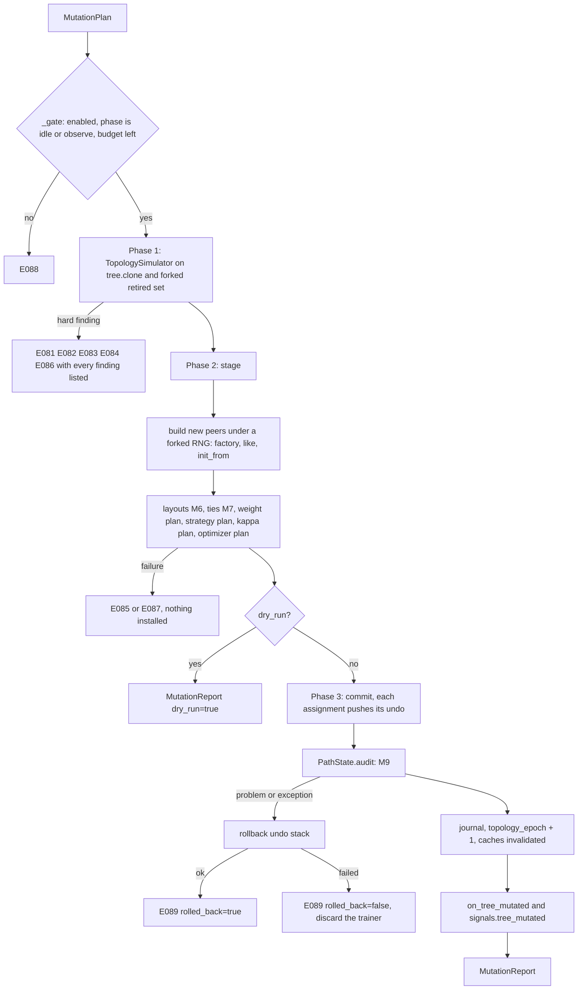

Phase 1 touches nothing, because it works on a clone. Phase 2 touches nothing either: it
*builds* every object the plan needs (new peers, new optimizer facades) and keeps them in a
`Staged` record. Phase 3 only assigns. A fault in phase 1 or 2 is a plain exception with a
clean trainer behind it; a fault in phase 3 (which should not happen, and is why the audit is
inside it) runs the undo stack.

#### 12.5.1 The simulator and its results

The simulator is pure Python. It runs on a structural clone of the tree and on plain sets of
paths, so every structural rule can be tested without a model, and `mactf components validate`
and the API can check a plan against a tree description with it.

```python
# mactf/training/mutation.py   (part 2: results and the simulator)
from typing import Callable

from ..coopetition.tree import (
    PeerTree, TreeTooLargeError, TreeValidationError, aggregation_groups, validate_path,
)
from ..exceptions import ComplianceError

ROOT = "root"          # == components.weight_plan.ROOT_LABEL (a test pins the equality)


def label_of(parent: str | None) -> str:
    return ROOT if parent is None else parent


def parent_of(path: str) -> str | None:
    head, _, _ = path.rpartition("/")
    return head or None


def structure_digest(tree: PeerTree, retired: Iterable[str]) -> str:
    """What a replay must reproduce: which nodes exist, their roles, and which are retired."""
    gone = set(retired)
    rows = [[node.path, node.role, node.path in gone] for node in tree.walk("root-first")]
    return digest_of(rows)


@dataclass(frozen=True)
class GroupChange:
    """One aggregation group whose members, or whose active members, differ after a plan."""

    label: str
    parent: str | None
    before: tuple[str, ...]
    after: tuple[str, ...]
    active_before: tuple[str, ...]
    active_after: tuple[str, ...]

    @property
    def appeared(self) -> bool:
        return not self.before and bool(self.after)

    @property
    def vanished(self) -> bool:
        return bool(self.before) and not self.after


@dataclass(frozen=True)
class Simulation:
    """The tree a plan would produce, and everything the engine needs to build it."""

    tree: PeerTree                       # the final structure; peers of existing nodes are shared
    retired: frozenset[str]
    tombstones: frozenset[str]
    added: tuple[str, ...]
    purged: tuple[str, ...]
    retired_now: tuple[str, ...]
    revived_now: tuple[str, ...]
    modified: tuple[str, ...]
    changes: tuple[GroupChange, ...]
    findings: tuple[Finding, ...]
    before_digest: str
    after_digest: str

    @property
    def hard(self) -> tuple[Finding, ...]:
        return tuple(item for item in self.findings if item.hard)

    @property
    def soft(self) -> tuple[Finding, ...]:
        return tuple(item for item in self.findings if not item.hard)

    @property
    def ok(self) -> bool:
        return not self.hard

    def raise_for_findings(self) -> None:
        """``MutationError`` carrying the first hard finding's code and every finding's text."""
        hard = self.hard
        if hard:
            raise MutationError(
                hard[0].code, hard[0].message, findings=[item.render() for item in self.findings]
            )

    def changed_labels(self) -> tuple[str, ...]:
        return tuple(change.label for change in self.changes)

    def active_paths(self) -> tuple[str, ...]:
        return tuple(node.path for node in self.tree.walk("root-first") if node.path not in self.retired)


@dataclass(frozen=True)
class MutationReport:
    """What a plan did (or, for a dry run, would do)."""

    plan_digest: str
    label: str
    reason: str
    source: str
    dry_run: bool
    epoch: int
    topology_epoch: int
    added: tuple[str, ...]
    retired: tuple[str, ...]
    revived: tuple[str, ...]
    purged: tuple[str, ...]
    modified: tuple[str, ...]
    rebuilt: tuple[str, ...]
    optimizers_rebuilt: tuple[str, ...]
    groups: tuple[str, ...]
    active_nodes: int
    retired_nodes: int
    before_digest: str
    after_digest: str
    warnings: tuple[str, ...]
    seconds: float

    def as_dict(self) -> dict[str, Any]:
        return {key: (list(value) if isinstance(value, tuple) else value) for key, value in vars(self).items()}

    @property
    def changed(self) -> bool:
        return bool(self.added or self.retired or self.revived or self.purged or self.modified)


class _Work:
    """The mutable state of one simulation."""

    def __init__(self, tree: PeerTree, retired: set[str], tombstones: set[str]) -> None:
        self.tree = tree
        self.retired = retired
        self.tomb = tombstones
        self.added: list[str] = []
        self.purged: list[str] = []
        self.retired_now: list[str] = []
        self.revived_now: list[str] = []
        self.modified: list[str] = []
        self.findings: list[Finding] = []

    @property
    def failed(self) -> bool:
        return any(item.hard for item in self.findings)

    def fail(self, code: str, message: str, path: str | None = None) -> None:
        self.findings.append(Finding(code, message, path, hard=True))

    def warn(self, code: str, message: str, path: str | None = None) -> None:
        self.findings.append(Finding(code, message, path, hard=False))

    def drop(self, path: str) -> None:
        for bucket in (self.modified, self.retired_now, self.revived_now):
            if path in bucket:
                bucket.remove(path)


def _groups(tree: PeerTree, retired: set[str] | frozenset[str]) -> dict[str, tuple[str | None, tuple[str, ...], tuple[str, ...]]]:
    """``label -> (parent, members, active members)`` in ``aggregation_groups`` order."""
    result: dict[str, tuple[str | None, tuple[str, ...], tuple[str, ...]]] = {}
    for parent, members in aggregation_groups(tree):
        result[label_of(parent)] = (
            parent, tuple(members), tuple(name for name in members if name not in retired)
        )
    return result


class TopologySimulator:
    """Apply a plan to a clone and judge the result. Never raises for a bad plan: it reports."""

    def __init__(
        self,
        tree: PeerTree,
        *,
        retired: Iterable[str],
        tombstones: Iterable[str],
        limits: MutationLimits,
        feasible: Callable[[int], None],
    ) -> None:
        self.tree = tree
        self.retired = frozenset(retired)
        self.tombstones = frozenset(tombstones)
        self.limits = limits
        #: ``feasible(n)`` raises ``ComplianceError`` when ``WEIGHT_FLOOR``/``WEIGHT_CAP`` admit no
        #: weight vector for ``n`` active members: ``feasible_bounds`` with the run's bounds.
        self.feasible = feasible

    # -- entry point -----------------------------------------------------
    def run(self, plan: MutationPlan) -> Simulation:
        work = _Work(self.tree.clone(), set(self.retired), set(self.tombstones))
        before_groups = _groups(self.tree, self.retired)
        if len(plan.ops) > self.limits.max_ops_per_plan:
            work.fail(
                "E084",
                f"the plan has {len(plan.ops)} operations; TRAINER.MUTATION.MAX_OPS_PER_PLAN is "
                f"{self.limits.max_ops_per_plan}",
            )
        for op in plan.ops:
            if work.failed:
                break      # later operations are defined only on the tree the failed one would have made
            getattr(self, f"_{op.kind.value}")(op, work)
        changes: tuple[GroupChange, ...] = ()
        if not work.failed:
            changes = self._finalize(work, before_groups)
        return Simulation(
            tree=work.tree,
            retired=frozenset(work.retired),
            tombstones=frozenset(work.tomb),
            added=tuple(work.added),
            purged=tuple(work.purged),
            retired_now=tuple(work.retired_now),
            revived_now=tuple(work.revived_now),
            modified=tuple(work.modified),
            changes=changes,
            findings=tuple(work.findings),
            before_digest=structure_digest(self.tree, self.retired),
            after_digest=structure_digest(work.tree, work.retired),
        )

    # -- operations ------------------------------------------------------
    def _check_reference(self, work: _Work, path: str, field_name: str, ref: str | None) -> bool:
        if ref is None or ref == REFERENCE_TOKEN:
            return True
        if ref not in work.tree:
            work.fail("E083", f"`{field_name}` names {ref!r}, which is not a node of the tree", path)
            return False
        if ref == path:
            work.fail("E083", f"`{field_name}` names the node itself", path)
            return False
        return True

    def _add(self, op: Op, work: _Work) -> None:
        spec = op.spec
        assert spec is not None
        path = spec.path
        try:
            validate_path(path)
        except TreeValidationError as error:
            return work.fail("E081", str(error), path)
        if path in work.tree:
            return work.fail("E081", "the node already exists", path)
        if path in work.tomb:
            return work.fail(
                "E081",
                "the path was purged earlier in this run and cannot be reused "
                "(TRAINER.MUTATION.TOMBSTONE); its warning and escalation history must stay attached "
                "to one peer",
                path,
            )
        parent = parent_of(path)
        if parent is not None:
            if parent not in work.tree:
                return work.fail("E081", f"the parent {parent!r} does not exist", path)
            if parent in work.retired:
                return work.fail("E081", f"the parent {parent!r} is retired; revive it first", path)
        for name, ref in (("like", spec.like), ("init_from", spec.init_from)):
            if not self._check_reference(work, path, name, ref):
                return None
        try:
            work.tree.add_node(path, role=spec.role, metadata=dict(spec.metadata))
        except TreeTooLargeError as error:
            return work.fail("E084", str(error), path)
        except TreeValidationError as error:
            return work.fail("E081", str(error), path)
        work.added.append(path)
        return None

    def _modify(self, op: Op, work: _Work) -> None:
        path, changes = op.path, op.changes
        if path not in work.tree:
            return work.fail("E081", "no such node", path)
        if path in work.retired:
            return work.fail("E081", "the node is retired; revive it first", path)
        rebuild = changes.get("rebuild") or {}
        for name, ref in (
            ("init_from", changes.get("init_from")),
            ("rebuild.like", rebuild.get("like")),
            ("rebuild.init_from", rebuild.get("init_from")),
        ):
            if not self._check_reference(work, path, name, ref):
                return None
        if "rebuild" in changes and self.limits.is_protected(path):
            return work.fail("E082", "the node matches TRAINER.MUTATION.PROTECTED and cannot be rebuilt", path)
        node = work.tree[path]
        if "role" in changes:
            node.role = changes["role"]
        if "metadata" in changes:
            merged = dict(node.metadata)
            for key, value in changes["metadata"].items():
                if value is None:
                    merged.pop(key, None)
                else:
                    merged[key] = value
            node.metadata = merged
        if path not in work.modified:
            work.modified.append(path)
        return None

    def _targets(self, work: _Work, path: str, *, recursive: bool) -> list[str]:
        return [path, *work.tree.descendants(path)] if recursive else [path]

    def _retire(self, op: Op, work: _Work) -> None:
        path = op.path
        if path not in work.tree:
            return work.fail("E081", "no such node", path)
        targets = self._targets(work, path, recursive=op.recursive)
        for target in targets:
            if self.limits.is_protected(target):
                return work.fail("E082", "the node matches TRAINER.MUTATION.PROTECTED and cannot be retired", target)
        if not op.recursive:
            live = [child for child in work.tree[path].children if child not in work.retired]
            if live:
                return work.fail(
                    "E082",
                    f"{len(live)} child(ren) are still active ({live[:4]}); retire the branch with "
                    "`recursive: true`, or retire the children first",
                    path,
                )
        fresh = [target for target in targets if target not in work.retired]
        if not fresh:
            return work.warn("W040", "already retired; nothing to do", path)
        for target in fresh:
            work.retired.add(target)
            work.tree.mark(target, "pruned")
            work.retired_now.append(target)
            if target in work.revived_now:
                work.revived_now.remove(target)
        return None

    def _revive(self, op: Op, work: _Work) -> None:
        path = op.path
        if path not in work.tree:
            return work.fail("E081", "no such node", path)
        targets = self._targets(work, path, recursive=op.recursive)
        fresh = [target for target in targets if target in work.retired]
        if not fresh:
            return work.warn("W041", "not retired; nothing to do", path)
        for target in fresh:
            parent = work.tree[target].parent
            if parent is not None and parent in work.retired and parent not in fresh:
                return work.fail(
                    "E081", f"the parent {parent!r} is retired; revive it too (`recursive: true`) or first", target
                )
        for target in fresh:
            work.retired.discard(target)
            work.tree.mark(target, "active")
            work.revived_now.append(target)
            if target in work.retired_now:
                work.retired_now.remove(target)
        return None

    def _purge(self, op: Op, work: _Work) -> None:
        path = op.path
        if not self.limits.allow_purge:
            return work.fail("E082", "TRAINER.MUTATION.ALLOW_PURGE is false; retire the node instead", path)
        if path not in work.tree:
            return work.fail("E081", "no such node", path)
        targets = self._targets(work, path, recursive=True)
        if len(targets) > 1 and not op.recursive:
            return work.fail("E082", f"the node has {len(targets) - 1} descendant(s); pass `recursive: true`", path)
        for target in targets:
            if self.limits.is_protected(target):
                return work.fail("E082", "the node matches TRAINER.MUTATION.PROTECTED and cannot be purged", target)
        live = [target for target in targets if target not in work.retired]
        if live and not op.force:
            return work.fail(
                "E082",
                f"{len(live)} node(s) are active ({live[:4]}); retire first, or pass `force: true` "
                "to delete without the retire step",
                path,
            )
        work.tree.remove_node(path, recursive=True)
        for target in targets:
            work.retired.discard(target)
            work.drop(target)
            if target in work.added:
                work.added.remove(target)       # never existed outside this plan: no tombstone
                continue
            work.purged.append(target)
            if self.limits.tombstone == "run":
                work.tomb.add(target)
        return None

    # -- the checks that need the final tree -----------------------------
    def _finalize(
        self, work: _Work, before: dict[str, tuple[str | None, tuple[str, ...], tuple[str, ...]]]
    ) -> tuple[GroupChange, ...]:
        tree, retired = work.tree, work.retired
        roots = [path for path in tree.root_paths if path not in retired]
        if len(roots) < self.limits.min_active_roots:
            work.fail(
                "E082",
                f"{len(roots)} active root(s) would remain; TRAINER.MUTATION.MIN_ACTIVE_ROOTS is "
                f"{self.limits.min_active_roots}",
            )
            return ()
        for node in tree.walk("root-first"):
            if node.path in retired:
                continue
            if node.parent is not None and node.parent in retired:
                work.fail(
                    "E082",
                    f"an active node sits under the retired {node.parent!r}; retire it too, or revive the parent",
                    node.path,
                )
                return ()
            if node.children and all(child in retired for child in node.children):
                work.fail(
                    "E082",
                    "every child is retired, which leaves a branch that cannot be averaged; retire the "
                    "branch itself (`recursive: true`) instead",
                    node.path,
                )
                return ()
        after = _groups(tree, retired)
        changes: list[GroupChange] = []
        for label, (parent, members, active) in after.items():
            old = before.get(label)
            if old is not None and old[1] == members and old[2] == active:
                continue
            old_members, old_active = (old[1], old[2]) if old is not None else ((), ())
            changes.append(GroupChange(label, parent, old_members, members, old_active, active))
        for label, (parent, members, active) in before.items():
            if label not in after:
                changes.append(GroupChange(label, parent, members, (), active, ()))
        for change in changes:
            if change.vanished or (change.parent is not None and change.parent in retired):
                continue
            try:
                self.feasible(len(change.active_after))
            except ComplianceError as error:
                work.fail(
                    "E086",
                    f"group {change.label!r} would have {len(change.active_after)} active member(s): {error}",
                    change.label,
                )
                return ()
        return tuple(changes)
```

Two consequences of the rules above are worth stating, because both are visible to a user
who tries the obvious thing:

* **One new child under a leaf is refused, and two are accepted.** The leaf becomes a parent
  and its group has one member. With the default `WEIGHT_CAP` of `0.6` the cap is below
  `1/1`, so `feasible_bounds(1, ...)` raises and the simulator reports `E086`. A plan that
  adds `team-a/x` and `team-a/y` in one operation list produces a group of two, for which
  `1/2 = 0.5 <= 0.6` holds. The same rule is why the default `MIN_ACTIVE_ROOTS` is 2 and not 1
  (M5): a root group of one active peer is infeasible under the default bounds, so the
  simulator would refuse it anyway, and the setting exists to give the refusal a name.
* **Operations are applied to the clone in order.** `add_peer("a/x"), add_peer("a/y")` sees `a`
  as an active leaf when it starts and as a parent with two children when it ends, and only
  the end state is checked for feasibility. That is why a plan, not a single operation, is the
  unit of mutation.

#### 12.5.2 Additions to `PeerTree` and `FreezeSet`

The commit has to swap a tree in place (the trainer, the freeze set and the watchdog context
all hold the same `PeerTree` object) and has to be undoable. Three small methods on `PeerTree`
and three on `FreezeSet` give it that; none changes existing behaviour.

```python
# mactf/coopetition/tree.py   (additions to PeerTree, after ``clone``; ``import dataclasses`` at the top)
    def adopt(self, other: "PeerTree") -> dict[str, PeerNode]:
        """Take ``other``'s nodes as this tree's own. Returns the old mapping for ``restore``.

        The old node objects are left untouched, so ``restore`` puts the tree back exactly: the
        same objects, the same ``children`` tuples, the same statuses.
        """
        previous = self._nodes
        self._nodes = other._nodes
        return previous

    def restore(self, previous: dict[str, PeerNode]) -> None:
        self._nodes = previous

    def without(self, paths: Iterable[str]) -> "PeerTree":
        """A read-only view without ``paths`` and their descendants.

        Kept nodes are the *same objects* (so a status read is live), except an ancestor that
        loses a child, which is a copy with a shorter ``children`` tuple. Used for the active
        view that rollout, scoring and strategy validation walk (12.7). Do not add to it.
        """
        dropped: set[str] = set()
        for path in paths:
            if path in self._nodes and path not in dropped:
                dropped.add(path)
                dropped.update(self.descendants(path))
        if not dropped:
            return self
        view = PeerTree(max_depth=self.max_depth, max_nodes=self.max_nodes)
        for path, node in self._nodes.items():
            if path in dropped:
                continue
            kept = tuple(child for child in node.children if child not in dropped)
            view._nodes[path] = node if kept == node.children else dataclasses.replace(node, children=kept)
        return view
```

```python
# mactf/training/freeze.py   (additions to FreezeSet)
    def is_retired(self, path: str) -> bool:
        with self._lock:
            return RETIRED in self._by_path.get(path, ())

    def retired(self) -> frozenset[str]:
        with self._lock:
            return frozenset(path for path, held in self._by_path.items() if RETIRED in held)

    def snapshot(self) -> dict[str, frozenset[str]]:
        with self._lock:
            return {path: frozenset(held) for path, held in self._by_path.items()}

    def restore(self, snapshot: Mapping[str, frozenset[str]]) -> None:
        """Put the reasons back exactly. Statuses follow the (separately restored) tree."""
        with self._lock:
            self._by_path = {path: set(held) for path, held in snapshot.items()}
```

`without` returns `self` when nothing is dropped, which is what makes the active view free in
a run that never retires anything (I1).

#### 12.5.3 Optimizer staging for a changed topology

`OptimizerPlan.stage` (9.5) stages one *slot* change. A topology change is a different shape
(new nodes, removed nodes, per-node override slots), so it gets its own staged form, built from
the same pieces.

```python
# mactf/training/optimizer_plan.py   (additions: StagedTopology, stage_topology, commit_topology)
@dataclass
class StagedTopology:
    entries: dict[str, OptimizerEntry]
    previous: dict[str, OptimizerEntry]
    optimizers: dict[str, MACTFOptimizer] = field(default_factory=dict)
    frozen: set[str] = field(default_factory=set)
    thawed: set[str] = field(default_factory=set)
    dropped: list[str] = field(default_factory=list)
    records: list[SwapRecord] = field(default_factory=list)
    warnings: list[str] = field(default_factory=list)
```

```python
# mactf/training/optimizer_plan.py   (methods of OptimizerPlan)
    def stage_topology(
        self,
        *,
        set_blocks: Mapping[str, Mapping[str, Any] | None],
        build: Sequence[str],
        drop: Sequence[str],
        active: Sequence[str],
        live: Mapping[str, MACTFOptimizer],
        make: Callable[[str, OptimizerEntry], MACTFOptimizer],
    ) -> StagedTopology:
        """Stage the optimizer side of a mutation. Mutates nothing that is live.

        ``set_blocks`` maps a node path to its new per-node block (the slot ``OPTIMIZER.<path>``),
        or to ``None`` to remove that override. ``build`` lists nodes that need a fresh facade
        regardless (new or rebuilt peers: their old state, if any, is meaningless). ``drop``
        lists purged nodes, whose per-node slot is removed. ``active`` is every node that will
        be able to learn afterwards. ``make(path, entry)`` is ``_make_optimizer`` bound to the
        staged peer.
        """
        with self._lock:
            previous = dict(self._entries)
            entries = dict(previous)
            for path in drop:
                entries.pop(f"{DEFAULT_SLOT}.{path}", None)
            for path, block in set_blocks.items():
                slot = f"{DEFAULT_SLOT}.{path}"
                if block is None:
                    entries.pop(slot, None)
                else:
                    entries[slot] = self._compile_for(slot, block, None)
            staged = StagedTopology(entries=entries, previous=previous, dropped=list(drop))
            fresh_paths = [path for path in dict.fromkeys([*build, *set_blocks]) if path in set(active) | set(build)]
            for path in fresh_paths:
                old_entry = self.select(path) if path not in build else None
                new_entry = self.select(path, entries)                     # may raise E051
                is_new = path in build
                if not is_new and old_entry is not None and (
                    old_entry.spec_hash == new_entry.spec_hash and old_entry.slot == new_entry.slot
                ):
                    continue
                old = live.get(path)
                fresh = make(path, new_entry)
                if old is not None and not is_new:
                    migration_for(new_entry.migrate)(old, fresh)
                staged.optimizers[path] = fresh
                if new_entry.frozen and (is_new or old_entry is None or not old_entry.frozen):
                    staged.frozen.add(path)
                if not new_entry.frozen and old_entry is not None and old_entry.frozen:
                    staged.thawed.add(path)
                staged.records.append(
                    SwapRecord(
                        slot=new_entry.slot, kind_id="optimizer",
                        from_name=old.describe().get("class", "none") if old is not None else "none",
                        to_name=fresh.describe().get("class", "none"),
                        from_spec_hash=getattr(old, "spec_hash", "") if old is not None else "",
                        to_spec_hash=new_entry.spec_hash, boundary=Boundary.EPISODE.value,
                        episode=self.episode, at=time.time(),
                    )
                )
            learners = [
                path for path in active
                if not self.select(path, entries).frozen
            ]
            if active and not learners:
                raise ImproperlyConfigured("E054: the topology change would leave no node able to learn")
            prefix = DEFAULT_SLOT + "."
            for slot in sorted(entries):
                if not slot.startswith(prefix):
                    continue
                glob = slot[len(prefix):]
                if not any(path == glob or fnmatch.fnmatchcase(path, glob) for path in active):
                    staged.warnings.append(
                        f"W011: optimizer override {glob!r} matches no node after the mutation"
                    )
            return staged

    def commit_topology(self, staged: StagedTopology) -> Callable[[], None]:
        """Make a staged topology change the plan's truth. Returns the function that undoes it."""
        with self._lock:
            history_length = len(self._history)
            previous = dict(self._entries)
            self._entries = dict(staged.entries)
            self._history.extend(staged.records)

        def undo() -> None:
            with self._lock:
                self._entries = previous
                del self._history[history_length:]

        return undo
```

`_make_optimizer` gains an optional `peer` argument so that it can bind a facade to a peer the
trainer has not installed yet (the one edit in 12.7):
`def _make_optimizer(self, path, entry, runtime, peer=None)` with `peer = peer or self.peers[path]`.

#### 12.5.4 The engine

```python
# mactf/training/mutation_engine.py   (new)
from __future__ import annotations

import copy
import dataclasses
import logging
import threading
import time
from dataclasses import dataclass, field
from typing import Any, Callable, Iterable, Mapping

import torch

from ..components.catalog import ComponentSpec
from ..components.weight_plan import ROOT_LABEL
from ..coopetition.aggregation import feasible_bounds
from ..coopetition.peer import Peer
from ..coopetition.strategy import group_layouts
from ..coopetition.tree import PeerTree, node_seed
from ..exceptions import ComplianceError, ContractError, ImproperlyConfigured, MutationError
from .freeze import RETIRED
from .mutation import (
    BUILD_TOKEN, INTERNAL_SOURCES, REFERENCE_TOKEN, Finding, GroupChange, MutationLimits, MutationPlan, MutationReport, Op, OpKind,
    PeerSpec, Simulation, TopologySimulator, _groups, digest_of, label_of, manifest_spec,
)

log = logging.getLogger("mactf.mutation")

PHASES_ALLOWED = ("idle", "observe")
# ``INTERNAL_SOURCES = ("watchdog", "replay")`` (the sources that are not the user asking: the
# watchdog's prune of 12.8 and the checkpoint reconciliation of 12.9) lives in ``mutation.py``
# with the other pure constants, because ``mutation_reconcile.py`` needs it without torch.


class Undo:
    """A stack of inverses. ``push`` before you mutate; ``rollback`` runs them newest first."""

    def __init__(self) -> None:
        self._steps: list[tuple[str, Callable[[], None]]] = []

    def push(self, label: str, inverse: Callable[[], None]) -> None:
        self._steps.append((label, inverse))

    def restore_dict(self, label: str, container: dict[Any, Any]) -> None:
        """Snapshot a dict (keeping its order) and register the restore."""
        saved = dict(container)

        def inverse() -> None:
            container.clear()
            container.update(saved)

        self.push(label, inverse)

    def restore_set(self, label: str, container: set[Any]) -> None:
        saved = set(container)

        def inverse() -> None:
            container.clear()
            container.update(saved)

        self.push(label, inverse)

    def restore_list(self, label: str, container: list[Any]) -> None:
        saved = list(container)

        def inverse() -> None:
            container[:] = saved

        self.push(label, inverse)

    def restore_attr(self, label: str, owner: Any, name: str) -> None:
        saved = getattr(owner, name)
        self.push(label, lambda: setattr(owner, name, saved))

    def rollback(self) -> list[str]:
        """Run every inverse. Returns the failures (empty when the rollback was complete)."""
        failures: list[str] = []
        while self._steps:
            label, inverse = self._steps.pop()
            try:
                inverse()
            except Exception as error:  # noqa: BLE001 - a failed inverse is reported, never raised
                failures.append(f"{label}: {type(error).__name__}: {error}")
        return failures


@dataclass
class Staged:
    """Everything a plan needs, built and checked, installed nowhere."""

    peers: dict[str, Peer] = field(default_factory=dict)          # new, and rebuilt, by path
    rebuilt: list[str] = field(default_factory=list)              # existing nodes whose peer is replaced
    reweighted: dict[str, torch.Tensor] = field(default_factory=dict)   # init_from on a live peer
    optimizer: Any = None                                         # StagedTopology
    notes: list[str] = field(default_factory=list)
```

```python
# mactf/training/mutation_engine.py   (class MutationEngine, part 1: gate, simulate, build)
class MutationEngine:
    """Owns the rules of changing a built trainer's peer tree."""

    def __init__(self, trainer: Any) -> None:
        self.trainer = trainer
        self._lock = threading.RLock()
        self._queue: list[tuple[MutationPlan, str]] = []

    # -- gate ------------------------------------------------------------
    def _gate(self, source: str) -> None:
        t = self.trainer
        if not t.built:
            raise MutationError("E088", "the trainer is not built; call build() or fit() first")
        internal = source in INTERNAL_SOURCES
        if not t.mutation_limits.enabled and not internal:
            raise MutationError(
                "E088",
                "tree mutation is off; set TRAINER.MUTATION.ENABLED: true (a run that never "
                "mutates keeps the topology it was built with, and the checkpoint it always wrote)",
            )
        if t._phase not in PHASES_ALLOWED:
            raise MutationError(
                "E088",
                f"a plan cannot run while the trainer is in phase {t._phase!r}; mutate between epochs, "
                "from an on_epoch_end callback, or queue it with request_mutation()",
            )
        blockers = t.mutation_blockers()
        if blockers:
            raise MutationError("E088", "this trainer cannot be mutated: " + "; ".join(blockers))
        if source != "replay" and t._mutations_in_cycle >= t.mutation_limits.max_plans_per_epoch:
            raise MutationError(
                "E088",
                f"{t._mutations_in_cycle} plans already ran this epoch; "
                f"TRAINER.MUTATION.MAX_PLANS_PER_EPOCH is {t.mutation_limits.max_plans_per_epoch}",
            )

    # -- simulate --------------------------------------------------------
    def _floor_cap(self) -> tuple[float, float]:
        coopetition = self.trainer._coopetition_settings()
        return float(coopetition.get("WEIGHT_FLOOR", 0.02)), float(coopetition.get("WEIGHT_CAP", 0.6))

    def _replay_limits(self) -> MutationLimits:
        """What a reconciliation may do (12.9): reproduce a structure that already existed.

        The structure came from plans that were valid under the limits of their day, and a
        configuration edited since must not make a checkpoint unloadable, so the *policy* limits
        are lifted (a root may be the last, a protected path may be purged, purge is allowed, a
        plan may be long, a purged path may come back). Every *structural* rule of the simulator
        (paths, parents, uniqueness, references, feasible weight bounds) still applies.
        """
        return dataclasses.replace(
            self.trainer.mutation_limits,
            min_active_roots=1,
            max_ops_per_plan=10_000,
            protected=(),
            allow_purge=True,
            tombstone="off",
        )

    def simulator(self, source: str = "api") -> TopologySimulator:
        t = self.trainer
        floor, cap = self._floor_cap()
        replay = source == "replay"
        return TopologySimulator(
            t.tree,
            retired=t.freeze.retired(),
            tombstones=() if replay else t._tombstones,
            limits=self._replay_limits() if replay else t.mutation_limits,
            feasible=lambda count: feasible_bounds(count, floor=floor, cap=cap),
        )

    def simulate(self, plan: MutationPlan, source: str = "api") -> Simulation:
        simulation = self.simulator(source).run(plan)
        simulation.raise_for_findings()
        return simulation

    # -- peers -----------------------------------------------------------
    def _factory_module(
        self, spec: PeerSpec, source: Peer | None, seed: int
    ) -> tuple[torch.nn.Module, bool]:
        t = self.trainer
        resolved = t.resolver.resolve(
            ComponentSpec.parse("peer_factory", spec.factory),
            trusted=t._components_trusted,
            inject={
                "spec": spec,
                "source": copy.deepcopy(source.module) if source is not None else None,
                "runtime": t._runtime,
                "settings": t.settings,
                "seed": seed,
            },
        )
        module = resolved.instance
        if not isinstance(module, torch.nn.Module):
            raise MutationError("E085", f"{spec.path}: the factory returned {type(module).__name__}, not an nn.Module")
        return module, bool(resolved.component.capabilities.get("finetuned", False))

    def _build_peer(
        self,
        spec: PeerSpec,
        *,
        tree: PeerTree,
        peers: Mapping[str, Peer],
        topology_epoch: int,
    ) -> Peer:
        """Steps 1-6 of 12.3, under a private RNG stream (M4)."""
        t = self.trainer
        runtime = t._runtime
        path = spec.path
        node = tree[path]
        seed = node_seed(int(runtime.seed), path, topology_epoch)
        sharing = str(getattr(t._hierarchy, "sharing", "independent"))
        if sharing == "shared_trunk" and node.depth > 1 and spec.like is not None:
            raise MutationError(
                "E085",
                f"{path}: `like` copies the module, trunk included, which would unshare it; in a "
                "shared_trunk run a new child uses a factory or the level's model source",
            )
        source = peers.get(spec.like) if spec.like is not None else None
        if spec.like is not None and source is None:
            raise MutationError("E083", f"{path}: `like` names {spec.like!r}, which has no peer", findings=[])
        devices = [runtime.device] if torch.device(runtime.device).type == "cuda" else []
        previous_tree = getattr(t, "_tree_in_build", None)
        t._tree_in_build = tree
        try:
            with torch.random.fork_rng(devices=devices):
                torch.manual_seed(seed)
                finetuned = False
                if spec.factory == BUILD_TOKEN:
                    module = t._module_for(path)          # step 3 of 12.3, chosen explicitly
                elif spec.factory is not None:
                    module, finetuned = self._factory_module(spec, source, seed)
                elif source is not None:
                    module, finetuned = copy.deepcopy(source.module), True
                else:
                    module = t._module_for(path)
                if sharing == "shared_trunk" and node.depth > 1 and t._shared_trunk is not None:
                    from .trainer import _with_shared_trunk

                    module = _with_shared_trunk(t._shared_trunk, module)
                peer = t._assemble_peer(path, node.depth, module, runtime, finetuned=finetuned)
        except MutationError:
            raise
        except Exception as error:  # noqa: BLE001 - any construction failure is a refusal, not a crash
            raise MutationError("E085", f"{path}: building the peer failed: {type(error).__name__}: {error}") from error
        finally:
            t._tree_in_build = previous_tree
        if spec.init_from is not None:
            self._copy_weights(path, peer, spec.init_from, peers)
        return peer

    def _weights_of(self, path: str, ref: str, peers: Mapping[str, Peer]) -> torch.Tensor:
        t = self.trainer
        source = t.reference if ref == REFERENCE_TOKEN else peers.get(ref)
        if source is None:
            raise MutationError("E083", f"{path}: `init_from` {ref!r} has no peer to read weights from")
        return source.export_parameters().detach().clone()

    def _copy_weights(self, path: str, target: Peer, ref: str, peers: Mapping[str, Peer]) -> None:
        source = self.trainer.reference if ref == REFERENCE_TOKEN else peers.get(ref)
        vector = self._weights_of(path, ref, peers)
        if source is not None and source.adapter.parameter_shapes() != target.adapter.parameter_shapes():
            raise MutationError("E085", f"{path}: `init_from` {ref!r} has a different parameter layout")
        if vector.numel() != target.export_parameters().numel():
            raise MutationError("E085", f"{path}: `init_from` {ref!r} has {vector.numel()} parameters, expected "
                                f"{target.export_parameters().numel()}")
        target.import_parameters(vector)
```

`_factory_module` deep-copies the source module before handing it over, so a factory that
edits `source` in place cannot damage the live peer. A factory that returns a module sharing
tensors with another peer is caught by the tie check in the next step.

```python
# mactf/training/mutation_engine.py   (class MutationEngine, part 2: stage)
    # -- stage -----------------------------------------------------------
    def _stage(self, plan: MutationPlan, simulation: Simulation) -> Staged:
        t = self.trainer
        epoch_next = t.topology_epoch + 1
        tree = simulation.tree
        staged = Staged()
        peers: dict[str, Peer] = {
            path: peer for path, peer in t.peers.items() if path not in simulation.purged
        }
        set_blocks: dict[str, Mapping[str, Any] | None] = {}
        survivors = set(simulation.added)
        for op in plan.ops:
            if op.kind is OpKind.ADD:
                spec = op.spec
                if spec.path not in survivors:
                    continue                      # added and then purged in the same plan
                peer = self._build_peer(spec, tree=tree, peers=peers, topology_epoch=epoch_next)
                staged.peers[spec.path] = peers[spec.path] = peer
                if spec.optimizer is not None:
                    set_blocks[spec.path] = dict(spec.optimizer)
            elif op.kind is OpKind.MODIFY:
                if op.path not in tree:
                    continue                      # purged later in the same plan
                changes = op.changes
                if "rebuild" in changes:
                    spec = PeerSpec.parse(changes["rebuild"], path=op.path)
                    peer = self._build_peer(spec, tree=tree, peers=peers, topology_epoch=epoch_next)
                    staged.peers[op.path] = peers[op.path] = peer
                    if op.path not in survivors and op.path not in staged.rebuilt:
                        staged.rebuilt.append(op.path)
                if "init_from" in changes:
                    vector = self._weights_of(op.path, changes["init_from"], peers)
                    target = peers[op.path]
                    if vector.numel() != target.export_parameters().numel():
                        raise MutationError("E085", f"{op.path}: `init_from` has a different parameter count")
                    if op.path in staged.peers:
                        staged.peers[op.path].import_parameters(vector)
                    else:
                        staged.reweighted[op.path] = vector
                if "optimizer" in changes:
                    set_blocks[op.path] = changes["optimizer"]
        self._check_layouts(simulation, peers)
        self._check_plans(simulation)
        build = [path for path in staged.peers]
        active = list(simulation.active_paths())
        runtime = t._runtime
        staged.optimizer = t.optimizer_plan.stage_topology(
            set_blocks={path: block for path, block in set_blocks.items() if path in tree},
            build=build,
            drop=list(simulation.purged),
            active=active,
            live=t.optimizers,
            make=lambda path, entry: t._make_optimizer(path, entry, runtime, peers.get(path)),
        )
        staged.notes.extend(staged.optimizer.warnings)
        return staged

    def _check_layouts(self, simulation: Simulation, peers: Mapping[str, Peer]) -> None:
        """M6 and M7 on the final tree, over active peers."""
        t = self.trainer
        for change in simulation.changes:
            if len(change.active_after) < 2:
                continue
            try:
                group_layouts(peers, change.active_after)
            except ContractError as error:
                raise MutationError("E085", f"group {change.label!r}: {error}") from error
        try:
            t._validate_tied_parameters(tree=simulation.tree, peers=peers, skip=simulation.retired)
        except ContractError as error:
            raise MutationError("E085", str(error)) from error

    def _check_plans(self, simulation: Simulation) -> None:
        """M-G3's second half: every plan that keys on groups accepts the final groups (E087)."""
        from ..components.weight_plan import GroupView
        from ..components.strategy_plan import tree_view

        t = self.trainer
        floor, cap = self._floor_cap()
        groups = _groups(simulation.tree, simulation.retired)
        views = [
            GroupView(
                label=label, parent=parent, members=active,
                level=0 if parent is None else int(simulation.tree[parent].depth),
                floor=floor, cap=cap,
            )
            for label, (parent, _members, active) in groups.items()
            if active and (parent is None or parent not in simulation.retired)
        ]
        active_tree = simulation.tree.without(simulation.retired)
        try:
            t.weight_plan.validate(views, initial=False)
            t.strategy_plan.validate(tree_view(active_tree, hierarchy=t._hierarchy is not None), initial=False)
            t.kappa_plan.validate([view.label for view in views], initial=False)
        except ImproperlyConfigured as error:
            raise MutationError("E087", f"a plan refused the new topology: {error}") from error
```

```python
# mactf/training/mutation_engine.py   (class MutationEngine, part 3: commit, journal, apply)
    # -- commit ----------------------------------------------------------
    def _commit(self, plan: MutationPlan, simulation: Simulation, staged: Staged, source: str, undo: Undo) -> None:
        """Phase 3. ``undo`` is owned by ``apply`` so its ``except`` clause can always reach it."""
        t = self.trainer
        tree = simulation.tree
        purged = list(simulation.purged)

        # 1. The tree, in place: every holder of ``trainer.tree`` (freeze set, watchdog) sees it.
        previous_nodes = t.tree.adopt(tree)
        undo.push("tree", lambda: t.tree.restore(previous_nodes))

        # 2. Peers.
        undo.restore_dict("peers", t.peers)
        for path in purged:
            t.peers.pop(path, None)
        for path, peer in staged.peers.items():
            t.peers[path] = peer
            t.tree[path].peer = peer
        for path, vector in staged.reweighted.items():
            before = t.peers[path].export_parameters().detach().clone()
            t.peers[path].import_parameters(vector)
            undo.push(f"weights:{path}", lambda p=path, b=before: t.peers[p].import_parameters(b))

        # 3. Optimizers.
        undo.restore_dict("optimizers", t.optimizers)
        for path in purged:
            t.optimizers.pop(path, None)
        for path, facade in staged.optimizer.optimizers.items():
            peer = t.peers[path]
            old_facade = peer.optimizer
            undo.push(f"peer.optimizer:{path}", lambda p=peer, o=old_facade: setattr(p, "optimizer", o))
            t._install_optimizer(path, facade)
        undo.push("optimizer_plan", t.optimizer_plan.commit_topology(staged.optimizer))

        # 4. The freeze set: retired, revived, purged, and the optimizer:null reasons.
        saved_freeze = t.freeze.snapshot()
        undo.push("freeze", lambda: t.freeze.restore(saved_freeze))
        for path in purged:
            t.freeze.forget(path)
        for path in simulation.revived_now:
            t.freeze.discard(path, RETIRED)
        for path in simulation.retired_now:
            t.freeze.add(path, RETIRED)
        for path in staged.optimizer.frozen:
            t.freeze.add(path, "optimizer:null")
        for path in staged.optimizer.thawed:
            t.freeze.discard(path, "optimizer:null")
        t.freeze.sync()

        # 5. Controllers and aggregators of the groups that changed.
        self._rebind_groups(simulation, undo)

        # 6. Caches keyed by group label or node path, through the registry (M9).
        t.path_state.forget(
            paths=purged + list(staged.peers) + list(staged.reweighted),
            labels=simulation.changed_labels(),
            undo=undo,
            dropped_paths=purged,
        )

        # 7. Scalars and the journal.
        undo.restore_set("tombstones", t._tombstones)
        t._tombstones.clear()
        t._tombstones.update(simulation.tombstones)
        self._record_manifest(plan, simulation, undo)
        undo.restore_attr("topology_epoch", t, "topology_epoch")
        t.topology_epoch += 1
        undo.restore_list("journal", t.mutation_journal)
        t.mutation_journal.append(
            {
                "seq": len(t.mutation_journal),
                "epoch": int(t._epoch),
                "topology_epoch": int(t.topology_epoch),
                "source": source,
                "plan": plan.canonical(),
                "plan_digest": plan.digest(),
                "before": simulation.before_digest,
                "after": simulation.after_digest,
            }
        )
        undo.restore_attr("active_view", t, "_active_view")
        t._active_view = None
        undo.restore_attr("budget", t, "_mutations_in_cycle")
        t._mutations_in_cycle += 1

        # 8. The audit (M9). A problem here is a bug, and it is rolled back like any other fault.
        problems = t.path_state.audit()
        if problems:
            raise MutationError("E089", "the post-commit audit found: " + "; ".join(problems))

    def _record_manifest(self, plan: MutationPlan, simulation: Simulation, undo: Undo) -> None:
        """What a checkpoint needs to rebuild this structure on another trainer (12.9.2).

        ``_node_specs`` holds the effective spec of every node a plan created or rebuilt, so a
        reconciliation can build the same architecture; ``_node_meta`` holds the final metadata of
        every node a plan created or touched, because the tree section of a checkpoint carries no
        metadata. A node built from the configuration and never touched has no entry in either,
        and that absence is what "built from the configuration" means.
        """
        t = self.trainer
        undo.restore_dict("node_specs", t._node_specs)
        undo.restore_dict("node_meta", t._node_meta)
        for path in simulation.purged:
            t._node_specs.pop(path, None)
            t._node_meta.pop(path, None)
        survivors = set(simulation.added)
        tree = simulation.tree
        for op in plan.ops:
            if op.kind is OpKind.ADD and op.spec.path in survivors:
                t._node_specs[op.spec.path] = manifest_spec(op.spec)
            elif op.kind is OpKind.MODIFY and op.path in tree and "rebuild" in op.changes:
                # A rebuild replaces the architecture (``factory`` / ``like``) and nothing else: the
                # optimizer block and the role the node was created with stay in its spec.
                renewed = manifest_spec(PeerSpec.parse(op.changes["rebuild"], path=op.path))
                prior = t._node_specs.get(op.path, {"path": op.path})
                kept = {key: value for key, value in prior.items() if key not in ("factory", "like")}
                t._node_specs[op.path] = {**kept, **renewed}
        for path in dict.fromkeys((*simulation.added, *simulation.modified)):
            if path not in tree:
                continue
            metadata = dict(tree[path].metadata)
            if metadata or path in t._node_meta:
                t._node_meta[path] = metadata

    def _rebind_groups(self, simulation: Simulation, undo: Undo) -> None:
        t = self.trainer
        undo.restore_dict("controllers", t.controllers)
        undo.restore_dict("level_controllers", t._level_controllers)
        undo.restore_dict("group_aggregators", t._group_aggregators)
        base = dict(t._coopetition_settings())
        for change in simulation.changes:
            label, parent = change.label, change.parent
            t._group_aggregators.pop(label, None)
            key = "root" if parent is None else parent
            if change.vanished:
                t.controllers.pop(key, None)
                t._level_controllers.pop(parent, None)
                continue
            if parent is not None and parent in simulation.retired:
                continue                                  # the whole group is out of play: leave its controller
            count = max(1, len(change.active_after))
            controller = t._level_controllers.get(parent)
            if controller is None:
                controller = t.kappa_plan.build(label, base, num_peers=count)
                t._level_controllers[parent] = controller
                t.controllers[key] = controller
                continue
            saved = controller.snapshot()
            undo.push(f"kappa:{label}", lambda c=controller, s=saved: c.restore(s))
            controller.resize(count)

    # -- apply -----------------------------------------------------------
    def apply(
        self, plan: "MutationPlan | Mapping[str, Any] | list[Any]", *, dry_run: bool = False, source: str = "api"
    ) -> MutationReport:
        started = time.monotonic()
        plan = MutationPlan.parse(plan)
        with self._lock:
            self._gate(source)
            simulation = self.simulate(plan, source)
            staged = self._stage(plan, simulation)
            if dry_run:
                return self._report(plan, simulation, staged, source, dry_run=True, started=started)
            undo = Undo()
            try:
                self._commit(plan, simulation, staged, source, undo)
            except Exception as error:  # noqa: BLE001 - phase 3 must either finish or be undone
                problems = undo.rollback()
                if problems:
                    raise MutationError(
                        "E089",
                        f"the commit failed ({error}) and the rollback did not complete: {problems}; "
                        "this trainer's state is unreliable and must be discarded",
                        rolled_back=False,
                    ) from error
                code = error.code if isinstance(error, MutationError) else "E089"
                raise MutationError(
                    code,
                    f"the commit failed and was rolled back: {error}",
                    findings=getattr(error, "findings", ()),
                    rolled_back=True,
                ) from error
            report = self._report(plan, simulation, staged, source, dry_run=False, started=started)
        self._finish(report)
        return report

    def _report(
        self, plan: MutationPlan, simulation: Simulation, staged: Staged, source: str, *, dry_run: bool, started: float
    ) -> MutationReport:
        t = self.trainer
        return MutationReport(
            plan_digest=plan.digest(), label=plan.label, reason=plan.reason, source=source,
            dry_run=dry_run, epoch=int(t._epoch),
            topology_epoch=int(t.topology_epoch),
            added=simulation.added, retired=simulation.retired_now, revived=simulation.revived_now,
            purged=simulation.purged, modified=simulation.modified, rebuilt=tuple(staged.rebuilt),
            optimizers_rebuilt=tuple(staged.optimizer.optimizers) if staged.optimizer is not None else (),
            groups=simulation.changed_labels(),
            active_nodes=len(simulation.active_paths()), retired_nodes=len(simulation.retired),
            before_digest=simulation.before_digest, after_digest=simulation.after_digest,
            warnings=tuple(item.render() for item in simulation.soft) + tuple(staged.notes),
            seconds=time.monotonic() - started,
        )

    def _finish(self, report: MutationReport) -> None:
        """After the commit: observers. An observer's failure never undoes a committed mutation."""
        from .. import signals

        t = self.trainer
        if report.source == "replay":
            # A reconciliation (12.9) restores a structure that already happened. It rebases the
            # health baselines itself, once, after the last plan; no callback or signal hears about
            # a topology change that the checkpoint says was already announced.
            return
        if len(t.mutation_journal) == t.mutation_limits.journal_warn:
            log.warning(
                "W045: the mutation journal reached %d entries; every checkpoint carries all of it "
                "(TRAINER.MUTATION.JOURNAL_WARN)",
                len(t.mutation_journal),
            )
        for note in report.warnings:
            log.warning("%s", note)
        for hook in (
            lambda: t._after_mutation(report),
            lambda: t._dispatch_many("on_tree_mutated", t, report),
            lambda: signals.tree_mutated.send(sender=t, report=report),
        ):
            try:
                hook()
            except Exception as error:  # noqa: BLE001 - observers are not part of the transaction
                log.error("an on_tree_mutated observer failed: %s", error)
                t.failures.append(f"on_tree_mutated observer: {error}")

    # -- deferred plans --------------------------------------------------
    def request(self, plan: "MutationPlan | Mapping[str, Any] | list[Any]", *, source: str = "request") -> MutationPlan:
        """Queue a plan for the top of the next epoch (the form a callback or a strategy uses)."""
        parsed = MutationPlan.parse(plan)
        with self._lock:
            self._queue.append((parsed, source))
        return parsed

    def pending(self) -> list[dict[str, Any]]:
        with self._lock:
            return [{"source": source, "plan": plan.canonical()} for plan, source in self._queue]

    def restore_pending(self, rows: "Iterable[Mapping[str, Any]]") -> int:
        """Replace the queue with what a checkpoint recorded (12.9). Returns how many plans were queued."""
        parsed = [(MutationPlan.parse(row["plan"]), str(row.get("source", "request"))) for row in rows]
        with self._lock:
            self._queue[:] = parsed
        return len(parsed)

    def discard_pending(self) -> int:
        with self._lock:
            count = len(self._queue)
            self._queue.clear()
            return count

    def apply_pending(self, epoch: int) -> list[MutationReport]:
        """Called at the top of ``run_epoch``: queued plans, then this epoch's schedule entries."""
        t = self.trainer
        due: list[tuple[MutationPlan, str]] = []
        with self._lock:
            due.extend(self._queue)
            self._queue.clear()
        done = {entry["plan_digest"] for entry in t.mutation_journal if entry.get("source") == "schedule"}
        for at_epoch, plan in t.mutation_limits.schedule:
            if at_epoch == int(epoch) and plan.digest() not in done:
                due.append((plan, "schedule"))
        reports: list[MutationReport] = []
        for plan, source in due:
            try:
                reports.append(self.apply(plan, source=source))
            except MutationError as error:
                # A queued or scheduled plan that is no longer valid must not end the run.
                t.failures.append(f"mutation {plan.label or plan.digest()} ({source}) refused: {error}")
                log.error("mutation %s (%s) refused: %s", plan.label or plan.digest(), source, error)
        return reports
```

Every `undo.push` in `_commit` precedes the mutation it inverts, so a fault between the push and the mutation runs an inverse that restores a value the mutation had not yet changed, which is harmless. `apply` creates the undo stack, so its `except` clause can always reach it even when `_commit` raised before returning.

`ComponentSpec` is imported from the module of section 5 that defines it
(`mactf/components/resolver.py` in the layout of 3.1); `group_layouts` is
`mactf/coopetition/strategy.py:425`. The engine reads the following trainer members, all of
which 12.7 adds or already exist: `built`, `tree`, `peers`, `optimizers`, `controllers`,
`_level_controllers`, `_group_aggregators`, `reference`, `freeze`, `resolver`,
`_components_trusted`, `_runtime`, `settings`, `_hierarchy`, `_epoch`, `failures`,
`optimizer_plan`, `weight_plan`, `strategy_plan`, `kappa_plan`, `mutation_limits`,
`mutation_journal`, `topology_epoch`, `_tombstones`, `_phase`, `_mutations_in_cycle`,
`_active_view`, `_shared_trunk`, `path_state`, and the methods `_module_for`,
`_assemble_peer`, `_make_optimizer`, `_install_optimizer`, `_validate_tied_parameters`,
`_coopetition_settings`, `_dispatch_many`.

### 12.6 Lifecycle: retire, revive, purge, and the `PathState` registry

#### 12.6.1 The three states of a node

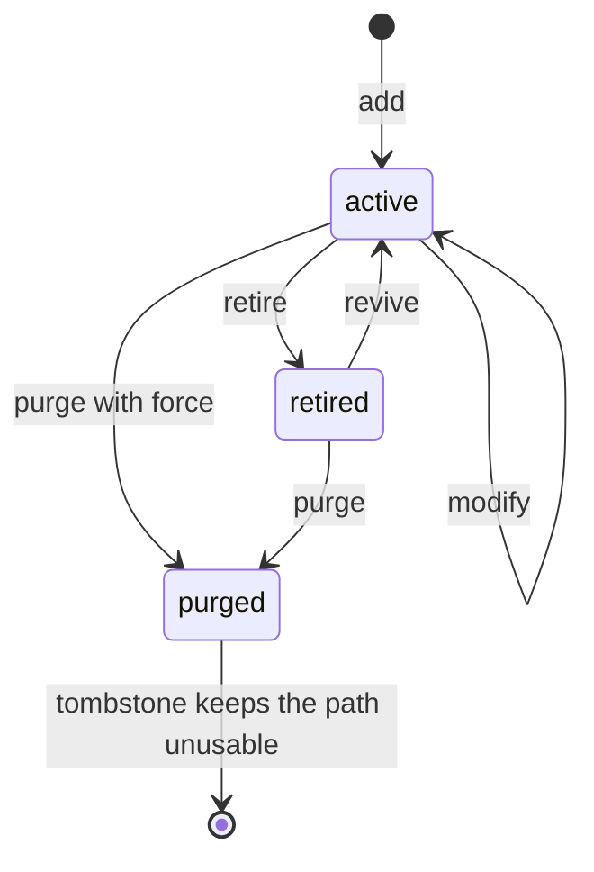

| | active | retired | purged |
|---|---|---|---|
| In `PeerTree` | yes, status `active` (or `failed`/`frozen` for a moment) | yes, status `pruned` | no |
| In `trainer.peers` | yes | **yes** (parameters, module, optimizer state kept) | no |
| Freeze reasons | none, or `strategy:*` / `optimizer:null` | `mutation:retired` plus whatever else | none (`forget`) |
| Rolled out, scored, delegated to | yes | **no** (active view, 12.7) | no |
| Trains, is written back to | yes | **no** (`skips_training`, `skips_write`) | no |
| Weight in its group | per scores | **0** (`excludes`; `mutation:` prefix, both freeze modes) | n/a |
| Counted in `tree_nodes` and `M8` | yes | no | no |
| Past scorecards, history, warnings | kept | **kept** | **kept** (episodes and scorecards are never rewritten) |
| Path reusable | n/a | n/a | **no** while `TOMBSTONE: run` (M3) |
| Checkpointed | peer, optimizer, freeze entry | peer, optimizer, freeze entry | not at all; the journal records the purge |

Retire is the default way out because it loses nothing: the peer keeps its weights, so a
later `revive` brings back a working peer, and a purge is available once the decision is
final. A retired peer is also the right answer to the watchdog's `prune_branch` when the
branch might recover (12.8).

**Compliance across the transitions (M3).** What each transition does to the three things a
compliance reviewer asks about:

| Question | retire | revive | purge |
|---|---|---|---|
| Can it erase a void? | No. `branch_void` is computed per episode from that episode's ledgers; a retired node produces no ledger, so it contributes no void, and it has never been able to remove one that was already recorded in `episodes` | No | No. The scorecards of past episodes stay in `trainer.scorecards` |
| Can it dodge a T0/T1/T2 floor? | No. A node that is out of play is not scored, so there is nothing to dodge, and its group's survivors are scored by the same chain | A revived peer is scored from the next episode by the same chain; its warning registry resumes where it stopped (the registry is keyed by path and is not touched) | No. The tombstone stops the path returning with a fresh warning count |
| Can a new peer start with a lighter ruleset? | n/a | n/a | n/a. `add` builds nothing of the scoring chain: the pipeline of a node is `pipeline_for(node.path)`, resolved at score time from the same `SCORING` blocks as every other node |

**The one thing a mutation can do to scoring.** It changes *who is averaged*. That is why the
weight floor is re-checked (M8) and why `branch_void` is not special-cased: with fewer active
members the same floor is a larger share, and `feasible_bounds` is what refuses a group in
which it would exceed `1/N`.

#### 12.6.2 The `PathState` registry

12.1 listed ten containers. The registry gives them one owner so that the next container
somebody adds is added in one place, and so that the audit that guards M9 is generated from
the same list as the cleanup.

```python
# mactf/training/path_state.py   (new)
from __future__ import annotations

from dataclasses import dataclass
from typing import Any, Callable, Iterable, Sequence

from ..components.weight_plan import ROOT_LABEL


@dataclass(frozen=True)
class Container:
    """One piece of per-path (or per-group) trainer state."""

    name: str
    keyed_by: str                 # "path" or "group"
    get: Callable[[Any], dict]    # the live dict
    on_purge: str                 # "drop" or "keep"
    on_retire: str                # "keep" always today; a column so a future container must say


def _by_attr(attribute: str) -> Callable[[Any], dict]:
    return lambda trainer: getattr(trainer, attribute)


CONTAINERS: tuple[Container, ...] = (
    Container("peers", "path", _by_attr("peers"), "drop", "keep"),
    Container("optimizers", "path", _by_attr("optimizers"), "drop", "keep"),
    Container("signal_by_peer", "path", _by_attr("signal_by_peer"), "drop", "keep"),
    Container("_last_weights", "path", _by_attr("_last_weights"), "drop", "keep"),
    Container("_previous_scores", "path", _by_attr("_previous_scores"), "drop", "keep"),
    Container("_dead_counts", "path", _by_attr("_dead_counts"), "drop", "keep"),
    Container("_epoch_node_metrics", "path", _by_attr("_epoch_node_metrics"), "drop", "keep"),
    Container("controllers", "group", _by_attr("controllers"), "drop", "keep"),
    Container("_group_aggregators", "group", _by_attr("_group_aggregators"), "drop", "keep"),
)


class PathState:
    """Cleanup and audit over every container a node path or group label keys."""

    def __init__(self, trainer: Any) -> None:
        self.trainer = trainer

    # -- cleanup ---------------------------------------------------------
    def forget(
        self,
        *,
        paths: Iterable[str],
        labels: Iterable[str],
        undo: Any,
        dropped_paths: Sequence[str],
    ) -> None:
        """Drop what a commit made stale, registering every inverse on ``undo``.

        ``dropped_paths`` are purged nodes: every per-path container loses them, and so does the
        function book and the freeze set. ``paths`` are nodes whose peer was replaced or
        re-seeded: the function book's cached instances for them are rebuilt lazily. ``labels``
        are the groups whose membership changed: the plans' per-group caches go.
        """
        t = self.trainer
        gone = list(dict.fromkeys(dropped_paths))
        for container in CONTAINERS:
            if container.keyed_by != "path" or container.on_purge != "drop":
                continue
            live = container.get(t)
            if container.name in ("peers", "optimizers"):
                continue                       # the commit already removed them, with their own undo
            undo.restore_dict(container.name, live)
            for path in gone:
                live.pop(path, None)
        for path in dict.fromkeys([*paths, *gone]):
            undo.push(f"functions:{path}", t.functions.forget(path))
        changed = list(dict.fromkeys(labels))
        undo.push("weight_plan.groups", t.weight_plan.forget_groups(changed))
        undo.push("strategy_plan.groups", t.strategy_plan.forget_groups(changed))

    # -- audit (M9) ------------------------------------------------------
    def audit(self) -> list[str]:
        """Every way the trainer can disagree with its tree. Empty means consistent."""
        t = self.trainer
        problems: list[str] = []
        tree = t.tree
        known = {node.path for node in tree.walk("root-first")}
        retired = t.freeze.retired()
        for container in CONTAINERS:
            live = container.get(t)
            if container.keyed_by == "path":
                stale = sorted(set(live) - known)
                if stale:
                    problems.append(f"{container.name} holds paths with no node: {stale[:4]}")
        if set(t.peers) != known:
            problems.append(
                f"peers and tree differ: missing={sorted(known - set(t.peers))[:4]} extra={sorted(set(t.peers) - known)[:4]}"
            )
        for node in tree.walk("root-first"):
            if node.peer is not t.peers.get(node.path):
                problems.append(f"{node.path}: the tree node and trainer.peers hold different peers")
            if node.path in retired:
                if node.status != "pruned":
                    problems.append(f"{node.path}: retired but status is {node.status!r}")
                continue
            if node.path not in t.optimizers and "optimizer:null" not in t.freeze.reasons(node.path):
                problems.append(f"{node.path}: active with no optimizer")
        labels = {
            ROOT_LABEL if parent is None else parent for parent, members in _group_pairs(tree)
            if any(member not in retired for member in members)
        }
        for key in t.controllers:
            if key != "root" and key not in known:
                problems.append(f"controllers holds group {key!r} with no node")
        for label in labels:
            key = "root" if label == ROOT_LABEL else label
            if key not in t.controllers and (label != ROOT_LABEL or t.controller is None):
                problems.append(f"group {label!r} has no controller")
        for label in t._group_aggregators:
            if label not in known:
                problems.append(f"_group_aggregators holds group {label!r} with no node")
        return problems

    def describe(self) -> list[dict[str, str]]:
        """What ``mactf trainer state-map`` prints: one row per container."""
        return [
            {"container": item.name, "keyed_by": item.keyed_by, "on_purge": item.on_purge, "on_retire": item.on_retire}
            for item in CONTAINERS
        ]


def _group_pairs(tree: Any) -> list[tuple[str | None, tuple[str, ...]]]:
    from ..coopetition.tree import aggregation_groups

    return aggregation_groups(tree)
```

Three additions make the registry's `forget` complete. Each returns the function that undoes
it, which is the convention of this section:

```python
# mactf/components/weight_plan.py   (addition to WeightPlan)
    def forget_groups(self, labels: Iterable[str]) -> Callable[[], None]:
        """Drop the per-group strategy instances (and carried state) of groups that changed.

        They are rebuilt on the next ``strategy_for``, seeded from ``_restore`` when a
        checkpoint supplied state, otherwise fresh. Returns the inverse.
        """
        wanted = set(labels)
        with self._lock:
            dropped_cache = {label: self._cache.pop(label) for label in list(self._cache) if label in wanted}
            dropped_carry = {label: self._carry.pop(label) for label in list(self._carry) if label in wanted}

        def undo() -> None:
            with self._lock:
                self._cache.update(dropped_cache)
                self._carry.update(dropped_carry)

        return undo
```

```python
# mactf/components/strategy_plan.py   (addition to StrategyPlan)
    def forget_groups(self, labels: Iterable[str]) -> Callable[[], None]:
        """Drop the cached per-group strategy instances of groups that changed. Returns the inverse."""
        wanted = set(labels)
        with self._lock:
            dropped = {key: self._group_cache.pop(key) for key in list(self._group_cache) if key[0] in wanted}

        def undo() -> None:
            with self._lock:
                self._group_cache.update(dropped)

        return undo
```

```python
# mactf/components/function_book.py   (FunctionBook.forget now returns its inverse)
    def forget(self, node_path: str) -> Callable[[], None]:
        """Drop cached instances of a node that left the tree or was rebuilt. Returns the inverse."""
        with self._lock:
            dropped = {key: self._cache.pop(key) for key in list(self._cache) if key[2] == node_path}

        def undo() -> None:
            with self._lock:
                self._cache.update(dropped)

        return undo
```

`FunctionBook.forget` returned `None` in 8.8; its only caller was this section, so the change
breaks nothing. A weight strategy that holds per-peer state keyed by *position* in the member
tuple (rather than by name) loses that state when a group's membership changes. That is by
design: `forget_groups` rebuilds it, and `W042` tells the user which groups were rebuilt so
they can see their moving average restart.

**What `audit` proves and what it does not.** It proves that no container names a path or a
group the tree does not have, that every active node has an optimizer (or a reason it does
not), and that every group with an active member has a controller. It does not prove that the
*values* are right: that is the job of the equivalence tests in 12.11 (a mutated run and a run
built from the final tree, then both stepped, agree on every shape and on the weights of the
first aggregation).

### 12.7 Rebinding the subsystems: the `MACTFTrainer` integration

12.5 gave the engine the trainer members it reads; this subsection adds them, and changes every
place in the trainer that walks the tree so that a retired peer is out of play (M10). The order
of the epoch (document 08 section 5.2) does not change; a run that never mutates executes the
same statements in the same order (the active view below is the tree itself when nothing is
retired).

#### 12.7.1 The sites

| Site | Today | After |
|---|---|---|
| imports (`trainer.py:1-130`) | | `MutationLimits`, `MutationPlan`, `MutationReport`, `structure_digest`, `MutationEngine`, `PathState`, `MutationError` |
| `__init__` (`trainer.py:381-442`) | no topology state | adds `mutation_limits`, `mutation_journal`, `topology_epoch`, `_tombstones`, `_phase`, `_mutations_in_cycle`, `_active_view`, `_shared_trunk`, `_loss_baseline`, `_rate_baseline`, `_node_specs`, `_node_meta`, `_base_digest`, `_build_meta`, `engine`, `path_state` |
| `build()` (`trainer.py:574-576`, `:682`) | tree, peers, `_initial_nodes = len(self.peers)` | the limits are validated against the freshly built tree; the audit of 12.6.2 runs once at the end of the build when mutation is enabled |
| `_build_peers` (`trainer.py:826-875`) | construction inline in the loop; the shared trunk is a local | the loop body becomes `_assemble_peer`, which the engine also calls; the trunk is `self._shared_trunk` |
| `_make_optimizer` (12.5.3) | `self.peers[path]` | an optional `peer` argument, so a facade can be bound to a peer not yet installed |
| `_validate_tied_parameters` (`trainer.py:957-987`) | reads `self.tree`, `self.peers` | keyword arguments `tree`, `peers`, `skip`; the defaults reproduce today |
| `node_paths`, `peer_names` (`trainer.py:550-558`, `:1151-1155`) | every node, every root | `node_paths` stays the complete structure (identity, `TrainSpec`); `peer_names` reads the active roots; new `active_node_paths` |
| `mean_score` (`trainer.py:1263-1273`) | `self.tree.root_paths` | `self.active_tree.root_paths` |
| `collect_episode` (`trainer.py:1315`) | `tree = self.tree` | `tree = self.active_tree` |
| `_fail_node` (`trainer.py:1436-1445`) | `self.tree.mark` | `self._mark_node`, which marks the tree and the cached view |
| `score` (`trainer.py:1459`) | `score_tree(self.tree, ...)` | `score_tree(self.active_tree, ...)` |
| `_train_epoch` (`trainer.py:1650`) | `self.tree.walk` | `self.active_tree.walk` |
| `_group_aggregator`, `update_weights`, `aggregate` (`trainer.py:1679`, `:1758`, `:1815`) | `self.tree` | `self.active_tree` |
| `_tree_view` (11.9) | `tree_view(self.tree, ...)` | `tree_view(self.active_tree, ...)` |
| `run_epoch` (`trainer.py:1864-1919`) | no phases | the phase flag, the pending-plan call, the budget reset, the view reset |
| `_observe`, `_health_context` (`trainer.py:1921-2004`) | | 12.8 |
| `evaluate`, `infer` (`trainer.py:2084-2133`) | every peer; `self.tree` | retired peers skipped; `self.active_tree` |
| `_trainer_state`, `load_state_dict` (`trainer.py:2190`, `:2228`) | | the journal (12.9) |
| new public methods | | `mutate`, `preview_mutation`, `request_mutation`, `add_peer`, `retire_peer`, `revive_peer`, `purge_peer`, `modify_peer`, `topology`, `mutation_history`, `mutation_blockers`, `_after_mutation` |

`to()` (`trainer.py:2259-2270`), `export_parameters`, `import_parameters` and `close()` iterate
`self.peers`, which still holds retired peers on purpose: moving a retired peer to another
device, exporting its weights and writing it into a checkpoint are exactly what keeps `revive`
possible. They need no change.

#### 12.7.2 Construction

```python
# mactf/training/trainer.py   (imports, with the other relative imports)
from ..coopetition.tree import PeerTree
from ..exceptions import MutationError
from .mutation import MutationLimits, MutationPlan, MutationReport, add_peer as _op_add
from .mutation import modify_peer as _op_modify, purge_peer as _op_purge
from .mutation import retire_peer as _op_retire, revive_peer as _op_revive
from .mutation import structure_digest
from .mutation_engine import MutationEngine
from .path_state import PathState
```

```python
# mactf/training/trainer.py   (__init__: after ``self._loss_function`` at line 441)
        # -- tree mutation (12.7) -------------------------------------
        self.mutation_limits: MutationLimits = MutationLimits()
        self.mutation_journal: list[dict[str, Any]] = []
        self.topology_epoch: int = 0
        self._tombstones: set[str] = set()
        self._phase: str = "idle"                  # idle | epoch | observe
        self._mutations_in_cycle: int = 0
        self._active_view: PeerTree | None = None
        self._shared_trunk: nn.Module | None = None
        self._loss_baseline: int = 0               # first ``history`` index judged by the loss probes
        self._rate_baseline: int = 0               # first ``_epoch_seconds`` index judged by the rate probe
        self._node_specs: dict[str, dict[str, Any]] = {}   # path -> effective spec of a created or rebuilt node (12.9)
        self._node_meta: dict[str, dict[str, Any]] = {}    # path -> final metadata of a created or touched node (12.9)
        self._base_digest: str = ""                        # structure digest of the tree as built (12.9)
        self._build_meta: dict[str, dict[str, Any]] = {}   # path -> metadata the tree was built with (12.9)
        self.engine: MutationEngine = MutationEngine(self)
        self.path_state: PathState = PathState(self)
```

`MutationEngine.__init__` stores the trainer and nothing else, and `PathState.__init__` the
same, so creating them before `build()` is safe; both refuse to act until `built` is true
(`_gate`, and `audit` reads containers that exist from `__init__`).

```python
# mactf/training/trainer.py   (build(): immediately after ``self.tree = tree``, line 575;
#                              ``trainer_block`` is the variable of 11.9)
        self.mutation_limits = MutationLimits.from_settings(
            trainer_block.get("MUTATION"), initial_roots=len(tree.root_paths)
        )
```

```python
# mactf/training/trainer.py   (build(): the last three statements before ``self.built = True``, line 682)
        self._initial_nodes = len(self.active_tree)
        self._base_digest = structure_digest(self.tree, ())
        self._build_meta = {
            node.path: copy.deepcopy(node.metadata) for node in self.tree.walk("root-first") if node.metadata
        }
        if self.mutation_limits.enabled:
            problems = self.path_state.audit()
            if problems:
                raise MutationError(
                    "E089",
                    "the trainer is inconsistent before any mutation ran, so one would only make it worse: "
                    + "; ".join(problems),
                )
```

`len(self.active_tree)` equals `len(self.peers)` at build (nothing is retired), so the
baseline of `trainer.py:682` is unchanged. The audit at build costs one pass over the nine
containers and runs only for a run that opted in.

`_build_peers` keeps its loop and its order; what moves is the body that turns a module into a
peer, because the engine needs the identical construction for a peer it adds. Finetuning,
learning rate, action and state dimensions, weight decay and the metadata a peer carries are
therefore defined once.

```python
# mactf/training/trainer.py   (_build_peers, replacing lines 826-875)
    def _build_peers(self, tree: PeerTree, runtime: Runtime) -> dict[str, Peer]:
        self._tree_in_build = tree
        sharing = str(getattr(self._hierarchy, "sharing", "independent"))
        freeze_base = bool(
            self.finetuning.freeze_base if self.finetuning is not None else True
        )

        peers: dict[str, Peer] = {}
        trunk: nn.Module | None = None
        for node in tree.walk("root-first"):
            module = self._module_for(node.path)

            if sharing == "shared_trunk" and node.depth > 1:
                # Children deep-copy the trunk *once* and own their heads. A
                # gradient from one child then accumulates into the shared trunk,
                # which is why the trunk is frozen by default.
                if trunk is None:
                    trunk = copy.deepcopy(module)
                    if freeze_base:
                        for parameter in trunk.parameters():
                            parameter.requires_grad_(False)
                    self._shared_trunk = trunk
                module = _with_shared_trunk(trunk, module)

            peer = self._assemble_peer(node.path, node.depth, module, runtime)
            node.peer = peer
            peers[node.path] = peer
        if not peers:  # pragma: no cover - the tree always has one node
            raise ImproperlyConfigured("the tree produced no nodes")
        return peers

    def _assemble_peer(
        self,
        path: str,
        depth: int,
        module: nn.Module,
        runtime: Runtime,
        *,
        finetuned: bool = False,
    ) -> Peer:
        """Module -> peer: finetuning, the optimizer-less ``build_peer``, and the metadata.

        ``finetuned`` says the module is a copy of a peer that already went through
        ``apply_finetuning``; the call is then a no-op (``_already_applied``) and the flag is only
        recorded. The peer is *not* placed in the tree or in ``self.peers``: the caller does that,
        which is what lets the engine stage a peer without touching the live trainer.
        """
        training = self._training_settings()
        sharing = str(getattr(self._hierarchy, "sharing", "independent"))
        module, report = apply_finetuning(module, self.finetuning, device=runtime.device)
        peer = build_peer(
            module,
            name=path,
            runtime=runtime,
            learning_rate=float(training.get("LEARNING_RATE", 1e-3)),
            action_dim=int(training.get("ACTION_DIM", 4)),
            state_dim=int(training.get("STATE_DIM", 16)),
            weight_decay=float(training.get("WEIGHT_DECAY", 0.0)),
        )
        peer.metadata["depth"] = depth
        peer.metadata["sharing"] = sharing
        peer.metadata["finetuning"] = report
        if finetuned:
            peer.metadata["finetuning_inherited"] = True
        if depth == 1:
            peer.metadata["role"] = "root"
        return peer
```

The condition `node.depth == 1 and node.path in roots` of line 869 is `depth == 1`, because a
root is exactly a node with no parent and depth 1 (`tree.py:643-644`, `:200-212`); the local
`roots` list is therefore not needed. The old behaviour for every existing run is identical,
which the unchanged `test_trainer_build_*` tests confirm.

```python
# mactf/training/trainer.py   (_validate_tied_parameters, replacing lines 957-987)
    def _validate_tied_parameters(
        self,
        *,
        tree: PeerTree | None = None,
        peers: Mapping[str, Peer] | None = None,
        skip: Iterable[str] | None = None,
    ) -> None:
        """A tied parameter in two groups cannot receive two blended values.

        The keyword arguments let the mutation engine ask the same question about a tree and a
        set of peers that are not installed yet, over active members only (M7). With none given
        it reads the live tree and peers and skips the retired ones, which at build is nobody.
        """
        tree = tree if tree is not None else self.tree
        peers = peers if peers is not None else self.peers
        skipped = set(skip) if skip is not None else set(self.freeze.retired())
        owners: dict[int, str] = {}
        for parent, members in aggregation_groups(tree):
            group = "root" if parent is None else parent
            seen_in_group: dict[int, str] = {}
            for member in members:
                if member in skipped:
                    continue
                peer = peers.get(member)
                if peer is None:
                    continue
                for name, parameter in peer.module.named_parameters():
                    if not parameter.requires_grad:
                        # A frozen shared trunk holds identical values everywhere,
                        # so averaging it is harmless and it is never double counted.
                        continue
                    key = id(parameter)
                    if key in seen_in_group:
                        raise ContractError(
                            f"parameter {name!r} is tied between {seen_in_group[key]!r} "
                            f"and {member!r} in group {group!r}; siblings must not share "
                            "parameters because they are averaged"
                        )
                    seen_in_group[key] = member
                    previous = owners.get(key)
                    if previous is not None and previous != group:
                        raise ContractError(
                            f"parameter {name!r} is tied across groups {previous!r} and "
                            f"{group!r}; a tied parameter cannot receive two different "
                            "blended values"
                        )
                    owners[key] = group
```

`Iterable` is already imported from `collections.abc` or `typing` in `trainer.py`; if it is not
(the module imports `Callable, Mapping, Sequence` today, `trainer.py:60-70`) the import line
gains it. `_make_optimizer` (9.7) takes the peer:

```python
# mactf/training/trainer.py   (_make_optimizer of 9.7: the signature and the first line)
    def _make_optimizer(
        self, path: str, entry: OptimizerEntry, runtime: Runtime, peer: Peer | None = None
    ) -> MACTFOptimizer:
        """Build, finish and bind the facade of one node for one entry."""
        peer = peer if peer is not None else self.peers[path]
        module = peer.adapter
        # ... the rest of the method is unchanged
```

#### 12.7.3 The active view

Two trees exist, on purpose. `trainer.tree` is the *complete structure*: every node that has not
been purged, retired ones included, with status `pruned` for those. It is what the checkpoint
topology, the audit, the journal digest and `revive` need. `trainer.active_tree` is the tree the
epoch *plays on*: the same tree without the retired nodes and their descendants.

```python
# mactf/training/trainer.py   (new members)
    @property
    def active_tree(self) -> PeerTree:
        """The tree rollout, scoring, training, coordination and aggregation walk (M10).

        ``PeerTree.without`` returns the tree itself when nothing is retired, so a run that never
        mutates pays nothing and sees nothing different. The view is rebuilt after a commit
        (``_active_view`` is reset there) and at the top of each epoch.
        """
        view = self._active_view
        if view is None:
            view = self.tree.without(self.freeze.retired())
            self._active_view = view
        return view

    @property
    def active_node_paths(self) -> tuple[str, ...]:
        return tuple(node.path for node in self.active_tree.walk("root-first"))

    def _mark_node(self, path: str, status: str) -> None:
        """Set a node's status on the tree and on the cached view.

        ``without`` shares unchanged node objects, so for almost every node one write is enough.
        An ancestor that lost a retired child is a copy in the view, and a status written only
        to the tree would leave the copy ``active`` for the rest of the epoch, so a failed
        parent would still be trained. Both are written.
        """
        self.tree.mark(path, status)
        view = self._active_view
        if view is not None and view is not self.tree:
            node = view.get(path)
            if node is not None:
                node.status = status
```

`_tree_view`, `mean_score`, `collect_episode` and the rest read it:

```python
# mactf/training/trainer.py   (the one-line edits, in file order)

# peer_names, line 1154
            return tuple(self.active_tree.root_paths)

# mean_score, line 1269
            for path in self.active_tree.root_paths

# collect_episode, line 1315
        tree = self.active_tree

# _fail_node, line 1438
        self._mark_node(node.path, "failed")

# score, line 1459
                self.active_tree, episode.ledgers, episode=episode.index, evidence=evidence

# _train_epoch, line 1650 (the freeze condition of 11.4 follows on line 1651)
        for node in self.active_tree.walk("leaves-first"):

# _group_aggregator, line 1679
            children = len(self.active_tree[parent].children)

# update_weights, line 1758
        members = tuple(self.active_tree.root_paths)

# aggregate (11.9 version, the ``tuple(self.tree.root_paths)`` argument)
            tuple(self.active_tree.root_paths),

# _tree_view (11.9)
        return tree_view(self.active_tree, hierarchy=self._hierarchy is not None)

# run_epoch, the policy hook, line 1915
            self._trainer_policy.on_epoch_end(self.active_tree, result)

# infer, line 2127
            self.active_tree,
```

```python
# mactf/training/trainer.py   (evaluate, line 2099: skip peers that are out of play)
        for path, peer in self.peers.items():
            if self.freeze.is_retired(path):
                continue
            adapter = peer.adapter
```

Why this is enough, site by site. Delegation and synthesis walk the `tree` local of
`collect_episode`, so a retired child is never *selected* and never *synthesized from*; its
parent's `selected_by_parent` is built from `node.children`, which in the view lacks it. The
rollout loop never runs a retired peer, so `episode.participants` and `episode.ledgers` do not
name it, and `score_tree`'s own check (`scoring/hierarchy.py:225-229`, every ledger names a
node of *this* tree) passes. `score_tree` walks the view, so a retired child produces no
`ScorerOutput`, no `branch_void` entry, and no rollup into its parent: the parent is scored
over the children that played. `_train_epoch` and `_write` never see it (and `eligible_for`
gives the same answer for any code path that does walk the complete tree, because `RETIRED`
is the `mutation:retired` reason that `excludes` honours in both freeze modes, 12.6). The two
walks that deliberately stay on the complete tree are the failed-status reset at the top of
`run_epoch` (line 1874: a retired node is not `failed`, so it is untouched) and the
`FreezeSet` status mirror.

#### 12.7.4 Phases, the pending plans and the top of the epoch

M2 is a flag, not a convention. `_phase` is `"idle"` outside `run_epoch` and from its first
line until the epoch's work starts, `"epoch"` while an episode is being collected, scored,
trained and coordinated, and `"observe"` from the moment the epoch's result exists until
`run_epoch` returns. `_gate` (12.5.4) admits `idle` and `observe` only.

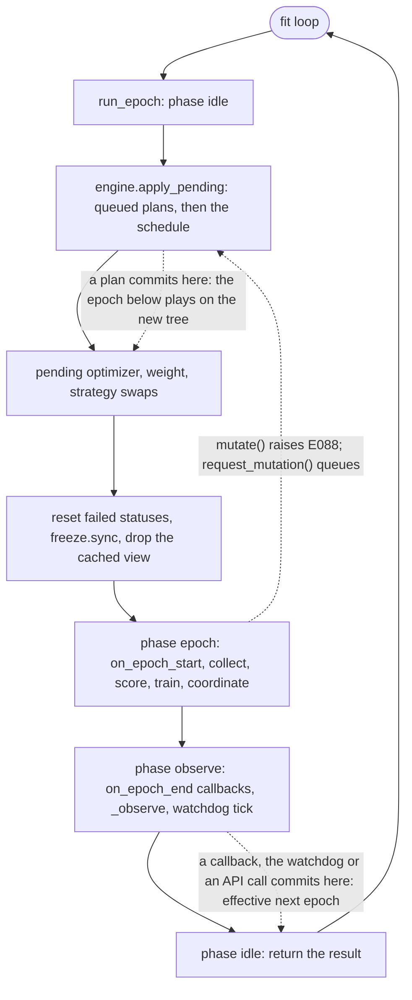

```python
# mactf/training/trainer.py   (run_epoch, lines 1864-1919: the statements this section adds or
#                              moves; everything else is unchanged, including 9.7, 10.8 and 11.9)
    def run_epoch(self, epoch: int) -> EpochResult:
        """One epoch in the fixed order of document 08 section 5.2."""
        self._require_built()
        self._phase = "idle"
        self._epoch = int(epoch)                    # a plan journaled below names this epoch
        self._mutations_in_cycle = 0
        self.engine.apply_pending(int(epoch))       # queued plans, then this epoch's schedule entries
        self._apply_pending_optimizers()            # 9.7
        self._apply_pending_weights()               # 10.8
        self._apply_pending_strategies()            # 11.9
        started = time.monotonic()
        self._epoch_cards = []
        self._epoch_step_losses = []
        self._epoch_node_metrics = {}
        self._normalization = None
        self._pending = None
        for node in self.tree.walk("root-first"):
            if node.status == "failed":
                self.tree.mark(node.path, "active")
        self.freeze.sync()                          # 11.4
        self._active_view = None                    # ancestors may hold a stale copy of a status
        self._phase = "epoch"
        try:
            self._dispatch_many("on_epoch_start", self, epoch)
            self.strategy_plan.epoch_start(self, epoch)
            self.freeze.check_learners(
                node.path for node in self.active_tree.walk("root-first")
                if node.peer is not None and node.status != "failed"
            )
            task = self.task_source.next(epoch)
            self.collect_episode(task)
            self.score()
            steps = self._train_epoch()
            self._stamp_distillation_metadata()
            report = self._coordinate(epoch)

            # ... lines 1887-1911, building ``metrics`` and ``result``, are unchanged ...

            self._phase = "observe"
            if self._trainer_policy is not None and callable(
                getattr(self._trainer_policy, "on_epoch_end", None)
            ):
                self._trainer_policy.on_epoch_end(self.active_tree, result)
            self._dispatch_many("on_epoch_end", self, result)
            self._observe(result, report)
            self._previous_scores = dict(self.signal_by_peer)
            return result
        finally:
            self._phase = "idle"
```

Three details of this listing. `self._epoch = int(epoch)` moves up from line 1868 because the
journal entry of a plan applied at the top of epoch `E` must say `E`, not `E - 1`. The
learner check of 11.9 now walks the active view, so a retired peer is not counted as a learner
and the check (`E075`) reports honestly when the *remaining* peers are all frozen. The
`try/finally` guarantees the flag returns to `idle` even when the epoch raises, so an
exception caught by a caller's `except` does not leave the trainer permanently "mid-epoch" and
unmutable.

A plan that commits in the `observe` phase takes effect at the next epoch: the epoch that just
ran produced its scorecards on the old tree, and the checkpoint `_observe` writes straight
afterwards carries the *new* topology and the journal that explains it (12.9). That ordering
is what makes a resume from that checkpoint start at the next epoch on the right tree.

#### 12.7.5 The public surface

```python
# mactf/training/trainer.py   (new methods, after ``request_stop`` at line 1133)
    # -- tree mutation ---------------------------------------------------
    def mutate(
        self, plan: "MutationPlan | Mapping[str, Any] | Sequence[Any]", *, dry_run: bool = False, source: str = "api"
    ) -> MutationReport:
        """Apply a plan atomically (12.5). ``dry_run=True`` simulates, stages, reports, installs nothing."""
        return self.engine.apply(plan, dry_run=dry_run, source=source)

    def preview_mutation(self, plan: "MutationPlan | Mapping[str, Any] | Sequence[Any]") -> MutationReport:
        return self.engine.apply(plan, dry_run=True, source="preview")

    def request_mutation(
        self, plan: "MutationPlan | Mapping[str, Any] | Sequence[Any]", *, source: str = "request"
    ) -> MutationPlan:
        """Queue a plan for the top of the next epoch. Parsed now, so a malformed plan fails here."""
        return self.engine.request(plan, source=source)

    def add_peer(self, path: str, *, reason: str = "", **spec: Any) -> MutationReport:
        return self.mutate(MutationPlan.of(_op_add(path, **spec), label=f"add:{path}", reason=reason))

    def modify_peer(self, path: str, *, reason: str = "", **changes: Any) -> MutationReport:
        return self.mutate(MutationPlan.of(_op_modify(path, **changes), label=f"modify:{path}", reason=reason))

    def retire_peer(self, path: str, *, recursive: bool = False, reason: str = "") -> MutationReport:
        return self.mutate(
            MutationPlan.of(_op_retire(path, recursive=recursive, reason=reason), label=f"retire:{path}", reason=reason)
        )

    def revive_peer(self, path: str, *, recursive: bool = False, reason: str = "") -> MutationReport:
        return self.mutate(
            MutationPlan.of(_op_revive(path, recursive=recursive, reason=reason), label=f"revive:{path}", reason=reason)
        )

    def purge_peer(
        self, path: str, *, recursive: bool = False, force: bool = False, reason: str = ""
    ) -> MutationReport:
        return self.mutate(
            MutationPlan.of(
                _op_purge(path, recursive=recursive, force=force, reason=reason), label=f"purge:{path}", reason=reason
            )
        )

    def mutation_history(self) -> list[dict[str, Any]]:
        """The journal: one entry per committed plan, oldest first, as stored in the checkpoint."""
        return [dict(entry) for entry in self.mutation_journal]

    def topology(self) -> dict[str, Any]:
        """What the tree is now: every node with its status, what is retired, what is tombstoned."""
        self._require_built()
        retired = self.freeze.retired()
        return {
            "topology_epoch": int(self.topology_epoch),
            "digest": structure_digest(self.tree, retired),
            "active": len(self.active_tree),
            "retired": sorted(retired),
            "tombstones": sorted(self._tombstones),
            "journal": len(self.mutation_journal),
            "pending": self.engine.pending(),
            "nodes": [
                {
                    "path": node.path, "role": node.role, "depth": node.depth, "parent": node.parent,
                    "status": node.status, "retired": node.path in retired,
                    "children": list(node.children),
                }
                for node in self.tree.walk("root-first")
            ],
        }

    def mutation_blockers(self) -> list[str]:
        """Reasons this trainer cannot be mutated at all (checked by ``MutationEngine._gate``)."""
        reasons: list[str] = []
        policy = self._trainer_policy
        if self._distillation.enabled and not bool(getattr(policy, "supports_tree_mutation", False)):
            reasons.append(
                "DISTILLATION is enabled and CoDistillStep keeps a fixed cohort and fixed teacher "
                "assignments; a policy that can follow a changing tree sets `supports_tree_mutation = True` "
                "and implements `on_tree_mutated(trainer, report)`"
            )
        return reasons
```

`label=f"add:{path}"` makes the journal readable without the plan. A custom `TrainerPolicy` of
section 7 that keeps per-peer state implements `on_tree_mutated`; `_after_mutation` (12.8)
calls it. `CoDistillStep` does not today (document 14), and the blocker says so rather than
letting a cohort step index a peer that has been purged.

A strategy or a callback that wants a change cannot call `mutate` (it runs while the phase is
`epoch`); it calls the queue. The coordination context of 11.6 exposes the same call so a
`PeerStrategy` does not need the trainer:

```python
# mactf/coopetition/strategy.py   (CoordinationContext: new method, after ``eligible_for``)
    def request_mutation(self, plan: Any, *, source: str = "strategy") -> Any:
        """Queue a topology change for the top of the next epoch; never applies it now (M2)."""
        return self._backend.request_mutation(plan, source=source)
```

and the one place a strategy would read what is retired:

```python
# mactf/coopetition/strategy.py   (CoordinationContext: new property)
    @property
    def retired(self) -> frozenset[str]:
        return self._backend.freeze.retired()
```

Because the `TreeView` a strategy receives is built from the active view (the `_tree_view`
edit above), `retired` is rarely needed: a retired peer is not in any group the strategy is
given.

#### 12.7.6 How the engine reads the trainer

12.5.4 already carries the two engine edges this subsection depends on; they are listed here so
the trainer side and the engine side can be checked against each other.

- `MutationEngine._gate(source)` admits `idle` and `observe` only, refuses a plan when
  `mutation_blockers()` is non-empty, and enforces `MAX_PLANS_PER_EPOCH` for every source
  except `replay`. The *internal* sources (`INTERNAL_SOURCES = ("watchdog", "replay")`) skip the
  `ENABLED` check: the watchdog's prune is a built-in feature that must not corrupt a run whether
  or not the user opted into mutation (its alternative today is the corruption of M-G2), and a
  replay reproduces a mutation the checkpoint says already happened, so it is neither budgeted
  nor refused for `ENABLED` (12.9 refuses it separately with `E080` when the journal is
  non-empty, the configuration says mutation is off and `STRICT_REPLAY` is true).
- `MutationEngine._finish` calls `t._after_mutation(report)` first, then the
  `on_tree_mutated` callbacks, then the `tree_mutated` signal. `_after_mutation` runs first so
  that the health baselines are rebased before any observer reads them, and, being plain trainer
  code, it is the one hook that a user callback cannot remove. Its text is in 12.8.5.

### 12.8 The watchdog, the health baselines and observability

The watchdog is the one component that already changes the tree on its own: `PRUNE_BRANCH`
removes a dead subtree (`watchdog.py:1128-1142`). Until now that was harmless because nothing
else cared; with a trainer that owns ten containers keyed by node path, it is the most likely
source of an inconsistent run. This subsection makes the watchdog a client of the mutation
engine, teaches the health machinery that a topology can change, and gives every mutation a
log record, a callback and a signal (M12).

#### 12.8.1 What is wrong today

| # | Finding | Evidence | Consequence once peers can come and go |
|---|---|---|---|
| **W-G1** | `MACTFWatchdog.prune_branch` calls `tree.remove_node(path, recursive=True)` on `context.extras["tree"]` | `watchdog.py:1128-1142` | The tree loses the node; `trainer.peers`, `optimizers`, `controllers`, `_group_aggregators`, `signal_by_peer`, `_last_weights`, `_previous_scores`, `_dead_counts`, `_epoch_node_metrics` and the freeze set keep it (M-G2). The parent's `AdaptiveKappa` and aggregator are still sized for the old children, so the next `aggregate` indexes a shape that no longer exists. Checkpoint `models` still carries the peer, the tree does not, and a resume raises `ContractMismatch` (`checkpoint_v2.py:995-999`) |
| **W-G2** | `tree_nodes = len(self.peers)`; `initial_tree_nodes` is set once at build | `trainer.py:682`, `:1999-2000` | A retired peer is still counted; an added peer is a "growth" nobody asked the probe to judge |
| **W-G3** | `WatchdogPolicy.max_tree_growth_ratio` is validated, serialized, documented, and read by **no probe**. `HealthContext.tree_nodes` and `initial_tree_nodes` have no reader either | `watchdog.py:126`, `:190`, `:295-296`; no `class` in the file consumes them | A dead setting (the same defect as `TRAINER.PEER_STRATEGY`). A callback that adds a peer every epoch is invisible to the watchdog |
| **W-G4** | `LossTrendProbe` judges the current loss against the median of the last five *prior* losses; `ThroughputProbe` compares this epoch's steps-per-second with the previous epoch's | `watchdog.py:389-433`, `:578-603`; `trainer.py:1962-1964`, `:1984` | The epoch after an `add` or a `retire` is on a different cohort: the mean loss moves because the *average* moved, not because training broke. A retire that removes the worst peer drops the loss (healthy); a purge that removes the best raises it by more than `loss_increase_ratio` and raises `CRITICAL` at `ratio >= 10`, whose default action is **rollback** |
| **W-G5** | The context is built from the complete tree: `roots = len(self.tree.root_paths)`, `dead` walks `self.tree`, `scores = dict(self.signal_by_peer)` | `trainer.py:1960`, `:1970-1974`, `:1983` | A retired root inflates `max_entropy = log(roots)`, so `EntropyProbe` reports a collapse that is a correct entropy over fewer peers. A retired peer's last signal stays in `scores` for the rest of the run |
| **W-G6** | `MemoryProbe` compares RSS with `_initial_rss`, read when the trainer is constructed | `trainer.py:423`, `:1997-1998`; `watchdog.py:606-637` | A new peer, its optimizer moments and its gradients are real memory the baseline never included: `RSS grew to 2.1x` after adding the fourth of four peers is a false `DEGRADED` |
| **W-G7** | `EarlyStopping` keeps `best` and `bad_epochs` across the whole run | `callbacks.py:291-338` | After a mutation the loss is measured on a different cohort; if it is higher than `best`, `bad_epochs` climbs until the run is stopped for something the user did on purpose |
| **W-G8** | A mutation leaves no trace in the log: no record kind, no callback, no signal | `logging.py:144-186` (the record kinds), `callbacks.py:34-44` (`HOOK_NAMES`), `signals.py:95-126` | A user comparing two runs cannot see that peer-3 left at epoch 7 |
| **W-G9** | `MACTFWatchdog.rollback` restores the last checkpoint into the *live* trainer (through `_CheckpointBridge`, `trainer.py:2399-2401`) | `watchdog.py:1110-1126`; `checkpoint_v2.py:995-999` | If the tree changed since that checkpoint the restore refuses with `ContractMismatch`, and the rollback that was meant to save the run is reported as `watchdog rollback failed`. 12.9 owns the fix (`reconcile_topology`) |

#### 12.8.2 The context learns about topology

```python
# mactf/training/watchdog.py   (HealthContext: new fields at the end, so positional construction
#                               and ``copies`` are unchanged; ``Callable`` is added to the typing import)
    extras: Mapping[str, Any] = field(default_factory=dict)
    #: First index of ``losses`` measured on the current topology. ``LossTrendProbe`` judges only
    #: ``losses[loss_baseline:]``; the NaN and Inf probes still read all of ``losses``.
    loss_baseline: int = 0
    #: Peers that are retired (still in the tree, out of play). ``tree_nodes`` counts only the others.
    retired_nodes: int = 0
    #: How many plans have committed, and the topology epoch they reached. Both 0 for a run that never mutated.
    mutations: int = 0
    topology_epoch: int = 0
    #: ``pruner(path, dead_epochs) -> nodes removed``. Set by a trainer; ``None`` for a context a
    #: caller built by hand, in which case ``prune_branch`` falls back to ``extras["tree"]``.
    pruner: Callable[[str, int], int] | None = None
```

`tree_nodes` keeps its name and its meaning "nodes in play", which for a run that never mutates
is `len(self.peers)`, the number it has always been. `retired_nodes`, `mutations` and
`topology_epoch` default to zero, so a hand-built context and every existing probe test
behave as before.

#### 12.8.3 Probes

`LossTrendProbe` reads the topology-aware slice; nothing else in the probe changes.

```python
# mactf/training/watchdog.py   (LossTrendProbe.probe, replacing line 393)
        losses = [float(value) for value in context.losses][max(0, int(context.loss_baseline)):]
```

With `loss_baseline == 0` (every run that never mutated, and every hand-built context) the
slice is the whole list: the probe is byte-for-byte what it was. After a mutation the probe has
fewer than two losses on the new topology and returns `HEALTHY`, then judges the new cohort
against its own trailing median. `NaNLossProbe` and `InfLossProbe` keep reading `losses`
unsliced: a NaN is a NaN whichever cohort produced it.

`TreeGrowthProbe` finally gives `max_tree_growth_ratio` a reader. It reports only growth: the
watchdog's own remedy for a dead branch (a smaller tree) must not raise an alarm of its own.

```python
# mactf/training/watchdog.py   (new probe, after DepthCostProbe)
class TreeGrowthProbe(_BaseProbe):
    """The active tree is more than ``max_tree_growth_ratio`` times the tree the run was built with.

    The probe is advisory (``DEGRADED`` at most): a user who doubles a tree on purpose raises
    ``WATCHDOG.MAX_TREE_GROWTH_RATIO``, and ``W044`` says so when the schedule is validated.
    Its job is the callback or strategy that requests a peer every epoch by mistake;
    ``TRAINER.MUTATION.MAX_PLANS_PER_EPOCH`` bounds the rate, this bounds the total.
    """

    name = "tree_growth"

    def probe(self, context: HealthContext) -> ProbeResult:
        nodes = context.tree_nodes
        initial = context.initial_tree_nodes
        if not nodes or not initial or int(initial) <= 0:
            return self._healthy()
        ratio = float(nodes) / float(initial)
        limit = float(self.policy.max_tree_growth_ratio)
        metadata = {
            "nodes": int(nodes),
            "initial_nodes": int(initial),
            "retired": int(context.retired_nodes),
            "mutations": int(context.mutations),
            "topology_epoch": int(context.topology_epoch),
        }
        if ratio > limit:
            return ProbeResult(
                name=self.name,
                status=WatchdogStatus.DEGRADED,
                value=ratio,
                threshold=limit,
                detail=(
                    f"the tree has {int(nodes)} active nodes, {ratio:.2f}x the {int(initial)} it was "
                    f"built with, after {int(context.mutations)} mutation(s)"
                ),
                metadata=metadata,
            )
        return self._healthy(ratio, threshold=limit, metadata=metadata)
```

```python
# mactf/training/watchdog.py   (default_probes: appended last, so the order and names of the
#                               existing probes are unchanged; ``__all__`` gains "TreeGrowthProbe")
        DepthCostProbe(policy),
        TreeGrowthProbe(policy),
    ]
```

```python
# mactf/training/watchdog.py   (MACTFWatchdog._recommendations: two branches, after "child_starvation")
            elif result.name == "tree_growth":
                advice.append(
                    "the tree keeps growing: inspect the callbacks and strategies that call "
                    "request_mutation, or raise WATCHDOG.MAX_TREE_GROWTH_RATIO if the growth is intended"
                )
            elif result.name == "dead_branch" and result.metadata.get("pruned"):
                advice.append(
                    f"branch {result.node_path!r} was removed from play ({result.metadata['pruned']}); "
                    "its weights are in the checkpoint written before the prune"
                )
```

The second branch is reached only by a report assembled after a prune; the first `dead_branch`
branch (`watchdog.py:1019-1022`) keeps its place and wins for an ordinary dead-branch result, so
no existing advice changes. A test pins `default_probes(policy)` names; it gains one entry
(`tree_growth`), which is the only edit to an existing test (12.11).

#### 12.8.4 `prune_branch` goes through the engine

```python
# mactf/training/watchdog.py   (MACTFWatchdog.prune_branch, replacing lines 1128-1142)
    def prune_branch(self, context: HealthContext) -> int:
        """Drop every dead subtree the report named; returns how many nodes left play.

        A trainer sets ``context.pruner``, which turns the removal into a mutation plan (12.8.5):
        the tree, the peers, the optimizers, the controllers and every per-path cache change
        together or not at all. A context a caller built by hand carries only a tree, and the
        original ``remove_node`` is the best that can be done for a structure nothing else
        depends on.
        """
        removed = 0
        pruner = context.pruner
        tree = context.extras.get("tree")
        if pruner is None and tree is None:
            return 0
        for path, count in sorted(context.dead_branches.items()):
            if int(count) < self.policy.dead_branch_patience:
                continue
            try:
                if pruner is not None:
                    removed += int(pruner(str(path), int(count)))
                else:
                    removed += int(tree.remove_node(str(path), recursive=True))
            except Exception as error:  # noqa: BLE001 - a failed prune is reported, never fatal
                emit = getattr(self.logger, "error", None)
                if callable(emit):
                    emit(f"watchdog could not prune branch {path!r}: {error}")
        return removed
```

`sorted` puts a parent before its children (a path is a prefix of its descendants'), so when
both a branch and a leaf under it are dead, the branch goes first and the pruner is asked
about a path that is already gone; `_prune_node` returns `0` for that, which is the correct
answer and not an error.

The snapshot that `tick` takes **before** the action (`watchdog.py:1049-1060`) is what makes a
prune recoverable: the checkpoint on disk holds the branch's weights and the journal without
the prune, and 12.9 shows how a rollback or a resume from it brings the branch back.

#### 12.8.5 The trainer side

```python
# mactf/training/trainer.py   (new methods, after ``mutation_blockers``)
    # -- the watchdog and the health baselines (12.8) ----------------------
    def _prune_node(self, path: str, dead_epochs: int = 0) -> int:
        """``PRUNE_BRANCH`` as a mutation. Returns the number of nodes that left play (0 if none).

        ``TRAINER.MUTATION.WATCHDOG_PRUNE`` decides how: ``purge`` (the default, and what
        ``remove_node`` always meant), ``retire`` (the branch keeps its weights and can be revived),
        or ``off`` (the watchdog only reports). A refusal (protected path, last active root, a
        distillation run) is recorded in ``failures`` and logged; training goes on.
        """
        node = self.tree.get(path)
        if node is None or path in self.freeze.retired():
            return 0
        mode = self.mutation_limits.watchdog_prune
        reason = f"dead branch: no proposals for {int(dead_epochs)} epoch(s)"
        if mode == "off":
            self.failures.append(f"watchdog: {path} is dead ({reason}) and WATCHDOG_PRUNE is off")
            return 0
        if mode == "retire":
            op = _op_retire(path, recursive=True, reason=reason)
        else:
            op = _op_purge(path, recursive=True, force=True, reason=reason)
        plan = MutationPlan.of(op, label=f"watchdog:{mode}:{path}", reason=reason)
        before = len(self.active_tree)
        try:
            self.engine.apply(plan, source="watchdog")
        except MutationError as error:
            self.failures.append(f"watchdog: could not {mode} {path}: {error}")
            log.error("watchdog could not %s %s: %s", mode, path, error)
            return 0
        return max(0, before - len(self.active_tree))

    def _after_mutation(self, report: MutationReport) -> None:
        """What the health machinery and the per-peer policies learn from a committed plan.

        Called by ``MutationEngine._finish`` before any user callback (12.7.6).
        """
        if report.dry_run or not report.changed:
            return
        # The first epoch measured on the new topology. At the top of epoch E (phase ``idle``) the
        # history holds E results and the next one is E's; in ``observe`` the epoch that just ran
        # is not in the history yet but belongs to the old topology, so the boundary is one later.
        self._loss_baseline = len(self.history) + (1 if self._phase == "observe" else 0)
        # ``_epoch_seconds`` already holds the epoch that just ran when this is called in ``observe``,
        # and not yet the one about to run when it is called in ``idle``; both give ``len``.
        self._rate_baseline = len(self._epoch_seconds)
        grown = tuple(dict.fromkeys((*report.added, *report.rebuilt)))
        if grown and self._initial_rss is not None:
            # New parameters, their gradients and optimizer moments are real, and a baseline
            # taken before them would call them a leak. Memory a purge frees is not credited
            # back: an allocator rarely returns it, so lowering the baseline would invite the
            # opposite false alarm.
            self._initial_rss += self._resident_bytes(grown)
        policy = self._trainer_policy
        hook = getattr(policy, "on_tree_mutated", None)
        if callable(hook):
            hook(self, report)
        record = getattr(self.logger, "mutation", None)
        if callable(record):
            record(report)

    #: Bytes a parameter costs while training: the weight, its gradient, and two Adam moments.
    _TRAINING_BYTES_PER_PARAMETER_BYTE = 4

    def _resident_bytes(self, paths: Iterable[str]) -> int:
        total = 0
        for path in paths:
            peer = self.peers.get(path)
            module = getattr(getattr(peer, "adapter", None), "module", None)
            if module is None:
                continue
            total += sum(
                int(parameter.numel()) * int(parameter.element_size()) for parameter in module.parameters()
            )
        return total * self._TRAINING_BYTES_PER_PARAMETER_BYTE
```

`log` is the module logger the trainer already uses; `Iterable` is already imported from
`typing` in the module header (`trainer.py:1-130`). A parameter shared with another peer
(`_shared_trunk`) is counted once per peer that holds it, which over-estimates and therefore
errs on the side of fewer false alarms.

`_health_context` is rewritten to read the active view and to hand the probes the topology
facts of 12.8.2. Everything that is not marked is the existing code.

```python
# mactf/training/trainer.py   (_health_context, replacing lines 1956-2004)
    def _health_context(self, result: EpochResult) -> "HealthContext":
        from .watchdog import HealthContext

        controller = self.controller
        active = self.active_tree
        roots = max(1, len(active.root_paths))                          # was self.tree.root_paths
        elapsed = self._epoch_seconds[-1] if self._epoch_seconds else 0.0
        previous_rate = None
        if (
            len(self._epoch_seconds) > 1
            and self._epoch_seconds[-2] > 0
            and len(self._epoch_seconds) - 2 >= self._rate_baseline     # the previous epoch ran on this topology
        ):
            previous_rate = result.steps / self._epoch_seconds[-2]
        escalated = sum(
            len(peer_card.warnings_escalated)
            for card in self._epoch_cards
            for peer_card in card.peers.values()
        )
        dead: dict[str, int] = {}
        in_play: set[str] = set()
        for node in active.walk("root-first"):                          # was self.tree.walk
            in_play.add(node.path)
            if node.status == "failed":
                dead[node.path] = self._dead_counts.get(node.path, 0) + 1
        self._dead_counts = dict(dead)
        count = 0
        if self.checkpoint is not None:
            try:
                count = len(self.checkpoint.list())
            except Exception:  # noqa: BLE001 - a missing directory is zero checkpoints
                count = 0
        retired = self.freeze.retired()
        return HealthContext(
            epoch=int(result.epoch),
            step=int(self.global_step),
            losses=tuple(item.mean_loss for item in self.history) + (result.mean_loss,),
            grad_norms=tuple(self.grad_norms),
            scores={path: value for path, value in self.signal_by_peer.items() if path in in_play},
            previous_scores=dict(self._previous_scores),
            entropy=float(controller.entropy) if controller else None,
            max_entropy=math.log(roots) if roots > 1 else 0.0,
            kappa=float(controller.kappa) if controller else None,
            aggregation_reports=tuple(self.reports),
            warnings_escalated=int(escalated),
            checkpoint_count=int(count),
            epoch_seconds=tuple(self._epoch_seconds),
            steps_per_second=(result.steps / elapsed) if elapsed > 0 else None,
            previous_steps_per_second=previous_rate,
            rss_bytes=self._rss(),
            initial_rss_bytes=self._initial_rss,
            tree_nodes=len(active),                                     # was len(self.peers)
            initial_tree_nodes=self._initial_nodes,
            dead_branches=dead,
            level_durations=dict(self._level_durations),
            extras={"tree": self.tree},
            loss_baseline=int(self._loss_baseline),
            retired_nodes=len(retired),
            mutations=len(self.mutation_journal),
            topology_epoch=int(self.topology_epoch),
            pruner=self._prune_node,
        )
```

For a run that never mutates, `active` is `self.tree`, `retired` is empty, `in_play` is every
node, `_rate_baseline` is `0` (so `len - 2 >= 0` holds whenever the old condition did), and the
five new fields are `0`, `0`, `0`, `0` and a bound method that is only called by a prune: the
context is equal to today's in every field a probe read before.

`extras["tree"]` stays the complete tree on purpose. A probe or a user callback that wants the
structure including retired nodes finds it where it always was; the *in-play* view is
`trainer.active_tree`.

#### 12.8.6 Observability: record, callback, signal

```python
# mactf/training/logging.py   (after HealthRecord, line 181)
@dataclass(frozen=True)
class MutationRecord(LogRecord):
    kind: str = "mutation"
```

```python
# mactf/training/logging.py   (MACTFLogger: new method, after ``health``, line 833)
    def mutation(self, report: Any, **fields: Any) -> None:
        """One record per committed plan: what changed, who asked, and the digests that prove it."""
        payload = dict(fields)
        if hasattr(report, "as_dict"):
            payload.update(report.as_dict())
        elif isinstance(report, Mapping):
            payload.update(dict(report))
        warned = bool(payload.get("warnings"))
        label = str(payload.get("label", "") or "")
        source = str(payload.get("source", "") or "")
        self.log(
            self._record(
                MutationRecord,
                level="warning" if warned else "info",
                epoch=int(payload.get("epoch", 0) or 0),
                message=f"{label or 'mutation'} ({source}): "
                f"+{len(payload.get('added', ()))} -{len(payload.get('purged', ()))} "
                f"retired {len(payload.get('retired', ()))} revived {len(payload.get('revived', ()))}",
                fields=payload,
            )
        )
```

`MutationReport.as_dict` (12.5) is already JSON-safe: tuples become lists, everything else is a
string, a number or a digest. The record goes through `MACTFLogger.log`, so every sink (console,
file, JSONL, TensorBoard, W&B) receives it with no sink change, and a sink that fails drops the
record rather than the mutation (`logging.py:701-709`).

```python
# mactf/signals.py   (a new group, after the training lifecycle, before "Startup")
# Topology lifecycle (document 17 section 12.8)
tree_mutated = Signal("tree_mutated")
```

```python
# mactf/training/callbacks.py   (HOOK_NAMES gains one entry; Callback gains the method; EarlyStopping reacts)
HOOK_NAMES: tuple[str, ...] = (
    "on_build",
    "on_epoch_start",
    "on_batch",
    "on_step",
    "on_score",
    "on_aggregate",
    "on_epoch_end",
    "on_tree_mutated",
    "on_resume",
    "on_close",
)

# class Callback:
    def on_tree_mutated(self, trainer: Any, report: Any) -> None:
        """A plan committed. ``report`` is the :class:`MutationReport`; the trainer is consistent again."""
        return None

# class EarlyStopping:
    def on_tree_mutated(self, trainer: Any, report: Any) -> None:
        """The loss is measured on a different cohort now: start the comparison over (W-G7)."""
        self.best = None
        self.bad_epochs = 0
```

Adding the name to `HOOK_NAMES` is what lets both `hooks={"on_tree_mutated": fn}` and a
`Callback` method pass the strict validation (`trainer.py:521-527`,
`callbacks.py:167-169`). The hook order is fixed: the trainer's own `_after_mutation`, the
`hooks` mapping and the callbacks (`_dispatch_many`: hooks first), then the signal.

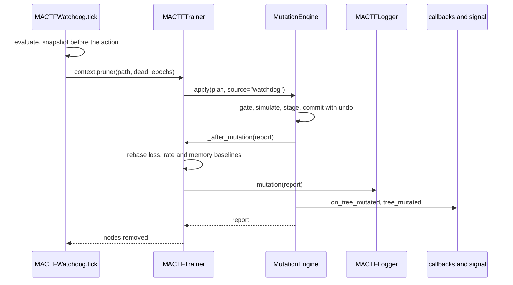

#### 12.8.7 What the watchdog does and does not decide

| Question | Answer |
|---|---|
| Can the watchdog mutate a run whose `TRAINER.MUTATION.ENABLED` is false? | Yes, for `PRUNE_BRANCH` only, and only because the alternative is the corruption of W-G1. It is the `watchdog` internal source of 12.5.4; every other source needs `ENABLED` |
| Can a user forbid it? | `TRAINER.MUTATION.WATCHDOG_PRUNE: off` (the watchdog reports; the dead branch keeps failing each epoch, as an unpruned branch does today) |
| Can it prune the last root or a protected peer? | No. The same simulator rules (M5) apply: `E082`, recorded in `failures` |
| Does a prune weaken scoring? | No (M3). The dead branch produced no ledger; the survivors are scored by the same chain and averaged with the floor re-checked (M8) |
| Does a prune lose the branch? | With `retire`, no: it can be revived. With `purge`, the weights are in the snapshot taken before the action |
| What if `DISTILLATION` is on? | `mutation_blockers()` refuses, the prune is recorded in `failures`, and the branch stays dead as it is today |
| Is a prune in the journal? | Yes, with `source: "watchdog"`, so a resume reproduces it (12.9) |

#### 12.8.8 Findings closed by this subsection

| Finding | Closed by |
|---|---|
| W-G1 | 12.8.4, 12.8.5 (`prune_branch` -> `_prune_node` -> `MutationEngine`) |
| W-G2 | 12.8.5 (`tree_nodes = len(active)`) |
| W-G3 | 12.8.3 (`TreeGrowthProbe`) |
| W-G4 | 12.8.2, 12.8.3, 12.8.5 (`loss_baseline`, `_rate_baseline`) |
| W-G5 | 12.8.5 (`active` roots, `in_play` scores and dead counts) |
| W-G6 | 12.8.5 (`_resident_bytes`) |
| W-G7 | 12.8.6 (`EarlyStopping.on_tree_mutated`) |
| W-G8 | 12.8.6 (`MutationRecord`, `on_tree_mutated`, `tree_mutated`) |
| W-G9 | 12.9 (`reconcile_topology`) |

### 12.9 The checkpoint, the journal and the reconciliation of topology

A checkpoint is a statement about a structure: these nodes, these weights, these optimizer
states. Until now the structure was a constant of the run, so the restore (`checkpoint_v2.py:985-1000`)
could *compare* the stored tree with the live one and refuse on a difference. Once peers can
come and go, "the live tree differs from the stored tree" is no longer a sign of a wrong
checkpoint; it is the normal state of affairs after a resume in a new process (the new process
built the *initial* tree) and after a watchdog rollback (the live tree has moved on since the
snapshot). This subsection makes the restore *reproduce* the stored structure, and makes the
checkpoint carry what it takes to do so.

#### 12.9.1 The design in one paragraph, and the one it replaced

The checkpoint carries a **mutation state** (12.9.2): the journal, a **manifest** (the effective
spec of every node a plan created or rebuilt, and the metadata of every node a plan touched),
the tombstones, the queue of plans not yet run, and three digests that tie them to the tree
section. At restore, **before the topology check**, the trainer computes the difference between
its live structure and the stored one and applies it as **one ordinary mutation plan** through
the engine (`source="replay"`), so the reconciliation inherits atomicity, the path-state audit and
the optimizer rebinding of 12.5-12.7 and has no second implementation of any of them. The
journal does not drive the reconstruction; it *proves* the checkpoint is coherent (12.9.4).

The design this replaced was the obvious one: replay the journal forward on a fresh build, and
on a rollback invert the entries since the checkpoint. It was rejected for four reasons that
the cases of 12.9.7 make concrete.

| Reason | Why replay-and-invert fails |
|---|---|
| **`purge` has no inverse** | The weights, optimizer moments and caches of a purged peer are gone from the live trainer. A rollback to a snapshot taken *before* a watchdog prune (the very case W-G9 is about) needs the peer back; no inverse operation can conjure it. The snapshot has it, and a *difference* against the snapshot's tree knows to `add` the node and let the restore load its weights |
| **`rebuild` has no inverse** | Replacing a module changes its architecture; the previous module is not recoverable from the plan. The manifest records the architecture each node should have; the difference rebuilds toward it |
| **Replay is order- and history-sensitive** | A forward replay of an `add` with `init_from: peer-1` copies peer-1's weights *as of replay time*, not as of the original time; an inverse of a `modify` needs the prior value, which the entry would have to carry. A difference needs neither, because parameters come from the checkpoint's own `models` section afterwards |
| **Divergence** | A rollback target and the live run may have both mutated after a common ancestor. Inverting the live suffix and replaying the target's suffix is two procedures; a difference is one, and it handles "no common ancestor" (a fresh process) with the same code |

#### 12.9.2 The mutation state

```python
# mactf/training/mutation.py   (part 3: the pure pieces a checkpoint needs; after ``MutationLimits``.
#                               ``INTERNAL_SOURCES`` moved here from the engine; ``PeerTree`` is already imported)
#: Sources that are not the user asking: the watchdog's prune (12.8) and the reconciliation (12.9).
INTERNAL_SOURCES = ("watchdog", "replay")


def manifest_spec(spec: PeerSpec) -> dict[str, Any]:
    """The part of a ``PeerSpec`` that decides what a node *is*.

    ``init_from`` is dropped: it says where the first weights came from, and a reconciliation
    never needs it because the weights come from the checkpoint's ``models`` section.
    """
    payload = spec.canonical()
    payload.pop("init_from", None)
    return payload


def tree_state_digest(tree_state: Mapping[str, Any]) -> str:
    """``structure_digest`` of a stored tree section (``PeerTree.state_dict``): ``pruned`` is retired."""
    try:
        tree = PeerTree.from_dict(tree_state)
    except Exception as error:  # noqa: BLE001 - a tree that does not parse is a corrupt checkpoint
        raise MutationError("E089", f"the checkpoint's tree section does not parse: {error}") from error
    retired = [node.path for node in tree.walk("root-first") if node.status == "pruned"]
    return structure_digest(tree, retired)
```

```python
# mactf/training/mutation_reconcile.py   (new; pure Python: imports no torch, so the CLI and the API
#                                         can read a checkpoint's mutation state)
from __future__ import annotations

import copy
import logging
from dataclasses import dataclass, field
from typing import Any, Iterable, Mapping, Sequence

from ..coopetition.tree import PeerTree
from ..exceptions import MutationError
from .mutation import (
    BUILD_TOKEN, INTERNAL_SOURCES, MutationPlan, add_peer, modify_peer, parent_of, purge_peer,
    retire_peer, revive_peer, structure_digest, tree_state_digest,
)

log = logging.getLogger("mactf.mutation")

STATE_VERSION = 1
_STATE_KEYS = frozenset(
    {"version", "journal", "topology_epoch", "base_digest", "digest", "tombstones", "specs", "metadata", "pending"}
)
_ENTRY_KEYS = ("seq", "epoch", "topology_epoch", "source", "plan", "plan_digest", "before", "after")
_MISSING = object()


def _text(raw: Mapping[str, Any], key: str) -> str:
    value = raw.get(key, "")
    if not isinstance(value, str):
        raise MutationError("E089", f"the checkpoint's mutation state has a non-text `{key}`: {value!r}")
    return value


def _count(raw: Mapping[str, Any], key: str) -> int:
    value = raw.get(key, 0)
    if isinstance(value, bool) or not isinstance(value, int) or value < 0:
        raise MutationError("E089", f"the checkpoint's mutation state has an invalid `{key}`: {value!r}")
    return value


def _mapping_of_mappings(raw: Mapping[str, Any], key: str) -> dict[str, dict[str, Any]]:
    value = raw.get(key) or {}
    if not isinstance(value, Mapping) or not all(isinstance(item, Mapping) for item in value.values()):
        raise MutationError("E089", f"the checkpoint's mutation state `{key}` must map a path to a mapping")
    return {str(path): copy.deepcopy(dict(item)) for path, item in value.items()}


@dataclass(frozen=True)
class MutationState:
    """What a checkpoint says about how its tree came to be (``identity["trainer"]["mutation"]``).

    ``{}`` (no state at all) is what a run that never mutated writes, which is why the checkpoint
    of such a run is byte-for-byte what it has always been (M11).
    """

    journal: tuple[dict[str, Any], ...] = ()
    topology_epoch: int = 0
    base_digest: str = ""        # the tree as ``build()`` made it: what a configuration reproduces
    digest: str = ""             # the tree this state describes: must equal the checkpoint's tree section
    tombstones: tuple[str, ...] = ()
    specs: Mapping[str, Mapping[str, Any]] = field(default_factory=dict)
    metadata: Mapping[str, Mapping[str, Any]] = field(default_factory=dict)
    pending: tuple[dict[str, Any], ...] = ()

    def __post_init__(self) -> None:
        object.__setattr__(self, "specs", dict(self.specs or {}))
        object.__setattr__(self, "metadata", dict(self.metadata or {}))

    # -- serialisation ---------------------------------------------------
    def as_dict(self) -> dict[str, Any]:
        return {
            "version": STATE_VERSION,
            "journal": [copy.deepcopy(dict(entry)) for entry in self.journal],
            "topology_epoch": int(self.topology_epoch),
            "base_digest": self.base_digest,
            "digest": self.digest,
            "tombstones": list(self.tombstones),
            "specs": {path: copy.deepcopy(dict(spec)) for path, spec in self.specs.items()},
            "metadata": {path: copy.deepcopy(dict(meta)) for path, meta in self.metadata.items()},
            "pending": [copy.deepcopy(dict(row)) for row in self.pending],
        }

    @classmethod
    def parse(cls, raw: Mapping[str, Any]) -> "MutationState":
        """Validate the shape of a stored state. ``E089`` for anything that is not one."""
        if not isinstance(raw, Mapping):
            raise MutationError("E089", f"the checkpoint's mutation state is a {type(raw).__name__}, not a mapping")
        version = raw.get("version", STATE_VERSION)
        if version != STATE_VERSION:
            raise MutationError(
                "E089",
                f"the checkpoint's mutation state is version {version!r}; this build reads version {STATE_VERSION}",
            )
        unknown = sorted(set(raw) - _STATE_KEYS)
        if unknown:
            raise MutationError("E089", f"the checkpoint's mutation state has unknown keys {unknown}")
        journal = raw.get("journal") or []
        if isinstance(journal, (str, bytes)) or not isinstance(journal, Sequence):
            raise MutationError("E089", "the checkpoint's mutation journal must be a list")
        rows: list[dict[str, Any]] = []
        for index, entry in enumerate(journal):
            if not isinstance(entry, Mapping):
                raise MutationError("E089", f"journal entry {index} is not a mapping")
            missing = [key for key in _ENTRY_KEYS if key not in entry]
            if missing:
                raise MutationError("E089", f"journal entry {index} lacks {missing}")
            rows.append(copy.deepcopy(dict(entry)))
        pending = raw.get("pending") or []
        if isinstance(pending, (str, bytes)) or not isinstance(pending, Sequence) or not all(
            isinstance(row, Mapping) and "plan" in row for row in pending
        ):
            raise MutationError("E089", "the checkpoint's pending mutations must be a list of {source, plan}")
        return cls(
            journal=tuple(rows),
            topology_epoch=_count(raw, "topology_epoch"),
            base_digest=_text(raw, "base_digest"),
            digest=_text(raw, "digest"),
            tombstones=tuple(sorted(str(path) for path in (raw.get("tombstones") or ()))),
            specs=_mapping_of_mappings(raw, "specs"),
            metadata=_mapping_of_mappings(raw, "metadata"),
            pending=tuple(copy.deepcopy(dict(row)) for row in pending),
        )

    # -- coherence -------------------------------------------------------
    @property
    def user_driven(self) -> bool:
        """True when a journal entry came from a source that needs ``TRAINER.MUTATION.ENABLED``."""
        return any(entry["source"] not in INTERNAL_SOURCES for entry in self.journal)

    def verify_chain(self, tree_digest: str) -> list[str]:
        """Every way the journal fails to explain the checkpoint's tree. Empty means coherent.

        The chain is ``base -> entry 0 -> entry 1 -> ... -> digest``, each entry's ``before`` equal
        to the previous ``after``, ``seq`` contiguous, each plan hashing to its recorded digest, and
        the end equal to the tree section the checkpoint actually holds.
        """
        problems: list[str] = []
        previous = self.base_digest
        for index, entry in enumerate(self.journal):
            if entry["seq"] != index:
                problems.append(f"entry {index} has seq {entry['seq']!r}; the journal is not contiguous")
            if entry["before"] != previous:
                problems.append(
                    f"entry {index} ({entry['plan_digest']}) starts from structure {entry['before']}, "
                    f"but the structure before it was {previous}"
                )
            try:
                recomputed = MutationPlan.parse(entry["plan"]).digest()
            except MutationError as error:
                problems.append(f"entry {index}: the recorded plan does not parse: {error}")
            else:
                if recomputed != entry["plan_digest"]:
                    problems.append(
                        f"entry {index}: the recorded plan hashes to {recomputed}, not {entry['plan_digest']}"
                    )
            previous = entry["after"]
        if previous != self.digest:
            problems.append(f"the journal ends at structure {previous}, but the state describes {self.digest}")
        if self.digest != tree_digest:
            problems.append(
                f"the state describes structure {self.digest}, but the checkpoint's tree section is {tree_digest}"
            )
        return problems
```

`specs` and `metadata` are the manifest. `specs[path]` is the effective, `init_from`-free
`PeerSpec` of a node that a plan created or rebuilt (the engine's `_record_manifest`, 12.5.4);
`metadata[path]` is the final metadata of a node a plan created or touched. A node built from the
configuration and never touched has neither entry, and that absence means "as `build()` makes
it": the trainer keeps `_build_meta` (12.7.2) for the metadata half of that sentence.

The trainer assembles and writes it:

```python
# mactf/training/trainer.py   (new methods, after ``_trainer_state``, line 2200;
#                              ``copy`` is imported at the top of the module, ``MutationState`` from
#                              ``.mutation_reconcile``)
    def _mutation_state(self) -> dict[str, Any]:
        """The checkpoint's account of how the tree came to be. ``{}`` for a run that never mutated."""
        pending = self.engine.pending()
        if not (
            self.mutation_journal or pending or self._node_specs or self._node_meta or self._tombstones
        ):
            return {}
        return MutationState(
            journal=tuple(copy.deepcopy(entry) for entry in self.mutation_journal),
            topology_epoch=int(self.topology_epoch),
            base_digest=self._base_digest,
            digest=structure_digest(self.tree, self.freeze.retired()),
            tombstones=tuple(sorted(self._tombstones)),
            specs=copy.deepcopy(self._node_specs),
            metadata=copy.deepcopy(self._node_meta),
            pending=tuple(pending),
        ).as_dict()

    def _identity_extra(self) -> dict[str, Any]:
        """Keys a periodic or watchdog checkpoint adds to ``identity`` (section 14.4 widens this to the
        whole trainer state; the mutation state is what it holds today)."""
        mutation = self._mutation_state()
        return {"trainer": {"mutation": mutation}} if mutation else {}
```

```python
# mactf/training/trainer.py   (_trainer_state, line 2190: the dict is built, then gains one key)
        state = {
            "spec": self.spec.as_dict() if self.spec is not None else {},
            # ... the keys of lines 2192-2198 unchanged ...
            "distillation": self._distillation_state(),
        }
        mutation = self._mutation_state()
        if mutation:
            state["mutation"] = mutation
        return state
```

```python
# mactf/training/trainer.py   (_observe, lines 1930-1942: the periodic context gains one argument)
                CheckpointContext(
                    trainer=self,
                    episode=result.epoch,
                    # ... unchanged ...
                    aggregations=tuple(self.reports),
                    identity_extra=self._identity_extra(),
                ),
```

```python
# mactf/training/trainer.py   (_CheckpointBridge.save, lines 2382-2397: a context the caller built without
#                              extras, and the one the bridge builds, both carry the mutation state)
        if isinstance(context, CheckpointContext):
            resolved = context
            if not resolved.identity_extra:
                resolved.identity_extra = self._trainer._identity_extra()
        else:
            scores = dict(getattr(context, "scores", {}) or {})
            resolved = CheckpointContext(
                # ... unchanged ...
                aggregations=tuple(self._trainer.reports),
                identity_extra=self._trainer._identity_extra(),
            )
```

The watchdog's snapshot ("before the action", `watchdog.py:1049-1060`) goes through the bridge, so
the checkpoint a rollback will later restore describes the structure it was taken on. `state_dict()`
(`trainer.py:2207-2226`) needs no edit: it replaces `identity["trainer"]` with
`_trainer_state()`, which now includes the mutation state.

```python
# mactf/orchestration/checkpoint_v2.py   (CheckpointContext: one new field, at the end, so every
#                                         positional and keyword construction is unchanged)
    extras: Mapping[str, Any] = field(default_factory=dict)
    #: Keys merged into the ``identity`` section. They may not replace a framework key
    #: (``run_id``, ``episode``, ...). Empty for every caller that does not use it, which keeps the
    #: identity section, and its hash, exactly as they were.
    identity_extra: Mapping[str, Any] = field(default_factory=dict)
```

```python
# mactf/orchestration/checkpoint_v2.py   (_collect: after the ``identity = {...}`` literal, line 594)
        extra = dict(context.identity_extra or {})
        clash = sorted(set(extra) & set(identity))
        if clash:
            raise ValidationError(
                f"identity_extra may not replace the framework's identity keys {clash}; "
                "put trainer-owned state under the 'trainer' key"
            )
        identity.update(extra)
```

A run that never mutated has `_mutation_state() == {}`, hence `_identity_extra() == {}`, hence an
identity section that is key-for-key what `_collect` produced before: no section hash changes
(M11), and a checkpoint written by an older build loads (the restore reads
`identity.get("trainer", {}).get("mutation")` and finds nothing).

#### 12.9.3 Computing the difference

The planner is a pure function of four things: the live tree, the live retired set, the live
manifest and the stored target. It has no torch and no trainer, so its every branch is a unit
test.

```python
# mactf/training/mutation_reconcile.py   (continued: the target and the planner)
@dataclass(frozen=True)
class TargetNode:
    path: str
    parent: str | None
    role: str
    retired: bool
    depth: int


@dataclass(frozen=True)
class Target:
    """The structure a checkpoint describes, in root-first order."""

    nodes: Mapping[str, TargetNode]
    specs: Mapping[str, Mapping[str, Any]]
    metadata: Mapping[str, Mapping[str, Any]]
    digest: str

    @classmethod
    def build(
        cls,
        tree_state: Mapping[str, Any],
        state: MutationState | None,
        build_meta: Mapping[str, Mapping[str, Any]],
    ) -> "Target":
        try:
            tree = PeerTree.from_dict(tree_state)
        except Exception as error:  # noqa: BLE001 - a tree that does not parse is a corrupt checkpoint
            raise MutationError("E089", f"the checkpoint's tree section does not parse: {error}") from error
        nodes = {
            node.path: TargetNode(node.path, node.parent, node.role, node.status == "pruned", int(node.depth))
            for node in tree.walk("root-first")
        }
        metadata: dict[str, dict[str, Any]] = {}
        for path in nodes:
            if state is not None and path in state.metadata:
                metadata[path] = copy.deepcopy(dict(state.metadata[path]))
            elif path in build_meta:
                metadata[path] = copy.deepcopy(dict(build_meta[path]))
        retired = [path for path, node in nodes.items() if node.retired]
        return cls(
            nodes=nodes,
            specs={} if state is None else {path: dict(spec) for path, spec in state.specs.items()},
            metadata=metadata,
            digest=structure_digest(tree, retired),
        )


@dataclass(frozen=True)
class ReconcilePlan:
    """The plan that turns the live structure into the stored one, and what it will do."""

    plan: MutationPlan | None
    revived: tuple[str, ...] = ()
    modified: tuple[str, ...] = ()
    rebuilt: tuple[str, ...] = ()
    purged: tuple[str, ...] = ()
    added: tuple[str, ...] = ()
    retired: tuple[str, ...] = ()

    @property
    def empty(self) -> bool:
        return self.plan is None

    def summary(self) -> str:
        parts = [
            f"{name} {len(items)}"
            for name, items in (
                ("added", self.added), ("purged", self.purged), ("retired", self.retired),
                ("revived", self.revived), ("rebuilt", self.rebuilt), ("modified", self.modified),
            )
            if items
        ]
        return ", ".join(parts) or "nothing"


def _ancestors(path: str) -> list[str]:
    result: list[str] = []
    parent = parent_of(path)
    while parent is not None:
        result.append(parent)
        parent = parent_of(parent)
    return result


def _rebuild_block(spec: Mapping[str, Any] | None, available: set[str]) -> dict[str, Any]:
    """The ``rebuild`` mapping for a stored spec: its architecture, or the build-time module."""
    block: dict[str, Any] = {}
    if spec is not None:
        if spec.get("factory") is not None:
            block["factory"] = spec["factory"]
        if spec.get("like") is not None and spec["like"] in available:
            block["like"] = spec["like"]
    return block or {"factory": BUILD_TOKEN}


def plan_reconciliation(
    tree: PeerTree,
    retired: Iterable[str],
    specs: Mapping[str, Mapping[str, Any]],
    target: Target,
) -> ReconcilePlan:
    """The operations, in an order every one of them is valid at its turn.

    1. ``revive`` every retired node that must be active in the end, or that a later step must
       touch (a retired node cannot be modified, and nothing can be added under it), with its
       retired ancestors, root first.
    2. ``modify`` the nodes whose architecture, role or metadata differ.
    3. ``purge`` the topmost live-only nodes, recursively and forced (a purge takes the subtree).
    4. ``add`` the stored-only nodes, parents first, each with its stored spec.
    5. ``retire`` what the stored tree says is retired and is not now, deepest first.
    """
    gone_now = set(retired)
    live = {node.path: node for node in tree.walk("root-first")}
    gone = {path for path in live if path not in target.nodes}
    kept = [path for path in live if path in target.nodes]
    kept_set = set(kept)
    created = [path for path in target.nodes if path not in live]

    # -- what changes on a node that exists on both sides ----------------
    changes: dict[str, dict[str, Any]] = {}
    for path in kept:
        node = live[path]
        change: dict[str, Any] = {}
        want_spec = target.specs.get(path)
        have_spec = specs.get(path)
        if (None if want_spec is None else dict(want_spec)) != (None if have_spec is None else dict(have_spec)):
            change["rebuild"] = _rebuild_block(want_spec, kept_set)
        if node.role != target.nodes[path].role:
            change["role"] = target.nodes[path].role
        have = dict(node.metadata)
        want = dict(target.metadata.get(path, {}))
        delta = {key: value for key, value in want.items() if have.get(key, _MISSING) != value}
        delta.update({key: None for key in have if key not in want})
        if delta:
            change["metadata"] = delta
        if change:
            changes[path] = change

    # -- which retired nodes must be active while the plan runs ----------
    must_be_active = set(changes)
    for path in created:
        parent = parent_of(path)
        if parent is not None and parent in kept_set:
            must_be_active.add(parent)
    for path in list(must_be_active):
        must_be_active.update(ancestor for ancestor in _ancestors(path) if ancestor in kept_set)
    revive = [
        path for path in kept
        if path in gone_now and (not target.nodes[path].retired or path in must_be_active)
    ]
    still_retired = {path for path in kept if path in gone_now and path not in revive}

    ops: list[Any] = []
    for path in revive:                                   # kept is root-first
        ops.append(revive_peer(path, reason="checkpoint reconciliation"))
    for path, change in changes.items():
        ops.append(modify_peer(path, **change))
    top_gone = [path for path in live if path in gone and parent_of(path) not in gone]
    for path in top_gone:
        ops.append(purge_peer(path, recursive=True, force=True, reason="checkpoint reconciliation"))

    available = set(kept_set)
    for path in created:                                  # target order is root-first
        spec = {key: value for key, value in dict(target.specs.get(path) or {}).items() if key != "path"}
        if spec.get("like") is not None and spec["like"] not in available:
            spec.pop("like")                              # the template is gone; the build-time module is the fallback
        spec["role"] = target.nodes[path].role
        meta = target.metadata.get(path)
        if meta:
            spec["metadata"] = dict(meta)
        ops.append(add_peer(path, **spec))
        available.add(path)

    to_retire = [
        path for path, node in target.nodes.items()
        if node.retired and path not in still_retired
    ]
    to_retire.sort(key=lambda item: target.nodes[item].depth, reverse=True)
    for path in to_retire:
        ops.append(retire_peer(path, reason="checkpoint reconciliation"))

    if not ops:
        return ReconcilePlan(plan=None)
    plan = MutationPlan.of(
        *ops, label=f"reconcile:{target.digest}", reason="the checkpoint's topology differs from the live one"
    )
    return ReconcilePlan(
        plan=plan,
        revived=tuple(revive),
        modified=tuple(changes),
        rebuilt=tuple(path for path, change in changes.items() if "rebuild" in change),
        purged=tuple(top_gone),
        added=tuple(created),
        retired=tuple(to_retire),
    )
```

Three of its choices need a sentence.

* **A node that is retired in the live tree and must be modified is revived first and retired
  again at the end.** `modify` refuses a retired node (12.4) and so does `add` under one; the
  planner does not weaken those rules, it routes around them, and the final `retire` step puts the
  node back where the stored tree says it is. The cost is one revive and one retire, in a plan
  that is atomic.
* **`init_from` is never replayed.** A reconciliation produces *structure*. The weights of every
  node, new or not, come from the checkpoint's `models` section, which the restore loads right
  after this step (`checkpoint_v2.py:1001-1033`), so the first weights an `add` gives a node
  (whatever `init_from` or the factory's random initialisation produced) are overwritten before
  the first forward pass, and the engine's private RNG stream (M4, `fork_rng`) means producing
  them consumed none of the run's randomness.
* **A missing `like` falls back to the build-time module.** A stored `like` names a node that
  was the template when the peer was created. If that node is not in the stored tree any more,
  `like` is dropped and the node is built by `_module_for(path)` (step 3 of 12.3). When that is
  the wrong architecture the layout check (`E085`) says so, and the restore raises `E089` with
  the finding; nothing is installed.

#### 12.9.4 The reconciler

```python
# mactf/training/mutation_reconcile.py   (continued: the one entry point the restore calls)
class TopologyReconciler:
    """Make a built trainer's structure the one a checkpoint describes, before its parameters load."""

    def __init__(self, trainer: Any) -> None:
        self.trainer = trainer

    # -- entry point -----------------------------------------------------
    def reconcile(
        self, identity: Mapping[str, Any], tree_state: Mapping[str, Any], *, strict: bool = True
    ) -> list[str]:
        """Returns the notes for the ``ResumeReport``. Raises ``MutationError`` and changes nothing
        when the checkpoint cannot be reproduced (``E080``, ``E088``, ``E089``)."""
        t = self.trainer
        notes: list[str] = []
        stored = identity.get("trainer") if isinstance(identity, Mapping) else None
        raw = stored.get("mutation") if isinstance(stored, Mapping) else None
        state = MutationState.parse(raw) if raw else None
        mutated = bool(t.mutation_journal or t.topology_epoch or t._node_specs or t._node_meta)
        if state is None and not mutated:
            # Neither side ever mutated: the restore's own comparison (a topology that differs is a
            # configuration that changed) is the whole story, exactly as before 12.
            return notes

        enforce = bool(strict and t.mutation_limits.strict_replay)
        target_digest = tree_state_digest(tree_state)
        if state is None and target_digest != t._base_digest:
            # A live run that mutated, and a checkpoint that is not a snapshot of *this* run's
            # initial tree and carries no journal: it belongs to some other configuration.
            # The restore's comparison names the difference.
            return notes

        problems: list[str] = []
        disabled = False
        if state is not None:
            problems.extend(state.verify_chain(target_digest))
            if state.base_digest != t._base_digest:
                problems.append(
                    f"the configuration builds structure {t._base_digest}, but the run started from "
                    f"{state.base_digest}: the hierarchy or the model sources changed since the checkpoint"
                )
            if state.user_driven and not t.mutation_limits.enabled:
                disabled = True
                problems.append(
                    "the journal holds user-requested mutations but TRAINER.MUTATION.ENABLED is false"
                )
        if problems:
            text = "; ".join(problems)
            if enforce:
                code = "E080" if disabled and len(problems) == 1 else "E089"
                raise MutationError(
                    code,
                    "the checkpoint's mutation journal does not describe a structure this configuration "
                    f"can resume (set TRAINER.MUTATION.STRICT_REPLAY: false to tolerate it): {text}",
                    findings=problems,
                )
            log.warning("W045: tolerated an inconsistent mutation journal: %s", text)
            notes.append(f"W045: tolerated an inconsistent mutation journal: {text}")

        target = Target.build(tree_state, state, t._build_meta)
        difference = plan_reconciliation(t.tree, t.freeze.retired(), t._node_specs, target)
        report = None
        if difference.plan is not None:
            saved_cycle = t._mutations_in_cycle
            try:
                report = t.engine.apply(difference.plan, source="replay")
            except MutationError as error:
                raise MutationError(
                    error.code,
                    f"cannot reproduce the checkpoint's topology ({difference.summary()}): {error}",
                    findings=error.findings,
                    rolled_back=error.rolled_back,
                ) from error
            finally:
                t._mutations_in_cycle = saved_cycle
        reached = structure_digest(t.tree, t.freeze.retired())
        if reached != target.digest:
            raise MutationError(
                "E089",
                f"after reconciliation the structure is {reached}, but the checkpoint's tree is "
                f"{target.digest}; this trainer cannot continue from this checkpoint",
                rolled_back=False,
            )
        self._adopt(state, target)
        if report is not None:
            self._rebase(report)
            notes.append(f"topology reconciled with the checkpoint ({difference.summary()})")
        elif state is not None and state.journal:
            notes.append(f"topology already matches the checkpoint ({len(state.journal)} journaled plan(s))")
        return notes

    # -- the bookkeeping that is the checkpoint's, not the plan's --------
    def _adopt(self, state: MutationState | None, target: Target) -> None:
        """Replace the records the replayed plan wrote with the ones the checkpoint holds."""
        t = self.trainer
        stored = state if state is not None else MutationState(base_digest=t._base_digest, digest=target.digest)
        t.mutation_journal[:] = [copy.deepcopy(dict(entry)) for entry in stored.journal]
        t.topology_epoch = int(stored.topology_epoch)
        t._tombstones.clear()
        t._tombstones.update(stored.tombstones)
        t._node_specs.clear()
        t._node_specs.update({path: dict(spec) for path, spec in stored.specs.items()})
        t._node_meta.clear()
        t._node_meta.update({path: dict(meta) for path, meta in stored.metadata.items()})
        t.engine.restore_pending(stored.pending)
        t._active_view = None

    def _rebase(self, report: Any) -> None:
        """The health baselines of 12.8, once, for the structure the restore just installed."""
        t = self.trainer
        t._loss_baseline = len(t.history) + (1 if t._phase == "observe" else 0)
        t._rate_baseline = len(t._epoch_seconds)
        grown = tuple(dict.fromkeys((*report.added, *report.rebuilt)))
        if grown and t._initial_rss is not None:
            t._initial_rss += t._resident_bytes(grown)
        record = getattr(t.logger, "mutation", None)
        if callable(record):
            record(report, reconciled=True)
```

`_rebase` runs only when the reconciliation changed something. A fresh process (empty history,
no epoch timings) gets `_loss_baseline = 0`, which is what it would have anyway; an in-process
rollback gets the baselines of the moment, which is what a mutation at that moment would have
set. Memory freed by purged peers is not credited back, for the reason given in 12.8.5.

The trainer exposes it as one method, and the checkpoint manager calls it where the topology was
compared:

```python
# mactf/training/trainer.py   (new method, after ``_mutation_state``)
    def reconcile_topology(
        self, identity: Mapping[str, Any], tree_state: Mapping[str, Any], *, strict: bool = True
    ) -> list[str]:
        """Called by ``MACTFCheckpoint.restore`` before it compares topologies (12.9)."""
        from .mutation_reconcile import TopologyReconciler

        return TopologyReconciler(self).reconcile(identity, tree_state, strict=strict)
```

```python
# mactf/orchestration/checkpoint_v2.py   (restore, step 4, replacing lines 985-1000;
#                                         ``Orchestrator`` has no ``reconcile_topology``: it never mutates)
        if trainer is not None:
            # 4. topology.
            tree_state = stored.tree
            trainer_tree = getattr(trainer, "tree", None)
            reconcile = getattr(trainer, "reconcile_topology", None)
            if callable(reconcile) and tree_state and trainer_tree is not None:
                notes.extend(reconcile(identity, tree_state, strict=strict))
            if tree_state and trainer_tree is not None:
                from ..coopetition.tree import PeerTree

                restored_tree = PeerTree.from_dict(tree_state)
                current = trainer_tree.state_dict()
                incoming = restored_tree.state_dict()
                if _topology(current) != _topology(incoming):
                    raise ContractMismatch(
                        "checkpoint topology does not match this trainer: "
                        + _topology_diff(current, incoming)
                    )
                notes.append(f"topology verified ({len(incoming['nodes'])} nodes)")
```

`reconcile` runs first, so by the time the unchanged comparison runs the two trees are equal,
and for a run that never mutated it returned immediately. The comparison stays as the
last line of defence: it re-derives the agreement from the trees themselves rather than
trusting the reconciler's digest.

#### 12.9.5 One restore, three entry points

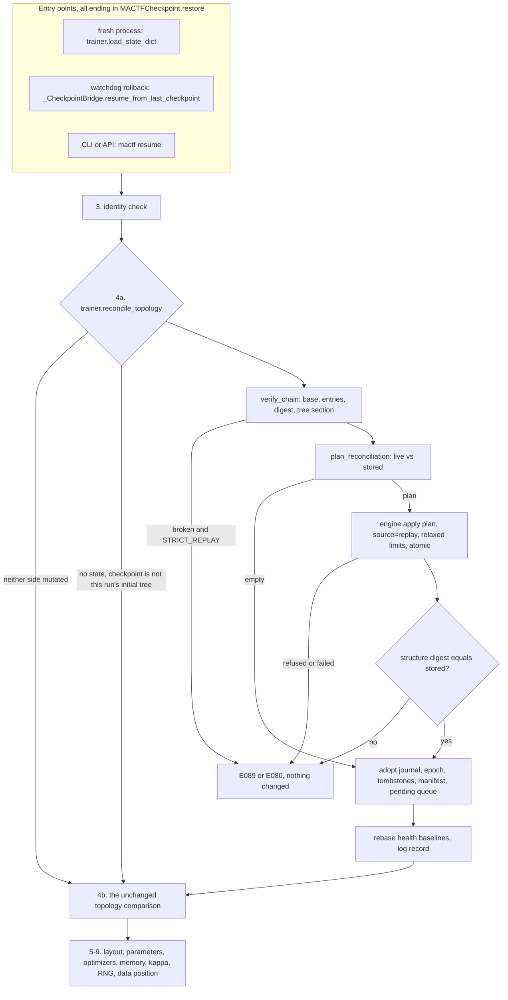

The three entry points differ only in what the live trainer looks like when they arrive:

| Entry | Live trainer | What the difference contains |
|---|---|---|
| A resume in a new process | built from the configuration: the *initial* tree, empty journal | every node the journal added, every retirement, every purge replayed as a structural difference |
| A watchdog rollback (`watchdog.py:1110-1126`) | the same run, possibly mutated after the snapshot | only what changed since the snapshot, including a node the watchdog itself pruned, which comes back as an `add` (its weights are in the snapshot) |
| `mactf resume` from the CLI or the API | a new process, as the first row | as the first row |

#### 12.9.6 What is and is not reproduced

| Item | Reproduced by | Notes |
|---|---|---|
| Paths, parents, roles, retired set | the difference, then checked by digest | `E089` if the digest differs |
| Architecture of a created or rebuilt peer | the manifest's `factory` / `like` | a factory a project removed raises `ComponentMissing` from the resolver, which the engine reports as `E085` |
| Metadata of a created or touched node | `manifest.metadata`, falling back to `_build_meta` | a metadata value of `null` cannot exist: in a plan it deletes the key |
| Parameters, buffers, optimizer moments, schedulers | the restore, as always (`checkpoint_v2.py:1001-1068`) | the reconciliation makes the nodes exist; it does not touch their tensors |
| Per-node optimizer override | the optimizer plan's own state (9.4) | `modify ... optimizer` is not in the manifest because the plan already checkpoints it |
| Kappa controllers and aggregators of groups that changed | the engine's rebinding (12.5.4), then the restore of controller state | a controller is rebuilt at the stored size, then loaded |
| Tombstones, topology epoch, journal, pending queue | `_adopt` | the replayed plan's own bookkeeping is overwritten |
| `history`, `_epoch_seconds`, losses | not part of a restore (`trainer.load_state_dict` never restored them) | the baselines of 12.8 handle the cohort boundary |
| The run's random stream | the restore (step 9) | the engine used a private stream, so the reconciliation did not consume it |
| The *order* in which a different history would have created the same tree | not reproduced, deliberately | `topology_epoch` is restored as recorded; seeds for later additions derive from it (`node_seed`), so the next addition is the same node on every path |

#### 12.9.7 The cases

| # | Situation | Outcome |
|---|---|---|
| 1 | Run never mutated; checkpoint from any older build | `reconcile` returns immediately; the unchanged comparison runs; v2 hashes unchanged |
| 2 | A resume in a new process of a run that added `peer-4` and retired `peer-3` | the new trainer has `peer-1..3`; the difference is `add peer-4`, `retire peer-3`; the restore loads `peer-4`'s weights |
| 3 | A rollback to a snapshot taken before a watchdog prune of `team-b`; the live tree no longer has `team-b` | the difference is `add team-b`, `add team-b/x`, ...; the nodes are built from the manifest or the build-time source, and the restore loads the weights the snapshot holds |
| 4 | A rollback past an `add` | the difference is a `purge` (forced, recursive) of the node; the peer, optimizer and caches go through the engine's own path (M9) |
| 5 | A rollback past a `retire` | `revive`; the node was never out of the checkpoint's `models` |
| 6 | A rollback past a `modify ... metadata` of a config-built node | the checkpoint has no manifest entry for it; the target is `_build_meta`'s metadata for it; the difference sets or deletes the keys that differ |
| 7 | A rollback past a `rebuild` | the checkpoint's manifest spec (or `@build` when it has none) is not the live spec: the node is rebuilt toward the stored one; the restore loads the stored weights |
| 8 | Live run mutated, checkpoint taken before the first mutation (no state) | the stored tree equals `_base_digest`, so the difference undoes every mutation; `_adopt` clears the journal, the epoch, the tombstones and the manifest |
| 9 | The checkpoint's journal and tree disagree (hand-edited, or a bug) | `verify_chain` names the first break; `E089` under `STRICT_REPLAY`, else `W045` and the tree section is trusted |
| 10 | The configuration's hierarchy changed since the run started | `base_digest` differs: `E089` (the run was started from a different tree than this configuration builds); the legacy message of the comparison is richer when no journal exists, and still applies then |
| 11 | The journal holds a user mutation and `ENABLED` is now false | `E080`; the watchdog's own entries never trigger it |
| 12 | `DISTILLATION` is now enabled and a plan is needed | the engine's blocker (`E088`) surfaces as `cannot reproduce the checkpoint's topology`; no change is made |
| 13 | The difference fails halfway (a factory raises) | the engine's transaction rolled back; the live trainer is untouched; the restore raises before it loads one tensor |
| 14 | A plan was queued by a callback in the epoch the checkpoint ends | `pending` carries it; `_adopt` re-queues it; it runs at the top of the resumed epoch |
| 15 | `MAX_PLANS_PER_EPOCH` is 1 and the difference is a single plan | the reconciliation is exempt (`source != "replay"` in `_gate`); the cycle counter is restored afterwards |
| 16 | A purged path is needed again by a rollback | tombstones are not consulted for `replay` (12.5.4 `simulator`), and `_adopt` restores the checkpoint's own tombstone set |

#### 12.9.8 Findings closed, and the limits that remain

W-G9 is closed: a watchdog rollback restores into a live trainer whose tree has changed, by
reproducing the snapshot's tree first; the `watchdog rollback failed` that M-G2 made likely can
no longer arise from a topology difference. M11 holds as stated in 12.2: every committed plan
is journaled, the journal is in every checkpoint the trainer writes (periodic, watchdog,
`state_dict`), the restore reproduces the stored structure before it restores anything else,
and a reproduction that does not hit the stored digest is `E089`.

Three limits are deliberate and are repeated in section 21:

1. **The journal grows without bound.** Every checkpoint carries all of it. `JOURNAL_WARN`
   (default 1000) raises `W045` once; no compaction is offered, because compaction would have to
   forget the chain that `verify_chain` uses. A run with thousands of plans is better served by
   a `MutationPlan` that does the work of many.
2. **The architecture of a node whose factory was removed from the project cannot be rebuilt.** The
   manifest names the factory; if the registry no longer has it the resolver reports
   `ComponentMissing` (reported as `E085`), and the restore refuses rather than substitute a different architecture for one the
   weights were trained under.
3. **A node can be *added* by a reconciliation only if its parent exists in the stored tree.** That
   is a property of any valid tree, so it never fails for a checkpoint the trainer wrote; it can
   fail for a hand-built payload, and then `Target.build` reports the tree section as unparseable
   (`E089`).

### 12.10 Configuration

Mutation is off by default, and a run that writes no `TRAINER.MUTATION` key is the run of today:
one tree, built once, one structure digest, the same checkpoint sections. Turning it on is one
key.

```yaml
# conf/trainer.yaml   (every key optional; the file already owns TRAINER and TRAINING, conf_files.py:73-75)
TRAINER:
  MUTATION:
    ENABLED: true                      # off (default) | on
    MIN_ACTIVE_ROOTS: 2                # default min(2, roots at build); never more than that
    MAX_OPS_PER_PLAN: 64               # one plan's operations
    MAX_PLANS_PER_EPOCH: 4             # plans that commit in one epoch (replay is exempt)
    PROTECTED: ["peer-1", "team-a/*"]  # path globs no plan may retire, purge or rebuild
    ALLOW_PURGE: true                  # false: retire is the only way out
    TOMBSTONE: run                     # run (default) | off
    WATCHDOG_PRUNE: purge              # purge (default) | retire | off
    JOURNAL_WARN: 1000                 # W045 once, at this many journal entries
    STRICT_REPLAY: true                # a journal that does not reproduce its tree is E089
    SCHEDULE:                          # plans applied at the top of a named epoch
      - AT_EPOCH: 6
        LABEL: grow
        REASON: "the reach task needs a third root"
        OPS:
          - {op: add, path: peer-4, like: peer-1, factory: perturbed_clone, params: {std: 0.02}}
      - AT_EPOCH: 12
        OPS:
          - {op: retire, path: peer-2, reason: "converged with peer-1"}
```

| Key | Default | Accepted | Effect | Refusal |
|---|---|---|---|---|
| `ENABLED` | `false` | `true` / `false` | Admits every source except the internal ones (`watchdog`, `replay`) | `E088` on any user plan |
| `MIN_ACTIVE_ROOTS` | `min(2, roots)` | integer `>= 1`, `<=` roots at build | The floor `_finalize` checks after every plan | `E080` if it exceeds the roots the run has; `E082` when a plan would go below it |
| `MAX_OPS_PER_PLAN` | `64` | integer `>= 1` | The length bound `TopologySimulator.run` checks first | `E084` |
| `MAX_PLANS_PER_EPOCH` | `4` | integer `>= 1` | The per-cycle budget in `_gate` | `E088` |
| `PROTECTED` | `[]` | list of path globs (`fnmatch`) | `MutationLimits.is_protected`, consulted by `retire`, `purge` and `rebuild` | `E082` |
| `ALLOW_PURGE` | `true` | `true` / `false` | Makes `purge` legal | `E082` |
| `TOMBSTONE` | `run` | `run` / `off` | Whether a purged path may be added again in the same run | — (`off` restores the pre-change freedom, and loses the warning history with it) |
| `WATCHDOG_PRUNE` | `purge` | `purge` / `retire` / `off` | How `prune_branch` removes a dead branch (12.8.4) | — |
| `JOURNAL_WARN` | `1000` | integer `>= 1` | One `W045` when the journal reaches it | — |
| `STRICT_REPLAY` | `true` | `true` / `false` | Whether a journal that does not reproduce its tree is fatal on restore | `E089`, or `W045` when false |
| `SCHEDULE` | `[]` | list of `{AT_EPOCH, LABEL?, REASON?, OPS}` | Plans `apply_pending` runs at the top of the named epoch, once each | `E080` on a malformed entry; a refused plan is recorded in `failures` and the run continues |

The `SCHEDULE` entries are validated as *plans* at load, not at the epoch: a typo in an `op`
fails `mactf check` and `mactf run` before a single step, rather than at epoch 6 in a run that
has already cost an hour. `MutationPlan.parse` is pure Python (12.4), so this costs no torch
import.

```python
# mactf/conf.py   (TRAINER_DEFAULTS gains one key, conf.py:37-56; and one call in the trainer block
#                  of _validate_blocks, conf.py:729-750)
TRAINER_DEFAULTS: dict[str, Any] = {
    # ... EPOCHS, BATCH_SIZE, STEPS_PER_EPOCH, GRAD_ACCUMULATION, MAX_GRAD_NORM, HIERARCHY,
    #     PEER_STRATEGY, WEIGHT_UPDATE, SHARING, TASK, CHECKPOINT_EVERY, LOG_EVERY_STEPS,
    #     WATCHDOG_EVERY_EPOCHS, then the keys of 9.9 / 10.10 / 11.11 ...
    "MUTATION": {
        "ENABLED": False,
        "ALLOW_PURGE": True,
        "TOMBSTONE": "run",
        "WATCHDOG_PRUNE": "purge",
        "STRICT_REPLAY": True,
        "JOURNAL_WARN": 1000,
        "MAX_OPS_PER_PLAN": 64,
        "MAX_PLANS_PER_EPOCH": 4,
    },
}


def _validate_mutation_block(settings: Mapping[str, Any]) -> None:
    """Shape and enumerations of ``TRAINER.MUTATION``: ``MutationLimits.validate_block`` is the
    one validator, so the configuration and the trainer cannot drift.

    ``mactf.training.mutation`` imports ``coexceptions`` and ``coopetition.tree`` only, both
    torch-free, so this check is safe in the load path every command pays for (doc 16 section
    7.9); ``MutationError`` is an ``ImproperlyConfigured``, which is what a caller expects from a
    bad block.
    """
    trainer = dict(settings.get("TRAINER") or {})
    block = trainer.get("MUTATION")
    if block is None:
        return
    if not isinstance(block, Mapping):
        raise ImproperlyConfigured("TRAINER.MUTATION must be a mapping")
    from .training.mutation import MutationLimits

    clean = MutationLimits.validate_block(block)
    if clean.get("SCHEDULE"):
        # A schedule is meaningless without the engine that reads it, and silently ignoring it
        # would be the kind of dead setting section 2.2 is about.
        if not clean.get("ENABLED", False):
            raise ImproperlyConfigured(
                "TRAINER.MUTATION.SCHEDULE is set but TRAINER.MUTATION.ENABLED is false; "
                "the schedule would never run"
            )
```

The call goes at the end of the `if trainer:` block of `_validate_blocks` (`conf.py:729-750`),
beside `_validate_strategy_blocks` (11.11) and `_validate_weight_blocks` (10.10):

```python
    trainer = dict(settings.get("TRAINER") or {})
    if trainer:
        # ... the existing EPOCHS/BATCH_SIZE/PEER_STRATEGY/SHARING checks ...
        _validate_mutation_block(settings)
```

`MIN_ACTIVE_ROOTS` cannot be fully checked at load: the root count is a property of the tree, and
the tree is built after the settings are read. `MutationLimits.from_settings(..., initial_roots=
len(tree.root_paths))` makes the final check at build (`trainer.py`, 12.7.2), and the two
messages differ on purpose — "cannot exceed the roots this run starts with" at load, "would leave
2 active roots" from the simulator.

Environment and `--set` forms address the same keys (doc 15 layering, doc 16 section 5.2). A value
is parsed as YAML, which is what makes a list or a mapping expressible on one command line:

```text
MACTF_TRAINER__MUTATION__ENABLED=true
MACTF_TRAINER__MUTATION__PROTECTED='["peer-1"]'
mactf run --set TRAINER.MUTATION.ENABLED=true --set TRAINER.MUTATION.MAX_PLANS_PER_EPOCH=1
mactf run --set 'TRAINER.MUTATION.SCHEDULE=[{AT_EPOCH: 2, OPS: [{op: retire, path: peer-2}]}]'
```

A scheduled plan is part of the run's *configuration*, and a plan the epoch loop applies is part
of the run's *history*. That distinction is why the schedule is not journaled as user input: the
journal records what ran (`source: "schedule"`), and `apply_pending` skips an entry whose digest
is already in the journal, so a resumed run does not apply epoch 6's plan twice (`_gate`,
`done = {...}` in 12.5.4).

There is no `MUTATION` key anywhere but `TRAINER`: `trainer.yaml` owns `TRAINING` and `TRAINER`
(`conf_files.py:73-75`), so putting the block in `orchestrator.yaml` is refused by the ownership
table with both file names in the message, as it is for every other block.

### 12.11 Worked examples, test matrix, taxonomy and behaviour changes

#### 12.11.1 A run that grows and prunes itself

The configuration form is the one above. This is the code form, which is what a project that
builds its own trainer uses, and it is the complete file — no step is elided.

```python
# myproject/evolve.py
"""A run whose swarm starts at three peers and follows a schedule of its own.

The script is deliberately explicit about the three things that make a mutated run different
from a fixed one: the limits it runs under, the plans it asks for, and the report it inspects
afterwards. Every plan is validated before it runs, so a refusal costs a line of log rather
than an epoch.
"""

from __future__ import annotations

import json
from pathlib import Path

from mactf import conf
from mactf.exceptions import MutationError
from mactf.training import MACTFTrainer
from mactf.training.mutation import MutationPlan, add_peer, retire_peer


def build(name: str):
    from myproject.models import ReachNet

    return ReachNet()


def main() -> int:
    settings = conf.load_settings("myproject.settings")
    settings["TRAINER"]["MUTATION"] = {
        "ENABLED": True,
        "MIN_ACTIVE_ROOTS": 2,
        "MAX_PLANS_PER_EPOCH": 1,
        "PROTECTED": ["peer-1"],
        "WATCHDOG_PRUNE": "retire",
    }
    trainer = MACTFTrainer(
        models={name: build(name) for name in ("peer-1", "peer-2", "peer-3")},
        settings=settings,
        checkpoint_dir=Path(settings.ensure_path("CHECKPOINTS")),
    )
    trainer.build()

    # 1. A plan that adds a root and retires a worker in one transaction. Either both happen or
    #    neither does: an `add` that would leave the weight bounds infeasible takes the `retire`
    #    with it (M1).
    grow = MutationPlan.of(
        add_peer("peer-4", like="peer-1", factory="perturbed_clone", params={"std": 0.02},
                 role="worker", metadata={"origin": "evolve"}),
        retire_peer("peer-3", reason="converged with peer-1"),
        label="grow-to-four",
        reason="the reach task needs a fourth voice and peer-3 stopped disagreeing",
    )

    # 2. A dry run is free: simulate, stage, report, install nothing. It is also the cheapest way
    #    to see the findings of ten rules at once.
    preview = trainer.mutate(grow, dry_run=True)
    print(json.dumps(preview.as_dict(), indent=2, sort_keys=True))

    # 3. Commit before the first epoch. `build()` leaves the phase at "idle", which is one of the
    #    two phases a plan may run in (M2); inside an epoch `mutate` raises `E088` instead of
    #    deferring, because a caller that wanted deferral has `request_mutation`.
    report = trainer.mutate(grow)
    print(f"{report.added} joined, {report.retired} left, topology epoch {report.topology_epoch}")

    # 4. A change to a live node, and the same node rebuilt from its build-time architecture.
    trainer.modify_peer("peer-4", metadata={"stage": "warm"}, reason="mark it for the next sweep")
    try:
        trainer.modify_peer("peer-2", rebuild={"factory": "@build"}, reason="undo a wide head")
    except MutationError as error:
        # W043 says the rebuild reset the optimizer; a rebuild that cannot be staged is E085 and
        # the node is untouched.
        print(f"rebuild refused: {error}")

    # 5. What the trainer now is, and how it got there.
    print(json.dumps(trainer.topology(), indent=2, sort_keys=True))
    for entry in trainer.mutation_history():
        print(entry["seq"], entry["source"], entry["plan"]["label"])

    # 6. A change *between* epochs, from the loop that owns the boundary. `run_epoch` returns with
    #    the phase back at "idle", so the call below is legal exactly there and nowhere else.
    for epoch in range(1, int(settings["TRAINER"]["EPOCHS"]) + 1):
        trainer.run_epoch(epoch)
        if epoch == 2:
            trainer.add_peer("peer-5", like="peer-4", reason="a fifth voice for the hard split")

    print(json.dumps(trainer.topology()["active"]))
    return 0


if __name__ == "__main__":
    raise SystemExit(main())
```

`add_peer(...)` takes the `PeerSpec` fields as keywords (`like`, `factory`, `init_from`, `role`,
`metadata`, `optimizer`); `factory` is a *name* or a spec, never a callable, because the plan has
to be journalable and a callable is not (12.3).

#### 12.11.2 A callback that reacts to the tree

A strategy, a callback and the watchdog all want the same three things: to ask for a change
without applying one, to know what the tree is, and to be told when it changed. The queue is the
first, `topology()` the second, `on_tree_mutated` the third.

```python
# myproject/components/prune_when_idle.py
from __future__ import annotations

from mactf.training.callbacks import Callback
from mactf.training.mutation import MutationPlan, retire_peer


class PruneWhenIdle(Callback):
    """Retire a leaf that has been the worst of its group for ``patience`` epochs in a row.

    The callback never touches the tree: it *requests* a plan, which runs at the top of the next
    epoch (M2). A requested plan that is no longer valid (the peer was already retired by the
    watchdog, say) is recorded in ``trainer.failures`` and the run continues, which is what a
    monitoring hook should cost.

    The scores come from ``EpochResult.metrics``, which is where ``run_epoch`` already puts
    ``metrics[path]["final_score"]`` for every node the epoch scored (``trainer.py:1887-1898``);
    a retired peer simply has no row.
    """

    name = "prune_when_idle"

    def __init__(self, *, patience: int = 4, floor: int = 2) -> None:
        if patience < 1:
            raise ValueError("patience must be >= 1")
        self.patience = int(patience)
        self.floor = int(floor)
        self._worst: dict[str, int] = {}

    def on_epoch_end(self, trainer, result) -> None:
        groups: dict[str | None, list[tuple[float, str]]] = {}
        for path, row in result.metrics.items():
            if path == "aggregation" or "final_score" not in row:
                continue
            groups.setdefault(trainer.tree[path].parent, []).append((float(row["final_score"]), path))
        for parent, rows in groups.items():
            if len(rows) < 2 or len(rows) - 1 < self.floor:
                continue                                          # MIN_ACTIVE_ROOTS, locally
            rows.sort()
            _score, path = rows[0]
            self._worst[path] = self._worst.get(path, 0) + 1
            if self._worst[path] >= self.patience:
                trainer.request_mutation(
                    MutationPlan.of(
                        retire_peer(path, reason=f"worst of {parent or 'root'} for {self.patience} epochs")
                    ),
                    source="callback",
                )
                self._worst[path] = 0

    def on_tree_mutated(self, trainer, report) -> None:
        # A retired or purged path must not keep a streak.
        for path in (*report.retired, *report.purged):
            self._worst.pop(path, None)
```

Registering it is the ordinary callback path; a `Callback` that defines `on_tree_mutated` is
called after the commit, never during it, and its failure cannot undo the mutation
(`MutationEngine._finish`, 12.5.4).

#### 12.11.3 The pure-Python plan: validation without a model

Because `mutation.py` imports no torch, a plan can be parsed, hashed and validated in a test, a
CLI and the API without building a trainer. This is the whole shared surface:

```python
# tests/training/test_mutation_plan.py
import pytest

from mactf.exceptions import MutationError
from mactf.training.mutation import MutationPlan, add_peer, retire_peer


def test_a_plan_round_trips_through_its_canonical_form():
    plan = MutationPlan.of(add_peer("peer-4", like="peer-1"), label="grow")
    again = MutationPlan.parse(plan.canonical())
    assert again.digest() == plan.digest()
    assert again.canonical() == plan.canonical()


def test_the_digest_ignores_key_order():
    a = MutationPlan.parse({"ops": [{"op": "add", "path": "p", "like": "q", "role": "worker"}]})
    b = MutationPlan.parse({"ops": [{"op": "add", "role": "worker", "like": "q", "path": "p"}]})
    assert a.digest() == b.digest()


@pytest.mark.parametrize(
    "raw, code",
    [
        ({"ops": []}, "E080"),                                            # empty plan
        ({"ops": [{"op": "explode", "path": "p"}]}, "E080"),              # unknown verb
        ({"ops": [{"op": "add", "path": ""}]}, "E080"),                   # empty path
        ({"ops": [{"op": "add", "path": "p", "recursive": True}]}, "E080"),  # key not of `add`
        ({"ops": [{"op": "modify", "path": "p"}]}, "E080"),               # modify needs `set`
        ({"ops": [{"op": "retire", "path": "p", "force": True}]}, "E080"),# force is purge only
        ({"ops": [{"op": "add", "path": "p", "role": "Root"}]}, "E080"),  # role grammar
        ({"ops": [{"op": "add", "path": "p", "init_from": "@nowhere"}]}, "E080"),
        ({"ops": [{"op": "modify", "path": "p", "set": {"role": "x", "rebuild": {}}}]}, "E080"),
        ({"ops": [{"op": "add", "path": "p"}], "extra": 1}, "E080"),      # unknown plan key
    ],
)
def test_a_malformed_plan_names_its_code(raw, code):
    with pytest.raises(MutationError) as caught:
        MutationPlan.parse(raw)
    assert caught.value.code == code
    assert caught.value.findings == ()


def test_a_plan_that_names_the_wrong_operation_is_refused():
    with pytest.raises(MutationError) as caught:
        MutationPlan.parse({"ops": [{"op": "add", "path": "peer-4", "spec": {"path": "peer-5"}}]})
    assert "names" in str(caught.value)
```

The classic cheat, `MutationPlan.of(retire_peer("peer-3"))` followed by
`plan.apply(trainer)`, is `trainer.mutate(plan)` — one call, one transaction, and the same
`MutationReport` the API returns.

#### 12.11.4 A tree to test against

Every structural rule of 12.5 is testable with three small helpers and no model. They are the
ones the section's own tests use.

```python
# mactf/testing/tree.py   (new module of the existing package; three names added to ``_EXPORTS`` in
#                          mactf/testing/__init__.py, which resolves them lazily, as it does today)
from __future__ import annotations

from typing import Any, Iterable, Mapping

from ..coopetition.tree import PeerTree
from ..training.mutation import MutationLimits, MutationPlan, TopologySimulator


def tree_of(*paths: str) -> PeerTree:
    """A tree from paths, in the order given: ``"root", "root/team-a", "root/team-a/x"``."""
    tree = PeerTree()
    for path in paths:
        parent = path.rsplit("/", 1)[0] if "/" in path else None
        tree.add_node(path, role="root" if parent is None else "worker")
    return tree


def simulator(
    tree: PeerTree,
    *,
    retired: Iterable[str] = (),
    tombstones: Iterable[str] = (),
    limits: MutationLimits | None = None,
    min_peers: int = 1,
) -> TopologySimulator:
    """The simulator over ``tree`` with a permissive feasibility rule (``min_peers`` active)."""
    def feasible(count: int) -> None:
        if count < min_peers:
            raise ValueError(f"{count} active members; at least {min_peers} needed")

    return TopologySimulator(
        tree,
        retired=retired,
        tombstones=tombstones,
        limits=limits or MutationLimits(enabled=True, min_active_roots=1),
        feasible=feasible,
    )


def findings(plan: Mapping[str, Any] | MutationPlan, tree: PeerTree, **kwargs: Any) -> list[str]:
    """The rendered findings of simulating ``plan``: empty means the plan would commit."""
    simulation = simulator(tree, **kwargs).run(MutationPlan.parse(plan))
    return [item.render() for item in simulation.findings]
```

Note the import in the listing above: `TopologySimulator` lives in `mactf/training/mutation.py`
with the rest of the pure half of the engine (12.5.1), not in `mutation_engine.py`, which is what
lets this helper and the configuration validator both use it without torch. `tree_of` builds a
flat tree by default (`PeerTree()` admits any number of roots) and a hierarchy when the paths
carry segments, so the three helpers cover every test of the matrix below.

#### 12.11.5 The test matrix

Each row is one test. The "kind" column says what a failure means: `unit` (the rule is wrong),
`atomic` (a transaction can leave debris), `e2e` (the integration is wrong), `guard` (a
compliance or safety property is broken), `equivalence` (a mutated run and a pre-built one
disagree). File names are new unless stated.

| # | Test | Kind | Asserts |
|---|---|---|---|
| 1 | `test_mutation_plan.py::test_a_plan_round_trips_through_its_canonical_form` | unit | `parse(canonical())` preserves `digest()` — the journal key |
| 2 | `test_mutation_plan.py::test_the_digest_ignores_key_order` | unit | `sort_keys=True` in `digest_of` |
| 3 | `test_mutation_plan.py::test_a_malformed_plan_names_its_code` | unit | The ten `E080` shapes of 12.4 |
| 4 | `test_mutation_limits.py::test_unknown_key_is_refused` | unit | `E080` names the accepted keys |
| 5 | `test_mutation_limits.py::test_min_active_roots_cannot_exceed_the_tree` | unit | `from_settings(..., initial_roots=2)` with `MIN_ACTIVE_ROOTS: 3` is `E080` |
| 6 | `test_mutation_limits.py::test_schedule_entries_are_parsed_at_load` | unit | A bad `OPS` is `E080` before any epoch; `ENABLED: false` with a schedule is `ImproperlyConfigured` |
| 7 | `test_mutation_simulator.py::test_add_under_a_missing_parent` | unit | `E081 [peer-9/x]` |
| 8 | `test_mutation_simulator.py::test_add_under_a_retired_parent` | unit | `E081`, "revive it first" |
| 9 | `test_mutation_simulator.py::test_add_a_tombstoned_path` | unit | `E081`, "cannot be reused" |
| 10 | `test_mutation_simulator.py::test_retire_with_active_children_needs_recursive` | unit | `E082`, children listed |
| 11 | `test_mutation_simulator.py::test_protected_globs` | unit | `E082` for `retire`, `purge` and `rebuild`; `modify` of metadata still allowed |
| 12 | `test_mutation_simulator.py::test_min_active_roots_is_enforced` | unit | `E082`, count in the message |
| 13 | `test_mutation_simulator.py::test_every_child_retired_is_refused` | unit | `E082`, "cannot be averaged" |
| 14 | `test_mutation_simulator.py::test_like_and_init_from_must_name_a_live_node` | unit | `E083` for unknown, self, and a purged node |
| 15 | `test_mutation_simulator.py::test_too_many_operations` | unit | `E084` with the limit in the message |
| 16 | `test_mutation_simulator.py::test_a_plan_longer_than_the_tree_refuses` | unit | `E084` from `TreeTooLargeError` |
| 17 | `test_mutation_simulator.py::test_infeasible_group_is_refused` | unit | `E086` when `feasible_bounds` rejects the new count |
| 18 | `test_mutation_simulator.py::test_already_retired_is_a_warning` | unit | `W040`, hard findings empty |
| 19 | `test_mutation_simulator.py::test_revive_when_not_retired_is_a_warning` | unit | `W041` |
| 20 | `test_mutation_simulator.py::test_findings_stop_at_the_first_hard_one` | unit | Later operations are not applied (they are undefined) |
| 21 | `test_mutation_engine.py::test_dry_run_installs_nothing` | atomic | Every container identical before and after; report `dry_run=True` |
| 22 | `test_mutation_engine.py::test_gate_refuses_outside_a_boundary` | unit | `E088` for `phase="epoch"`, for `ENABLED: false`, for a spent budget, for a blocker |
| 23 | `test_mutation_engine.py::test_a_failure_in_commit_rolls_everything_back` | atomic | A factory that raises on the *third* node leaves tree, peers, optimizers, freeze, caches and journal byte-identical |
| 24 | `test_mutation_engine.py::test_a_failed_rollback_is_e089_not_a_half_run` | atomic | Injected fault in an inverse: `rolled_back=False`, message says to discard |
| 25 | `test_mutation_engine.py::test_the_post_commit_audit_runs` | atomic | `E089` when a container is deliberately left stale |
| 26 | `test_mutation_engine.py::test_journal_entry_names_the_epoch_it_ran_in` | unit | `entry["epoch"] == E`, not `E - 1` (12.7.4) |
| 27 | `test_mutation_engine.py::test_topology_epoch_increments_once_per_plan` | unit | Two plans: `topology_epoch == 2` |
| 28 | `test_mutation_engine.py::test_requested_plans_run_at_the_top_of_the_next_epoch` | e2e | `request` then `run_epoch(3)`: the tree is new inside the epoch, and the report says epoch 3 |
| 29 | `test_mutation_engine.py::test_a_refused_queued_plan_is_recorded_not_raised` | unit | `trainer.failures` gains one line; the epoch completes |
| 30 | `test_mutation_engine.py::test_a_scheduled_plan_runs_once_across_a_resume` | e2e | `apply_pending(6)` twice: one journal entry |
| 31 | `test_mutation_peers.py::test_a_new_peer_is_seeded_from_the_run_seed` | guard | Same plan, same seed, two trainers: identical parameters; the run's RNG state before and after the plan is identical (M4) |
| 32 | `test_mutation_peers.py::test_init_from_copies_weights_strictly` | unit | Values equal; a shape mismatch is `E085` |
| 33 | `test_mutation_peers.py::test_a_wider_sibling_in_one_group_is_refused` | guard | `E085` from `group_layouts` (M6) |
| 34 | `test_mutation_peers.py::test_a_shared_trunk_is_not_unshared_by_like` | unit | `E085` (12.3 step 4) |
| 35 | `test_mutation_peers.py::test_tied_parameters_survive_the_tree` | guard | `E085` from `_validate_tied_parameters` over the final tree (M7) |
| 36 | `test_mutation_peers.py::test_rebuild_resets_the_optimizer_and_warns` | unit | `W043`; the facade is new; the old moments are gone |
| 37 | `test_mutation_peers.py::test_a_missing_factory_is_e085_with_the_name` | unit | Remove the factory from the registry: `ComponentMissing` surfaces as `E085` |
| 38 | `test_mutation_retire.py::test_a_retired_peer_does_not_roll_out_or_score` | guard | `collect_episode`, `score`, `_train_epoch`, `_write`, `update_weights` all skip it (M10) |
| 39 | `test_mutation_retire.py::test_a_retired_peer_keeps_its_weights` | unit | `revive` restores a working peer; parameters unchanged by the round trip |
| 40 | `test_mutation_retire.py::test_a_retired_peer_has_weight_zero` | guard | `AggregationReport` lists it with `0.0` and reason `mutation:retired`, in both freeze modes |
| 41 | `test_mutation_retire.py::test_purge_forgets_the_containers` | atomic | `PathState.audit()` clean after a purge of a branch with a trained leaf |
| 42 | `test_mutation_retire.py::test_a_purged_path_cannot_return` | guard | `E081` (M3); `TOMBSTONE: off` allows it |
| 43 | `test_mutation_retire.py::test_history_outlives_a_purge` | guard | Scorecards, episodes and warning-registry rows for the path still exist (M3) |
| 44 | `test_mutation_groups.py::test_a_new_group_gets_a_controller_and_an_aggregator` | atomic | `controllers` has the label; `_group_aggregators` builds; `W042` names the rebuilt groups |
| 45 | `test_mutation_groups.py::test_a_vanished_group_drops_its_controller` | atomic | The container no longer names it; the root controller is untouched (W-G10) |
| 46 | `test_mutation_watchdog.py::test_prune_branch_goes_through_the_engine` | guard | `source="watchdog"`, journal entry, `audit()` clean; `WATCHDOG_PRUNE: off` prunes nothing |
| 47 | `test_mutation_watchdog.py::test_prune_records_e082_without_ending_the_run` | unit | A protected branch: `failures`, run continues (12.8.7) |
| 48 | `test_mutation_watchdog.py::test_health_context_counts_only_active_nodes` | unit | `tree_nodes`, `retired_nodes`, `mutations`, `topology_epoch` |
| 49 | `test_mutation_watchdog.py::test_loss_probe_judges_the_current_cohort` | unit | `loss_baseline` slice; `loss_baseline=0` is byte-identical to today |
| 50 | `test_mutation_watchdog.py::test_tree_growth_probe` | unit | `DEGRADED` above the ratio, `HEALTHY` below, and it never fires on shrinkage |
| 51 | `test_mutation_checkpoint.py::test_a_mutated_run_resumes_in_a_new_process` | e2e | A second trainer built from the same configuration reconciles to the stored digest and loads a peer the plan created |
| 52 | `test_mutation_checkpoint.py::test_a_rollback_past_a_purge_brings_the_peer_back` | e2e | The rollback snapshot's weights are restored on the rebuilt node (12.9.7 case 3) |
| 53 | `test_mutation_checkpoint.py::test_a_tampered_journal_is_e089` | unit | `verify_chain` names the first break; `STRICT_REPLAY: false` gives `W045` |
| 54 | `test_mutation_checkpoint.py::test_an_unmutated_run_writes_no_trainer_identity` | guard | `identity_extra() == {}`, and the v2 section hashes equal the pre-change ones (I1) |
| 55 | `test_mutation_equivalence.py::test_a_mutated_run_matches_a_prebuilt_one` | equivalence | Grow a 2-peer run to 4 at epoch 1 and build a 4-peer run with the same modules and seeds: identical parameter tensors after the same steps, identical aggregation shapes |
| 56 | `test_mutation_equivalence.py::test_a_retired_run_matches_a_three_peer_run` | equivalence | Retire at build parity: 3 active peers produce the same weights a flat 3-peer build does |
| 57 | `test_mutation_atomicity.py::test_every_inverse_is_pushed_before_its_mutation` | atomic | Fault injection at each of the 8 commit steps: the trainer is consistent and `audit()` is clean |
| 58 | `test_mutation_defaults.py::test_no_configuration_means_no_mutation` | guard | `MutationLimits().enabled is False`; a user plan is `E088`; the tree is the built one |
| 59 | `test_conf_mutation.py::test_the_yaml_block_is_validated_at_load` | unit | Each bad key and each bad enumeration, through `conf.validate_settings` |
| 60 | `test_conf_mutation.py::test_the_environment_and_set_forms_parse` | unit | `MACTF_TRAINER__MUTATION__PROTECTED='["peer-1"]'` reaches `TRAINER.MUTATION.PROTECTED` as a list |

Rows 21–25 and 57 are the ones that would have caught the design this section replaced. A test
that only exercises the happy path of `add` proves nothing about M1; the injected faults are
what do, and each of the eight commit steps of 12.5.4 gets one.

#### 12.11.6 The codes of section 12

| Code | Severity | Raised by | Meaning |
|---|---|---|---|
| `E080` | error | `PeerSpec.parse`, `Op.parse`, `MutationPlan.parse`, `MutationLimits.validate_block`, `MutationReconciler.reconcile` | A plan or a limit block is not valid data: unknown key, bad verb, bad path, bad role, non-JSON value, a plan that sets both `init_from` and `rebuild`, a schedule entry without `AT_EPOCH`, or a checkpoint whose journal holds user mutations while `ENABLED` is false |
| `E081` | error | `TopologySimulator._add`, `_modify`, `_retire`, `_revive`, `_purge` | A structural rule: no such node, the node exists, a tombstoned path, a missing or retired parent, the node is retired (revive first), a `revive` whose parent is still retired |
| `E082` | error | `TopologySimulator._retire`, `_purge`, `_finalize` | A protection or a size rule: `PROTECTED` glob, `ALLOW_PURGE` false, active children without `recursive`, active nodes without `force`, fewer than `MIN_ACTIVE_ROOTS` roots, every child of a branch retired |
| `E083` | error | `TopologySimulator._check_reference`, `MutationEngine._build_peer` | A reference (`like`, `init_from`) names an unknown node, the node itself, a purged node, or a node with no peer to read from |
| `E084` | error | `TopologySimulator.run`, `_add` | A size limit: more operations than `MAX_OPS_PER_PLAN`, or a node that would exceed `max_nodes` (from `TreeTooLargeError`) |
| `E085` | error | `MutationEngine._build_peer`, `_copy_weights`, `_check_layouts`, `_check_plans` | The new topology cannot exist: the factory returned something that is not an `nn.Module`, `@like` would unshare a trunk, a parameter count or layout differs from `init_from`, siblings in one group disagree on layout (M6), tied parameters would appear (M7), or the factory is no longer registered (`ComponentMissing`) |
| `E086` | error | `TopologySimulator._finalize` | The group's new active count admits no legal weight vector under `WEIGHT_FLOOR`/`WEIGHT_CAP` (`feasible_bounds`) (M8) |
| `E087` | error | `MutationEngine._check_plans` | A plan refused the topology the mutation would create: the optimizer plan, the strategy plan, the weight plan or the kappa plan raised `ImproperlyConfigured` for it |
| `E088` | error | `MutationEngine._gate`, `MutationReconciler.reconcile` | The plan cannot run now: the trainer is not built, mutation is off, the phase is `epoch`, a blocker is present (`DISTILLATION` with a policy that cannot follow a tree), the epoch's budget is spent, or a reconciliation is blocked by the same list |
| `E089` | error | `MutationEngine._commit`, `apply`, `PathState.audit`, `MutationState.parse`, `MutationReconciler.reconcile` | Atomicity or integrity: the post-commit audit found stale state, the rollback did not complete (`rolled_back=False`: discard the trainer), a checkpoint's mutation state or tree section does not parse, the journal does not reproduce its tree under `STRICT_REPLAY`, or a reconciliation did not reach the stored digest |
| `W040` | warning | `TopologySimulator._retire` | The node was already retired; the plan is a no-op for it |
| `W041` | warning | `TopologySimulator._revive` | The node was not retired; the plan is a no-op for it |
| `W042` | warning | `MutationEngine._rebind_groups` | A group's membership changed, so its aggregator, its controller state and the per-group strategy state were rebuilt |
| `W043` | warning | `MutationEngine._commit` (a `modify ... rebuild`) | The node's architecture was replaced, so its optimizer was rebuilt and its moments are gone |
| `W044` | warning | `MutationLimits.from_settings` | A `SCHEDULE` that can grow the tree beyond `WATCHDOG.MAX_TREE_GROWTH_RATIO` will be reported by `TreeGrowthProbe` |
| `W045` | warning | `MutationEngine._finish`, `MutationReconciler.reconcile` | The journal reached `JOURNAL_WARN`, or a journal that does not reproduce its tree was tolerated because `STRICT_REPLAY` is false |
| `F001`..`F012` | finding | `verify_*` probes | The probe findings of sections 6 to 11, carried inside the errors above when a mutation's staged component fails its probe |

The four soft codes exist so that a *legal but pointless* plan is not an error: retiring a
retired peer, reviving a live one, rebuilding a node (which costs its moments), and changing a
group (which restarts its averages) are all things a schedule can do by accident, and each says
so in the report's `warnings` tuple, which is what the API returns and the CLI prints.

#### 12.11.7 Files touched by section 12

| File | Change |
|---|---|
| `mactf/training/mutation.py` (new) | `Finding`, `PeerSpec`, `Op`, `OpKind`, `MutationPlan`, the five `*_peer` helpers, `MutationLimits`, `INTERNAL_SOURCES`, `manifest_spec`, `tree_state_digest`, `TopologySimulator`, `Simulation`, `GroupChange`, `MutationReport`, `structure_digest`, `label_of`, `parent_of`, `digest_of`, `REFERENCE_TOKEN`, `BUILD_TOKEN` |
| `mactf/training/mutation_engine.py` (new) | `MutationEngine`, `Undo`, `Staged`, `StagedTopology`, `PHASES_ALLOWED` |
| `mactf/training/mutation_reconcile.py` (new) | `MutationState`, `Target`, `plan_reconciliation`, `MutationReconciler`, `Diff` |
| `mactf/training/path_state.py` (new) | `PathState`, `Container`, the per-owner `forget*` helpers |
| `mactf/training/peer_factories.py` (new) | `clone`, `perturbed_clone`, `from_state`, `register_builtins` |
| `mactf/training/trainer.py` | The sites of the 12.7.1 table; `_assemble_peer` extracted from `_build_peers`; `_make_optimizer(..., peer=)`; the mutations methods of 12.7.5; `_mutation_state`, `reconcile_topology`, `_after_mutation`; the journal entries of `_trainer_state` / `load_state_dict` |
| `mactf/training/watchdog.py` | `HealthContext` gains `loss_baseline`, `retired_nodes`, `mutations`, `topology_epoch`, `pruner`; `LossTrendProbe` slices; `TreeGrowthProbe`; `prune_branch` through the pruner; `_recommendations` branches; `TreeGrowthProbe` in `default_probes` |
| `mactf/training/logging.py` | `MutationRecord`, `MACTFLogger.mutation` |
| `mactf/training/callbacks.py` | `on_tree_mutated`; `EarlyStopping` resets its patience on a mutation (W-G7) |
| `mactf/coopetition/tree.py` | `adopt`, `restore`, `without`, `structure_digest`, `node_seed` reuse; `pruned` becomes a status the trainer sets |
| `mactf/coopetition/strategy.py` | `CoordinationContext.request_mutation`, `.retired`; `group_layouts` |
| `mactf/orchestration/checkpoint_v2.py` | The reconciliation before the topology comparison; the mutation state in `identity_extra`; the `pending` queue on restore |
| `mactf/orchestration/live.py` | `tree_mutated` in the event table; `RunManager.tree` returning the active view for a mutated run |
| `mactf/exceptions.py` | `MutationError` |
| `mactf/conf.py` | `TRAINER_DEFAULTS["MUTATION"]`; `_validate_mutation_block` |
| `mactf/testing/tree.py` (new) | `tree_of`, `simulator`, `findings` |
| `tests/training/test_mutation_*.py` (new, 8 files) | Rows 1–58 |
| `tests/cli/test_conf_mutation.py` (new) | Rows 59–60 |
| `tests/watchdog/test_probes.py` (existing) | `default_probes` gains `tree_growth`: one assertion edited |

#### 12.11.8 Behaviour changes with nothing configured

A run that writes no `TRAINER.MUTATION` key and registers no factory behaves as it does today,
with six exceptions. Each is either a bug that this section had to touch or a field that is new
and defaulted; none changes a score, a weight, a parameter or a checkpoint hash.

1. **A dead branch is now removed through the engine, not by `tree.remove_node`.** With
   `WATCHDOG_PRUNE: purge` (the default, and what `prune_branch` did before), the *removal* is
   the same removal; what changes is that the trainer's peers, optimizers, controllers and caches
   are cleaned with it, and that the journal gets an entry. Before, the removal left the run
   corrupt (M-G2), which is why this is not optional. A project that wants the old
   report-only behaviour sets `WATCHDOG_PRUNE: off`.
2. **`HealthContext` has five new fields**, all defaulted, so a hand-built context and every
   existing probe test are unaffected. `loss_baseline=0` makes the sliced probe identical.
3. **`default_probes(policy)` returns one more probe** (`tree_growth`). A test that pins the
   names gains one entry.
4. **A strategy mapping with an unaccepted key is now an error** — the change 11.11 already
   made, repeated here because it is the same class of dead setting.
5. **`trainer.failures` can gain a line where the run used to raise.** A refused *queued or
   scheduled* plan is recorded and the epoch continues (a plan asked for by a callback is not
   allowed to end a run); a plan the user calls `mutate` with still raises, always.
6. **A checkpoint written by this build has `identity["trainer"]["mutation"]` only when the run
   mutated.** An unmutated run's identity, and therefore its v2 section hashes, are what they
   were (I1, and section 14's `test_default_identity`).

What does not change: `PeerTree.remove_node` and `add_node` keep their signatures and their
semantics for a caller outside the trainer; `Orchestrator` never mutates (it has no tree to
mutate and no engine to do it); `trainer.peers` still holds retired peers, so `export_parameters`,
`import_parameters`, `to()` and `close()` are untouched; and `MACTFTrainer(model=...)` with no
`MUTATION` block builds and runs exactly the code path it did before this section.

---

## 13. Engine integration

Sections 3 to 12 made `MACTFTrainer` extensible. This section makes it **reachable**: a
project selects `ORCHESTRATOR.ENGINE: trainer` and gets the customizable engine behind
every surface that already drives a run — `mactf run`, `mactf runs resume`,
`mactf redteam`, the run manager's threads and event bus, and the API's run routes — with
no change to those surfaces and no change to `Orchestrator`, which stays the default and
the frozen equivalence oracle.

The mechanism is one adapter class, `TrainerEngine`, whose *whole* job is duck typing: it
exposes the attributes and methods `RunDriver` and `RunManager` already use, and delegates
the training to a `MACTFTrainer`. Where the orchestrator and the trainer disagree about
*what a run records* — the signal window, the rollback depth, the checkpoint schema — the
engine says which behaviour it reproduces and a test pins it (13.8).

---

### 13.1 What exists, and what is missing

Everything in this table was read in the tree.

| Piece | Where | State today |
|---|---|---|
| The run driver | `management/driver.py:162-360` | Constructs `Orchestrator(self.settings)` at `:181`, calls `prepare` at `:183`, reads `context.runtime`, `peers`, `sandbox_choice`, `startup_notes` at `:228-231`, and `run(config, should_stop=, on_epoch=)` at `:277-278` |
| The run manager | `orchestration/live.py:436-1032` | `_default_factory` returns `Orchestrator(settings, modules=..., registry=...)` (`:473-474`); `_execute` calls `prepare` (`:762`) and `run` (`:769-771`); `tree()` builds a flat `PeerTree` over `orchestrator.peers` (`:547-567`) |
| The run handle | `orchestration/live.py:359-417` | `handle.orchestrator` is typed `Orchestrator \| None` (`:372`) and is the object `peers.py` and `redteam` reach through |
| The API peers view | `contrib/api/views/peers.py:27-28` | Reads `handle.orchestrator.peers[name].adapter` |
| `mactf redteam` | `management/commands/redteam.py:92-98` | Uses `orchestrator.context` and `context.metrics` after the run, then calls `phases.stress_test` |
| `mactf runs resume` | `management/commands/runs.py:216-229` | The same `plan_run` + `RunDriver` pair as `run`, so it inherits whatever the driver builds |
| The trainer | `training/trainer.py:191-2284` | Complete, but reachable only from code: `MACTFTrainer(...).fit()` |
| Engine selection | `conf.py:158-169` (`ORCHESTRATOR_DEFAULTS`) | No `ENGINE` key; nothing reads one |

The gaps, each of which this section closes:

| ID | Gap | Evidence |
|---|---|---|
| **E-G1** | `RunDriver` hard-codes the orchestrator | `driver.py:181` is the only construction site inside the CLI path; `MACTFTrainer` cannot be run from a terminal at all |
| **E-G2** | `RunManager` hard-codes the orchestrator | `live.py:474`; the `orchestrator_factory` hook exists (`:447`) but no factory ships, so an API server always runs the orchestrator |
| **E-G3** | The driver reads six attributes and two methods off the object it drives | `prepare`, `run`, `registry`, `context`, `peers`, `sandbox_choice`, `startup_notes`, and `run_id` (written at `live.py:651`). Nothing declares that set, so "duck compatible" has been a convention |
| **E-G4** | The trainer emits no phase signals | `phases.debate/score_episode/local_update/aggregate` send `phase_started`/`phase_finished` (`phases.py:121-454`); `MACTFTrainer.run_epoch` (`trainer.py:1864-1919`) sends none, so the SSE `phase` event would be empty for a trainer run |
| **E-G5** | The trainer writes no run rows | `Orchestrator.run` owns `start_run`, `record_episode`, `record_events`, `record_checkpoint`, `record_aggregation`, `record_resume_report`, `finish_run` (`orchestrator.py:307-580`). `MACTFTrainer.fit` writes none of them |
| **E-G6** | The trainer's checkpoint schema is v2, the orchestrator's is v1 | `CheckpointManager.save` writes a flat dict (`checkpoint.py:52-85`); `MACTFCheckpoint.save` writes 16 hashed sections (`checkpoint_v2.py:512-573`). A run cannot silently change schema mid-run |
| **E-G7** | The two engines compute the epoch signal over different windows | `PhaseContext.signal_by_peer` averages over **every** card the run has produced (`phases.py:70-89`), `MACTFTrainer.signal_by_peer` over **this epoch's** cards (`trainer.py:1477-1484`). The existing equivalence test runs one epoch, which is why it passes (`tests/training/test_trainer_equivalence.py:41-70`) |
| **E-G8** | `RunManager._spawn` starts a bare thread | `live.py:669-675` passes `target=self._run`, so a `contextvars` overlay established on the request thread (section 3.5) is invisible to the run thread |

---

### 13.2 Invariants

| ID | Invariant | Enforced by |
|---|---|---|
| **T1** | *Surface parity.* `TrainerEngine` satisfies the protocol in 13.3: every attribute exists before `prepare` returns, every method has the orchestrator's signature and return shape. | `Engine` protocol (13.3), `test_engine_surface.py` |
| **T2** | *Selection is configuration, not code.* `ORCHESTRATOR.ENGINE` alone decides; an unknown value is `E090` at settings validation, before any model is built. | `dispatch.engine_name`, `conf._validate_blocks` |
| **T3** | *Orchestrator untouched.* No behaviour of `Orchestrator` changes; with `ENGINE` unset every existing test passes unchanged. | 13.6's diff touches `driver.py`, `live.py`, `conf.py`, `dispatch.py`, `engine.py` only |
| **T4** | *One run row per run.* The engine writes the same registry rows the orchestrator does, in the same order, with the same shapes, plus `settings.engine`. | `_run_epochs`, `_record_episode`, `_persist_warnings` (13.4) |
| **T5** | *One writer.* A run uses exactly one checkpoint schema. The engine never mixes `CheckpointManager` and `MACTFCheckpoint` in one directory, and `E091` refuses a resume across engines unless `ORCHESTRATOR.ALLOW_ENGINE_SWITCH`. | `_build_checkpoint_writer`, `_check_identity` |
| **T6** | *Reproducible signal.* With `ORCHESTRATOR.ENGINE_COMPAT=true` (default) the engine's epoch signal equals `Orchestrator`'s for every epoch of a flat run; with it `false` the trainer's documented per-epoch window applies. | `CumulativeSignal` (13.7.2) |
| **T7** | *No phase left open.* Every `phase_started` the engine emits is closed by a `phase_finished` before the epoch's `run_epoch` returns, including when the epoch raises. | `EnginePhaseBridge` + `finally` in `run_epoch` (13.7.3) |
| **T8** | *Cancellation at the boundary.* `should_stop` is polled between epochs only, after the epoch is recorded, so a cancel never leaves a half-written epoch row or a half-stepped optimizer. | `_run_epochs` loop tail (13.4.5) |
| **T9** | *Feature honesty.* A configuration the trainer cannot serve (`mactf.distributed` installed, `ORCHESTRATOR.ENGINE=trainer`) is refused with `E092` at `prepare`, not silently ignored at epoch 3. | `_refuse_unsupported` (13.4.2) |

---

### 13.3 The surface a run driver needs

This is the contract `TrainerEngine` implements. It is written down here as a
`runtime_checkable` protocol so a test can assert it instead of a reviewer.

```python
# mactf/orchestration/dispatch.py   (part 1: the protocol and the engine names)
"""Engine dispatch: pick ``Orchestrator`` or ``TrainerEngine`` without importing torch.

``mactf.management.driver`` documents that importing it imports no torch
(``driver.py:9-10``), so the choice and the class are separated: this module is
torch-free and imports a class only when a run is actually constructed.
"""

from __future__ import annotations

import logging
from typing import TYPE_CHECKING, Any, Mapping, Protocol, runtime_checkable

from ..exceptions import ImproperlyConfigured

if TYPE_CHECKING:  # pragma: no cover - annotations only, and torch-free by design
    from ..db import Registry
    from .orchestrator import RunConfig
    from .phases import PhaseContext

log = logging.getLogger("mactf.orchestration.dispatch")

#: ``ORCHESTRATOR.ENGINE`` values. The first is the default and the frozen oracle.
ENGINE_ORCHESTRATOR = "orchestrator"
ENGINE_TRAINER = "trainer"
ENGINES: tuple[str, ...] = (ENGINE_ORCHESTRATOR, ENGINE_TRAINER)
DEFAULT_ENGINE = ENGINE_ORCHESTRATOR


@runtime_checkable
class Engine(Protocol):
    """What ``RunDriver``, ``RunManager``, ``mactf redteam`` and the API read.

    Every member below is used by a real call site; the comment names it. The
    protocol is deliberately *structural*: ``Orchestrator`` satisfies it without
    being changed, and ``TrainerEngine`` satisfies it by delegation.
    """

    #: ``driver.py:228`` and ``live.py`` -- the resolved runtime description.
    settings: Any
    #: ``live.py:649-651`` reads and then writes it; ``driver.py:233`` logs it.
    run_id: str
    #: ``driver.py:182``, ``:295``; ``live.py:810``.
    registry: Any
    #: ``_persist_warnings`` and ``RunManager.attach`` consumers.
    scorer: Any
    #: ``driver.py`` does not read it; the engine's ``_resume`` does.
    checkpoints: Any
    #: ``driver.py:229`` (``", ".join(peers)``), ``peers.py:27``.
    peers: dict[str, Any]
    #: ``phases.bootstrap`` and every phase function.
    reference: Any
    #: ``phases.aggregate`` when the engine delegates; ``None`` is allowed.
    aggregator: Any
    #: The engine's own epoch loop uses it; surfaced for parity.
    runner: Any
    #: ``driver.py:228`` (``context.runtime``), ``redteam.py:92-98``.
    context: "PhaseContext | None"
    #: ``driver.py:230``.
    sandbox_choice: Any
    #: ``driver.py:231``, printed as ``note`` lines.
    startup_notes: list[str]
    #: Not read by a driver; recorded so a caller can compute a duration.
    started_at: float

    def prepare(self, config: "RunConfig | None" = None) -> "PhaseContext":
        """Build everything a run needs, raising before any row is written."""
        ...

    def run(
        self,
        config: "RunConfig | None" = None,
        *,
        should_stop: Any = None,
        on_epoch: Any = None,
    ) -> dict[str, Any]:
        """Run the epoch loop; return the summary ``driver.py:293-299`` reads."""
        ...


def engine_name(settings: Any) -> str:
    """``ORCHESTRATOR.ENGINE``, validated. ``E090`` for anything else."""
    block = settings.get("ORCHESTRATOR", {}) if hasattr(settings, "get") else {}
    raw = block.get("ENGINE", DEFAULT_ENGINE) if isinstance(block, Mapping) else DEFAULT_ENGINE
    name = str(raw if raw is not None else DEFAULT_ENGINE).strip().lower()
    if name not in ENGINES:
        raise ImproperlyConfigured(
            f"E090: ORCHESTRATOR.ENGINE must be one of {list(ENGINES)}, got {raw!r}"
        )
    return name


def engine_for(settings: Any) -> type:
    """The class, imported on demand so this module stays torch-free."""
    if engine_name(settings) == ENGINE_TRAINER:
        from .engine import TrainerEngine

        return TrainerEngine
    from .orchestrator import Orchestrator

    return Orchestrator


def engine_factory(
    settings: Any,
    registry: "Registry | None" = None,
    *,
    modules: Mapping[str, Any] | None = None,
) -> Engine:
    """Construct the configured engine.

    ``registry=None`` means "resolve one" (``ensure_registry``), which is what
    ``RunDriver`` wants: it has no registry until an engine has one.
    """
    if engine_name(settings) == ENGINE_TRAINER:
        from .engine import TrainerEngine

        return TrainerEngine(settings, modules=modules, registry=registry)
    from .orchestrator import Orchestrator

    return Orchestrator(settings, modules=dict(modules) if modules else None, registry=registry)


def engine_of(engine: Any) -> str:
    """The engine name of a live object, without importing either class.

    Used for the checkpoint's ``identity.engine`` and for ``E091``. A subclass of
    ``TrainerEngine`` is still the trainer engine; anything else is the orchestrator.
    """
    if type(engine).__name__ == "TrainerEngine":
        return ENGINE_TRAINER
    for klass in type(engine).__mro__:
        if klass.__name__ == "TrainerEngine":
            return ENGINE_TRAINER
    return ENGINE_ORCHESTRATOR
```

#### 13.3.1 The call sites, one by one

| Call site | Member | `Orchestrator` today | `TrainerEngine` |
|---|---|---|---|
| `driver.py:181` | constructor | `Orchestrator(settings)` | `engine_factory(settings, None)` |
| `driver.py:182` | `.registry` | `ensure_registry` in `__init__` | the same, or the writer's registry |
| `driver.py:183` | `.prepare(config)` | builds swarm, scorer, task source, sandbox | builds `MACTFTrainer`, then the same four |
| `driver.py:228` | `.context.runtime.describe()` | `PhaseContext.runtime` | the trainer's `Runtime` |
| `driver.py:229` | `.peers` | `dict[str, Peer]` | `trainer.peers` |
| `driver.py:230` | `.sandbox_choice.describe()` | `SandboxChoice` | the same `_choose_sandbox` result |
| `driver.py:231` | `.startup_notes` | task-source and sandbox notes | the same plus the trainer's `failures` |
| `driver.py:277` | `.run(config, should_stop=, on_epoch=)` | `_run_epochs` | 13.4.5 |
| `driver.py:293-299` | `summary["status" \| "history" \| "epochs_completed"]` | built in `_run_epochs` | identical keys |
| `driver.py:329` | `after(engine)` | `stress_test(context)` | same context, same phase function |
| `live.py:649` | `.run_id` (read) | `uuid4().hex[:12]` | the same shape |
| `live.py:651` | `.run_id = run_id` (write) | plain attribute | plain attribute, forwarded to the trainer before `build()` |
| `live.py:762` | `.prepare(config)` | see above | see above |
| `live.py:769` | `.run(...)` | see above | see above |
| `live.py:810` | `.registry` | same object | same object |
| `live.py:553` | `tree(run_id)` | flat `PeerTree` over peers | `trainer.tree` |
| `peers.py:27` | `.peers[name].adapter` | `Peer.adapter` | `Peer.adapter` |
| `redteam.py:92` | `.context` | a real `PhaseContext` | a real `PhaseContext` (13.4.4) |

Two facts make this cheap. `Peer`, `EpisodeRunner`, `ScoringPipeline` and `Aggregator`
are the *same classes* in both engines (`trainer.py:826-875` builds peers with
`build_peer`; `:988` builds the aggregator with `Aggregator.from_settings`), so the
objects the driver and the API read are the objects they already know. And the engine's
`context` is a real `PhaseContext`, so `phases.bootstrap` and `phases.stress_test` run
unmodified.

---

### 13.4 `TrainerEngine` (`mactf/orchestration/engine.py`)

#### 13.4.1 Structure

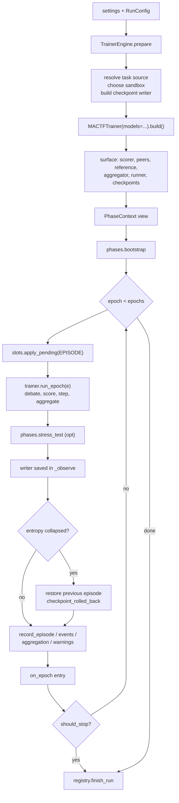

The engine owns **bookkeeping**; the trainer owns **training**. That split is why the
adapter is ~350 lines and not a second orchestrator.

```python
# mactf/orchestration/engine.py
"""The ``TrainerEngine`` adapter: ``MACTFTrainer`` behind the ``Orchestrator`` surface.

Section 13 of document 17. Three rules govern every line below:

1. The trainer trains; the engine records. No gradient, loss, weight or temperature
   arithmetic happens here.
2. Everything that can fail fails in ``prepare``, before ``registry.start_run`` writes a
   ``running`` row, exactly as ``Orchestrator.prepare`` does (``orchestrator.py:91-177``).
3. Where the orchestrator and the trainer disagree about *bookkeeping*, the engine
   reproduces the orchestrator unless a documented switch says otherwise (13.8).
"""

from __future__ import annotations

import logging
import time
import uuid
from pathlib import Path
from typing import Any, Callable, Mapping, Sequence

import torch

from .. import signals
from ..conf_files import is_authored
from ..coopetition.aggregation import feasible_bounds
from ..db import Registry, ensure_registry
from ..exceptions import ContractError, ImproperlyConfigured
from ..runtime import Runtime, load_checkpoint
from ..sandbox.detect import build_spec, choose_provider
from ..scoring.normalize import CohortNormalizer
from ..training.callbacks import Callback
from ..training.trainer import MACTFTrainer
from .checkpoint import CheckpointRecord, should_rollback
from .checkpoint_v2 import CheckpointContext, MACTFCheckpoint
from .dispatch import ENGINE_TRAINER
from .episode import EpisodeRunner
from .orchestrator import RunConfig, _default_modules, planned_epochs
from .phases import PhaseContext, bootstrap, stress_test

log = logging.getLogger("mactf.orchestration.engine")

__all__ = ["CumulativeSignal", "EnginePhaseBridge", "TrainerEngine"]
```

#### 13.4.2 Construction, `prepare` and the feature gate

```python
class TrainerEngine:
    """Drive one ``MACTFTrainer`` and record the run like ``Orchestrator`` does.

    ``trainer=`` exists for tests and for the API's preview path: a caller that already
    built a trainer (with its own hooks, callbacks and optimizer plan) hands it over and
    the engine only adds bookkeeping.

    ``engine_name`` is a class attribute so ``dispatch.engine_of`` and the checkpoint's
    ``identity["engine"]`` agree without importing this module.
    """

    engine_name = ENGINE_TRAINER

    def __init__(
        self,
        settings: Any,
        *,
        modules: Mapping[str, Any] | None = None,
        registry: Registry | None = None,
        trainer: MACTFTrainer | None = None,
        task_source: Any | None = None,
        logger: Any | None = None,
    ) -> None:
        self.settings = settings
        self.run_id = uuid.uuid4().hex[:12]
        self.registry: Registry = registry or ensure_registry(settings)
        self.trainer: MACTFTrainer | None = trainer
        # -- the surface, filled by prepare() ------------------------------
        self.scorer: Any = getattr(trainer, "scorer", None)
        self.checkpoints: MACTFCheckpoint | None = getattr(trainer, "checkpoint", None)
        self.peers: dict[str, Any] = dict(getattr(trainer, "peers", {}) or {})
        self.reference: Any = getattr(trainer, "reference", None)
        self.aggregator: Any = getattr(trainer, "aggregator", None)
        self.runner: EpisodeRunner | None = getattr(trainer, "runner", None)
        self.context: PhaseContext | None = None
        self.sandbox_choice: Any = None
        self.startup_notes: list[str] = []
        self.started_at = 0.0
        # -- inputs ---------------------------------------------------------
        self._modules: dict[str, Any] = dict(modules) if modules else {}
        self._task_source = task_source
        self._logger = logger
        # -- run state ------------------------------------------------------
        self._prepared_config: RunConfig | None = None
        self._source: Any = None
        self._bridge: EnginePhaseBridge | None = None
        self._signal: CumulativeSignal | None = None
        self._rollbacks: list[dict[str, Any]] = []
        self._bootstrap: dict[str, Any] = {}
        self._regions: list[str] = []

    # -- convenience ------------------------------------------------------
    @property
    def tree(self) -> Any:
        """The trainer's ``PeerTree``, or ``None`` before ``prepare``."""
        return getattr(self.trainer, "tree", None)

    def attach_logger(self, logger: Any) -> None:
        """Give the trainer the run logger ``RunManager`` created (``live.py:751-757``).

        Assigned after ``build()`` on purpose: the trainer reads ``self.logger`` in
        ``_observe`` (``trainer.py:1924``), so a logger attached at any point after
        construction is used from the next epoch on and the log file is closed by
        ``trainer.close()``.
        """
        self._logger = logger
        if self.trainer is not None:
            self.trainer.logger = logger

    def capabilities(self) -> Any:
        """The trainer's capability record, for a caller that wants it from the engine."""
        trainer = self._require_trainer()
        return trainer.capabilities()

    def close(self) -> None:
        """Flush and release the trainer (idempotent, like ``RunManager.shutdown``)."""
        if self.trainer is not None:
            self.trainer.close()

    def describe(self) -> dict[str, Any]:
        """What the engine is, for a log line and for the API's run detail."""
        trainer = self.trainer
        return {
            "engine": self.engine_name,
            "run_id": self.run_id,
            "built": bool(getattr(trainer, "built", False)),
            "nodes": len(self.peers),
            "checkpoint_schema": 2 if isinstance(self.checkpoints, MACTFCheckpoint) else None,
            "compat": self._compat,
            "rollbacks": len(self._rollbacks),
        }

    # -- construction ------------------------------------------------------
    def prepare(self, config: RunConfig | None = None) -> PhaseContext:
        """Resolve the runtime, build the trainer, and surface what a driver reads."""
        config = config or RunConfig()
        settings = self.settings

        if config.device:
            settings["DEVICE"] = config.device
        if config.seed is not None:
            settings["SEED"] = config.seed
        if config.run_id:
            self.run_id = config.run_id

        training = settings["TRAINING"]
        self._refuse_unsupported(config)

        trainer = self.trainer
        if trainer is None:
            modules = self._modules or _default_modules(settings)
            names = list(modules)
            if config.peers is not None:
                names = names[: config.peers]
            if not names:
                raise ImproperlyConfigured(
                    "no peers configured; set PEERS in settings, pass modules to the engine, "
                    "or hand it a built trainer"
                )
            models = {name: modules[name] for name in names}
            source = self._build_task_source(config)
            self._source = source
            trainer = MACTFTrainer(
                models=models,
                settings=settings,
                task_source=source,
                checkpoint=self._build_checkpoint_writer(),
                logger=self._logger,
                strict=True,
            )
            trainer.run_id = self.run_id
            trainer.build()
            self.trainer = trainer
        else:
            trainer.run_id = self.run_id if not trainer.built else trainer.run_id
            trainer.build()
            self._source = trainer.task_source

        # The swarm the driver, the API and the phases read.
        self.scorer = trainer.scorer
        self.peers = trainer.peers
        self.reference = trainer.reference
        self.aggregator = trainer.aggregator
        self.runner = trainer.runner
        self.checkpoints = trainer.checkpoint
        feasible_bounds(
            len(self.peers),
            floor=float(settings["COOPETITION"]["WEIGHT_FLOOR"]),
            cap=float(settings["COOPETITION"]["WEIGHT_CAP"]),
        )

        self.sandbox_choice = self._choose_sandbox(config)
        if self.sandbox_choice is not None:
            self.startup_notes.append(self.sandbox_choice.describe())
        for note in trainer.failures:
            if note not in self.startup_notes:
                self.startup_notes.append(note)

        self.context = self._phase_context(trainer, config)
        self._install_hooks(trainer, self.context)
        self._regions = ["trainer:" + path for path in sorted(self.peers)]
        self._prepared_config = config
        return self.context
```

`_refuse_unsupported` is the honesty gate (**T9**). The trainer has no distributed
bridge: `phases.local_update` hands over to `context.distributor` when the app is
installed (`phases.py:339-341`), and a `MACTFTrainer` epoch never consults it. Running one
with the other silently installed would train locally while the API reported workers.

```python
    def _refuse_unsupported(self, config: RunConfig) -> None:
        """Refuse a configuration the trainer cannot honour (``E092``), at prepare."""
        apps = list(self.settings.get("INSTALLED_APPS") or [])
        if any(str(app).startswith("mactf.distributed") for app in apps):
            raise ImproperlyConfigured(
                "E092: ORCHESTRATOR.ENGINE='trainer' cannot run with mactf.distributed "
                "installed: MACTFTrainer has no distributor bridge, so a worker cohort "
                "would be reported by the API and never used. Use ENGINE='orchestrator' "
                "for a distributed run."
            )
        if self.trainer is not None and config.peers is not None:
            if int(config.peers) != len(self.trainer.peers):
                raise ImproperlyConfigured(
                    f"E092: a pre-built trainer has {len(self.trainer.peers)} nodes but "
                    f"RunConfig.peers={config.peers}; build the trainer with the peers you mean"
                )
```

`_compat` reads the switch **T6** depends on:

```python
    @property
    def _compat(self) -> bool:
        """``ORCHESTRATOR.ENGINE_COMPAT``: reproduce the orchestrator's signal window."""
        value = self._block("ORCHESTRATOR").get("ENGINE_COMPAT", True)
        return bool(value)
```

#### 13.4.3 The parity helpers (duplicated from `Orchestrator`, on purpose)

Four small helpers are duplicated rather than extracted, because extracting them would
mean editing `Orchestrator` (decision **D1**) and because each is a *policy* that the two
engines must share, not a utility. `tests/components/test_engine_parity.py` (13.9, row 6)
asserts the two produce equal values for the same settings, so a drift is a red test, not
a surprise.

```python
    # -- mirrors of orchestrator.py:179-274, kept equal by test_engine_parity ------
    def _block(self, name: str) -> dict[str, Any]:
        """A settings block, or ``{}`` when absent or not a mapping (``orchestrator.py:179``)."""
        block = self.settings.get(name, {}) if hasattr(self.settings, "get") else {}
        return dict(block) if isinstance(block, dict) else {}

    def _task_name(self, config: RunConfig) -> str | None:
        """``RunConfig.task_source``, then ``ORCHESTRATOR.TASK_SOURCE``, then ``TRAINING.TASK``."""
        configured = self._block("ORCHESTRATOR").get("TASK_SOURCE")
        return (
            config.task_source
            or (str(configured) if configured else None)
            or self.settings["TRAINING"].get("TASK")
        )

    def _build_task_source(self, config: RunConfig) -> Any:
        """Resolve the task source with the same degradation rule the orchestrator uses.

        ``orchestrator.py:230-249``: a source that cannot be built from real data falls
        back to the synthetic generator with a note, because a run launched for another
        reason must not fail on a missing dataset directory.
        """
        from ..data.registry import build_source

        name = self._task_name(config) or "synthetic"
        try:
            return build_source(str(name), settings=self.settings)
        except Exception as exc:  # noqa: BLE001 - degraded, recorded, not silent
            message = f"task source {name!r} unavailable ({exc}); using synthetic"
            self.startup_notes.append(message)
            log.warning(message)
            return build_source("synthetic", settings=self.settings)

    def _choose_sandbox(self, config: RunConfig) -> Any:
        """``orchestrator.py:250-274``: choose a provider, and never fail a run over it."""
        del config  # the choice does not depend on the run config; kept for signature parity
        sandbox_settings = self.settings["SANDBOX"]
        try:
            choice = choose_provider(
                requested=str(sandbox_settings.get("PROVIDER", "auto")),
                isolation=sandbox_settings.get("ISOLATION", "hardware"),
                settings=sandbox_settings,
            )
        except Exception as exc:  # noqa: BLE001 - sandbox is optional for training
            self.startup_notes.append(f"sandbox unavailable: {exc}")
            return None
        if choice.degraded:
            message = (
                f"hardware isolation requested but running at {choice.report.isolation.label}: "
                + "; ".join(choice.reasons)
            )
            self.startup_notes.append(message)
            signals.integrity_incident.send(sender=self, reason=message)
            log.warning(message)
        build_spec(
            "swarm",
            settings=sandbox_settings,
            root=self.settings.path("ROOT"),
        )
        return choice

    def _build_checkpoint_writer(self) -> MACTFCheckpoint | None:
        """The v2 writer this run uses, or ``None`` when the project has no directory.

        ``CHECKPOINT.DIR`` (when authored) is resolved against ``ROOT``; otherwise
        ``PATHS["CHECKPOINTS"]``. The writer is given the registry, so every
        ``save`` also writes the ``checkpoints`` row the API lists
        (``checkpoint_v2.py:725-746``) -- the engine never calls ``record_checkpoint``
        itself, which is what keeps the two in step.
        """
        block = self._block("CHECKPOINT") if is_authored(self.settings, "CHECKPOINT") else {}
        directory = block.get("DIR")
        target: Path | None = None
        if directory:
            candidate = Path(str(directory)).expanduser()
            if not candidate.is_absolute():
                candidate = self.settings.path("ROOT") / candidate
            target = candidate
        try:
            return MACTFCheckpoint.from_settings(
                self.settings,
                run_id=self.run_id,
                directory=target,
                registry=self.registry,
            )
        except ImproperlyConfigured:
            if target is not None:
                raise  # the project named a directory; do not hide a bad path
            return None
```

#### 13.4.4 The `PhaseContext` view

`phases.bootstrap` reads `context.peers`, `reference`, `runtime`, `source` and
`training_settings` (`phases.py:126-147`); `phases.stress_test` reads `peers`, `scorer`
and `metrics` (`phases.py:437-455`); `mactf redteam`'s injectors read `scorer` and
`metrics` too. One real `PhaseContext` serves all three.

```python
    def _phase_context(self, trainer: MACTFTrainer, config: RunConfig) -> PhaseContext:
        """A live view over the trainer, in the shape the phase functions expect."""
        runtime = trainer.runtime
        if runtime is None:  # pragma: no cover - build() always resolves one
            raise ContractError("the trainer has no runtime after build()")
        training = dict(self.settings["TRAINING"])
        coopetition = dict(self.settings["COOPETITION"])
        return PhaseContext(
            run_id=self.run_id,
            epoch=0,
            peers=trainer.peers,
            reference=trainer.reference,
            scorer=trainer.scorer,
            runner=trainer.runner,
            runtime=runtime,
            metrics={
                "task_source": type(trainer.task_source).__name__,
                "engine": ENGINE_TRAINER,
            },
            source=trainer.task_source,
            signal_source=str(coopetition.get("SIGNAL_SOURCE", "final_score")).lower(),
            normalization=dict(coopetition.get("NORMALIZATION") or {}),
            training_settings=training
            | {"SEED": int(self.settings["SEED"]), "TASK": self._task_name(config)},
        )

    def _sync_context(self, trainer: MACTFTrainer) -> PhaseContext:
        """Re-point the view at the trainer's live containers before every epoch.

        A tree mutation (section 12) rebinds ``trainer.peers``, ``reference`` and
        ``runner``; the context the driver holds must follow, or ``mactf redteam``
        would score against the pre-mutation swarm.
        """
        context = self.context
        if context is None:  # pragma: no cover - prepare() sets it
            raise ContractError("_sync_context needs prepare() to have run")
        context.peers = trainer.peers
        context.reference = trainer.reference
        context.scorer = trainer.scorer
        context.runner = trainer.runner
        context.runtime = trainer.runtime or context.runtime
        context.source = trainer.task_source
        self.peers = trainer.peers
        self.reference = trainer.reference
        self.scorer = trainer.scorer
        self.runner = trainer.runner
        self.aggregator = trainer.aggregator
        return context

    def _require_trainer(self) -> MACTFTrainer:
        if self.trainer is None:
            raise ContractError("the engine has no trainer; call prepare() first")
        return self.trainer
```

#### 13.4.5 `run` and the epoch loop

```python
    # -- execution ---------------------------------------------------------
    def run(
        self,
        config: RunConfig | None = None,
        *,
        should_stop: Callable[[], bool] | None = None,
        on_epoch: Callable[[dict[str, Any]], None] | None = None,
    ) -> dict[str, Any]:
        """Drive ``trainer.run_epoch`` to completion or to ``should_stop``.

        ``should_stop`` is polled at the epoch boundary only (T8), after the epoch's
        rows are durable, so a cancel never interrupts a torch operation and never
        leaves an optimizer half-stepped.
        """
        config = config or RunConfig()
        if self.context is not None and self._prepared_config is config:
            context = self.context
        else:
            context = self.prepare(config)
        trainer = self._require_trainer()
        epochs = planned_epochs(self.settings, config)

        self.started_at = time.time()
        runtime_info = context.runtime.describe()
        row_settings: dict[str, Any] = {
            "device": self.settings["DEVICE"],
            "epochs": epochs,
            # Additive and diagnostic: a run row written by ``Orchestrator`` has no
            # ``engine`` key, which is exactly how ``_check_identity`` reads it.
            "engine": self.engine_name,
        }
        self.registry.start_run(
            self.run_id,
            settings=row_settings,
            runtime=runtime_info,
            sandbox=self.sandbox_choice.report.as_dict() if self.sandbox_choice else None,
            notes="; ".join(self.startup_notes),
        )
        try:
            return self._run_epochs(
                config,
                context,
                epochs,
                runtime_info,
                should_stop=should_stop,
                on_epoch=on_epoch,
            )
        except BaseException as exc:
            try:
                self.registry.finish_run(
                    self.run_id, status="failed", notes=f"{type(exc).__name__}: {exc}"[:500]
                )
            except Exception:  # noqa: BLE001 - never mask the original failure
                log.exception("could not mark run %s as failed", self.run_id)
            raise

    def _run_epochs(
        self,
        config: RunConfig,
        context: PhaseContext,
        epochs: int,
        runtime_info: dict[str, Any],
        *,
        should_stop: Callable[[], bool] | None = None,
        on_epoch: Callable[[dict[str, Any]], None] | None = None,
    ) -> dict[str, Any]:
        trainer = self._require_trainer()
        training = self.settings["TRAINING"]

        if config.dry_run:
            summary = {
                "run_id": self.run_id,
                "status": "dry_run",
                "runtime": runtime_info,
                "peers": list(self.peers),
                "sandbox": self.sandbox_choice.describe() if self.sandbox_choice else "none",
                "notes": list(self.startup_notes),
                "engine": self.engine_name,
            }
            self.registry.finish_run(self.run_id, status="dry_run")
            return summary

        start_epoch = 0
        if config.resume_from is not None:
            start_epoch = self._resume(config)

        # The orchestrator's first phase, run for the same reason and by the same
        # function: the two engines must prime the swarm identically (T6, 13.8.2).
        self._bootstrap = dict(bootstrap(context, enabled=bool(training["BOOTSTRAP"])) or {})

        history: list[dict[str, Any]] = []
        cancelled = False
        completed_epochs = 0
        max_entropy = float(torch.log(torch.tensor(float(max(1, len(self.peers))))).item())

        for epoch in range(start_epoch, epochs):
            context.epoch = epoch
            self._sync_context(trainer)
            self._apply_boundary(trainer)

            start = time.time()
            reports_before = len(trainer.reports)
            trainer.run_epoch(epoch)

            card = trainer.scorecards[-1]
            fresh = trainer.reports[reports_before:]
            report = fresh[-1] if fresh else None

            if config.redteam if config.redteam is not None else bool(training["REDTEAM"]):
                stress_test(context)

            score = sum(card.scores.values()) / max(1, len(card.scores))
            record = self._epoch_checkpoint(trainer, epoch)
            self._maybe_rollback(trainer, record, report, epoch, training, max_entropy)
            self._record_episode(epoch, card, report)

            report = self._epoch_report(trainer, report)
            entry = {
                "epoch": epoch,
                "duration": time.time() - start,
                "scorecards": card.to_dict(),
                "signal_by_peer": dict(trainer.signal_by_peer),
                "kappa": float(report.kappa) if report is not None else self._kappa(trainer),
                "entropy": float(report.entropy) if report is not None else self._entropy(trainer),
                "weights": dict(report.weights) if report is not None else {},
                "adjustments": list(report.adjustments) if report is not None else [],
                "score": score,
                "engine": self.engine_name,
            }
            history.append(entry)
            completed_epochs += 1
            log.info(
                "epoch %d kappa=%.4f entropy=%.4f score=%.4f",
                epoch,
                entry["kappa"],
                entry["entropy"],
                score,
            )
            if on_epoch is not None:
                on_epoch(entry)
            if should_stop is not None and should_stop():
                cancelled = True
                break

        status = "cancelled" if cancelled else "completed"
        self.registry.finish_run(
            self.run_id,
            status=status,
            kappa=self._kappa(trainer),
            entropy=self._entropy(trainer),
        )
        return {
            "run_id": self.run_id,
            "status": status,
            "epochs": epochs,
            "epochs_completed": completed_epochs,
            "runtime": runtime_info,
            "peers": list(self.peers),
            "history": history,
            "notes": list(self.startup_notes),
            "engine": self.engine_name,
            "bootstrap": dict(self._bootstrap),
            "rollbacks": list(self._rollbacks),
        }

    # -- small readers ------------------------------------------------------
    @staticmethod
    def _kappa(trainer: MACTFTrainer) -> float:
        controller = trainer.controller
        return float(controller.kappa) if controller is not None else 0.0

    @staticmethod
    def _entropy(trainer: MACTFTrainer) -> float:
        controller = trainer.controller
        return float(controller.entropy) if controller is not None else 0.0

    @staticmethod
    def _epoch_report(trainer: MACTFTrainer, report: Any) -> Any:
        """The report the epoch produced, or the trainer's cached one.

        ``_coordinate`` may legitimately return ``None`` (a strategy that does not
        aggregate this epoch, ``trainer.py:1843-1859``). The trainer still stores the
        last report in ``_epoch_report``; the engine prefers the epoch's own report and
        falls back to that, so the SSE ``epoch`` event keeps its ``kappa`` field.
        """
        if report is not None:
            return report
        return getattr(trainer, "_epoch_report", None)
```

`_apply_boundary` is the one line section 4.4 assigns to the engine: queued component
swaps are applied once per episode, *before* the epoch that will use them.

```python
    def _apply_boundary(self, trainer: MACTFTrainer) -> None:
        """Apply queued component swaps at the episode boundary (section 4.4)."""
        slots = getattr(trainer, "slots", None)
        apply_pending = getattr(slots, "apply_pending", None)
        if slots is None or not callable(apply_pending):
            return
        from ..components.kinds import Boundary

        for record in apply_pending(Boundary.EPISODE):
            log.info(
                "slot %s: %s -> %s at episode %d",
                record.slot, record.from_name, record.to_name, int(record.episode),
            )
```

#### 13.4.6 Checkpoint and rollback

The trainer writes the epoch's checkpoint inside `_observe` (`trainer.py:1929-1943`), so
the engine does not write a second one. It *finds* that record and decides about the
rollback, which is the only piece of the orchestrator's checkpoint logic the engine keeps
(`orchestrator.py:390-413`).

```python
    # -- checkpoint ---------------------------------------------------------
    def _epoch_checkpoint(self, trainer: MACTFTrainer, epoch: int) -> CheckpointRecord | None:
        """The record this epoch wrote, or ``None`` when the epoch wrote none.

        A run with ``TRAINING.CHECKPOINT_EVERY = 2`` writes on odd epochs only; the
        rollback check must not fire on an epoch that has no snapshot of its own.
        """
        writer = trainer.checkpoint
        latest = getattr(writer, "latest", None)
        if writer is None or not callable(latest):
            return None
        record = latest()
        if record is None or int(record.episode) != int(epoch):
            return None
        return record

    def _previous_record(self, writer: MACTFCheckpoint, epoch: int) -> CheckpointRecord | None:
        """The newest valid record strictly older than ``epoch``."""
        older = [record for record in writer.list() if int(record.episode) < int(epoch)]
        return older[-1] if older else None

    def _maybe_rollback(
        self,
        trainer: MACTFTrainer,
        record: CheckpointRecord | None,
        report: Any,
        epoch: int,
        training: Mapping[str, Any],
        max_entropy: float,
    ) -> None:
        """``orchestrator.py:390-413``, with the trainer's full v2 restore.

        ``should_rollback`` is the same function and the same arguments as the
        orchestrator's, so the two engines roll back at the same epoch for the same
        reason. What they restore differs (D-13.2): the orchestrator's v1 restore has
        peers, the reference and the controller in it, while the trainer's v2 restore
        also has the optimizers, the RNG state and the data position -- which is what a
        run that continues after a rollback actually needs.
        """
        if record is None or report is None:
            return
        rollback, reason = should_rollback(
            entropy=report.entropy,
            max_entropy=max_entropy,
            collapse_ratio=float(training["ENTROPY_COLLAPSE_RATIO"]),
            fallback=report.fallback,
            enabled=bool(training["ROLLBACK_ON_ENTROPY_COLLAPSE"]),
        )
        if not rollback:
            return
        writer = trainer.checkpoint
        if not isinstance(writer, MACTFCheckpoint):
            return
        previous = self._previous_record(writer, epoch)
        if previous is None:
            self.startup_notes.append(
                f"rollback wanted at epoch {epoch} ({reason}) but no earlier checkpoint exists"
            )
            return
        payload = writer.load(previous.episode)
        writer.restore(payload, trainer=trainer, strict=trainer.strict)
        signals.checkpoint_rolled_back.send(
            sender=self, reason=reason, episode=previous.episode
        )
        self.startup_notes.append(f"rollback at epoch {epoch}: {reason}")
        self._rollbacks.append(
            {"epoch": epoch, "restored": int(previous.episode), "reason": str(reason)}
        )
        log.warning("epoch %d rolled back to episode %d: %s", epoch, previous.episode, reason)
```

#### 13.4.7 Rows, events and warnings

These three methods are transcriptions of `orchestrator.py:574-619`, with the trainer's
containers as the source. The registry API is unchanged, so a query written for an
orchestrator run returns the same shapes for a trainer run.

```python
    # -- persistence --------------------------------------------------------
    def _record_episode(self, epoch: int, card: Any, report: Any) -> None:
        """``orchestrator.py:574-597``: the episode, the report, the events, the warnings."""
        context = self.context
        if context is None:  # pragma: no cover - prepare() sets it
            raise ContractError("_record_episode needs prepare() to have run")
        context.scorecards.append(card)
        trainer = self._require_trainer()
        if trainer.episodes:
            context.episodes.append(trainer.episodes[-1])
        if report is not None:
            context.reports.append(report)

        normalization = None
        recorded_report = report
        if context.signal_source == "points":
            # Kept bug-for-bug: the orchestrator replaces ``report`` with the
            # normalization report here and then writes it into the aggregation slot
            # (``orchestrator.py:577-582``). See Q-13.2.
            recorded_report = context.normalization_report()
            normalization = recorded_report.as_dict() if recorded_report is not None else None
        self.registry.record_episode(
            self.run_id, epoch, card.to_dict(), normalization=normalization
        )
        if recorded_report is not None:
            self.registry.record_aggregation(self.run_id, epoch, recorded_report)

        episode = trainer.episodes[-1] if trainer.episodes else None
        for peer in card.peers:
            ledger = (
                episode.participants[peer].ledger
                if episode is not None and peer in episode.participants
                else None
            )
            events = [
                {
                    "rule_id": event.rule_id,
                    "magnitude": event.magnitude,
                    "severity": event.resolved_severity().label,
                    "evidence": event.evidence,
                    "source": event.source,
                }
                for event in (ledger or ())
            ]
            self.registry.record_events(self.run_id, epoch, peer, events)
            self._persist_warnings(epoch, peer)

    def _persist_warnings(self, epoch: int, peer: str) -> None:
        """``orchestrator.py:599-619``: active and expired warning records."""
        registry = self.scorer.registry_for(peer)
        for rule_id, records in registry.all_active(peer).items():
            for record in records:
                self.registry.record_warning(self.run_id, peer, record)
        for rule_id, records in registry._warnings.get(peer, {}).items():
            for record in records:
                if record.active:
                    continue
                if record.expiry_episode > epoch:
                    continue
                self.registry.record_warning(self.run_id, peer, record)
                self.registry.expire_warning(
                    self.run_id, peer, rule_id, record.episode, expired_at=time.time()
                )
```

`registry._warnings` is private and is reached from `orchestrator.py:610` already; the
engine uses the same field so the two write the same rows. Section 14 (persistence) files
this as **Q-13.3**: the warning registry should expose the expired records it writes;
until then the two engines share the private access and one test
(`test_engine_warning_rows_match`) compares their rows.

#### 13.4.8 Resume

```python
    # -- resume -------------------------------------------------------------
    def _resume(self, config: RunConfig) -> int:
        """``orchestrator.py:465-542`` for a v2 checkpoint and a live trainer."""
        trainer = self._require_trainer()
        writer = trainer.checkpoint
        if not isinstance(writer, MACTFCheckpoint):
            raise ImproperlyConfigured(
                "resume_from needs a writable CHECKPOINT directory; set CHECKPOINT.DIR or "
                "PATHS['CHECKPOINTS'], or pass a trainer with a checkpoint writer"
            )
        restored_episode: int | None = None
        source = config.resume_from
        explicit: Path | None = None

        if source is True:
            configured = self._block("ORCHESTRATOR").get("RESUME_FROM")
            if configured:
                target = Path(str(configured)).expanduser()
                if not target.is_absolute():
                    target = self.settings.path("ROOT") / target
                if target.is_dir():
                    writer = MACTFCheckpoint.from_settings(
                        self.settings, run_id=self.run_id, directory=target,
                        registry=self.registry,
                    )
                    trainer.checkpoint = writer
                    self.checkpoints = writer
                    self.startup_notes.append(
                        f"resume directory from ORCHESTRATOR.RESUME_FROM: {target}"
                    )
                else:
                    source = target

        if source is True or source is None:
            record = writer.latest()
            if record is not None:
                restored_episode = int(record.episode)
            elif source is True:
                self.startup_notes.append(
                    f"W051: no valid checkpoint under {writer.directory}; the run starts at epoch 0"
                )
        else:
            explicit = Path(source)
            if explicit.is_dir():
                writer = MACTFCheckpoint.from_settings(
                    self.settings, run_id=self.run_id, directory=explicit,
                    registry=self.registry,
                )
                trainer.checkpoint = writer
                self.checkpoints = writer
                record = writer.latest()
                restored_episode = int(record.episode) if record is not None else None
            elif explicit.exists():
                payload = load_checkpoint(explicit)
                restored_episode = int(payload.get("episode", 0))
                self._restore(trainer, payload, where=explicit)
                self.startup_notes.append(f"resumed from {explicit.name}")
            else:
                raise ImproperlyConfigured(f"resume_from path does not exist: {explicit}")

        if source is True and restored_episode is not None:
            payload = writer.load(restored_episode)
            self._restore(trainer, payload, where=writer.path_for(restored_episode))
            self.startup_notes.append(f"resumed from episode {restored_episode}")

        restored_warnings = 0
        for peer in self.peers:
            restored_warnings += self.registry.restore_warnings(
                self.run_id, self.scorer.registry_for(peer), peer=peer
            )
        start_epoch = 0 if restored_episode is None else restored_episode + 1
        self.registry.record_resume_report(
            self.run_id,
            checkpoint_episode=restored_episode,
            started_epoch=start_epoch,
            warning_count=restored_warnings,
            report={
                "source": str(source),
                "warnings_restored": restored_warnings,
                "engine": self.engine_name,
                "notes": list(self.startup_notes),
            },
        )
        if restored_warnings:
            self.startup_notes.append(f"restored {restored_warnings} warning record(s)")
        return start_epoch

    def _restore(self, trainer: MACTFTrainer, payload: Any, *, where: Path) -> None:
        """Check the engine identity (``E091``) and restore through the trainer.

        ``MACTFTrainer.load_state_dict`` restores in the v2 order and then applies the
        trainer-owned sections (strategy, callbacks, distillation) -- which is exactly
        what a resume of a customized run needs (section 14).
        """
        self._check_identity(payload, where=where)
        trainer.load_state_dict(payload, strict=trainer.strict)

    def _check_identity(self, payload: Any, *, where: Path) -> None:
        """Refuse to continue another engine's run unless the project opted in (**T5**).

        ``identity["engine"]`` is written by section 14. A checkpoint without the key was
        written by ``Orchestrator`` (whose ``CheckpointManager`` payloads have no
        identity at all), which is the documented default.
        """
        identity = (
            dict(payload.get("identity") or {})
            if isinstance(payload, Mapping)
            else dict(getattr(payload, "identity", {}) or {})
        )
        recorded = str(identity.get("engine") or "orchestrator").strip().lower()
        if recorded == self.engine_name:
            return
        allowed = bool(self._block("ORCHESTRATOR").get("ALLOW_ENGINE_SWITCH", False))
        if not allowed:
            raise ImproperlyConfigured(
                f"E091: {where} was written by the {recorded} engine, but this run uses "
                f"{self.engine_name!r}. Set ORCHESTRATOR.ALLOW_ENGINE_SWITCH: true to "
                "continue it under the other engine (the parameters, optimizers and "
                "warnings are compatible; the epoch bookkeeping is not resumed)."
            )
        self.startup_notes.append(
            f"W050: continued a {recorded} checkpoint under the {self.engine_name} engine"
        )
```

#### 13.4.9 The two hooks

```python
    def _install_hooks(self, trainer: MACTFTrainer, context: PhaseContext) -> None:
        """Attach the phase bridge once, and the compat signal window when enabled."""
        if self._bridge is None:
            self._bridge = EnginePhaseBridge(self)
            trainer.add_callback(self._bridge)
        if self._compat and self._signal is None:
            self._signal = CumulativeSignal(trainer, context.signal_source)
            trainer.add_callback(self._signal)
```

`add_callback` raises `ValidationError` for a duplicate name
(`callbacks.py:121-124`), which is why the two guards exist: `prepare` may be called
twice (the driver calls it, then `run` sees the same `config` object and reuses the
context, `orchestrator.py:295-300`).

---

### 13.5 Dispatch, configuration and exports

#### 13.5.1 `ORCHESTRATOR_DEFAULTS` (`mactf/conf.py:158-169`)

```python
ORCHESTRATOR_DEFAULTS: dict[str, Any] = {
    # Which task source the run uses. None defers to TRAINER.TASK.
    "TASK_SOURCE": None,
    # Stop after this many epochs. None defers to TRAINER.EPOCHS.
    "MAX_EPOCHS": None,
    # Where a resumed run looks when --resume names no file.
    "RESUME_FROM": None,
    # Print the startup notes (path resolution, conf/ notes).
    "ANNOUNCE": True,
    # Validated but not read: see document 15 section 7.3.
    "PAUSE_IS_FATAL": False,
    # Document 17 section 13: which class runs the epochs.
    "ENGINE": "orchestrator",
    # Document 17 section 13.8: reproduce the orchestrator's cumulative signal window.
    "ENGINE_COMPAT": True,
    # Allow ``--resume`` to continue a checkpoint written by the other engine (E091).
    "ALLOW_ENGINE_SWITCH": False,
}
```

and the validation, inside `_validate_blocks`'s `orchestrator` branch
(`conf.py:835-849`), so a typo fails at settings load, before a model exists:

```python
    orchestrator = dict(settings.get("ORCHESTRATOR") or {})
    if orchestrator:
        from .orchestration.dispatch import ENGINES  # torch-free, so settings stay torch-free

        engine = str(orchestrator.get("ENGINE", "orchestrator") or "orchestrator").strip().lower()
        if engine not in ENGINES:
            raise ImproperlyConfigured(
                f"E090: ORCHESTRATOR.ENGINE must be one of {list(ENGINES)}, got "
                f"{orchestrator.get('ENGINE')!r}"
            )
        for key in ("ENGINE_COMPAT", "ALLOW_ENGINE_SWITCH"):
            if key in orchestrator and not isinstance(orchestrator[key], bool):
                raise ImproperlyConfigured(
                    f"ORCHESTRATOR.{key} must be true or false, got {orchestrator[key]!r}"
                )
        epochs = orchestrator.get("MAX_EPOCHS")
        # ... the existing MAX_EPOCHS / RESUME_FROM checks follow unchanged ...
```

`from .orchestration.dispatch import ENGINES` is safe in `conf.py`: `dispatch.py` imports
`mactf.exceptions` and the standard library only, and imports a class lazily, so the
"every command loads settings without torch" rule (`conf.py:704-707`) holds. The import
sits inside the branch so a settings load with no `ORCHESTRATOR` block does not touch
`mactf.orchestration` at all.

#### 13.5.2 `mactf/orchestration/__init__.py`

```python
_EXPORTS: dict[str, str] = {
    # ... existing entries ...
    "Engine": "dispatch",
    "ENGINES": "dispatch",
    "ENGINE_ORCHESTRATOR": "dispatch",
    "ENGINE_TRAINER": "dispatch",
    "engine_factory": "dispatch",
    "engine_for": "dispatch",
    "engine_name": "dispatch",
    "engine_of": "dispatch",
    "TrainerEngine": "engine",
}

if TYPE_CHECKING:  # pragma: no cover - static analysers see the real imports
    # ... existing imports ...
    from .dispatch import (
        ENGINES,
        ENGINE_ORCHESTRATOR,
        ENGINE_TRAINER,
        Engine,
        engine_factory,
        engine_for,
        engine_name,
        engine_of,
    )
    from .engine import TrainerEngine
```

Because the table is resolved through `_lazy`, `from mactf.orchestration import
engine_factory` still imports no torch, and `from mactf.orchestration import
TrainerEngine` imports it only when asked for.

#### 13.5.3 What a project writes

```yaml
ORCHESTRATOR:
  ENGINE: trainer            # the customizable engine (document 17)
  MAX_EPOCHS: 20
TRAINER:
  PEER_STRATEGY: cooperative # real since section 11; ignored by Orchestrator, W002
  WEIGHT_UPDATE: score_weighted
```

```bash
mactf run --epochs 20 --set ORCHESTRATOR.ENGINE=trainer
MACTF_ORCHESTRATOR__ENGINE=trainer mactf run --epochs 20   # --set wins over env
```

and the reverse, to compare the two engines on one project without editing a file:

```bash
mactf run --epochs 3 --seed 1337 --set ORCHESTRATOR.ENGINE=trainer --run-id t3
mactf run --epochs 3 --seed 1337 --set ORCHESTRATOR.ENGINE=orchestrator --run-id o3
mactf runs compare o3 t3        # document 16's comparison view; same columns, same rows
```

---

### 13.6 Driver and run-manager integration

#### 13.6.1 `RunDriver.execute` (`mactf/management/driver.py:175-190`)

```python
    def execute(self, plan: RunPlan, *, timeout: float | None = None, on_interrupt: str = "pause",
                log_path: Path | str | None = None, log_enabled: bool = True,
                after: Callable[[Any], Mapping[str, Any] | None] | None = None,
                label: str = "run") -> DriveResult:
        from ..orchestration.dispatch import engine_factory
        from ..orchestration.runlock import RunLock, lock_directory
        from .interrupt import StopFlag

        lock = RunLock(lock_directory(self.settings), plan.run_id, owner="cli")
        with lock, StopFlag(timeout=timeout, announce=self.out.warn) as stop:
            engine = engine_factory(self.settings)      # was: Orchestrator(self.settings)
            self._recheck(plan, engine.registry)
            engine.prepare(plan.config)                 # raises before any row is written
            logger, log_file = self._open_log(plan, log_path, log_enabled)
            try:
                return self._drive(plan, engine, lock, stop, logger, log_file,
                                   on_interrupt, after, label)
            finally:
                if logger is not None:
                    logger.close()
```

`_drive` and `_settle` take `engine` instead of `orchestrator`; their bodies are
unchanged except for the two places that read it (`engine.registry`, and
`after(engine)` at `:329`). `_drive`'s `on_epoch` closure is unchanged, so the CLI's
per-epoch line prints for a trainer run exactly as it does for an orchestrator run --
the entry dict has the same keys (13.4.5), plus `engine`, which the printer ignores.

#### 13.6.2 `RunManager` (`mactf/orchestration/live.py`)

Four edits.

**(a) The factory** (`:473-474`):

```python
    def _default_factory(self, settings: Settings, registry: Registry) -> Any:
        """The configured engine, built with this manager's modules and registry."""
        from .dispatch import engine_factory

        return engine_factory(settings, registry, modules=self.modules)
```

**(b) Context propagation** (`:669-675`) -- gap **E-G8**:

```python
    def _spawn(self, handle: RunHandle) -> None:
        """Start the run thread *inside the caller's context*.

        ``contextvars`` reaches an ``asyncio`` task automatically but not a new
        ``threading.Thread``. The component overlay of section 3.5 (and the request's
        identity, if an app installed one) lives in a ``ContextVar``; without this
        capture a trainer run started from an API request would lose the overlay that
        registered its components and fail at the first ``resolve``.
        """
        ctx = contextvars.copy_context()
        thread = threading.Thread(
            target=ctx.run,
            args=(self._run, handle),
            name=f"mactf-run-{handle.run_id}",
            daemon=True,
        )
        handle.thread = thread
        handle.done.clear()
        thread.start()
```

`contextvars` joins the module's imports (`live.py:17-26`). The context is captured
per spawn, so `start` and `resume` each get a fresh, unentered copy -- a `Context` may
only be entered once at a time, and a resumed run is a new thread.

**(c) The handle** (`:359-417`): `orchestrator` is widened and gains an alias, so new
code can say what it means while `handle.orchestrator` keeps working for the API views:

```python
        #: The engine driving this run: an ``Orchestrator`` or a ``TrainerEngine``
        #: (document 17 section 13). The name is historical; it is not always an
        #: orchestrator.
        self.orchestrator: Any = None

    @property
    def engine(self) -> Any:
        """The same object under the name section 13 uses."""
        return self.orchestrator
```

**(d) The run thread** (`:744-781`): attach the trainer so the observability routes and
`tree()` see it, hand the run logger to it, and close it on the way out.

```python
    def _execute(self, handle: RunHandle) -> None:
        engine = handle.orchestrator
        assert engine is not None
        config = handle.config
        if "logger" not in handle.components:
            from ..training.logging import MACTFLogger

            handle.components["logger"] = MACTFLogger(
                self.settings, run_id=handle.run_id, sinks=[], async_write=False, level="DEBUG"
            )
        if handle.cancel_requested:
            self._finish(handle, RunState.CANCELLED, {"epochs_completed": 0})
            return
        try:
            engine.prepare(config)
        except Exception as exc:  # noqa: BLE001
            self._fail(handle, exc)
            return
        # A trainer run exposes its trainer, so ``/runs/{id}/tree`` and the
        # observability routes read the live object instead of a flat copy.
        trainer = getattr(engine, "trainer", None)
        if trainer is not None:
            handle.components.setdefault("trainer", trainer)
        attach = getattr(engine, "attach_logger", None)
        if callable(attach):
            attach(handle.components["logger"])
        self._transition(handle, RunState.RUNNING)
        self._publish(handle.run_id, "run", {"status": "running"})
        try:
            summary = engine.run(
                config, should_stop=handle.should_stop,
                on_epoch=lambda entry: self._on_epoch(handle, entry),
            )
        except BaseException as exc:  # noqa: BLE001
            self._fail(handle, exc, already_recorded=True)
            return
        finally:
            close = getattr(engine, "close", None)
            if callable(close):
                try:
                    close()
                except Exception:  # noqa: BLE001 - shutdown never fails a finished run
                    logger.debug("could not close the %s engine", type(engine).__name__, exc_info=True)
        handle.summary = {k: v for k, v in summary.items() if k != "history"}
        handle.epochs_completed = int(summary.get("epochs_completed", handle.epochs_completed) or 0)
        status = RunState(summary.get("status", "completed"))
        if status is RunState.CANCELLED and handle.pause_requested and not handle.cancel_requested:
            self._pause(handle)
        else:
            self._finish(handle, status, summary)
```

and `tree()` (`:547-567`) prefers the engine's own tree:

```python
    def tree(self, run_id: str) -> Any | None:
        """The live ``PeerTree`` for a run the manager holds, else ``None``.

        A trainer engine's tree wins: it is the object mutations change (section 12),
        so a hierarchy, its statuses and its retired set are the truth. Otherwise the
        attached trainer's tree, and otherwise a flat tree over the engine's peers.
        """
        handle = self.get_handle(run_id)
        if handle is None:
            return None
        engine_tree = getattr(handle.orchestrator, "tree", None)
        if engine_tree is not None:
            return engine_tree
        trainer = handle.components.get("trainer")
        if trainer is not None and getattr(trainer, "tree", None) is not None:
            return trainer.tree
        orchestrator = handle.orchestrator
        if orchestrator is None or not orchestrator.peers:
            return None
        from ..coopetition.tree import PeerTree

        tree = PeerTree.flat(list(orchestrator.peers))
        for name, peer in orchestrator.peers.items():
            node = tree.get(name)
            node.peer = peer
        return tree
```

The `orchestrator_factory` parameter (`:447`) keeps its signature and its type widens to
`Callable[[Settings, Registry], Any]`, so a test that injects a fake engine still works;
a test that injected an `Orchestrator` subclasses nothing.

---

### 13.7 Signals and registry telemetry

#### 13.7.1 The event stream, one row per signal

`RunManager._connect_signals` (`live.py:482-497`) subscribes twelve signals. The table
says where each fires under each engine, and therefore whether the trainer path needs
anything from this document.

| Signal | Orchestrator source | Trainer source | Bridge needed? |
|---|---|---|---|
| `phase_started("bootstrap")` / `phase_finished` | `phases.py:121-147` | the engine calls `phases.bootstrap` (13.4.5) | no |
| `phase_started("debate")` | `phases.py:170` | `EnginePhaseBridge.on_epoch_start` | **yes** |
| `phase_started("scoring")` | `phases.py:233` | `EnginePhaseBridge.on_score` | **yes** |
| `phase_started("local_update")` | `phases.py:342` | `EnginePhaseBridge.on_score` (after scoring closes) | **yes** |
| `phase_started("aggregation")` / `phase_finished` | `phases.py:389-415` | `EnginePhaseBridge.on_aggregate` | **yes** |
| `phase_started("stress_test")` | `phases.py:441` | the engine calls `phases.stress_test` (13.4.5) | no |
| `episode_started` | `episode.py:117` (`EpisodeRunner.run`) | same call (`trainer.py:1350`) | no |
| `episode_scored` | `pipeline.py:629` | same call (`trainer.py:1460-1464`) | no |
| `episode_peer_scored` | `pipeline.py:391` | same call | no |
| `warning_issued` / `warning_escalated` / `warning_expired` | `warning.py:151-219` | same scorer, same call | no |
| `aggregation_completed` | `aggregation.py:329` (`Aggregator.apply`) | same call (`trainer.py:1794-1802`) | no |
| `checkpoint_written` | `checkpoint.py:86` (v1) or `checkpoint_v2.py:569` | `checkpoint_v2.py:569` (v2, in `_observe`) | no |
| `checkpoint_rolled_back` | `orchestrator.py:411` | `TrainerEngine._maybe_rollback` | **yes** |
| `integrity_incident` | `orchestrator.py:267`, `aggregation.py:262` | the engine's `_choose_sandbox` + the same aggregation | no |

Five of the fourteen rows need code; four of those are the phase bridge. That is the
whole reason the adapter is small: the trainer already lives on top of the same scorer,
the same runner, the same aggregator and the same checkpoint writer.

#### 13.7.2 `CumulativeSignal`: the window, closed (**T6**)

Gap **E-G7** is a real semantic difference, not a bug in either engine:

- `PhaseContext.signal_by_peer` averages over `context.scorecards`, and `score_episode`
  only ever appends (`phases.py:77-84`). After epoch 3 the map is the mean over four
  epochs.
- `MACTFTrainer.score` resets `_epoch_cards` at the top of every `run_epoch`
  (`trainer.py:1868`) and averages over that list (`:1477-1484`), so its map is the mean
  over one epoch.

With `ORCHESTRATOR.ENGINE_COMPAT: true` the engine restores the orchestrator's window by
recomputing the signal after `score()` from every card the run has produced. The hook
point is exact: `score()` assigns `self.signal_by_peer` and *then* dispatches `on_score`
(`trainer.py:1473-1486`), so a callback that overwrites the map is read by `_train_epoch`,
`_coordinate` and the checkpoint.

```python
class CumulativeSignal(Callback):
    """The orchestrator's signal window, recomputed from every card the run produced.

    ``final_score`` mode reproduces ``PhaseContext.signal_by_peer``
    (``phases.py:77-84``) exactly; ``points`` mode reproduces ``_points_signal``
    (``phases.py:86-89``), which pools the raw ``final_points`` of every card recorded
    so far and normalizes the pooled means **once**, not once per epoch.
    """

    name = "engine_cumulative_signal"

    def __init__(self, trainer: MACTFTrainer, mode: str) -> None:
        self.mode = str(mode).lower()
        self.cards: list[Any] = []
        self.policy = trainer.normalizer.policy

    def values(self) -> dict[str, float]:
        """The cumulative signal map, in the mode the run uses."""
        if self.mode == "points":
            return self._points()
        totals: dict[str, list[float]] = {}
        for card in self.cards:
            for peer, peer_card in card.peers.items():
                totals.setdefault(peer, []).append(float(peer_card.final_score))
        return {peer: sum(values) / len(values) for peer, values in totals.items() if values}

    def _points(self) -> dict[str, float]:
        totals: dict[str, list[float]] = {}
        voids: dict[str, bool] = {}
        for card in self.cards:
            for peer, peer_card in card.peers.items():
                points = peer_card.points
                value = (
                    points.get("final_points")
                    if isinstance(points, Mapping)
                    else getattr(points, "final_points", None)
                )
                if value is None:
                    raise ContractError(
                        "COOPETITION.SIGNAL_SOURCE='points' needs every scorecard to carry "
                        f"points; peer {peer!r} has none (pass evidence to the scorer)"
                    )
                totals.setdefault(peer, []).append(float(value))
                voids[peer] = voids.get(peer, False) or bool(peer_card.is_void)
        means = {peer: sum(values) / len(values) for peer, values in totals.items() if values}
        if not means:
            return {}
        report = CohortNormalizer(self.policy).normalize(
            means, episode=len(self.cards) - 1, void=voids
        )
        return report.signals()

    def on_score(self, trainer: MACTFTrainer, card: Any) -> None:
        self.cards.append(card)
        trainer.signal_by_peer = self.values()
        return None
```

`report.signals()` is the same accessor `MACTFTrainer.score` uses for the per-epoch map
(`trainer.py:1475`), so the two code paths cannot format the map differently.

#### 13.7.3 `EnginePhaseBridge`

```python
class EnginePhaseBridge(Callback):
    """Emit the phase signals from the trainer's hook points.

    A trainer epoch dispatches, in this order: ``on_epoch_start``, ``on_score`` (after
    the card exists), ``on_batch`` and ``on_step`` per node (inside the update),
    ``on_aggregate`` (after the group report exists), ``on_epoch_end``. The bridge maps
    the orchestrator's six phases onto those points, so the SSE ``phase`` event has the
    same names in the same order, and ``on_epoch_end`` closes anything still open --
    which is what makes **T7** true even when an epoch raises (``run_epoch`` dispatches
    ``on_epoch_end`` only on success, so the engine also closes in a ``finally``; see
    ``_close_phases``).
    """

    name = "engine_phase_bridge"

    def __init__(self, sender: Any) -> None:
        self.sender = sender
        self.open: list[str] = []

    # -- emission ---------------------------------------------------------
    def _start(self, phase: str, **payload: Any) -> None:
        signals.phase_started.send(sender=self.sender, phase=phase, **payload)
        self.open.append(phase)

    def _finish(self, phase: str, **payload: Any) -> None:
        if phase in self.open:
            self.open.remove(phase)
        signals.phase_finished.send(sender=self.sender, phase=phase, **payload)

    def _close_all(self, **payload: Any) -> None:
        for phase in list(reversed(self.open)):
            self._finish(phase, **payload)

    # -- hooks ------------------------------------------------------------
    def on_epoch_start(self, trainer: MACTFTrainer, epoch: int) -> None:
        self._start("debate", epoch=int(epoch))

    def on_score(self, trainer: MACTFTrainer, card: Any) -> None:
        # ``debate`` produced the ledgers; ``scoring`` produced this card; the update
        # that follows is ``local_update`` until the group report exists.
        self._finish("debate", episode=getattr(card, "episode", None))
        self._start("scoring")
        self._finish("scoring", scorecard=card)
        self._start("local_update")

    def on_aggregate(self, trainer: MACTFTrainer, report: Any) -> None:
        self._finish("local_update")
        self._start("aggregation")
        self._finish("aggregation", report=report)

    def on_epoch_end(self, trainer: MACTFTrainer, result: Any) -> None:
        # A strategy that aggregates nothing (``independent``) never dispatches
        # ``on_aggregate``; close the update here so no phase is left open.
        self._close_all(result=result)
```

and the engine closes the bridge on the failure path, which is the only place the
callback cannot run:

```python
    def _run_epochs(self, ...):
        ...
        for epoch in range(start_epoch, epochs):
            ...
            try:
                trainer.run_epoch(epoch)
            except BaseException:
                if self._bridge is not None:
                    self._bridge._close_all(epoch=epoch, failed=True)
                raise
```

`EnginePhaseBridge`'s `sender` is the engine, not the `PhaseContext` the orchestrator
uses (`phases.py:121`). Both are objects with a `run_id`, and no receiver in the tree
reads `sender` -- `RunManager` attributes by thread (`live.py:507-513`), and the API's
receivers read the payload (`contrib/api/receivers.py:20-40`). The engine's
`run_id` is the run's id, so an SSE consumer that does read the sender gets the right
one.

---

### 13.8 Equivalence with `Orchestrator`

The oracle has two layers: a property every epoch of a flat run must satisfy (13.8.1),
and a test that asserts it (13.8.2). Divergences that are *by design* are listed in
13.8.3 with the reason and the switch that controls them.

#### 13.8.1 What "equivalent" means

| Quantity | Oracle | Why it can be exact |
|---|---|---|
| Parameters after every epoch | `torch.equal` per tensor, per peer | both run the same `build_peer`, the same loss and the same optimizer on the same states, in the same order |
| Loss sequence | `pytest.approx(rel=0, abs=1e-9)` per step | float32 arithmetic on the same device is deterministic, and `DETERMINISTIC: true` pins it (`runtime.py:181-190`) |
| `kappa`, `entropy`, `weights` | `==` on floats | `AdaptiveKappa` and `_project_bounded` are pure functions of the scores |
| `final_score` per peer per epoch | `==` on floats | the same scorer, the same ledgers, the same evidence |
| Checkpoint `models` and `kappa` section hashes | `==` on the `sha256:` strings | `_HashWriter.digest` over the tensors (`checkpoint_v2.py:118-148`) |
| The `history` entry, minus `duration` | key-wise `==` | the engine builds it from the same objects |
| RNG state after `prepare` | `torch.get_rng_state()` equal | the parity assertion that makes the first line true (13.8.2, `test_engine_rng_parity`) |

Not asserted, and why:

- `identity.created_at`, `hostname`, `command_line`, and therefore `content_hash` and
  `section_hashes()["identity"]`: they are timestamps and environment, not training.
- `duration`: wall clock.
- `optimizers` section hash: the orchestrator's v1 file stores `Peer.state_dict()`'s
  optimizer block, the trainer's v2 file stores `MACTFOptimizer.state_dict()`; the
  *values* are compared through the restored behaviour instead (the resume test).

#### 13.8.2 The test

```python
# tests/components/test_engine_equivalence.py
"""Document 17 section 13.8: TrainerEngine reproduces Orchestrator, epoch for epoch."""

from __future__ import annotations

import copy
import json
import math

import pytest
import torch
import torch.nn as nn

from mactf.orchestration.dispatch import engine_factory, engine_name
from mactf.orchestration.orchestrator import Orchestrator, RunConfig
from mactf.orchestration.engine import TrainerEngine


class Tiny(nn.Module):
    """The shape ``tests/training/test_trainer_equivalence.py`` uses."""

    def __init__(self) -> None:
        super().__init__()
        self.body = nn.Sequential(nn.Linear(4, 16), nn.Tanh())
        self.policy = nn.Linear(16, 3)
        self.value = nn.Linear(16, 1)

    def forward(self, state):
        hidden = self.body(state)
        return self.policy(hidden), self.value(hidden)


@pytest.fixture()
def tuned(settings, tmp_path):
    settings["TRAINING"].update(
        {"EPOCHS": 3, "BATCH_SIZE": 8, "STATE_DIM": 4, "ACTION_DIM": 3,
         "BOOTSTRAP": False, "CHECKPOINT_EVERY": 1}
    )
    settings["DEVICE"] = "cpu"
    settings["DETERMINISTIC"] = True
    settings["SANDBOX"].update({"PROVIDER": "local", "ALLOW_FALLBACK": True})
    settings["CHECKPOINT"]["DIR"] = str(tmp_path / "ck")
    settings["COOPETITION"]["DISAGREEMENT_MAX"] = 1.0
    settings["ORCHESTRATOR"]["ENGINE_COMPAT"] = True
    return settings


def _modules() -> dict[str, nn.Module]:
    return {"peer-1": Tiny(), "peer-2": Tiny()}


def _fresh(settings) -> dict[str, nn.Module]:
    """The same weights for both engines: a deep copy of one seeded build."""
    torch.manual_seed(1337)
    return _modules()


def _same_tensors(left: dict[str, torch.Tensor], right: dict[str, torch.Tensor]) -> None:
    assert set(left) == set(right)
    for name, tensor in left.items():
        assert torch.equal(tensor, right[name]), f"{name} diverged"


def test_engine_selection_is_configuration(tuned):
    assert engine_name(tuned) == "orchestrator"
    tuned["ORCHESTRATOR"]["ENGINE"] = "trainer"
    assert engine_name(tuned) == "trainer"
    assert isinstance(engine_factory(tuned), TrainerEngine)


def test_unknown_engine_is_refused(tuned):
    tuned["ORCHESTRATOR"]["ENGINE"] = "trianer"
    from mactf.exceptions import ImproperlyConfigured

    with pytest.raises(ImproperlyConfigured, match="E090"):
        engine_name(tuned)


def test_engine_rng_parity(tuned, tmp_path):
    """Both engines reach the same RNG state after ``prepare`` (13.8.1, last row)."""
    modules = _fresh(tuned)
    torch.manual_seed(0)
    orchestrator = Orchestrator(tuned, modules=copy.deepcopy(modules))
    orchestrator.prepare(RunConfig(epochs=1))
    after_orchestrator = torch.get_rng_state().clone()

    torch.manual_seed(0)
    tuned["ORCHESTRATOR"]["ENGINE"] = "trainer"
    engine = TrainerEngine(tuned, modules=copy.deepcopy(modules))
    engine.prepare(RunConfig(epochs=1))
    assert torch.equal(torch.get_rng_state(), after_orchestrator)


def test_epoch_by_epoch_equivalence(tuned, tmp_path):
    modules = _fresh(tuned)
    torch.manual_seed(1337)
    orchestrator = Orchestrator(tuned, modules=copy.deepcopy(modules))
    oracle = orchestrator.run(RunConfig(epochs=3, seed=1337))

    torch.manual_seed(1337)
    tuned["ORCHESTRATOR"]["ENGINE"] = "trainer"
    tuned["CHECKPOINT"]["DIR"] = str(tmp_path / "trainer-ck")
    engine = TrainerEngine(tuned, modules=copy.deepcopy(modules))
    summary = engine.run(RunConfig(epochs=3, seed=1337))

    assert summary["status"] == oracle["status"] == "completed"
    assert len(summary["history"]) == len(oracle["history"]) == 3

    for expected, actual in zip(oracle["history"], summary["history"]):
        assert actual["epoch"] == expected["epoch"]
        assert actual["kappa"] == expected["kappa"]
        assert actual["entropy"] == expected["entropy"]
        assert actual["weights"] == expected["weights"]
        assert actual["score"] == expected["score"]
        assert actual["signal_by_peer"] == expected["signal_by_peer"]
        assert json.dumps(actual["scorecards"], sort_keys=True) == json.dumps(
            expected["scorecards"], sort_keys=True
        )

    for name, peer in engine.peers.items():
        _same_tensors(peer.export_parameters(), orchestrator.peers[name].export_parameters())


def test_checkpoint_sections_agree(tuned, tmp_path):
    """The v1 and v2 writers hash the same tensors to the same digest (13.8.1)."""
    modules = _fresh(tuned)
    torch.manual_seed(1337)
    orchestrator = Orchestrator(tuned, modules=copy.deepcopy(modules))
    orchestrator.run(RunConfig(epochs=1, seed=1337))
    v1 = orchestrator.checkpoints.load(orchestrator.checkpoints.latest().episode)

    torch.manual_seed(1337)
    tuned["ORCHESTRATOR"]["ENGINE"] = "trainer"
    tuned["CHECKPOINT"]["DIR"] = str(tmp_path / "trainer-ck")
    engine = TrainerEngine(tuned, modules=copy.deepcopy(modules))
    engine.run(RunConfig(epochs=1, seed=1337))
    writer = engine.trainer.checkpoint
    v2 = writer.load(writer.latest().episode)

    from mactf.orchestration.checkpoint_v2 import _HashWriter

    for path, payload in v1["peers"].items():
        models = payload.get("adapter") or payload.get("module") or payload
        stored = {k: v for k, v in dict(v2.models[path]).items() if k in models}
        assert _HashWriter.digest(stored) == _HashWriter.digest(
            {k: v for k, v in models.items() if k in stored}
        ), f"{path}: the two writers hash the same tensors differently"


def test_per_epoch_window_when_compat_is_off(tuned, tmp_path):
    """``ENGINE_COMPAT: false`` restores the trainer's documented per-epoch window."""
    modules = _fresh(tuned)
    torch.manual_seed(1337)
    orchestrator = Orchestrator(tuned, modules=copy.deepcopy(modules))
    oracle = orchestrator.run(RunConfig(epochs=3, seed=1337))

    torch.manual_seed(1337)
    tuned["ORCHESTRATOR"].update({"ENGINE": "trainer", "ENGINE_COMPAT": False})
    tuned["CHECKPOINT"]["DIR"] = str(tmp_path / "trainer-ck")
    engine = TrainerEngine(tuned, modules=copy.deepcopy(modules))
    summary = engine.run(RunConfig(epochs=3, seed=1337))

    assert summary["history"][0]["weights"] == oracle["history"][0]["weights"]
    assert summary["history"][-1]["weights"] != oracle["history"][-1]["weights"]
```

#### 13.8.3 Divergences that are by design

| ID | Divergence | Why it is allowed | Controlled by |
|---|---|---|---|
| **D-13.1** | The epoch signal window: cumulative (orchestrator) vs per-epoch (trainer) | The orchestrator is frozen; the trainer's window is the one document 11 specifies. The engine can reproduce either, so the oracle holds and a project can choose | `ORCHESTRATOR.ENGINE_COMPAT` |
| **D-13.2** | Rollback depth: peers/reference/controller (orchestrator) vs the whole v2 payload (engine) | A trainer run has optimizer moments, RNG state and a data position; restoring less would make its next epoch differ from the uninterrupted run | none; documented |
| **D-13.3** | Checkpoint schema v1 vs v2, and therefore the files' bytes | Section 14 defines v2 as the format for a customized run; the two writers' *section* digests agree (13.8.2) | `ORCHESTRATOR.ALLOW_ENGINE_SWITCH` only for resume |
| **D-13.4** | The run row gains `settings.engine` | Diagnostic, additive, and the only way to answer "which engine ran this?" from the registry | none |
| **D-13.5** | `trainer.global_step` and `history` do not rewind on a rollback | The parameters, optimizers, temperature and RNG do; the counters are monotonic by contract (they count work done, not work kept) | none |
| **D-13.6** | With a strategy that aggregates nothing, the entry's `weights` is `{}` | `_coordinate` may return `None`; the SSE consumer already treats `weights` as optional (`driver.py:260`) | the strategy |
| **D-13.7** | `episode_*` payloads carry node paths, and a hierarchy's paths include `/` | Both engines emit the same paths for the same tree; nothing in the stream assumes flat names | none |

---

### 13.9 Test matrix for section 13

| # | Test | Kind | Pins |
|---|---|---|---|
| 1 | `test_engine_surface.py::test_members_before_prepare` | unit | **T1**: every attribute of the protocol exists on a fresh engine |
| 2 | `test_engine_surface.py::test_isinstance_protocol` | unit | **T1**: `isinstance(engine, Engine)` and `isinstance(Orchestrator(...), Engine)` |
| 3 | `test_engine_surface.py::test_run_returns_the_driver_keys` | unit | `run_id`, `status`, `epochs`, `epochs_completed`, `runtime`, `peers`, `history`, `notes` |
| 4 | `test_engine_dispatch.py::test_engine_name_defaults_to_orchestrator` | unit | **T2** |
| 5 | `test_engine_dispatch.py::test_unknown_engine_is_e090` | unit | **T2**, `E090` from `engine_name` and from `conf.validate_settings` |
| 6 | `test_engine_parity.py::test_task_source_matches_orchestrator` | unit | the duplicated `_build_task_source` returns the same type and the same first task |
| 7 | `test_engine_parity.py::test_sandbox_choice_matches_orchestrator` | unit | the duplicated `_choose_sandbox` returns the same provider and the same notes |
| 8 | `test_engine_parity.py::test_checkpoint_directory_matches_orchestrator` | unit | `CHECKPOINT.DIR` beats `PATHS["CHECKPOINTS"]` identically |
| 9 | `test_engine_equivalence.py::test_engine_rng_parity` | integration | the last row of 13.8.1 |
| 10 | `test_engine_equivalence.py::test_epoch_by_epoch_equivalence` | integration | parameters, loss, kappa, entropy, weights, score, signal, scorecards over 3 epochs |
| 11 | `test_engine_equivalence.py::test_checkpoint_sections_agree` | integration | v1 and v2 hash the same tensors to the same digest |
| 12 | `test_engine_equivalence.py::test_per_epoch_window_when_compat_is_off` | integration | **T6**, both directions |
| 13 | `test_engine_signals.py::test_phase_order` | unit | the exact sequence `bootstrap, debate, scoring, local_update, aggregation` per epoch |
| 14 | `test_engine_signals.py::test_no_phase_left_open_on_failure` | unit | **T7**: a peer that raises mid-epoch still closes every phase |
| 15 | `test_engine_signals.py::test_episode_and_aggregation_signals_fire_once` | integration | rows 7-11 of 13.7.1 |
| 16 | `test_engine_db.py::test_run_rows_match_the_orchestrator` | integration | **T4**: `runs`, `episodes`, `scorecards`, `rule_events`, `checkpoints`, `aggregations` for one epoch, column by column |
| 17 | `test_engine_db.py::test_finish_run_on_failure` | integration | a raising epoch leaves `status='failed'` and the exception propagates |
| 18 | `test_engine_resume.py::test_resume_continues_at_the_next_epoch` | integration | `_resume` returns `episode + 1`, parameters restored, warnings restored |
| 19 | `test_engine_resume.py::test_resume_across_engines_is_e091` | integration | **T5**, both directions, and `ALLOW_ENGINE_SWITCH: true` gives `W050` and proceeds |
| 20 | `test_engine_resume.py::test_branch_from_a_checkpoint` | integration | `resume_from=Path` on a copied file starts a new run at `episode + 1` |
| 21 | `test_engine_rollback.py::test_entropy_collapse_rolls_back_once` | integration | `checkpoint_rolled_back` fires with the previous episode; parameters equal that episode's |
| 22 | `test_engine_rollback.py::test_no_earlier_checkpoint_is_a_note` | unit | the note, and no restore |
| 23 | `test_engine_driver.py::test_cli_run_selects_the_engine` | cli | `--set ORCHESTRATOR.ENGINE=trainer` produces a `completed` row and an `epoch` line per epoch |
| 24 | `test_engine_driver.py::test_cli_resume_and_branch` | cli | `mactf runs resume` and `--branch-from` under the trainer engine |
| 25 | `test_engine_live.py::test_manager_drives_the_trainer` | integration | `RunManager.start` with `ENGINE: trainer`; `phase`, `epoch`, `checkpoint`, `terminal` events on the bus |
| 26 | `test_engine_live.py::test_contextvars_reach_the_run_thread` | unit | **E-G8**: an overlay registered before `start` is visible inside `_execute` |
| 27 | `test_engine_live.py::test_tree_is_the_trainers_tree` | unit | `RunManager.tree` returns the trainer's `PeerTree` after a mutation |
| 28 | `test_engine_live.py::test_cancel_stops_at_the_boundary` | integration | **T8**: the epoch in flight is recorded; the summary says `cancelled` |
| 29 | `test_engine_redteam.py::test_injectors_run_under_the_trainer` | cli | `mactf redteam` scores both injectors against `engine.context` |
| 30 | `test_engine_api.py::test_peers_route_reads_the_trainer` | integration | `GET /runs/{id}/peers` returns the trainer's adapters |
| 31 | `test_engine_feature_gate.py::test_distributed_is_e092` | unit | **T9**, and `ENGINE=orchestrator` with the app installed is unaffected |
| 32 | `test_engine_feature_gate.py::test_prebuilt_trainer_with_a_peer_count` | unit | **T9**, second branch |
| 33 | `test_engine_defaults.py::test_no_engine_key_changes_nothing` | regression | **T3**: the whole existing suite is the assertion; this row pins `engine_for` returns `Orchestrator` for an unwritten block |

---

### 13.10 Errors, files and behaviour changes

#### 13.10.1 Codes introduced by section 13

| Code | Where | Meaning |
|---|---|---|
| `E090` | `dispatch.engine_name`, `conf._validate_blocks` | `ORCHESTRATOR.ENGINE` is not one of `ENGINES` (including a non-string value that stringifies to something else) |
| `E091` | `TrainerEngine._check_identity` | The checkpoint was written by the other engine and `ORCHESTRATOR.ALLOW_ENGINE_SWITCH` is false |
| `E092` | `TrainerEngine._refuse_unsupported` | The configuration cannot be served by the trainer engine: `mactf.distributed` installed, or `RunConfig.peers` disagrees with a pre-built trainer |
| `W050` | `TrainerEngine._check_identity` | A cross-engine resume was explicitly allowed; parameters are restored, epoch bookkeeping is not resumed |
| `W051` | `TrainerEngine._resume` | `--resume` found no valid checkpoint in the configured directory; the run starts at epoch 0 |

`E090` is raised twice on purpose: `conf.validate_settings` catches it at load, so
`mactf run --set ORCHESTRATOR.ENGINE=xyz` fails before a model exists, and
`engine_name` catches it again for a caller that built a settings dict by hand
(`mactf.testing` and the API's preview path both do).

#### 13.10.2 Files touched by section 13

| File | Change |
|---|---|
| `mactf/orchestration/engine.py` (new) | `TrainerEngine`, `CumulativeSignal`, `EnginePhaseBridge` |
| `mactf/orchestration/dispatch.py` (new) | `Engine`, `ENGINES`, `engine_name`, `engine_for`, `engine_factory`, `engine_of` |
| `mactf/orchestration/__init__.py` | eight new `_EXPORTS` entries; `TYPE_CHECKING` imports |
| `mactf/management/driver.py` | `engine_factory` at `:181`; `_drive`/`_settle` take `engine` |
| `mactf/orchestration/live.py` | `contextvars` import; `_default_factory` (`:473`); `_spawn` (`:669`); `_execute` (`:744-781`); `tree()` (`:547`); `RunHandle.engine` |
| `mactf/conf.py` | three `ORCHESTRATOR_DEFAULTS` keys; the `ENGINE` / bool validation in `_validate_blocks` |
| `mactf/testing/harness.py` | `Harness.engine(count=2, engine="trainer")`, which builds modules and returns `engine_factory` over a settings copy with `ORCHESTRATOR.ENGINE` set |
| `tests/components/test_engine_*.py` (new, 10 files) | Rows 1-33 |
| `docs/plans.new/17-component-customization.md` | this section |

#### 13.10.3 Behaviour changes with nothing configured

**T3** says a project that never writes `ORCHESTRATOR.ENGINE` cannot tell this section
shipped. That is true of training and of every number; four things are visible, and each
is a fix or an additive field:

1. **`RunDriver` builds through a factory** (`driver.py:181`). The object it gets is an
   `Orchestrator` with the same arguments (`settings`, no modules, registry resolved
   inside), so the run is identical. A test that monkeypatches
   `mactf.management.driver.Orchestrator` -- if one exists -- must patch
   `mactf.orchestration.orchestrator.Orchestrator` instead; the tree has no such test.
2. **`RunManager._spawn` enters a copied context.** A run started from a request thread
   now sees that request's `contextvars`. Nothing in the orchestrator path reads a
   context variable, so no number changes; a project that does (an overlay, a request id)
   now gets the behaviour it documented.
3. **`RunManager.tree` prefers `engine.tree`.** `Orchestrator` has no `tree` attribute,
   so `getattr(..., "tree", None)` is `None` and the old flat-tree path is taken
   unchanged. Only a trainer run takes the new branch.
4. **The handle gained an `engine` property** and its `orchestrator` field is typed
   `Any`. No runtime difference; the API views that read `handle.orchestrator` are
   untouched.

What does not change: `mactf run`, `mactf runs resume`, `mactf redteam` and the API's run
routes keep their output, their exit codes and their event names; `Orchestrator` keeps
its source; and every settings file without an `ORCHESTRATOR` block keeps
`ENGINE: orchestrator` and `ENGINE_COMPAT: true`, which are the only values the two
engine classes read.

---

---

## 14. Persistence and compatibility

Sections 3 to 13 made a run able to use components that are not in the framework, and made
the engine that uses them reachable from a terminal. This section makes such a run
*resumable*: every extension a run used is written into the checkpoint, compared on the way
back in, and reported with a code when the code that provided it is gone. It also closes the
gap section 2.1 recorded — the periodic checkpoint carried no trainer-owned identity at all
— and adds registry migration **4** so a run row can answer "which components did this run
use?" without loading a checkpoint.

Two things are deliberately *not* persisted: a built-in component's parameters, because they
already live in `runs.settings` and in `conf/`, and configuration itself, because a
checkpoint restores *state*, and a checkpoint that silently overrode `conf/trainer.yaml`
would make the file a lie. What this section guarantees instead is that a mismatch is
impossible to miss.

---

### 14.1 What exists, and what is missing

| Piece | Where | State today |
|---|---|---|
| The identity section | `orchestration/checkpoint_v2.py:578-593` | Fifteen framework keys (`run_id`, `episode`, `global_step`, `schema_version`, `created_at`, torch/python/mactf versions, `hostname`, `command_line`, `device`, `dtype`, `amp`, `mode`, `score`) |
| The extra hook | `orchestration/checkpoint_v2.py:314-320` (`identity_extra` field), `:326-331` (merge) | Added by section 12.7; refuses to replace a framework key |
| Where the trainer fills it | `training/trainer.py:261-265` (`_identity_extra`) | Holds the mutation state only, and only after a mutation |
| Periodic checkpoint | `training/trainer.py:1930-1943` (`_observe`) | Builds a `CheckpointContext` **without** `identity_extra` |
| `state_dict` | `training/trainer.py:2207-2226` | Builds a `CheckpointContext` without `identity_extra`, then patches `identity["trainer"]` |
| Watchdog snapshot | `training/trainer.py` `_CheckpointBridge.save` (section 12.7) | Already passes `identity_extra=self._trainer._identity_extra()` |
| Registry writer | `orchestration/checkpoint_v2.py:725-745` (`_record_in_registry`) | Writes the `checkpoints` row; nothing about components |
| The registry schema | `db.py:20` (`SCHEMA_VERSION = 3`), `:234-238` (`MIGRATIONS`) | Three versions; no component column |
| The migrate command | `management/commands/migrate.py:33-74` | Generic: applies whatever `MIGRATIONS` holds, reports `core_pending` from `SCHEMA_VERSION` |
| The behind-schema guard | `management/base.py:422-432` | Refuses a command when `schema_version() < SCHEMA_VERSION` |
| Slot fingerprints | `components/slots.py` `SlotTable.fingerprints()` (section 4.4) | `{path: {kind, name, origin, version, spec_hash, source_digest, ...}}` |

The gaps:

| ID | Gap | Evidence |
|---|---|---|
| **P-G1** | A periodic checkpoint records nothing about the components a run used | `trainer.py:1930-1943` has no `identity_extra`; `_identity_extra` (`:261-265`) holds only the mutation state |
| **P-G2** | `state_dict()` records nothing either, so a `--branch-from` copy loses the fact as well | `trainer.py:2210-2219` |
| **P-G3** | Nothing compares a checkpoint's components with the live ones, so a resume silently uses whatever `conf/` says today | `checkpoint_v2.restore` (`:949-1191`) checks topology, layout, dtype and device — never a component |
| **P-G4** | A missing component produces a `NameError`-shaped failure deep inside a `load_state_dict`, or worse, a silently different component | no code path reads a component name back |
| **P-G5** | `runs` has no place to list a run's components, so `mactf runs show` cannot answer the question the CLI section adds | `db.py:51-118` (the `runs` table) |
| **P-G6** | The mutation state a section-12 run writes is absent from its *periodic* checkpoints, so a resume of a mutated run rebuilds the pre-mutation tree and fails the topology check | the same missing `identity_extra` as P-G1 |

---

### 14.2 Invariants

| ID | Invariant | Enforced by |
|---|---|---|
| **P1** | *Default identity.* A run that uses only built-in components with default parameters writes no `components` key, so `section_hashes()["identity"]` and `content_hash()` are byte-identical to the pre-change values (**I1**). | `component_manifest` returns `{}`; `_identity_extra` omits the key |
| **P2** | *Extension completeness.* Every slot whose component is not a built-in, overrides a built-in, or asks to be recorded appears in `identity["components"]`, keyed by kind and then by slot path. | `component_manifest` (14.3.2) |
| **P3** | *Fail before writing.* A manifest that is malformed, from a newer component schema, or names a component this build lacks is refused before any parameter, optimizer or RNG state is restored. | `ComponentRestorer.plan` runs first in `load_state_dict` (14.5.2) |
| **P4** | *No silent substitution.* A slot whose saved spec differs from the live one is either `E094` (strict) or `W052` naming the field — never a quiet continuation on a different component. | `diff()` (14.3.3), `RestorePlan` |
| **P5** | *Legacy tolerance.* A checkpoint with no `components` key (every file written before this section, and every all-built-in run) restores exactly as it did, with one informational note. | `W053`, `RestorePlan.empty` |
| **P6** | *One manifest, two readers.* The manifest in the file and the manifest in `runs.components_json` are produced by the same function, so the CLI and a resume cannot disagree. | `component_manifest` used by `_identity_extra` and by `record_components` |
| **P7** | *Additive schema.* Migration 4 adds one nullable column and changes no existing value; a database at version 3 upgrades in place and a version-4 reader works on a version-3 file. | `_migration_4_step` (14.6.2) |

---

### 14.3 The manifest (`mactf/components/fingerprint.py`)

#### 14.3.1 What a recorded entry holds

One entry is a slot's fingerprint plus the facts a fingerprint cannot carry:

```json
{
  "schema": 1,
  "kind": "weight_update",
  "name": "trimmed_mean",
  "origin": "project",
  "version": "0",
  "spec_hash": "sha256:6c1d…",
  "source_digest": "sha256:0a44…",
  "params": {"trim": 0.2},
  "slot": "TRAINER.WEIGHT_UPDATE"
}
```

| Field | Why it is there | Who reads it |
|---|---|---|
| `schema` | The shape of *this entry*, so a future format is a version, not a guess | `_check_entry` (`E096`) |
| `kind` | Redundant with the outer key, so an exported entry (the CLI's JSON, an API body) is self-describing | `diff`, `mactf components diff` |
| `name` | What must still be registered | `ComponentRestorer` (`E093`) |
| `origin` | Whether the entry is an extension at all, and whether a resume is *downgrading* an extension to a built-in | `diff` (`origin` change) |
| `version` | The component's own version string; a bump is reported even when the spec hash matches | `diff`, `W052` |
| `spec_hash` | The canonical hash of `{type, import, params}` (section 5.2) | `diff`, `E094` |
| `source_digest` | The hash of the *code* that defined a non-built-in factory (section 3.3) | `diff`, `E094` |
| `params` | What the project asked for, verbatim, so a mismatch can be shown | `diff`, the CLI |
| `slot` | The path, so an entry stands alone in an API response | CLI, API |

#### 14.3.2 Building it

```python
# mactf/components/fingerprint.py
"""The checkpoint's record of which components a run used, and the diff of two records.

Section 14. The manifest is the *only* place the framework writes a component's identity into
a checkpoint, and ``diff`` is the only place it compares two. Both are pure functions of the
slot table, so both are unit-testable without a trainer.
"""

from __future__ import annotations

import logging
from dataclasses import dataclass
from typing import Any, Iterable, Mapping

from .kinds import Origin

log = logging.getLogger("mactf.components")

#: The shape of one entry. Bumped only if an entry gains a field a reader must understand.
ENTRY_SCHEMA = 1
#: The key the entry lives under in ``identity``.
IDENTITY_KEY = "components"

#: Attributes on a component's *instance* that force it into the manifest even when it is a
#: built-in with default parameters. ``unsafe`` is how section 7.6 records a policy that runs
#: outside ``StepGuard``; ``record_in_checkpoint`` is the general hook.
RECORD_FLAGS: tuple[str, ...] = ("record_in_checkpoint", "unsafe")


def records_in_checkpoint(component: Any, instance: Any = None) -> bool:
    """Whether this slot belongs in a checkpoint's ``components`` manifest.

    Three reasons, in order of frequency:

    1. It is not a built-in: a ``project``, ``plugin`` or ``runtime`` component is *code* that
       the settings cannot reconstruct, so its identity must travel with the weights (I5, I6).
    2. It replaces a built-in: the origin is ``project`` already in that case, but the
       ``overrides_builtin`` flag is what the resume comparison reports.
    3. Its instance asks to be recorded, or declares itself ``unsafe``.

    A built-in with parameters set in configuration is deliberately **not** recorded: the
    parameters are in ``runs.settings`` and in ``conf/``, and recording them would break P1
    for every run that ever wrote a ``LOSS`` block.
    """
    if component.origin is not Origin.BUILTIN or bool(component.overrides_builtin):
        return True
    if instance is None:
        return False
    return any(bool(getattr(instance, flag, False)) for flag in RECORD_FLAGS)


def entry_for(slot: Any) -> dict[str, Any]:
    """One manifest entry for a live slot (``components.slots.Slot``)."""
    resolved = slot.resolved
    component = resolved.component
    payload: dict[str, Any] = {
        "schema": ENTRY_SCHEMA,
        "kind": slot.kind_id,
        "name": component.name,
        "origin": component.origin.value,
        "version": str(component.version),
        "spec_hash": str(resolved.spec_hash),
        "slot": slot.path,
        # The spec's params, verbatim: they are what the project wrote and what a diff shows.
        "params": dict(resolved.spec.params),
    }
    source = component.fingerprint(spec_hash=None).get("source_digest")
    if source:
        payload["source_digest"] = str(source)
    if component.overrides_builtin:
        payload["overrides_builtin"] = True
    return payload


def component_manifest(slots: Any, *, kinds: Iterable[str] | None = None) -> dict[str, dict[str, dict[str, Any]]]:
    """``{kind: {slot path: entry}}`` for every slot that must be recorded. ``{}`` otherwise.

    ``slots`` is a :class:`~mactf.components.slots.SlotTable`; ``kinds`` narrows the result (the
    CLI asks for one kind, a checkpoint always records all of them).
    """
    wanted = None if kinds is None else frozenset(str(kind) for kind in kinds)
    manifest: dict[str, dict[str, dict[str, Any]]] = {}
    for path in slots.paths():
        slot = slots.get(path)
        if wanted is not None and slot.kind_id not in wanted:
            continue
        if not records_in_checkpoint(slot.component, slot.instance):
            continue
        manifest.setdefault(slot.kind_id, {})[path] = entry_for(slot)
    return {kind: dict(sorted(entries.items())) for kind, entries in sorted(manifest.items())}


def recorded_slots(manifest: Mapping[str, Any]) -> list[tuple[str, str]]:
    """``[(kind, slot)]`` in kind-then-path order, for a report or a loop."""
    pairs: list[tuple[str, str]] = []
    for kind in sorted(manifest or {}):
        entries = manifest[kind]
        if not isinstance(entries, Mapping):
            continue
        for path in sorted(entries):
            pairs.append((str(kind), str(path)))
    return pairs
```

#### 14.3.3 Comparing two records

```python
@dataclass(frozen=True)
class Change:
    """One field that differs between a saved entry and a live one."""

    kind: str
    slot: str
    field: str
    saved: Any
    live: Any

    @property
    def structural(self) -> bool:
        """Whether the change means a *different component*, not a different version of it."""
        return self.field in ("name", "kind", "origin", "spec_hash", "source_digest", "present")

    def describe(self) -> str:
        if self.field == "present":
            return f"{self.slot}: {'absent now' if self.live is None else 'absent when saved'}"
        return f"{self.slot}: {self.field} {self.saved!r} -> {self.live!r}"


#: Fields compared in this order. ``present`` is synthetic (one side has no entry at all).
_COMPARED: tuple[str, ...] = (
    "kind", "name", "origin", "version", "spec_hash", "source_digest", "overrides_builtin",
)


def diff(
    saved: Mapping[str, Any] | None,
    live: Mapping[str, Any] | None,
) -> list[Change]:
    """Every difference between two manifests of the shape ``component_manifest`` returns.

    A slot present on one side only is one ``present`` change, not seven field changes: the
    message a user needs is "this slot is not configured any more", not the field list of a
    record that no longer exists. A differing ``params`` mapping is reported as one change
    whose values are the mappings, because ``spec_hash`` already moved and a per-key diff
    would repeat the same fact.
    """
    saved_map = _flat(saved)
    live_map = _flat(live)
    changes: list[Change] = []
    for kind, path in sorted(set(saved_map) | set(live_map)):
        before = saved_map.get((kind, path))
        after = live_map.get((kind, path))
        if before is None or after is None:
            changes.append(
                Change(kind=kind, slot=path, field="present", saved=before, live=after)
            )
            continue
        for field in _COMPARED:
            if before.get(field) != after.get(field):
                changes.append(
                    Change(kind=kind, slot=path, field=field,
                           saved=before.get(field), live=after.get(field))
                )
        if dict(before.get("params") or {}) != dict(after.get("params") or {}):
            changes.append(
                Change(kind=kind, slot=path, field="params",
                       saved=dict(before.get("params") or {}), live=dict(after.get("params") or {}))
            )
    return changes


def _flat(manifest: Mapping[str, Any] | None) -> dict[tuple[str, str], dict[str, Any]]:
    """``{(kind, slot): entry}`` from the nested shape."""
    flat: dict[tuple[str, str], dict[str, Any]] = {}
    for kind, entries in dict(manifest or {}).items():
        if not isinstance(entries, Mapping):
            continue
        for path, entry in entries.items():
            if isinstance(entry, Mapping):
                flat[(str(kind), str(path))] = dict(entry)
    return flat


def render(changes: Iterable[Change]) -> str:
    """One line per change, for a log or ``mactf components diff``."""
    return "\n".join(change.describe() for change in changes)
```

A worked diff, from a project that renamed its weight strategy between two runs:

```text
TRAINER.WEIGHT_UPDATE: name 'trimmed_mean' -> 'ema_softmax'
TRAINER.WEIGHT_UPDATE: spec_hash 'sha256:6c1d…' -> 'sha256:9f02…'
RL.loss: params {'clip': 0.2} -> {'clip': 0.1}
TRAINER.OPTIMIZER.default: absent now
```

`structural` is what the restorer keys on: a `version` bump is a `W052`, a `name` change is an
`E094` under strict.

---

### 14.4 Writing: three call sites, one function

Gap **P-G1** and **P-G2** are the same one-line omission in two places; **P-G6** follows from
it. The manifest itself is one function, called from the trainer's `_identity_extra`, which
all three writers already (or now) consult.

```python
# mactf/training/trainer.py   (replacing ``_identity_extra``, the section 12.7 body)
    def _identity_extra(self) -> dict[str, Any]:
        """Keys a checkpoint adds to ``identity``.

        Two sections and nothing else, each present only when it has content:

        * ``trainer``: the mutation state, for a run that changed its tree (section 12.7);
        * ``components``: the extensions the run uses (section 14.3), absent for an
          all-built-in run, which is what keeps a default run's identity hash unchanged (P1).

        ``engine`` is written by this module because ``MACTFTrainer`` is the only engine that
        writes a v2 checkpoint; ``Orchestrator``'s v1 files carry no ``identity`` at all, so an
        absent key already reads as "orchestrator" (``Engine._check_identity``).
        """
        extra: dict[str, Any] = {}
        mutation = self._mutation_state()
        if mutation:
            extra["trainer"] = {"mutation": mutation}
        manifest = self._component_manifest()
        if manifest:
            extra["components"] = manifest
        extra["engine"] = ENGINE_NAME
        return extra

    def _component_manifest(self) -> dict[str, dict[str, dict[str, Any]]]:
        """The section 14.3 manifest for this trainer's slots; ``{}`` when it has none.

        ``slots`` is created by ``build()`` (section 3.5); a trainer built by an older code
        path, or by a test that skipped the component model, has no attribute and records
        nothing rather than failing.
        """
        slots = getattr(self, "slots", None)
        if slots is None:
            return {}
        from ..components.fingerprint import component_manifest

        return component_manifest(slots)
```

`ENGINE_NAME` is a module constant, next to the module's other constants
(`trainer.py:2285-2288`):

```python
# mactf/training/trainer.py   (module constants, after ``_HEAD_PREFIXES``)
#: The engine that writes a schema-2 checkpoint. ``Orchestrator`` writes schema 1 and no
#: ``identity`` section, so its absence is how a resume reads "orchestrator" (13.4.8, E091).
ENGINE_NAME = "trainer"
```

`extra["engine"]` is written unconditionally, unlike the other two keys. That is intentional:
it is what `E091` compares, and a trainer checkpoint that omitted it would read as an
orchestrator file and be refused under `ALLOW_ENGINE_SWITCH: false`. It is also stable across
every trainer run, so it costs one key and no churn.

#### 14.4.1 The periodic checkpoint (`_observe`)

```python
# mactf/training/trainer.py   (replacing lines 1930-1943)
        every = int(self._training_settings().get("CHECKPOINT_EVERY", 1) or 0)
        writer = self.checkpoint
        if writer is not None and every and (result.epoch + 1) % every == 0:
            writer.save(
                CheckpointContext(
                    trainer=self,
                    episode=result.epoch,
                    global_step=self.global_step,
                    score=self.mean_score,
                    kappa=float(self.controller.kappa) if self.controller else 0.0,
                    entropy=float(self.controller.entropy) if self.controller else 0.0,
                    aggregations=tuple(self.reports),
                    # Section 14: without this a resumed run rebuilt the pre-mutation tree and
                    # the component set of the settings, not the one the file was written with.
                    identity_extra=self._identity_extra(),
                ),
                reason="periodic",
            )
```

#### 14.4.2 `state_dict()`

```python
# mactf/training/trainer.py   (replacing lines 2210-2226)
        context = CheckpointContext(
            trainer=self,
            episode=self._epoch,
            global_step=self.global_step,
            score=self.mean_score,
            kappa=float(self.controller.kappa) if self.controller else 0.0,
            entropy=float(self.controller.entropy) if self.controller else 0.0,
            aggregations=tuple(self.reports[-64:]),
            identity_extra=self._identity_extra(),
        ).resolve()
        payload = self.checkpoint._collect(
            context, episode=self._epoch, step=self.global_step
        )
        data = _detach_clone(payload.as_dict())
        state = self._trainer_state()
        identity = {**dict(data["identity"]), "trainer": state}
        data["identity"] = identity
        return data
```

The last line is the same merge as before; what changed is that `identity` now already holds
`components` and `engine`, and `data = _detach_clone(...)` no longer drops them (it clones
tensors and copies everything else, `trainer.py:2310-2330`).

#### 14.4.3 The watchdog snapshot

No edit: `_CheckpointBridge.save` builds its context with
`identity_extra=self._trainer._identity_extra()` (section 12.7), so widening
`_identity_extra` widens the snapshot too. That is why the fix is one method and three
call sites rather than four.

#### 14.4.4 The write path

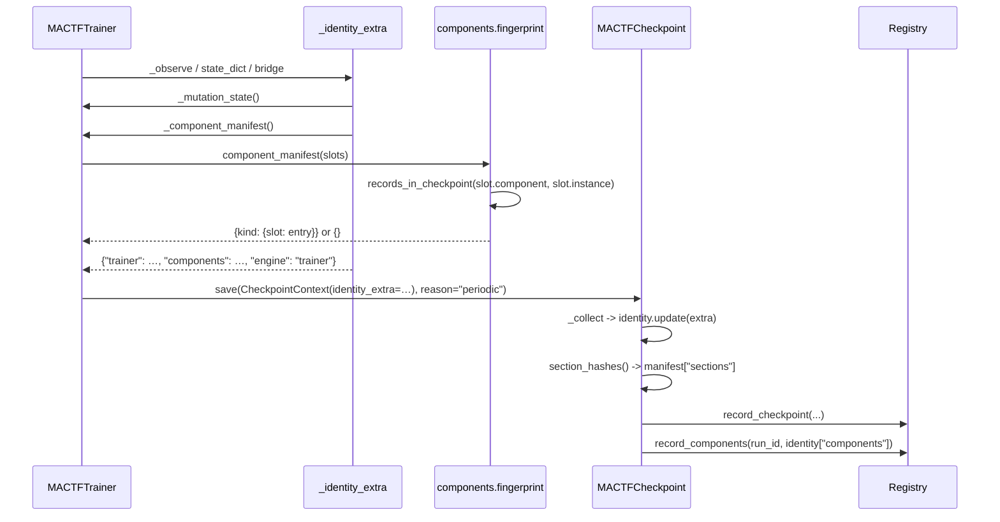

---

### 14.5 Restoring: verification before any state is touched

#### 14.5.1 Statuses and codes

| Status | Meaning | Strict | Permissive | Consequence |
|---|---|---|---|---|
| `ok` | Entry matches the live slot field for field | — | — | Nothing; the component's own `load_state_dict` decides about its state |
| `builtin` | The entry is a built-in with default parameters (only possible in a hand-edited file) | `ok` | `ok` | Recorded, compared, never an error |
| `mismatch` | The slot is live but `diff` finds a structural or version difference | `E094` | `W052` | The live component is used; its own state loader drops what does not fit |
| `orphan` | Entry names a slot the run no longer has (a retired peer's `RL.*`, an override glob that stopped matching) | `W052` | `W052` | The entry is ignored, and named |
| `missing` | Slot is live and wants this component, but the registry does not have the name | `E093` | `E093` | Fatal: the code that produced the state is not loaded |
| `malformed` | The entry is not a mapping, or lacks `schema`/`kind`/`name` | `E095` | `E095` | Fatal: the file cannot be interpreted |
| `unsupported` | `schema` is not `ENTRY_SCHEMA` | `E096` | `E096` | Fatal: written by a newer build |
| `absent` | The checkpoint has no `components` key | `W053` | `W053` | Nothing to verify; today's behaviour exactly (P5) |

`missing`, `malformed` and `unsupported` are fatal in both modes, because there is no
defensible way to continue: the parameters on disk belong to code that is not here, and
either the answer is "install the module" or the answer is "do not resume".

#### 14.5.2 `ComponentRestorer` (`mactf/components/restore.py`)

```python
# mactf/components/restore.py
"""Read a checkpoint's ``components`` manifest and say what it means for this run.

Section 14.5. The restorer never edits a slot: configuration comes from settings (section 5),
and a restore that quietly re-pointed a slot would make ``conf/`` a lie. It verifies, reports
per slot, and raises only when continuing would mean training with the wrong code.
"""

from __future__ import annotations

import logging
from dataclasses import dataclass, field
from typing import Any, Mapping

from ..exceptions import ImproperlyConfigured
from .fingerprint import ENTRY_SCHEMA, IDENTITY_KEY, diff, recorded_slots, render

log = logging.getLogger("mactf.components")

#: Statuses that stop a resume in both modes.
FATAL = frozenset({"missing", "malformed", "unsupported"})


@dataclass(frozen=True)
class Finding:
    """What the restorer decided about one slot."""

    kind: str
    slot: str
    status: str
    code: str | None = None
    message: str = ""
    saved: Mapping[str, Any] | None = None
    live: Mapping[str, Any] | None = None

    @property
    def fatal(self) -> bool:
        return self.status in FATAL

    def describe(self) -> str:
        prefix = f"{self.code}: " if self.code else ""
        return f"{prefix}{self.slot} [{self.status}] {self.message}".rstrip()


@dataclass
class RestorePlan:
    """The findings for one checkpoint, plus the notes a caller appends to its report."""

    findings: list[Finding] = field(default_factory=list)
    #: ``True`` when the checkpoint carried no manifest at all (an older file, or an
    #: all-built-in run). Nothing was verified and nothing may be claimed.
    absent: bool = False
    checked: int = 0

    # -- queries ----------------------------------------------------------
    @property
    def fatal(self) -> list[Finding]:
        return [finding for finding in self.findings if finding.fatal]

    @property
    def warnings(self) -> list[Finding]:
        return [finding for finding in self.findings if finding.code and not finding.fatal]

    @property
    def ok(self) -> bool:
        return not self.fatal

    def status_of(self, slot: str) -> str | None:
        for finding in self.findings:
            if finding.slot == slot:
                return finding.status
        return None

    def notes(self) -> list[str]:
        return [finding.describe() for finding in self.findings if finding.code]

    def describe(self) -> dict[str, Any]:
        counts: dict[str, int] = {}
        for finding in self.findings:
            counts[finding.status] = counts.get(finding.status, 0) + 1
        return {
            "absent": self.absent,
            "checked": self.checked,
            "statuses": counts,
            "findings": [
                {
                    "kind": finding.kind,
                    "slot": finding.slot,
                    "status": finding.status,
                    "code": finding.code,
                    "message": finding.message,
                }
                for finding in self.findings
            ],
        }

    # -- raising ----------------------------------------------------------
    def raise_for_errors(self) -> None:
        """Raise ``E093``/``E095``/``E096`` for the first fatal finding, naming all of them.

        One exception with every fatal slot listed is more useful than the first one: an
        operator who is missing two plugins should install both, not discover them one
        resume at a time.
        """
        fatal = self.fatal
        if not fatal:
            return
        lines = [finding.describe() for finding in fatal]
        raise ImproperlyConfigured(lines[0] + ("" if len(lines) == 1 else f" (+{len(lines) - 1} more)"))


class ComponentRestorer:
    """Compare a checkpoint's manifest with the live slot table."""

    def __init__(self, slots: Any, *, policy: Any = None) -> None:
        self.slots = slots
        #: ``HubPolicy``; ``strict_restore`` is the only field read, and ``None`` means "read
        #: it from the hub when the plan is built", which keeps this class testable bare.
        self.policy = policy

    # -- planning ---------------------------------------------------------
    def plan(self, payload: Any) -> RestorePlan:
        """Plan against a checkpoint payload, a raw mapping, or a bare manifest.

        ``payload`` is what ``MACTFCheckpoint.load`` returns (a ``CheckpointPayload``), a
        ``torch.load`` result (a mapping with ``identity``), or already the manifest itself --
        the CLI passes the last form.
        """
        manifest = extract_manifest(payload)
        if manifest is None:
            return RestorePlan(absent=True)
        strict = self._strict()
        plan = RestorePlan()
        for kind, path in recorded_slots(manifest):
            entry = manifest[kind][path]
            plan.findings.append(self._check(kind, path, entry, strict=strict))
            plan.checked += 1
        for finding in plan.findings:
            if finding.code:
                (log.error if finding.fatal else log.warning)("%s", finding.describe())
        return plan

    def report(self, plan: RestorePlan) -> str:
        """A human summary, for the engine's ``startup_notes`` and ``mactf runs show``."""
        if plan.absent:
            return "W053: this checkpoint records no components; nothing to verify"
        if not plan.findings:
            return "components: nothing recorded"
        mismatched = [finding for finding in plan.findings if finding.status == "mismatch"]
        return (
            f"components: {plan.checked} checked, {len(mismatched)} differ, "
            f"{len(plan.fatal)} fatal"
        )

    # -- one slot ---------------------------------------------------------
    def _check(self, kind: str, path: str, entry: Any, *, strict: bool) -> Finding:
        problem = _check_entry(kind, path, entry)
        if problem is not None:
            status, code, message = problem
            return Finding(kind, path, status, code, message, saved=None)

        saved = dict(entry)
        try:
            slot = self.slots.get(path)
        except Exception:  # noqa: BLE001 - ``ComponentMissing`` for a slot is an orphan here
            return Finding(
                kind, path, "orphan", "W052",
                "the run no longer has this slot; the entry is ignored",
                saved=saved, live=None,
            )

        live = _live_entry(slot)
        if saved.get("name") != live.get("name") or saved.get("kind") != live.get("kind"):
            registered = _is_registered(saved.get("kind"), saved.get("name"))
            if not registered:
                return Finding(
                    kind, path, "missing", "E093",
                    f"needs component {saved.get('name')!r} of kind {saved.get('kind')!r}, which "
                    "is not registered; install the module that provides it "
                    "(COMPONENTS.MODULES or the mactf.components entry point) or resume "
                    "with a different checkpoint",
                    saved=saved, live=live,
                )

        changes = diff({kind: {path: saved}}, {kind: {path: live}})
        if not changes:
            return Finding(kind, path, "ok", None, "", saved=saved, live=live)

        structural = [change for change in changes if change.structural]
        detail = render(changes)
        if strict and structural:
            return Finding(
                kind, path, "mismatch", "E094",
                "differs from the checkpoint and COMPONENTS.STRICT_RESTORE is on:\n" + detail,
                saved=saved, live=live,
            )
        return Finding(
            kind, path, "mismatch", "W052",
            "differs from the checkpoint; this run uses the configured component:\n" + detail,
            saved=saved, live=live,
        )

    def _strict(self) -> bool:
        """``COMPONENTS.STRICT_RESTORE``, read off the effective ``HubPolicy``.

        ``getattr`` rather than an attribute access because ``HubPolicy`` gains the field in
        section 15.1: a build that has ``restore.py`` but not yet the settings key treats every
        difference as ``W052``, which is the safe direction (a warning cannot block a resume).
        """
        policy = self.policy
        if policy is None:
            try:
                from .registry import HUB

                policy = HUB.effective_policy()
            except Exception:  # noqa: BLE001 - a bare unit test has no hub
                return False
        return bool(getattr(policy, "strict_restore", False))


# ---------------------------------------------------------------------------
# Helpers
# ---------------------------------------------------------------------------
def extract_manifest(payload: Any) -> dict[str, dict[str, dict[str, Any]]] | None:
    """The manifest inside a payload, or ``None`` when the payload carries none.

    Three accepted shapes, because three call sites hand this a different object: a
    ``CheckpointPayload`` (``payload.identity``), a ``torch.load`` mapping (``["identity"]``),
    and a manifest itself (the CLI's ``components diff``), which is recognised because its
    values are ``{slot: entry}`` mappings rather than the identity's scalars.
    """
    identity: Any = None
    if isinstance(payload, Mapping):
        identity = payload.get("identity", payload if _looks_like_manifest(payload) else None)
    else:
        identity = getattr(payload, "identity", None)
    if not isinstance(identity, Mapping):
        return None
    raw = identity.get(IDENTITY_KEY) if _looks_like_manifest(identity) is not True else identity
    if raw is None:
        return None
    if not isinstance(raw, Mapping):
        return {IDENTITY_KEY: {"?": raw}}  # surfaced as E095 by ``_check_entry``
    return {str(kind): dict(entries) for kind, entries in raw.items() if isinstance(entries, Mapping)} or {
        IDENTITY_KEY: {"?": raw}
    }


def _looks_like_manifest(mapping: Mapping[str, Any]) -> bool:
    """``True`` when the values are ``{slot: {entry fields}}`` rather than identity scalars."""
    for value in mapping.values():
        if isinstance(value, Mapping):
            for inner in value.values():
                if isinstance(inner, Mapping) and "name" in inner:
                    return True
    return False


def _check_entry(kind: str, path: str, entry: Any) -> tuple[str, str, str] | None:
    """``(status, code, message)`` for a malformed or unsupported entry, else ``None``."""
    if not isinstance(entry, Mapping):
        return (
            "malformed", "E095",
            f"entry for {kind}/{path} is {type(entry).__name__}, not a mapping",
        )
    missing = [key for key in ("schema", "kind", "name") if key not in entry]
    if missing:
        return (
            "malformed", "E095",
            f"entry for {kind}/{path} lacks {', '.join(missing)}",
        )
    schema = entry["schema"]
    if not isinstance(schema, int) or isinstance(schema, bool):
        return ("malformed", "E095", f"entry for {kind}/{path} has a non-integer schema {schema!r}")
    if schema != ENTRY_SCHEMA:
        return (
            "unsupported", "E096",
            f"entry for {kind}/{path} uses component schema {schema}; this build understands "
            f"{ENTRY_SCHEMA}. Upgrade mactf, or resume with a build that wrote this file",
        )
    return None


def _live_entry(slot: Any) -> dict[str, Any]:
    from .fingerprint import entry_for

    return entry_for(slot)


def _is_registered(kind: Any, name: Any) -> bool:
    """Whether the registry can still build this name (``E093`` depends on it)."""
    if not isinstance(kind, str) or not isinstance(name, str):
        return False
    try:
        from .registry import HUB

        return HUB.registry(kind).find(name) is not None
    except Exception:  # noqa: BLE001 - an unknown kind means "not registered here"
        return False
```

`extract_manifest`'s `_looks_like_manifest` deserves a word: a `CheckpointPayload`'s identity
holds scalars and, at most, the `trainer` mapping (whose values are dicts of dicts, so the
`"name" in inner` test is what distinguishes them). A manifest's leaves always carry `name`.
That is a heuristic, and it is the reason the doc's CLI section reads the manifest from a
typed accessor (`CheckpointPayload.identity`) rather than a raw mapping wherever it can.

#### 14.5.3 Where the restorer runs

```python
# mactf/training/trainer.py   (MACTFTrainer.load_state_dict: five statements added at the top)
    def load_state_dict(
        self, payload: Mapping[str, Any], *, strict: bool = True
    ) -> ResumeReport:
        """Restore from a payload produced by :meth:`state_dict` or a checkpoint."""
        self._require_built()
        if self.checkpoint is None:
            raise ImproperlyConfigured("load_state_dict() needs a checkpoint writer")
        # Section 14.5: verify the components before a single parameter moves (P3). A missing
        # component must not be discovered after the models have been overwritten.
        plan = self._component_plan(payload)
        plan.raise_for_errors()
        self.component_notes = plan.notes()
        identity = payload.get("identity") if isinstance(payload, Mapping) else payload.identity
        extra = dict((identity or {}).get("trainer") or {})
        recorded = extra.get("signal_source")
        # ... the rest of the method is unchanged ...

    def _component_plan(self, payload: Any) -> Any:
        """The ``RestorePlan`` for this payload; ``absent`` when there is nothing recorded."""
        from ..components.restore import ComponentRestorer

        slots = getattr(self, "slots", None)
        if slots is None:
            # A trainer built without the component model: nothing can be verified, and nothing
            # was recorded by such a run either.
            from ..components.restore import RestorePlan

            return RestorePlan(absent=True)
        return ComponentRestorer(slots).plan(payload)
```

`self.component_notes` is initialised in `__init__` next to `strategy_warnings` (the list
section 11 already appends notes to, `trainer.py:530-560`):

```python
# mactf/training/trainer.py   (__init__: after ``self.strategy_warnings = []``)
        #: Notes from the section 14 component verification. ``mactf runs show`` prints them.
        self.component_notes: list[str] = []
```

and `TrainResult` carries them (section 11 already widens `TrainResult` with
`strategy_warnings`; `component_notes` joins it):

```python
# mactf/training/trainer.py   (TrainResult: one field after ``strategy_warnings``)
    component_notes: tuple[str, ...] = ()
```

`fit()` fills it from `self.component_notes` after a `resume` (section 11's code, one added
key). Nothing else reads it in the training path, which is what keeps it cheap.

#### 14.5.4 The restore path

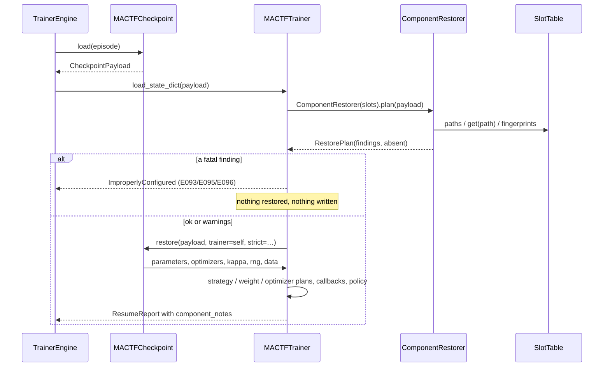

---

### 14.6 Registry migration 4

#### 14.6.1 Why a column and not a table

A run's component set is written once at start and then only re-written when a swap changes
it. It is read as a whole, for one run, and never queried by field. A table would mean a row
per slot per run and two joins to answer "which weight strategy did run `abc123` use?",
which is the only question anyone asks. One JSON column answers it in one row, which is why
the same design was chosen for `runs.settings` (`db.py:51-118`).

| Why | Consequence |
|---|---|
| Read whole, per run | `TEXT` holding the manifest, decoded on read |
| Written at start, re-written on a swap | Idempotent `UPDATE`, no history (the checkpoints and the journals are the history) |
| Must not break an older reader | `SELECT *` readers ignore an unknown column; only `get_run` and the CLI decode it |
| Nullable | A run that used only built-ins leaves it `NULL`, exactly as the checkpoint leaves its key absent (P1, P7) |

#### 14.6.2 The migration

```python
# mactf/db.py   (SCHEMA_VERSION and the migration, replacing line 20 and extending lines 234-238)
SCHEMA_VERSION = 4


def _migration_4_step(connection: sqlite3.Connection) -> None:
    """The component manifest of a run (document 17 section 14).

    One nullable column, no backfill: a row written before this version keeps ``NULL``, and
    ``NULL`` means "this run predates the component model or used only built-ins". A backfill
    would have to invent a manifest, and an invented manifest is worse than an absent one --
    ``Registry.components`` reports the difference instead (``W053``).
    """
    _add_columns_if_absent(connection, "runs", {"components_json": "TEXT"})


MIGRATIONS: tuple[Migration, ...] = (
    Migration(1, statements=_MIGRATION_1),
    Migration(2, step=_migration_2_step),
    Migration(3, step=_migration_3_step),
    Migration(4, step=_migration_4_step),
)
```

`_add_columns_if_absent` (`db.py:39-48`) is what makes the step idempotent: a database that
already has the column (a hand-rolled build, or a re-run after a crash between the `ALTER` and
the `mactf_schema` insert) is left alone. `Registry.migrate` (`db.py:380-398`) then records
version 4 in `mactf_schema` and seeds `mactf_migrations` for `core`.

#### 14.6.3 The two methods

```python
# mactf/db.py   (after ``record_checkpoint``, line 909)
    def record_components(
        self,
        run_id: str,
        components: Mapping[str, Any] | None,
        *,
        source: str = "engine",
    ) -> None:
        """Store a run's component manifest (document 17 section 14).

        ``source`` is a note, not a filter: ``engine`` writes the manifest a run started with,
        ``checkpoint`` re-writes it when a swap or a resume changed it, ``import`` is a caller
        backfilling from a file. An empty or absent mapping stores ``NULL`` rather than ``{}``
        so that "no components recorded" and "recorded as nothing" cannot be confused.
        """
        payload = json.dumps(dict(components), default=str) if components else None
        with self.connect() as connection:
            cursor = connection.execute(
                "UPDATE runs SET components_json = ? WHERE id = ?", (payload, run_id)
            )
            if not cursor.rowcount:
                raise ImproperlyConfigured(
                    f"no run {run_id!r} to record {source} components for; "
                    "start_run must write the row first"
                )

    def components(self, run_id: str) -> dict[str, Any] | None:
        """The run's manifest as stored, or ``None`` when it has none.

        ``None`` is the honest answer for a run that predates the component model and for one
        that used only built-ins; the caller that needs to tell them apart looks at the
        checkpoint (``W053`` says the file records none either).
        """
        with self.connect() as connection:
            row = connection.execute(
                "SELECT components_json FROM runs WHERE id = ?", (run_id,)
            ).fetchone()
        if row is None:
            return None
        raw = row["components_json"]
        return json.loads(raw) if raw else None
```

and `get_run` decodes the column, so every existing reader of `runs` (the API's run detail,
`mactf runs show`, the comparison view of document 16) sees a mapping rather than a JSON
string:

```python
# mactf/db.py   (get_run, replacing lines 590-594)
    def get_run(self, run_id: str) -> dict[str, Any] | None:
        with self.connect() as connection:
            row = connection.execute("SELECT * FROM runs WHERE id = ?", (run_id,)).fetchone()
        return _decode_run(row) if row else None


def _decode_run(row: sqlite3.Row) -> dict[str, Any]:
    """A ``runs`` row with its JSON columns decoded (``settings``, ``runtime``, ``components``)."""
    item = _row_to_dict(row)
    for column in ("settings", "runtime", "sandbox", "components_json"):
        value = item.get(column)
        if isinstance(value, str) and value:
            try:
                item[column] = json.loads(value)
            except json.JSONDecodeError:  # a hand-edited row: keep the text, do not fail
                item[column] = value
    item["components"] = item.pop("components_json", None)
    return item
```

`_decode_run` is additive for readers (`get_run` gains decoded `settings`/`runtime`/`sandbox`
too, which is what the API was already doing by hand) and it renames the column to
`components` so the view's shape matches the checkpoint's key. `list_runs` keeps returning raw
rows: a list view does not need three decoded JSON blobs per row, and changing its shape would
be a behaviour change section 16 does not ask for.

#### 14.6.4 Who writes it

```python
# mactf/orchestration/engine.py   (TrainerEngine._run_epochs: three statements after start_run)
        self.registry.start_run(
            self.run_id,
            settings=row_settings,
            runtime=runtime_info,
            sandbox=self.sandbox_choice.report.as_dict() if self.sandbox_choice else None,
            notes="; ".join(self.startup_notes),
        )
        # Section 14.6: the manifest the run starts with, from the same function the checkpoint
        # uses (P6), so the row and the file cannot disagree about the initial set.
        manifest = trainer._component_manifest()
        if manifest:
            self.registry.record_components(self.run_id, manifest, source="engine")
```

and the writer re-records it on every save, because a mid-run swap is durable only in the
file until this line runs:

```python
# mactf/orchestration/checkpoint_v2.py   (save: one call after ``_record_in_registry``)
        self._record_in_registry(record)
        self._record_components(payload)
        signals.checkpoint_written.send(sender=self, record=record, payload=payload.as_dict())
```

```python
# mactf/orchestration/checkpoint_v2.py   (after ``_record_in_registry``, line 745)
    def _record_components(self, payload: CheckpointPayload) -> None:
        """Keep ``runs.components_json`` equal to the manifest this file was written with.

        A registry without the method (an app that supplies its own) is not an error: the file
        remains authoritative, which is the rule for every other registry write in
        ``_record_in_registry``.
        """
        recorder = getattr(self.registry, "record_components", None)
        if not callable(recorder):
            return
        manifest = dict(payload.identity.get(IDENTITY_KEY) or {})
        try:
            recorder(self.run_id, manifest or None, source="checkpoint")
        except ImproperlyConfigured:
            # ``start_run`` never ran (a bare ``state_dict()`` in a script). The file is
            # written and correct; there is simply no row to attach it to.
            log.debug("no run row for %s; components recorded in the file only", self.run_id)
```

`IDENTITY_KEY` is imported from `components.fingerprint`. `checkpoint_v2` already imports
from `mactf.*` at module level (`:1-40`), and `components.fingerprint` imports only
`components.kinds` and the standard library, so the import cannot create a cycle:
`components` never imports `orchestration` at module import time.

---

### 14.7 Compatibility

#### 14.7.1 Files

| File | `components` key | What a resume does |
|---|---|---|
| v1 (`CheckpointManager`, `checkpoint.py:51-88`) | impossible (no `identity`) | `load` migrates it (`checkpoint_v2.py:893-947`), `ExtractManifest` finds none → `W053`, then the topology and layout checks run as today. `E091` refuses it under the trainer engine unless `ALLOW_ENGINE_SWITCH` |
| v2, written before this document | absent | `W053`; nothing verified; parameters, optimizers, RNG and data position restore as today (P5) |
| v2, all built-in | absent (P1) | `W053`; identical bytes to the previous row |
| v2, one extension | present | Every entry checked; `ok` for each; the extension's own `load_state_dict` loads its state |
| v2, extension removed from `conf/` | present | `W052` naming every changed field; the run continues on the configured component and its state loader drops what does not fit |
| v2, extension's module uninstalled | present | `E093` before anything is restored, naming the component, the kind and the slot |
| v2, hand-edited entry | present | `E095` (missing field) or `E096` (a `schema` this build does not know) |
| v2, `STRICT_RESTORE: true`, extension's params edited | present | `E094` listing `spec_hash` and `params` |
| v2, `STRICT_RESTORE: true`, extension's *code* edited (same params) | present | `E094` listing `source_digest` |
| v2, `STRICT_RESTORE: true`, extension's `version` bumped only | present | `E094` (version is compared) — the one case a team may want permissive, and the reason the default is `false` |
| v2, written after a peer was retired | present, with the retired node's `RL.*` entries | Those entries are `orphan` → `W052`, not fatal: the slots legitimately no longer exist |

#### 14.7.2 Databases

| Database | `components_json` | Behaviour |
|---|---|---|
| version 1-3 | column absent | `mactf` refuses any *new* command with the existing behind-schema guard (`management/base.py:422-432`) until `mactf migrate`; a read-only `mactf runs list` on an old database keeps working because it never selects the column explicitly |
| version 3, migrated | all `NULL` | `components(run_id)` returns `None`; the CLI prints "not recorded" |
| version 4, new run, all built-in | `NULL` | same |
| version 4, new run, one extension | manifest | `components(run_id)` returns it |
| version 4, mid-run swap | manifest re-written at the next save | the row is the *latest* set, matching the latest checkpoint |
| version 4, written by a newer build | column possibly narrower/none | the JSON is opaque to the reader; an unknown kind is simply a key it prints |

The one-way property: a version-4 database opened by a version-3 build fails the schema check
(the recorded version is higher than `SCHEMA_VERSION`), which is the documented behaviour of
`Registry.migrate` for any newer file, not something this section changes.

#### 14.7.3 Engines

`Orchestrator` never writes `identity` at all (`CheckpointManager.save`,
`checkpoint.py:51-88`), so its files are the first row of 14.7.1 and nothing here touches it
(**T3**). A trainer checkpoint resumed under the orchestrator is `E091` (13.4.8) before this
section's check runs, because `_check_identity` is the engine's first statement.

---

### 14.8 What the bytes do and do not change

| Run | `identity` section | `section_hashes()["identity"]` | `content_hash()` | `runs.components_json` |
|---|---|---|---|---|
| All built-in, never mutated (P1) | unchanged, 15 keys | unchanged | unchanged | `NULL` |
| All built-in, mutated (section 12) | `+ identity["trainer"]["mutation"]` | changes | changes | `NULL` |
| One extension | `+ identity["components"]`, `+ identity["engine"]` | changes | changes | the same manifest |
| Extension plus mutation | both keys | changes | changes | the same manifest |

The first row is the invariant: a run that customizes nothing writes exactly the bytes it
wrote before this document, which is what makes `test_default_identity` a byte comparison and
not a semantic one. The second row is section 12's guarantee and is listed for completeness —
a mutated run already changed its identity hash before section 14 existed.

`identity["engine"]` is the one key that is always present on a trainer checkpoint, so
`section_hashes()["identity"]` for *any* trainer run differs from the pre-change value. That
is deliberate: `E091` needs it, and the alternative — inferring the engine from the filename
or the checkpoint directory — would fail exactly when someone copies a file.

#### 14.8.1 The demonstration

```python
# tests/components/test_persistence_identity.py   (the shape of the three assertions)
def test_a_default_run_writes_the_same_identity_hash(settings, tmp_path, monkeypatch):
    """P1: no components, no trainer extras, no engine key -- for ``Orchestrator``."""
    from mactf.orchestration.checkpoint_v2 import CheckpointPayload

    monkeypatch.setattr("mactf.training.trainer.ENGINE_NAME", "trainer")
    trainer = _trainer(settings, tmp_path)
    context = trainer._checkpoint_context(epoch=0, reason="periodic")
    payload = trainer.checkpoint._collect(context, episode=0, step=0)
    # The 15 framework keys, and not one more.
    assert sorted(payload.identity) == sorted(_FRAMEWORK_IDENTITY_KEYS)
    assert "components" not in payload.identity
```

`_FRAMEWORK_IDENTITY_KEYS` is the literal list from `checkpoint_v2.py:578-593`, kept in the
test on purpose: a future key added to `_collect` must be a decision, not a side effect.

---

### 14.9 Where every kind's state lives

The fingerprints above answer "which component"; this is the companion table for "which
state", consolidating what sections 7 to 12 each define, so a reviewer can check that no kind
was left with state that neither the checkpoint nor the registry knows about.

| Kind | Instance state | Section | Where it is written |
|---|---|---|---|
| `scorer` | None (a stage is a pure function of the ledger) | 6 | nothing |
| `reward_term` | None | 6.3 | nothing |
| `rl_function.<family>` | Only for a stateful function (a running normaliser, a counter) | 8.8.5 | `identity["trainer"]["functions"]` |
| `optimizer` | Moments, step counts, per-group state | 9.8 | `stored.optimizers[path]` (`MACTFOptimizer.state_dict`) |
| `scheduler` | The scheduler's own `state_dict` | 9.8 | `stored.schedulers[path]` |
| `peer_strategy` | Per-group and per-slot state | 11.10 | `identity["trainer"]["strategy"]`, `["strategy_plan"]` |
| `weight_update` | Per-group state, the plan | 10.9 | `identity["trainer"]["weight_plan"]` |
| `aggregator` | None of its own; the group reports are the record | 10.9 | `stored.aggregations` |
| `trainer_policy` | Whatever it declares, plus its name and `unsafe` flag | 7.7 | `identity["trainer"]["policy"]`, the flag in `identity["components"]` |
| `peer_factory` | The tree it built | 12.9 | `stored.tree`, `identity["trainer"]["mutation"]` |

Every row is either "pure, so nothing" or a section that names its key; there is no kind whose
state is implicit.

---

### 14.10 Test matrix for section 14

| # | Test | Kind | Pins |
|---|---|---|---|
| 1 | `test_fingerprint.py::test_a_builtin_with_default_params_is_not_recorded` | unit | **P1**, **P2** |
| 2 | `test_fingerprint.py::test_a_project_component_is_recorded` | unit | **P2**, all nine fields present |
| 3 | `test_fingerprint.py::test_an_unsafe_policy_is_recorded_with_its_flag` | unit | `RECORD_FLAGS`; `unsafe: true` in the entry |
| 4 | `test_fingerprint.py::test_manifest_is_sorted_and_grouped_by_kind` | unit | deterministic bytes (a stable hash across processes) |
| 5 | `test_fingerprint.py::test_diff_reports_one_present_change_for_a_missing_slot` | unit | 14.3.3 |
| 6 | `test_fingerprint.py::test_diff_reports_params_and_spec_hash_together` | unit | a params edit is visible even before the hash is compared |
| 7 | `test_persistence_identity.py::test_a_default_run_writes_the_same_identity_hash` | integration | **P1**, 14.8.1 |
| 8 | `test_persistence_identity.py::test_periodic_checkpoint_carries_the_manifest` | integration | **P-G1**: `_observe`'s context has `identity_extra` |
| 9 | `test_persistence_identity.py::test_state_dict_carries_the_manifest` | unit | **P-G2** |
| 10 | `test_persistence_identity.py::test_watchdog_snapshot_carries_the_manifest` | integration | 14.4.3 |
| 11 | `test_persistence_identity.py::test_engine_key_is_written_once` | unit | `identity["engine"] == "trainer"`, one key |
| 12 | `test_restore_components.py::test_a_matching_manifest_is_all_ok` | unit | `ok` per slot, no codes |
| 13 | `test_restore_components.py::test_a_missing_component_is_e093` | unit | **P3**, `missing` before any write |
| 14 | `test_restore_components.py::test_a_changed_spec_is_w052_or_e094` | unit | **P4**, both modes |
| 15 | `test_restore_components.py::test_a_changed_source_digest_is_e094_under_strict` | unit | code edited, params same |
| 16 | `test_restore_components.py::test_an_orphan_slot_is_w052` | unit | a retired peer's entry |
| 17 | `test_restore_components.py::test_a_malformed_entry_is_e095` | unit | four shapes: not a mapping, missing `schema`, missing `name`, non-integer schema |
| 18 | `test_restore_components.py::test_a_newer_schema_is_e096` | unit | `schema: 2` |
| 19 | `test_restore_components.py::test_a_legacy_file_is_one_w053` | unit | **P5**, no exception, no findings but the note |
| 20 | `test_restore_components.py::test_nothing_is_restored_after_a_fatal_finding` | guard | a poisoned payload: parameters unchanged, no optimizer mutated, no `checkpoints` row |
| 21 | `test_restore_components.py::test_every_fatal_slot_is_named` | unit | two missing components named in one exception |
| 22 | `test_db_migration.py::test_migration_4_adds_one_nullable_column` | unit | **P7**: version 3 → 4, existing rows keep their values |
| 23 | `test_db_migration.py::test_migration_4_is_idempotent` | unit | run twice; one `ALTER` |
| 24 | `test_db_migration.py::test_record_components_round_trip` | unit | `record_components` → `components()` equality |
| 25 | `test_db_migration.py::test_record_components_for_a_missing_run_is_refused` | unit | the `ImproperlyConfigured` naming the run |
| 26 | `test_db_migration.py::test_empty_manifest_stores_null` | unit | `None`, not `{}` |
| 27 | `test_db_migration.py::test_get_run_decodes_components` | unit | a mapping, and no `components_json` key |
| 28 | `test_db_migration.py::test_a_version_3_database_refuses_a_new_run` | cli | the existing guard, unchanged message plus `mactf migrate` |
| 29 | `test_persistence_engine.py::test_engine_records_the_manifest_at_start` | integration | **P6**, row equals the first checkpoint's key |
| 30 | `test_persistence_engine.py::test_a_swap_updates_the_row_at_the_next_save` | integration | 14.6.4 |
| 31 | `test_persistence_engine.py::test_resume_reports_component_notes` | integration | `ResumeReport` + `TrainResult.component_notes` |
| 32 | `test_persistence_engine.py::test_orchestrator_files_are_untouched` | regression | **T3**: a v1 file has no `identity` at all |

---

### 14.11 Codes, files and behaviour changes

#### 14.11.1 Codes introduced by section 14

| Code | Where | Meaning |
|---|---|---|
| `E093` | `ComponentRestorer._check` | A checkpoint needs a component (name and kind) that this build has not registered: the providing module is not loaded |
| `E094` | `ComponentRestorer._check` | A live slot differs from the recorded entry and `COMPONENTS.STRICT_RESTORE` is on; the message lists every differing field |
| `E095` | `ComponentRestorer._check` via `_check_entry` | The `components` section, or one entry, is not interpretable: not a mapping, no `schema`/`kind`/`name`, or a non-integer schema |
| `E096` | `_check_entry` | An entry's `schema` is newer than `ENTRY_SCHEMA` |
| `W052` | `ComponentRestorer._check` | A slot differs (permissive mode), or an entry names a slot the run no longer has |
| `W053` | `ComponentRestorer.plan` | The checkpoint records no components at all: a legacy file, or an all-built-in run |

#### 14.11.2 Files touched by section 14

| File | Change |
|---|---|
| `mactf/components/fingerprint.py` (new) | `ENTRY_SCHEMA`, `IDENTITY_KEY`, `RECORD_FLAGS`, `records_in_checkpoint`, `entry_for`, `component_manifest`, `recorded_slots`, `Change`, `diff`, `render` |
| `mactf/components/restore.py` (new) | `Finding`, `RestorePlan`, `ComponentRestorer`, `extract_manifest` |
| `mactf/training/trainer.py` | `ENGINE_NAME`; `_identity_extra` widened; `_component_manifest`; `_observe` and `state_dict` pass `identity_extra`; `load_state_dict` verifies first; `component_notes` on the trainer and on `TrainResult` |
| `mactf/orchestration/checkpoint_v2.py` | `_record_components`, called from `save` after `_record_in_registry` |
| `mactf/orchestration/engine.py` | `record_components` after `start_run` |
| `mactf/db.py` | `SCHEMA_VERSION = 4`; `_migration_4_step`; `MIGRATIONS` entry; `record_components`; `components`; `get_run` decodes via `_decode_run` |
| `tests/components/test_fingerprint.py`, `test_restore_components.py`, `test_persistence_identity.py`, `test_persistence_engine.py`, `tests/db/test_db_migration.py` (new) | Rows 1-32 |
| `docs/plans.new/17-component-customization.md` | this section |

#### 14.11.3 Behaviour changes with nothing configured

**P1** and **T3** again: a project that customizes nothing and never resumes across engines
sees two differences, both additive.

1. **A trainer checkpoint gains `identity["engine"]`.** `content_hash()` therefore differs
   from a file written before this document. Nothing compares that hash across builds except
   `verify()` against its own manifest, so the only effect is that a *new* file cannot be
   byte-compared with an *old* one — which no code does, and which the test in 14.8.1 pins
   explicitly.
2. **`get_run` returns decoded JSON.** `settings`, `runtime` and `sandbox` become mappings
   (the API views were decoding them by hand and now find them decoded; they must drop their
   own `json.loads`, which section 16 does as part of its own diff) and `components` appears
   as a key with value `None`. `list_runs` is unchanged.

What does not change: the `runs`, `episodes`, `checkpoints` and `aggregations` schemas other
than the one new column; every file written by `Orchestrator`; every file written by a
trainer run that uses only built-ins (apart from `identity["engine"]`); the migrate command's
output shape (`core_pending` is computed from `SCHEMA_VERSION`, so it reports `0` on a
version-4 database without a code change); and every checkpoint read path, which gains one
verification step that cannot fail when the manifest is absent.

---

---

## 15. Configuration surface

Sections 3 to 14 defined the model, the guards and the persistence. This section is how a
project *reaches* them from a file: two new blocks (`COMPONENTS`, `COMPLIANCE`), one that
was declared but never given a home (`RL`), two new files in the `conf/` layout, validators
in `mactf/conf.py` that read the registries instead of a hard-coded tuple, and the two
command-line layers that already exist (`MACTF_*`, `--set`) taught to address a *component
spec* rather than only a scalar.

Three findings drive the shape of it, and each is a defect in the tree today:

| Finding | Evidence | What this section does |
|---|---|---|
| **C-G1** — the name sets are frozen | `mactf/conf.py:707-712` hard-codes `_PEER_STRATEGY_NAMES` and `_WEIGHT_STRATEGY_NAMES`; `:739-745` rejects anything else, so a strategy registered in section 11 is *refused by its own configuration* | 15.4: one torch-free `known.py`, read by the validators |
| **C-G2** — there is no `COMPONENTS` block | `DEFAULTS` (`conf.py:189-441`) has no key with that name; `HubPolicy` (`registry.py`, section 3.3) is only ever built with its defaults, so `ALLOW_BUILTIN_OVERRIDE`, `LOCKED`, `MODULES` and the rest have no file spelling | 15.1: the block, its defaults and `HubPolicy` wiring |
| **C-G3** — the two command-line layers cannot express a spec | `--set` walks into a scalar and refuses (`conf_overrides.py:143-165`: `"... is a str, not a mapping"`); `_apply_env` skips every mapping-valued key (`conf.py:588-596`) | 15.6 and 15.7: one promotion rule for `--set`, and `__`-separated nested environment overrides |

**C-G3 is the one that changes an existing promise.** Document 15 §14 non-goal 2 says "no
nested environment overrides: `_apply_env` walks scalars only, unchanged". Sections 3, 10,
11 and 12 of *this* document then wrote `MACTF_TRAINER__WEIGHT_UPDATE__TYPE=uniform`,
`MACTF_TRAINER__MUTATION__ENABLED=true` and `MACTF_ORCHESTRATOR__ENGINE=trainer` as working
examples — and the third one does work only because `ORCHESTRATOR.ENGINE` is a scalar
`str`, while the first two cannot work at all. This section resolves it in one direction:
**the `__` form is implemented** (§15.6), each earlier example becomes true, and document 15's
non-goal 2 is amended rather than left contradicted. A project that never writes a `__`
variable sees no change, which is what keeps **P1**.

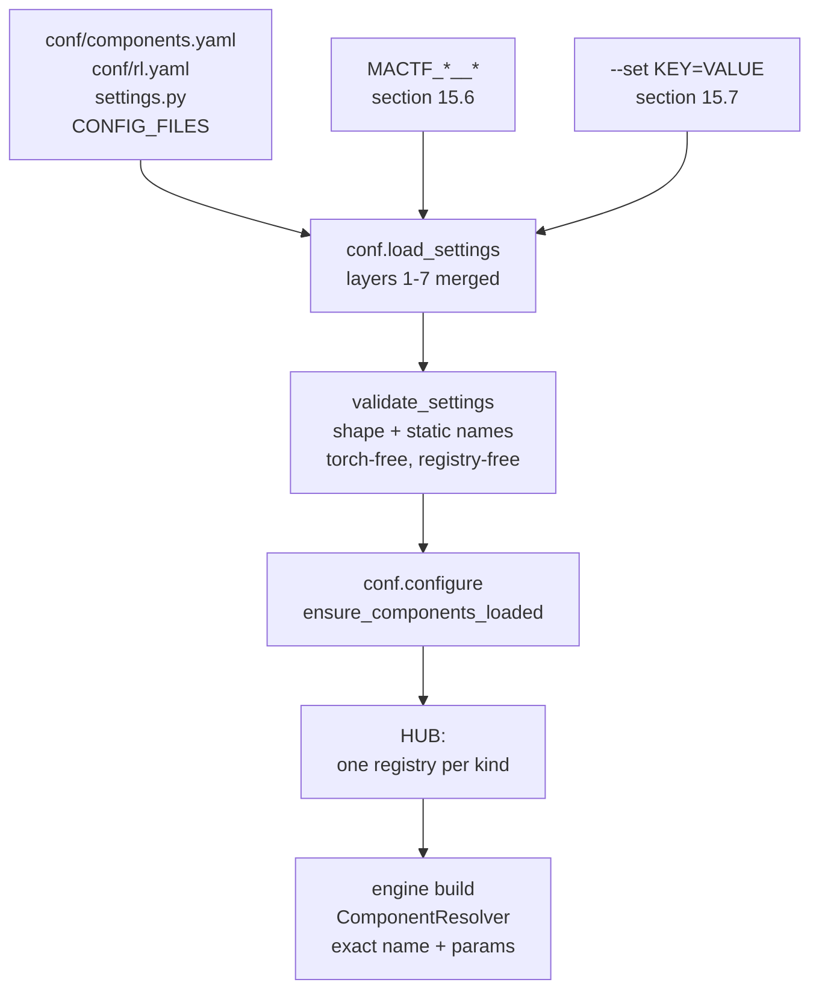

The split is the whole design: **`validate_settings` may only use facts that need neither
torch nor a populated registry** (`conf.py:700-707` is the rule every command pays for), and
everything that needs a registry happens at `configure` and at build. A name that only a
plugin will register is therefore *unknown at load and correct at build* — the escape hatch
is `known.may_be_extended` (§15.4.3), not a looser load-time check.

---

### 15.1 The `COMPONENTS` block

#### 15.1.1 Defaults

```python
# mactf/conf.py   (new block beside ORCHESTRATOR_DEFAULTS, before DEFAULTS)
COMPONENTS_DEFAULTS: dict[str, Any] = {
    # -- who may replace a built-in ------------------------------------------------
    "ALLOW_BUILTIN_OVERRIDE": False,
    # -- what may not change at all (``kind:name`` or ``slot:<path>``, fnmatch) -----
    "LOCKED": [],
    # -- whether an old-style direct dict write is an error or just noise ----------
    "STRICT_LEGACY": False,
    # -- importing code named by a spec -------------------------------------------
    "ALLOW_IMPORT": False,
    "IMPORT_ALLOWLIST": [],
    # -- how many components of one kind may exist --------------------------------
    "MAX_PER_KIND": 512,
    # -- discovery ----------------------------------------------------------------
    "PLUGINS": "auto",          # "auto" | "off" | [entry-point names]
    "MODULES": [],              # dotted modules imported once, in order
    "FREEZE_AFTER_LOAD": False,
    # -- restore ---------------------------------------------------------------
    "STRICT_RESTORE": False,
}
```

Every value is the one that makes a project that writes nothing behave exactly as it does
today: no override, no lock, legacy writes tolerated (with a warning), no import from an
untrusted surface, `auto` discovery (which finds the framework's own entry point group,
empty), nothing imported, registries left open, and a restore difference reported as `W052`
rather than `E094` (§14.4).

`DEFAULTS` gains it as a copy, like every other block (`conf.py:425-440`):

```python
# mactf/conf.py   (inside DEFAULTS, after "CORS")
    # Document 17 section 15.1: the component registry's own policy.
    "COMPONENTS": copy.deepcopy(COMPONENTS_DEFAULTS),
    # Document 17 section 6.6: the compliance floor every custom scorer is held to.
    "COMPLIANCE": copy.deepcopy(COMPLIANCE_DEFAULTS),
    # Document 17 section 8.5: per-family RL function selection.
    "RL": copy.deepcopy(RL_DEFAULTS),
```

`COMPLIANCE_DEFAULTS` is the block §6.6 already wrote (`MIN_FLOOR_LAMBDA`,
`GUARD_MODE`, `REWARD_CEILING`, `TOLERANCE`, `TRUST_BUILTIN`) and `RL_DEFAULTS` is §8.5.2's
three keys (`UNCONSUMED`, `STRICT_GLOBS`, `VERIFY`). They are named constants here, next to
`TRAINER_DEFAULTS`, for the same reason those are: `tests/test_conf_blocks.py:29-38` asserts
`DEFAULTS[name] is not NEW_BLOCKS[name]`, so a default cannot be mutated through `DEFAULTS`.

#### 15.1.2 Two spellings, one key

§8.5.3's wiring note calls the API trust switch `COMPONENTS.API_ALLOW_IMPORT`; §5.4 calls it
`COMPONENTS.ALLOW_IMPORT`. Both sentences are wanted — one is about the *API surface*, the
other about the *import* operation — so both spellings are accepted, one is canonical, and
the duplicate is reported instead of silently aliased:

```python
# mactf/conf.py   (beside COMPONENTS_DEFAULTS)
#: Spellings kept for compatibility / readability. The value is the canonical key.
_COMPONENTS_ALIASES: dict[str, str] = {
    "API_ALLOW_IMPORT": "ALLOW_IMPORT",
}

log = logging.getLogger("mactf.conf")          # add ``import logging`` to the imports


def _canonical_components(block: Mapping[str, Any]) -> dict[str, Any]:
    """Upper-case the keys and fold an alias onto its canonical key.

    Two spellings that resolve to different values is a configuration the reader cannot
    predict, so it is refused rather than resolved by order; the same value twice is
    accepted with ``W006`` so a project can migrate one line at a time.
    """
    folded: dict[str, Any] = {}
    seen: dict[str, str] = {}
    for raw_key, value in dict(block or {}).items():
        key = str(raw_key).upper()
        canonical = _COMPONENTS_ALIASES.get(key, key)
        if canonical in folded:
            if folded[canonical] != value:
                raise ImproperlyConfigured(
                    f"E013: COMPONENTS.{key} and COMPONENTS.{seen[canonical]} both set "
                    f"{canonical} to different values ({value!r} vs {folded[canonical]!r})"
                )
            log.warning(
                "W006 COMPONENTS.%s is an alias of COMPONENTS.%s; keep one",
                key, canonical,
            )
            continue
        folded[canonical] = value
        seen[canonical] = key
    return folded
```

#### 15.1.3 `HubPolicy` gains `STRICT_RESTORE`

§14.4.1's `ComponentRestorer._strict` reads `getattr(policy, "strict_restore", False)` with a
fallback so a build with `restore.py` but without this key still behaves safely. This is the
key's other half, and it also closes the gap §4.2 left: `policy_from_settings` does not pass
it today.

```python
# mactf/components/registry.py   (HubPolicy, after ``max_components_per_kind``)
    #: ``COMPONENTS.STRICT_RESTORE``: a restore difference is E094, not W052 (section 14).
    strict_restore: bool = False
```

```python
# mactf/components/plugins.py   (policy_from_settings, replaces the body of section 4.2)
def policy_from_settings(components: Mapping[str, Any], *, locked: bool = True) -> HubPolicy:
    """Build a :class:`HubPolicy` from the ``COMPONENTS`` block (defaults in section 15.1)."""
    return HubPolicy(
        allow_builtin_override=bool(components.get("ALLOW_BUILTIN_OVERRIDE", False)),
        locked=frozenset(str(p) for p in components.get("LOCKED", ())) if locked else frozenset(),
        strict_legacy=bool(components.get("STRICT_LEGACY", False)),
        allow_import=bool(components.get("ALLOW_IMPORT", False)),
        import_allowlist=tuple(str(p) for p in components.get("IMPORT_ALLOWLIST", ())),
        max_components_per_kind=int(components.get("MAX_PER_KIND", 512)),
        strict_restore=bool(components.get("STRICT_RESTORE", False)),
    )
```

---

### 15.2 The `COMPLIANCE` block, wired

§6.6 gave the block, its validator and the three call sites. What belongs here is the two
lines that connect them, so a reader looking at `conf.py` sees the call and not a dangling
function:

```python
# mactf/conf.py   (inside _validate_blocks, immediately after the existing NON_OFFSETTABLE check)
    # Document 17 section 6.6: the floor every customization is held to. Before
    # _validate_points, because PENALTY_LAMBDAS is what it reads.
    _validate_compliance(settings)
```

```python
# mactf/conf.py   (_NEW_BLOCKS, conf.py:714-717)
_NEW_BLOCKS = (
    "TRAINER", "OPTIMIZER", "LOSS", "LOGGER", "WATCHDOG", "CHECKPOINT",
    "ORCHESTRATOR", "CORS",
    # Document 17: the blocks its sections own.
    "COMPONENTS", "COMPLIANCE", "RL",
)
```

`_NEW_BLOCKS` is the shape gate: `COMPONENTS: 3` and `RL: [1]` are `ImproperlyConfigured`
from the existing loop with no new code. `_validate_compliance` and `_validate_rl` are then
called from the block they belong to, so a bad value produces the coded message rather than
the generic one.

**One consequence worth stating.** `COMPLIANCE.MIN_FLOOR_LAMBDA` is validated against
`SCORING.PENALTY_LAMBDAS` *including* the six reserved rules, not only the configured set
(`p04` §6.6, the line at `conf.py:672-678`'s sibling). That is deliberate: `SCORING.NON_OFFSETTABLE`
may only *widen* the catalog set (H1), so a lambda of `0` on `P17` is a weakened floor whether
or not the project listed it.

---

### 15.3 The `conf/` layout extension

#### 15.3.1 Two files, two blocks

`CONF_LAYOUT` (`conf_files.py:54-142`) owns exactly seventeen blocks. Two more are needed, and
each gets a file whose `owns` tuple is *the block*, because the ownership check
(`_ownership_problems`, `conf_files.py:357-373`) is what stops a project from putting
`COMPONENTS` in `trainer.yaml` and wondering why it is ignored:

```python
# mactf/conf_files.py   (CONF_LAYOUT, inserted after "mactf.yaml" and after "loss.yaml")
    ConfFile(
        "components.yaml",
        ("COMPONENTS", "COMPLIANCE"),
        "Which components may be registered, replaced or imported, and the floor they "
        "are held to.",
    ),
    # ... peers.yaml, trainer.yaml, optimizer.yaml, loss.yaml unchanged ...
    ConfFile(
        "rl.yaml",
        ("RL",),
        "Per-family RL function selection: advantage, loss, rollup, synthesis and the rest.",
    ),
```

**Placement is load order, and load order is the tuple's order** (`conf_files.py:275-278`).
`components.yaml` comes second, before anything it governs, so `mactf config --origin` reads
in the order a reader thinks in: execution knobs, component policy, the swarm, the loop. It
has no *functional* precedence over `trainer.yaml` because the two own disjoint top-level
keys; putting `COMPONENTS` earlier only matters for the startup notes' order and for the
`conf:` layer label. `rl.yaml` comes directly after `loss.yaml`, because `RL.LOSS` and `LOSS`
are the two halves of one question and §8.5.4 refuses the combination `E040`.

Both files are new, so both need a packaged template (`mactf/templates/conf/components.yaml.tpl`,
`rl.yaml.tpl`) or `startproject` writes a project that fails its own drift test
(`tests/test_conf_blocks.py::test_every_template_leaf_equals_the_defaults_leaf`, and
`tests/test_startproject_conf.py::test_the_shipped_templates_are_exactly_the_layout`).

#### 15.3.2 `conf/components.yaml.tpl`

```yaml
# conf/components.yaml — owns: COMPONENTS and COMPLIANCE. A run that writes neither
# keyword behaves exactly as the framework always has: five strategies, six weight
# rules, no plugin, no import, and a restore difference reported as a warning.

COMPONENTS:
  # Replacing a built-in (``penalty``, ``kappa_softmax``, ``AdamW``, ...) needs this.
  # Off by default: a built-in is the framework's promise about a number.
  ALLOW_BUILTIN_OVERRIDE: false

  # Patterns, ``fnmatch``, two forms:
  #   "kind:name"       one component: cannot be registered over or removed
  #   "slot:<path>"     one slot: cannot be swapped or queued at run time
  # A production deployment pins the compliance boundary and freezes the rest.
  LOCKED: []
  #  - "scorer:penalty"
  #  - "slot:SCORING.CHAIN.penalty"
  #  - "slot:TRAINER.WEIGHT_UPDATE"

  # An old-style ``PEER_STRATEGIES["x"] = Cls`` write warns (W005). ``true`` makes it
  # an error, which is what a project that has finished migrating wants.
  STRICT_LEGACY: false

  # ``import: "pkg.mod:Class"`` in a spec executes a module. Trusted surfaces (conf/,
  # --set, code) may always; an HTTP request body may not unless ALLOW_IMPORT is on
  # *and* the module matches IMPORT_ALLOWLIST.
  ALLOW_IMPORT: false
  IMPORT_ALLOWLIST: []

  MAX_PER_KIND: 512

  # "auto" loads every installed ``mactf.components`` entry point; "off" loads none;
  # a list loads exactly those names.
  PLUGINS: auto

  # Dotted modules imported once, in order, before any spec is resolved. A module
  # named here is the project's opt-in (I5): registration is never a side effect of
  # being importable.
  MODULES: []

  # Refuse a new global component after startup. A run may still bring its own into
  # its overlay; a LOCKED slot may not change at all.
  FREEZE_AFTER_LOAD: false

  # A resume whose components differ from the checkpoint: false reports W052 and
  # continues with the configured component, true refuses with E094.
  STRICT_RESTORE: false

COMPLIANCE:
  # Lambda floor for every non-offsettable rule; > 0. A zero would erase a penalty.
  MIN_FLOOR_LAMBDA: 1.0
  # enforce: a guard violation fails the run. fallback: the reference stage scores
  # instead and W003 is logged. Never a silent clamp.
  GUARD_MODE: enforce
  # The largest reward total a custom reward stage may report.
  REWARD_CEILING: 10000.0
  # Floating-point slack in the guard's comparisons, in [0, 1e-3].
  TOLERANCE: 1.0e-9
  # Skip inspecting the three built-in stage classes (I1): they cannot violate.
  TRUST_BUILTIN: true
```

#### 15.3.3 `conf/rl.yaml.tpl`

```yaml
# conf/rl.yaml — owns: RL. One key per function family, plus the switches. Omitting a
# family keeps the framework's behaviour for it; omitting the file entirely is the same
# as writing every value below.

RL:
  # Each family takes a name, {type, params} or {import, params} (section 5.1).
  # ADVANTAGE: gae
  # VALUE:     {type: mlp, params: {hidden: 64}}
  # LOSS:      {type: weighted_sum, params: {terms: [...], weights: [...]}}
  # ROLLUP:    kappa_weighted
  # SYNTHESIS: consensus

  # A per-node family: glob -> spec. Not allowed for ROLLUP (E042: one rollup for
  # the whole tree).
  OVERRIDES: {}
  #  ADVANTAGE:
  #    "peer-b*": {type: clipped, params: {clip: 1.0}}

  # A configured family no active consumer reads is an error (E041); "warn" is the
  # migration setting and reports W010.
  UNCONSUMED: error
  # An override glob that matches no node at build is an error (E044).
  STRICT_GLOBS: true
  # Run the contract probe on custom functions only ("custom"), on all ("all"), or
  # not at all ("off").
  VERIFY: custom
```

#### 15.3.4 What the new files change in tests

| File | Assertion | Change |
|---|---|---|
| `tests/test_conf_files.py::test_layout_has_seventeen_distinct_files` | `len(names) == 17` | `19`, and the tuple must stay sorted-by-subsystem (the test already pins distinctness and the `.yaml` suffix) |
| `tests/test_conf_files.py::test_the_new_blocks_are_owned_by_the_documented_files` | owner per block | gain `COMPONENTS`/`COMPLIANCE` → `components.yaml`, `RL` → `rl.yaml` |
| `tests/test_conf_files.py::test_every_owned_key_has_exactly_one_owner` | one owner per key | unchanged; it is what fails if `COMPLIANCE` is also listed under `scorer.yaml` |
| `tests/test_startproject_conf.py::test_conf_has_every_layout_file` | `conf/` file set | derived from `CONF_LAYOUT`, so it passes with no edit; the **count** it asserts must be re-read |
| `tests/test_startproject_conf.py::test_the_shipped_templates_are_exactly_the_layout` | shipped `.tpl` set == layout | fails until both templates exist — the test that makes this subsection honest |
| `tests/test_packaging.py::test_wheel_ships_every_conf_template_and_no_legacy_configs` | wheel contains every `.tpl` | passes once the files exist; `pyproject.toml:133` already globs `*.tpl` |
| `tests/test_conf_blocks.py::test_every_template_leaf_equals_the_defaults_leaf` | parametrized over `CONF_LAYOUT` | picks the two files up automatically; every leaf above must equal `COMPONENTS_DEFAULTS`/`COMPLIANCE_DEFAULTS`/`RL_DEFAULTS` byte for byte |

The last row is the reason the templates spell every key. `PROJECT_CHOICES` in that test exists
for a *deliberate* difference from the framework default; `components.yaml` has none, so
`ALLOW_BUILTIN_OVERRIDE: false` must be written rather than omitted.

---

### 15.4 Static names: `mactf/components/known.py`

#### 15.4.1 Why a table and not the registries

`conf.py` runs on every command, including `help` and `__complete`, and must not import torch
(`conf.py:700-707`). The five registries that hold strategies, weight rules and stages are
populated by modules that *do* import torch (`coopetition/strategy.py`, `coopetition/weights.py`,
`scoring/reward_terms.py`). Reading `HUB.registry("peer_strategy").names()` at that moment
returns an empty list, and a validator built on it would reject `kappa_softmax`.

The resolution is a small module with no imports but `mactf.exceptions`:

```python
# mactf/components/known.py
"""The built-in component names, known without importing torch or populating a registry.

``conf.py`` validates a component reference at settings load, on every command, on a path
that must stay torch-free (``conf.py:700-707``). The registries cannot answer there: they
are populated by modules that import torch. So the built-ins are listed here, once, and
``tests/test_conf_mirrors.py`` keeps this table equal to the live registries as of import.

A kind absent from ``BUILTIN_NAMES`` is not name-checked at load: its reference is validated
by shape, and the registry decides at build with a precise ``ComponentMissing``. That is the
right split for kinds whose names are *derived* (every ``torch.optim`` class is a valid
``OPTIMIZER.CLASS``; every scheduler factory is a registry entry resolved later).
"""

from __future__ import annotations

import fnmatch
import re
from typing import Any, Mapping

from ..exceptions import ImproperlyConfigured
from .kinds import all_kind_ids

#: ``kind_id -> names the framework ships``. A kind that is not here is shape-checked only.
BUILTIN_NAMES: dict[str, frozenset[str]] = {
    "scorer": frozenset({"reward", "penalty", "warning", "hierarchy"}),
    "reward_term": frozenset({"severity_scaled", "capped"}),
    "peer_strategy": frozenset({
        "independent", "cooperative", "kappa_softmax", "frozen_peer", "hierarchical",
    }),
    "weight_update": frozenset({
        "kappa_softmax", "uniform", "score_weighted", "reference_only", "none", "explicit",
    }),
    "aggregator": frozenset({"default"}),
    "trainer_policy": frozenset({"default", "co_distill"}),
}

#: Every kind id a ``COMPONENTS.LOCKED`` pattern may name, ``rl_function.<family>`` included.
LOCKABLE_KINDS: frozenset[str] = frozenset(all_kind_ids())

#: Kinds whose names are lower-cased before comparison, because a YAML author writes
#: ``Kappa_Softmax`` and the registry key is lower case.
LOWERCASE_KINDS: frozenset[str] = frozenset({"scorer", "peer_strategy", "weight_update",
                                             "aggregator", "trainer_policy", "reward_term"})

#: ``str.isidentifier`` per segment; the same rule ``conf_files`` uses for a dotted path.
_DOTTED = re.compile(r"^[A-Za-z_][A-Za-z0-9_]*(\.[A-Za-z_][A-Za-z0-9_]*)*$")
#: A lock pattern's prefix: a kind id, a family-qualified kind id, or ``slot``.
_LOCK = re.compile(r"^(slot|rl_function(\.[a-z_]+)?|[a-z_]+):(.+)$")


def is_dotted_name(text: Any) -> bool:
    """Whether ``text`` is a dotted Python name (``acme.components``), not a path."""
    return isinstance(text, str) and bool(_DOTTED.match(text))


def registry_names(kind_id: str) -> frozenset[str]:
    """The names currently registered, or nothing at all when the hub is not loaded.

    ``HUB.registry`` *creates* an empty registry on first ask, so this cannot fail; it can
    only be uninformative, and the union below makes that harmless.
    """
    try:
        from .registry import HUB

        return frozenset(HUB.registry(kind_id).names())
    except Exception:  # noqa: BLE001 - a bare unit test may have no hub; names are static
        return frozenset()


def known_names(kind_id: str) -> frozenset[str] | None:
    """Every name a project may write for ``kind_id``, or ``None`` when not name-checked.

    The union, not the registry alone: at load time the registry is empty, and after a
    plugin loads it is a superset of the built-ins. Both directions are correct answers to
    "could this name exist?" and neither can be false.
    """
    static = BUILTIN_NAMES.get(kind_id)
    if static is None:
        return None
    return static | registry_names(kind_id)


def may_be_extended(components: Mapping[str, Any] | None) -> bool:
    """Whether a name the framework does not ship could legitimately exist at build.

    Two ways: ``COMPONENTS.MODULES`` names something to import, or a distribution exposes
    the ``mactf.components`` entry-point group. Both checks are import-free.
    """
    block = dict(components or {})
    if block.get("MODULES"):
        return True
    if str(block.get("PLUGINS", "auto")).lower() == "off":
        return False
    from importlib import metadata

    return bool(metadata.entry_points(group="mactf.components"))


def spec_shape_problem(raw: Any) -> str | None:
    """``None`` when ``raw`` can be a component spec. Names are not checked here (§8.5.2)."""
    if raw is None:
        return None
    if isinstance(raw, str):
        return None if raw.strip() else "an empty string is not a component name"
    if isinstance(raw, Mapping):
        keys = {str(key) for key in raw}
        if not ({"type", "name", "import"} & keys):
            return "a spec mapping needs 'type' (or 'import')"
        if "params" in keys and not isinstance(raw.get("params"), Mapping):
            return "'params' must be a mapping"
        return None
    return f"a spec is a name or a mapping, not {type(raw).__name__}"


def component_ref_problem(
    where: str, raw: Any, *, kind_id: str, settings: Any
) -> str | None:
    """Validate one component reference. ``None`` when it is acceptable *at load*.

    Three outcomes, and the third is the point of ``may_be_extended``:

    1. A name the framework ships: accepted.
    2. A mapping with ``type`` or ``import``: accepted by shape. The name inside ``type``
       is checked the same way when present; ``import`` is checked for shape only, because
       whether the module exists is a build-time fact (and an untrusted surface is refused
       there, by the resolver, not here).
    3. A name nothing ships: refused **unless** a project module or a plugin could add it,
       in which case it is accepted here and ``E011``/``ComponentMissing`` at build.
    """
    problem = spec_shape_problem(raw)
    if problem is not None:
        return f"{where}: {problem}"
    if isinstance(raw, Mapping):
        candidate = raw.get("type")
        if candidate is None:
            return None  # ``import`` only: shape is all a settings load can know
    else:
        candidate = raw
    text = str(candidate).strip()
    if not text:
        return f"{where}: an empty component name"
    names = known_names(kind_id)
    if names is None:
        return None
    folded = text.lower() if kind_id in LOWERCASE_KINDS else text
    if folded in names:
        return None
    components = dict(settings.get("COMPONENTS") or {}) if hasattr(settings, "get") else {}
    if may_be_extended(components):
        return None
    return f"{where} must be one of " + ", ".join(sorted(names))


def lock_pattern_problem(pattern: Any, *, kinds: Any) -> str | None:
    """One ``COMPONENTS.LOCKED`` entry, or why it cannot lock anything."""
    text = str(pattern)
    if not text or text != text.strip():
        return f"COMPONENTS.LOCKED: {pattern!r} is not a usable pattern"
    match = _LOCK.match(text)
    if match is None:
        return (
            f"COMPONENTS.LOCKED: {pattern!r} must be 'kind:name' or 'slot:<path>' "
            "(for example 'scorer:penalty' or 'slot:TRAINER.WEIGHT_UPDATE')"
        )
    head, _, name = match.groups()
    if head != "slot" and head not in kinds:
        return (
            f"COMPONENTS.LOCKED: {pattern!r} names unknown kind {head!r}; kinds are "
            + ", ".join(sorted(kinds))
            + ", or 'slot'"
        )
    return None
```

`/^[A-Za-z_][A-Za-z0-9_.]*:[A-Za-z_][A-Za-z0-9_.]*$/`'s sibling `_DOTTED` is used by
`E014` below; `fnmatch` is imported for the allow-list check in `_validate_components`.

#### 15.4.2 The validator, replacing the two hard-coded frozensets

`conf.py:707-712` and the two checks at `:739-745` are deleted. `_SHARING_MODES`
(`conf.py:702`) **stays**: sharing is a `nn.Module` layout decision, not a component kind
(§3.2's `ComponentKind` has no `sharing` member), so it has no registry to read and no plugin
should be able to invent one.

```python
# mactf/conf.py   (replaces _PEER_STRATEGY_NAMES ... and the two checks in _validate_blocks)
from .components.known import (
    BUILTIN_NAMES,
    component_ref_problem,
    known_names,
    lock_pattern_problem,
    may_be_extended,
)

#: The torch-free mirror of the built-ins, still read by ``tests/cli/test_conf_mirrors.py``.
#: They are views of ``known.BUILTIN_NAMES``, not a second copy of the names.
_PEER_STRATEGY_NAMES = BUILTIN_NAMES["peer_strategy"]
_WEIGHT_STRATEGY_NAMES = BUILTIN_NAMES["weight_update"]
```

`from .components.known import ...` at module scope is safe: `known.py` imports
`mactf.exceptions`, `fnmatch`, `re` and `typing` at import time, and `importlib.metadata`
inside a function. It imports nothing from `mactf.components.registry`, which is where
`contextvars` and the whole hub live — lazily, inside `registry_names`. The `conf.py:700-707`
rule therefore holds, and `tests/cli/test_import_weight.py` (which asserts that a settings
load imports no torch) keeps passing.

```python
# mactf/conf.py   (new function; called first in _validate_blocks)
_COMPONENTS_FLAGS = (
    "ALLOW_BUILTIN_OVERRIDE", "STRICT_LEGACY", "ALLOW_IMPORT", "FREEZE_AFTER_LOAD",
    "STRICT_RESTORE",
)


def _validate_components(settings: Any) -> None:
    """Shape and enumerations of ``COMPONENTS`` (section 15.1). No registry, no torch.

    Names that a *component reference* uses are checked by ``component_ref_problem`` at the
    place that names them (the ``TRAINER`` branch below, ``_validate_weight_blocks``,
    ``_validate_strategy_blocks``); this function checks the block itself.
    """
    raw = settings.get("COMPONENTS")
    if raw is None:
        return
    if not isinstance(raw, dict):
        raise ImproperlyConfigured("E013: COMPONENTS must be a mapping")
    block = _canonical_components(raw)
    unknown = sorted(set(block) - set(COMPONENTS_DEFAULTS))
    if unknown:
        raise ImproperlyConfigured(
            f"E013: COMPONENTS has unknown key(s) {unknown}; accepted: "
            + ", ".join(sorted(COMPONENTS_DEFAULTS))
        )
    for key in _COMPONENTS_FLAGS:
        value = block.get(key, COMPONENTS_DEFAULTS[key])
        if not isinstance(value, bool):
            raise ImproperlyConfigured(f"COMPONENTS.{key} must be true or false, got {value!r}")

    maximum = block.get("MAX_PER_KIND", COMPONENTS_DEFAULTS["MAX_PER_KIND"])
    if isinstance(maximum, bool) or not isinstance(maximum, int) or maximum < 1:
        raise ImproperlyConfigured(
            f"COMPONENTS.MAX_PER_KIND must be an integer >= 1, got {maximum!r}"
        )

    modules = block.get("MODULES", [])
    if not isinstance(modules, (list, tuple)):
        raise ImproperlyConfigured(
            f"COMPONENTS.MODULES must be a list of dotted module names, got "
            f"{type(modules).__name__}"
        )
    for entry in modules:
        # A path would be imported from the working directory, which is how a typo
        # becomes "it works on my machine". The message names the two usual mistakes.
        if not isinstance(entry, str) or not _DOTTED.match(entry):
            raise ImproperlyConfigured(
                f"E014: COMPONENTS.MODULES entry {entry!r} is not a dotted module name; "
                "write 'myproject.components' and put its parent on --pythonpath"
            )

    plugins = block.get("PLUGINS", COMPONENTS_DEFAULTS["PLUGINS"])
    if isinstance(plugins, (list, tuple)):
        bad = [name for name in plugins if not isinstance(name, str) or not name.strip()]
        if bad:
            raise ImproperlyConfigured(
                f"E015: COMPONENTS.PLUGINS names must be non-empty strings, got {bad!r}"
            )
    elif str(plugins).lower() not in {"auto", "off"}:
        raise ImproperlyConfigured(
            "E015: COMPONENTS.PLUGINS must be 'auto', 'off' or a list of entry-point names, "
            f"got {plugins!r}"
        )

    kinds = set(BUILTIN_NAMES) | {"slot"}
    locked = block.get("LOCKED", [])
    if not isinstance(locked, (list, tuple)):
        raise ImproperlyConfigured(
            f"COMPONENTS.LOCKED must be a list of patterns, got {type(locked).__name__}"
        )
    for pattern in locked:
        problem = lock_pattern_problem(pattern, kinds=kinds)
        if problem is not None:
            raise ImproperlyConfigured(f"E016: {problem}")

    allowlist = block.get("IMPORT_ALLOWLIST", [])
    if not isinstance(allowlist, (list, tuple)):
        raise ImproperlyConfigured(
            f"COMPONENTS.IMPORT_ALLOWLIST must be a list of module patterns, got "
            f"{type(allowlist).__name__}"
        )
    for pattern in allowlist:
        if not isinstance(pattern, str) or not pattern.strip():
            raise ImproperlyConfigured(
                f"E017: COMPONENTS.IMPORT_ALLOWLIST entry {pattern!r} is not a pattern"
            )
        if pattern in {"*", "**"}:
            # A blanket allow-list would make ALLOW_IMPORT meaningless on the one
            # surface it protects. Refused rather than documented as a footgun.
            raise ImproperlyConfigured(
                f"E017: COMPONENTS.IMPORT_ALLOWLIST cannot be {pattern!r}: it would admit "
                "every module an HTTP request names; list the packages instead"
            )
```

`fnmatch` is imported by `known.py` for the resolver's check; this function only needs the
literal-pattern refusal, so it does not import it.

#### 15.4.3 The two `TRAINER` checks, rewritten

```python
# mactf/conf.py   (_validate_blocks, trainer branch; replaces conf.py:739-745)
        problem = component_ref_problem(
            "TRAINER.PEER_STRATEGY", trainer.get("PEER_STRATEGY", "kappa_softmax"),
            kind_id="peer_strategy", settings=settings,
        )
        if problem is not None:
            raise ImproperlyConfigured(problem)
        problem = component_ref_problem(
            "TRAINER.WEIGHT_UPDATE", trainer.get("WEIGHT_UPDATE", "kappa_softmax"),
            kind_id="weight_update", settings=settings,
        )
        if problem is not None:
            raise ImproperlyConfigured(problem)
```

and the two per-block validators §10.10 and §11.11 wrote become one-liners over the same
helper, instead of each carrying its own `_validate_component_ref` and its own copy of
`_names_may_be_extended`:

```python
# mactf/conf.py   (_validate_weight_blocks, replacing its local helper calls)
    block = _canonical_components(settings.get("COMPONENTS") or {})   # for may_be_extended
    for where, raw in [
        ("TRAINER.WEIGHT_UPDATE", trainer.get("WEIGHT_UPDATE", "kappa_softmax")),
        *(
            (f"TRAINER.WEIGHT_UPDATE_OVERRIDES[{glob!r}]", value)
            for glob, value in dict(trainer.get("WEIGHT_UPDATE_OVERRIDES") or {}).items()
        ),
    ]:
        problem = component_ref_problem(
            where, raw, kind_id="weight_update", settings=settings
        )
        if problem is not None:
            raise ImproperlyConfigured(problem)
    aggregator = trainer.get("AGGREGATOR")
    if aggregator is not None:
        problem = component_ref_problem(
            "TRAINER.AGGREGATOR", aggregator, kind_id="aggregator", settings=settings
        )
        if problem is not None:
            raise ImproperlyConfigured(problem)
```

```python
# mactf/conf.py   (_validate_strategy_blocks, replacing its local helper calls)
    for where, raw in [
        ("TRAINER.PEER_STRATEGY", trainer.get("PEER_STRATEGY", "kappa_softmax")),
        *(
            (f"TRAINER.PEER_STRATEGY_OVERRIDES[{glob!r}]", value)
            for glob, value in dict(trainer.get("PEER_STRATEGY_OVERRIDES") or {}).items()
        ),
    ]:
        problem = component_ref_problem(
            where, raw, kind_id="peer_strategy", settings=settings
        )
        if problem is not None:
            raise ImproperlyConfigured(problem)
```

`SCORING.STAGES` and the `RL` families keep `_spec_shape_problem` (§8.5.2) as their load-time
check and gain nothing: a *stage* is also a component, but `zero_reward`/`no_warnings` must be
reachable before `known.py` exists in an installation that has not upgraded, and shape-only
checking there has no downside (§6.4's guard is what protects a stage, not its name).

**Message compatibility.** `tests/test_conf_blocks.py:192-193` matches
`"TRAINER.PEER_STRATEGY must be one of"`, which `component_ref_problem` produces verbatim
(`f"{where} must be one of " + ", ".join(sorted(names))`). The accepted set is now the union
with the live registry, which is a superset; the test asserts a prefix, so it keeps passing.

---

### 15.5 When components load

§4.2's `load_components` is the only importer, and its docstring claims it runs "before the
registry-backed validators in `conf.py`". That cannot be literally true: those validators run
*inside* `load_settings`, and `load_components` needs the merged settings to know what to
import. The true order is:

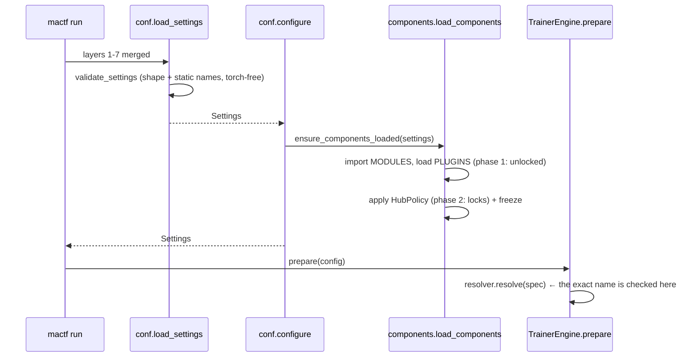

The name that a plugin provides is therefore *unknown* to `validate_settings` and *known* to
the resolver — which is exactly why `may_be_extended` exists and why `E011`/`ComponentMissing`
is the code a typo gets when `MODULES` is set. To make the order real and idempotent:

```python
# mactf/components/plugins.py   (addition)
_LAST_BLOCK: dict[str, Any] | None = None
_LAST_REPORT: LoadReport | None = None


def ensure_components_loaded(settings: Any = None) -> LoadReport:
    """Load components once per distinct ``COMPONENTS`` block; safe to call anywhere.

    Every caller needs the same guarantee and none can be sure it is first: ``conf.configure``
    (the CLI), ``TrainerEngine.prepare`` (a run built in code), ``RunManager.create`` (the API
    runs several), ``mactf check``. Comparing the canonical block means a settings reload in a
    test loads the new one, and a second call in the same process does nothing.
    """
    global _LAST_BLOCK, _LAST_REPORT
    if settings is None:
        from ..conf import get_settings

        settings = get_settings()
    block = dict(settings.get("COMPONENTS") or {}) if hasattr(settings, "get") else {}
    from .reflect import canonical_json

    fingerprint = canonical_json(block)
    with _LOCK:
        if _LAST_BLOCK is not None and canonical_json(_LAST_BLOCK) == fingerprint:
            assert _LAST_REPORT is not None
            return _LAST_REPORT
        report = load_components(block)
        _LAST_BLOCK = block
        _LAST_REPORT = report
        return report
```

and the one call site in `conf.configure`:

```python
# mactf/conf.py   (configure, after _settings = load_settings(...))
    apps_module.reset_registry()
    _clear_http_caches()
    # Document 17 section 15.5: the registry is configured with the settings that
    # describe it, before any consumer resolves a spec. Idempotent and torch-free
    # unless a MODULE imports torch, which is the project's own decision.
    from .components.plugins import ensure_components_loaded

    ensure_components_loaded(_settings)
    return _settings
```

`reset_for_tests` (§4.2) gains the two module globals so a test that changes `COMPONENTS`
between cases reloads:

```python
def reset_for_tests() -> None:
    """Forget what was loaded. Test-only: registrations themselves are not undone."""
    global _LAST_BLOCK, _LAST_REPORT
    with _LOCK:
        _LOADED.clear()
        _LAST_BLOCK = None
        _LAST_REPORT = None
        HUB.configure(HubPolicy())
```

---

### 15.6 Environment overrides: `MACTF_A__B__C`

#### 15.6.1 The rule

`_apply_env` (`conf.py:588-596`) walks the *top level* and skips every mapping-valued key. So
`MACTF_TRAINER=...` does nothing, `MACTF_TRAINER__MUTATION__ENABLED` does nothing, and
`MACTF_SEED=7` works. Sections 3, 10, 11 and 12 need the middle form; this is it.

| Form | Meaning |
|---|---|
| `MACTF_<KEY>` | A top-level *scalar* setting: `MACTF_SEED=7`, `MACTF_DEBUG=true`. Unchanged. |
| `MACTF_<BLOCK>__<KEY>` | One key of a block: `MACTF_ORCHESTRATOR__ENGINE=trainer`. |
| `MACTF_<BLOCK>__<KEY>__<SUB>` | A nested mapping: `MACTF_TRAINER__MUTATION__ENABLED=true`. Up to four segments. |
| `MACTF_<BLOCK>=...` | **Refused** when the block is a mapping: replacing a whole block from one variable is a configuration file in an environment variable, and it would bypass every per-key type check. |

A segment is the key's spelling in `DEFAULTS` (upper case), because that is what
`Settings` holds. The value is coerced by the type the key already has, exactly as a flat
variable is (`_coerce_env`, `conf.py:566-585`), which is what makes `PROTECTED='["peer-1"]'`
a list and `ENABLED=true` a bool. A key that does not exist yet can be created only where
the default is an absent or empty mapping — the same `_is_open` rule `--set` uses.

#### 15.6.2 The code

```python
# mactf/conf_overrides.py   (made public so conf.py uses the one rule)
def is_open_container(defaults: Mapping[str, Any], container_path: Sequence[str]) -> bool:
    """A container accepts new keys when its default is absent or an empty mapping."""
    return _is_open(defaults, container_path)


_is_open = is_open_container   # the private name the rest of this module already uses
```

```python
# mactf/conf.py   (replaces _apply_env, conf.py:588-596)
#: ``MACTF_A__B__C__D`` is the deepest form the documented blocks need
#: (``TRAINER.WEIGHT_UPDATE.params.alpha`` is four). A fifth segment is a typo.
_MAX_ENV_SEGMENTS = 4


def _env_segments(key: str) -> tuple[str, ...]:
    """``MACTF_TRAINER__MUTATION__ENABLED`` -> ``("TRAINER", "MUTATION", "ENABLED")``."""
    return tuple(part.strip() for part in key[len("MACTF_") :].split("__"))


def _apply_env(values: dict[str, Any]) -> None:
    """Apply ``MACTF_*`` variables: flat scalars and ``__``-separated block leaves.

    Document 15 §14 non-goal 2 said this walks scalars only. Document 17 section 15.6
    amends it, because a component spec is a mapping and a mapping is what every block a
    project tunes has become. Nothing changes for a variable without ``__``.
    """
    from .conf_overrides import is_open_container

    for key in sorted(os.environ):                  # deterministic, so a note is stable
        if not key.startswith("MACTF_") or key in _ENV_NON_SETTINGS:
            continue
        segments = _env_segments(key)
        raw = os.environ[key]
        if not segments[0]:
            raise ImproperlyConfigured(f"E018: {key} names no setting")

        first = segments[0]
        if first not in values or first.startswith("_"):
            raise ImproperlyConfigured(
                f"E018: {key}: unknown setting {first!r}"
                + _close(first, [name for name in values if not name.startswith("_")])
            )
        if len(segments) == 1:
            if isinstance(values[first], dict):
                raise ImproperlyConfigured(
                    f"E018: {key} sets {first}, which is a mapping; override one key "
                    f"instead: {key}__<KEY>"
                )
            values[first] = _coerce_env(first, raw, values[first])
            continue

        if len(segments) > _MAX_ENV_SEGMENTS:
            raise ImproperlyConfigured(
                f"E018: {key} has {len(segments)} segments; at most {_MAX_ENV_SEGMENTS} "
                "are supported (BLOCK__KEY__SUB__LEAF)"
            )
        if any(not segment for segment in segments):
            raise ImproperlyConfigured(f"E018: {key} has an empty segment")

        container: Any = values
        walked: list[str] = []
        for index, segment in enumerate(segments[:-1]):
            if not isinstance(container, dict):
                raise ImproperlyConfigured(
                    f"E018: {key}: {'.'.join(walked)} is not a mapping"
                )
            if segment not in container:
                if not is_open_container(DEFAULTS, walked):
                    raise ImproperlyConfigured(
                        f"E018: {key}: {'.'.join(walked) or 'settings'} has no key "
                        f"{segment!r}{_close(segment, list(container))}"
                    )
                container[segment] = {}
                # Created rather than declared: worth one line, because the value is now
                # in the settings and not in any file the reader can grep.
                log.warning(
                    "W007 %s creates %s.%s, which no default declares",
                    key, ".".join(walked), segment,
                )
            child = container[segment]
            walked.append(segment)
            if not isinstance(child, dict):
                raise ImproperlyConfigured(
                    f"E018: {key}: {'.'.join(walked)} is a {type(child).__name__}, not a "
                    "mapping; set it whole or use a key of the mapping"
                )
            container = child

        last = segments[-1]
        if last not in container:
            if not is_open_container(DEFAULTS, walked):
                raise ImproperlyConfigured(
                    f"E018: {key}: {'.'.join(walked)} has no key {last!r}"
                    f"{_close(last, list(container))}"
                )
            log.warning(
                "W007 %s creates %s.%s, which no default declares",
                key, ".".join(walked), last,
            )
            container[last] = _coerce(raw)
            continue
        container[last] = _coerce_env("__".join((*walked, last)), raw, container[last])
```

`_close` is `conf_overrides._suggest` for the two places `conf.py` now needs it:

```python
# mactf/conf.py   (helper; ``import difflib`` joins the imports)
def _close(word: str, candidates: Sequence[str]) -> str:
    """``"; did you mean X?"`` for a typo in a variable name, or the empty string."""
    close = difflib.get_close_matches(word, list(candidates), n=3, cutoff=0.6)
    return f"; did you mean {', '.join(close)}?" if close else ""
```

**Three behaviours chosen deliberately:**

1. **A mapping-valued flat variable is refused, not merged.** `MACTF_TRAINER=...` used to be
   silently ignored (`if ... isinstance(values[name], dict): continue`). Ignoring it is how a
   team spends an afternoon on "why did six epochs not take". It is now `E018`.
2. **A created key warns (`W007`).** `TRAINER.MUTATION.PROTECTED` may legitimately arrive
   before the block is written in YAML, but the settings then differ from every file on disk,
   and a warning is the only trace.
3. **`__` never means "or".** `MACTF_TRAINER__PEER_STRATEGY_OVERRIDES__team-a` cannot exist,
   because `team-a` is not a Python identifier-shaped key and would need quoting to survive a
   shell. The documented form is a whole-mapping assign:
   `MACTF_TRAINER__PEER_STRATEGY_OVERRIDES='{"team-*": independent}'`, which the
   `_coerce_env` path parses as YAML. §15.9.2 shows it.

---

### 15.7 `--set` and component specs

#### 15.7.1 What fails today

`apply_overrides` (`conf_overrides.py:124-191`) walks the dotted path and raises as soon as a
segment is not a mapping:

```text
--set TRAINER.WEIGHT_UPDATE.type=uniform
  .--set 'TRAINER.WEIGHT_UPDATE.type=uniform': TRAINER.WEIGHT_UPDATE is a str, not a mapping
```

`TRAINER.WEIGHT_UPDATE` is the string `"kappa_softmax"` (`conf.py:44`), so the object a spec
layer wants to write into does not exist yet. The three forms that must work:

| Command | Resulting value |
|---|---|
| `--set TRAINER.WEIGHT_UPDATE=uniform` | `"uniform"` — the name form, works today |
| `--set TRAINER.WEIGHT_UPDATE.type=uniform` | `{"type": "uniform"}` |
| `--set TRAINER.WEIGHT_UPDATE.params.temperature=2` | `{"params": {"temperature": 2}}` |
| `--set 'TRAINER.WEIGHT_UPDATE={type: trimmed_mean, params: {trim: 0.2}}'` | parsed as YAML; works today |

#### 15.7.2 The promotion rule

One rule, in the loop that already decides whether a container exists:

> Walking `KEY.SEG...`, when `SEG` holds a **scalar** (a `str`) or `None`, and the next path
> segment is `params`, replace the scalar with `{"params": {}}`. When the next segment is the
> **last** one and is `type` or `import`, replace it with `{}`. Otherwise refuse, as today.

```python
# mactf/conf_overrides.py   (new constants beside _KEY)
#: The leaf names of a component spec (section 5.1). ``name`` is accepted by
#: ``spec_shape_problem`` but is not promoted: a spec is named by ``type`` or ``import``.
_SPEC_LEAVES = frozenset({"type", "import", "params"})


def _promotion(remaining: Sequence[str]) -> dict[str, Any] | None:
    """The mapping a scalar becomes so the remaining path can be written, or ``None``.

    ``("params", "temperature")`` -> ``{"params": {}}``
    ``("type",)``                -> ``{}``
    anything else                -> ``None`` (refused by the caller, as today)
    """
    if not remaining:
        return None
    head = remaining[0].lower()
    if head == "params":
        return {"params": {}}
    if len(remaining) == 1 and head in {"type", "import"}:
        return {}
    return None
```

```python
# mactf/conf_overrides.py   (apply_overrides, the walk; replaces lines 143-165)
        container: Any = values
        walked: list[str] = []
        for index, segment in enumerate(path[:-1]):
            if not isinstance(container, dict):
                raise CommandError.usage(
                    f"--set {override.text!r}: {'.'.join(walked)} is not a mapping"
                )
            if segment not in container:
                if _is_open(defaults, walked):
                    container[segment] = {}
                else:
                    raise CommandError.usage(
                        f"{'.'.join(walked) or 'settings'} has no key {segment!r} in "
                        f"--set {override.text!r}{_suggest(segment, list(container))}"
                    )
            child = container[segment]
            walked.append(segment)
            if isinstance(child, (list, tuple)):
                raise CommandError.usage(
                    f"--set {override.text!r}: {'.'.join(walked)} is a list; "
                    f"set the whole list: --set '{'.'.join(walked)}=[...]'"
                )
            if not isinstance(child, dict):
                promoted = _promotion(path[index + 1 :])
                if promoted is None or not isinstance(child, (str, type(None))):
                    # A scalar is only a *spec* placeholder; a float or a bool is a
                    # leaf, and walking into it cannot mean anything.
                    raise CommandError.usage(
                        f"--set {override.text!r}: {'.'.join(walked)} is a "
                        f"{_type_name(child)}, not a mapping"
                    )
                container[segment] = promoted
                child = promoted
            container = child
```

The last segment's handling is unchanged except for one case that now needs a hint rather than
a bare refusal: writing `--set TRAINER.WEIGHT_UPDATE.params={}` is a leaf write of a mapping
over a scalar, which `_compatible` (`conf_overrides.py:77-90`) refuses because `str` and `dict`
do not match. That is correct (it would discard the name), and the message already names both
types.

#### 15.7.3 What the promotion does *not* do

- It does not promote an `int`, `bool` or `float`. `--set TRAINER.EPOCHS.value=3` still says
  `TRAINER.EPOCHS is a int, not a mapping`, which is the only readable answer.
- It does not promote across a list. `--set SCORING.STAGES.reward.type=x` works only once
  `STAGES` exists as a mapping; the default `{}` is open, so the *first* segment creates it,
  and the rule above then handles `reward` (a scalar does not exist, it is created as `{}`
  because `defaults` has no `SCORING.STAGES.reward`). The result is
  `{"STAGES": {"reward": {"type": "x"}}}`, which is what §6.2 documents.
- It does not touch `_compatible`. A promoted `{}` meets `old = None` (the `AGGREGATOR`
  default) and `old = "kappa_softmax"` (the `WEIGHT_UPDATE` default) under the existing
  `isinstance(old, (dict, ...))` branches, because promotion replaces the old value before
  the compatibility check runs on the *leaf*.

---

### 15.8 The complete key reference

Every key this document adds, in one place, so a reviewer can check that no section invented
a setting with no reader and no reader has a setting with no section.

#### 15.8.1 `COMPONENTS` (§15.1)

| Key | Type | Default | Read by | Refusal |
|---|---|---|---|---|
| `ALLOW_BUILTIN_OVERRIDE` | bool | `false` | `ComponentRegistry._check_replace` (§3.4, I10) | `ComponentLocked` when a built-in is replaced without it |
| `LOCKED` | list of `kind:name` / `slot:<path>` | `[]` | `HubPolicy.is_locked`, `SlotTable._slot_locked` (§4.5) | `E016` for a malformed pattern; `ComponentLocked` at the attempt |
| `STRICT_LEGACY` | bool | `false` | `_check_replace` `via="legacy"` (§3.4) | `ComponentLocked` for a legacy write |
| `ALLOW_IMPORT` | bool | `false` | `ComponentResolver._import` (§5.4) | `ComponentImportDenied` on an untrusted surface |
| `IMPORT_ALLOWLIST` | list of `fnmatch` patterns | `[]` | same | `E017` for a bad entry or a blanket `*` |
| `MAX_PER_KIND` | int >= 1 | `512` | `ComponentRegistry.register` | `ComponentContractError` when full |
| `PLUGINS` | `"auto"` / `"off"` / list | `"auto"` | `load_components` (§4.2) | `E015` for anything else |
| `MODULES` | list of dotted names | `[]` | `load_components` (§4.2) | `E014` for a path or a bad segment |
| `FREEZE_AFTER_LOAD` | bool | `false` | `load_components` phase 2 | `ComponentLocked` on a later global write |
| `STRICT_RESTORE` | bool | `false` | `ComponentRestorer._strict` (§14.4.1) | `E094` instead of `W052` |
| `API_ALLOW_IMPORT` | alias of `ALLOW_IMPORT` | — | `_canonical_components` | `E013` when both are set to different values; `W006` when both agree |

#### 15.8.2 `COMPLIANCE` (§6.6, wired here)

| Key | Type | Default | Read by | Refusal |
|---|---|---|---|---|
| `MIN_FLOOR_LAMBDA` | float > 0 | `1.0` | `GuardPolicy`, `PenaltyScorer.min_floor_lambda` | `ImproperlyConfigured` naming the rule and the value |
| `GUARD_MODE` | `enforce` / `fallback` | `enforce` | `ComplianceGuard` (§6.4.2) | `ImproperlyConfigured` for any other string |
| `REWARD_CEILING` | float > 0 | `10000.0` | `ComplianceGuard` C008 | same |
| `TOLERANCE` | float in `[0, 1e-3]` | `1e-9` | every guard comparison | same |
| `TRUST_BUILTIN` | bool | `true` | `ComplianceGuard._trusted` (§6.4.3) | — |

#### 15.8.3 Blocks extended by sections 9 to 12

| Where | Keys | Section |
|---|---|---|
| `TRAINER` | `POLICY`, `ALLOW_UNSAFE_POLICY`, `STEP_GUARD`, `LOSS_COMPLIANCE`, `COMPLIANCE_COEFFICIENT` | 7 |
| `TRAINER` | `WEIGHT_UPDATE_OVERRIDES`, `WEIGHT_GUARD`, `WEIGHT_OPTIONS`, `AGGREGATOR` | 10 |
| `TRAINER` | `PEER_STRATEGY_OVERRIDES`, `PEER_STRATEGY_OPTIONS`, `STRATEGY_GUARD`, `FREEZE_MODE` | 11 |
| `TRAINER` | `MUTATION` (+ ten sub-keys) | 12 |
| `OPTIMIZER` | `OVERRIDES`, `MIGRATE`, `VERIFY`, `STRICT_GLOBS`, `PARAMS`; `TYPE` accepts any registered name | 9 |
| `SCORING` | `STAGES` | 6 |
| `COOPETITION` | `KAPPA_OVERRIDES` | 10 |
| `ORCHESTRATOR` | `ENGINE`, `ENGINE_COMPAT`, `ALLOW_ENGINE_SWITCH` | 13 |

Not one of them is a new *file*: `trainer.yaml` already owns `TRAINER` (`conf_files.py:73-75`),
`optimizer.yaml` owns `OPTIMIZER`, `scorer.yaml` owns `SCORING`, `orchestrator.yaml` owns
`COOPETITION` and `ORCHESTRATOR`. A project that puts any of the new keys in the *wrong* file
gets the ownership refusal naming both files (`_ownership_problems`), which is the behaviour
document 15 §3.3 asked for.

---

### 15.9 Worked examples

#### 15.9.1 A project that customizes, in files

```yaml
# conf/components.yaml
COMPONENTS:
  MODULES: ["acme_scoring.components", "acme_scoring.strategies"]
  ALLOW_BUILTIN_OVERRIDE: false
  LOCKED: ["scorer:penalty", "slot:SCORING.CHAIN.penalty"]
  MAX_PER_KIND: 64
  STRICT_RESTORE: true

COMPLIANCE:
  MIN_FLOOR_LAMBDA: 2.0
  GUARD_MODE: enforce
```

```yaml
# conf/trainer.yaml
TRAINER:
  WEIGHT_UPDATE:
    type: trimmed_mean
    params: {trim: 0.2}
  WEIGHT_UPDATE_OVERRIDES:
    "team-a": uniform
  PEER_STRATEGY: kappa_softmax
  POLICY: {type: co_distill}
  STEP_GUARD: {MODE: quarantine, SNAPSHOT: auto}
```

```yaml
# conf/rl.yaml
RL:
  ADVANTAGE: {type: clipped, params: {clip: 3.0}}
  OVERRIDES:
    ADVANTAGE:
      "peer-b*": {type: clipped, params: {clip: 1.0}}
  UNCONSUMED: error
```

#### 15.9.2 The same three settings, four ways

| Layer | Example | Lands as |
|---|---|---|
| `settings.py` | `TRAINER = {"WEIGHT_UPDATE": {"type": "trimmed_mean", "params": {"trim": 0.2}}}` | the mapping, `_mark_authored` records `WEIGHT_UPDATE` |
| `conf/` | the YAML above | decoded by `_load_yaml`, deep-merged |
| `CONFIG_FILES` | the same file, cited from `CONFIG_FILES` (which `mactf.yaml` owns) | merged after `conf/`, so it wins |
| `MACTF_*` | `MACTF_TRAINER__WEIGHT_UPDATE__TYPE=uniform` | `{"type": "uniform"}` — the params of the lower layer survive, because `ComponentSpec.merged_over` merges a patch (§5.5) |
| `MACTF_*`, whole mapping | `MACTF_TRAINER__WEIGHT_UPDATE_OVERRIDES='{"team-*": uniform}'` | parsed as YAML to a mapping |
| `--config` | `mactf run --config experiments/trim.yaml` | merged above the environment |
| `--set`, name | `mactf run --set TRAINER.WEIGHT_UPDATE=uniform` | the string, replacing the mapping wholesale |
| `--set`, leaf | `mactf run --set TRAINER.WEIGHT_UPDATE.params.trim=0.3` | `{"params": {"trim": 0.3}}` |

`--set` is last, so this command wins over all four files:

```text
mactf run --epochs 3 \
  --set COMPONENTS.STRICT_RESTORE=true \
  --set TRAINER.WEIGHT_UPDATE.params.trim=0.3 \
  --set 'TRAINER.PEER_STRATEGY_OVERRIDES={"team-*": cooperative}' \
  --set ORCHESTRATOR.ENGINE=trainer
```

#### 15.9.3 The override chain a resolver sees

For `TRAINER.WEIGHT_UPDATE`, given `conf/trainer.yaml` with `{type: trimmed_mean, params: {trim: 0.1}}`
and `--set TRAINER.WEIGHT_UPDATE.params.trim=0.3`:

| Layer | Value after merge |
|---|---|
| 1. default | `"kappa_softmax"` |
| 3. `conf/trainer.yaml` | `{"type": "trimmed_mean", "params": {"trim": 0.1}}` |
| 5. `MACTF_*` | unchanged (the variable addresses `params.trim` only if written) |
| 7. `--set` | `{"type": "trimmed_mean", "params": {"trim": 0.3}}` |
| 8. API body | `{"params": {"trim": 0.3, "temperature": 2.0}}` — a patch, applied with `merged_over` |
| 9. code instance | wins outright, recorded as `runtime`, `adopt`ed without a build |

The checkpoint then records `identity["components"]["weight_update"]["TRAINER.WEIGHT_UPDATE"]`
with `spec_hash = spec_hash({"type": "trimmed_mean", "params": {"trim": 0.3, "temperature": 2.0}})`.

---

### 15.10 Test matrix for section 15

| # | Test | Kind | Pins |
|---|---|---|---|
| 1 | `test_conf_components.py::test_defaults_block_has_every_documented_key` | unit | 15.8.1 and `COMPONENTS_DEFAULTS` cannot drift |
| 2 | `test_conf_components.py::test_defaults_are_inert` | unit | **P1**: a project writing nothing gets `HubPolicy()` and no `W006`/`W007` |
| 3 | `test_conf_components.py::test_the_block_is_a_copy_of_the_constant` | unit | `test_conf_blocks.py:41-46`'s rule, for the new block |
| 4 | `test_conf_components.py::test_a_non_bool_flag_is_e013` | unit | each of the five flags, one parametrized row |
| 5 | `test_conf_components.py::test_an_unknown_key_is_e013` | unit | message lists the accepted set |
| 6 | `test_conf_components.py::test_a_module_path_is_e014` | unit | `"./components.py"`, `"acme/scoring"`, `"acme."`, `"acme..x"` |
| 7 | `test_conf_components.py::test_plugins_forms` | unit | `auto`, `off`, a list; `"sometimes"` is `E015`; `[""]` is `E015` |
| 8 | `test_conf_components.py::test_a_lock_pattern_needs_a_kind_or_slot` | unit | `"penalty"`, `"scorer:"`, `":penalty"`, `"nonsense:penalty"` → `E016` |
| 9 | `test_conf_components.py::test_a_blanket_allowlist_is_refused` | unit | `["*"]` → `E017` |
| 10 | `test_conf_components.py::test_the_alias_is_w006` | unit | `API_ALLOW_IMPORT` alone sets `allow_import`; both set to the same value warns once |
| 11 | `test_conf_components.py::test_the_alias_conflict_is_e013` | unit | `true` and `false` together |
| 12 | `test_conf_components.py::test_strict_restore_reaches_the_hub_policy` | unit | `policy_from_settings` → `HubPolicy.strict_restore`; §14.4.1's `getattr` path and the field agree |
| 13 | `test_conf_known.py::test_the_table_matches_the_live_registries` | unit | **the missing `test_conf_mirrors.py`**: `known.BUILTIN_NAMES[kind] == frozenset(legacy table)` for all six kinds, importing torch once |
| 14 | `test_conf_known.py::test_every_kind_id_is_covered_or_explicitly_none` | unit | `known_names(k)` is not `None` for the six, and is `None` for `rl_function.loss` |
| 15 | `test_conf_known.py::test_a_scorer_registered_by_a_plugin_is_accepted` | unit | register then `component_ref_problem` → `None` |
| 16 | `test_conf_known.py::test_an_unknown_name_is_refused_without_modules` | unit | the exact `"must be one of"` message `test_conf_blocks.py:192-193` matches |
| 17 | `test_conf_known.py::test_an_unknown_name_is_deferred_with_modules` | unit | `MODULES` set → `None` at load, `ComponentMissing` at build |
| 18 | `test_conf_known.py::test_an_unknown_name_is_deferred_with_an_entry_point` | unit | a fake `metadata.entry_points` |
| 19 | `test_conf_known.py::test_a_mapping_spec_needs_type_or_import` | unit | `{}`, `{"params": {}}` refused; `{"import": ...}` accepted without a name check |
| 20 | `test_conf_env.py::test_a_nested_override_reaches_the_block` | unit | `MACTF_ORCHESTRATOR__ENGINE=trainer` |
| 21 | `test_conf_env.py::test_a_third_segment_reaches_a_sub_key` | unit | `MACTF_TRAINER__MUTATION__ENABLED=true` → `bool` |
| 22 | `test_conf_env.py::test_the_value_is_coerced_by_the_existing_type` | unit | `=true` → bool, `=2` → int, `'["peer-1"]'` → list |
| 23 | `test_conf_env.py::test_a_mapping_flat_variable_is_e018` | unit | `MACTF_TRAINER=...` |
| 24 | `test_conf_env.py::test_an_unknown_block_is_e018_with_a_suggestion` | unit | `MACTF_TRAINR__...` |
| 25 | `test_conf_env.py::test_a_scalar_container_is_e018` | unit | `MACTF_TRAINER__EPOCHS__X=1` |
| 26 | `test_conf_env.py::test_a_fifth_segment_is_e018` | unit | the depth bound |
| 27 | `test_conf_env.py::test_creating_an_undeclared_key_is_w007` | unit | `caplog` at `WARNING`, and the value present |
| 28 | `test_conf_env.py::test_a_flat_scalar_still_works` | regression | `MACTF_SEED=7`; the pre-existing path is untouched |
| 29 | `test_conf_overrides.py::test_a_spec_leaf_promotes_a_scalar` | unit | `--set TRAINER.WEIGHT_UPDATE.type=uniform` → `{"type": "uniform"}` |
| 30 | `test_conf_overrides.py::test_a_params_leaf_promotes_two_levels` | unit | `...params.trim=0.3` → `{"params": {"trim": 0.3}}` |
| 31 | `test_conf_overrides.py::test_an_import_leaf_promotes` | unit | `...import=pkg.mod:Cls` |
| 32 | `test_conf_overrides.py::test_a_non_spec_leaf_is_refused` | unit | `TRAINER.EPOCHS.value=3` still says "is a int, not a mapping" |
| 33 | `test_conf_overrides.py::test_a_list_still_refuses_a_walk` | regression | the existing message, unchanged |
| 34 | `test_conf_overrides.py::test_promotion_does_not_accept_a_float_container` | unit | `LR.value` refused |
| 35 | `test_conf_files.py::test_layout_has_nineteen_distinct_files` | unit | 15.3.4 |
| 36 | `test_conf_files.py::test_the_two_new_blocks_have_owners` | unit | `owner_of("COMPONENTS") == "components.yaml"`, `owner_of("RL") == "rl.yaml"` |
| 37 | `test_conf_files.py::test_a_key_written_by_the_wrong_file_names_both` | unit | `COMPLIANCE` in `scorer.yaml` |
| 38 | `test_startproject_conf.py::test_conf_has_nineteen_yaml_files` | cli | the count, and that both parse as mappings |
| 39 | `test_conf_blocks.py::test_every_template_leaf_equals_the_defaults_leaf[components.yaml]` | drift | picks the file up from `CONF_LAYOUT` |
| 40 | `test_conf_blocks.py::test_every_template_leaf_equals_the_defaults_leaf[rl.yaml]` | drift | same |
| 41 | `test_conf_blocks.py::test_every_owned_block_that_has_a_default_is_written_by_its_file` | drift | a default with no template line fails here |
| 42 | `test_conf_components.py::test_ensure_components_loaded_is_idempotent` | unit | two calls, one `importlib.import_module` (monkeypatched) |
| 43 | `test_conf_components.py::test_a_changed_block_reloads` | unit | a settings reload with different `MODULES` loads once more |
| 44 | `test_import_weight.py::test_a_settings_load_still_imports_no_torch` | regression | `known.py` at module scope, `registry.py` lazily |
| 45 | `tests/cli/test_help_snapshot.py::test_help_matches_the_snapshot` | regression | **unchanged**: section 15 adds no command and no flag |

---

### 15.11 Codes, files and behaviour changes

#### 15.11.1 Codes introduced by section 15

| Code | Where | Meaning |
|---|---|---|
| `E013` | `_validate_components`, `_canonical_components` | The `COMPONENTS` block is not a mapping, has an unknown key, gives a flag a non-bool, or sets an alias and its canonical key to different values |
| `E014` | `_validate_components` | A `COMPONENTS.MODULES` entry is not a dotted module name (a path, an empty segment, a trailing dot) |
| `E015` | `_validate_components` | `COMPONENTS.PLUGINS` is neither `auto`, `off`, nor a list of non-empty names |
| `E016` | `_validate_components` via `lock_pattern_problem` | A `COMPONENTS.LOCKED` entry is not `kind:name` or `slot:<path>`, or names an unknown kind |
| `E017` | `_validate_components` | A `COMPONENTS.IMPORT_ALLOWLIST` entry is not a pattern, or is a blanket `*`/`**` |
| `E018` | `_apply_env` | An environment override that cannot be applied: an empty segment, an unknown block or key, a mapping-valued flat variable, a scalar treated as a mapping, or more than four segments |
| `W006` | `_canonical_components` | `COMPONENTS.API_ALLOW_IMPORT` and `COMPONENTS.ALLOW_IMPORT` are both set to the same value: one line can be deleted |
| `W007` | `_apply_env` | An environment override created a key no `DEFAULTS` block declares |

`E001`, `E011` and `E012` are *not* introduced here: `E011` is a spec naming an injected
parameter (§6.2) and `E012` is a spec with both flat params and a `params` mapping (§5.1),
both raised by the resolver at build. `E002`..`E010` are reserved for the model's own codes
and are not used by any section of this document.

#### 15.11.2 Files touched by section 15

| File | Change |
|---|---|
| `mactf/conf.py` | `COMPONENTS_DEFAULTS`, `COMPLIANCE_DEFAULTS`, `RL_DEFAULTS`; `DEFAULTS` gains three copies; `_COMPONENTS_ALIASES`, `_canonical_components`, `_validate_components`, `_close`; `_PEER_STRATEGY_NAMES`/`_WEIGHT_STRATEGY_NAMES` become views of `known.BUILTIN_NAMES`; `_validate_blocks` calls `_validate_components` first, `_validate_compliance` after the NON_OFFSETTABLE check, and uses `component_ref_problem` in the trainer branch; `_NEW_BLOCKS` gains three names; `_apply_env` rewritten; `configure` calls `ensure_components_loaded`; `log` added |
| `mactf/components/known.py` (new) | `BUILTIN_NAMES`, `LOWERCASE_KINDS`, `registry_names`, `known_names`, `may_be_extended`, `spec_shape_problem`, `component_ref_problem`, `lock_pattern_problem` |
| `mactf/components/registry.py` | `HubPolicy.strict_restore` |
| `mactf/components/plugins.py` | `policy_from_settings` passes `strict_restore`; `ensure_components_loaded`; `reset_for_tests` clears the cached block |
| `mactf/conf_overrides.py` | `is_open_container` public; `_SPEC_LEAVES`, `_promotion`; `apply_overrides` promotes a scalar spec leaf |
| `mactf/conf_files.py` | two `ConfFile` entries (`components.yaml`, `rl.yaml`) |
| `mactf/templates/conf/components.yaml.tpl`, `rl.yaml.tpl` (new) | the two files above |
| `tests/test_conf_components.py`, `test_conf_known.py`, `test_conf_env.py`, `test_conf_overrides.py` (new) | rows 1-19, 20-28, 29-34, 42-43 |
| `tests/test_conf_files.py`, `test_startproject_conf.py`, `tests/cli/test_conf_mirrors.py` (new) | rows 35-41, 13 |

#### 15.11.3 Behaviour changes with nothing configured

A project that writes none of the new keys sees four differences, all of them in *metadata*,
none in a number, a weight or a score:

1. **`Settings.as_dict()` gains three blocks.** `mactf config`, a support bundle and the
   `runs.settings` JSON all show `COMPONENTS`, `COMPLIANCE` and `RL` with their defaults.
   `_AUTHORED` does not list them, so `mactf config --changed` shows nothing new; iterating
   `DEFAULTS` twice in a row (`test_conf_equivalence`'s leaf comparison) still matches,
   because both sides of that comparison read the same `DEFAULTS`.
2. **`conf/` has two more possible files.** A project that does not create them gets the
   existing notes (`components.yaml: absent, defaults apply`), and a project that creates a
   file named something else still gets the "no loader reads" refusal, which now suggests the
   two new names in its list.
3. **`MACTF_TRAINER=...` is now an error instead of being ignored** (`E018`). This is the one
   change that can fail a working command line, and it can only fire on a spelling that never
   did anything.
4. **`HUB` is configured at `configure()`.** `ALLOW_BUILTIN_OVERRIDE: false`,
   `MAX_PER_KIND: 512` and an empty `LOCKED` are exactly `HubPolicy()`'s defaults, so a
   registration that succeeded before still succeeds; the only new failure mode is a project
   that relied on importing its components *after* a settings load having registered
   silently — which is what `COMPONENTS.MODULES` is for, and `W001`/`W005` already report the
   legacy path.

What does **not** change: every default value in every existing block (`test_conf_blocks.py`'s
drift test and `test_conf_equivalence.py`'s leaf comparison both assert it); the seventeen
existing `conf/` files and their contents; `--set` on any path that is not a component spec;
`MACTF_<SCALAR>` for every existing scalar; the help snapshot (section 15 adds no command,
no flag and no argument); and every checkpoint, because none of these keys is read by a
hasher.

---

---

## 16. CLI and API

Sections 3 to 15 define the component model, the guards and the configuration. This section
is the **operator surface** over them: what a person types, and what a tool sends, to *see*
components, *validate* a spec before a run, *scaffold* a new component, *diff* two manifests,
*change* a live run's components, and *mutate* its peer tree.

Everything here is **additive**. The command framework (`GroupCommand`/`Sub`, `ExitCode` and
`classify()`, the two CLI goldens, `scripts/gen_cli_docs.py`), the API framework (`ApiView`,
`authorize`, the `ROUTES` table and its parity test) and the client (`mactf.client.specs`)
already exist in the tree; this section names each file it joins, shows the code that goes in
it, and lists the generated artefacts the implementing change must regenerate. No existing verb,
route, field, scope, exit code or setting changes meaning (table in 16.4).

### 16.1 CLI

#### 16.1.1 What is added

| Surface | New or extended | File | Reads or writes |
|---|---|---|---|
| `mactf components list \| inspect \| validate \| scaffold \| diff` | new group | `mactf/management/commands/components.py` | reads the hub; `scaffold` writes one file |
| `mactf runs components show \| set` | extends `runs` | `mactf/management/commands/runs.py` | reads a run's manifest; `set` queues a spec change |
| `mactf peers mutate` | extends `peers` | `mactf/management/commands/peers.py` | simulates a `MutationPlan`; `--apply` queues it |
| `mactf run --component-module M` | extends `run` | `mactf/management/commands/run.py` | adds `M` to `COMPONENTS.MODULES` for this run only |
| completers `component_kind`, `component_name`, `slot_path` | extends the registry | `mactf/management/completion/completers.py` | read-only |

`mactf runs components set` and `mactf peers mutate --apply` are the only verbs that change a
*run*; both go through the same boundary-queued path the API uses (`SlotTable.request`, 4.4, and
`MutationEngine.request`, 12.5), so a change is applied at the next epoch boundary and never
mid-episode.

#### 16.1.2 The `components` group

The contract test (`tests/cli/test_command_contract.py`) enforces, for every command and verb:
one-sentence `help` ending in a full stop, an example on every verb, a category other than
`General`, `text` in `output_formats`, `--dry-run` on every destructive verb, no `print`,
`input` or `sys.exit`, no bare `except`, and a `completer` (or `choices`) on every argument
whose dest is in its `KNOWN_SETS` (`kind` is already in that set; the new `name` and `slot`
dests are added to it by this change). The group below is written to satisfy all of it.

```python
# mactf/management/commands/components.py   (new)
"""``mactf components``: list, inspect, validate, scaffold and diff components (section 16.1)."""

from __future__ import annotations

import argparse
import json
import keyword
import re
from pathlib import Path
from typing import Any

from ...exceptions import (
    CommandError, ComponentMissing, ImproperlyConfigured, ResourceNotFound,
)
from ..group import GroupCommand, Sub
from ..output import Column

_IDENT = re.compile(r"[A-Za-z_][A-Za-z0-9_]*")
_PARAM = re.compile(r"([A-Za-z_][A-Za-z0-9_.-]*)=(.*)")


def param_pair(text: str) -> tuple[str, Any]:
    """``K=V`` with ``V`` parsed as JSON when it is, else kept as a string."""
    match = _PARAM.fullmatch(text)
    if match is None:
        raise argparse.ArgumentTypeError(f"{text!r} is not KEY=VALUE")
    key, raw = match.groups()
    try:
        return key, json.loads(raw)
    except ValueError:
        return key, raw


#: ``kind`` for scaffold: the kinds a person writes code for (peers have ``startpeer``).
SCAFFOLD_KINDS = ("scorer", "reward_term", "weight_update", "peer_strategy", "rl_function",
                  "optimizer", "scheduler", "trainer_policy")


class Command(GroupCommand):
    help = "List, inspect, validate, scaffold and diff the pluggable training components."
    category = "Swarm"
    output_formats = ("text", "json", "yaml")
    #: ``validate`` and ``scaffold`` never need a database; ``list`` needs the plugins loaded.
    requires_settings = True
    subcommands = (
        Sub("list", "List every visible component, optionally of one kind.", aliases=("ls",),
            arguments=((("--kind",), {"default": None, "metavar": "KIND", "completer": "component_kind",
                                      "help": "Only this kind, e.g. scorer or rl_function.loss."}),
                       (("--origin",), {"default": None, "choices": ("builtin", "plugin", "project", "runtime"),
                                        "help": "Only components registered by this origin."}),
                       (("--locked",), {"action": "store_true", "default": False,
                                        "help": "Only components matched by COMPONENTS.LOCKED."})),
            examples=("mactf components list", "mactf components list --kind rl_function.loss --origin project",
                      "mactf components list --format json")),
        Sub("inspect", "Show one component: origin, mutability, parameters, contract and fingerprint.",
            arguments=((("kind",), {"completer": "component_kind"}),
                       (("name",), {"completer": "component_name"})),
            examples=("mactf components inspect weight_update kappa_softmax",
                      "mactf components inspect rl_function.loss ppo --format yaml")),
        Sub("validate", "Check a component spec against its contract without starting a run.",
            arguments=((("--kind",), {"required": True, "metavar": "KIND", "completer": "component_kind"}),
                       (("--name",), {"default": None, "metavar": "NAME", "completer": "component_name",
                                      "help": "The registered name; omit it when --import is given."}),
                       (("--import", "--import-path"), {"dest": "import_path", "default": None,
                                                        "metavar": "MODULE:ATTR",
                                                        "help": "Check an importable factory instead of a name."}),
                       (("--param",), {"action": "append", "type": param_pair, "default": None,
                                       "metavar": "KEY=VALUE",
                                       "help": "A parameter; repeat it. VALUE is JSON when it parses."}),
                       (("--spec-file",), {"default": None, "metavar": "FILE", "completer": "file",
                                           "help": "A JSON or YAML spec; '-' reads standard input."}),
                       (("--probe",), {"action": "store_true", "default": False,
                                       "help": "Also build a throwaway instance and run the author probe (8.3)."})),
            examples=("mactf components validate --kind weight_update --name trimmed_mean --param trim=0.2",
                      "mactf components validate --kind rl_function.loss --import myproj.losses:Huber --probe")),
        Sub("scaffold", "Write a ready-to-edit component module for a kind.", destructive=True,
            arguments=((("kind",), {"choices": SCAFFOLD_KINDS}),
                       (("name",), {"help": "The registered name; also the module name (snake_case)."}),
                       (("--dir",), {"default": None, "metavar": "PATH", "completer": "directory",
                                     "help": "Base directory; defaults to <project>/components."}),
                       (("--force",), {"action": "store_true", "default": False,
                                       "help": "Overwrite an existing file."}),
                       (("--dry-run",), {"action": "store_true", "default": False,
                                         "help": "Print what would be written and write nothing."})),
            examples=("mactf components scaffold weight_update my_trimmed_mean",
                      "mactf components scaffold scorer carbon_cost --dir src/mine --dry-run")),
        Sub("diff", "Compare two component manifests: runs, checkpoints, or manifest files.",
            arguments=((("left",), {"metavar": "A", "completer": "run_id",
                                    "help": "A run id, a checkpoint file, or a manifest file."}),
                       (("right",), {"metavar": "B", "completer": "run_id",
                                     "help": "The other side; 'live' means the current project settings."}),
                       (("--structural",), {"action": "store_true", "default": False,
                                            "help": "Hide changes that cannot alter behaviour (a version bump)."})),
            examples=("mactf components diff run-0007 run-0009", "mactf components diff run-0007 live --structural")),
    )

    # -- list / inspect ----------------------------------------------------
    def sub_list(self, **options):
        from ...components import HUB, ensure_components_loaded
        ensure_components_loaded(self.need_settings())
        kind = options.get("kind")
        rows = []
        for kind_id, entries in HUB.snapshot().items():
            if kind and kind != kind_id:
                continue
            for name, info in entries.items():
                if options.get("origin") and info["origin"] != options["origin"]:
                    continue
                if options.get("locked") and not info.get("locked"):
                    continue
                rows.append({"kind": kind_id, "name": name, **info})
        if kind and not rows and kind not in HUB.kinds():
            raise ResourceNotFound(f"no component kind {kind!r}; kinds: {sorted(HUB.kinds())}")
        payload = {"count": len(rows), "items": rows}
        self.out.emit(payload, text=lambda: self.out.table(rows, (
            Column("kind", "KIND"), Column("name", "NAME"), Column("origin", "ORIGIN"),
            Column("mutability", "MUTABLE"), Column("locked", "LOCKED"),
            Column("fingerprint", "FINGERPRINT", fmt=lambda value: str(value)[:12])), empty="no components"))
        return 0

    def sub_inspect(self, **options):
        from ...components import HUB, ensure_components_loaded
        ensure_components_loaded(self.need_settings())
        try:
            component = HUB.registry(options["kind"]).get(options["name"])
        except ComponentMissing as exc:
            raise ResourceNotFound(str(exc)) from exc
        payload = component.describe()
        self.out.emit(payload, text=lambda: self.out.mapping(payload))
        return 0

    # -- validate -----------------------------------------------------------
    def sub_validate(self, **options):
        from ...components import ComponentResolver, ComponentSpec, HUB, ensure_components_loaded
        from ...components.chain_validation import probe_instance
        settings = self.need_settings()
        ensure_components_loaded(settings)
        raw = self._raw_spec(options)
        findings: list[dict[str, Any]] = []
        try:
            spec = ComponentSpec.parse(options["kind"], raw)
            resolver = ComponentResolver(HUB, trusted=True)     # a CLI user is the operator (5.4)
            component = resolver.validate(spec, trusted=True)
        except ComponentMissing as exc:
            raise ResourceNotFound(str(exc)) from exc
        except ImproperlyConfigured as exc:                      # spec, param and contract errors
            findings.append({"code": getattr(exc, "code", "E005"), "severity": "error", "message": str(exc)})
        else:
            findings.extend(self._advisories(component, settings))
            if options["probe"]:
                findings.extend(probe_instance(resolver, spec))
        failed = any(item["severity"] == "error" for item in findings)
        payload = {"kind": options["kind"], "spec": raw, "ok": not failed, "findings": findings}
        self.out.emit(payload, text=lambda: self._render_findings(payload))
        return 1 if failed else 0

    def _raw_spec(self, options: dict[str, Any]) -> dict[str, Any]:
        raw: dict[str, Any] = {}
        if options.get("spec_file"):
            raw = self.read_structured(options["spec_file"])
        if options.get("name"):
            raw["type"] = options["name"]
        if options.get("import_path"):
            raw["import"] = options["import_path"]
        if options.get("param"):
            raw.setdefault("params", {}).update(dict(options["param"]))
        if not raw:
            raise CommandError.usage("give --name, --import or --spec-file")
        return raw

    @staticmethod
    def _advisories(component: Any, settings: Any) -> list[dict[str, Any]]:
        """Warnings that are not failures: ``W004`` for an unsafe policy (7.7)."""
        found = []
        if getattr(component, "unsafe", False):
            found.append({"code": "W004", "severity": "warning",
                          "message": f"{component.kind}:{component.name} is declared unsafe; it needs "
                                     "TRAINER.ALLOW_UNSAFE_POLICY to run"})
        return found

    def _render_findings(self, payload: dict[str, Any]) -> str:
        head = "ok" if payload["ok"] else "invalid"
        lines = [f"{payload['kind']}: {head}"]
        lines += [f"  {item['severity'].upper():7} {item['code']}  {item['message']}" for item in payload["findings"]]
        return "\n".join(lines)

    # -- scaffold -----------------------------------------------------------
    def sub_scaffold(self, **options):
        from ...components.scaffold import render_scaffold
        name = options["name"]
        if not _IDENT.fullmatch(name) or keyword.iskeyword(name):
            raise CommandError.usage(f"{name!r} cannot be a module name; use letters, digits and underscores")
        base = Path(options["dir"]) if options["dir"] else self.project_root() / "components"
        target = (base / f"{name}.py").resolve()
        root = base.resolve()
        if root != target and root not in target.parents:
            raise CommandError.usage(f"{name!r} would write outside {root}")
        body = render_scaffold(options["kind"], name)
        payload = {"path": str(target), "kind": options["kind"], "name": name, "bytes": len(body.encode("utf-8")),
                   "dry_run": bool(options["dry_run"])}
        if options["dry_run"]:
            self.out.emit(payload, text=lambda: f"would write {target}\n\n{body}")
            return 0
        if target.exists() and not options["force"]:
            raise CommandError.conflict(f"{target} exists; pass --force to overwrite")
        target.parent.mkdir(parents=True, exist_ok=True)
        target.write_text(body, encoding="utf-8", newline="\n")
        self.out.emit(payload, text=lambda: f"wrote {target}\nadd {name!r}'s module to COMPONENTS.MODULES to load it")
        return 0

    # -- diff ---------------------------------------------------------------
    def sub_diff(self, **options):
        from ...components.manifest import diff, render
        left, right = self._manifest(options["left"]), self._manifest(options["right"])
        changes = diff(left, right)
        if options["structural"]:
            changes = [change for change in changes if change.structural]
        payload = {"left": options["left"], "right": options["right"], "same": not changes,
                   "changes": [change.as_dict() for change in changes]}
        self.out.emit(payload, text=lambda: render(changes) or "no differences")
        return 0 if not changes else 1
```

`ensure_components_loaded`, `ComponentResolver`, `HUB.snapshot()` and `Component.describe()` are
the objects of 3.4, 3.5 and 5.2; `probe_instance` is `verify_function`'s generalisation over every
kind (8.3); `render_scaffold` is below; `manifest.diff`/`render` are 14.4. The helpers
`read_structured`, `project_root`, `conflict` and `mapping` already exist on `BaseCommand`
and `Printer`; `_manifest` resolves its argument in the order *file, checkpoint, run id, the word
`live`* and raises `ResourceNotFound` when none matches.

**`mactf components list` output** (the column set is what the golden pins):

```text
KIND                   NAME             ORIGIN   MUTABLE  LOCKED  FINGERPRINT
scorer                 reward           builtin  static   yes     3a91c0b2e7d4
scorer                 carbon_cost      project  episode  no      b04e9a117c25
weight_update          kappa_softmax    builtin  episode  no      91ce77a0d3f8
weight_update          trimmed_mean     builtin  episode  no      5d20c88e41b9
rl_function.loss       ppo              builtin  step     no      e1f37b0a9c60
rl_function.loss       huber            project  step     no      7a8c2d5e0f13
```

**`mactf components validate` output**, for a failing and a warning spec:

```text
$ mactf components validate --kind weight_update --name trimmed_mean --param trimm=0.2
weight_update: invalid
  ERROR   E004  weight_update:trimmed_mean does not accept 'trimm'; accepted: ['trim']
$ echo $?
1

$ mactf components validate --kind trainer_policy --import myproj.policies:Greedy
trainer_policy: ok
  WARNING W004  trainer_policy:greedy is declared unsafe; it needs TRAINER.ALLOW_UNSAFE_POLICY to run
```

An unknown name is not a finding but a missing thing: it exits `3`, naming the accepted set
(`E001`).

#### 16.1.3 Scaffolds

`render_scaffold(kind, name)` returns a module with the registration decorator, the contract
(section 3.7) filled in as a stub that raises `NotImplementedError` *inside the method body
only*, the `mutability` and `origin` declarations, a `PARAMS` mapping so `inspect` has something
to show, and a test stub. One template per kind, parametrised by `ComponentKind`:

```python
# mactf/components/scaffold.py   (new)
"""Source text for ``mactf components scaffold`` (section 16.1)."""

from __future__ import annotations

_HEADER = '''"""{kind} component: {name}.

Load it by adding this module to COMPONENTS.MODULES in conf/settings.yaml. See the
contract for a {kind}: mactf.components.contracts.{contract}.
"""

from __future__ import annotations

from mactf.components import register
'''

_BODIES: dict[str, str] = {
    "weight_update": '''

@register("weight_update", "{name}", mutability="episode", params={{"temperature": (float, 1.0)}})
class {cls}:
    """Turn per-peer kappas into simplex weights. Return a tensor that sums to 1."""

    def __init__(self, temperature: float = 1.0) -> None:
        self.temperature = temperature

    def __call__(self, ctx):
        raise NotImplementedError("compute ctx.kappas -> weights; WeightGuard projects the result")
''',
    "scorer": '''

@register("scorer", "{name}", mutability="episode", role="penalty")
class {cls}:
    """One scoring stage. ``role`` is reward, penalty or warning; a guard enforces it."""

    def score(self, ctx):
        raise NotImplementedError("return a ScorerOutput; ComplianceGuard checks it against the reference")
''',
    "peer_strategy": '''

@register("peer_strategy", "{name}", mutability="episode")
class {cls}:
    """Decide, per group, which peers train this step. StrategyGuard checks the choice."""

    def plan(self, ctx):
        raise NotImplementedError("return a StepPlan for ctx.group")
''',
    "reward_term": '''

@register("reward_term", "{name}", mutability="episode")
class {cls}:
    def __call__(self, ctx):
        raise NotImplementedError("return a non-negative bucket amount; the REWARD_CEILING guard caps the sum")
''',
    "rl_function": '''

@register("rl_function.loss", "{name}", mutability="step")
class {cls}:
    def __call__(self, batch, *, logits, values):
        raise NotImplementedError("return a differentiable scalar; the probe checks C- and F-codes")
''',
    "optimizer": '''

@register("optimizer", "{name}", mutability="episode")
class {cls}:
    def build(self, params, **hyper):
        raise NotImplementedError("return an object with step() and zero_grad()")
''',
    "scheduler": '''

@register("scheduler", "{name}", mutability="episode")
class {cls}:
    def build(self, optimizer, **hyper):
        raise NotImplementedError("return an object with step(); it must be bound to the optimizer given")
''',
    "trainer_policy": '''

@register("trainer_policy", "{name}", mutability="static")
class {cls}:
    """Own the step. StepGuard wraps it unless ``unsafe = True`` and the operator allows that."""

    def step(self, trainer, batch):
        raise NotImplementedError("return a StepResult")
''',
}

_TEST = '''

# tests/components/test_{name}.py
#   from mactf.components import ComponentResolver, ComponentSpec, HUB
#   def test_{name}_meets_its_contract():
#       ComponentResolver(HUB, trusted=True).validate(ComponentSpec.parse("{kind}", {{"type": "{name}"}}), trusted=True)
'''


def render_scaffold(kind: str, name: str) -> str:
    body = _BODIES.get(kind)
    if body is None:
        raise ValueError(f"no scaffold for kind {kind!r}")
    cls = "".join(part.capitalize() for part in name.split("_"))
    contract = {"rl_function": "rl_function_contract"}.get(kind, f"{kind}_contract")
    head = _HEADER.format(kind=kind, name=name, contract=contract)
    return head + body.format(name=name, cls=cls) + _TEST.replace("{name}", name).replace("{kind}", kind)
```

`_TEST` is substituted with `replace` because it contains literal braces in its comment; the other
two templates use `format` and double their own braces. `test_scaffold_renders_and_imports` (19.3)
renders every kind, imports the result, and asserts no `{` or `}` placeholder survives.

#### 16.1.4 `runs components` and `peers mutate`

Both are verbs added to existing groups, so each inherits that group's global options, `--format`
set and exit-code behaviour.

```python
# mactf/management/commands/runs.py   (extends the existing Command.subcommands tuple)
        Sub("components", "Show or change the components a run uses.",
            arguments=((("action",), {"choices": ("show", "set")}),
                       (("run_id",), {"completer": "run_id"}),
                       (("slot",), {"nargs": "?", "default": None, "metavar": "SLOT", "completer": "slot_path",
                                    "help": "A slot path such as TRAINER.WEIGHT_UPDATE (required for set)."}),
                       (("--spec",), {"default": None, "metavar": "YAML",
                                      "help": "The new spec, or a patch of params only; "
                                              "'-' reads standard input."}),
                       (("--now",), {"action": "store_true", "default": False,
                                     "help": "Fail rather than wait if the slot cannot change before the next episode."})),
            examples=("mactf runs components show run-0007",
                      "mactf runs components set run-0007 TRAINER.WEIGHT_UPDATE --spec '{params: {temperature: 2}}'")),
```

```python
# mactf/management/commands/runs.py   (new method)
    def sub_components(self, **options):
        from ...orchestration.live import manager_for_cli
        manager = manager_for_cli(self.need_settings(), self.registry())
        if options["action"] == "show":
            payload = manager.components(options["run_id"])               # RunNotFound -> exit 3
            self.out.emit(payload, text=lambda: self._components_text(payload))
            return 0
        if not options["slot"] or options["spec"] is None:
            raise CommandError.usage("components set needs a SLOT and --spec")
        spec = self.read_structured(options["spec"], inline=True)
        queued = manager.request_components(options["run_id"], options["slot"], spec, immediate=options["now"])
        self.out.emit(queued, text=lambda: f"queued {options['slot']} for {queued['boundary']}; "
                                          f"spec_hash {queued['spec_hash'][:12]}")
        return 0
```

`manager.components(run_id)` returns the run's `SlotTable.fingerprints()` plus its queued
(`SlotTable.pending()`) and applied (`SlotTable.history()`) swaps for a live run; for a finished or
unloaded run it returns the `identity["components"]` manifest of its newest checkpoint with
`"source": "checkpoint"`, exactly like `RunPeerTreeView` does for the tree. `request_components`
resolves the spec (`ComponentSpec.parse(..., allow_patch=True)`, then `merged_over` the slot's current
spec) **before** queueing, so a bad spec is refused immediately with its `E004`/`E005` and nothing is
queued. A run that is not live is a conflict (exit `4`): components of a run that is not running are
changed by resuming it with new settings, not by this verb.

```python
# mactf/management/commands/peers.py   (extends Command.subcommands)
        Sub("mutate", "Simulate a peer-tree mutation plan, and optionally queue it on a run.",
            arguments=((("plan",), {"metavar": "FILE", "completer": "file",
                                    "help": "A MutationPlan as JSON or YAML; '-' reads standard input."}),
                       (("--run",), {"default": None, "metavar": "RUN_ID", "completer": "run_id",
                                     "help": "Simulate against this run's live tree instead of the settings."}),
                       (("--apply",), {"action": "store_true", "default": False,
                                       "help": "Queue the plan on --run for the next epoch boundary."})),
            examples=("mactf peers mutate plan.yaml",
                      "mactf peers mutate plan.yaml --run run-0007 --apply")),
```

Without `--apply` the verb is read-only: it builds the tree from settings (or loads the run's), runs
`TopologySimulator.run(plan)` (12.5.1) and prints the `Simulation`'s hard and soft findings. Exit
`0` when the plan is applicable, `1` when it has a hard finding (`E081`-`E089` family, listed in
17.2), so a CI job can gate on it. With `--apply` it additionally calls
`MutationEngine.request(plan, source="cli")` and prints the plan digest. `--apply` without `--run`
is a usage error (`2`).

#### 16.1.5 `run --component-module`

```python
# mactf/management/commands/run.py   (extends Command.arguments)
        (("--component-module",), {"action": "append", "default": None, "metavar": "MODULE", "dest": "component_modules",
                                   "help": "Import MODULE and register its components for this run; repeat it."}),
```

The option appends each module to `COMPONENTS.MODULES` in the settings layer the run is started
with (the `--set` layer of 15.7, so provenance records it as `cli`) and never writes
`settings.yaml`. It is the one place a component module is named on a command line, and it is
subject to `COMPONENTS.ALLOW_IMPORT` exactly like a module listed in the file. The same flag name
is accepted by `serve` so a server can be started with a plugin without editing settings.

#### 16.1.6 Completers

`component_kind`, `component_name` and `slot_path` are registered in `COMPLETERS` beside `rule_id`
and `peer_name`, are pure (no imports of `torch`), and degrade to no candidates on any failure,
which is the contract of 9.6.

```python
# mactf/management/completion/completers.py   (additions)
from ...components.known import BUILTIN_NAMES, LOWERCASE_KINDS, known_names   # static; imports no torch


def component_kind(ctx: CompletionContext) -> list[str]:
    """Every kind id, including ``rl_function.<family>`` (15.4)."""
    return sorted(BUILTIN_NAMES)


def component_name(ctx: CompletionContext) -> list[str]:
    """Names for the kind already typed on the line: ``--kind K`` or the first positional."""
    kind = ctx.value_of("--kind") or ctx.positional(0)
    if not kind or kind not in BUILTIN_NAMES:
        return sorted({name for names in BUILTIN_NAMES.values() for name in names})
    return sorted(known_names(kind))


def slot_path(ctx: CompletionContext) -> list[str]:
    """Slot paths of the configured project: ``TRAINER.WEIGHT_UPDATE``, ``RL.loss`` and so on."""
    return sorted(_slot_paths_from_settings(ctx))


COMPLETERS.update({"component_kind": component_kind, "component_name": component_name, "slot_path": slot_path})
```

`known_names` is the static name table of 15.4: the built-ins, plus names the project settings
declare, with no plugin imported, which keeps `__complete` inside its latency budget.

### 16.2 Exit codes and the golden files

#### 16.2.1 Mapping every new failure

`classify()` (`mactf/management/exitcodes.py`) already sends `ImproperlyConfigured` to `USAGE`,
`ResourceNotFound` to `NOT_FOUND`, `StateConflict` to `CONFLICT` and every other `MACTFError` to
`FAILURE`. Section 17.1 gives each new exception a base that makes most of the mapping fall out of
`isinstance`; the table is what the implementation must produce, and `test_component_exit_codes`
(19.3) pins it.

| Situation | Exception | Code | Exit | Text on stderr |
|---|---|---|---|---|
| `inspect` or `validate` names an unknown kind or component | `ComponentMissing` (raised) rewrapped as `ResourceNotFound` by the command | `E001` | `3` | `NotFound: no scorer named 'x'; known: [...]` |
| A settings file or `--set` names an unknown component | `ComponentMissing` | `E001` | `2` | `ImproperlyConfigured: ...` (it is a configuration error, not a lookup) |
| `validate` finds a bad key, bad value, bad shape or a contract failure | findings in the payload | `E004`, `E005`, `E007`, `F001`-`F012` | `1` | none; the findings are the output |
| A module is not importable from an untrusted surface | `ComponentImportDenied` | `E006` | `2` | `ImproperlyConfigured: ...` |
| Registering a name that exists, without `replace` | `ComponentCollision` | `E002` | `4` | `Conflict: ...` |
| Replacing or removing a locked component or slot | `ComponentLocked` | `E003` | `4` | `Conflict: ...` |
| Changing a slot at a boundary its mutability forbids | `ComponentLocked` (reason names the boundary) | `E003` | `4` | `Conflict: ...` |
| `runs components set` names a slot the run does not have | `ComponentMissing` (kind `slot`) | `E010` | `3` | `NotFound: ...` |
| A policy declared `unsafe` without the operator's allowance | `UnsafePolicyDenied` | `E009` | `2` | `ImproperlyConfigured: ...` |
| A component cannot be built from its spec | `ComponentBuildError` | `E008` | `1` | `ComponentBuildError: ...` |
| A guard violation reaches the top of a command | `ComplianceGuardViolation`, `StepGuardViolation`, `WeightGuardViolation`, `StrategyGuardViolation` | `C001`-`C012`, `E063`, `E073` | `1` | `ComplianceGuardViolation: ...` |
| A mutation plan with a hard finding | `MutationError` | `E080`-`E089` | `1` | `MutationError: ...` |
| `runs components set` on a run that is not live | `RunStateError` (existing) | none | `4` | `Conflict: ...` |
| `scaffold` onto an existing file without `--force` | `CommandError.conflict` | none | `4` | `CommandError: ...` |
| `peers mutate --apply` without `--run` | `CommandError.usage` | none | `2` | `CommandError: ...` |
| Components load fails because a module raised at import | `ComponentBuildError` wrapping the cause, with `--traceback` available | `E008` | `1` | `ComponentBuildError: ...` |

The one exit code that depends on the surface rather than the exception is `ComponentMissing`: the
same exception is `2` when the *settings* name a thing that is not there (the project is
misconfigured) and `3` when a *command argument* does (the thing you asked about is absent). That is
the existing split between `ImproperlyConfigured` and `ResourceNotFound`, and the commands keep to it
by catching `ComponentMissing` where a name came from an argument and re-raising `ResourceNotFound`.

#### 16.2.2 The `classify()` change

Every component error derives from `ValidationError`, which derives from `ImproperlyConfigured`, so
the ones that mean "the configuration is wrong" (`ComponentMissing`, `ComponentParamError`,
`ComponentSpecError`, `ComponentImportDenied`, `ComponentContractError`) already classify to `USAGE`.
Three groups need an explicit branch, placed **before** the `ImproperlyConfigured` branch because
they derive from it too: the conflicts, `MutationError`, and `UnsafePolicyDenied` (a
`ComponentLocked`, which would otherwise be a conflict, but is a configuration mistake):

```python
# mactf/management/exitcodes.py   (additions to classify(); imports extended)
from ..exceptions import ComponentCollision, ComponentLocked, MutationError, UnsafePolicyDenied

    if isinstance(exc, UnsafePolicyDenied):          # a ComponentLocked, but a configuration mistake
        return int(ExitCode.USAGE), f"ImproperlyConfigured: {message}"
    if isinstance(exc, (ComponentCollision, ComponentLocked)):
        return int(ExitCode.CONFLICT), f"Conflict: {message}"
    if isinstance(exc, MutationError):
        return int(ExitCode.FAILURE), f"MutationError: {message}"
    # ComplianceGuardViolation and the other guard errors derive from ComplianceError
    # -> MACTFError, so the existing MACTFError branch already gives FAILURE.
```

No other branch changes, no new `ExitCode` member is added, and the numeric values are untouched,
which keeps the exit-code table of `docs/cli.md` valid.

#### 16.2.3 What the implementing change must regenerate

The documents are not edited by this plan; the implementing change carries these steps, and the
tests below fail until they are done.

| Artefact | Regenerated by | Enforced by |
|---|---|---|
| `tests/cli/golden/help.json` and `tests/cli/golden/overview.txt` | `MACTF_UPDATE_GOLDEN=1 pytest tests/cli/test_help_snapshot.py` | `test_help_snapshot` fails on any drift in a command, verb, option or help sentence |
| `docs/cli.md` | `python scripts/gen_cli_docs.py` | `tests/cli/test_docs_generated.py` fails when the file differs from the generator's output |
| `docs/api.md` and the OpenAPI document | the API docs generator (16.4) | `tests/api/test_openapi_in_sync.py` |
| completion scripts | none (they are protocol-driven) | `tests/cli/test_completion_*` still pass unchanged |

A reviewer reads the golden diff as the complete list of new surface; any line in it that this
section does not describe is a bug in the change.

### 16.3 API

#### 16.3.1 Routes

All routes are under `/api/v1/`, return `application/json` or `application/problem+json`, and are
declared in `mactf/contrib/api/urls.py`. The module docstring states two ordering rules asserted by
tests (literal before `{rule_id}`, `peers/tree` before `peers/{path:path}`); this change adds a
third of the same kind and extends the docstring and the test:

> `components/validate` is declared before `components/{kind}/{name}`.

`components/validate` has two segments and `components/{kind}/{name}` has three, so the router
could not confuse them today; the rule is stated anyway because it is the rule the module already
keeps for `rules/validation` and `rules/{rule_id}`, and because a future `components/{kind}` would
make the order matter. `test_literal_routes_precede_parameterised` (19.3) asserts it. The two run
routes use a different literal segment from `runs/{run_id}/peers/{path:path}`, so they cannot be
shadowed by it and are placed in the runs block purely so the OpenAPI order is stable.

| Route name | Method and path | Scope | Purpose |
|---|---|---|---|
| `component-list` | `GET components` | `read` | Every visible component; filters `kind`, `origin`, `locked`, paginated |
| `component-validate` | `POST components/validate` | `read` | Validate a spec; never mutates (see below) |
| `component-detail` | `GET components/{kind}/{name}` | `read` | One component, as `Component.describe()` |
| `trainer-validate` | `POST trainers/validate` | `read` | Validate a whole `TrainerSpec`, all problems at once |
| `run-components` | `GET runs/{run_id}/components` | `read` | The run's slot table, pending and applied swaps |
| `run-components` | `PATCH runs/{run_id}/components` | `run:write` | Queue a spec change for one slot |
| `run-mutation-create` | `POST runs/{run_id}/mutations` | `run:write` | Simulate (`dry_run: true`) or queue a `MutationPlan` |

`POST components/validate` needs the `read` scope only because it never changes state and, for an
unauthenticated or `read`-scoped caller, is **untrusted**: the resolver runs with `trusted=False`
(5.4), so an `import:` spec is refused (`E006`) unless it matches `COMPONENTS.API_ALLOW_IMPORT`, and
no author probe runs on a spec that carries a callable. It is therefore a pure function of the spec
and the registry. `PATCH` and `POST .../mutations` need `run:write`, the same scope as
`POST /runs` and `POST /runs/{id}/cancel`; both scopes are already in `SCOPES`, so
`validate_tokens` and the scope vocabulary do not change.

```python
# mactf/contrib/api/urls.py   (additions; the new imports sort with their neighbours)
from .views.components import (
    ComponentDetailView,
    ComponentListView,
    ComponentValidateView,
    RunComponentsView,
    RunMutationView,
    TrainerValidateView,
)

urlpatterns += [
    # -- components (3.9) ---------------------------------------------------------
    path("components", ComponentListView.as_view(), name="component-list"),
    path("components/validate", ComponentValidateView.as_view(), name="component-validate"),  # before {kind}
    path("components/{kind}/{name}", ComponentDetailView.as_view(), name="component-detail"),
    path("trainers/validate", TrainerValidateView.as_view(), name="trainer-validate"),
    path("runs/{run_id}/components", RunComponentsView.as_view(), name="run-components"),
    path("runs/{run_id}/mutations", RunMutationView.as_view(), name="run-mutation-create"),
]
```

`{kind}` is a single path segment, so `rl_function.loss` is written as is (a dot is not a
separator) and `{name}` is a single segment as well; a component name containing `/` is refused at
registration (`ComponentRegistry._check_name`, 3.4), so no `{path:path}` converter is needed.

#### 16.3.2 Serializers with dynamic choices

`Field.__init__` stores `self.choices = list(choices)`, so a module-level
`ChoiceField(choices=list(PEER_STRATEGIES))` would freeze whatever was registered when the module
was imported and a plugin loaded later would be rejected by the API as "not one of the accepted
values". Two serializers need the live registry: `TrainerSpecSerializer.peer_strategy` and
`.weight_update` (sections 10.6 and 11.6 promise this) and the new component specs. A subclass
resolves the list when a *serializer is instantiated*, which is once per request:

```python
# mactf/contrib/api/serializers.py   (new field; used by the new and the existing serializers)
from ...http.serializers import ChoiceField


class ComponentChoiceField(ChoiceField):
    """A ``ChoiceField`` whose choices are the registry's names *now*, not at import."""

    def __init__(self, kind_id: str, **options):
        self.kind_id = kind_id
        super().__init__(choices=self._names(), **options)

    def _names(self) -> list[str]:
        from ...components import HUB
        return HUB.registry(self.kind_id).names()

    def refresh(self) -> None:
        self.choices = self._names()

    def schema(self):                       # OpenAPI lists the names that are registered when the document is built
        self.refresh()
        return super().schema()
```

`Serializer.__init__` deep-copies its declared fields per instance (`copy.deepcopy` of the field
map, `mactf/http/serializers.py`), and a deep copy does not call `__init__`, so a copied field would
keep the choices it had when the class was defined. The implementing change therefore adds one line
to the serializer's field-binding step, which is the single place it is needed:

```python
# mactf/http/serializers.py   (Serializer._bind_fields: after copying a field, give it a chance to refresh)
            refresh = getattr(field, "refresh", None)
            if callable(refresh):
                refresh()
```

Every field class without a `refresh` is untouched, so this is additive. The new serializers:

```python
# mactf/contrib/api/serializers.py   (additions)
class ComponentSpecSerializer(Serializer):
    """One spec in the uniform shape of section 5.1."""
    type = CharField(required=False, max_length=128, pattern=r"^[A-Za-z_][A-Za-z0-9_.-]*$")
    import_ = CharField(required=False, max_length=256, source="import", pattern=r"^[\w.]+:[\w.]+$")
    params = DictField(required=False, default_factory=dict)


class ComponentValidateSerializer(Serializer):
    kind = ComponentKindField()                      # a ChoiceField over all_kind_ids(), refreshed per request
    spec = NestedField(serializer=ComponentSpecSerializer)
    probe = BoolField(default=False, help_text="Build a throwaway instance; refused for a spec carrying an import.")


class ComponentPatchSerializer(Serializer):
    slot = CharField(max_length=128, help_text="A slot path such as TRAINER.WEIGHT_UPDATE or RL.loss.")
    spec = NestedField(serializer=ComponentSpecSerializer)
    boundary = ChoiceField(choices=["episode", "step"], default="episode")


class MutationSerializer(Serializer):
    plan = ListField(child=DictField(), min_length=1, max_length=256)
    dry_run = BoolField(default=False)
    label = CharField(required=False, max_length=64)
    reason = CharField(required=False, max_length=256)


# The existing serializer changes by two lines:
class TrainerSpecSerializer(Serializer):
    # ... existing fields ...
    peer_strategy = ComponentChoiceField("peer_strategy", required=False, allow_null=True)   # was a fixed list
    weight_update = ComponentChoiceField("weight_update", required=False, allow_null=True)   # was a fixed list
```

`TrainerSpecSerializer` currently accepts only names for those two fields; a spec mapping is accepted
as well by the new `ComponentSpecSerializer` through `NestedField` in a `oneOf`, which the OpenAPI
generator already emits for the optimizer spec. A string stays valid.

#### 16.3.3 Views

```python
# mactf/contrib/api/views/components.py   (new)
"""Components over HTTP (section 16.3)."""

from __future__ import annotations

from typing import Any

from ....components import HUB, ComponentResolver, ComponentSpec
from ....exceptions import (
    ComponentCollision, ComponentImportDenied, ComponentLocked, ComponentMissing,
    ComponentParamError, ComponentSpecError, MutationError,
)
from ....http.exceptions import Conflict, Http404, ValidationError
from ....http.request import Request
from ....http.response import JsonResponse
from .. import deps
from ..serializers import (
    ComponentPatchSerializer, ComponentValidateSerializer, MutationSerializer, TrainerSpecSerializer,
)
from .base import ApiView, bool_param, get_run_or_404, page_params, paginate_list


def _findings(exc: Exception) -> list[dict[str, Any]]:
    """A component error as the same shape ``mactf components validate`` prints."""
    return [{"code": getattr(exc, "code", "E005"), "severity": "error", "message": str(exc),
             "details": dict(getattr(exc, "details", {}) or {})}]


class ComponentListView(ApiView):
    summary = "Every visible component"
    description = "Filters: kind, origin, locked. Paginated like every list."

    def get(self, request: Request) -> JsonResponse:
        rows = []
        kind, origin = request.GET.get("kind"), request.GET.get("origin")
        locked = bool_param(request, "locked", False)
        for kind_id, entries in HUB.snapshot().items():
            if kind and kind != kind_id:
                continue
            for name, info in entries.items():
                if origin and info["origin"] != origin:
                    continue
                if locked and not info.get("locked"):
                    continue
                rows.append({"kind": kind_id, "name": name, **info})
        limit, offset = page_params(request)
        return JsonResponse(paginate_list(rows, limit, offset))


class ComponentDetailView(ApiView):
    summary = "One component"

    def get(self, request: Request, kind: str, name: str) -> JsonResponse:
        try:
            return JsonResponse(HUB.registry(kind).get(name).describe())
        except ComponentMissing as exc:
            raise Http404(str(exc), extensions={"code": "E001", "known": exc.known}) from None


class ComponentValidateView(ApiView):
    scopes = {"post": "read"}
    summary = "Validate a component spec"
    request_serializer = {"post": ComponentValidateSerializer}
    description = ("Untrusted: an `import` spec is refused unless COMPONENTS.API_ALLOW_IMPORT allows it, "
                   "and a spec that carries an import is never probed. Never mutates anything.")

    def post(self, request: Request) -> JsonResponse:
        body = self.body(request, ComponentValidateSerializer)
        raw = {k: v for k, v in body["spec"].items() if v not in (None, {}, "")}
        findings: list[dict[str, Any]] = []
        try:
            spec = ComponentSpec.parse(body["kind"], raw)
            ComponentResolver(HUB, trusted=False).validate(spec, trusted=False)
        except ComponentMissing as exc:
            raise Http404(str(exc), extensions={"code": "E001", "known": exc.known}) from None
        except (ComponentParamError, ComponentSpecError, ComponentImportDenied) as exc:
            findings = _findings(exc)
        if findings:
            raise ValidationError({"spec": [item["message"] for item in findings]}, extensions={"findings": findings})
        return JsonResponse({"kind": body["kind"], "ok": True, "findings": [], "spec_hash": spec.hash()})


class TrainerValidateView(ApiView):
    scopes = {"post": "read"}
    summary = "Validate a whole trainer spec, reporting every problem"
    request_serializer = {"post": TrainerSpecSerializer}

    def post(self, request: Request) -> JsonResponse:
        from ....components.chain_validation import validate_trainer_spec
        body = self.body(request, TrainerSpecSerializer)
        findings = validate_trainer_spec(body, deps.get_settings_dep(request), trusted=False)
        ok = not any(item["severity"] == "error" for item in findings)
        return JsonResponse({"ok": ok, "findings": findings}, status=200 if ok else 422)


class RunComponentsView(ApiView):
    scopes = {"get": "read", "patch": "run:write"}
    operation_ids = {"get": "run-components-get", "patch": "run-components-patch"}
    summary = "A run's components: show, or queue a change"
    request_serializer = {"patch": ComponentPatchSerializer}

    def get(self, request: Request, run_id: str) -> JsonResponse:
        get_run_or_404(request, run_id)
        return JsonResponse(deps.get_run_manager_dep(request).components(run_id))

    def patch(self, request: Request, run_id: str) -> JsonResponse:
        get_run_or_404(request, run_id)
        body = self.body(request, ComponentPatchSerializer)
        manager = deps.get_run_manager_dep(request)
        try:
            queued = manager.request_components(run_id, body["slot"], body["spec"], trusted=False,
                                                boundary=body["boundary"])
        except ComponentMissing as exc:
            raise Http404(str(exc), extensions={"code": "E001", "known": exc.known}) from None
        except (ComponentLocked, ComponentCollision) as exc:
            raise Conflict(str(exc), extensions={"code": exc.code}) from None
        except (ComponentParamError, ComponentSpecError, ComponentImportDenied) as exc:
            raise ValidationError({"spec": [str(exc)]}, extensions={"findings": _findings(exc)}) from None
        return JsonResponse(queued, status=202)


class RunMutationView(ApiView):
    scopes = {"post": "run:write"}
    summary = "Simulate or queue a mutation plan"
    request_serializer = {"post": MutationSerializer}
    description = "`dry_run: true` returns the simulation and queues nothing. Otherwise the plan is applied at the next epoch boundary."

    def post(self, request: Request, run_id: str) -> JsonResponse:
        get_run_or_404(request, run_id)
        body = self.body(request, MutationSerializer)
        manager = deps.get_run_manager_dep(request)
        try:
            if body["dry_run"]:
                report = manager.simulate_mutation(run_id, body["plan"])
                return JsonResponse(report.as_dict(), status=200 if report.ok else 422)
            queued = manager.request_mutation(run_id, body["plan"], label=body.get("label", ""),
                                              reason=body.get("reason", ""), source="api")
        except MutationError as exc:
            raise ValidationError({"plan": [str(exc)]}, extensions={"code": exc.code, "findings": exc.findings}) from None
        return JsonResponse(queued, status=202)
```

The base `ApiView.dispatch` already runs `_translate` on any exception it did not handle, so the
explicit `except` clauses above exist to choose the status and to attach the `code`; nothing
escapes untranslated.

#### 16.3.4 `_translate`, status codes and bodies

`_translate` in `mactf/contrib/api/views/base.py` is extended so a component error raised anywhere
below a view, for instance inside `RunManager`, still becomes the right problem document without
each view repeating the `try`:

```python
# mactf/contrib/api/views/base.py   (additions to _translate)
    if isinstance(exc, (ComponentCollision, ComponentLocked)):
        return Conflict(str(exc), extensions={"code": exc.code, **dict(exc.details)})
    if isinstance(exc, ComponentMissing):
        return Http404(str(exc), extensions={"code": exc.code, "known": exc.known})
    if isinstance(exc, (ComponentParamError, ComponentSpecError, ComponentImportDenied, ComponentContractError)):
        return ValidationError({"spec": [str(exc)]}, extensions={"code": exc.code})
    if isinstance(exc, MutationError):
        return ValidationError({"plan": [str(exc)]}, extensions={"code": exc.code, "findings": exc.findings})
```

| Condition | Status | `type` | Extensions |
|---|---|---|---|
| Spec well-formed and valid | `200` | none | `ok: true`, `spec_hash` |
| Unknown kind or name | `404` | `urn:mactf:error:not-found` | `code: E001`, `known` |
| Bad key, value, shape; import denied; contract failure | `422` | `urn:mactf:error:validation` | `code`, `findings` |
| Locked, collision, boundary refused | `409` | `urn:mactf:error:conflict` | `code`, `slot` |
| Change queued | `202` | none | `slot`, `boundary`, `spec_hash`, `queued_at` |
| Run not live (`PATCH`, `POST mutations`) | `409` | `urn:mactf:error:conflict` | the existing `RunStateError` fields |
| Scope missing | `403` | `urn:mactf:error:forbidden` | existing |
| Guard violation during the *run* | not an HTTP status | n/a | surfaces as `run.status = failed` with the `findings` in the run's warnings and in `GET runs/{id}` |

Example exchanges:

```text
POST /api/v1/components/validate
{"kind": "weight_update", "spec": {"type": "trimmed_mean", "params": {"trimm": 0.2}}}

422 Unprocessable
{"type": "urn:mactf:error:validation", "title": "Validation failed", "status": 422,
 "errors": {"spec": ["weight_update:trimmed_mean does not accept 'trimm'; accepted: ['trim']"]},
 "findings": [{"code": "E004", "severity": "error", "message": "weight_update:trimmed_mean does not accept 'trimm'; accepted: ['trim']"}]}
```

```text
PATCH /api/v1/runs/run-0007/components        (Authorization: Bearer <run:write token>)
{"slot": "TRAINER.WEIGHT_UPDATE", "spec": {"params": {"temperature": 2.0}}}

202 Accepted
{"run_id": "run-0007", "slot": "TRAINER.WEIGHT_UPDATE", "boundary": "episode",
 "spec_hash": "sha256:9f02...", "applies_at": "next episode boundary", "queued_at": "2026-10-29T10:14:07Z"}
```

```text
POST /api/v1/runs/run-0007/mutations
{"dry_run": true, "plan": [{"op": "retire", "path": "root/worker-3", "reason": "diverged"}]}

200 OK
{"ok": true, "changed": true, "hard": [], "soft": [{"code": "W043", "message": "..."}], "active_paths": ["..."]}
```

The three endpoints that change a live run (`PATCH`, `POST mutations`, and the existing `POST
cancel`) all return `409` for a run that is not live, and all are idempotent on the same body when
the request carries the existing `Idempotency-Key` header (`get_idempotency_dep`).

#### 16.3.5 The client route table

`mactf/client/routes.py` carries `ROUTES`, which `tests/client/test_structure.py` cross-checks in
three ways: every entry equals what `reverse("api:<name>")` returns; the set of route names equals
the set of names in `urlpatterns`; and a client without the API app falls back to the table. The
change adds the six entries, using the same `{name}` syntax (the test's `SAMPLE` supplies `kind`
and `name` already, `kind` being added to it):

```python
# mactf/client/routes.py   (additions to ROUTES)
    "component-list": "components",
    "component-validate": "components/validate",
    "component-detail": "components/{kind}/{name}",
    "trainer-validate": "trainers/validate",
    "run-components": "runs/{run_id}/components",
    "run-mutation-create": "runs/{run_id}/mutations",
```

```python
# tests/client/test_structure.py   (the SAMPLE gains one key; nothing else changes)
SAMPLE = {"run_id": "r1", "episode": 3, "rule_id": "P1", "peer": "p0", "name": "p0", "path": "a/b",
          "kind": "weight_update"}
```

`run-components` serves `GET` and `PATCH` on one path under one route name, the way `RunListView`
serves `GET` and `POST` on `runs`; `operation_ids` on the view gives the two OpenAPI operation ids.
There is therefore one `urlpatterns` name and one `ROUTES` entry, and
`names(urlpatterns) == set(ROUTES)` holds.

### 16.4 SDK, generated docs and compatibility

#### 16.4.1 The client

`mactf/client/specs.py` builds plain dicts, drops `None`, and has no logic. It gains three builders,
and `trainer()` gains the two spec forms it can now carry:

```python
# mactf/client/specs.py   (additions; __all__ gains "component", "components", "mutation")
def component(type: str | None = None, *, import_: str | None = None, **params: Any) -> dict[str, Any]:
    """A ``ComponentSpec``: ``component("trimmed_mean", trim=0.2)`` or ``component(import_="pkg.mod:Cls")``."""
    if (type is None) == (import_ is None):
        raise ValueError("give exactly one of type and import_")
    spec: dict[str, Any] = {"type": type} if type is not None else {"import": import_}
    if params:
        spec["params"] = dict(params)
    return spec


def components(**slots: Mapping[str, Any] | str) -> dict[str, Any]:
    """``{slot: spec}`` for ``PATCH runs/{id}/components`` calls and for settings files."""
    return {slot: ({"type": value} if isinstance(value, str) else dict(value)) for slot, value in slots.items()}


def mutation(*ops: Mapping[str, Any], label: str | None = None, reason: str | None = None) -> dict[str, Any]:
    """A ``MutationPlan`` body: ``mutation({"op": "retire", "path": "root/w3"}, label="prune")``."""
    return _drop_none({"plan": [dict(op) for op in ops], "label": label, "reason": reason})
```

`trainer(weight_update=..., peer_strategy=...)` already accepts a string; it now also accepts a
`component(...)` dict, which the serializer's `oneOf` takes. The `Client` gains three methods that
each call one route through `path_for`, so nothing in them is route-specific:

```python
# mactf/client/client.py   (additions; same transport and error mapping as every other method)
    def components(self, *, kind: str | None = None, origin: str | None = None) -> dict:
        return self._get("component-list", params={"kind": kind, "origin": origin})

    def validate_component(self, kind: str, spec: Mapping[str, Any]) -> dict:
        return self._post("component-validate", json={"kind": kind, "spec": dict(spec)})

    def patch_components(self, run_id: str, slot: str, spec: Mapping[str, Any]) -> dict:
        return self._patch("run-components", run_id=run_id, json={"slot": slot, "spec": dict(spec)})

    def mutate(self, run_id: str, *ops: Mapping[str, Any], dry_run: bool = False) -> dict:
        return self._post("run-mutation-create", run_id=run_id, json={**specs.mutation(*ops), "dry_run": dry_run})
```

`test_specs_are_plain_dicts_the_server_accepts` (existing) is extended with one case per new
builder; the client errors reuse `mactf.client.errors`, whose `ValidationFailed` already carries the
RFC 7807 body, so `findings` are reachable without a new class.

#### 16.4.2 Generated documentation

| Document | Gains | Source of truth |
|---|---|---|
| `docs/cli.md` | the `components` group (five verbs), `runs components`, `peers mutate`, `run --component-module`, the three completers | `scripts/gen_cli_docs.py` reads `describe_command`; nothing is written by hand |
| `docs/api.md` | six routes, four serializers, the problem types above | the OpenAPI document built from the views and serializers |
| `docs/exit-codes.md` section of `docs/cli.md` | the table of 16.2.1 as a new subsection | `gen_cli_docs.py`, from `classify()` tests |
| the project guide | a "Customising components" chapter that links to sections 3 to 15 | hand-written; links only |

The text of every `help`, `description`, `summary` and `description` in 16.1 and 16.3 is the text
that will appear in those documents, which is why each is one sentence.

#### 16.4.3 Compatibility: every surface is additive

| Surface | Change | Old caller sees |
|---|---|---|
| `mactf` top-level command list | `components` added | an unknown-command typo suggestion list gains one name |
| `mactf runs` | verb `components` added | existing verbs, flags and output unchanged |
| `mactf peers` | verb `mutate` added | unchanged |
| `mactf run` | option `--component-module` added | unchanged when absent |
| `ExitCode` | no member added or renumbered | unchanged |
| `classify()` | two new branches, for exceptions that did not exist | every old exception classifies as before |
| `GET /runs/{id}` | none | byte-identical |
| `POST /runs` and `trainers/preview` | `peer_strategy` and `weight_update` accept a spec mapping in addition to a name | old bodies validate as before; a name unknown to the old fixed list but registered now is accepted |
| `TrainerSpecSerializer` OpenAPI | `enum` for the two fields is now generated from the registry | the same names, plus any registered |
| API scopes | none | unchanged |
| `ROUTES` | six entries added | `path_for` for every old name is unchanged |
| `mactf.client.specs` | three builders added | unchanged |
| Settings | `COMPONENTS`, `COMPLIANCE`, `RL` (section 15) | absent block means no behaviour change |
| Database | migration 4 adds `runs.components_json` (section 14) | a reader that ignores the column is unaffected |

The rule behind the table: **a new capability is a new name** (verb, route, option, builder,
setting); no existing name changes what it does. That is also what makes the section removable: with
the new names deleted, the old surface is byte-for-byte what it is today, and the golden and docs
tests say so.

#### 16.4.4 Codes and files

Codes raised by this section are all defined in 17.2: `E001`-`E010` (the model), `E011`/`E012`
(the resolver), `E063`, `E073`, `E080`-`E089` (guards and mutation), `C001`-`C012`, `F001`-`F012`
(compliance and probes) and `W004` (unsafe policy advisory). **Files:**
`mactf/management/commands/components.py` (new); `mactf/management/commands/runs.py`,
`peers.py`, `run.py`, `serve.py` (extended); `mactf/management/completion/completers.py`;
`mactf/management/exitcodes.py`; `mactf/components/scaffold.py` (new);
`mactf/contrib/api/urls.py`, `serializers.py`, `views/base.py`, `views/components.py` (new);
`mactf/http/serializers.py` (one line); `mactf/client/routes.py`, `specs.py`, `client.py`; and the
generated artefacts of 16.2.3. Test rows for all of it are in 19.3.

---

## 17. System checks and error taxonomy

Sections 3 to 16 raise errors and warnings from about thirty places. This section is where they
are defined once: the **exception classes** (17.1), the **consolidated table of codes** (17.2),
and the **system checks** that report the same codes before a run starts (17.3). Every code in
the table is raised by a section of this document and by nothing else, and every code a section
raises is in the table; `test_code_table_is_complete` (19.3) checks both directions by scanning
the source tree.

### 17.1 Exception classes (`mactf/exceptions.py`)

#### 17.1.1 Design

Three rules shaped the hierarchy.

1. **Existing handlers keep working.** A caller that wrote `except ImproperlyConfigured` around a
   scorer or strategy lookup keeps catching what it caught. `ValidationError` already exists as
   an `ImproperlyConfigured` subclass for "a spec named an unknown type or a keyword the
   constructor does not accept", so every error that is a *bad spec or bad configuration* derives
   from it, through one new base, `ComponentError`. `build_weight_update` therefore still raises
   something that `except ValidationError` catches, with a message that still names the accepted
   set (10.3, 11.6).
2. **One exception, one code, one text prefix.** Each class has a `code` (`E001` ...), and every
   message starts with it (`E004: weight_update:trimmed_mean does not accept ...`), the form the
   settings validators of sections 8 to 15 already use. A caller that needs the code reads
   `exc.code`; a reader of a log greps it. A subclass whose code varies (`ComponentSpecError` is
   `E005`, but a message that begins `E011:` or `E012:` is one of those) takes it from the message.
3. **Guard violations are not configuration errors.** A guard violation means a *component* did
   something at run time that the framework refuses to accept. These derive from
   `ComplianceError`, so they are `MACTFError`s that are not `ImproperlyConfigured`: a
   `try/except ImproperlyConfigured` around a build cannot swallow a compliance failure.

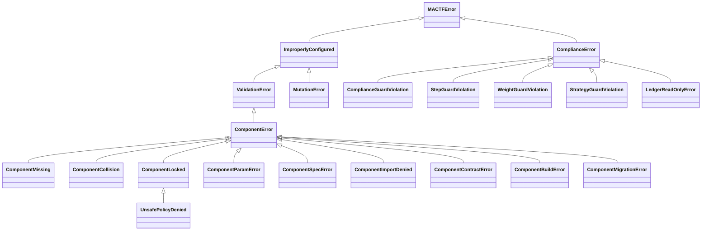

`MutationError` is defined in 12.3 (it carries `findings` and `rolled_back`) and
`WeightGuardViolation` and `StrategyGuardViolation` in 10.4 and 11.5; they are in the diagram and
the tables here, and are not repeated in the listing below.

#### 17.1.2 The listing

```python
# mactf/exceptions.py   (additions, after ValidationError and ComplianceError respectively)
import re
from collections.abc import Mapping, Sequence

_CODE_PREFIX = re.compile(r"^(E\d{3}): ")


class ComponentError(ValidationError):
    """Base of every error about a *component* (a registered, configurable part).

    ``code`` is the taxonomy code; ``kind`` and ``name`` say which component, when one is
    known. A message that already starts with a code (``E012: ...``) keeps that code, so one
    class can carry the sibling codes of its family without a subclass per code.
    """

    code = "E005"

    def __init__(self, message: str, *, kind: str | None = None, name: str | None = None,
                 code: str | None = None) -> None:
        found = _CODE_PREFIX.match(message)
        self.code = code or (found.group(1) if found else type(self).code)
        self.kind = kind
        self.name = name
        super().__init__(message if found else f"{self.code}: {message}")


class ComponentMissing(ComponentError):
    """``E001``: no such component. ``known`` is what *would* have been accepted.

    The same exception names a missing *slot* (``E010``): the slot table's ``get`` raises
    ``ComponentMissing("slot", path, sorted(paths))``.
    """

    code = "E001"

    def __init__(self, kind: str, name: str, known: Sequence[str] = ()) -> None:
        self.known = tuple(known)
        listed = ", ".join(repr(item) for item in self.known) or "none registered"
        super().__init__(
            f"no {kind} named {name!r}; accepted: {listed}", kind=kind, name=name,
            code="E010" if kind == "slot" else "E001",
        )


class ComponentCollision(ComponentError):
    """``E002``: the name is taken and ``replace`` was not given."""

    code = "E002"

    def __init__(self, kind: str, name: str, detail: str = "") -> None:
        super().__init__(f"{kind} {name!r} is already registered" + (f": {detail}" if detail else ""),
                         kind=kind, name=name)


class ComponentLocked(ComponentError):
    """``E003``: the component, the slot or the boundary may not be changed.

    ``reason`` is the one-line why (``COMPONENTS.LOCKED``, origin rank, mutability, boundary).
    """

    code = "E003"

    def __init__(self, kind: str, path: str, reason: str) -> None:
        self.path = path
        self.reason = reason
        super().__init__(f"{kind} {path!r} cannot be changed: {reason}", kind=kind, name=path)


class UnsafePolicyDenied(ComponentLocked):
    """``E009``: a policy declared ``unsafe`` and the operator has not allowed that."""

    code = "E009"

    def __init__(self, name: str, reason: str) -> None:
        # Skip ComponentLocked.__init__ (its message names a *slot*); keep its attributes.
        ComponentError.__init__(
            self, f"trainer_policy {name!r} cannot be used: {reason}",
            kind="trainer_policy", name=name, code="E009",
        )
        self.path = name
        self.reason = reason


class ComponentParamError(ComponentError):
    """``E004``: a spec key the component does not accept, or a value out of range. ``problems`` is complete."""

    code = "E004"

    def __init__(self, kind: str, name: str, problems: Sequence[str]) -> None:
        self.problems = tuple(problems)
        super().__init__(f"{kind}:{name}: " + "; ".join(self.problems), kind=kind, name=name)


class ComponentSpecError(ComponentError):
    """``E005`` (or ``E011``/``E012`` by message prefix): the spec is malformed."""

    code = "E005"

    def __init__(self, kind: str, detail: str) -> None:
        super().__init__(f"{kind} spec: {detail}" if not _CODE_PREFIX.match(detail) else detail, kind=kind)


class ComponentImportDenied(ComponentError):
    """``E006``: an ``import:`` spec on an untrusted surface, or a module outside the allow-list."""

    code = "E006"

    def __init__(self, target: str, reason: str) -> None:
        self.target = target
        super().__init__(f"import {target!r} refused: {reason}")


class ComponentContractError(ComponentError):
    """``E007``: the factory or instance does not meet its kind's contract. ``problems`` is complete."""

    code = "E007"

    def __init__(self, kind: str, name: str, problems: Sequence[str]) -> None:
        self.problems = tuple(problems)
        text = "; ".join(self.problems)
        # A probe failure (8.3, 9.6, 10.6) carries its own code; keep it.
        super().__init__(f"{kind}:{name} breaks its contract: {text}", kind=kind, name=name)


class ComponentBuildError(ComponentError):
    """``E008``: a factory (or a plugin module) raised. The cause is chained, never swallowed."""

    code = "E008"

    def __init__(self, kind: str, name: str, error: BaseException | str) -> None:
        self.cause = error if isinstance(error, BaseException) else None
        text = f"{type(error).__name__}: {error}" if isinstance(error, BaseException) else str(error)
        super().__init__(f"could not build {kind} {name!r}: {text}", kind=kind, name=name)


class ComponentMigrationError(ComponentError):
    """``E048``: a swap's state migration refused or failed; the old component keeps running."""

    code = "E048"

    def __init__(self, message: str) -> None:
        super().__init__(message)


class ComplianceGuardViolation(ComplianceError):
    """The scoring guard refused a stage's output (``C001``-``C012``). ``findings`` is every violation."""

    def __init__(self, findings: Sequence[Mapping[str, object]]) -> None:
        self.findings = tuple(dict(item) for item in findings)
        self.code = str(self.findings[0].get("code", "C001")) if self.findings else "C001"
        listed = "; ".join(f"{item.get('code')} {item.get('message', '')}".strip() for item in self.findings)
        super().__init__(f"{self.code}: scoring guard refused the output: {listed}")


class StepGuardViolation(ComplianceError):
    """The step guard refused a policy's step (``S001``-``S009``). ``path`` is the node."""

    def __init__(self, path: str, violations: Sequence[Mapping[str, object]]) -> None:
        self.path = path
        self.violations = tuple(dict(item) for item in violations)
        self.code = str(self.violations[0].get("code", "S001")) if self.violations else "S001"
        listed = "; ".join(f"{item.get('code')} {item.get('message', '')}".strip() for item in self.violations)
        super().__init__(f"{self.code}: step guard refused node {path!r}: {listed}")


class LedgerReadOnlyError(ComplianceError):
    """``C007``: a stage or plugin tried to write to the ledger (``record``, ``extend``, ``clear``)."""

    code = "C007"

    def __init__(self, operation: str) -> None:
        self.operation = operation
        super().__init__(f"C007: the ledger is read-only for scoring stages; {operation!r} is refused")
```

`ComponentMigrationError`'s code is `E048` even though the same class carries `E049` (a strict
restore of function state, 8.8) by message prefix, which `ComponentError.__init__` honours.
`ComponentContractError` carries `E007` for a registration failure and `E047` for a function
probe (8.3) and `E056` for an optimizer probe (9.6) in the same way: the raiser writes the code in
the message, the class does not need a subclass per code.

#### 17.1.3 Where each class is raised, and what it classifies to

| Class | Base | Code | Raised in | Exit code (16.2) | HTTP (16.3) |
|---|---|---|---|---|---|
| `ComponentMissing` | `ComponentError` | `E001`, `E010` | 3.4, 4.4, 5.2, 9.3 | `3` from a command argument, `2` from settings | `404` |
| `ComponentCollision` | `ComponentError` | `E002` | 3.4, 5.2 | `4` | `409` |
| `ComponentLocked` | `ComponentError` | `E003` | 3.4, 4.3-4.5, 7.4, 9.5 | `4` | `409` |
| `UnsafePolicyDenied` | `ComponentLocked` | `E009` | 7.4 | `2` | `422` |
| `ComponentParamError` | `ComponentError` | `E004` | 5.2, 6.7 | `2` (a finding: `1`) | `422` |
| `ComponentSpecError` | `ComponentError` | `E005`, `E011`, `E012` | 5.1, 5.2, 6.2 | `2` (a finding: `1`) | `422` |
| `ComponentImportDenied` | `ComponentError` | `E006` | 5.4 | `2` | `422` |
| `ComponentContractError` | `ComponentError` | `E007`, `E047`, `E056` | 3.7, 8.3, 9.6 | `2` (a finding: `1`) | `422` |
| `ComponentBuildError` | `ComponentError` | `E008` | 3.4, 4.2, 9.3 | `1` | `500` with `problem+json`, `code` |
| `ComponentMigrationError` | `ComponentError` | `E048`, `E049` | 8.8, 9.6 | `1` | `409` |
| `ComplianceGuardViolation` | `ComplianceError` | `C001`-`C012` | 6.4, 8.6 | `1` | the run fails; see the run's warnings |
| `StepGuardViolation` | `ComplianceError` | `S001`-`S009` | 7.6 | `1` | the run fails |
| `WeightGuardViolation` | `ComplianceError` | `E063` | 10.4 | `1` | the run fails |
| `StrategyGuardViolation` | `ComplianceError` | `E073` | 11.5 | `1` | the run fails |
| `LedgerReadOnlyError` | `ComplianceError` | `C007` | 6.4 | `1` | the run fails |
| `MutationError` | `ImproperlyConfigured` | `E080`-`E089` | 12.5 | `1` | `422` (a dry run), `409` (the run is not live) |

The two code ranges the column calls "the run fails" do not map to an HTTP status because they
happen *inside* a run: the API reports them as the run's `status: failed`, the `findings` in its
warnings, and `GET /runs/{id}/components`. `classify()` is extended for the three rows whose exit
code differs from what `isinstance` against `ImproperlyConfigured` would give (16.2.2).

### 17.2 The consolidated code table

#### 17.2.1 Conventions

| Prefix | Meaning | Where it appears | Fatal |
|---|---|---|---|
| `E` | An error: configuration, contract or state that makes the operation impossible | an exception message, a `mactf check` error, a `422` body | yes |
| `W` | A warning: legal but surprising, or a tolerated degradation | the run's log, its warnings table, a `mactf check` warning | no |
| `C` | A *compliance* finding of the scoring guard (`ComplianceGuard`, `RollupGuard`) | the `ComplianceGuardViolation.findings` list | yes under `enforce`, else substituted |
| `F` | A *function probe* finding (8.3): shape, finiteness, differentiability, determinism | the findings inside an `E047` | yes, except those marked skippable |

The ranges are allocated by section so a number tells a reader where to look:

| Range | Section | Subject |
|---|---|---|
| `E001`-`E012` | 3-6 | the model: registry, locking, specs, contracts, building |
| `E013`-`E018` | 15 | the `COMPONENTS` block and its environment overrides |
| `E040`-`E049` | 8 | RL functions and their state |
| `E050`-`E057` | 9 | optimizers and schedulers |
| `E060`-`E067` | 10 | weight updates and aggregation |
| `E070`-`E077` | 11 | peer strategies and freezing |
| `E080`-`E089` | 12 | peer-tree mutation |
| `E090`-`E092` | 13 | engine selection |
| `E093`-`E096` | 14 | checkpoint restore |
| `W001`-`W007` | 3, 4, 6, 7, 13, 15 | model and configuration warnings |
| `W010`-`W017`, `W021`, `W022` | 8-10 | RL, optimizer, weight-update warnings |
| `W030`-`W036` | 11 | strategy warnings |
| `W040`-`W045` | 12 | mutation warnings |
| `W050`-`W053` | 13, 14 | engine and restore warnings |
| `C001`-`C012` | 6, 8 | the compliance guard |
| `F001`-`F012` | 8 | function probe findings |

Gaps (`E019`-`E039`, `E058`, `E059`, ...) are reserved, not unused by accident: a later section
that adds a code takes the next free number in its own range, so a number is never reused for a
different meaning.

#### 17.2.2 The table

Severity `violation` and `finding` rows are the `C` and `F` codes. **Section** is where the code
is introduced and its behaviour specified; **Raised by** is the one place that raises it, with
the sibling raisers (a settings validator and a runtime check that share a code) named in the
section.

| Code | Severity | Section | Raised by | Meaning |
|---|---|---|---|---|
| **E001** | error | 3.4 | `ComponentRegistry.get`, `ComponentResolver`, `build_*` | A component of this kind and name is not registered (`ComponentMissing`); the message lists the accepted names |
| **E002** | error | 3.4 | `ComponentRegistry.register`, `ComponentResolver._import` | The name is taken by another factory and `replace` was not given (`ComponentCollision`) |
| **E003** | error | 4.3 | `ComponentRegistry`, `SlotTable.swap/request`, `OptimizerPlan` | The component, slot or boundary is locked: `COMPONENTS.LOCKED`, an origin of lower rank, a built-in without `ALLOW_BUILTIN_OVERRIDE`, a slot whose mutability forbids this boundary (`ComponentLocked`) |
| **E004** | error | 5.2 | `Component.check_params`, `ComponentResolver.validate` | A spec key the component does not accept, or a value outside its declared range or type (`ComponentParamError`); the message lists the accepted keys |
| **E005** | error | 5.1 | `ComponentSpec.parse` | A spec that is not a name or a mapping, has neither `type` nor `import`, or has a malformed `import` (`ComponentSpecError`) |
| **E006** | error | 5.4 | `ComponentResolver._import` | An `import` spec on a surface that is not trusted, or a module outside `IMPORT_ALLOWLIST` (`ComponentImportDenied`) |
| **E007** | error | 3.7 | `ComponentRegistry.register`, `ComponentResolver.adopt` | A factory or an instance does not meet its kind's contract, or asks for a looser mutability than the kind allows (`ComponentContractError`) |
| **E008** | error | 3.4 | `ComponentRegistry.build`, `build_scheduler`, `load_components` | A factory raised while building, or a plugin module raised at import (`ComponentBuildError`, with the cause chained) |
| **E009** | error | 7.7 | `MACTFTrainer._attach_policy` | A policy declared `unsafe = True` and `TRAINER.ALLOW_UNSAFE_POLICY` is not set (`UnsafePolicyDenied`); always raised at build, never mid-run |
| **E010** | error | 4.4 | `SlotTable.get`, `SlotTable.request` | A slot path that does not exist (`ComponentMissing` with kind `slot`) |
| **E011** | error | 6.2 | `ComponentSpec.parse`, `ComponentRegistry.build` | A spec names a parameter the framework injects (`policy`, `registries`, ...); it would be silently overridden, so it is refused |
| **E012** | error | 5.1 | `ComponentSpec.parse` | A spec gives parameters both flat and under `params` |
| **E013** | error | 15.11 | `_validate_components`, `_canonical_components` | The `COMPONENTS` block is not a mapping, has an unknown key, gives a flag a non-bool, or sets an alias and its canonical key to different values |
| **E014** | error | 15.11 | `_validate_components` | A `COMPONENTS.MODULES` entry is not a dotted module name (a path, an empty segment, a trailing dot) |
| **E015** | error | 15.11 | `_validate_components` | `COMPONENTS.PLUGINS` is neither `auto`, `off`, nor a list of non-empty names |
| **E016** | error | 15.11 | `_validate_components` via `lock_pattern_problem` | A `COMPONENTS.LOCKED` entry is not `kind:name` or `slot:<path>`, or names an unknown kind |
| **E017** | error | 15.11 | `_validate_components` | A `COMPONENTS.IMPORT_ALLOWLIST` entry is not a pattern, or is a blanket `*`/`` |
| **E018** | error | 15.11 | `_apply_env` | An environment override that cannot be applied: an empty segment, an unknown block or key, a mapping-valued flat variable, a scalar treated as a mapping, or more than four segments |
| **E040** | error | 8.10 | `FunctionBook.validate`, `conf._validate_rl` | Two sources name the same default (`LOSS` and `RL.LOSS`; `RL.SYNTHESIS` and `synthesis=`; `RL.ROLLUP` and `hierarchical_scorer=`) |
| **E041** | error | 8.10 | `FunctionBook.validate` | A family is configured that no active consumer reads (`W010` when `RL.UNCONSUMED: warn`) |
| **E042** | error | 8.10 | `conf._validate_rl`, `FunctionBook.install_override`, `swap_override` | A per-node override for a global-only family (`rollup`) |
| **E043** | error | 8.10 | `FunctionBook._select` | Two overrides of equal specificity match the same node |
| **E044** | error | 8.10 | `FunctionBook.validate` | An override glob matches no node at build (`W011` after a tree mutation or when `STRICT_GLOBS: false`) |
| **E045** | error | 8.10 | `FunctionBook.validate` | `RL.ROLLUP` or `RL.SYNTHESIS` is set on a run with no hierarchy |
| **E046** | error | 8.10 | `build_synthesis` | A custom `rl_function.synthesis` name equals a node-level built-in name |
| **E047** | error | 8.10 | `verify_function` | A function failed its contract probe (`F001..F012` in the message) |
| **E048** | error | 8.10 | `migrations.py` | A migration refused or failed (`ComponentMigrationError`) |
| **E049** | error | 8.10 | `FunctionBook.load_state_dict` | Strict restore: saved function state does not match the configured spec |
| **E050** | error | 9.10 | `OptimizerPlan.validate` | An `OPTIMIZER.OVERRIDES` glob matches no node at build (`W011` after a mutation or with `STRICT_GLOBS: false`) |
| **E051** | error | 9.10 | `OptimizerPlan.select` | Two overrides of equal specificity match the same node |
| **E052** | error | 9.10 | `compile_entry`, `attach_scheduler`, `build_scheduler` | A scheduler cannot be used: the backend has no torch optimizer, or the scheduler needs a metric (`ReduceLROnPlateau`) |
| **E053** | error | 9.10 | `_compile_scheduler` | A scheduler's parameters are invalid (unknown key, `warmup_steps >= total_steps`, `total_steps < 1`) |
| **E054** | error | 9.10 | `OptimizerPlan.validate`, `stage`, `request` | Every node would be frozen, or the default entry would be removed |
| **E055** | error | 9.10 | `MACTFOptimizer._reconcile`, `OptimizerPlan.load_state_dict` | Strict restore: saved optimizer state or plan entry does not match the configured spec |
| **E056** | error | 9.10 | `verify_entry` | An optimizer failed its probe (`O001..O006` in the message) |
| **E057** | error | 9.10 | `compile_entry` | An entry is inconsistent: an unaccepted key, a key given flat and under `PARAMS`, scipy with accumulation, a bad `MIGRATE` |
| **E060** | error | 10.5 | `WeightGuardConfig`, `WeightPlan.validate`, `conf.py` | A weight-update configuration problem: an unknown or malformed `WEIGHT_GUARD` or `WEIGHT_OPTIONS` key, an override block that is not a mapping, a bad glob, an override that matches no group, or two aggregation groups with one label |
| **E061** | error | 10.5 | `pick_glob` via `WeightPlan.select` | Two `WEIGHT_UPDATE_OVERRIDES` globs of equal specificity match one group |
| **E062** | error | 10.5 | `pick_glob` via `KappaPlan` | Two temperature-override globs of equal specificity match one group |
| **E063** | error | 10.4 | `WeightGuard` (`WeightGuardViolation`) | A weight strategy's output broke the weight contract (`U001`-`U007`) under `MODE=enforce` |
| **E064** | error | 10.6 | `verify_aggregator`, `WeightPlan.validate` | A strategy's `validate` rejected the tree, or its output probe failed; at build and after a tree mutation |
| **E065** | error | 10.7 | `WeightStrategy.clone_with` check | `clone_with` returned a different class or different options, so a per-group copy would not be the strategy that was configured |
| **E066** | error | 10.9 | `WeightPlan.load_state_dict` | The saved plan differs from the configured one under `COMPONENTS.STRICT_RESTORE` |
| **E067** | error | 10.6 | `verify_aggregator` | A strategy's `state_dict` is not JSON, has no `load_state_dict`, or does not round-trip |
| **E070** | error | 11.12 | `StrategyPlan`, `FreezeSet`, `StrategyGuard`, `conf.py` | A strategy-configuration problem: unknown `PEER_STRATEGY_OPTIONS` or `STRATEGY_GUARD` key, bad `MODE` / `SCOPE` / `MIGRATE` / `FREEZE_MODE`, an override that matches no group (under `STRICT_GLOBS`), an invalid glob, colliding group labels |
| **E071** | error | 11.12 | `StrategyPlan.select` | Two override globs match one group with equal specificity |
| **E072** | error | 11.12 | `StrategyPlan` | A legacy strategy (no `coordinate`) used where only a context-driven one can work: as an override, or beside overrides |
| **E073** | error | 11.12 | `StrategyGuard` | `StrategyGuardViolation`: a hard rule (`Y005`, `Y006`), or any violation under `MODE=enforce` |
| **E074** | error | 11.12 | `StrategyPlan`, probe | A strategy's `validate` rejected the tree; it defines no entry point; the probe found a violation; `MIGRATE=fail` refused a swap that would drop state; bad `mode` argument |
| **E075** | error | 11.12 | `FreezeSet` | A malformed freeze reason; a freeze of a path that is not a node; no node would train |
| **E076** | error | 11.12 | `StrategyPlan.load_state_dict` | The saved plan differs from the configured one under `COMPONENTS.STRICT_RESTORE` |
| **E077** | error | 11.12 | probe | `state_dict` is not JSON, has no `load_state_dict`, or does not round-trip |
| **E080** | error | 12.11 | `PeerSpec.parse`, `Op.parse`, `MutationPlan.parse`, `MutationLimits.validate_block`, `MutationReconciler.reconcile` | A plan or a limit block is not valid data: unknown key, bad verb, bad path, bad role, non-JSON value, a plan that sets both `init_from` and `rebuild`, a schedule entry without `AT_EPOCH`, or a checkpoint whose journal holds user mutations while `ENABLED` is false |
| **E081** | error | 12.11 | `TopologySimulator._add`, `_modify`, `_retire`, `_revive`, `_purge` | A structural rule: no such node, the node exists, a tombstoned path, a missing or retired parent, the node is retired (revive first), a `revive` whose parent is still retired |
| **E082** | error | 12.11 | `TopologySimulator._retire`, `_purge`, `_finalize` | A protection or a size rule: `PROTECTED` glob, `ALLOW_PURGE` false, active children without `recursive`, active nodes without `force`, fewer than `MIN_ACTIVE_ROOTS` roots, every child of a branch retired |
| **E083** | error | 12.11 | `TopologySimulator._check_reference`, `MutationEngine._build_peer` | A reference (`like`, `init_from`) names an unknown node, the node itself, a purged node, or a node with no peer to read from |
| **E084** | error | 12.11 | `TopologySimulator.run`, `_add` | A size limit: more operations than `MAX_OPS_PER_PLAN`, or a node that would exceed `max_nodes` (from `TreeTooLargeError`) |
| **E085** | error | 12.11 | `MutationEngine._build_peer`, `_copy_weights`, `_check_layouts`, `_check_plans` | The new topology cannot exist: the factory returned something that is not an `nn.Module`, `@like` would unshare a trunk, a parameter count or layout differs from `init_from`, siblings in one group disagree on layout (M6), tied parameters would appear (M7), or the factory is no longer registered (`ComponentMissing`) |
| **E086** | error | 12.11 | `TopologySimulator._finalize` | The group's new active count admits no legal weight vector under `WEIGHT_FLOOR`/`WEIGHT_CAP` (`feasible_bounds`) (M8) |
| **E087** | error | 12.11 | `MutationEngine._check_plans` | A plan refused the topology the mutation would create: the optimizer plan, the strategy plan, the weight plan or the kappa plan raised `ImproperlyConfigured` for it |
| **E088** | error | 12.11 | `MutationEngine._gate`, `MutationReconciler.reconcile` | The plan cannot run now: the trainer is not built, mutation is off, the phase is `epoch`, a blocker is present (`DISTILLATION` with a policy that cannot follow a tree), the epoch's budget is spent, or a reconciliation is blocked by the same list |
| **E089** | error | 12.11 | `MutationEngine._commit`, `apply`, `PathState.audit`, `MutationState.parse`, `MutationReconciler.reconcile` | Atomicity or integrity: the post-commit audit found stale state, the rollback did not complete (`rolled_back=False`: discard the trainer), a checkpoint's mutation state or tree section does not parse, the journal does not reproduce its tree under `STRICT_REPLAY`, or a reconciliation did not reach the stored digest |
| **E090** | error | 13.10 | `dispatch.engine_name`, `conf._validate_blocks` | `ORCHESTRATOR.ENGINE` is not one of `ENGINES` (including a non-string value that stringifies to something else) |
| **E091** | error | 13.10 | `TrainerEngine._check_identity` | The checkpoint was written by the other engine and `ORCHESTRATOR.ALLOW_ENGINE_SWITCH` is false |
| **E092** | error | 13.10 | `TrainerEngine._refuse_unsupported` | The configuration cannot be served by the trainer engine: `mactf.distributed` installed, or `RunConfig.peers` disagrees with a pre-built trainer |
| **E093** | error | 14.11 | `ComponentRestorer._check` | A checkpoint needs a component (name and kind) that this build has not registered: the providing module is not loaded |
| **E094** | error | 14.11 | `ComponentRestorer._check` | A live slot differs from the recorded entry and `COMPONENTS.STRICT_RESTORE` is on; the message lists every differing field |
| **E095** | error | 14.11 | `ComponentRestorer._check` via `_check_entry` | The `components` section, or one entry, is not interpretable: not a mapping, no `schema`/`kind`/`name`, or a non-integer schema |
| **E096** | error | 14.11 | `_check_entry` | An entry's `schema` is newer than `ENTRY_SCHEMA` |
| **W001** | warning | 4.3 | `ComponentRegistry._check_replace` | A built-in component was replaced under `ALLOW_BUILTIN_OVERRIDE` |
| **W002** | warning | 2.2 | check `mactf.components.W002` | `TRAINER.PEER_STRATEGY` or `TRAINER.WEIGHT_UPDATE` is set to a non-default value but the active engine never reads it (the `Orchestrator` ignores both) |
| **W003** | warning | 6.4 | `ComplianceGuard`, check `mactf.components.W003` | A run started with `COMPLIANCE.GUARD_MODE: fallback`; a plugin bug costs a substituted score instead of the run |
| **W004** | warning | 7.7 | `mactf components validate`, check `mactf.components.W004` | A policy with `unsafe = True` is configured; `StepGuard` does not wrap it |
| **W005** | warning | 3.6 | `LegacyTable.__setitem__` | A component was replaced through a write to a legacy dict (`SCORER_TYPES`, `PEER_STRATEGIES`, ...) |
| **W006** | warning | 15.11 | `_canonical_components` | `COMPONENTS.API_ALLOW_IMPORT` and `COMPONENTS.ALLOW_IMPORT` are both set to the same value: one line can be deleted |
| **W007** | warning | 15.11 | `_apply_env` | An environment override created a key no `DEFAULTS` block declares |
| **W010** | warning | 8.10 | `FunctionBook.validate` | An unconsumed family under `RL.UNCONSUMED: warn` |
| **W011** | warning | 8.10 | `FunctionBook.validate` | A glob that matches no node, after mutation or with `STRICT_GLOBS: false` |
| **W012** | warning | 8.10 | `FunctionBook.load_state_dict` | Saved function state was dropped because the slot or its spec changed |
| **W013** | warning | 8.10 | `FunctionBook` at build | `RL.VERIFY: off`: custom functions run without a contract probe |
| **W014** | warning | 9.10 | `optimizer_migrations.carry` | A carry dropped something it could not move (the scheduler position onto a scheduler-less entry; an open accumulation window when `GRAD_ACCUMULATION` changed) |
| **W015** | warning | 9.10 | `MACTFOptimizer._reconcile`, `OptimizerPlan.load_state_dict` | Optimizer state or a swapped entry in the checkpoint differs from the configured spec; says whether it was carried or dropped |
| **W016** | warning | 9.5 | `OptimizerPlan.validate` | A `null` optimizer entry selects the only node of a group, so it would never be updated |
| **W017** | warning | 10.4 | `WeightGuard`, `build_weight_update` | A weight strategy was rejected, repaired by projection onto the bounded simplex, or replaced by `kappa_softmax` (`MODE` `repair` or `fallback`) |
| **W021** | warning | 10.9 | `WeightPlan.load_state_dict` | State saved for an aggregation group does not fit the live strategy at that label; dropped |
| **W022** | warning | 10.5 | `WeightPlan.validate` | An override matches no aggregation group after a tree mutation, or with `STRICT_GLOBS: false` |
| **W030** | warning | 11.12 | `StrategyGuard` | A soft violation was handled (`skip` or `fallback`) |
| **W031** | warning | 11.12 | `StrategyPlan` | Saved state or plan did not match the live one; the saved plan won or the state was dropped |
| **W032** | warning | 11.12 | `MACTFTrainer._write` | A group was skipped because every member is frozen |
| **W033** | warning | 11.12 | `StrategyPlan.validate` | An override matches no group (when `STRICT_GLOBS` is off, or after a mutation) |
| **W034** | warning | 11.12 | trainer, `FreezeSet` | `frozen_peer` under `legacy` (frozen peers still train and receive write-back), or the saved `FREEZE_MODE` differs |
| **W035** | warning | 11.12 | trainer | In a hierarchy, groups that no strategy serves (the default walks the root only) |
| **W036** | warning | 11.12 | `FreezeSet.load_state_dict` | A saved freeze entry has no node; dropped |
| **W040** | warning | 12.11 | `TopologySimulator._retire` | The node was already retired; the plan is a no-op for it |
| **W041** | warning | 12.11 | `TopologySimulator._revive` | The node was not retired; the plan is a no-op for it |
| **W042** | warning | 12.11 | `MutationEngine._rebind_groups` | A group's membership changed, so its aggregator, its controller state and the per-group strategy state were rebuilt |
| **W043** | warning | 12.11 | `MutationEngine._commit` (a `modify ... rebuild`) | The node's architecture was replaced, so its optimizer was rebuilt and its moments are gone |
| **W044** | warning | 12.11 | `MutationLimits.from_settings` | A `SCHEDULE` that can grow the tree beyond `WATCHDOG.MAX_TREE_GROWTH_RATIO` will be reported by `TreeGrowthProbe` |
| **W045** | warning | 12.11 | `MutationEngine._finish`, `MutationReconciler.reconcile` | The journal reached `JOURNAL_WARN`, or a journal that does not reproduce its tree was tolerated because `STRICT_REPLAY` is false |
| **W050** | warning | 13.10 | `TrainerEngine._check_identity` | A cross-engine resume was explicitly allowed; parameters are restored, epoch bookkeeping is not resumed |
| **W051** | warning | 13.10 | `TrainerEngine._resume` | `--resume` found no valid checkpoint in the configured directory; the run starts at epoch 0 |
| **W052** | warning | 14.11 | `ComponentRestorer._check` | A slot differs (permissive mode), or an entry names a slot the run no longer has |
| **W053** | warning | 14.11 | `ComponentRestorer.plan` | The checkpoint records no components at all: a legacy file, or an all-built-in run |
| **C001** | violation | 6.4 | `ComplianceGuard`, stage: every stage | A non-finite or negative number: `amount`, every bucket, every weight, every `amounts[k]`, `omega` must be finite and `>= 0` (`omega >= 1`) |
| **C002** | violation | 6.4 | `ComplianceGuard`, stage: PENALTY | Floor below reference: For every `k` in `NO` (the effective non-offsettable set) with a reference amount: `amounts[k] >= m_k * max(lambda_k, MIN_FLOOR_LAMBDA)` within tolerance, where `m_k` is the sum of the magnitudes of the admitted events of rule `k` |
| **C003** | violation | 6.4 | `ComplianceGuard`, stage: PENALTY | Omega below reference: `omega >= 1.0` and `omega >= omega_ref`, where `omega_ref` is the reference stage's bounded product |
| **C004** | violation | 6.4 | `ComplianceGuard`, stage: PENALTY | `void_rules` too small: `void_rules` is a superset of `{k in NO : reference amount exists}` |
| **C005** | violation | 6.4 | `ComplianceGuard`, stage: WARNING | Warning-first violation: `ctx.warning_only_rules` contains no rule in `NEVER_WARNING_FIRST` or `NO` (framework.md W9) |
| **C006** | violation | 6.4 | `ComplianceGuard`, stage: every stage | Out-of-role output: A REWARD or PENALTY stage returned `mutations`, `void_rules` (REWARD) or changed a protected context field in `prepare` |
| **C007** | violation | 6.4 | `ComplianceGuard`, stage: every stage | Ledger tampering: The ledger's event tuple changed during the walk, or `prepare` replaced the ledger |
| **C008** | violation | 6.4 | `ComplianceGuard`, stage: REWARD | Reward above ceiling: `sum(weights[b] * bucket[b]) <= COMPLIANCE.REWARD_CEILING` |
| **C009** | violation | 6.4 | `ComplianceGuard`, stage: REWARD, PENALTY | Amount for an event not admitted: `by_rule` / `amounts` keys are within the ledger's rules for that side; a penalty key must also be tier-admitted and not warning-only |
| **C010** | violation | 8.10 | `RollupGuard` | A rollup dropped a void a child reported |
| **C011** | violation | 8.10 | `RollupGuard` | A rollup raised, returned a non-`ScorerOutput`, or returned a non-finite amount |
| **C012** | violation | 8.10 | `RollupGuard` | A rollup emitted warning mutations |
| **F001** | finding | 8.3 | `function_probes.py` (all) | The entry method raised on a well-formed input |
| **F002** | finding | 8.3 | `function_probes.py` (all) | Wrong return type (not a tensor, not a mapping, not a `ScorerOutput`, ...) |
| **F003** | finding | 8.3 | `function_probes.py` (all) | Wrong shape or size |
| **F004** | finding | 8.3 | `function_probes.py` (all) | A non-finite value in the output, or in a loss `breakdown` |
| **F005** | finding | 8.3 | `function_probes.py` (`value`, `loss`, `regularization`, `objective`) | Not differentiable: the output does not depend on the parameters or inputs it claims; skippable with `probe["skip"]` |
| **F006** | finding | 8.3 | `function_probes.py` (all except sampling) | Not deterministic: the same input gave a different output; skippable with `probe["skip"]` |
| **F007** | finding | 8.3 | `function_probes.py` (all) | The function mutated an input it was handed; skippable with `probe["skip"]` |
| **F008** | finding | 8.3 | `function_probes.py` (`loss`) | A loss `breakdown.total` disagrees with the returned tensor |
| **F009** | finding | 8.3 | `function_probes.py` (`loss`) | A loss requires a batch key the probe cannot supply and the loss provides no `probe_batch` |
| **F010** | finding | 8.3 | `function_probes.py` (`rollup`) | A rollup dropped a child's `void_rules` |
| **F011** | finding | 8.3 | `function_probes.py` (all) | `probe["skip"]` names a code that cannot be skipped |
| **F012** | finding | 8.3 | `function_probes.py` (`synthesis`) | A synthesis output has the wrong shape for its declared shape rule |

#### 17.2.3 Probe and audit families

Four more prefixes label the *items inside* a finding rather than the exception that carries it.
They are listed here so a code in a log has one place to be looked up; none is raised on its own.

| Family | Prefix | Defined in | Carried inside |
|---|---|---|---|
| Step guard | `S001`-`S009` | 7.6 | `StepGuardViolation`, the card's `metadata["step_guard"]` |
| Optimizer probe | `O001`-`O006` | 9.6 | `E056` |
| Weight guard | `U001`-`U007` | 10.4 | `E063`, `E064`, `W017`, the aggregation report's `adjustments` |
| Strategy audit | `Y001`-`Y008` | 11.7 | `E073`, `E074`, `W030` |

#### 17.2.4 The rule for adding a code

A change that adds a code must, in one commit: add the row to the table above with its section
and its single raiser; add the code to the allocation table if it opens a new range; add a test
that provokes it (the test names the code in its docstring); and, if the code is a `W`, say in
the row whether `mactf check` reports it (17.3). `test_code_table_is_complete` fails the build
otherwise, so the table cannot drift from the code.

### 17.3 System checks

#### 17.3.1 The app

System checks (`mactf/checks.py`) are registered by an app's `systems.py` and reported by
`mactf check`, which takes `--app`, `--tag` and an id prefix. The components checks live in a
new contrib app that follows the scoring app exactly, so nothing about how a check is registered
or reported is new:

```python
# mactf/contrib/components/apps.py   (new)
"""The components contrib app: the checks that report the codes of 17.2 before a run starts."""

from __future__ import annotations

from ...apps import AppConfig


class ComponentsConfig(AppConfig):
    name = "mactf.contrib.components"
    label = "mactf_components"
    verbose_name = "MACTF Components"

    def ready(self) -> None:
        from . import systems  # noqa: F401  (registers checks)
```

```python
# mactf/contrib/components/systems.py   (new)
from __future__ import annotations

from ... import checks
from .checks import (
    check_builtin_replacements,
    check_configured_specs,
    check_dead_trainer_settings,
    check_engine_support,
    check_guard_modes,
    check_registry_contracts,
    check_unsafe_policy,
)

for _check in (
    check_registry_contracts, check_configured_specs, check_builtin_replacements,
    check_dead_trainer_settings, check_guard_modes, check_unsafe_policy, check_engine_support,
):
    checks.register(_check, app="mactf_components", requires="mactf.contrib.components")
```

The app is added to the default `INSTALLED_APPS` (`mactf/conf.py:194`, `mactf/settings_default.py:26`)
and to `startproject`'s generated settings (15.3); a project that removes it loses the checks and
nothing else, because the model itself does not depend on the app, only on `mactf.components`.
`requires=` makes each check inapplicable (so silently skipped) in a configuration that no longer
installs it, which is what `_applicable` in `checks.py` is for.

#### 17.3.2 The checks

Message ids use the **same code as the table**, namespaced by the app: `mactf.components.E007`
is `E007`, found by a check instead of raised mid-build. A check never invents a code.

| Check function | Reports | Level | Condition |
|---|---|---|---|
| `check_registry_contracts` | `E007`, `E002` | error | A registered component fails its kind's contract, or two registries disagree about a name; found by walking `HUB.snapshot()` |
| `check_configured_specs` | `E001`, `E004`, `E005`, `E006`, `E011`, `E012` | error | Every spec in `TRAINER.*`, `OPTIMIZER.*`, `RL.*`, `SCORING.*` and `COMPONENTS.*` resolves with `ComponentResolver.validate(trusted=False)` for an `import:` spec and `trusted=True` otherwise |
| `check_builtin_replacements` | `W001` | warning | A built-in is replaced while `COMPONENTS.ALLOW_BUILTIN_OVERRIDE` is on |
| `check_dead_trainer_settings` | `W002` | warning | `TRAINER.PEER_STRATEGY` or `TRAINER.WEIGHT_UPDATE` differs from its default while `ORCHESTRATOR.ENGINE` is `orchestrator` |
| `check_guard_modes` | `W003`, `W013` | warning | `COMPLIANCE.GUARD_MODE` is `fallback`; `RL.VERIFY` is `off` |
| `check_unsafe_policy` | `W004`, `E009` | warning, error | A policy with `unsafe = True` is configured (`W004`); with `ALLOW_UNSAFE_POLICY` off it is also `E009` |
| `check_engine_support` | `E090`, `E092` | error | `ORCHESTRATOR.ENGINE` is not a known engine; the trainer engine is selected with `mactf.distributed` installed |

```python
# mactf/contrib/components/checks.py   (new; the first two checks shown in full, the rest follow the same shape)
from __future__ import annotations

from ...checks import ERROR, WARNING, CheckMessage
from ...components import HUB, ComponentResolver, ComponentSpec, ensure_components_loaded
from ...components.known import configured_specs
from ...exceptions import ComponentError, ComponentMissing

_APP = "mactf.components"


def _error(code: str, message: str, hint: str | None = None) -> CheckMessage:
    return CheckMessage(level=ERROR, message=message, hint=hint, id=f"{_APP}.{code}")


def _warning(code: str, message: str, hint: str | None = None) -> CheckMessage:
    return CheckMessage(level=WARNING, message=message, hint=hint, id=f"{_APP}.{code}")


def check_configured_specs() -> list[CheckMessage]:
    """Every configured component resolves, with the same errors a build would raise."""
    from ...conf import get_settings

    settings = get_settings()
    ensure_components_loaded(settings)
    resolver = ComponentResolver(HUB)
    found: list[CheckMessage] = []
    for slot, kind_id, raw in configured_specs(settings):         # (path, kind id, raw spec), 15.4
        try:
            spec = ComponentSpec.parse(kind_id, raw)
            resolver.validate(spec, trusted=not spec.import_path)
        except ComponentMissing as exc:
            found.append(_error(exc.code, f"{slot}: {exc}", hint=f"accepted: {list(exc.known)}"))
        except ComponentError as exc:
            found.append(_error(exc.code, f"{slot}: {exc}"))
    return found


def check_dead_trainer_settings() -> list[CheckMessage]:
    """``W002``: a setting that looks like a selector and is read by nothing (2.2)."""
    from ...conf import DEFAULTS, get_settings
    from ...orchestration.dispatch import engine_name

    settings = get_settings()
    if engine_name(settings) != "orchestrator":
        return []
    trainer = settings.get("TRAINER") or {}
    defaults = DEFAULTS["TRAINER"]
    return [
        _warning(
            "W002",
            f"TRAINER.{key} is set to {trainer[key]!r} but ORCHESTRATOR.ENGINE=orchestrator never reads it",
            hint="Set ORCHESTRATOR.ENGINE=trainer (13.5), or remove the setting.",
        )
        for key in ("PEER_STRATEGY", "WEIGHT_UPDATE")
        if trainer.get(key) not in (None, defaults.get(key))
    ]
```

`mactf check` already reports these with `--format json`, and `mactf check --tag components`
selects them. `requires_system_checks` is the existing attribute that tells the dispatcher which
commands run checks before they execute; the new `components` group sets it to `("mactf_components",)`
for `validate` and to nothing for `list`, `inspect`, `scaffold` and `diff`, so that listing the
components of a project whose settings are broken is still possible. `--skip-checks` (the global
option that already exists) skips them like any other check, and `mactf run` runs them by default,
so a bad spec is found before a model is built.

#### 17.3.3 Interaction with settings validation

`conf.validate_settings` raises `E013`-`E018` and the other `ImproperlyConfigured` codes at load, so
a project that fails there never reaches the checks. The checks add what validation cannot know
without importing project code: whether a *name* resolves. The two are deliberately separate so
that `mactf config show` works on a project whose plugins are not importable, and so that
`mactf check` can be the one command that loads everything and says what is wrong.

### 17.4 Files and behaviour changes

| File | Change |
|---|---|
| `mactf/exceptions.py` | the classes of 17.1.2; `MutationError`, `WeightGuardViolation`, `StrategyGuardViolation` as in 12.3, 10.4, 11.5 |
| `mactf/contrib/components/__init__.py`, `apps.py`, `systems.py`, `checks.py` (new) | the app of 17.3 |
| `mactf/conf.py`, `mactf/settings_default.py` | `mactf.contrib.components` in `INSTALLED_APPS` |
| `mactf/management/exitcodes.py` | the branches of 16.2.2 |
| `tests/components/test_exceptions.py`, `test_code_table.py`, `test_system_checks.py` (new) | 19.3 |

Behaviour changes with nothing configured: `mactf check` reports one more app and, for a project
that sets `TRAINER.PEER_STRATEGY` or `TRAINER.WEIGHT_UPDATE` under the default engine, one
`W002` per setting; nothing else changes, and no `W` is a failure under the default
`--fail-level error`.

---

## 18. Worked examples

Eight complete examples, one per thing a person actually customizes. Each has the same five
parts: the **module** (what is written), the **YAML** (how a project turns it on), the **CLI**
(how an operator checks and changes it), the **API** (how a tool does the same) and **what the
guard does when it misbehaves** (the point of the model). Three of them (the weight strategy,
the training policy and the retire/revive/purge plan) have a full module already in 10.11, 7.10
and 12.11; those examples do not repeat it, they show the other four parts and the failure
cases.

All examples assume a project `acme` with `COMPONENTS.MODULES: ["acme.components"]` (15.1) and
the default engine unless a note says otherwise. Names are illustrative; every API used is the
one defined in the section cited beside it.

### 18.1 A reward stage that tempers credit (a scorer stage)

**Goal.** Scale every reward by a factor below one, to study how much of a result is due to the
reward side. A *reward* stage is the one scorer kind where a different number is legitimate
(6.1); the penalty stage has no such freedom, which is why there is no example of one here.

```python
# acme/components/scorers.py
from __future__ import annotations

from typing import Any, Mapping

from mactf.components import register_scorer
from mactf.scoring.base import ScoreContext, ScorerOutput
from mactf.scoring.reward_scorer import RewardScorer


@register_scorer("tempered_reward", version="1", description="RewardScorer scaled by a constant factor")
class TemperedReward(RewardScorer):
    def __init__(self, *, config: Mapping[str, Any] | None = None, factor: float = 0.5) -> None:
        super().__init__(config=config)
        if not 0.0 < factor <= 1.0:
            raise ValueError("factor must be in (0, 1]: a stage may temper a reward, not inflate it")
        self.factor = float(factor)

    def score(self, ctx: ScoreContext) -> ScorerOutput:
        base = super().score(ctx)
        breakdown = dict(base.breakdown)
        for bucket in self.BUCKETS:
            breakdown[bucket] = float(breakdown[bucket]) * self.factor
        breakdown["by_rule"] = {rule: float(value) * self.factor for rule, value in breakdown["by_rule"].items()}
        breakdown["total"] = float(breakdown["total"]) * self.factor
        return ScorerOutput(kind=base.kind, amount=float(base.amount) * self.factor,
                            breakdown=breakdown, rules=base.rules)
```

```yaml
# conf/components.yaml
COMPONENTS: {MODULES: ["acme.components"]}
SCORING:
  STAGES:
    reward: {type: tempered_reward, params: {factor: 0.5}}
```

```text
$ mactf components validate --kind scorer --name tempered_reward --param factor=0.5 --probe
scorer: ok
$ mactf components validate --kind scorer --name tempered_reward --param factr=0.5
scorer: invalid
  ERROR   E004  scorer:tempered_reward does not accept 'factr'; accepted: ['config', 'factor']
$ mactf runs components set run-0007 SCORING.STAGES.reward --spec '{params: {factor: 0.25}}'
queued SCORING.STAGES.reward for episode boundary; spec_hash 4be07c1d90a2
```

```text
PATCH /api/v1/runs/run-0007/components
{"slot": "SCORING.STAGES.reward", "spec": {"params": {"factor": 0.25}}}
202 {"slot": "SCORING.STAGES.reward", "boundary": "episode", "spec_hash": "sha256:4be07c1d...", "applies_at": "next episode boundary"}
```

| Misbehaviour | What catches it | Result |
|---|---|---|
| `factor: 4.0` in YAML | `__init__` raises `ValueError`; the resolver wraps it | `E008` at build, before an episode runs |
| A subclass that *did* inflate (a bug, or a copy of this module with the check removed) | `ComplianceGuard`: `sum(weights * bucket) <= COMPLIANCE.REWARD_CEILING` | `C008`, `ComplianceGuardViolation` under `enforce`; the reference reward is substituted and `W003` logged under `fallback` |
| A stage that writes a mutation or a void | `ComplianceGuard`, role check | `C006` |
| A stage that edits the ledger | the read-only ledger | `C007` (`LedgerReadOnlyError`) |
| `PATCH` while a `step`-mutability scorer is expected | `SlotTable.request` boundary rule | `409`, `E003` |

The reward stage can only ever make a score *lower or equal*; the guard makes the other direction
an error instead of a result.

### 18.2 A reward term: diminishing returns on one rule family

**Goal.** Stop one noisy reward rule dominating, without replacing the stage. A *term* is the
unit for this (6.3): it sees one event and returns a non-negative number.

```python
# acme/components/terms.py
from __future__ import annotations

import math
from typing import Sequence

from mactf.components import register_reward_term
from mactf.exceptions import ValidationError
from mactf.scoring.base import ScoreContext, severity_fraction
from mactf.scoring.ledger import RuleEvent
from mactf.scoring.reward_terms import RewardTerm, _rules, _severity_table


@register_reward_term("sqrt_magnitude", version="1")
class SqrtMagnitude(RewardTerm):
    """``sqrt(magnitude) * severity_fraction``: the tenth event matters less than the first."""

    name = "sqrt_magnitude"

    def __init__(self, *, scale: float = 1.0, rules: Sequence[str] | None = None) -> None:
        if not math.isfinite(scale) or scale < 0.0:
            raise ValidationError(f"sqrt_magnitude: 'scale' must be finite and >= 0, got {scale!r}")
        self.scale = float(scale)
        self.rule_ids = _rules(rules, owner="sqrt_magnitude")

    def contribution(self, event: RuleEvent, ctx: ScoreContext) -> float:
        fraction = severity_fraction(event.resolved_severity(), _severity_table(ctx), default=1.0)
        return self.scale * math.sqrt(max(float(event.magnitude), 0.0)) * fraction
```

```yaml
SCORING:
  STAGES:
    reward:
      type: composed_reward
      params:
        terms:
          - {type: severity_scaled, weight: 1.0, params: {rules: [R1, R2, R3]}}
          - {type: sqrt_magnitude, weight: 0.5, params: {scale: 2.0, rules: [R10, R11]}}
```

```text
$ mactf components list --kind reward_term
KIND         NAME             ORIGIN   MUTABLE  LOCKED  FINGERPRINT
reward_term  capped           builtin  episode  no      0c41a5e8d7b3
reward_term  severity_scaled  builtin  episode  no      7d9a20f1c4e6
reward_term  sqrt_magnitude   project  episode  no      a3f817b265d0
$ mactf components validate --kind reward_term --name sqrt_magnitude --param rules='["R99"]'
reward_term: invalid
  ERROR   E004  reward_term:sqrt_magnitude: ['R99'] are not reward rules; reward terms apply to [...]
```

```text
POST /api/v1/components/validate
{"kind": "reward_term", "spec": {"type": "sqrt_magnitude", "params": {"scale": -1}}}
422 {"errors": {"spec": ["E008: could not build reward_term 'sqrt_magnitude': ValidationError: sqrt_magnitude: 'scale' must be finite and >= 0, got -1"]}}
```

| Misbehaviour | What catches it | Result |
|---|---|---|
| A term returns a negative or non-finite number | `ComposedRewardScorer` checks each contribution; `ComplianceGuard` `C001` behind it | the stage raises at the first event; under `fallback` the reference reward is substituted (`W003`) |
| A term is registered for a rule that is not a reward rule | the term's constructor, `_rules` | `E004`/`E008` at build |
| A negative `weight` on the term | `ComposedRewardScorer._weight` | refused at build: a reward may not reduce a score |
| All terms removed | `ComposedRewardScorer.__init__` | `ImproperlyConfigured`, at least one term is needed |

### 18.3 A weight-update strategy: per-group, with state

The module is `EmaSoftmax` of **10.11** (an exponential moving average of each peer's score,
centred on the median, clipped, then a softmax at the controller's temperature). What this
example adds is how it is selected, changed and policed.

```yaml
COMPONENTS: {MODULES: ["acme.components.ema_softmax"]}
ORCHESTRATOR: {ENGINE: trainer}           # the Orchestrator never reads TRAINER.WEIGHT_UPDATE (W002)
TRAINER:
  WEIGHT_UPDATE: {type: ema_softmax, params: {alpha: 0.3}}
  WEIGHT_UPDATE_OVERRIDES:
    "team-*": {type: ema_softmax, params: {alpha: 0.6, clip: 2.0}}
  WEIGHT_GUARD: {MODE: repair, TOLERANCE: 0.001}
```

```text
$ mactf components validate --kind weight_update --name ema_softmax --param alhpa=0.5
weight_update: invalid
  ERROR   E004  weight_update:ema_softmax does not accept 'alhpa'; accepted: ['alpha', 'clip']
$ mactf runs components show run-0007 | head -4
SLOT                       KIND           NAME          SPEC_HASH     STATE
TRAINER.WEIGHT_UPDATE      weight_update  ema_softmax   9f02c7a41b1d  live
TRAINER.WEIGHT_UPDATE_...  weight_update  ema_softmax   31b8ee09f2a5  live (team-*)
$ mactf runs components set run-0007 TRAINER.WEIGHT_UPDATE --spec '{params: {alpha: 0.5}}'
queued TRAINER.WEIGHT_UPDATE for episode boundary; spec_hash 5a07d2e6c913
```

```text
PATCH /api/v1/runs/run-0007/components
{"slot": "TRAINER.WEIGHT_UPDATE", "spec": {"type": "uniform"}}
202 {"slot": "TRAINER.WEIGHT_UPDATE", "boundary": "episode", ...}
```

The change applies at the next episode boundary, with `MIGRATE` from `TRAINER.WEIGHT_OPTIONS`
(`reset` by default, so `EmaSoftmax`'s averages are discarded with a log line; `carry` is refused
because `uniform` has no `load_state_dict`, `E048`).

| Misbehaviour | What catches it | Result |
|---|---|---|
| The strategy returns weights that do not sum to 1 or fall outside `[floor, cap]` | `WeightGuard`, `U005` | `repair`: projected onto the bounded simplex, `W017`; `enforce`: `WeightGuardViolation` (`E063`) |
| It returns a negative or non-finite weight, or names the wrong peers | `U001`-`U003` | `fallback` to `kappa_softmax` with `W017`; `enforce`: `E063` |
| It carries weight to an ineligible peer | `U004` | zeroed and renormalized |
| It raises | `WeightGuard` | the group falls back with `W017`; the run continues |
| `swap` to a name that is not registered | `ComponentResolver` | `E001` (`404` from the API); the old strategy keeps running |
| A tree mutation leaves one peer in a group its `validate` rejects | `WeightPlan.validate`, after the mutation | `E064`, the mutation is rolled back (M1) |

The one thing no setting changes: a strategy cannot give a void peer weight it did not earn;
the floor is applied by `constrain` from the ledgers, upstream of any strategy (R5, 8.10).

### 18.4 A peer strategy: mix only every N epochs

**Goal.** Let peers train independently and mix their parameters every `period` epochs,
a stand-in for the many "synchronise occasionally" schemes. The strategy is context-driven
(`coordinate`), so it can be applied to one group only.

```python
# acme/components/every_n.py
from __future__ import annotations

from typing import Any, ClassVar, Mapping

from mactf.components import register_peer_strategy
from mactf.coopetition.strategy import PeerStrategy, StrategyTraits


@register_peer_strategy("every_n", version="1", description="Mix parameters every N epochs, train independently otherwise")
class EveryN(PeerStrategy):
    name: ClassVar[str] = "every_n"
    traits: ClassVar[StrategyTraits] = StrategyTraits(aggregates=True, walk="tree")

    def __init__(self, *, period: int = 3) -> None:
        if int(period) < 1:
            raise ValueError("period must be >= 1")
        self.period = int(period)
        self._epoch = 0

    def on_epoch_start(self, trainer: Any, epoch: int) -> None:
        self._epoch = int(epoch)

    def coordinate(self, ctx) -> None:
        for group in ctx.groups:
            if self._epoch % self.period == 0:
                ctx.aggregate_group(group)
            else:
                ctx.skip(group, f"mixing only every {self.period} epochs")

    def state_dict(self) -> Mapping[str, Any]:
        return {"epoch": self._epoch}

    def load_state_dict(self, payload: Mapping[str, Any]) -> None:
        self._epoch = int(payload.get("epoch", 0))
```

```yaml
ORCHESTRATOR: {ENGINE: trainer}
TRAINER:
  PEER_STRATEGY: {type: every_n, params: {period: 4}}
  PEER_STRATEGY_OVERRIDES:
    "team-b": independent                  # one group never mixes, whatever the default says
  STRATEGY_GUARD: {MODE: repair, CHECK_FROZEN: true}
```

```text
$ mactf components inspect peer_strategy every_n
kind: peer_strategy   name: every_n   origin: project   mutability: episode
params: period (int, default 3)
contract: ok     fingerprint: 6e41b9d07c2a     version: 1
$ mactf runs components set run-0007 TRAINER.PEER_STRATEGY --spec '{params: {period: 2}}'
queued TRAINER.PEER_STRATEGY for episode boundary; spec_hash 8d33f0a1e5b7
```

```text
PATCH /api/v1/runs/run-0007/components
{"slot": "TRAINER.PEER_STRATEGY_OVERRIDES.team-b", "spec": {"type": "cooperative"}}
202 {...}
```

| Misbehaviour | What catches it | Result |
|---|---|---|
| The strategy mixes a group whose weights `WeightGuard` would refuse | the weight guard runs inside `aggregate_group` | the same `U00x` handling as 18.3; the strategy cannot bypass it |
| It writes parameters of a frozen peer | `StrategyGuard` with `CHECK_FROZEN` | `Y005`, a hard violation: `E073` in every mode |
| It aggregates a group the context voided | the context's pre-condition | `Y002`, `E073` |
| Only legacy `on_epoch_end` is defined and it is used as an override | `StrategyPlan` | `E072`: a legacy strategy cannot serve a single group |
| `period: 0` | `__init__` | `E008` at build |
| `PATCH` replaces it while it holds state | `MIGRATE` mode | `reset` drops `_epoch` with a log line, `fail` refuses (`E074`) |

### 18.5 An optimizer and a scheduler: Lion with a step-down

**Goal.** Train with Lion (not in `torch.optim`) and drop the learning rate by 10x at step 500,
for all nodes except a worker subtree that keeps AdamW. This is the example 9.9 points at.

```python
# acme/components/optim.py
from __future__ import annotations

import torch

from mactf.components import register_optimizer, register_scheduler


@register_optimizer("Lion", version="1.0", description="Sign-of-momentum optimizer (Chen et al., 2023)")
class Lion(torch.optim.Optimizer):
    def __init__(self, params, lr: float = 1e-4, betas=(0.9, 0.99), weight_decay: float = 0.0) -> None:
        if lr < 0.0:
            raise ValueError("lr must be >= 0")
        super().__init__(params, dict(lr=lr, betas=tuple(betas), weight_decay=weight_decay))

    @torch.no_grad()
    def step(self, closure=None):
        loss = None
        if closure is not None:
            with torch.enable_grad():
                loss = closure()
        for group in self.param_groups:
            beta1, beta2 = group["betas"]
            for p in group["params"]:
                if p.grad is None:
                    continue
                state = self.state[p]
                if not state:
                    state["exp_avg"] = torch.zeros_like(p)
                p.mul_(1.0 - group["lr"] * group["weight_decay"])
                update = state["exp_avg"].mul(beta1).add(p.grad, alpha=1.0 - beta1).sign_()
                p.add_(update, alpha=-group["lr"])
                state["exp_avg"].mul_(beta2).add_(p.grad, alpha=1.0 - beta2)
        return loss


@register_scheduler("step_then_flat", version="1")
def step_then_flat(optimizer, *, drop_at: int, factor: float = 0.1):
    if drop_at < 1 or not 0.0 < factor <= 1.0:
        raise ValueError("drop_at must be >= 1 and factor in (0, 1]")
    return torch.optim.lr_scheduler.LambdaLR(optimizer, lambda step: 1.0 if step < drop_at else factor)
```

```yaml
COMPONENTS: {MODULES: ["acme.components.optim"]}
OPTIMIZER:
  TYPE: Lion
  LR: 3.0e-4
  WEIGHT_DECAY: 0.01
  PARAMS: {betas: [0.9, 0.99]}
  SCHEDULER: step_then_flat
  SCHEDULER_KWARGS: {drop_at: 500, factor: 0.1}
  MAX_GRAD_NORM: 1.0
  MIGRATE: carry
  OVERRIDES:
    "root/worker-*":                       # the subtree keeps AdamW and the same scheduler
      TYPE: torch
      CLASS: AdamW
      LR: 1.0e-4
```

The override sets `TYPE`, so it replaces all of the default's *backend* keys (`PARAMS: betas` is
Lion's and means nothing to AdamW), and it inherits the facade keys `WEIGHT_DECAY`,
`MAX_GRAD_NORM` and `SCHEDULER` one by one (9.4.1).

```text
$ mactf components validate --kind scheduler --name step_then_flat --param drop_at=0 --probe
scheduler: invalid
  ERROR   E008  could not build scheduler 'step_then_flat': ValueError: drop_at must be >= 1 and factor in (0, 1]
$ mactf components validate --kind optimizer --name Lion --param lr=1e-4 --probe
optimizer: ok
$ mactf runs components set run-0007 OPTIMIZER.OVERRIDES.root/worker-1 --spec '{TYPE: Lion, LR: 1e-4}'
queued OPTIMIZER.OVERRIDES.root/worker-1 for episode boundary; spec_hash c04e19d8b3f6
```

```text
PATCH /api/v1/runs/run-0007/components
{"slot": "OPTIMIZER.OVERRIDES.root/worker-1", "spec": {"params": {"lr": 1.0e-4}}, "boundary": "episode"}
202 {...}
```

| Misbehaviour | What catches it | Result |
|---|---|---|
| An override glob that matches no node | `OptimizerPlan.validate` | `E050` at build; `W011` after a tree mutation or with `STRICT_GLOBS: false` |
| Two overrides of equal specificity match one node | `OptimizerPlan.select` | `E051` |
| A scheduler `ReduceLROnPlateau` (needs a metric) or one on a backend with no torch optimizer | `build_scheduler` | `E052` |
| `warmup_steps >= total_steps` | scheduler compile | `E053` |
| Every node would be frozen by an override | `OptimizerPlan.validate` | `E054` |
| An optimizer whose `step()` raises, returns non-finite parameters, or does not round-trip `state_dict` | `verify_entry` (probe, `VERIFY: custom`) | `E056` listing `O001`-`O006`, before the slot is committed |
| A live swap from `Lion` to `AdamW` with `MIGRATE: carry` | the migration | the momentum is not compatible: `W014` or, under `fail`, `E048`; the old optimizer keeps running |

No optimizer can change what a rule violation costs: the loss, the compliance term and the
weights are all upstream of it (9.10).

### 18.6 An RL function: a Huber value loss

**Goal.** Replace the squared value-regression loss by a Huber loss for noisy returns. A `loss`
function is `compute(batch) -> (Tensor, LossBreakdown)`; the compliance term is added by the
framework (R3), so this function cannot leave it out.

```python
# acme/components/losses.py
from __future__ import annotations

import torch
import torch.nn.functional as F

from mactf.components import register_function
from mactf.rl.loss import LossBreakdown


@register_function("loss", "huber_value", version="1")
class HuberValueLoss:
    """``delta``-Huber between predicted values and value targets."""

    required_fields = frozenset({"values", "value_targets"})
    probe = {"state_dim": 8}

    def __init__(self, *, delta: float = 1.0) -> None:
        if delta <= 0.0:
            raise ValueError("delta must be > 0")
        self.delta = float(delta)

    def compute(self, batch):
        values, targets = batch["values"], batch["value_targets"]
        loss = F.huber_loss(values, targets.detach(), delta=self.delta)
        return loss, LossBreakdown(total=float(loss.detach()), extras={"huber": float(loss.detach())})
```

```yaml
COMPONENTS: {MODULES: ["acme.components.losses"]}
RL:
  LOSS: {type: huber_value, params: {delta: 0.5}}
  OVERRIDES:
    LOSS: {"root/worker-*": {type: huber_value, params: {delta: 2.0}}}
  VERIFY: custom
```

```text
$ mactf components validate --kind rl_function.loss --name huber_value --param delta=0.5 --probe
rl_function.loss: ok
$ mactf components validate --kind rl_function.loss --import acme.components.losses:Broken --probe
rl_function.loss: invalid
  ERROR   E007  rl_function.loss:broken breaks its contract: F004 a non-finite value in the output; F007 mutated an input
$ mactf runs components set run-0007 RL.LOSS --spec '{params: {delta: 1.0}}'
queued RL.LOSS for step boundary; spec_hash e2a64c71f08b
```

```text
POST /api/v1/components/validate
{"kind": "rl_function.loss", "spec": {"type": "huber_value", "params": {"delta": 0}}, "probe": true}
422 {"errors": {"spec": ["E008: could not build rl_function.loss 'huber_value': ValueError: delta must be > 0"]}}
```

| Misbehaviour | What catches it | Result |
|---|---|---|
| The loss is not differentiable, not finite, or mutates its batch | the probe (`verify_function`), before the slot is committed | `E047` listing `F005`, `F004`, `F007`; the old loss keeps running |
| `required_fields` names a key the trainer does not supply | `F009` unless `probe_batch` is provided | `E047` |
| The family is configured but nothing consumes it | `FunctionBook.validate` | `E041` (`W010` with `RL.UNCONSUMED: warn`) |
| `LOSS` and `RL.LOSS` both set | the legacy-conflict rule | `E040` |
| A custom loss that omits the compliance term | `ensure_compliance`, by `TRAINER.LOSS_COMPLIANCE` | `require` (default): the loss is extended with `compliance_floor`, never rejected; `enforce`: refused with a message naming the fix; `off`: left alone, an explicit operator choice |
| A swap while a step is in flight | `FunctionBook._swap` | applied at the step boundary only; probe, migrate, commit are atomic (R9) |

### 18.7 A training policy

The module is `AnchoredPolicy` of **7.10**: the default step plus an anchor to the reference,
declaring `requires_terms = {"compliance_floor"}`. This example adds the operating surface.

```yaml
COMPONENTS: {MODULES: ["my_project.policies"]}
ORCHESTRATOR: {ENGINE: trainer}
TRAINER:
  POLICY: {type: anchored, params: {anchor_coefficient: 0.1}}
  STEP_GUARD: {MODE: quarantine, MAX_CONSECUTIVE: 5}
```

```text
$ mactf components inspect trainer_policy anchored
kind: trainer_policy   name: anchored   origin: project   mutability: static
params: anchor_coefficient (float, default 0.05)
contract: ok     unsafe: no
$ mactf components validate --kind trainer_policy --import my_project.policies:Greedy
trainer_policy: ok
  WARNING W004  trainer_policy:greedy is declared unsafe; it needs TRAINER.ALLOW_UNSAFE_POLICY to run
```

A policy is `static`: it is chosen at run start and cannot be swapped, so
`mactf runs components set run-0007 TRAINER.POLICY ...` is refused with exit code `4` and
`E003`, and the API answers `409` with the same code. To change a policy, start a new run; to
test one, `mactf components validate --probe` builds a throwaway instance and runs a synthetic
step through `StepGuard`.

| Misbehaviour | What catches it | Result |
|---|---|---|
| The step loss or a gradient norm is non-finite | `StepGuard` `S001`, `S002` | `quarantine`: the node is restored from its snapshot and the step is neutralised; `enforce`: `StepGuardViolation` |
| A parameter or buffer turns non-finite after the step | `S003` | the same; the snapshot is restored first |
| A breached floor and a step that reports no compliance term | `S004` | quarantined |
| `MAX_CONSECUTIVE` quarantines for one node in a row | `S006` | `StepGuardViolation` even in `quarantine` mode: the run is not progressing |
| A void node reports a positive advantage | `S008` | quarantined |
| `unsafe = True` without `TRAINER.ALLOW_UNSAFE_POLICY` | `_attach_policy` | `E009` at `build()`, never mid-run; with the allowance, `W004` and no `StepGuard` |
| The policy raises | `S009` | the node is restored, then the exception propagates unchanged |

### 18.8 Retire, revive and purge a peer

**Goal.** A worker diverged: take it out of training and aggregation without losing it, put it
back after a fix, and eventually delete one that is not coming back. The full code form is in
12.11.1; this is the operator form. Plans are data, so the same plan is a file, a CLI argument
and an API body.

```yaml
# plan-retire.yaml
label: prune-worker-3
reason: diverged at epoch 14
ops:
  - {op: retire, path: root/worker-3, reason: "loss non-finite for 3 epochs"}
```

```yaml
# plan-revive.yaml
label: restore-worker-3
ops:
  - {op: revive, path: root/worker-3}
  - {op: modify, path: root/worker-3, optimizer: {LR: 5.0e-5}}
```

```yaml
# plan-purge.yaml
label: drop-worker-3
ops:
  - {op: purge, path: root/worker-3, force: true, reason: "architecture abandoned"}
```

```text
$ mactf peers mutate plan-retire.yaml --run run-0007
plan prune-worker-3 (digest 1b7e04c9d2a8): applicable
  ok      retire root/worker-3
$ echo $?
0
$ mactf peers mutate plan-purge.yaml --run run-0007
plan drop-worker-3: refused
  E082    root/worker-3 is active; retire it first or pass `recursive`/`force` as the plan allows
$ echo $?
1
$ mactf peers mutate plan-retire.yaml --run run-0007 --apply
queued prune-worker-3 for the next epoch boundary (digest 1b7e04c9d2a8)
```

```text
POST /api/v1/runs/run-0007/mutations
{"dry_run": true, "plan": [{"op": "retire", "path": "root/worker-3", "reason": "diverged"}]}
200 {"ok": true, "changed": true, "hard": [], "soft": [], "active_paths": ["root/worker-1", "root/worker-2"]}

POST /api/v1/runs/run-0007/mutations
{"plan": [{"op": "retire", "path": "root/worker-3", "reason": "diverged"}], "label": "prune-worker-3"}
202 {"label": "prune-worker-3", "digest": "1b7e04c9d2a8", "applies_at": "next epoch boundary"}
```

| What is asked | What catches it | Result |
|---|---|---|
| Retire a node that is already retired | simulator | `W040`, a no-op, the plan still applies |
| Revive a node that was never retired | simulator | `W041`, a no-op |
| Retire the reference peer, or a `PROTECTED` path | simulator | `E082` |
| Retire so many roots that `MIN_ACTIVE_ROOTS` would be violated | simulator | `E082` |
| A group left with a size that admits no legal weight vector | `feasible_bounds` | `E086` |
| Purge an active node, or a node with active children, without `force`/`recursive` | simulator | `E082` |
| A reference (`like`, `init_from`) to a purged node | simulator | `E083` |
| A plan submitted during an episode | `MutationEngine._gate` | `E088` from `mutate`; `request_mutation` (the API and CLI path) defers it to the boundary instead |
| A commit that fails half way | the undo log | everything restored; `MutationError` with `rolled_back=True`; `E089` only if the undo itself failed |
| Resuming a run whose tree was mutated | the journal in every checkpoint | the stored structure is reproduced before anything else is restored; a mismatch is `E089` |

Retire keeps the node, its parameters and its optimizer; revive restores it; purge removes it
for good and leaves a tombstone so its path cannot be reused (M5). The journal records all
three, and the three deliberate limits on it are stated in section 21.

### 18.9 What the eight examples show

| Example | Kind | Mutability | Guard that bounds it | Codes a mistake produces |
|---|---|---|---|---|
| 18.1 | `scorer` (reward stage) | `episode` | `ComplianceGuard` | `E008`, `C006`-`C008` |
| 18.2 | `reward_term` | `episode` | the stage, then `ComplianceGuard` | `E004`, `E008`, `C001` |
| 18.3 | `weight_update` | `episode` | `WeightGuard` | `E004`, `E063`, `E064`, `W017` |
| 18.4 | `peer_strategy` | `episode` | `StrategyGuard` | `E072`, `E073`, `E074` |
| 18.5 | `optimizer`, `scheduler` | `episode` | the probe, the plan | `E050`-`E057`, `W014` |
| 18.6 | `rl_function.loss` | `step` | the probe, `ensure_compliance` | `E040`, `E041`, `E047`, `F001`-`F012` |
| 18.7 | `trainer_policy` | `static` | `StepGuard` | `E009`, `S001`-`S009` |
| 18.8 | peer tree | boundary | the simulator, the undo log | `E080`-`E089`, `W040`-`W045` |

Each row's guard is the one place where a customization is checked against a framework
invariant, and none of them can be turned into a way to *weaken* a score: the codes on the right
are what a mistake costs, and the test matrix (19.3) provokes every one.

---

## 19. Test matrix

Every section before this one ends with, or points to, its own tests. This section does four
things: it fixes where the tests live (19.1), names the helpers a test may rely on (19.2),
indexes the per-section matrices and adds the tests that belong to no earlier section (19.3), and
then spells out the four cross-cutting suites that the design invariants of 1.4 depend on: default
identity (19.4), engine equivalence (19.5), atomic swaps and mutations (19.6), and property and
checkpoint tests (19.7).

The per-section matrices stay where they are; they are the authority for their own rows. This
section never restates a row, so a test has one definition and one place to change.

### 19.1 Layout

New tests live in a new package `tests/components/`, with one exception per rule below. Nothing
under `tests/` moves, and no existing test is edited except where a section says a golden is
regenerated (16.2.3).

| Location | Holds | Needs |
|---|---|---|
| `tests/components/` | registry, resolution, overlays, slots, guards, strategies, mutation, persistence, engines | `torch` only where the row says `integration` |
| `tests/cli/` | the `components` group, `runs components`, `peers mutate`, the help and docs goldens | no `torch` (`mactf.testing.cli.invoke`) |
| `tests/client/` | `ROUTES`, the specs, the in-process `Client` | the `api_settings` and `inproc` fixtures of `tests/client/conftest.py` |
| `tests/contrib_api/` | the six new routes, status codes, `ComponentChoiceField` | the `api_settings` fixture of `tests/contrib_api/conftest.py` |
| `tests/db/` | migration 4 and `record_components` | an in-memory SQLite |
| `tests/` (top level) | `test_conf_*`, `test_packaging.py`, `test_startproject_conf.py` | the existing `settings` fixture |

Three rules apply to every file:

1. **Kinds.** A row is `unit` (no `torch`, no database, under 50 ms), `integration` (a
   `Harness`, a database or a real peer), `cli` (through `invoke`) or `property` (Hypothesis,
   19.7). A `unit` test that imports `torch` is a bug; `test_import_weight.py` fails the build if
   it happens, because the import of `mactf.components` must stay light (I1 depends on it: a
   default run must not import a plugin framework).
2. **No global leakage.** A test that registers a component does so inside
   `with registry.overlay():` or with the `component_overlay` fixture below, and never on the
   process registry. `test_overlay_isolated_between_runs` (19.3) is the guard for the rule.
3. **No sleeping, no network.** Time is a counter (`epoch`), and a sandbox is the in-process
   provider. The suite runs offline.

### 19.2 Helpers

Six helpers, all in the existing `mactf.testing` package, which resolves them lazily so that
`mactf.testing.cli` still needs no `torch`. Four already exist and two are new modules whose code
appears in the section that needs them.

| Helper | Where | Status | Use |
|---|---|---|---|
| `invoke(argv, ...) -> CliResult` | `mactf/testing/cli.py` | exists | every `cli` row; captures stdout, stderr and the exit code, never calls `sys.exit` |
| `Client`, `TestResponse` | `mactf/testing/client.py` | exists | every API row; in-process, no socket |
| `Harness`, `build_harness`, `ToyPeer`, `make_ledger` | `mactf/testing/harness.py` | exists; `Harness.engine(count=2, engine="trainer")` added in 13.10 | every `integration` row that runs epochs |
| `synthetic_backend`, `sweep`, `written` | `mactf/testing/strategy.py` | new (11.10) | a strategy tested with no model, no GPU and no peers; also the engine of the strategy probe |
| `tree_of`, `simulator`, `findings` | `mactf/testing/tree.py` | new (12.11.4) | every structural rule of 12.5 |
| `component_overlay` | `tests/components/conftest.py` | new, a fixture, not an export | a registry overlay popped at teardown, with `HUB.snapshot()` compared before and after |

`component_overlay` is the only helper that belongs to this section. It is short enough to show
whole, because every later row depends on it:

```python
# tests/components/conftest.py
from __future__ import annotations

import pytest

from mactf.components import HUB, overlay


@pytest.fixture
def component_overlay():
    """Register freely; the process registry is checked identical afterwards."""
    before = HUB.snapshot()
    with overlay() as scope:
        yield scope
    assert HUB.snapshot() == before, "a test leaked a registration into the process registry"
```

Two conventions make the rows below short:

- **`Harness.engine` over a settings copy.** A test never edits the shared `settings`; it asks the
  harness for an engine, passing `engine="orchestrator"` or `"trainer"`, and the harness copies the
  settings, applies `ORCHESTRATOR.ENGINE` and returns the factory. That is what lets 19.5 run
  one scenario under both engines with a single parametrisation.
- **A swap is tested through `Slot` before it is tested through the engine.** The four rules of
  11.9 (the change lands at the next `run_epoch`, `detach` before `attach`, `carry` only for the same
  class, a failed swap changes nothing) each have a `unit` row against a bare `SlotTable` and an
  `integration` row through `request_peer_strategy`. The first is fast and finds the bug; the
  second proves the wiring.

### 19.3 Per-section matrix and the tests that belong to none

#### 19.3.1 Where each section's tests are

Only sections 12-15 close with a numbered matrix. The others name their tests inline, next to the
rule each one pins. The table says where to look; for sections 3-5 and 7, which name almost
none, the rows are added in 19.3.3.

| Section | Tests are named in |
|---|---|
| 3 Component model | 19.3.3 (rows 20-22) |
| 4 Origins, mutability, locking | 19.3.3 (rows 22-24) |
| 5 Spec and resolution | 19.3.3 (rows 25-26) |
| 6 Scoring functions | 6.5 (`test_default_pipeline_is_byte_identical`), 6.7 (`test_chain_validation_agrees`) |
| 7 Training policies | 7.3, 7.8, and 19.3.3 (rows 27-28) |
| 8 RL functions | 8.10 (the invariants table, one test per row) |
| 9 Optimizers and schedulers | 9.10 |
| 10 Weight update and aggregation | 10.2, 10.12 |
| 11 Peer strategies | 11.2, 11.12 |
| 12 Peers and mutation | 12.11 |
| 13 Engine integration | 13.9 (32 rows) |
| 14 Persistence | 14.10 |
| 15 Configuration | 15.10 |

A test file named in a section and absent from the repository when its phase gate runs is a
defect of that phase (20.2).

#### 19.3.2 Invariants to tests

Each invariant of 1.4 has at least one test. Rows marked *new* are defined here because no
section owns them.

| Invariant | Test | Where |
|---|---|---|
| I1 default identity | `test_default_identity`, `test_default_pipeline_is_byte_identical`, `test_checkpoint_bytes_unchanged_when_all_builtin` | 19.4 |
| I2 compliance monotonicity | `test_guard_property_*` | 10.2, 19.7 |
| I3 simplex validity | `test_rollup_guard_*`, `test_weights_default_identity`, `test_ineligible_gets_zero` | 8.10, 10.2, 11.2 |
| I4 atomic mutation | `test_mutation_atomicity`, `test_a_failure_in_commit_rolls_everything_back` | 19.6 |
| I5 explicit opt-in | `test_an_unknown_name_is_refused_without_modules`, `test_an_unknown_name_is_deferred_with_an_entry_point` | 15.10 |
| I6 reproducibility | `test_a_missing_component_is_e093`, `test_a_changed_source_digest_is_e094_under_strict` | 14.10 |
| I7 mutability honored | `test_gate_refuses_outside_a_boundary`, `test_swap_is_atomic` | 12.11, 19.6 |
| I8 no silent fallback | `test_an_unknown_key_is_e013`, `test_strategy_unknown_key_rejected` | 15.10, 11.12 |
| I9 per-run isolation | `test_overlay_isolated_between_runs` | *new*, below |
| I10 built-ins immutable | `test_builtin_replacement_needs_the_flag_and_logs_w001` | *new*, below |

#### 19.3.3 Tests defined in this section

These are the tests that sections 16 and 17 and the invariants above promise and no earlier section
owns.

| # | Test | Kind | Pins |
|---|---|---|---|
| 1 | `tests/components/test_exceptions.py::test_every_exception_has_a_code_and_a_status` | unit | each class of 17.1 carries a code from the table, an exit code from 16.2 and an HTTP status |
| 2 | `tests/components/test_exceptions.py::test_bases_are_compatible` | unit | `ComponentError` is a `ValidationError`; a guard violation is a `ComplianceError`; code that caught the old type still catches the new |
| 3 | `tests/components/test_code_table.py::test_code_table_is_complete` | unit | a scan of `mactf/` for `E###`, `W###`, `C###`, `F###` tokens against the 17.2 table, **both directions**: no raised code missing from the table, no table row raised nowhere |
| 4 | `tests/components/test_code_table.py::test_the_table_matches_the_live_registries` | unit | each registry's own error codes agree with the table (the per-family tables of 8.10, 9.10, 10.12 and 11.12) |
| 5 | `tests/components/test_system_checks.py::test_each_check_has_its_code_and_hint` | unit | every check of 17.3 returns `CheckMessage`s with an id, a hint and the `mactf_components` app label |
| 6 | `tests/components/test_system_checks.py::test_a_clean_project_has_no_messages` | integration | `mactf check` on `startproject` output is silent |
| 7 | `tests/components/test_system_checks.py::test_check_unsafe_policy_is_e009_when_enforced` | unit | `check_unsafe_policy` escalates exactly as 17.3 says |
| 8 | `tests/cli/test_components_cli.py::test_component_exit_codes` | cli | every row of the 16.2 exit-code table, by triggering the exception |
| 9 | `tests/cli/test_components_cli.py::test_scaffold_renders_and_imports` | cli | each scaffold template renders, imports, registers and passes its own test stub |
| 10 | `tests/cli/test_components_cli.py::test_every_verb_dry_runs` | cli | `scaffold`, `runs components set`, `peers mutate` accept `--dry-run` and touch nothing |
| 11 | `tests/contrib_api/test_components_api.py::test_literal_routes_precede_parameterised` | unit | `/components/validate/` resolves to the validate view, not to `component-detail` |
| 12 | `tests/contrib_api/test_components_api.py::test_status_table` | integration | the status table of 16.3: 200, 201, 202, 400, 404, 409, 422 each reachable |
| 13 | `tests/contrib_api/test_components_api.py::test_choice_field_refreshes` | unit | a component registered after the serializer class was built appears in `choices` after `refresh()` |
| 14 | `tests/client/test_structure.py::test_routes_cover_every_component_view` | unit | the extended `ROUTES` agrees with `reverse()` (the existing check, extended by six rows) |
| 15 | `tests/client/test_structure.py::test_specs_are_plain_dicts_the_server_accepts` | unit | each new builder of 16.4 returns a dict the server's serializer validates |
| 16 | `tests/components/test_isolation.py::test_overlay_isolated_between_runs` | integration | two `RunManager` runs in one process each register a different `loss`; neither run sees the other's; the process registry is unchanged after both (**I9**) |
| 17 | `tests/components/test_isolation.py::test_builtin_replacement_needs_the_flag_and_logs_w001` | unit | replacing a built-in without `COMPONENTS.ALLOW_BUILTIN_OVERRIDE` is refused; with it, it succeeds and logs `W001` (**I10**) |
| 18 | `tests/components/test_examples.py::test_every_worked_example_runs` | integration | each snippet of section 18 is extracted from this document (see 19.3.4) and run |
| 19 | `tests/components/test_docs_anchors.py::test_cited_paths_exist` | unit | every `mactf/...` path cited in the shipped docs exists, so a refactor that moves a file is told |
| 20 | `tests/components/test_registry.py::test_an_unknown_name_is_e001_with_a_suggestion` | unit | **I8**: no silent fallback; the message names the nearest registered name |
| 21 | `tests/components/test_registry.py::test_legacy_tables_are_views` | unit | a write to each legacy dict of 3.6 reaches the hub, and a read through the hub sees it; replacing a built-in that way logs `W005` |
| 22 | `tests/components/test_slots.py::test_a_slot_changes_only_at_its_boundary` | unit | **I7**: an `episode` slot refuses a swap mid-episode and takes it at the next boundary; a `run` slot refuses after `prepare` |
| 23 | `tests/components/test_locking.py::test_a_locked_component_is_not_shadowed_by_an_overlay` | unit | 4.5: `ComponentLocked` for a global write and for an overlay write |
| 24 | `tests/components/test_locking.py::test_a_lock_pattern_needs_a_kind_or_slot` | unit | the lock grammar of 4.5 (also pinned from 15.10) |
| 25 | `tests/components/test_resolution.py::test_resolution_order` | unit | 5.3: the same key set in yaml, environment, `--set`, the API body and code resolves to the later layer, and `describe()` names which |
| 26 | `tests/components/test_resolution.py::test_an_import_outside_the_allow_list_is_refused` | unit | 5.4: a spec `import` not covered by `COMPONENTS.IMPORT_ALLOW` is a `ComponentImportDenied` |
| 27 | `tests/components/test_policies.py::test_the_default_policy_is_the_old_step` | integration | 7.3: with no `TRAINER.POLICY` the step is the pre-change step (compared against the 19.4 fixtures) |
| 28 | `tests/components/test_policies.py::test_a_trainer_instance_in_code_warns_first` | unit | 7.6 and risk **R5**: a `trainer=` instance predating the guard warns, then runs

#### 19.3.4 The examples are tests

Section 18's code is not decoration. `test_every_worked_example_runs` reads the
Markdown, pulls out each fenced block whose first line is `# example: 18.N`, writes it to a
temporary project and runs it under `Harness.engine(count=2, engine="trainer")` for two epochs.
A block that cannot run therefore fails the build, which is the only reliable way to keep
documentation honest. A block that needs a GPU or a network is marked `# example: 18.N skip`
and is listed in the test's output so that the skip is visible, not silent.

### 19.4 Default identity and byte equality (I1)

The single most important property of the whole change: **a project that configures nothing new
behaves exactly as before.** Three tests pin it, at three levels, because each level can break
alone.

| Test | Level | How |
|---|---|---|
| `test_default_pipeline_is_byte_identical` | scoring | the old and the new scoring pipelines are built from the same settings; for 200 random score-vectors the outputs are compared with `torch.equal`, not `allclose` |
| `test_default_identity` | training | a two-peer, three-epoch run on `Harness` with no `COMPONENTS` block; the parameters, loss, kappa, entropy, weights, scorecards and signal of every epoch are compared with the **recorded fixtures** of the pre-change framework, bitwise |
| `test_checkpoint_bytes_unchanged_when_all_builtin` | persistence | the checkpoint written at epoch 3 has an `identity` with no `components` key (14.3) and its content hash equals the fixture's; the file differs only in the fields the format already varied (timestamps) |

The fixtures are the point. They are produced **once, before any production code of this change is
merged**, by a script that runs the unmodified framework, and they are checked in:

```
tests/components/fixtures/default_identity/
    run.json            # settings, seed, peer count, epochs
    epochs.npz          # per-epoch tensors, written with numpy so no torch version is baked in
    checkpoint.sha256   # content hash of the epoch-3 checkpoint
    scorecards.json     # canonical JSON of the scorecards
```

This ordering is a rollout rule, not a test detail (20.1, phase P0): a fixture generated by the new
code proves only that the new code agrees with itself.

Five conditions make the comparison fair, and each is asserted by the test rather than assumed:

1. **Seeds.** `torch.manual_seed`, `numpy`, `random` and the peer-seed derivation are all set from
   `run.json`; the test fails if `torch.get_rng_state()` after the run differs from the fixture's.
2. **Determinism flags.** `torch.use_deterministic_algorithms(True)` and a single thread; the
   test records the torch version in the fixture and **skips with a message**, not a pass, if the
   installed version differs in its major or minor number, because bitwise equality across
   versions is not promised by torch.
3. **Iteration order.** Every dictionary the pipeline walks is walked in insertion order. A new
   structure that is a `set` fails the test by changing the order of float additions.
4. **No new work on the hot path.** `test_default_run_unchanged` additionally counts calls to
   every guard's `run` with a spy and asserts **zero** when every component is built in. That is
   what "a built-in never goes through a guard that can alter its output" (I1) means in code.
5. **Both engines.** The scenario is parametrised over `ORCHESTRATOR.ENGINE` (19.5), and the
   Orchestrator leg is compared with the fixture as well as the trainer leg, so a regression in the
   shared code is caught by both.

A failure of any of these three tests blocks the merge of the phase that caused it (20.2). There is
no "update the fixture" path in review: a fixture changes only in a commit whose message names the
behaviour change that justifies it, and that commit touches nothing else.

### 19.5 Orchestrator versus `TrainerEngine` equivalence

The two engines must be interchangeable for a project that does not use the new features (13.8).
The suite is `tests/components/test_engine_equivalence.py` (rows 9-12 of 13.9) and one
parametrised scenario drives it:

```python
# tests/components/test_engine_equivalence.py
SCENARIOS = {
    "plain":      {},
    "hierarchy":  {"HIERARCHY": {"GROUPS": 2}},
    "mutating":   {"MUTATION": {"ENABLED": True}},          # no plan is requested; the engine is armed
    "custom":     {"RL": {"OVERRIDES": {"LOSS": {"TYPE": "composite"}}}},   # the default, spelled out
}

@pytest.mark.parametrize("name", sorted(SCENARIOS))
def test_orchestrator_trainer_equivalence(name, harness_factory):
    a = harness_factory(engine="orchestrator", **SCENARIOS[name]).run(epochs=3)
    b = harness_factory(engine="trainer", **SCENARIOS[name]).run(epochs=3)
    assert_runs_equal(a, b)            # tensors by torch.equal; scalars by ==; scorecards by canonical JSON
```

What `assert_runs_equal` compares, in order, stopping at the first difference and naming the
epoch, the field and both values:

| # | Field | Comparison |
|---|---|---|
| 1 | parameters after each epoch | `torch.equal` per tensor |
| 2 | loss, kappa, entropy | `==` |
| 3 | weights | `torch.equal` |
| 4 | score, signal | `==` |
| 5 | scorecards | canonical JSON equality |
| 6 | RNG state after each epoch | `torch.equal` on the state tensor (`test_engine_rng_parity`, 13.8.1) |
| 7 | database rows | column by column (`test_run_rows_match_the_orchestrator`, row 16 of 13.9) |
| 8 | checkpoint sections | same digests (`test_checkpoint_sections_agree`) |

Three deliberate differences are **not** compared and are listed so a reviewer does not add them:
the `engine` key in the checkpoint identity (`E091` guards it), wall-clock fields, and the order of
`phase` events across threads.

`test_orchestrator_files_are_untouched` (a `unit` row owned by 14.10) hashes the Orchestrator's
source files against a manifest and fails if a phase of this plan edits one. It is what makes the
statement of **T3** (13.2) checkable instead of promised.

### 19.6 Atomic swaps and atomic mutations (I4, I7, R9)

An atomic operation is tested the same way every time, so that a new operation inherits the
pattern. The pattern has four steps:

1. Build a trainer in a known state and take a **full snapshot**: the parameters, the optimizer
   state, the slot table (`SlotTable.fingerprints()` and `history()`), the tree
   (`PeerTree` paths and flags), the retired set, the tombstones, and the RNG state.
2. Install a **fault** at each step of the operation in turn, by a monkeypatched function that
   raises on its Nth call. The set of steps is read from the operation's own ordering list, so a
   step added later is covered without editing the test.
3. Run the operation. Assert the expected exception and its code.
4. Take a second snapshot and assert it **equals the first, field by field**.

```python
# tests/components/test_swap_atomic.py
@pytest.mark.parametrize("step", SWAP_STEPS)        # ("probe", "migrate", "commit", "audit")
def test_swap_is_atomic(step, trainer, fault_at):
    before = snapshot(trainer)
    with fault_at("mactf.components.slots", step), pytest.raises(ComponentBuildError):
        trainer.slots.swap("optimizer", {"type": "lion", "params": {"lr": 1e-4}})
    assert snapshot(trainer) == before
    assert trainer.slots.pending() == ()           # nothing queued by a failed swap
```

The same shape covers:

| Operation | Test | Steps faulted |
|---|---|---|
| a slot swap | `test_swap_is_atomic`, `test_optimizer_swap_is_atomic`, `test_strategy_swap_atomic` | probe, migrate, commit, post-commit audit |
| a queued swap | `test_a_refused_queued_plan_is_recorded_not_raised` | validation at the boundary |
| a mutation plan | `test_mutation_atomicity`, `test_a_failure_in_commit_rolls_everything_back` | each operation of a three-operation plan, then the rollback itself |
| a failed rollback | `test_a_failed_rollback_is_e089_not_a_half_run` | the **inverse** of one operation raises; the run stops with `E089` and does not continue half-mutated |
| a tampered journal | `test_a_tampered_journal_is_e089` | the journal entry's digest no longer matches |

The last two rows are the honest limit of atomicity: when the undo itself fails, the framework
cannot restore the state, so it stops the run with a named error instead of continuing. A test
exists for that path precisely because it is the one that would otherwise be discovered in
production.

Two further tests pin the **ordering** promises that atomicity relies on:
`test_every_inverse_is_pushed_before_its_mutation` (an inverse that is pushed after the mutation
is lost when the mutation raises) and `test_probe_runs_before_commit` (a candidate is judged
before it replaces anything).

### 19.7 Property tests, checkpoint and legacy-hash tests

#### 19.7.1 Guard properties (Hypothesis)

Hypothesis tests live in `tests/components/test_guard_properties.py`, are `property` rows, and use
`@settings(max_examples=200, deadline=None)` locally and `max_examples=1000` in the nightly job.
Each states one invariant and generates adversarial components:

| Test | Generates | Asserts |
|---|---|---|
| `test_guard_property_compliance_floor` | a reward stage that returns any finite float, `inf`, `nan` or a huge value, over random breach vectors | `final_score` drops by at least the reference floor for every non-offsettable breach (I2); `nan` and `inf` become a `ComplianceGuardViolation`, never a score |
| `test_guard_property_void_stays_void` | random void sets and random stages | a void peer's score is the void value after every stage |
| `test_guard_property_weights_are_a_simplex` | a weight stage returning arbitrary non-negative or negative vectors | the repaired weights satisfy I3 under `fallback`, and the stage is rejected with its code under `enforce` |
| `test_guard_property_strategy_cannot_write` | a strategy that attempts to write to a frozen, void or foreign node | the write is refused and the state is unchanged (`test_strategy_cannot_write`) |
| `test_guard_property_rollup_union_survives_trimming` | trimmed-mean and median rollups over random child sets with void children | `test_union_survives_trimming`: the union of the children's support is preserved |
| `test_guard_property_mutation_plans` | random well-formed and malformed plans over random trees | the simulator and the engine **agree**: the simulator's first hard finding names the code the engine raises, and a plan the simulator accepts always commits (`test_chain_validation_agrees` is the scoring analogue) |

A Hypothesis failure prints a seed and is committed as an `@example` in the same change that fixes
it, so a regression found once is never rediscovered by luck.

#### 19.7.2 Checkpoint and legacy-hash tests

| Test | Pins |
|---|---|
| `test_a_default_run_writes_the_same_identity_hash` | a v2 checkpoint of a default run hashes identically to the pre-change code's (the persistence analogue of 19.4) |
| `test_a_legacy_file_is_one_w053` | a v1 file loads, produces exactly one `W053`, and resumes under both engines |
| `test_a_matching_manifest_is_all_ok` | an unchanged project restores with no notes |
| `test_a_changed_spec_is_w052_or_e094` | `W052` normally, `E094` under `STRICT` |
| `test_a_missing_component_is_e093` | a component absent at restore refuses the resume (**I6**) |
| `test_a_newer_schema_is_e096` and `test_a_version_3_database_refuses_a_new_run` | forward-version refusals |
| `test_migration_4_is_idempotent` | running migration 4 twice changes nothing |
| `test_a_mutated_run_resumes_in_a_new_process` | a run that mutated its tree, saved, and resumed in a **fresh interpreter** (a subprocess) continues bit-identically to one that never stopped |
| `test_a_scheduled_plan_runs_once_across_a_resume` | a plan scheduled for epoch N runs exactly once even if the run is killed and resumed around N |

The subprocess row is the only test in the suite that spawns a process. It exists because a
resume inside the process that wrote the checkpoint can pass on state that is still in memory.

### 19.8 What the suite does not cover

Said once, so no one assumes otherwise: the suite proves **bit equality on CPU in one torch
version** and **behavioural equivalence elsewhere**; it does not prove performance (a benchmark
row exists in 20.4 but is advisory); it does not exercise a real GPU, a real network sandbox or
a distributed backend (`E092` refuses that combination, 13.4.2); and it does not test third-party
plugins beyond the contract (the contracts of 3.7), because a plugin's own
behaviour is its author's to test, with the helpers of 19.2.

---

## 20. Phased rollout with acceptance gates

Sections 3-15 describe the finished design. This section orders the work. Documents 14, 15 and 16
are already implemented, so every phase starts from the shipped framework (the existing CLI
framework, the API, the client, the system checks and the checkpoint v2 format) and **extends**
it; no phase rewrites a shipped surface, and none edits the Orchestrator (**T3**, 13.2).

### 20.1 Rules that apply to every phase

1. **Inert by default.** A phase adds capability, never a changed default. After each phase a
   project that configures nothing new runs exactly as before, which is invariant I1, and the
   gate of the phase proves it (19.4).
2. **Fixtures first.** Phase P0 begins by running the **unmodified** framework to record the
   default-identity fixtures of 19.4 (`tests/components/fixtures/default_identity/`) and checking
   them in as the first commit of the phase, before any production line of this plan exists. A
   fixture recorded afterwards proves nothing.
3. **One gate per phase, named.** Each phase has an **exit criterion**: a named set of tests that
   must pass, run in a CI job named `components-gate-<phase>`, together with the entire existing
   suite. A phase is not started until the previous gate is green on the main branch.
4. **Smallest reviewable pieces.** A phase ships as a short series of pull requests, each of which
   passes the whole suite on its own. The order of the files inside a phase is the order in the
   "Files" column.
5. **Re-check the anchors.** Before a phase starts, the line anchors of 20.3 for that phase are
   re-read against the tree; a moved anchor is corrected in this document in the same pull
   request that notices it.
6. **A phase can be reverted alone.** Because nothing is on by default, reverting a phase's
   pull requests returns the framework to the previous gate. The one irreversible step, the
   database migration, is isolated in P4 and described in 20.4.

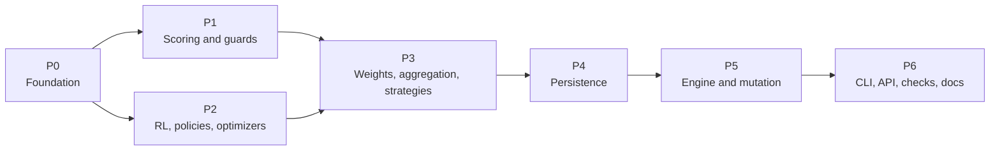

P1 and P2 depend only on P0 and may proceed in parallel; every other arrow is a hard dependency.

### 20.2 The phases

A note on names: **P0-P6** are rollout phases. They are not the persistence properties `P1`-`P6`
of section 14 or the rule identifiers `P1`-`P23` of the compliance catalog; context always
decides, and the phase names appear only in this section and in `components-gate-*` job names.

#### P0 - Foundation

| | |
|---|---|
| **Delivers** | Sections 3, 4 and 5; the `COMPONENTS` block and `HubPolicy` of 15; the `LegacyTable` views that make every existing registry a view of the hub (3.6) |
| **Files** | `mactf/components/` (new package: `kinds`, `reflect`, `params`, `registry` with the hub and overlays, `legacy`, `contracts`, `decorators`, `resolver`, `slots`, `plugins`), then one-line replacements of each legacy dict in `mactf/scoring/registry.py`, `mactf/coopetition/strategy.py`, `mactf/coopetition/weights.py` and `mactf/rl/functions/registry.py`, then `mactf/settings_default.py` and `mactf/conf.py` for the new block |
| **Exit criterion** | `test_default_identity` against the **recorded** fixtures; `test_import_weight` (importing `mactf.components` pulls in no `torch`); `test_function_registry`; `test_conf_blocks`; `test_conf_equivalence`; `test_overlay_isolated_between_runs`; `test_builtin_replacement_needs_the_flag_and_logs_w001` |
| **Done when** | every existing registration call site still works unchanged and every legacy dict is a view; nothing consumes a component yet |
| **Risk** | R1, R2 (21) |

The ordering constraint of 3.6 applies: each `LegacyTable(...)` is constructed at the bottom of
the module that defines the classes it lists.

#### P1 - Scoring and guards

| | |
|---|---|
| **Delivers** | Section 6 (scorer registry, pipeline chain validation, reward stages) and the `ComplianceGuard` |
| **Files** | `mactf/components/guards/compliance.py`, then `mactf/scoring/base.py`, `penalty.py`, `guards.py`, `pipeline.py`, `hierarchy.py` |
| **Exit criterion** | `test_default_pipeline_is_byte_identical`; `test_chain_validation_agrees`; `test_guard_property_compliance_floor`; `test_guard_property_void_stays_void`; the tests named in 6.5 and 6.7; `test_pipeline_validation` |
| **Done when** | a registered scorer or reward stage runs inside the guard, and a stage that tries to lower a breach's cost is refused with its `C` code |
| **Risk** | R3 |

#### P2 - RL functions, policies, optimizers and schedulers

| | |
|---|---|
| **Delivers** | Sections 7, 8 and 9 |
| **Files** | `mactf/rl/functions/` (`loss`, `advantage`, `support`), `mactf/components/guards/step.py` (the `StepGuard`), then `mactf/training/optimizer.py`, then the policy plumbing in `mactf/training/trainer.py` |
| **Exit criterion** | `test_override_loss_gets_compliance`; `test_clipped_advantage`; `test_optimizer_swap_is_atomic`; `test_optimizer_migration_*`; `test_median_synthesis`; `test_l1_anneal`; `test_default_identity` re-run (the fixtures must still match) |
| **Done when** | the optimizer and scheduler of section 9 and the worked example of 18.5 run, and every loss reaches the optimizer through `ensure_compliance` |
| **Risk** | R3, R5 |

#### P3 - Weight update, aggregation and peer strategies

| | |
|---|---|
| **Delivers** | Sections 10 and 11 (`WeightGuard`, `RollupGuard`, `StrategyGuard`, the strategy probe and the `mactf.testing.strategy` helpers) |
| **Files** | `mactf/coopetition/weights.py`, `aggregation.py`, `strategy.py`, `tree.py`, then `mactf/coopetition/weight_guard.py`, `mactf/components/guards/rollup.py` and `guards/strategy.py`, then `mactf/testing/strategy.py` |
| **Exit criterion** | `test_weights_default_identity`; `test_strategy_default_identity`; `test_strategy_swap_atomic`; `test_guard_property_weights_are_a_simplex`; `test_guard_property_strategy_cannot_write`; `test_guard_property_rollup_union_survives_trimming`; `test_trimmed_mean_rollup`; `test_staggered_mix` |
| **Done when** | the four rules for swapping an in-flight strategy (11.9) each have a passing `unit` and `integration` row |
| **Risk** | R4, R6 |

#### P4 - Persistence

| | |
|---|---|
| **Delivers** | Section 14: the `identity["components"]` manifest, `ComponentRestorer`, migration 4 and `record_components` |
| **Files** | `mactf/components/fingerprint.py`, `mactf/components/restore.py`, then `mactf/orchestration/checkpoint_v2.py`, then `mactf/db.py` (migration 4) |
| **Exit criterion** | `test_a_default_run_writes_the_same_identity_hash`; `test_checkpoint_bytes_unchanged_when_all_builtin`; `test_a_legacy_file_is_one_w053`; `test_a_missing_component_is_e093`; `test_a_changed_spec_is_w052_or_e094`; `test_migration_4_is_idempotent`; `test_db_migration` |
| **Done when** | a checkpoint written by the previous release restores under the new code with exactly one informational note, and a default run writes a byte-identical file |
| **Risk** | R7, R10 |

The migration is the one irreversible step; 20.4 says what that costs.

#### P5 - Engine integration and tree mutation

| | |
|---|---|
| **Delivers** | Sections 12 and 13: the `Engine` protocol, `TrainerEngine`, the `MutationPlan`/`MutationEngine`/`TopologySimulator`, and the live-run wiring |
| **Files** | `mactf/training/mutation.py` (the pure half, no `torch`), `mactf/training/mutation_engine.py`, `mactf/orchestration/engine.py`, `mactf/orchestration/dispatch.py`, `mactf/training/trainer.py`, `mactf/orchestration/live.py`, `mactf/testing/harness.py` (`Harness.engine`), `mactf/testing/tree.py` |
| **Exit criterion** | the 32 rows of 13.9; `test_orchestrator_trainer_equivalence` over all four scenarios; `test_mutation_atomicity`; `test_a_failed_rollback_is_e089_not_a_half_run`; `test_a_mutated_run_resumes_in_a_new_process`; `test_orchestrator_files_are_untouched` |
| **Done when** | one scenario runs bit-identically under both engines, and a three-operation plan that fails at each step leaves the trainer unchanged |
| **Risk** | R5, R8, R9 |

#### P6 - CLI, API, system checks, examples and documentation

| | |
|---|---|
| **Delivers** | Sections 16, 17 and 18; the remainder of section 15 (the mirrors and the shipped templates) |
| **Files** | `mactf/management/commands/components.py`, `mactf/components/scaffold.py`, the `runs components` and `peers mutate` verbs, `mactf/contrib/components/`, the API views, serializers and `urls.py`, `mactf/client/routes.py` and `specs.py`, the goldens, `docs/cli.md` and `docs/api.md` (regenerated, never hand-edited) |
| **Exit criterion** | `test_component_exit_codes`; `test_help_snapshot`; `test_command_contract`; `test_docs_generated`; `test_openapi_in_sync`; `test_literal_routes_precede_parameterised`; `test_routes_cover_every_component_view`; `test_code_table_is_complete`; `test_each_check_has_its_code_and_hint`; `test_every_worked_example_runs`; `test_wheel_ships_every_conf_template_and_no_legacy_configs` |
| **Done when** | `mactf check` on a fresh `startproject` is silent, and each example of section 18 runs from this document |
| **Risk** | R11, R12 |

The generated files change in a **separate commit** from the code that causes the change
(16.2.3), so a reviewer sees the regeneration as a pure consequence.

### 20.3 Line anchors to re-check

These are the `path:line` citations of sections 2-17 that a phase edits or reads. They were read
against the tree on the `last_reviewed` date; the snippet is the text of the line then. A phase
re-reads its own rows before it starts (rule 5 of 20.1).

| Phase | File | Line | Text at the time |
|---|---|---|---|
| P0 | `mactf/conf.py` | 37 | `TRAINER_DEFAULTS: dict[str, Any] = {` |
| P0 | `mactf/conf.py` | 158 | `ORCHESTRATOR_DEFAULTS: dict[str, Any] = {` |
| P0 | `mactf/conf.py` | 194 | `"INSTALLED_APPS": [` |
| P0 | `mactf/conf.py` | 672 | `missing = reserved - set(scoring["NON_OFFSETTABLE"])` |
| P0 | `mactf/conf.py` | 706 | `#: (document 16, section 7.9). ''tests/cli/test_conf_mirrors.py'' k...` |
| P0 | `mactf/conf.py` | 707 | `_PEER_STRATEGY_NAMES = frozenset({` |
| P0 | `mactf/conf.py` | 739 | `if str(trainer.get("PEER_STRATEGY", "kappa_softmax")).lower() not i...` |
| P0 | `mactf/coopetition/strategy.py` | 376 | `PEER_STRATEGIES: dict[str, type] = {` |
| P0 | `mactf/coopetition/strategy.py` | 425 | `def group_layouts(` |
| P0 | `mactf/coopetition/weights.py` | 464 | `WEIGHT_STRATEGIES: dict[str, type] = {` |
| P0 | `mactf/rl/functions/registry.py` | 28 | `"value": VALUE_FUNCTION_TYPES,` |
| P0 | `mactf/rl/functions/registry.py` | 56 | `#: Families exposed by ''function_capabilities()''; the tuple fixes...` |
| P0 | `mactf/rl/functions/registry.py` | 115 | `def build_function(spec: Mapping[str, Any], *, family: str \| None ...` |
| P0 | `mactf/scoring/registry.py` | 26 | `SCORER_TYPES: dict[str, type[Scorer]] = {` |
| P0 | `mactf/scoring/registry.py` | 34 | `def register_scorer(name: str, scorer: type[Scorer], *, replace: bo...` |
| P0 | `mactf/settings_default.py` | 26 | `INSTALLED_APPS = [` |
| P1 | `mactf/compliance.py` | 35 | `_INHERITED_VOID_FLOOR = 1000.0` |
| P1 | `mactf/compliance.py` | 108 | `def constrain(` |
| P1 | `mactf/compliance.py` | 129 | `)` |
| P1 | `mactf/compliance.py` | 198 | `continuous: ContinuousScore,` |
| P1 | `mactf/scoring/base.py` | 190 | `class Scorer(ABC):` |
| P1 | `mactf/scoring/base.py` | 222 | `@classmethod` |
| P1 | `mactf/scoring/guards.py` | 474 | `GUARDS: dict[str, Guard] = {` |
| P1 | `mactf/scoring/guards.py` | 700 | `class PointsEngine:` |
| P1 | `mactf/scoring/hierarchy.py` | 97 | `ROLLUP_STRATEGIES: dict[str, type] = {` |
| P1 | `mactf/scoring/hierarchy.py` | 145 | `def __init__(` |
| P1 | `mactf/scoring/penalty.py` | 52 | `def non_offsettable(self) -> frozenset[str]:` |
| P1 | `mactf/scoring/penalty.py` | 70 | `def score(self, ctx: ScoreContext) -> ScorerOutput:` |
| P1 | `mactf/scoring/pipeline.py` | 73 | `def __init__(` |
| P1 | `mactf/scoring/pipeline.py` | 329 | `non_offsettable = set(self.score_config.get("NON_OFFSETTABLE", NON_...` |
| P1 | `mactf/scoring/pipeline.py` | 499 | `def _compose(` |
| P2 | `mactf/distill/step.py` | 576 | `def attach(self, trainer: Any) -> None:` |
| P2 | `mactf/rl/advantage.py` | 89 | `def penalise_void_advantage(` |
| P2 | `mactf/rl/functions/loss.py` | 204 | `batch["compliance_floor"], device=reference.device, dtype=reference...` |
| P2 | `mactf/rl/functions/loss.py` | 397 | `class CallableLoss(_LossBase):` |
| P2 | `mactf/training/optimizer.py` | 66 | `class OptimizerBackend(Protocol):` |
| P2 | `mactf/training/optimizer.py` | 929 | `def attach_scheduler(self, name: str, **kwargs: Any) -> Any:` |
| P2 | `mactf/training/optimizer.py` | 1076 | `def state_dict(self) -> dict[str, Any]:` |
| P3 | `mactf/coopetition/aggregation.py` | 44 | `class Aggregator:` |
| P3 | `mactf/coopetition/aggregation.py` | 366 | `def _project_bounded(` |
| P3 | `mactf/coopetition/tree.py` | 571 | `def add_node(` |
| P4 | `mactf/orchestration/checkpoint_v2.py` | 56 | `@dataclass` |
| P5 | `mactf/orchestration/live.py` | 436 | `class RunManager:` |
| P5 | `mactf/training/trainer.py` | 349 | `self._trainer_policy = trainer` |
| P5 | `mactf/training/trainer.py` | 611 | `self.weight_strategy = build_weight_update(` |
| P5 | `mactf/training/trainer.py` | 1505 | `def train_step(self, node: Any, batch: Mapping[str, Any]) -> StepRe...` |
| P5 | `mactf/training/trainer.py` | 1921 | `def _observe(self, result: EpochResult, report: AggregationReport \...` |
| P6 | `mactf/management/driver.py` | 162 | `class RunDriver:` |
| P6 | `mactf/management/driver.py` | 175 | `from ..orchestration.orchestrator import Orchestrator` |

A row whose text no longer matches is not an error in the code; it means the file moved, and the
citation in the section that uses it must be corrected. `test_cited_paths_exist` (19.3.3) checks
the **files**; the lines are a review step, because a line number is the one thing a refactor
legitimately changes.

### 20.4 Performance budget and rollback

**Performance.** The only claim is that the default path costs nothing it did not cost before:
no guard runs (19.4, condition 4), no manifest is built (14.3.2), no import of the component
package pulls in `torch`. A benchmark row in `tests/components/test_overhead.py` times an
epoch of the `Harness` scenario with and without the package's slots installed and prints the
ratio; the gate **reports** it and does not fail on it, because a wall-clock threshold on a
shared CI runner is noise. A ratio above 1.02 on the maintainers' reference machine is a defect to
be explained in review.

**Rollback.** For each phase, in the order of risk:

| Phase | To revert | What stays behind |
|---|---|---|
| P6 | revert the pull requests, regenerate the goldens | nothing |
| P5 | revert; `ORCHESTRATOR.ENGINE` falls back to the Orchestrator, which was never modified | checkpoints written by `TrainerEngine` carry `engine: trainer`; resuming them under the Orchestrator is `E091` unless `ALLOW_ENGINE_SWITCH` is set (14.7.3) |
| P4 | revert the code | migration 4's nullable column stays in any database that ran it and is `NULL` for a default run; a version-4 database is not rolled back automatically (14.7.2) |
| P3 - P1 | revert | nothing; defaults were inert |
| P0 | revert | nothing; the legacy dicts are restored to plain dicts |

The practical rule: **do not merge P4 and P5 on the same day.** If a defect shows in P5, P4 is
already proven in use; the migration is then not a suspect.

### 20.5 Definition of done for the whole plan

All seven gates are green on the main branch; the matrices of every section pass; `mactf check`
is silent on a fresh project; `docs/cli.md` and `docs/api.md` are regenerated and in sync; the
front matter `status` of this document changes from `approved-for-implementation` to
`implemented`, with the date of the last gate; and the open questions of 21.2 each have an answer recorded
here or are explicitly carried forward.

---

## 21. Risk register and open questions

This section is the honest ledger: what could go wrong with the plan, what the document already
does about it, what is deliberately left unsolved, and which questions remain open with the
answer the document assumes until someone says otherwise.

**A note on names.** Risks are written **risk R1** to **risk R12** and are used only in this
section and in the phase tables of section 20. Section 8.10 also numbers its invariants `R1` to
`R12` (a different list: the RL function layer's rules), and section 7 cites "risk R5" for the
`trainer=` instance below. Whenever a number could be either, this document says "risk" or
"invariant" first. The invariants of 1.4 are `I1`-`I10`, the persistence properties of 14.2 are
`P1`-`P7`, the engine properties are `T1`-`T9`, and the mutation rules are `M1`-`M11`.

### 21.1 Risk register

Likelihood and impact are `low`, `medium` or `high`, judged for **this** plan, not in general. A
risk is *closed* only when its detection column names a test that exists in section 19.

| ID | Risk | L | I | What the document does about it | Detection | Phase |
|---|---|---|---|---|---|---|
| **R1** | **A default run drifts.** A change meant to be inert alters a score, a weight, an update or a checkpoint hash by one bit, and nobody notices because the new code is only compared with itself. | medium | high | Fixtures are recorded from the unmodified framework **before** any production line of the plan (20.1, rule 2). The comparison is bitwise (`torch.equal`). A spy asserts no guard runs on the built-in path. | `test_default_identity`, `test_default_pipeline_is_byte_identical`, `test_checkpoint_bytes_unchanged_when_all_builtin` (19.4) | P0 on, every gate |
| **R2** | **Import cycles and import weight.** The legacy tables register built-ins at import and run each kind's contract, which imports the class it checks; building them in the wrong place makes `import mactf` fail or pull in `torch` for a command that does not need it. | medium | medium | `LegacyTable` is constructed at the bottom of the module that defines its classes (3.6); `mactf.components` imports no `torch`; the test helpers load lazily. | `test_import_weight`, `test_a_settings_load_still_imports_no_torch` | P0 |
| **R3** | **A guard has a hole, or a false positive.** A plugin lowers what a breach costs by a path the guard did not model (the original "four holes" of 2.3), or a legitimate component is refused so often that operators turn the guard off. | medium | high | The guards sit *around* the engine rather than replacing it (2.4); each guard has a `mode` (`enforce`, `fallback`, `off`) and a property test that attacks it with `nan`, `inf`, huge values and void peers; `TRAINER.LOSS_COMPLIANCE` extends a loss rather than rejecting it by default. | `test_guard_property_*` (19.7.1), `test_override_loss_gets_compliance`, `test_laundering_is_caught_in_enforce_mode_and_repaired_in_fallback` | P1, P2 |
| **R4** | **A strategy or weight stage misbehaves in a way a probe cannot see.** The probe runs a synthetic cohort; a real cohort has a shape the probe never produced. | medium | medium | The probe is a gate, not a proof: the guard still runs every sweep under `enforce`, writes are restricted to the verbs of `CoordinationContext`, and a node-local failure is node-local (`test_synthesis_failure_is_node_local`). | `test_guard_property_strategy_cannot_write`, `test_guard_property_weights_are_a_simplex` | P3 |
| **R5** | **The `trainer=` instance in code.** A project that built a `MACTFTrainer` by hand and passed its own `trainer=` policy object predates `StepGuard`; wrapping it strictly would break a working project, and not wrapping it would leave a hole. | medium | medium | It is wrapped in `warn` mode: the project is told on the first step, nothing is refused, and the message names the setting that moves it to `quarantine` (7.6.5). Built-in policies are never wrapped, which is what keeps **I1**. | `test_a_trainer_instance_in_code_warns_first` (19.3.3) | P2, P5 |
| **R6** | **A live strategy or optimizer swap loses state.** A migration drops momentum or a stateful strategy's counters and the loss curve shows it three epochs later. | medium | medium | A swap states its `MIGRATE` policy: `carry` (same class only), `reset` or `fail` (`E074`); a swap that would drop state under `fail` is refused. The outgoing component's `detach` always runs before the incoming `attach`. | `test_strategy_swap_atomic`, `test_optimizer_swap_is_atomic`, `test_optimizer_migration_*` | P2, P3 |
| **R7** | **Checkpoint compatibility.** A file written by the previous release does not restore, or a restore silently continues on a different component. | low | high | `identity["components"]` is absent for a built-in-only run, so old and default files are byte-identical (14.8); a missing component is refused **before** any state moves (`P3` of 14.2); a changed spec is a named warning or, under strict, an error. | `test_a_legacy_file_is_one_w053`, `test_a_missing_component_is_e093`, `test_a_changed_spec_is_w052_or_e094` | P4 |
| **R8** | **The two engines diverge.** `TrainerEngine` and the Orchestrator are close for a year and then differ in a way that only a long run reveals (the order of two float additions, a signal fired once instead of twice). | medium | high | The Orchestrator is untouched (**T3**); the equivalence suite compares parameters, loss, weights, scorecards, RNG state, database rows and checkpoint digests over four scenarios; duplicated helpers have parity tests. | `test_orchestrator_trainer_equivalence`, `test_engine_parity.py` | P5 |
| **R9** | **A mutation or a rollback fails half-way.** A tree change commits some operations and not others, or the undo of an undo fails and the run continues on a tree nobody can describe. | low | high | Three phases (simulate on a clone, stage, commit with an inverse pushed first); an audit after commit; a failed rollback stops the run with `E089`; a tampered journal is `E089`. | `test_mutation_atomicity`, `test_a_failed_rollback_is_e089_not_a_half_run`, `test_swap_is_atomic` (19.6) | P5 |
| **R10** | **The database migration is the one irreversible step.** Migration 4 adds a nullable column; a database that ran it is not rolled back by reverting code, and a newer schema is refused by an older release. | low | medium | The column is nullable and `NULL` for a default run; the migration is idempotent; P4 is not merged on the same day as P5 (20.4); a forward-version database is refused with a named error rather than opened read-write. | `test_migration_4_is_idempotent`, `test_a_newer_schema_is_e096`, `test_a_version_3_database_refuses_a_new_run` | P4 |
| **R11** | **The shipped CLI or API surface regresses.** A new verb breaks the command contract, a literal route is shadowed by a parameterised one, or a generated doc is edited by hand and drifts. | medium | low | The new surface extends the existing framework and is checked by its existing tests; the golden files regenerate in a separate commit; every change to the API is additive (16.4). | `test_command_contract`, `test_help_snapshot`, `test_docs_generated`, `test_openapi_in_sync`, `test_literal_routes_precede_parameterised` | P6 |
| **R12** | **The error taxonomy and the documentation drift.** A code is raised and not tabled, a code is tabled and never raised, or an example stops running. | high | low | The code table is checked in both directions by a scan; each worked example is extracted from this document and run; a cited path that does not exist fails a test. | `test_code_table_is_complete`, `test_every_worked_example_runs`, `test_cited_paths_exist` (19.3.3) | P6 |

Three risks the document does **not** list, because the design removes them rather than
mitigating them: a plugin changing what a compliance rule *means* (the points engine stays
built in, 1.2, and open question Q1), a plugin loaded without the operator naming it (**I5**), and
two concurrent API runs seeing each other's registrations (**I9**).

### 21.2 Open questions

Each question has the answer this document **assumes**, so that implementation is not blocked by
it, the reason, and what would change the answer.

| ID | Question | Assumed answer | Why | What would change it |
|---|---|---|---|---|
| **Q1** | Should a component ever be allowed to customize the points guards and bindings (`GUARDS`, `BINDINGS`), i.e. redefine what a rule means? | **No.** They stay built in. | They encode the framework's clauses rule by rule; a plugin that redefines a rule redefines compliance (1.2). Weights remain configurable (`SCORING.POINTS`). | A written change to the framework document that makes a rule configurable by contract. |
| **Q2** | Should `ORCHESTRATOR.ENGINE` default to `trainer` once the equivalence suite has been green for a release? | **No change in this plan.** The default stays `orchestrator`. | Changing a default is a separate decision with its own migration notice; this plan only makes it *possible*. | Two consecutive releases with no equivalence defect and a request from a user. |
| **Q3** | Should plugin code be sandboxed (a subprocess or a restricted interpreter) rather than only allow-listed? | **No.** The import allow-list, the guards and the explicit opt-in (**I5**) are the boundary. | In-process components are the point (they share tensors with the trainer); a sandbox is a different product. The residual risk is stated, not hidden: a plugin the operator enabled runs with the operator's rights. | A deployment that loads components from users who are not the operator. |
| **Q4** | Can a component's *source* be reloaded in a live run (a new version of the same name) rather than only swapped for another registered component? | **No.** Reload takes a restart; the fingerprint of the source is recorded so a restore can tell (`E094` under strict). | A reload would have to reconcile state built by the old class with the new one, which is the migration problem again without a policy for it. | A `reload` verb with a defined state-migration contract per kind. |
| **Q5** | Should `TrainerEngine` support `mactf.distributed`? | **Not yet.** `E092` refuses the combination at `prepare` (13.4.2, **T9**). | Distributed coordination changes where the weights and the ledger live; adding it to this plan would double the equivalence surface. | A follow-up document that extends the engine protocol and the equivalence suite to a multi-process run. |
| **Q6** | Should unsafe policies be settable over the API? | **No.** `TRAINER.ALLOW_UNSAFE_POLICY` is configuration or code only (7.7). | A remote caller that can switch off the guard has bypassed the guard. | None foreseen; this is a security property, not a convenience. |
| **Q7** | Should the checkpoint record built-in components with non-default parameters? | **Yes, if the parameters differ from the defaults** (14.3). | A run that changed a built-in's parameter must not restore silently onto the defaults. A built-in with default parameters is not recorded, which is what keeps **I1**. | A format decision to record every component always, at the cost of every existing hash changing. |
| **Q8** | Is a hierarchy of more than a few levels worth optimising the mutation simulator for? | **Not now.** The simulator works on a clone and is linear in the tree. | The limits of 12.4 (`MAX_OPS_PER_PLAN` and friends) bound a plan; a large tree is a measurement to take, not a design to guess. | A profile of a real run showing the simulator on the hot path. |

### 21.3 The three deliberate limits

Stated in 12.9.8 and repeated here as that section promised. They are properties of the design,
not defects to fix in a later phase.

1. **The mutation journal grows without bound.** Every checkpoint carries all of it.
   `JOURNAL_WARN` (default 1000) raises `W045` once. No compaction is offered, because compaction
   would have to forget the chain that `verify_chain` uses. A run with thousands of plans is better
   served by one `MutationPlan` that does the work of many.
2. **The architecture of a node whose factory was removed from the project cannot be rebuilt.**
   The manifest names the factory; if the registry no longer has it, the resolver reports
   `ComponentMissing` (surfaced as `E085`) and the restore refuses rather than substitute an
   architecture the weights were not trained under.
3. **A node can be *added* by a reconciliation only if its parent exists in the stored tree.** That
   is a property of any valid tree, so it never fails for a checkpoint the trainer wrote. It can
   fail for a hand-built payload, and then `Target.build` reports the tree section as unparseable
   (`E089`).

### 21.4 How this section is kept honest

- A risk is **closed** when its detection test exists and passes at the gate of its phase; the
  phase table of 20.2 lists the same tests, so the two cannot disagree without a reviewer seeing
  it.
- A new risk found during implementation is added here **in the pull request that finds it**, with
  a detection test, and the phase table gains the row.
- An open question is **answered** by editing its row (the assumed answer becomes the decision) and
  by recording, in the pull request, who decided; a question is never deleted.
- The front matter of this document records `last_reviewed`. A gate that passes more than one
  release after that date re-checks the line anchors of 20.3 before it starts.
