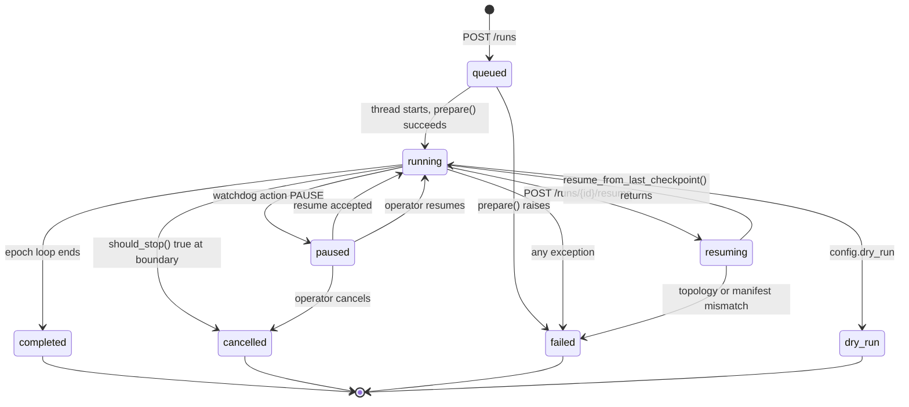
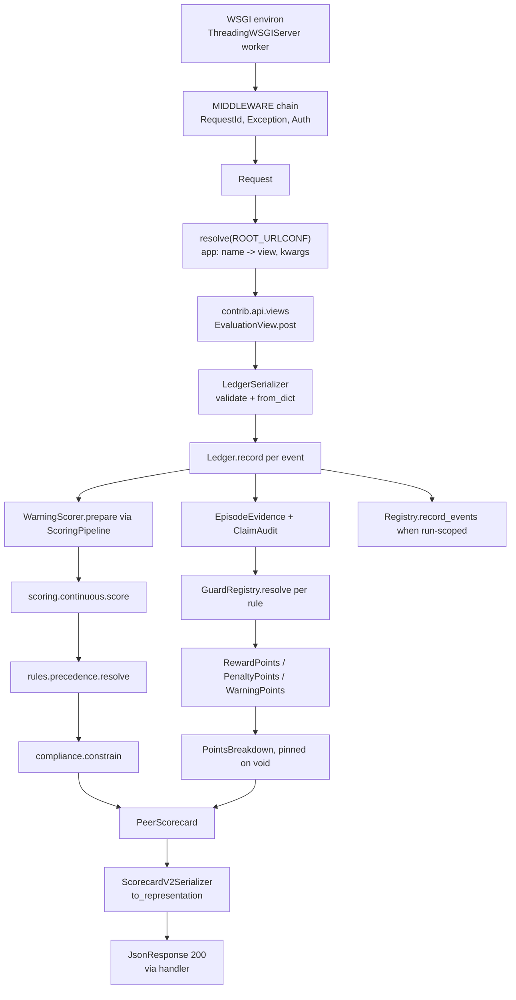
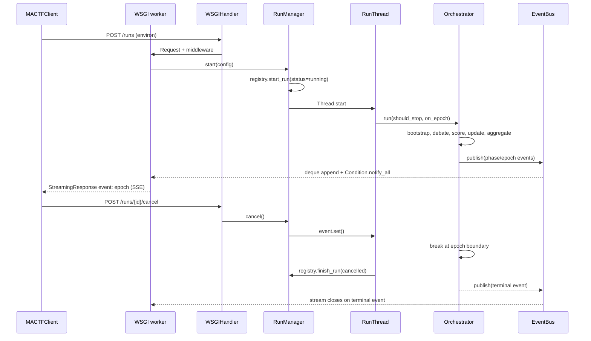

# 01. Target Architecture

## 1. Layering

Five layers, each allowed to import only downward. A violation is a review
blocker, and `tests/http/test_layering.py` enforces it by parsing imports.

```
L5  mactf/distributed/   coordinator, worker            (Phase D)
L4  mactf/contrib/api/   app, urls, views, serializers, auth, checks,
                         management/commands/serve       (Phase B)
    mactf/client/        MACTFClient, InProcessTransport,
                         HTTPTransport                   (Phase C)
L3  mactf/http/          request, response, urls, router, views,
                         middleware, handler, serializers,
                         exceptions, openapi, asgi (optional)
L2  mactf/orchestration/ runs, phases, episodes, bootstrap,
                         live (RunManager, EventBus)
    mactf/training/      trainer, optimizer, finetune, protocol,
                         callbacks, logging, watchdog
    mactf/scoring/       ledger, judge, evaluator, base, reward_scorer,
                         penalty, warning_scorer, pipeline, warning, hierarchy,
                         points, evidence, guards, normalize
    mactf/coopetition/   adapter, peer, temperature, aggregation, pool,
                         tree, delegation, synthesis, strategy, weights
    mactf/rl/            policy, loss, value, advantage, functions/
    mactf/sandbox/       base, detect, qemu, local, channel, guest_agent
    mactf/data/          sources, codec, registry, sampling
L1  mactf/rules/         catalog, severity, precedence
    mactf/db.py          registry and migrations
    mactf/conf.py        settings
    mactf/runtime.py     device, dtype, seeding, atomic IO
    mactf/signals.py     event bus primitives
    mactf/exceptions.py  error hierarchy
    mactf/apps.py        AppConfig, AppRegistry, INSTALLED_APPS
    mactf/checks.py      system checks
    mactf/management/    command discovery and BaseCommand
```

L3 is new and is the only layer that exists purely to carry bytes. It knows
`Request`, `Response`, and a URL conf; it does not know what a peer, a scorecard,
or a run is. That is what makes it reusable by both the service app and the
in-process client, and it is what stops the transport from becoming a second
engine.

Rules:

- `mactf/http/` must **not** import `mactf.orchestration`, `mactf.training`,
  `mactf.scoring`, `mactf.coopetition`, `mactf.rl`, `mactf.sandbox`,
  `mactf.contrib`, or `mactf.client`. It is a transport. The one permitted
  downward import is `mactf.exceptions` (to map `MACTFError` onto RFC 9457
  problems without re-declaring the hierarchy).
- `mactf/contrib/api/` may import L3, L2, and L1. It is an app; it is where the
  routes, the serializers, and the engine calls meet. It must **not** import
  `mactf.client`. There is no circularity to invite: a server never calls its own
  client.
- `mactf/client/` may import L3 and L1 only. It must **not** import
  `mactf.contrib.api`, and it must **not** import `mactf.orchestration.live`,
  `mactf.scoring`, or `mactf.training` for convenience. Its return types come
  from `mactf.scoring` and `mactf.orchestration` through `from_dict` on those
  objects, but importing the modules to call them is forbidden; the transport is
  the only path to a scorecard. `tests/client/test_layering.py` asserts the import
  set, and criterion 39 asserts the L3 half of it.
- `mactf/apps.py` must not import any layer above L1. `AppConfig.get_urls()`
  resolves a module path at request time; the app registry never touches L3 at
  import time, or `import mactf` would drag in the transport.
- L2 must not import L3/L4/L5. This is already true and must stay true.
  `RunManager` and `EventBus` live in `mactf/orchestration/live.py` rather than in
  the api app precisely because they are engine concerns: the client's in-process
  transport reaches them through the app, never by importing them.
- `mactf/distributed/` may import L3 and may contribute routes through an
  `urlpatterns` module, but it imports nothing above it.
- `mactf/training/` may import `mactf/rl`, `mactf/scoring`, `mactf/coopetition`,
  `mactf/runtime`, `mactf/signals`, and `mactf/orchestration.checkpoint`. It must
  **not** import `mactf/http`, `mactf/contrib/api`, or `mactf/client`. It is L2
  and stays L2.
- `mactf/rl/functions/` must **not** import `mactf/training`. The function
  wrappers are usable standalone, and a circular dependency between the trainer
  and the objectives it drives is the failure this rule prevents.
- `mactf/coopetition/tree.py` must **not** import `mactf/training`. The tree is a
  data structure; the trainer consumes it. `PeerTree.from_dict` is used by the
  checkpoint layer, which would otherwise pull the trainer into the import graph.
- `mactf/scoring/hierarchy.py` may import `mactf/coopetition.tree`; the tree must
  not import `mactf/scoring.hierarchy`.
- `mactf/contrib/api/` must not compute scores, aggregate parameters, or resume
  runs itself. It calls `ScoringPipeline`, `Aggregator`, `MACTFCheckpoint`, and
  `MACTFTrainer`, in the spirit of every earlier rule. Its `views.py` may not
  contain a scoring expression; `tests/contrib_api/test_no_scoring_in_views.py`
  greps for arithmetic on score fields.
- `mactf/scoring/points.py`, `evidence.py`, `guards.py`, and `normalize.py` are
  L2 and may import `mactf/rules/`, `mactf/scoring/ledger.py`, and stdlib only.
  They must **not** import `mactf/scoring/continuous.py` and
  `continuous.py` must **not** import them. The independence is what makes the
  equivalence gate in 07 section 11 a regression test instead of an argument, and
  `tests/scoring/test_points_equivalence.py` asserts it by parsing imports in
  both directions.
- `normalize.py` must not import `mactf/coopetition/aggregation.py`. The
  normalizer produces a signal; the aggregator consumes one. Importing the
  aggregator to "help" would make the calibration function depend on the
  controller that is supposed to react to it.

The first four rules are the shape of the integration: transport has no domain
knowledge, the app has both, and the client has transport plus object
reconstruction and nothing else. The remaining rules are what make
`mactf/training/` a library rather than a component of the server.
`tests/training/test_import_graph.py` enforces them.

## 2. New module graph

```
mactf/
  http/                      NEW (Phase B, L3) stdlib only
    __init__.py              exports Request, Response, JsonResponse, get_wsgi_application
    request.py               Request, QueryDict, parse_qs wrapper
    response.py              Response, JsonResponse, StreamingResponse,
                             ProblemResponse, status
    urls.py                  path, re_path, include, URLPattern, URLResolver,
                             resolve, reverse, clear_url_caches, get_resolver
    converters.py            path conversion: str, int, slug, uuid, path
    views.py                 View, as_view, dispatch, http_method_names
    middleware.py            Middleware protocol, RequestIdMiddleware,
                             AuthMiddleware, CorsMiddleware, ExceptionMiddleware
    handler.py               WSGIHandler, get_wsgi_application
    serializers.py           Serializer, Field family, ModelSerializer, ValidationError
    exceptions.py            HttpError->problem+json mapping for MACTFError
    openapi.py               schema() from the URL conf and serializer metadata
    asgi.py                  optional ASGI adapter, requires [asgi] extra
    testing.py               dispatch_wsgi, shared by the client and the test client
  contrib/
    api/                     NEW (Phase B, L4) the service app
      __init__.py
      apps.py                ApiConfig(name="mactf.contrib.api", label="api"),
                             ready() imports systems.py, connects signals
      urls.py                urlpatterns with name= on every route, app_name="api"
      serializers.py         every wire model from doc 02, ModelSerializer where
                             the shape is a dataclass to_dict
      auth.py                bearer tokens, scopes, Principal
      checks.py              mactf.api.E001, W002, E003, E004
      systems.py             imports checks.py so ready() registers them
      signals.py             app_ready receiver, run lifecycle receivers
      views/                 meta.py, runs.py, episodes.py, streams.py,
                             evaluations.py, peers.py, sandbox.py, scorers.py,
                             hierarchy.py, observability.py, admin.py
      management/
        commands/serve.py    mactf serve  (wsgiref, --host --port --workers)
  client/                    NEW (Phase C, L4)
    __init__.py              exports MACTFClient, Transport, errors
    client.py                MACTFClient, namespace facades (runs, scores, ...)
    base.py                  Transport protocol, and the envelopes RunHandle,
                             Event, Page, Run, Episode, RuleEvent
    transport.py             InProcessTransport (WSGI), HTTPTransport (urllib)
    errors.py                MACTFClientError hierarchy
    pagination.py            Page iterator helper
    specs.py                 dict builders for TrainerSpec and friends
  testing/
    client.py                NEW  Client  (in-process WSGI test client)
  orchestration/
    live.py                  NEW (Phase B, L2) RunState, RunHandle, EventBus,
                                  RunManager  <-- shared by the api app
    bootstrap.py             NEW  BootstrapTrainer
    checkpoint_v2.py         NEW  (A0) MACTFCheckpoint, CheckpointPayload,
                                  ResumeReport, VerificationResult
  training/                  NEW (A0)
    __init__.py              exports MACTFTrainer, MACTFOptimizer, FinetuneConfig
    protocol.py              TrainerProtocol, StepResult, EpochResult
    trainer.py               MACTFTrainer, TrainSpec, TrainResult
    optimizer.py             MACTFOptimizer, OptimizerBackend, TorchOptimizer,
                             ScipyOptimizer, CallableOptimizer, ParamGroupRouter
    finetune.py              FinetuneConfig, apply_finetuning
    callbacks.py             Callback, CallbackList
    logging.py               MACTFLogger, LogRecord family, sinks
    watchdog.py              MACTFWatchdog, WatchdogPolicy, probes, HealthReport
  data/                      NEW (Phase A)
    __init__.py
    codec.py                 TaskCodec, record validation
    sources.py               JsonlTaskSource, SyntheticTaskSource, TaskSourceProtocol
    registry.py              named source registry, settings-driven resolution
    sampling.py              deterministic epoch iteration, seeding
  scoring/
    evaluator.py             NEW  EvaluatorProtocol, ClaimAuditor, SuggestionLog,
                                  FlagLedger, SandboxAudit, ProgressAudit, COVERAGE
    base.py                  NEW (A0) Scorer ABC, ScoringKind, ScoreContext,
                                  ScorerOutput, WarningMutation
    reward_scorer.py         NEW (A0) RewardScorer
    penalty.py               NEW (A0) PenaltyScorer
    warning_scorer.py        NEW (A0) WarningScorer
    pipeline.py              KEPT ScoringPipeline + legacy Scorer shim
    hierarchy.py             NEW (A0) HierarchicalScorer, RollupStrategy
    points.py                NEW (A0) MAX_POINTS, SeverityPoints, PointsTable,
                                  PointsBreakdown, RulePoints, DenialRecord
    evidence.py              NEW (A0) EpisodeEvidence, ClaimRecord, ClaimAudit
    guards.py                NEW (A0) RuleBinding, GuardVerdict, GuardRegistry,
                             the 40 guards
    normalize.py             NEW (A0) NormalizationPolicy, CohortStats,
                                  CohortNormalizer, NormalizationReport
  coopetition/
    pool.py                  NEW  CooperativePool, split reporting
    tree.py                  NEW (A0) NodeKind, PeerNode, PeerTree, HierarchySpec
    delegation.py            NEW (A0) DelegationPolicy and implementations
    synthesis.py             NEW (A0) SynthesisFunction and implementations
    strategy.py              NEW (A0) PeerStrategy and implementations
    weights.py               NEW (A0) WeightUpdateStrategy, KappaSoftmaxAverage
  rl/
    functions/
      __init__.py            NEW (A0) exports
      registry.py            NEW (A0) from_spec dispatch, capabilities
      value.py               NEW (A0) ValueFunction, NestedValueFunction
      advantage.py           NEW (A0) AdvantageFunction and implementations
      loss.py                NEW (A0) LossFunction, CompositeLoss, CausalLMLoss
      support.py             NEW (A0) Return/ Reward/ Regularization/ Objective/
                             Gradient/ Metric/ Action functions
  sandbox/
    guest_agent.py           NEW  guest-side listener (stdlib only)
  distributed/               NEW (Phase D)
    __init__.py
    coordinator.py           Coordinator
    worker.py                Worker, WorkerClient
    protocol.py              registration, task, result payloads
    transport.py             parameter vector (de)serialization
    urls.py                  urlpatterns included by the api app when installed
```

Three structural notes.

**`mactf/http/` has no `models.py`.** Wire models belong to the app that serves
them (`mactf/contrib/api/serializers.py`), because they are the app's contract,
not the transport's. A transport that carries a `ScorecardSerializer` would have
to know what a scorecard is.

**`mactf/client/` has no `models.py`.** It returns `PeerScorecard`,
`EpisodeScorecard`, `AggregationReport`, `CapabilityReport`, and the rest, built by
`from_dict` on those classes. There is no place for a parallel family to appear,
which is the structural half of the Gap 18 fix.

**`mactf/contrib/api/views.py` and `views/`.** The package holds one `views.py`
that re-exports from `views/` submodules. `ApiConfig.ready()` imports `views`, not
each route module, so a route file is loaded once and its registration is
idempotent under `importlib.reload` in tests.


## 3. Concurrency model

This is the most important design decision in the plan, because the library is
synchronous and torch-bound while an HTTP server is concurrent. The transport is
WSGI, so the currency is threads, not tasks.

```
        WSGI server: ThreadingWSGIServer, bounded worker pool
        |                |                  |
    read routes     POST /runs        GET /events (SSE)
        |                |                  ^
        v                v                  |
   sqlite (WAL)     RunManager           EventBus
                         |                  ^
                one thread per run          |
                         v                  |
                Orchestrator (sync, torch)  |
                         |                  |
                mactf.signals.send(...)     |
                         |                  |
                EventBus.publish()  --Condition.notify_all--> worker thread
```

Decisions:

1. **One thread per run.** `RunManager.start()` creates
   `threading.Thread(target=self._run, daemon=True, name=f"mactf-run-{run_id}")`.
   The GIL is irrelevant here because torch releases it for large kernels, and
   the alternative (running torch on a request thread) is strictly worse: a
   `/runs` request would occupy a worker for the whole run.
2. **The server is threaded, the pool is bounded.** `wsgiref.simple_server` is
   single-threaded by default, which would make one SSE stream block every other
   request. `mactf serve` therefore runs `ThreadingWSGIServer` (a
   `socketserver.ThreadingMixIn` subclass) with a semaphore-bounded worker pool of
   `HTTP.STREAM_WORKERS` (default 16). A stream holds one worker for its
   duration, so the default is chosen to leave read workers available; a host
   serving many concurrent streams raises it, and `mactf serve` logs the value at
   startup.
3. **Read endpoints never touch a run thread.** They read sqlite, which runs in
   WAL mode already (`mactf/db.py:124` sets `PRAGMA journal_mode = WAL`). A run
   and a reader never contend beyond WAL's normal behaviour.
4. **Events cross the thread boundary once.** `EventBus` is pure threading: a
   bounded `collections.deque(maxlen=API.EVENT_BUFFER)` guarded by a
   `threading.Lock`, plus a `threading.Condition`. `publish()` appends one
   JSON-safe dict and calls `notify_all()`. An SSE worker loop reads from the
   buffer by index, and on exhaustion waits on the condition with a timeout equal
   to `HTTP.SSE_HEARTBEAT` seconds, on which it writes a comment frame to keep
   proxies from closing the connection. There is no event loop anywhere in the
   server, which is why the same `EventBus` serves the blocking client iterator
   without a second implementation.
5. **Cancellation is cooperative.** `RunHandle.cancel` sets a
   `threading.Event`. The orchestrator checks it at the top of each epoch via an
   injected `should_stop: Callable[[], bool]`. It does not raise inside a torch
   op, because that would leave optimizer state inconsistent.
6. **Concurrency is bounded.** `MAX_CONCURRENT_RUNS` (default 1) is a semaphore.
   A `POST /runs` beyond the limit returns `429` with `Retry-After`, not a queue
   that grows unbounded.
7. **Shutdown is deterministic.** `mactf serve` installs a `SIGINT`/`SIGTERM`
   handler and an `atexit` hook that set every live handle's cancel flag, join
   each thread with a timeout, and mark any still-running registry row
   `interrupted`. `WSGIServer.shutdown()` is called from a separate thread, which
   is the documented way to stop `serve_forever`.

### Where the trainer, logger, and watchdog run

The wrapper layer in documents 08 and 09 stays synchronous and stays inside the
run thread. That is a deliberate restriction, and the three exceptions are
narrow.

| Component | Thread | Why |
|---|---|---|
| `MACTFTrainer.fit` | the run thread | It drives torch. Moving it to a request worker would serialize all torch work onto a request and time the request out |
| `MACTFWatchdog.tick` | the run thread, called by `fit` at epoch end | It reads parameters, gradients, and memory of the thing it is guarding. Doing it from another thread races with the training step |
| `MACTFCheckpoint.save` | the run thread, unless `async_write=True` | A synchronous save is the default because a checkpoint not on disk at crash time is not a checkpoint. `async_write=True` moves only the file I/O to a writer thread; the payload is snapshotted synchronously under a short lock, so no tensor is read while it is being mutated |
| `MACTFLogger` sinks | one daemon writer thread when `async_write=True`, else the run thread | Logging must never block a step on disk, and one writer thread guarantees FIFO order across sinks |
| `GET /runs/{id}/watchdog`, `GET /runs/{id}/logs/tail` | a request worker, read-only | They read the last `HealthReport` and the `MemorySink` deque under a lock. They never call `tick()` |
| SSE stream | a dedicated request worker per stream | It blocks on the `EventBus` condition between events. It never holds a run lock, and it exits on the terminal event or client disconnect |

The rules that follow from this:

- No component holds a torch tensor while blocked on I/O or a lock. A worker
  unwinding with live autograd state is how a graph is freed under a running
  backward pass.
- `MACTFLogger` never sends signals; it only receives them. A logger that sent
  signals would be able to alter training through a side channel.
- `MACTFWatchdog` never mutates hyperparameters (document 09 section 3.6). If it
  did, the run thread would be changing configuration based on a probe while a
  step was in flight, and the next epoch would not be reproducible.
- A rollback initiated by the watchdog runs on the run thread, between epochs,
  never concurrently with a step. `aggregate` and `save` share the run thread for
  the same reason.
- The only lock the trainer and a request worker share is the checkpoint write
  lock. It is held for the duration of the parameter copy, not for the file
  write.

This is why `01` does not add an async trainer. An async trainer would need
per-node async execution, which only pays off for I/O-bound models, and the
hierarchy (`10`) already gets that benefit from a bounded thread pool inside
`run_inference`.

### Required library change for cancellation

`Orchestrator.run` gains one optional parameter and no behavioural change when it
is absent:

```python
def run(
    self,
    config: RunConfig | None = None,
    *,
    should_stop: Callable[[], bool] | None = None,
    on_epoch: Callable[[dict[str, Any]], None] | None = None,
) -> dict[str, Any]:
```

- `should_stop` is checked after `_record_episode` and before the next epoch.
  When it returns true the loop breaks, the registry row is finished with
  `status="cancelled"`, and the returned summary carries `"status": "cancelled"`
  plus the epochs actually completed.
- `on_epoch` receives the same `entry` dict that is appended to `history`, which
  is exactly what the SSE stream emits. This keeps the CLI and the API on one
  event definition.

Both parameters default to `None`, so every existing caller and test is
unaffected. This is the entire library surface change required for Phase B.

### Two adjacent `RunConfig` corrections

`RunConfig` ([mactf/orchestration/orchestrator.py:45](mactf/orchestration/orchestrator.py#L45))
declares `resume_from: Path | None`, but the CLI passes
`True if options.get("resume") else None`
([mactf/management/commands/run.py:35](mactf/management/commands/run.py#L35)), so a
resumed run currently receives a `bool` where a path is expected. The type
annotation and the call site disagree. Phase A fixes this by changing the field
to `resume_from: Path | bool | None`, which is what the code actually does, and
by documenting that `True` means "the latest checkpoint".

`RunConfig` also gains an optional `task_source: str | None = None` so a per-run
dataset selection is expressible. `Orchestrator.prepare` resolves it through
`mactf.data.registry.build_source`; `None` keeps the current synthetic default.
This is what `RunCreateRequest.task_source` in document 02 maps onto.

## 4. Run lifecycle



Two states are new and both exist because of document 09:

- **`paused`** is not `failed`. The watchdog's `PAUSE` action stops the loop and
  leaves the row `paused` so `POST /runs/{id}/resume` can continue the same run
  id. Treating a pause as a failure would make a reversible degradation
  irreversible. `completed`, `cancelled`, `failed`, and `dry_run` remain the only
  terminal states.
- **`resuming`** is the window in which `resume_from_last_checkpoint()` is
  verifying the manifest, rebuilding the tree, and restoring the optimizer. It is
  observable so a slow restore does not look like a hung run, and it is
  interruptible only by `cancel`, because aborting a restore halfway leaves
  half-applied state.

Transitions are enforced in `RunManager` and mirrored into the `runs.status`
column. `POST /runs/{id}/cancel` on a terminal run returns `409` with the current
status in the problem body. The registry is authoritative on restart: a row left
in `running` when the process died is rewritten to `interrupted` at startup by
`RunManager.reap_orphans()`, which is the only place the API writes a status it
did not observe.

A `paused` row survives a restart. `reap_orphans` rewrites `running` but leaves
`paused` alone, because a paused run has a resolvable checkpoint by construction
(the watchdog snapshots before pausing, document 09 section 3.4) and rewriting it
to `interrupted` would lose the distinction between "an operator must decide" and
"the process died".

## 5. Data flow: request to scorecard



Note the ordering: neither the transport nor the view performs a scoring step of
its own. The view calls `ScoringPipeline.score_peer` and serializes the result,
which is why an HTTP scorecard and a CLI scorecard are the same object
serialized twice. The `Request`/`Response` envelope is the only thing the
transport contributes, and criterion 53 asserts both transports produce the same
bytes through it.

The two columns out of `ledger` are the P11 split in diagram form. The left
column is the docx path and is unchanged; the right column is the rubric. They
rejoin only at `card`, which carries both `final_score` and `points`, and the
right column cannot write to `comp` or `cont` because it runs after them. The
`breakdown --> card` edge is `metadata["points"]`, not a field that
`compliance.constrain` can see.

## 6. Data flow: run to live client



The in-process transport enters at the same `WSGIHandler` and stops at the
`Response` object: it builds an environ, calls the handler, and parses the
resulting status and body. It never calls `RunManager` directly, which is what
keeps the two paths honest.

## 7. Dependency injection

`get_wsgi_application()` takes no arguments; it reads `ROOT_URLCONF`,
`MIDDLEWARE`, and `API` from the active settings object and caches one handler per
settings object. What used to be `create_app(...)` keyword arguments are now
ordinary configuration:

```python
# project/urls.py
from mactf.http.urls import include, path

urlpatterns = [
    path("api/v1/", include("mactf.contrib.api.urls")),
]
```

and the dependencies a view needs are read from the request:

```python
# mactf/contrib/api/deps.py
def get_settings(request: Request) -> Settings          # request.settings
def get_registry(request: Request) -> Registry          # ensure_registry(settings)
def get_scorer(request: Request) -> ScoringPipeline     # app-scoped, cached
def get_run_manager(request: Request) -> RunManager     # app-scoped, cached
def get_principal(request: Request) -> Principal        # auth middleware
```

`WSGIHandler` attaches both the settings object and the resolved app registry to
the `Request` before dispatch, so a view never calls `get_settings()` itself.
`ApiConfig.ready()` stores the app-scoped `ScoringPipeline` and `RunManager` on
the `AppConfig`, which is how `get_scorer` and `get_run_manager` are per-app
rather than per-process globals and why a test that configures two settings
objects in sequence gets two independent pipelines.

`get_scorer` returns a `ScoringPipeline` so warning registries are shared across
requests for the same app instance. Two `mactf serve` worker processes would
therefore hold separate in-memory warning state - which is precisely why document
04.4 persists warnings to sqlite. The annotation stays `Scorer` because
`ScoringPipeline` is a `Scorer`; a test asserts the returned object is an instance
of both. `mactf serve` runs a single process by default and logs a warning when
`--workers` is set above 1, naming the warning-state caveat rather than silently
producing divergent scores.

`RunManager` takes no transport dependency, so a view that needs one reads it from
the app config, and `mactf.testing.Client` gets the same object a live server
would use.

For tests, the settings object is the injection point, not the app:

```python
settings = Settings(ROOT_URLCONF="tests.urls", API={"ALLOW_ANONYMOUS": True})
response = mactf.testing.Client(settings=settings).get("/api/v1/rules")
```

`Client` calls `clear_url_caches()` on teardown so a second settings object with a
different `ROOT_URLCONF` cannot observe the first one's resolved patterns.

## 8. Hierarchy in the architecture

Peer hierarchy is a property of the orchestrator layer the user designs. When the
user composes an orchestrator with nested peers, the framework trains, scores,
aggregates, checkpoints, and serves that hierarchy natively. A flat swarm is not a
special case of the framework; it is the degenerate tree with a single level.
Hierarchy is never an exception path, never a separate pipeline, and never a
second scoring implementation.

Normative definition: [10-hierarchical-peers.md](10-hierarchical-peers.md)
section 1. Stated as a design principle:
[00-scope-and-audit.md](00-scope-and-audit.md) section 4, P9.

### Where the tree sits in the layers

`mactf/coopetition/tree.py` is L2. It holds `PeerTree`, `PeerNode`, and
`HierarchySpec`, and it imports only `mactf.coopetition.peer`,
`mactf.exceptions`, and stdlib. It does not import `mactf.training`,
`mactf.scoring`, or `mactf.api`.

That placement is what allows four otherwise separate consumers to agree on the
same topology without depending on each other:

| Consumer | Uses the tree for |
|---|---|
| `mactf/scoring/hierarchy.py` | walk order, depth, parent/child links for rollup and `branch_void` |
| `mactf/training/trainer.py` | build order, epoch order, per-node optimizer binding |
| `mactf/orchestration/checkpoint_v2.py` | serializing topology so a resume rebuilds the same paths |
| `mactf/contrib/api/views/peers.py` | `GET /runs/{id}/peers/tree` and `POST /peers/{path}/infer` |

### Flat equivalence in the module graph

A depth-1 tree is not a separate path through the code. The mapping is:

| Today | With the tree |
|---|---|
| `PEERS: ["peer-a", "peer-b"]` | `PeerTree.flat(["peer-a", "peer-b"])` |
| `PhaseContext.peers: dict[str, Peer]` | `tree.nodes` where `path == name` |
| `Episode.participants: dict[str, PeerEpisode]` | keyed by `node.path`, identical keys for depth 1 |
| `scorer.score_peer(ledger, peer=name)` | `pipeline.score_peer(ledger, peer=name, node_path="")` |
| `Aggregator.compute_weights(names, scores)` | one aggregation group: `tree.root_paths` |
| `CheckpointManager.save(peers=...)` | `payload.models` keyed by path, `payload.tree` with one level |

Because `node_path == ""` for every root of a depth-1 tree (document 10 section
5.4), warning registries, log records, and scorecards are byte-identical to
today's. That is the mechanical content of "a flat swarm is the degenerate tree",
and it is what acceptance criterion 26 tests.

### Concurrency implication

Nothing in the tree changes the one-thread-per-run model. Tree traversal is
in-process and synchronous during training. The only place concurrency appears is
`run_inference(parallel=True)`, which uses a bounded `ThreadPoolExecutor` inside
the run thread, and which is bounded by `max_workers` so a wide tree cannot
exhaust the host's thread budget. Inference from `POST /runs/{id}/infer` runs on
the request's executor, not the run thread, because a loaded run's tree is
read-mostly; the one shared resource is the module itself, which is read-only
during inference.

## 9. Where scores live

| Data | Authority | Survives restart | Read by |
|---|---|---|---|
| Run row, status, timings | `runs` table | yes | `GET /runs` |
| Episode scorecards (full JSON) | `episodes.scorecard` | yes | `GET .../episodes/{n}` |
| Individual rule events | `rule_events` | yes | `GET .../rule-events` |
| Points per peer-episode | `scorecards.points` column (migration 3), mirrored in `episodes.scorecard.metadata["points"]` | yes | `GET .../points`, v2 scorecards |
| Cohort calibration | `episodes.normalization` (migration 3) | yes | `GET .../episodes/{n}/normalization` |
| Points table identity | `scorecards.points_table_version` | yes | `GET /scores/scale` cross-check |
| Warnings | `warnings` table (new) | yes | `GET /runs/{id}/warnings` |
| Adjudications | `adjudications` table (new) | yes | `GET .../adjudications` |
| Aggregation reports | `aggregations` table (new) | yes | `GET .../aggregations` |
| Peers and topology | `tree` section in the checkpoint; `PeerTreeModel` is derived | yes, from a checkpoint | `GET /runs/{id}/peers/tree` |
| Log tail | `MemorySink` deque | no (by design) | `GET /runs/{id}/logs/tail` |
| Full log history | `jsonl` file per run | yes | `GET .../logs/tail?source=file` |
| Health reports | last report in the checkpoint, history in memory | last report only | `GET /runs/{id}/watchdog` |
| Resume outcomes | `resume_reports` table (new) or `runs.notes` | yes | `GET .../resume` |
| Live progress | `EventBus` ring buffer | no (by design) | SSE only |
| kappa/entropy in flight | `AggregationReport` in memory | no | SSE, then DB on epoch end |

The last row is deliberate: a client that reconnects after a restart recovers the
*scored* truth from the database and simply misses transient progress. Nothing
that affects a score exists only in memory.

Two additions deserve their own note because they are the new data whose absence
would be a silent lie:

- **Topology** is only authoritative in `CheckpointPayload.tree`. A live run's
  tree lives in `RunState`; `GET /runs/{id}/peers/tree` reads the live tree when
  the run is in memory and the latest checkpoint's `tree` section when it is not.
  Returning `404` for a run with no checkpoint would be correct but unhelpful, so
  the route documents `source: "live" | "checkpoint"` in its response.
- **Health history** is bounded by `WATCHDOG.KEEP_HISTORY` and is explicitly not
  durable beyond the last report. A user who needs the full probe history reads
  the JSONL log, where every `HealthRecord` is a line. That is a documented
  split, not an oversight.

### 9.1 Why points are stored twice

`scorecards.points` and `episodes.scorecard.metadata["points"]` hold the same
`PointsBreakdown`. That redundancy is intentional and has one narrow purpose: the
JSON column is the queryable projection, and the embedded copy is what makes a
scorecard self-describing when it is exported, diffed, or handed to a client that
never queries the database.

Neither copy may be authoritative for a different value. `tests/contrib_api/test_points_routes.py`
asserts they are equal for every stored row, and the write path sets both from one
object in one transaction, so a divergence is impossible without a bug. The
alternative — storing only the JSON and parsing it in SQL — would make
`GET /runs/{id}/points` a full table scan with a JSON decode per row. The
alternative in the other direction — storing only the column and dropping the
embedded copy — would break a scorecard export that a user keeps outside the
database. Two copies with an equality test is the cheap version of both.

`points_table_version` is stored on the scorecard rather than inferred from the
run's settings, because settings can be reloaded. A scorecard scored under table
`1.0.0` and read after an upgrade to `1.1.0` must say which table produced it;
otherwise a support question about a six-month-old run has no answer.

## 10. Static typing and lint gates

- `py.typed` is already shipped ([pyproject.toml:95](pyproject.toml#L95)).
- `mypy` config exists ([pyproject.toml:114](pyproject.toml#L114)). New modules
  must type-check under it with `ignore_missing_imports = false` gained for any
  optional extra; the transport and client need no stub package because they use
  only stdlib types.
- `ruff` select is `E,F,I,UP,B` with `E501` ignored. New code must pass it.
- `mactf/http/` and `mactf/contrib/api/serializers.py` must not use `Any` for a
  field that has a known type; `tests/http/test_typing.py` asserts no `Any`-typed
  public field exists in the serializer modules. The one exception is
  `LogRecord.fields: Mapping[str, Any]` and `PeerNode.metadata`, which are
  explicitly open by design.
- `mactf/client/` declares its return types from the engine packages under
  `TYPE_CHECKING` only, so importing the client does not import torch. A test
  asserts `sys.modules` after `import mactf.client` contains no `torch`, no
  `mactf.training`, and no `mactf.contrib`.
- `mactf/training/` is typed against `torch.optim.Optimizer` rather than against
  `OptimizerBackend` where the concrete type is known, so `mypy` catches a
  wrapper that forgets `param_groups`. `OptimizerBackend` is used only at the
  boundary where a third-party optimizer enters.
- The legacy `Scorer` shim in `pipeline.py` uses `TYPE_CHECKING` aliasing, so
  `mypy` sees `ScoringPipeline` and continues to check the existing annotations
  in `PhaseContext.scorer` and `Orchestrator.scorer`.
