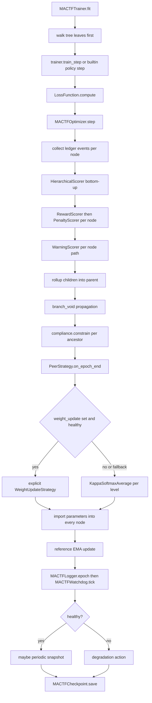

# 08. Trainer, Optimizer, and Strategies

This document fixes three abstractions that the library currently hardcodes:

1. The optimizer. `build_peer` constructs `torch.optim.Adam` and nothing else
   (`mactf/coopetition/peer.py:103`), and `Peer.to()` rebuilds it as Adam after a
   device move (`peer.py:46`).
2. The training step. `local_update` (`mactf/orchestration/phases.py:142-224`)
   is the only objective the framework can run.
3. The coordination policy. `Aggregator.apply` writes blended parameters into
   every peer unconditionally (`mactf/coopetition/aggregation.py:337-366`).

`MACTFOptimizer`, `MACTFTrainer`, and `PeerStrategy` replace those three, without
removing them. A run that configures nothing behaves exactly as it does today;
that is the compatibilty gate in section 9.

## 1. Module layout

```
mactf/training/
  __init__.py          NEW  exports
  optimizer.py         NEW  MACTFOptimizer, OptimizerBackend, TorchOptimizer,
                            ScipyOptimizer, CallableOptimizer, ParamGroupRouter
  trainer.py           NEW  MACTFTrainer, TrainerProtocol, StepResult, TrainSpec
  protocol.py          NEW  TrainerProtocol, StepResult, EpochResult
  finetune.py          NEW  FinetuneConfig, apply_finetuning, resolve_peft
  callbacks.py         NEW  Callback, CallbackList, built-in callbacks
  logging.py           NEW  MACTFLogger            (document 09)
  watchdog.py          NEW  MACTFWatchdog          (document 09)

mactf/coopetition/
  strategy.py          NEW  PeerStrategy, built-in strategies
  weights.py           NEW  WeightUpdateStrategy, KappaSoftmaxAverage, ...
  peer.py              KEPT unchanged in behaviour; build_peer delegates
  aggregation.py       KEPT unchanged; strategies call it
```

`mactf/training/` may import `mactf.rl`, `mactf.scoring`, `mactf.coopetition`,
`mactf.runtime`, and `mactf.orchestration.checkpoint`. It must not import
`mactf.http`, `mactf.contrib.api`, or `mactf.client`. `mactf/rl/functions/` must
not import `mactf.training`, so the function wrappers stay usable standalone.
These rules are enforced by an import-graph test in document 06.

## 2. `MACTFOptimizer`

### 2.1 Interface

```python
# mactf/training/optimizer.py
class OptimizerBackend(Protocol):
    @property
    def param_groups(self) -> list[dict[str, Any]]: ...
    @property
    def learning_rate(self) -> float: ...
    @learning_rate.setter
    def learning_rate(self, value: float) -> None: ...
    def zero_grad(self, set_to_none: bool = True) -> None: ...
    def step(self, closure: Callable[[], torch.Tensor] | None = None) -> Any: ...
    def add_param_group(self, group: dict[str, Any]) -> None: ...
    def state_dict(self) -> dict[str, Any]: ...
    def load_state_dict(self, state: Mapping[str, Any]) -> None: ...
    def describe(self) -> dict[str, Any]: ...
```

`OptimizerBackend` is structurally satisfied by `torch.optim.Optimizer` for
everything except `describe`, so `TorchOptimizer` is a thin adapter rather than
a reimplementation.

### 2.2 `TorchOptimizer`

Accepts any of:

```python
TorchOptimizer(torch.optim.AdamW, lr=3e-4, weight_decay=0.01)
TorchOptimizer(functools.partial(torch.optim.SGD, momentum=0.9), lr=0.1)
TorchOptimizer(torch.optim.AdamW(params, lr=1e-4))    # already built
```

The built-instance form is detected by `isinstance(candidate,
torch.optim.Optimizer)`. The other two forms are constructed lazily in
`bind(parameters)` so the trainer can pass the final parameter list after
freezing, PEFT wrapping, and device movement.

Frozen-parameter filter, mandatory: `bind()` selects
`[p for p in parameters if p.requires_grad]`. This matters because
`build_peer` already does it (`peer.py:104`) and because a PEFT model has a
mostly-frozen base. Passing frozen parameters to Adam is not an error, but it
allocates optimizer state for tensors that will never receive a gradient, which
for a 7B model is gigabytes.

Device moves must preserve the optimizer class. The current `Peer.to()`
compares against nothing and rebuilds Adam unconditionally (`peer.py:41-47`),
which silently discards the user's optimizer choice. `MACTFOptimizer`
substitutes `move_to(device)` that rebuilds through the same spec and reloads
`state_dict()`; document 06 adds a test that a `SGD(momentum=0.9)` peer stays
SGD through a `.to()`.

### 2.3 `ScipyOptimizer`

```python
ScipyOptimizer(
    method="L-BFGS-B",
    *,
    closure_required=True,
    max_iter=20,
    tol=1e-6,
    options=None,
    dtype=torch.float64,
)
```

Supported methods and their Jacobian handling:

| Method | `jac` | Hessian needed |
|---|---|---|
| `L-BFGS-B` | analytic, `None` if the closure returns no grad | no |
| `BFGS` | analytic | no |
| `CG` | analytic | no |
| `Newton-CG` | analytic | yes, `hess` or `hessp` required |
| `Nelder-Mead` | never | no |
| `Powell` | never | no |
| `SLSQP` | analytic | no |

Mechanics:

1. `bind()` captures the parameter list and records
   `offset[i]`, `numel[i]` for each parameter plus the total length.
2. `closure()` is called by scipy. It writes the candidate vector into the
   parameters with `torch.nn.utils.vector_to_parameters`, evaluates the user's
   closure, and returns `(float_loss, flat_grad_or_None)`.
3. The flattening uses `torch.nn.utils.parameters_to_vector` and forces
   `float64` on CPU, because scipy operates on numpy arrays and `float32`
   accumulation inside L-BFGS-B loses the line-search precision that makes it
   useful. The parameter dtype is restored afterwards.
4. `step(closure)` raises `ContractError` if `closure is None`. There is no
   silent fallback to a torch step; a scipy optimizer without a closure is a
   configuration bug.
5. `state_dict()` stores the flattened vector and the last `OptimizeResult`
   (`nit`, `nfev`, `fun`, `message`), so a resume does not restart the line
   search from scratch.

Honest limitation, stated in the doc and in `describe()`: scipy methods are
full-batch. They cannot consume a minibatch stream, so in `MACTFTrainer` they run
at epoch granularity after the epoch's data is assembled, not per step.
`TrainerCapabilities.optimizer_granularity` reports `"epoch"` for these methods
and the service layer surfaces it, so a user is never surprised that
`STEPS_PER_EPOCH` is ignored.

`torch.autograd.grad` is used rather than `loss.backward()` inside the closure,
so gradients do not accumulate across scipy's many evaluations. This is the
single most common bug in torch-plus-scipy code and the doc calls it out.

### 2.4 `CallableOptimizer`

Two forms:

```python
CallableOptimizer(fn)                        # fn(parameters: list[Parameter]) -> None
CallableOptimizer(fn, functional=True)       # fn(param: Parameter) -> Tensor (new value)
```

The functional form applies `param.data.copy_(new_value.detach())` under
`torch.no_grad()`. It exists for evolutionary strategies and for custom
second-order code. It does not support `state_dict()`; `describe()` reports
`"stateful": False` and `MACTFCheckpoint` records that the optimizer state is
absent rather than pretending it can resume one.

### 2.5 `ParamGroupRouter`

```python
ParamGroupRouter(
    routes=[
        Route(pattern=r".*lora_.*",     optimizer=TorchOptimizer(torch.optim.AdamW, lr=1e-4)),
        Route(pattern=r".*task_head.*", optimizer=TorchOptimizer(torch.optim.Adam,  lr=1e-3)),
    ],
    default=TorchOptimizer(torch.optim.AdamW, lr=2e-5),
)
```

- `pattern` is matched with `re.fullmatch` against the fully qualified parameter
  name. In a hierarchy the name is prefixed with the node path, so
  `peer-a/sub-1/mini-2/.*lora_.*` is expressible.
- `default` is mandatory. A router without a default would silently drop
  parameters when a new module appears.
- Binding walks every trainable parameter exactly once and assigns it to the
  first matching route, then `default`. The facade then asserts the multiset of
  assigned parameters equals the multiset of trainable parameters.

The assertion is the important part. Its failure message names the offending
parameter, because the realistic failure is a LoRA adapter that silently never
trains:

```
ContractError: parameter "base_model.model.layers.3.self_attn.q_proj.lora_A.weight"
is trainable but was not claimed by any ParamGroupRouter route or default
```

### 2.6 `MACTFOptimizer` facade

```python
class MACTFOptimizer:
    def __init__(
        self,
        backend: OptimizerBackend | type[torch.optim.Optimizer] | Callable[..., Any],
        *,
        lr: float | None = None,
        weight_decay: float = 0.0,
        param_groups: Sequence[Mapping[str, Any]] | None = None,
        router: ParamGroupRouter | None = None,
        grad_accumulation: int = 1,
        max_grad_norm: float | None = None,
        scheduler: Any | None = None,
        scaler: Any | None = None,
        node_path: str = "",
    ) -> None: ...

    def bind(self, parameters: Iterable[nn.Parameter]) -> "MACTFOptimizer": ...
    def zero_grad(self, set_to_none: bool = True) -> None: ...
    def step(self, closure: Callable[[], torch.Tensor] | None = None) -> "StepOutcome": ...
    def set_lr(self, value: float, *, group: int | None = None) -> None: ...
    def move_to(self, runtime: Runtime) -> "MACTFOptimizer": ...
    def state_dict(self) -> dict[str, Any]: ...
    def load_state_dict(self, payload: Mapping[str, Any]) -> None: ...
    def describe(self) -> dict[str, Any]: ...
    @classmethod
    def from_spec(cls, spec: Mapping[str, Any]) -> "MACTFOptimizer": ...
```

`StepOutcome` is a frozen dataclass: `stepped: bool` (false on an accumulation
step), `grad_norm: float | None`, `lr: float`, `skipped_reason: str | None`.
`skipped_reason` covers AMP's `unscale_` detecting inf/NaN and the scaler
skipping the step; the trainer logs it rather than guessing.

AMP ordering is owned here, not by the trainer:

```python
def step(self, closure=None):
    if self.scaler is not None:
        self.scaler.unscale_(self._optimizer)          # before clipping
        norm = clip(self._parameters, self.max_grad_norm) if self.max_grad_norm else None
        previous = self.scaler.get_scale()
        self.scaler.step(self._optimizer)
        self.scaler.update()
        stepped = self.scaler.get_scale() >= previous   # False means a skip
```

That reproduces `phases.py:206-212` exactly, including the
`unscale_ -> clip -> step` order whose violation changes gradient norms. A test
asserts the resulting parameter values match the current implementation to
`1e-12` on a fixed seed.

`state_dict()` shape, which document 09 depends on:

```python
{
  "node_path": "peer-a/sub-1",
  "backend": "torch",
  "class": "AdamW",
  "lr": 0.0001,
  "param_groups": [...],
  "state": {...},              # torch tensors, saved by atomic_torch_save
  "scheduler": {...} | None,
  "scaler": {...} | None,
  "grad_accumulation": 4,
  "max_grad_norm": 1.0,
  "router": {"routes": [...], "default": "AdamW"},
}
```

## 3. `TrainerProtocol`

```python
# mactf/training/protocol.py
@dataclass(frozen=True)
class StepResult:
    loss: torch.Tensor
    breakdown: LossBreakdown
    stepped: bool = True
    metrics: Mapping[str, float] = field(default_factory=dict)

@dataclass(frozen=True)
class EpochResult:
    epoch: int
    steps: int
    mean_loss: float
    metrics: Mapping[str, Mapping[str, float]] = field(default_factory=dict)

class TrainerProtocol(Protocol):
    def setup(self, node: PeerNode | Peer) -> None: ...
    def train_step(self, node: PeerNode | Peer, batch: Mapping[str, Any]) -> StepResult: ...
    def on_epoch_end(self, tree: PeerTree | Mapping[str, Peer], result: EpochResult) -> None: ...
```

`PeerNode | Peer` in the signatures is not sloppiness: document 10 wraps flat
runs in a depth-1 `PeerTree`, so `PeerNode` is always available, but a user
writing a `TrainerProtocol` for a single module should not have to import tree
types. The protocol states that `node.peer` is the `Peer` in both cases.

A plain callable is also accepted by `MACTFTrainer`:

```python
def my_step(node, batch, *, trainer=None) -> StepResult | tuple[torch.Tensor, dict]:
    ...
```

A returned `(loss, dict)` is wrapped into a `StepResult` with an empty
`LossBreakdown` whose `extras` carry the dict. That keeps
`trainer=my_function` usable without forcing the user to import framework
dataclasses, at the cost of a thinner log line.

## 4. `FinetuneConfig`

```python
# mactf/training/finetune.py
@dataclass(frozen=True)
class FinetuneConfig:
    peft_type: Literal["lora", "adalora", "prefix", "qlora"] | None = None
    r: int = 8
    alpha: int = 16
    dropout: float = 0.05
    target_modules: tuple[str, ...] | str = "auto"
    bias: Literal["none", "all", "lora_only"] = "none"
    task_type: str = "CAUSAL_LM"
    quantization: Literal["4bit", "8bit"] | None = None
    quant_type: str = "nf4"
    double_quant: bool = True
    compute_dtype: Literal["bfloat16", "float16", "float32"] = "bfloat16"
    freeze_base: bool = True
    gradient_checkpointing: bool = False
    modules_to_save: tuple[str, ...] = ()
    init_lora_weights: str = "default"

def apply_finetuning(
    model: nn.Module,
    config: FinetuneConfig,
    *,
    device: torch.device | None = None,
) -> tuple[nn.Module, dict[str, Any]]: ...
```

Rules the implementation must follow:

- `peft_type is None` and `quantization is None` returns the model itself and
  an empty report. No wrapping, no copies.
- `qlora` implies `quantization="4bit"`. Requesting `qlora` with 8-bit raises
  `ImproperlyConfigured` rather than producing a mislabelled run.
- 4-bit and 8-bit require `bitsandbytes` and a CUDA device. On CPU or MPS the
  call raises `ImproperlyConfigured` with the message
  `"4-bit quantization requires CUDA and bitsandbytes; set FINETUNE.QUANTIZATION=None or use peft_type='lora'"`.
  It does not silently fall back to fp32, because a user who asked for QLoRA to
  fit memory needs to know it did not happen.
- `target_modules="auto"` resolves by inspection: for
  `transformers` models it reads `model.config.model_type` and applies the
  documented per-architecture defaults (`q_proj`, `k_proj`, `v_proj`, `o_proj`
  for Llama-family, `query`, `key`, `value` for BERT-family). An unknown
  architecture raises `ImproperlyConfigured` listing the parameters the caller
  could target, rather than guessing.
- `freeze_base=True` sets `requires_grad_(False)` on every parameter before
  `get_peft_model` attaches adapters, so the optimizer built afterwards sees only
  adapter parameters.
- The returned report records `trainable_parameters`, `total_parameters`,
  `trainable_ratio`, `adapter_names`, and `quantized`. `MACTFCheckpoint` stores
  adapter state separately using `adapter_names`, so a 4-bit base is never
  re-serialized (document 09).
- `apply_finetuning` is idempotent: calling it twice with the same config
  returns the already-wrapped model by checking for `PeftModel` and comparing
  `peft_config`.

Dependency contract:

| Extra | Provides | Missing-extra error |
|---|---|---|
| `mactf[scipy]` | `scipy>=1.11`, `numpy>=1.26` | `ScipyOptimizer` raises with the pip command |
| `mactf[peft]` | `peft>=0.10`, `transformers>=4.40` | `FinetuneConfig` raises |
| `mactf[quant]` | `bitsandbytes>=0.43` | quantization raises |
| `mactf[train]` | all of the above | - |

`pyproject.toml` carries these. A bare `pip install mactf` still installs only
`torch>=2.4` and `PyYAML>=6.0`, preserving
[00-scope-and-audit.md](00-scope-and-audit.md) section 5.

## 5. `MACTFTrainer`

### 5.1 Constructor

```python
class MACTFTrainer:
    def __init__(
        self,
        *,
        # -- what is being trained ------------------------------------
        model: nn.Module | None = None,
        model_factory: Callable[[str], nn.Module] | None = None,
        models: Mapping[str, nn.Module] | None = None,
        num_peers: int | None = None,
        peer_names: Sequence[str] | None = None,
        hierarchy: HierarchySpec | None = None,          # document 10
        # -- how it is trained ----------------------------------------
        optimizer: MACTFOptimizer | type[torch.optim.Optimizer] | Mapping[str, Any] | Callable[..., Any] | None = None,
        loss: LossFunction | Mapping[str, Any] | Callable[..., Any] | None = None,
        trainer: TrainerProtocol | Callable[..., Any] | None = None,
        finetuning: FinetuneConfig | Mapping[str, Any] | None = None,
        # -- how it is scored -----------------------------------------
        scorers: Scorer | Sequence[Scorer] | Mapping[str, Any] | None = None,
        hierarchical_scorer: HierarchicalScorer | None = None,   # document 10
        scorer_settings: Mapping[str, Any] | None = None,
        # -- how peers interact ---------------------------------------
        peer_strategy: PeerStrategy | str | None = None,
        weight_update: WeightUpdateStrategy | str | None = None,
        aggregator: Aggregator | None = None,
        kappa: AdaptiveKappa | None = None,
        delegation: DelegationPolicy | str | None = None,         # document 10
        synthesis: SynthesisFunction | Callable[..., Any] | None = None,
        # -- execution -------------------------------------------------
        runtime: Runtime | None = None,
        settings: Any | None = None,
        seed: int | None = None,
        device: str | None = None,
        dtype: str | None = None,
        amp: bool | None = None,
        grad_accumulation: int = 1,
        max_grad_norm: float | None = None,
        # -- data ------------------------------------------------------
        data: Any | None = None,
        task_source: Any | None = None,
        tokenizer: Any | None = None,
        data_collator: Callable[..., Any] | None = None,
        batch_size: int | None = None,
        steps_per_epoch: int | None = None,
        # -- observability and recovery --------------------------------
        logger: MACTFLogger | None = None,          # document 09
        watchdog: MACTFWatchdog | None = None,      # document 09
        checkpoint: MACTFCheckpoint | None = None,  # document 09
        callbacks: Sequence[Callback] | None = None,
        checkpoint_dir: str | Path | None = None,
        # -- escape hatches --------------------------------------------
        hooks: Mapping[str, Callable[..., Any]] | None = None,
        strict: bool = True,
    ) -> None: ...
```

Nothing in that list is decorative. Each parameter has a defined effect or it
would not be there:

| Parameter | Effect |
|---|---|
| `model` / `model_factory` / `models` | Exactly one must be given. `models` is an explicit per-peer map; `model_factory(path)` is called once per node and must return a fresh module. |
| `num_peers` | With `model_factory`, builds that many root peers. Mutually exclusive with `models`. |
| `hierarchy` | Overrides `num_peers`; the tree supplies the count and the per-level factories. |
| `optimizer` | Normalized through `MACTFOptimizer.from_spec` when it is a mapping. `None` means Adam at `TRAINING.LEARNING_RATE`, which preserves today's behaviour. |
| `loss` | Normalized to a `LossFunction`. `None` means `CompositeLoss` with `LossConfig` defaults, reproducing `compute_loss`. |
| `trainer` | `None` means the built-in policy-gradient step, which is `local_update` behind `TrainerProtocol`. |
| `finetuning` | Applied per node *before* optimizer binding. |
| `scorers` | A chain for `ScoringPipeline`; mutually exclusive with `hierarchical_scorer`. |
| `peer_strategy` | Defaults to `HierarchicalStrategy` when `hierarchy` is set, else `IndependentStrategy`. |
| `weight_update` | Defaults to `KappaSoftmaxAverage` (see 6.2). |
| `delegation` / `synthesis` | Only meaningful with a hierarchy; combining them with a flat run raises rather than being ignored. |
| `runtime` | Built from `settings` when absent, using `build_runtime` (`mactf/runtime.py:170`). |
| `strict` | When true, unknown hook names, unclaimed parameters, and missing loss fields all raise instead of warning. |

Validation in `__init__`, before any model is built:

1. Exactly one of `model` / `model_factory` / `models` / `hierarchy`.
2. `num_peers >= 1` when used; `peer_names` unique and path-legal.
3. `scorers` XOR `hierarchical_scorer` XOR neither (defaults apply).
4. `delegation` and `synthesis` require a hierarchy.
5. `grad_accumulation >= 1`, `max_grad_norm > 0` when set.
6. `FinetuneConfig` extras resolvable.
7. Chain validity through `ScoringPipeline` construction.

Every violation raises `ImproperlyConfigured` with an actionable message. A
constructor that accepts contradictory arguments and resolves them at epoch 3 is
the failure mode this validation exists to prevent.

### 5.2 Methods

```python
def build(self) -> "MACTFTrainer": ...
def fit(
    self,
    epochs: int | None = None,
    data: Any | None = None,
    *,
    resume: bool = False,
    callbacks: Sequence[Callback] | None = None,
) -> TrainResult: ...

def run_epoch(self, epoch: int) -> EpochResult: ...
def train_step(self, node: PeerNode | Peer, batch: Mapping[str, Any] | Batch) -> StepResult: ...
def collect_episode(self) -> Episode: ...
def score(self) -> EpisodeScorecard: ...
def update_weights(self) -> AggregationReport: ...
def aggregate(self, report: AggregationReport | None = None) -> AggregateResult: ...
def evaluate(self, data: Any | None = None) -> Mapping[str, float]: ...
def normalize_episode(self, episode: EpisodeScorecard,
                      *, policy: NormalizationPolicy | None = None) -> NormalizationReport: ...
def infer(self, inputs: Any, *, node_path: str | None = None) -> Any: ...   # document 10
def export_parameters(self, *, node_path: str | None = None) -> dict[str, torch.Tensor]: ...
def import_parameters(self, payload: Mapping[str, torch.Tensor], *, strict: bool = True) -> int: ...
def state_dict(self) -> dict[str, Any]: ...
def load_state_dict(self, payload: Mapping[str, Any], *, strict: bool = True) -> "ResumeReport": ...
def to(self, runtime: Runtime) -> "MACTFTrainer": ...
def close(self) -> None: ...
```

`fit()` is the loop. Its body, in order, is fixed:

```
for epoch in range(start_epoch, epochs):
    for callback in callbacks: callback.on_epoch_start(self, epoch)
    source = self.task_source.next(epoch)
    episode = self.collect_episode()          # delegation + rollout
    scorecard = self.score()                  # HierarchicalScorer or ScoringPipeline
    for node in tree.walk("leaves-first"):
        self.train_step(node, batch)
    report = self.update_weights()            # PeerStrategy -> WeightUpdateStrategy
    self.aggregate(report)                    # writes parameters, updates reference
    result = EpochResult(...)
    for callback in callbacks: callback.on_epoch_end(self, result)
    self.logger.epoch(result)                 # document 09
    health = self.watchdog.tick(self.context) # document 09
    if health.action in {PAUSE, ABORT}:
        return self._halt(health)
self.close()
```

Note that scoring happens before training, which is the current order in
`Orchestrator._run_epochs` (debate at `orchestrator.py:260`, scorecard at `:261`,
local update at `:263`, aggregation at `:274`, checkpoint at `:285`). Keeping the
order is required by the equivalence gate, because a gradient produced before
scoring would change every number.

`normalize_episode` is the only method here that does not participate in `fit`.
It is a deliberate pure read: it takes an already-scored episode and returns its
`NormalizationReport` without touching trainer state, so it is safe to call from a
callback, a notebook, or a route handler on any thread. `fit` calls the same
function internally to build the epoch's signal when
`COOPETITION.SIGNAL_SOURCE="points"`, which is why it lives on the trainer at all
rather than only in `normalize.py`: the trainer must own the cohort boundary, and
the cohort is whatever `score()` returned for that epoch.

### 5.3 Parameter identity

Hard requirement, repeated from the plan because it is the easiest thing to get
wrong:

> Node parameters are never copied. Every node copy comes from
> `copy.deepcopy` of the user's module, and the `PeerAdapter` holds that same
> object. An optimizer built on the adapter therefore trains the original.

That is today's behaviour (`adapter.py:79-110`, and `orchestrator.py:112-114`
deep-copies per peer). `MACTFTrainer` must not "helpfully" move, clone, or
re-wrap modules in a way that breaks the reference. A test asserts
`id(node.peer.adapter.module) == id(node.peer.adapter.module)` stability across
`build()`, and that a parameter mutation through the optimizer is visible through
`node.module`.

The three legal sharing modes, all explicit:

| Mode | Meaning | Default |
|---|---|---|
| `independent` | Every node owns a deep copy | yes |
| `shared_trunk` | Children deep-copy the trunk but own their heads; trunk is frozen after init | no |
| `tied_weights` | Named modules are the same object across nodes via `torch.nn.utils.parametrize`-free explicit tying | no |

`tied_weights` interacts with aggregation: averaging a tied parameter twice
double-counts it. `MACTFOptimizer` rejects a tied parameter appearing in two
nodes' export payloads, and `Aggregator.aggregate` is given a deduplicated view.
This is documented in section 6.4.

## 6. Peer strategy and weight update

### 6.1 `PeerStrategy`

```python
# mactf/coopetition/strategy.py
class PeerStrategy(ABC):
    name: ClassVar[str]

    def on_epoch_start(self, trainer: Any, epoch: int) -> None: ...
    def on_peer_step(self, trainer: Any, node: PeerNode, result: StepResult) -> None: ...
    @abstractmethod
    def on_epoch_end(self, trainer: Any, epoch: int, report: AggregationReport | None) -> None: ...
    def should_aggregate(self) -> bool: ...
    def describe(self) -> dict[str, Any]: ...
    @classmethod
    def from_spec(cls, spec: Mapping[str, Any]) -> "PeerStrategy": ...
```

| Strategy | `should_aggregate` | `on_epoch_end` |
|---|---|---|
| `IndependentStrategy` | `False` | Nothing. Peers diverge. |
| `CooperativeStrategy` | `False` | Shares episode signals through `PhaseContext.signal_by_peer`-equivalent, no parameter mixing |
| `KappaSoftmaxStrategy` | `True` | Calls the configured `WeightUpdateStrategy` and applies it |
| `FrozenPeerStrategy` | `True` | Marks one node `frozen` and excludes it from weight updates; it still scores |
| `HierarchicalStrategy` | `True` | Aggregates level by level deepest-first, then the root; see document 10 section 7 |

`HierarchicalStrategy` is the default when `hierarchy` is present. It is the
only strategy that walks more than one aggregation group.

### 6.2 `WeightUpdateStrategy`

```python
# mactf/coopetition/weights.py
class WeightUpdateStrategy(Protocol):
    name: ClassVar[str]

    def apply(
        self,
        vectors: Mapping[str, torch.Tensor],
        scores: Mapping[str, float],
        *,
        kappa: float,
        level: int = 0,
        eligible: Mapping[str, bool] | None = None,
        confidence: Mapping[str, float] | None = None,
    ) -> AggregationReport: ...

    def describe(self) -> dict[str, Any]: ...
    @classmethod
    def from_spec(cls, spec: Mapping[str, Any]) -> "WeightUpdateStrategy": ...
```

`KappaSoftmaxAverage` is the default and the fallback. It is a pure delegation
to code that already exists:

```python
class KappaSoftmaxAverage:
    name = "kappa_softmax"

    def __init__(self, aggregator: Aggregator) -> None:
        self.aggregator = aggregator

    def apply(self, vectors, scores, *, kappa, level=0, eligible=None, confidence=None):
        names = list(vectors)
        report = self.aggregator.compute_weights(
            names,
            [scores.get(name, 0.0) for name in names],
            eligible=[eligible.get(name, True) for name in names] if eligible else None,
            confidence=[confidence.get(name, 1.0) for name in names] if confidence else None,
        )
        return report
```

`Aggregator.compute_weights` already implements the whole pipeline the
requirement names: participation gating, confidence gating, softmax over
`kappa * score`, trimmed-mean outlier removal, floor-then-cap projection with
renormalisation, and the disagreement fallback
(`mactf/coopetition/aggregation.py:113-281`). `Aggregator.aggregate`
(`:283-335`) computes the weighted sum and raises on a length mismatch.
`Aggregator.apply` (`:337-366`) writes the result into every peer, resets
optimizer momentum, and updates the reference with `reference_ema`.

`MACTFTrainer.aggregate` calls `Aggregator.aggregate` and `Aggregator.apply`
directly. It does not reimplement any of it. That is the difference between a
wrapper and a fork.

Kappa comes from the existing controller. `AdaptiveKappa.step(scores)`
(`mactf/coopetition/temperature.py:112`) returns the softmax weights and updates
the entropy-targeting temperature; `AdaptiveKappa.kappa` is what the report
records. `KappaSoftmaxAverage` reads `kappa` from the trainer's controller
rather than recomputing it, so there is one owner of the temperature.

Other provided strategies:

| Strategy | Weights |
|---|---|
| `UniformAverage` | `1/n` for every eligible peer |
| `ScoreWeightedAverage` | `score_i / sum(scores)` with a shift for negatives |
| `ReferenceOnlyAverage` | Weight 1.0 on the reference, 0 elsewhere; a deliberate reset |
| `NoAggregation` | Returns a report with `weights={}` and `adjustments=["aggregation disabled"]`; nothing is written |
| `ExplicitWeightStrategy` | Caller-supplied fixed weights, validated to sum to 1 within `1e-9` |

### 6.2.1 The score vector's source and range

`scores` reaching `apply` is whatever `COOPETITION.SIGNAL_SOURCE` selects, and the
two possible sources have different ranges. This is the one place where a wrapper
can be correct and still produce different numbers, so it is specified rather than
discovered:

| `SIGNAL_SOURCE` | `scores` | Range | `kappa` scale |
|---|---|---|---|
| `"points"` (default) | per-peer epoch mean of the calibrated `signal` | `[-1, 1]` | derived, typically `~0.1` |
| `"final_score"` | per-peer epoch mean of `final_score`, as today | roughly `[-50, +60]` | `KAPPA_INIT`, as today |

A `WeightUpdateStrategy` implementation must not assume either range. `softmax`
is shift-invariant, so a strategy that adds a constant is safe; a strategy that
divides by a hardcoded `100.0` is not, and
`tests/training/test_weight_update.py::test_strategy_is_source_agnostic` runs every
provided strategy under both sources to catch it.

`KappaSoftmaxAverage` is unaffected apart from receiving a differently-scaled
`kappa`: it passes both through unchanged. `AdaptiveKappa` owns the rescaling, and
`TemperatureState.signal_source` plus `scaled_kappa_init` are recorded in the
checkpoint so a resume cannot silently switch the temperature policy mid-run. See
[11-points-and-normalization.md](11-points-and-normalization.md) section 8.

`HierarchicalStrategy` is the one strategy that must be source-aware in its
*decisions* rather than its arithmetic: it aggregates level by level, and a level
whose peers are all void is skipped rather than averaged to zero. That rule holds
under both sources, because voidness is a docx concept that the points path reads
rather than defines.

### 6.3 The fallback rule

Stated once, implemented once, tested once:

> If `weight_update` is `None`, or its `apply` raises `ComplianceError` or
> `NotImplementedError`, or the returned `AggregationReport.fallback` is true,
> `KappaSoftmaxAverage` runs instead. The reason is appended to
> `AggregationReport.adjustments` and published on the
> `aggregation_completed` signal. Degradation is never silent.

Implementation detail: the fallback is a `try/except` in
`MACTFTrainer.update_weights`, and the appended adjustment has the form
`"weight_update 'my_strategy' failed: <reason>; fell back to kappa_softmax"`.
Any other exception propagates, because a `TypeError` in a custom strategy is a
bug, not a degradation.

Explicit string values accepted by `from_spec`: `kappa_softmax` (default),
`uniform`, `score_weighted`, `reference_only`, `none`, `explicit`. Anything else
raises `ValidationError` at construction with the accepted list, not at epoch 4.

### 6.4 Aggregation groups and tied weights

- A flat run has one group: all root peers.
- A hierarchy has one group per parent: that parent's children. A parent is
  never aggregated with its siblings' children.
- `require_same_layout` (`mactf/coopetition/peer.py:144`) is applied per group,
  not per run. Heterogeneous branches become legal; siblings must still match,
  because reward-modulated averaging of differently shaped parameters is
  meaningless.
- Tied parameters are deduplicated before averaging. The dedup key is
  `(id(parameter), shape)`; a tie that crosses groups is rejected with a
  `ContractError` naming both nodes, because a parameter cannot receive two
  different blended values.

## 7. Hooks and callbacks

`hooks` is the escape hatch for research code that does not want to subclass:

| Hook | Signature | Called |
|---|---|---|
| `on_build` | `(trainer) -> None` | end of `build()` |
| `on_epoch_start` | `(trainer, epoch) -> None` | top of `fit` loop |
| `on_batch` | `(trainer, node, batch) -> Batch \| None` | before `train_step`; returning a batch replaces it |
| `on_step` | `(trainer, node, StepResult) -> StepResult \| None` | after `train_step` |
| `on_score` | `(trainer, EpisodeScorecard) -> None` | after scoring |
| `on_aggregate` | `(trainer, AggregationReport) -> None` | after aggregation |
| `on_epoch_end` | `(trainer, EpochResult) -> None` | before logging |
| `on_resume` | `(trainer, ResumeReport) -> None` | after a resume |
| `on_close` | `(trainer) -> None` | in `close()` |

`unknown hooks` raise when `strict=True`. A hook that returns `None` leaves the
value unchanged; this is the same convention `Signal.send`
(`mactf/signals.py:62`) uses, so behaviour is predictable across both extension
mechanisms.

`Callback` is a class-based wrapper over the same hooks with a stable name, so
callbacks can be added and removed by name and restored from a checkpoint.

## 8. Mermaid: one epoch through the trainer



## 9. Compatibility and equivalence gates

`MACTFTrainer()` with no arguments relevant to the abstractions must reproduce
`Orchestrator.run()` for the same settings. Concretely:

| Gate | Oracle | Tolerance |
|---|---|---|
| `MACTFTrainer(model=..., num_peers=2)` epoch output equals `Orchestrator` for `SEED=1337`, `EPOCHS=1` | `tests/test_e2e.py` | `1e-9` on every `final_score`, `kappa`, `entropy` |
| Default optimizer is Adam at `TRAINING.LEARNING_RATE` | `peer.py:103-107` | exact |
| Default loss equals `compute_loss` with `LossConfig()` | `tests/test_rl.py:101-135` | `1e-12` |
| Default step equals `local_update` | `phases.py:142-224` | `1e-12` on parameters after one step |
| `KappaSoftmaxAverage` weights equal `Aggregator.compute_weights` | `tests/test_aggregation.py` | `1e-12` |
| AMP path equals `phases.py:206-212` including skip detection | fixed seed, forced scale change | `1e-12` |
| `Peer.to()` preserves the optimizer class | new test | exact |
| `normalize_episode` does not mutate the scorecard it is given | field-by-field diff before and after | exact |
| `fit` under `SIGNAL_SOURCE="final_score"` produces identical kappa/entropy to `Orchestrator` | `tests/test_e2e.py` | `1e-9` |

If any of these fail, the abstraction has changed a number and the implementation
is wrong, not the oracle.

## 10. Tests

| File | Covers |
|---|---|
| `tests/training/test_optimizer_torch.py` | Class, partial, and instance forms; frozen filter; device move; AMP ordering and skip |
| `tests/training/test_optimizer_scipy.py` | Each supported method on a quadratic; closure requirement; gradient accumulation across evaluations; dtype restoration; unsupported-Hessian rejection |
| `tests/training/test_optimizer_callable.py` | Both forms; absent `state_dict` reported honestly |
| `tests/training/test_optimizer_router.py` | Route assignment, default mandatory, unclaimed parameter error message, node-path prefixes |
| `tests/training/test_finetune.py` | LoRA/QLoRA config validation, `auto` target resolution, CPU quantization rejection, idempotence, trainable ratio |
| `tests/training/test_trainer_build.py` | Constructor validation matrix (all seven rules), parameter identity, sharing modes |
| `tests/training/test_trainer_fit.py` | Loop order, hook invocation, callback add/remove, strict unknown hook |
| `tests/training/test_trainer_equivalence.py` | Section 9 gates |
| `tests/training/test_strategies.py` | Every built-in strategy's `should_aggregate` and report shape |
| `tests/training/test_weight_update.py` | Every weight strategy, explicit validation, fallback rule, adjustment text; both `SIGNAL_SOURCE` values |
| `tests/training/test_signal_source.py` | Entropy convergence under both sources, derived `kappa_init_points`, resume persistence |
| `tests/training/test_import_graph.py` | `training` does not import `http`/`contrib.api`/`client`; `rl.functions` does not import `training` |

## 11. Sequencing

```
optimizer.py -> protocol.py -> trainer.py (build + fit skeleton)
             -> finetune.py -> strategy.py -> weights.py
             -> equivalence gates green -> document 09 wiring
             -> signals: SIGNAL_SOURCE, normalize_episode (document 11) -> document 09 wiring
```

`finetune.py` before `trainer.py` is deliberate: the optimizer must bind after
PEFT wrapping, and that ordering is easier to get right when the wrapping exists
first.
