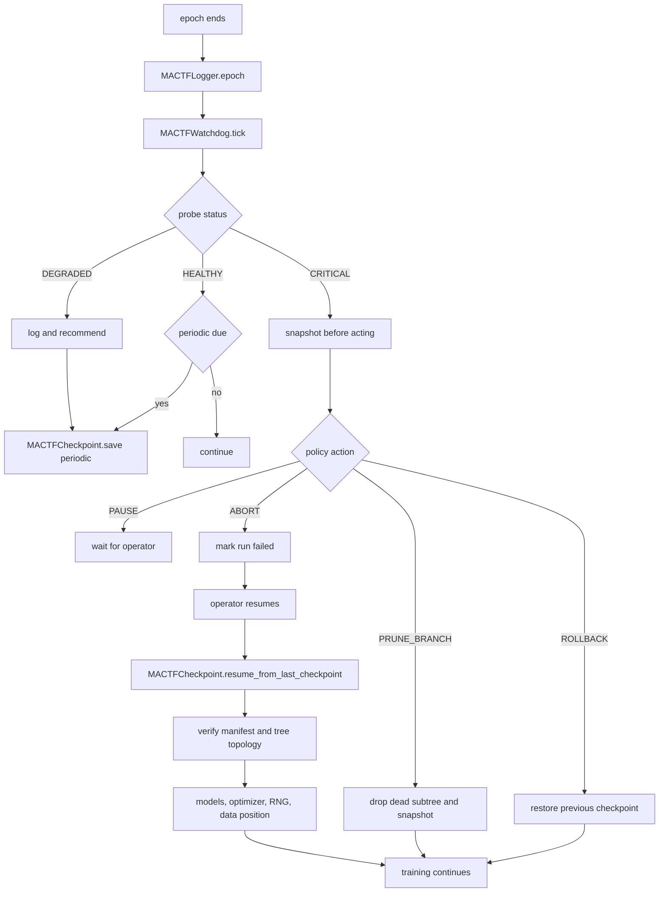

# 09. Logging, Watchdog, and Checkpoint

Three classes that make a run observable and recoverable:

- `MACTFLogger` turns a run's events into typed records across several sinks.
- `MACTFWatchdog` decides whether the run is healthy and calls the checkpoint
  layer when it is not.
- `MACTFCheckpoint` writes and restores complete state, including RNG and data
  position, so `resume_from_last_checkpoint()` continues training rather than
  merely reloading weights.

The existing pieces stay. `mactf/telemetry.py` keeps `configure_logging`,
`JsonFormatter`, `PlainFormatter`, `get_logger`, and `log_event`.
`CheckpointManager` (`mactf/orchestration/checkpoint.py:39`) keeps its API and
remains the low-level writer. `should_rollback` (`checkpoint.py:150`) keeps its
signature and is reused by the watchdog. This document adds a layer above all
three; it does not replace them.

## 1. Module layout

```
mactf/training/
  logging.py        NEW  MACTFLogger, LogRecord hierarchy, sinks
  watchdog.py       NEW  MACTFWatchdog, WatchdogPolicy, probes, HealthReport

mactf/orchestration/
  checkpoint.py     KEPT  CheckpointManager, CheckpointRecord, should_rollback
  checkpoint_v2.py  NEW   MACTFCheckpoint, CheckpointPayload, ResumeReport
```

`checkpoint_v2.py` rather than growing `checkpoint.py` is deliberate:
`CheckpointManager` is imported by `orchestrator.py:29` and used at `:144`,
`:285`, and `:298`. Keeping the two files separate means phase A0 can ship
`MACTFCheckpoint` without touching the orchestrator's run loop until the
trainer migration.

## 2. `MACTFLogger`

### 2.1 Constructor

```python
# mactf/training/logging.py
class MACTFLogger:
    def __init__(
        self,
        settings: Any | None = None,
        *,
        run_id: str | None = None,
        level: str | None = None,
        sinks: Sequence[LogSink] | None = None,
        buffer_size: int = 1000,
        redact: Sequence[str] = (),
        async_write: bool = True,
        queue_size: int = 8192,
        schema_version: int = 1,
        clock: Callable[[], float] = time.time,
        monotonic: Callable[[], float] = time.monotonic,
    ) -> None: ...
```

Defaults resolve from settings: level from `TELEMETRY.LEVEL`, log file from
`TELEMETRY.LOG_FILE` (`mactf/conf.py:152`), JSON from `TELEMETRY.JSON`, console
from `TELEMETRY.CONSOLE`. When `settings is None`, console-only at `INFO`, which
is what a library user calling `MACTFLogger()` should get.

`clock` and `monotonic` are injectable so tests can assert ordering and
duration without sleeping. Both appear in every record. Wall time alone is not
enough: a clock adjustment mid-run would produce negative durations, and the
watchdog's staleness probe depends on a monotonic source.

### 2.2 Sinks

```python
class LogSink(Protocol):
    name: str
    def write(self, record: "LogRecord") -> None: ...
    def flush(self) -> None: ...
    def close(self) -> None: ...
    def state_dict(self) -> dict[str, Any]: ...
```

| Sink | Behaviour |
|---|---|
| `ConsoleSink` | stderr; plain text through `PlainFormatter`, or JSON through `JsonFormatter`. Never stdout, because stdout belongs to CLI output such as `--json` |
| `FileSink` | Appends to `TELEMETRY.LOG_FILE`; rotation by size (`max_bytes`, `backup_count`) using the stdlib `RotatingFileHandler` semantics |
| `JsonlSink` | One JSON object per line, no rotation, fsync on `flush()`. This is what a log shipper or `GET /runs/{id}/logs/tail` reads |
| `MemorySink` | Bounded `deque(maxlen=buffer_size)`; backs `tail()` and survives without touching disk |
| `TensorBoardSink` | Writes scalars to `SummaryWriter`; requires `mactf[tensorboard]` |
| `WandBSink` | Logs through `wandb`; requires `mactf[wandb]` |

Optional sinks raise `ImproperlyConfigured` naming the exact pip command:

```
ImproperlyConfigured: TensorBoardSink requires tensorboard; install with
`pip install "mactf[tensorboard]"`
```

There is no quiet degradation to a no-op sink. A user who configured TensorBoard
and sees an empty dashboard has been failed by the framework, and this document
forbids that.

### 2.3 Records

Records are typed dataclasses, not formatted strings. A sink renders; it does
not decide what a field means.

```python
@dataclass(frozen=True)
class LogRecord:
    kind: str
    run_id: str
    node_path: str = ""
    depth: int = 0
    epoch: int = 0
    step: int = 0
    wall_time: float = 0.0
    monotonic: float = 0.0
    duration: float = 0.0
    level: str = "info"
    message: str = ""
    fields: Mapping[str, Any] = field(default_factory=dict)
    schema_version: int = 1

class EpochRecord(LogRecord): ...          # kind="epoch"; carries EpochResult
class StepRecord(LogRecord): ...           # kind="step"; node, loss, grad_norm, lr
class LossRecord(LogRecord): ...           # kind="loss"; LossBreakdown.as_dict
class ScoreRecord(LogRecord): ...          # kind="score"; PeerScorecard.to_dict
class AggregationRecord(LogRecord): ...    # kind="aggregation"; report.as_dict
class WarningRecord(LogRecord): ...        # kind="warning"; rule, action, episode
class CheckpointRecord(LogRecord): ...     # kind="checkpoint"; path, reason, episode
class HealthRecord(LogRecord): ...         # kind="health"; HealthReport summary
class ResumeRecord(LogRecord): ...         # kind="resume"; ResumeReport
```

Field sources reuse existing serializers so there is one definition of each
number:

| Record | Source |
|---|---|
| `LossRecord` | `LossBreakdown.as_dict()` (`mactf/rl/loss.py:39`) |
| `ScoreRecord` | `PeerScorecard.to_dict()` |
| `AggregationRecord` | `AggregationReport.as_dict()` (`mactf/coopetition/aggregation.py:54`) |
| `CheckpointRecord` | `CheckpointRecord.describe()` (`checkpoint.py:32`) plus the path |
| `HealthRecord` | `HealthReport.as_dict()` |

`node_path` and `depth` default to the empty string and `0`, which is the flat
case, so a flat run logs records whose `node_path` is `""` and a hierarchical
run logs the same record types with a path. Sinks that ignore paths are
unaffected.

### 2.4 Methods

```python
def log(self, record: LogRecord) -> None: ...
def info(self, message: str, **fields: Any) -> None: ...
def warning(self, message: str, **fields: Any) -> None: ...
def error(self, message: str, *, exc_info: bool = False, **fields: Any) -> None: ...
def debug(self, message: str, **fields: Any) -> None: ...
def epoch(self, result: EpochResult, **fields: Any) -> None: ...
def step(self, node: PeerNode | str, result: StepResult, **fields: Any) -> None: ...
def loss(self, breakdown: LossBreakdown, *, node_path: str = "", **fields: Any) -> None: ...
def score(self, card: PeerScorecard, **fields: Any) -> None: ...
def aggregation(self, report: AggregationReport, **fields: Any) -> None: ...
def checkpoint(self, record: CheckpointRecord, *, reason: str = "") -> None: ...
def health(self, report: HealthReport) -> None: ...
def tail(self, n: int = 100, *, node_path: str | None = None, kind: str | None = None) -> list[LogRecord]: ...
def flush(self, timeout: float | None = None) -> None: ...
def close(self) -> None: ...
def state_dict(self) -> dict[str, Any]: ...
def load_state_dict(self, payload: Mapping[str, Any]) -> None: ...
def child(self, suffix: str) -> "MACTFLogger": ...
```

`child()` returns a logger that shares sinks and buffer but stamps a suffix on
`run_id`-adjacent fields (`worker.0`, `sandbox.probe`), which is how a
distributed worker's logs stay attributable without a second file.

### 2.5 Signal wiring

`MACTFLogger.connect(signals=None)` subscribes to:

| Signal | Record |
|---|---|
| `phase_started` / `phase_finished` (`mactf/signals.py:110-111`) | `StepRecord` with phase name and duration |
| `episode_peer_scored` (`:96`) | `ScoreRecord` |
| `episode_scored` (`:97`) | `EpochRecord` |
| `warning_issued` / `warning_escalated` (`:100`, `:102`) | `WarningRecord` |
| `warning_expired` (`:101`) | `WarningRecord` with action `expire` |
| `aggregation_completed` (`:107`) | `AggregationRecord` |
| `checkpoint_written` (`:112`) | `CheckpointRecord` |
| `checkpoint_rolled_back` (`:113`) | `CheckpointRecord` with reason |
| `integrity_incident` (`:103`) | `HealthRecord` at level `error` |

The logger is a receiver only. It never calls `signal.send`. That is what makes
"logging cannot change training" true by construction rather than by review, and
it matches `Signal.send`'s own contract that receiver failure is logged and
swallowed (`mactf/signals.py:78-82`).

A sink that raises is caught, counted in `dropped_records`, and reported once per
epoch at `error` level in the *next* successful record's `fields`. A broken sink
never fails a training step; it also never disappears silently.

### 2.6 Async writer

`async_write=True` starts one daemon thread with a `queue.Queue(maxsize=queue_size)`.

- `log()` places the record and returns. It must not block a training step.
- `flush(timeout=None)` waits for the queue to drain. `timeout=None` waits until
  drained, which is correct before a checkpoint and before process exit.
- `close()` drains, closes every sink, and joins the thread with a 5 second
  budget; if the join times out it logs at `error` and returns, because hanging
  at exit is worse than losing the tail.
- On `queue.Full`, the oldest non-`error` record is dropped and
  `dropped_records` increments. Error records are never dropped; if the queue is
  full of errors, `log()` blocks, because losing errors is not acceptable.
- Ordering is FIFO across all sinks. The writer thread is the single consumer, so
  two sinks cannot disagree about record order.

With `async_write=False` the call writes synchronously. That is the correct
choice for tests and for a single-step CLI run where determinism of the file
contents matters.

### 2.7 Redaction and determinism

- `redact` is a sequence of case-insensitive substrings matched against field
  keys. A match replaces the value with `"***"` before any sink sees it,
  including `MemorySink`. Default list: `token`, `secret`, `password`, `api_key`,
  `authorization`, `hf_token`, `wandb_key`.
- Redaction is applied to `fields` only. It does not recurse into a tensor or a
  scorecard, because those are the data being logged.
- Log output is explicitly **not** part of the byte-identical guarantee for
  scores. Times, thread scheduling, and queue drops make byte equality
  impossible and promising it would be a lie. What is guaranteed is that
  `ScoreRecord.fields` contains exactly the scorecard dict, so a score can be
  recovered from the log even when it differs from a rerun's log byte for byte.

## 3. `MACTFWatchdog`

### 3.1 Constructor

```python
# mactf/training/watchdog.py
class MACTFWatchdog:
    def __init__(
        self,
        *,
        checkpoint: MACTFCheckpoint,
        logger: MACTFLogger,
        policy: WatchdogPolicy | None = None,
        probes: Sequence[HealthProbe] | None = None,
        snapshot_every_epochs: int = 1,
        snapshot_every_seconds: float | None = None,
        snapshot_on_degradation: bool = True,
        on_degradation: str = "snapshot",
        on_critical: str = "rollback",
        keep_history: int = 512,
        clock: Callable[[], float] = time.monotonic,
    ) -> None: ...
```

`checkpoint` and `logger` are required. A watchdog that cannot snapshot is a
monitor, and a monitor is not what was asked for. Both are keyword-only, so the
dependency is visible at every call site.

`on_degradation` and `on_critical` are action names validated against the
`WatchdogAction` enum at construction. An unknown action raises
`ImproperlyConfigured`, not at the first bad epoch.

### 3.2 `WatchdogPolicy`

```python
@dataclass(frozen=True)
class WatchdogPolicy:
    # loss
    nan_policy: str = "abort"                 # "abort" | "rollback" | "ignore"
    inf_policy: str = "abort"
    loss_increase_ratio: float = 3.0          # vs the trailing median
    loss_patience: int = 2                    # epochs above the ratio
    # gradients
    max_grad_norm: float = 100.0
    grad_norm_patience: int = 1
    # scores
    score_regression_tolerance: float = 0.10
    score_patience: int = 3
    # entropy and kappa
    entropy_collapse_ratio: float = 0.05      # same meaning as should_rollback
    entropy_patience: int = 2
    kappa_min: float = 1e-3
    kappa_max: float = 1e3
    # progress
    stale_epoch_seconds: float = 1800.0
    min_throughput_ratio: float = 0.25        # vs the trailing median
    max_step_time_drift: float = 5.0
    # resources
    max_rss_growth_ratio: float = 2.0         # vs the first epoch
    max_gpu_memory_ratio: float = 0.95
    # checkpoints and warnings
    max_checkpoint_age_seconds: float = 3600.0
    warning_spike_threshold: int = 10         # escalations in one epoch
    # hierarchy
    max_tree_growth_ratio: float = 2.0        # nodes vs the first epoch
    dead_branch_patience: int = 2
    child_starvation_patience: int = 3
    depth_cost_ratio: float = 4.0             # per-level wall time vs parent

    @classmethod
    def from_settings(cls, settings: Mapping[str, Any]) -> "WatchdogPolicy": ...
```

Every threshold is in `WATCHDOG` settings and validated in the style of
`mactf/conf.py:280`: a negative ratio, a patience below 1, a
`loss_increase_ratio` below 1.0, or a GPU ratio outside `(0, 1]` raises
`ImproperlyConfigured` at startup. A watchdog that never fires because of a typo
is worse than no watchdog, because it produces false confidence.

`entropy_collapse_ratio` deliberately matches
`TRAINING.ENTROPY_COLLAPSE_RATIO` semantics so the watchdog and
`should_rollback` cannot disagree about what collapse means. They are separate
settings because the watchdog may want to fire before the rollback threshold,
but the meaning is shared.

### 3.3 Probes

```python
class HealthProbe(Protocol):
    name: str
    def probe(self, context: "HealthContext") -> ProbeResult: ...
```

```python
@dataclass(frozen=True)
class ProbeResult:
    name: str
    status: WatchdogStatus          # HEALTHY | DEGRADED | CRITICAL
    value: float | None = None
    threshold: float | None = None
    detail: str = ""
    node_path: str = ""
    metadata: Mapping[str, Any] = field(default_factory=dict)
```

| Probe | DEGRADED | CRITICAL |
|---|---|---|
| `NaNLossProbe` | - | any NaN in `LossBreakdown.total` |
| `InfLossProbe` | - | any inf |
| `GradNormProbe` | norm above `max_grad_norm` for `grad_norm_patience` | 10x above |
| `LossTrendProbe` | total above `loss_increase_ratio` × trailing median for `loss_patience` | 10x |
| `ScoreTrendProbe` | mean score falls by `score_regression_tolerance` for `score_patience` | falls below the floor |
| `EntropyProbe` | ratio below `entropy_collapse_ratio` for `entropy_patience` | entropy is exactly 0 with more than one peer |
| `AggregationFallbackProbe` | `report.fallback` is true | fallback twice consecutively |
| `KappaProbe` | kappa outside `[kappa_min, kappa_max]` | kappa non-finite |
| `StaleProgressProbe` | no epoch completion within `stale_epoch_seconds` | 2x |
| `ThroughputProbe` | steps per second below `min_throughput_ratio` × median | below 10% |
| `MemoryProbe` | RSS growth above `max_rss_growth_ratio`; GPU above `max_gpu_memory_ratio` | GPU allocation failure |
| `CheckpointAgeProbe` | last checkpoint older than `max_checkpoint_age_seconds` | none exists past epoch 1 |
| `WarningSpikeProbe` | more than `warning_spike_threshold` escalations in an epoch | 2x |
| `DeadBranchProbe` | a subtree reports no proposals for `dead_branch_patience` epochs | - |
| `ChildStarvationProbe` | a child is never selected by delegation for `child_starvation_patience` epochs | - |
| `DepthCostProbe` | a level's wall time exceeds its parent's by `depth_cost_ratio` | - |

`MemoryProbe` uses `resource.getrusage(RUSAGE_SELF).ru_maxrss` on POSIX and
`psutil` when available on Windows, falling back to the `tracemalloc` peak for
the Python heap only. The fallback is recorded in `metadata["source"]` so a user
reading a report knows whether "RSS" meant process working set or Python heap.
GPU memory comes from `torch.cuda.memory_allocated` and `mem_get_info`, only
when `torch.cuda.is_available()`.

The three hierarchy probes are in this document rather than in document 10
because they share the `ProbeResult` contract and the history buffer. Document 10
defines what a dead branch *is*; the probe defines when to complain.

### 3.4 `tick` and `HealthReport`

```python
def tick(self, context: "HealthContext") -> HealthReport: ...
def evaluate(self, context: "HealthContext") -> HealthReport: ...   # no side effects
def snapshot(self, context: "HealthContext", *, reason: str, best: bool = False) -> CheckpointRecord: ...
def should_stop(self) -> bool: ...
def health_history(self, limit: int = 50) -> list[HealthReport]: ...
def describe(self) -> dict[str, Any]: ...
def state_dict(self) -> dict[str, Any]: ...
def load_state_dict(self, payload: Mapping[str, Any]) -> None: ...
```

```python
@dataclass(frozen=True)
class HealthReport:
    status: WatchdogStatus
    action: WatchdogAction
    epoch: int
    results: tuple[ProbeResult, ...]
    per_node: Mapping[str, WatchdogStatus]
    recommendations: tuple[str, ...]
    snapshot: CheckpointRecord | None = None
    duration: float = 0.0
    monotonic: float = 0.0

    def as_dict(self) -> dict[str, Any]: ...
    def worst(self, limit: int = 5) -> tuple[ProbeResult, ...]: ...
```

`tick()` is `evaluate()` plus side effects. The separation exists because the API
needs a dry read (`GET /runs/{id}/watchdog` must not trigger a snapshot) while
the trainer needs the acting version. Both share one code path for probe
evaluation, so a report read over HTTP is the same report the trainer saw.

Decision procedure, in order:

1. Run every probe. A probe that raises is converted to a `CRITICAL`
   `ProbeResult` named after the probe with the exception text, and the run
   continues. A broken probe must not stop training.
2. `status` is the worst probe status. `per_node` aggregates by `node_path`.
3. If `status == HEALTHY` and a periodic snapshot is due (epoch or seconds), set
   `action = SNAPSHOT`.
4. If `status == DEGRADED` and `snapshot_on_degradation`, set
   `action = SNAPSHOT`, and append a recommendation rather than changing
   anything.
5. If `status == CRITICAL`, run `snapshot(reason=<probe names>)` **first**, then
   set `action` from `on_critical`. The snapshot always precedes the damage.
6. Append the report to the bounded history and emit `HealthRecord`.

Escalation detail worth stating explicitly: the snapshot in step 5 is taken
before a rollback, which means the rolled-back state is also on disk. Without
that, a rollback destroys the evidence needed to understand what went wrong.

### 3.5 Actions and their meaning

| Action | Effect |
|---|---|
| `NONE` | Continue |
| `LOG` | Continue; the report is logged at `warning` |
| `SNAPSHOT` | Continue after `checkpoint.save` |
| `ROLLBACK` | Restore the previous checkpoint, emit `checkpoint_rolled_back`, continue |
| `PRUNE_BRANCH` | Snapshot, then `PeerTree.remove_node(path, recursive=True)`, then snapshot again |
| `PAUSE` | Stop the fit loop without marking the run failed; the run stays `running` until an operator resumes or cancels |
| `ABORT` | Stop and mark the run `failed` with the probe detail as the note |

`ROLLBACK` reuses `CheckpointManager.restore` semantics and the existing signal,
so a watchdog rollback is indistinguishable from the entropy-collapse rollback
the orchestrator already performs at `orchestrator.py:294-307`. One rollback
mechanism, two triggers.

`PAUSE` is not `ABORT` with a different label. `PAUSE` returns from `fit()` with
a `TrainResult(status="paused")` and leaves the registry row in `running`, so
`POST /runs/{id}/resume` can continue the same run id. `ABORT` writes
`status="failed"`.

### 3.6 What the watchdog refuses to do

> The watchdog never edits hyperparameters, never changes the learning rate,
> never rebalances peers, and never resizes anything. It observes, snapshots,
> and stops or rewinds. Any adjustment is emitted as a recommendation string in
> `HealthReport.recommendations` for a caller to act on.

Reason: an automatic learning-rate change triggered by a loss spike makes an
experiment unreproducible and hides the spike. The recommendation list is the
compromise — the information is surfaced, the decision stays with a human or an
explicitly configured policy object.

## 4. `MACTFCheckpoint`

### 4.1 Constructor

```python
# mactf/orchestration/checkpoint_v2.py
class MACTFCheckpoint:
    def __init__(
        self,
        directory: str | Path,
        *,
        run_id: str,
        keep: int = 5,
        keep_best: int = 1,
        compress: bool = True,
        checksum: str = "sha256",
        async_write: bool = False,
        watch: MACTFWatchdog | None = None,
        include_optimizer: bool = True,
        include_rng: bool = True,
        include_data_position: bool = True,
        include_buffers: bool = True,
        include_adapters: bool = True,
        clock: Callable[[], float] = time.time,
    ) -> None: ...
```

`keep` and `keep_best` are separate because a run wants recent recovery points
*and* the best-scoring one, which may be old. Pruning respects both.

`async_write=True` writes to a temporary path in a background thread and swaps
atomically. The default is `False` because a checkpoint that is not on disk when
the process dies is not a checkpoint; the async option exists for very large
models where a synchronous write would blow the epoch budget.

### 4.2 `CheckpointPayload`

```python
@dataclass(frozen=True)
class CheckpointPayload:
    identity: Mapping[str, Any]
    tree: Mapping[str, Any] | None
    models: Mapping[str, Mapping[str, Any]]
    reference: Mapping[str, Any] | None
    adapters: Mapping[str, Any] | None
    optimizers: Mapping[str, Mapping[str, Any]]
    schedulers: Mapping[str, Any] | None
    grad_scaler: Mapping[str, Any] | None
    kappa: Mapping[str, Any] | None
    warnings: Mapping[str, Any] | None
    aggregations: tuple[Mapping[str, Any], ...]
    memory: Mapping[str, Any]
    rng: Mapping[str, Any] | None
    data: Mapping[str, Any] | None
    logging: Mapping[str, Any] | None
    watchdog: Mapping[str, Any] | None
    manifest: Mapping[str, Any]

    SECTIONS: ClassVar[tuple[str, ...]] = (...)
    def content_hash(self) -> str: ...
    def as_dict(self) -> dict[str, Any]: ...
```

Each section, and what makes it necessary:

**`identity`** — `run_id`, `episode`, `global_step`, `schema_version`,
`created_at`, `torch_version`, `python_version`, `mactf_version`, `hostname`,
`command_line`, `device`, `dtype`, `amp`. Without the device and dtype, a resume
on a different host produces a diff that looks like a bug and is not. Without
`global_step`, "resume at epoch 7" cannot distinguish "7 completed" from "7 in
progress".

**`tree`** — the serialized `PeerTree`: every node's path, parent, children,
kind, depth, role, and the ordering. A resume that restores *n* models into a
tree of a different shape is not a resume, and this is the section that makes
the mismatch detectable. Serialized with `PeerTree.to_dict()` (document 10).

**`models`** — every node's `state_dict()` keyed by node path, plus the
reference. `torch.save` handles tensors; the payload is written through
`atomic_torch_save` (`mactf/runtime.py:202`) so a crash mid-write leaves the
previous file intact.

**`adapters`** — for a PEFT model, the adapter weights and the `PeftConfig`
dict, plus `adapter_names` from `apply_finetuning`'s report. Storing adapters
separately means a 4-bit base is referenced by identity
(`base_model_name_or_path`, `revision`) rather than re-serialized. A resume
rebuilds the base, re-applies `apply_finetuning`, then loads adapter weights.
Without this section a QLoRA checkpoint is either enormous or unrestorable.

**`optimizers`** — `MACTFOptimizer.state_dict()` per node path. Includes
scheduler and scaler. For a scipy backend this carries the flattened vector and
the last `OptimizeResult`, so the line search does not restart from scratch.

**`kappa`** — `AdaptiveKappa.state_dict()` (`temperature.py:155`), plus one
entry per level when hierarchical. A resume that resets kappa to `kappa_init`
changes every aggregation weight for the rest of the run.

**`warnings`** — `WarningScorer.state_dict()`: every registry keyed by
`node_path` then peer. A warning issued in epoch 3 and still active in epoch 9
must survive a resume, or the escalation counter resets and the agent gets a
free pass.

**`aggregations`** — the last *n* `AggregationReport` dicts. Used for the
watchdog's trend probes after a resume and for the API's episode view.

**`memory`** — the section that answers "the resume fits but the numbers
differ":

```python
{
  "memory_format": {"conv1": "channels_last", ...},   # per module, when non-default
  "dtype": {"peer-a": "torch.bfloat16", ...},
  "device": {"peer-a": "cuda:0", ...},
  "buffers": {
       "peer-a": {"name": {"shape": [...], "dtype": "...", "value": Tensor}},
  },
  "non_persistent_buffers": ["peer-a/_extra_state"],   # recorded, never saved
  "quantization": {"bits": 4, "quant_type": "nf4", "double_quant": True, "compute_dtype": "bfloat16"},
  "gradient_checkpointing": True,
  "requires_grad": {"peer-a/adapter.weight": True, ...},
}
```

Buffers are saved by value, not only by name, because a BN running mean restored
as zeros silently changes the first post-resume forward pass.
`non_persistent_buffers` are listed explicitly to document that they were
deliberately excluded: PyTorch does not save them either, so a reader can tell
the difference between an oversight and a decision.

`requires_grad` is saved because a resume that accidentally unfreezes a base
model doubles the memory and changes the optimizer's parameter set.

**`rng`** — the section that makes resume a resume:

```python
{
  "python": random.getstate(),
  "numpy": numpy.random.get_state(),
  "torch_cpu": torch.get_rng_state(),
  "torch_cuda": torch.cuda.get_rng_state_all(),
  "generators": {"sampler": gen.get_state(), "node:peer-a": gen.get_state()},
  "seeds": {"global": 1337, "node:peer-a": 13371337},
}
```

Without this, a resumed run diverges because the dropout mask, the action
sampling, and the task batch all differ from the uninterrupted run's. Section
4.6 states the guarantee precisely.

**`data`** —

```python
{
  "source": {"type": "JsonlTaskSource", "path": "...", "sha256": "..."},
  "epoch": 7,
  "batch_index": 3,
  "sampler": {"type": "epoch_shuffle", "seed": 1337,
              "consumed": 23, "generator_state": "..."},
  "worker_seeds": [101, 102, 103, 104],
  "task_counter": 39,
  "cursor": {"file": "...", "line": 812},
}
```

`task_counter` is what makes `TaskSource.next()` (`episode.py:58`) resume the
exact task stream rather than restarting at counter 0. This is why the section
cannot be approximated by "epoch number".

**`logging`** — `MACTFLogger.state_dict()`: `run_id`, `dropped_records`, per-sink
record counts, and the byte offset of the JSONL sink. Offset-based resume is
what prevents a duplicated tail after a restart.

**`watchdog`** — the last `HealthReport` dict and the probe counters. Needed so
`max_checkpoint_age_seconds` and the patience counters do not reset.

**`manifest`** —

```python
{
  "schema_version": 2,
  "files": [{"name": "payload.pt", "bytes": 12345, "sha256": "..."}],
  "sections": {"identity": "sha256:...", "models": "sha256:...", ...},
  "content_hash": "sha256:...",
  "created_at": 1729468800.0,
  "mactf_version": "0.1.0",
}
```

### 4.3 Methods

```python
def path_for(self, episode: int, *, best: bool = False) -> Path: ...
def save(self, context: "CheckpointContext", *, reason: str, episode: int | None = None,
         step: int | None = None, best: bool = False) -> CheckpointRecord: ...
def list(self, *, valid_only: bool = False) -> list[CheckpointRecord]: ...
def latest(self, *, valid_only: bool = True) -> CheckpointRecord | None: ...
def verify(self, path: str | Path) -> VerificationResult: ...
def prune(self, *, keep: int | None = None, keep_best: int | None = None) -> int: ...
def load(self, path: str | Path | None = None) -> CheckpointPayload: ...
def restore(self, payload: CheckpointPayload | Mapping[str, Any], *, trainer: Any = None,
            strict: bool = True) -> ResumeReport: ...
def resume_from_last_checkpoint(self, *, trainer: Any = None, strict: bool = True,
                                allow_partial: bool = False) -> ResumeReport: ...
def export_parameters(self, path: str | Path, *, format: str = "pt") -> Path: ...
def describe(self, path: str | Path | None = None) -> dict[str, Any]: ...
def state_dict(self) -> dict[str, Any]: ...
def load_state_dict(self, payload: Mapping[str, Any]) -> None: ...
```

`save` also calls `Registry.record_checkpoint` (`mactf/db.py:310`) so the sqlite
`checkpoints` table (`db.py:70`) stays the index. A checkpoint on disk that is
not in the registry is invisible to the API; a registry row without a file is a
dangling reference that `verify` catches.

### 4.4 Integrity

`verify(path)` returns:

```python
@dataclass(frozen=True)
class VerificationResult:
    path: Path
    ok: bool
    problems: tuple[str, ...]
    manifest: Mapping[str, Any] | None
    content_hash: str | None
```

It checks, in order: the file exists and is non-empty; `torch.load` succeeds
with `weights_only=False`; `manifest` is present and `schema_version` is
supported; every listed file exists with the recorded byte size; every section
hash matches; `content_hash` matches a recomputation.

`latest(valid_only=True)` walks newest to oldest and returns the first whose
`verify` passes. A corrupt newest checkpoint is therefore skipped rather than
fatal, and the skip is recorded in the `ResumeReport` as
`skipped_checkpoints=[("ep0009", "section models hash mismatch")]`. That is the
difference between "resume worked" and "resume worked but you should know it
went back two epochs".

`schema_version` support: version 2 is current. Version 1 checkpoints (from
`CheckpointManager`) are readable through a migration path that fills
`tree` with a flat tree from the `peers` keys, sets `rng`/`data`/`adapters` to
`None`, and reports them in `missing_sections`. That is how the existing
`RunConfig.resume_from` keeps working while the format moves forward.

### 4.5 `resume_from_last_checkpoint`

This is the method the requirement names, and the ordering is the method.

```python
def resume_from_last_checkpoint(
    self,
    *,
    trainer: Any = None,
    strict: bool = True,
    allow_partial: bool = False,
) -> ResumeReport:
```

Steps, in exactly this order, each with the reason it cannot move:

1. **Locate.** `latest(valid_only=True)`. If none, raise
   `ComplianceError("no valid checkpoints in <dir>")` when `strict`, else return
   an empty `ResumeReport` with `missing_sections` naming everything.
2. **Verify.** Re-check the manifest. A failure here raises; by this point the
   file was selected as valid, so a failure means corruption after selection.
3. **Identity check.** Refuse if `payload.identity.run_id != self.run_id` unless
   `allow_partial`, in which case record the mismatch in `skipped_checkpoints`.
   Refuse unconditionally if `device`/`dtype` differ and `strict`, because a
   bf16-on-CUDA checkpoint restored into fp32-on-CPU will not reproduce.
4. **Rebuild the tree.** `PeerTree.from_dict(payload.tree)`; compare against the
   trainer's tree if it has one. A topology mismatch is a hard failure: paths
   that changed meaning cannot be reconciled silently.
5. **Layout check.** `require_same_layout` (`peer.py:144`) per aggregation
   group, plus the `memory.dtype`/`device`/`requires_grad` maps. A shape
   mismatch raises; a dtype mismatch raises unless `allow_partial`.
6. **Restore parameters, then rebuild the optimizer.** Write every node's
   `state_dict` first. Only then construct the optimizer on the restored
   parameters and call `optimizer.load_state_dict(...)`.

   The order is not stylistic. Adam's `exp_avg` and `exp_avg_sq` are keyed by
   parameter identity, and building the optimizer before restoring parameters
   either raises on a shape mismatch or, worse, attaches momentum computed for
   the pre-aggregation weights. The existing code avoids this by never
   restoring optimizer state at all; `MACTFCheckpoint` restores it correctly by
   doing it second.
7. **Restore memory section.** Memory format (`to(memory_format=...)` for every
   module that recorded one), buffers by value, `requires_grad` flags,
   gradient-checkpointing flag. Buffers before the first forward pass, or a
   restored BN mean is overwritten by the first batch.
8. **Restore kappa, warnings, aggregations.** After models, because
   `WarningRegistry` is independent of parameters and order does not matter, but
   after the optimizer so a failure in step 6 does not leave half the state
   applied and kappa advanced.
9. **Restore RNG.** After model construction, because module `__init__` consumes
   the global RNG stream. Restoring before would be immediately overwritten by
   weight initialization.

   This is the single most common resume bug and the reason this step is
   numbered rather than described as "also restore RNG".
10. **Restore data position.** `TaskSource` counter, sampler generator state,
    batch index, worker seeds. After RNG, because the sampler's generator is
    part of the RNG section and setting the counter must not consume it.
11. **Restore logger and watchdog.** Counters, JSONL offsets, patience counters,
    last health report.
12. **Set trainer position.** `trainer.start_epoch = identity.epoch + 1`,
    `trainer.global_step = identity.global_step`, `trainer._resumed = True`.
13. **Emit.** `signals.checkpoint_written(sender=self, record=record,
    payload=payload, restored=True)` — the same signal `CheckpointManager.restore`
    already emits (`checkpoint.py:146`) — and return the `ResumeReport`.

```python
@dataclass(frozen=True)
class ResumeReport:
    run_id: str
    checkpoint: Path
    episode: int
    global_step: int
    schema_version: int
    restored_sections: tuple[str, ...]
    missing_sections: tuple[str, ...]
    skipped_checkpoints: tuple[tuple[str, str], ...]
    topology: Mapping[str, Any] | None
    warnings_restored: int
    optimizers_restored: int
    bit_identical_expected: bool
    duration: float
    notes: tuple[str, ...] = ()

    def as_dict(self) -> dict[str, Any]: ...
```

`bit_identical_expected` is `True` only when `rng`, `data`, `memory`, and
`optimizers` were all present and restored with no skips. It is a claim, and
section 4.6 says exactly what it claims.

### 4.6 What the resume guarantee actually is

> Under `DETERMINISTIC=True`, on the same device and dtype, with the same
> `MACTFCheckpoint` configuration, resuming from a checkpoint at the end of
> epoch *k* produces a run whose epoch *k+1* onwards is bit-identical to the
> uninterrupted run's.

It holds because all of the following are restored: model parameters, buffers,
memory format, optimizer state, scheduler, AMP scaler, kappa, warning
registries, RNG for python/numpy/torch/CUDA and every generator, and the data
position. Every item in that list is load-bearing; section 4.5's ordering exists
to make them all land.

What it does **not** claim:

- Different hardware. cuDNN algorithm selection and non-deterministic kernels
  make cross-device bit equality impossible, and PyTorch's own
  `use_deterministic_algorithms` does not fix a different GPU architecture.
- A different number of dataloader workers, because worker seeds are part of the
  data section but worker scheduling is not.
- `DETERMINISTIC=False`, where `torch.backends.cudnn.benchmark` is on
  (`runtime.py:167`) and kernel choice legitimately varies.

When `rng` or `data` was absent (`missing_sections`), the report says
`bit_identical_expected=False` and the notes say
`"warm restart: RNG and data position unavailable; subsequent epochs will diverge"`.
The document requires that sentence to be in the code and in the log, because a
warm restart presented as a resume is the failure mode this whole section
exists to prevent.

### 4.7 Retention

`prune()` keeps:

- the newest `keep` checkpoints by episode,
- the best `keep_best` by `identity.score` (recorded at save time),
- never the checkpoint currently referenced by an in-flight `resume`,
- at least one checkpoint regardless of `keep=0`, because zero retention means
  no recovery.

Retention counts are logged as `CheckpointRecord` with `reason="prune"` and the
list of removed paths, so a user can see what was deleted rather than discovering
it when the run dies.

## 5. Mermaid: degradation to resume



## 6. Settings

```python
"TELEMETRY": {          # existing keys unchanged
    "LEVEL": "INFO",
    "JSON": False,
    "CONSOLE": True,
    "LOG_FILE": "var/logs/mactf.log",
    # new
    "JSONL_FILE": "var/logs/mactf.jsonl",
    "ASYNC": True,
    "QUEUE_SIZE": 8192,
    "BUFFER_SIZE": 1000,
    "ROTATE_BYTES": 10_485_760,
    "ROTATE_BACKUPS": 5,
    "REDACT": ["token", "secret", "password", "api_key", "authorization", "hf_token", "wandb_key"],
},
"WATCHDOG": {
    "ENABLED": True,
    "SNAPSHOT_EVERY_EPOCHS": 1,
    "SNAPSHOT_EVERY_SECONDS": None,
    "ON_DEGRADATION": "snapshot",
    "ON_CRITICAL": "rollback",
    "NAN_POLICY": "abort",
    "LOSS_INCREASE_RATIO": 3.0,
    "LOSS_PATIENCE": 2,
    "MAX_GRAD_NORM": 100.0,
    "SCORE_REGRESSION_TOLERANCE": 0.10,
    "SCORE_PATIENCE": 3,
    "ENTROPY_COLLAPSE_RATIO": 0.05,
    "STALE_EPOCH_SECONDS": 1800.0,
    "MAX_RSS_GROWTH_RATIO": 2.0,
    "MAX_GPU_MEMORY_RATIO": 0.95,
    "MAX_CHECKPOINT_AGE_SECONDS": 3600.0,
    "WARNING_SPIKE_THRESHOLD": 10,
    "MAX_TREE_GROWTH_RATIO": 2.0,
    "KEEP_HISTORY": 512,
},
"CHECKPOINT": {
    "KEEP": 5,
    "KEEP_BEST": 1,
    "COMPRESS": True,
    "CHECKSUM": "sha256",
    "ASYNC_WRITE": False,
    "INCLUDE_OPTIMIZER": True,
    "INCLUDE_RNG": True,
    "INCLUDE_DATA_POSITION": True,
    "INCLUDE_BUFFERS": True,
    "INCLUDE_ADAPTERS": True,
},
```

`TELEMETRY.LEVEL` and `TELEMETRY.LOG_FILE` keep their current meaning; the new
keys are additive. `TRAINING.CHECKPOINT_EVERY` (`conf.py:142`) remains the
policy for the orchestrator's own checkpoint cadence and is superseded by
`WATCHDOG.SNAPSHOT_EVERY_EPOCHS` only inside `MACTFTrainer`. Both are valid; a
run uses one path or the other, never both, and document 08 section 5.2 fixes the
trainer's loop as the user of the watchdog.

## 7. Tests

| File | Covers |
|---|---|
| `tests/logging/test_logger_records.py` | Every record type, field sources, `node_path` default, schema version |
| `tests/logging/test_logger_sinks.py` | Each sink, rotation, JSONL parse-back, `tail` filters, missing-extra errors |
| `tests/logging/test_logger_async.py` | Ordering, `flush`, overflow drop of non-errors, errors never dropped, close drains |
| `tests/logging/test_logger_redaction.py` | Default and custom redaction lists; no secret on disk |
| `tests/logging/test_logger_signals.py` | Each signal produces the right record; logger never sends |
| `tests/logging/test_logger_failure.py` | A raising sink does not fail a step; the failure is counted and reported |
| `tests/watchdog/test_policy_validation.py` | Every threshold's bounds; unknown action rejected at construction |
| `tests/watchdog/test_probes.py` | Each probe at HEALTHY/DEGRADED/CRITICAL on synthetic contexts; a raising probe becomes CRITICAL and does not stop the run |
| `tests/watchdog/test_actions.py` | Snapshot-before-action ordering; `PAUSE` leaves the run `running`; `ABORT` writes `failed` |
| `tests/watchdog/test_no_mutation.py` | The watchdog changes no hyperparameter, learning rate, or weight |
| `tests/watchdog/test_hierarchy_probes.py` | Dead branch, child starvation, depth cost |
| `tests/checkpoints/test_payload.py` | Every section round-trips; `content_hash` stable; `manifest` complete |
| `tests/checkpoints/test_verify.py` | Truncated file, tampered section, bad byte size, unsupported schema version |
| `tests/checkpoints/test_latest_valid.py` | A corrupt newest file is skipped and recorded in `skipped_checkpoints` |
| `tests/checkpoints/test_resume_ordering.py` | Optimizer rebuilt after parameters; RNG restored after construction; a failure in step 6 leaves kappa unadvanced |
| `tests/checkpoints/test_resume_bit_identical.py` | Kill at epoch 3, resume, assert epochs 4-6 match the uninterrupted run bit for bit under `DETERMINISTIC=True` |
| `tests/checkpoints/test_resume_warm_restart.py` | With `INCLUDE_RNG=False`, the report says `bit_identical_expected=False` and the note is present |
| `tests/checkpoints/test_resume_v1.py` | A `CheckpointManager` v1 file restores with the documented `missing_sections` |
| `tests/checkpoints/test_prune.py` | Keeps newest `keep`, best `keep_best`, never zero, never the in-flight one |
| `tests/checkpoints/test_adapters.py` | A PEFT checkpoint stores adapters, not the base; resume re-applies and loads |
| `tests/checkpoints/test_memory_format.py` | channels_last survives; non-persistent buffers are listed and not saved; `requires_grad` restored |

## 8. Sequencing

```
logging.py -> watchdog.py (needs logger + a save callback)
           -> checkpoint_v2.py (needs payload types from tree and optimizer)
           -> resume ordering tests green
           -> trainer wiring (document 08 section 5.2 loop)
```

`logging.py` first because the watchdog's first action on an unhealthy run is to
log the reason, and a watchdog that cannot report is not trustworthy. The resume
ordering test is the gate before trainer wiring, because a wrong restore order
produces a run that trains happily and silently diverges.
