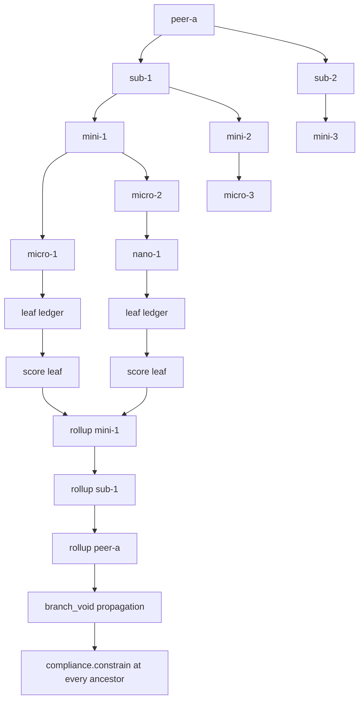

# 10. Hierarchical Peers

A peer may own sub-peers, which may own their own sub-peers, arbitrarily deep:

```
peers -> peer -> subagents -> miniagents -> microagents -> nanoagents -> ...
```

The same structure applies to inference, not only training. A root peer may
delegate an inference request down the tree and synthesize the answer.

## 1. The rule

This section is normative. It is repeated verbatim in
[00-scope-and-audit.md](00-scope-and-audit.md) section 4 and referenced from
[01-target-architecture.md](01-target-architecture.md) section 10.

> Peer hierarchy is a property of the orchestrator layer the user designs. When
> the user composes an orchestrator with nested peers, the framework trains,
> scores, aggregates, checkpoints, and serves that hierarchy natively. A flat
> swarm is not a special case of the framework; it is the degenerate tree with a
> single level. Hierarchy is never an exception path, never a separate pipeline,
> and never a second scoring implementation.

That is a rule, not an aspiration, and it has five mechanical consequences that
the rest of this document specifies.

**One code path.** `ScoringPipeline`, `Aggregator`, `MACTFTrainer`,
`MACTFCheckpoint`, and every API route operate on a `PeerTree`. A flat run is a
`PeerTree` of depth 1 built by `PeerTree.flat(names)`. There is no
`if hierarchical:` branch in scoring, in aggregation, or in checkpointing. A
reader searching the codebase for `hierarch` finds the tree module, the rollup
module, and the delegation policies, and no conditional that switches scoring
engines.

**Labels are not limits.** `peer`, `subagent`, `miniagent`, `microagent`,
`nanoagent` are a display and policy vocabulary. They are not a maximum depth.
Depth and arity are integers chosen by the orchestrator's design. A seventh level
is `GENERIC` at depth 7 and is described as `level-7`. Nothing in the framework
counts labels.

**No withheld capability.** A nano-agent can be trained, scored, warned,
aggregated, checkpointed, resumed, and served. A feature that only works at the
root is a bug against this document, not a documented limitation.

**Existing code keeps working.** `Episode.participants` (`episode.py:97`) and
`PhaseContext.peers` (`phases.py:42`) are keyed by a bare name. That name becomes
the path of a root node, so a depth-1 tree's keys are identical to today's and an
existing checkpoint's `peers` dict restores unchanged.

**The user's composition decides the shape.** The framework does not impose a
hierarchy generator, a default branching factor, or a recommended depth. It
validates the tree it is given and refuses to guess.

## 2. Module layout

```
mactf/coopetition/
  tree.py        NEW  NodeKind, PeerNode, PeerTree, HierarchySpec, LevelSpec,
                      TreeValidationError
  delegation.py  NEW  DelegationPolicy and implementations
  synthesis.py   NEW  SynthesisFunction and implementations
  strategy.py    NEW  PeerStrategy and implementations        (document 08)
  weights.py     NEW  WeightUpdateStrategy implementations    (document 08)

mactf/scoring/
  hierarchy.py   NEW  HierarchicalScorer, RollupStrategy, rollup implementations

mactf/rl/functions/
  value.py       EXT  NestedValueFunction                     (document 07)
```

`mactf/coopetition/tree.py` must not import `mactf.training`. The tree is a data
structure with a `Peer` per node; the trainer consumes it. That direction is what
lets `PeerTree.from_dict` be used by the checkpoint layer without dragging the
trainer into the import graph.

## 3. Data model

### 3.1 `NodeKind`

```python
# mactf/coopetition/tree.py
class NodeKind(str, Enum):
    PEER = "peer"            # depth 1, the roots
    SUBAGENT = "subagent"    # depth 2
    MINIAGENT = "miniagent"  # depth 3
    MICROAGENT = "microagent"# depth 4
    NANOAGENT = "nanoagent"  # depth 5
    GENERIC = "generic"      # depth 6 and beyond

    @classmethod
    def for_depth(cls, depth: int) -> "NodeKind": ...
    def label_plural(self) -> str: ...   # "peers", "subagents", ...
```

`for_depth(1)` is `PEER`, `for_depth(9)` is `GENERIC`. The plural labels exist
because the API and the CLI display `subagents` rather than `subagent` when
listing a parent's children, and hardcoding pluralization in three places is how
"miniagentss" reaches a user-facing string.

### 3.2 `PeerNode`

```python
@dataclass
class PeerNode:
    path: str                       # "peer-a/sub-1/mini-2"
    name: str                       # "mini-2"
    kind: NodeKind
    depth: int
    parent: str | None
    children: tuple[str, ...] = ()
    peer: Peer | None = None
    role: str = "worker"
    status: str = "active"          # active | failed | frozen | pruned
    metadata: dict[str, Any] = field(default_factory=dict)

    @property
    def is_leaf(self) -> bool: ...
    @property
    def is_root(self) -> bool: ...
    def describe(self) -> dict[str, Any]: ...
```

`status` is a string rather than an enum because it is persisted in checkpoints
and read by older readers; an enum would make an unknown status a hard failure
instead of a displayable one. The known values are documented and validated
where they are written.

### 3.3 Paths

The path is the node's identity everywhere: in the ledger, in the scorecard, in
the checkpoint, in the API, and in log records.

Grammar:

```
path      := segment ( "/" segment )*
segment   := [A-Za-z0-9_.:-]+
```

Rejections, each with the offending path in the message:

| Input | Reason |
|---|---|
| `""` | Empty path |
| `"/peer-a"` | Leading separator |
| `"peer-a/"` | Trailing separator |
| `"peer-a//sub-1"` | Empty segment |
| `"peer a"` | Space not in the allowed set |
| `"peer-a/sub-1/../../etc"` | `..` is allowed by the character class but rejected as a segment that is exactly `.` or `..` |
| `"peer-a/sub-1"` added when `peer-a` is absent | Orphan |
| `"peer-a/sub-1"` added twice | Duplicate |

The `..` rejection is deliberate: paths appear in filesystem paths for per-node
artifacts (sandbox images use a `{peer}` placeholder at `conf.py:113`), so a
traversal has to be blocked at the tree rather than at each writer.

Ordering is lexicographic on the path string, not dict insertion order. Two
processes that build the same tree in different orders get the same iteration
order, which is what makes aggregation and checkpointing reproducible.

### 3.4 `HierarchySpec`

```python
@dataclass(frozen=True)
class LevelSpec:
    label: str                       # "subagent", "miniagent", or a custom label
    count: int                       # children per parent at this level
    model: str | nn.Module | Callable[[str], nn.Module] | None = None
    strategy: str | None = None
    roles: tuple[str, ...] = ()
    n_count: int | tuple[int, ...] | None = None   # variable arity per parent

@dataclass(frozen=True)
class HierarchySpec:
    levels: tuple[LevelSpec, ...]
    roots: int = 1
    root_models: Mapping[str, nn.Module] | None = None
    max_depth: int = 8
    max_nodes: int = 256
    max_children_per_node: int = 16
    fanout_policy: str = "uniform"    # uniform | random | explicit
    sharing: str = "independent"      # independent | shared_trunk | tied_weights
    attribution: str = "rollup"       # rollup | own
    cross_level_grad: bool = False
    seed: int = 0

    @classmethod
    def flat(cls, names: Sequence[str], *, model: nn.Module | None = None) -> "HierarchySpec": ...
    @classmethod
    def from_spec(cls, spec: Mapping[str, Any]) -> "HierarchySpec": ...
    def to_spec(self) -> dict[str, Any]: ...
    def build(self, *, runtime: Runtime, settings: Any) -> PeerTree: ...
```

`HierarchySpec.flat(["peer-a", "peer-b"])` is exactly equivalent to today's
`PEERS` list, and it is what `MACTFTrainer` uses when `hierarchy=None` and
`num_peers` is given. This is the mechanical form of "a flat swarm is the
degenerate tree".

`n_count` handles the case where a parent has a different number of children than
its siblings. `n_count=3` gives three; `n_count=(1, 4, 2)` gives exactly that for
three parents. Combining `count` and `n_count` is rejected rather than resolved
by precedence, because a silent precedence rule is how a run trains a topology
nobody intended.

`fanout_policy="random"` uses a seeded `blake2b`-derived generator (section 7.2),
so the same spec and seed produce the same topology on every run and every
machine.

### 3.5 `PeerTree`

```python
class PeerTree:
    def __init__(self, *, max_depth: int = 8, max_nodes: int = 256) -> None: ...

    # -- construction ----------------------------------------------------
    @classmethod
    def flat(cls, names: Sequence[str], *, max_nodes: int = 256) -> "PeerTree": ...
    def add_node(self, path: str, *, peer: Peer | None = None, role: str = "worker",
                 kind: NodeKind | None = None, metadata: Mapping[str, Any] | None = None) -> PeerNode: ...
    def remove_node(self, path: str, *, recursive: bool = False) -> int: ...

    # -- navigation ------------------------------------------------------
    @property
    def root_paths(self) -> tuple[str, ...]: ...
    @property
    def leaves(self) -> tuple[str, ...]: ...
    @property
    def depth(self) -> int: ...
    @property
    def levels(self) -> Mapping[int, tuple[str, ...]]: ...
    def __len__(self) -> int: ...
    def __contains__(self, path: object) -> bool: ...
    def __getitem__(self, path: str) -> PeerNode: ...
    def get(self, path: str) -> PeerNode | None: ...
    def children(self, path: str) -> tuple[str, ...]: ...
    def parent(self, path: str) -> str | None: ...
    def ancestors(self, path: str) -> tuple[str, ...]: ...
    def descendants(self, path: str) -> tuple[str, ...]: ...
    def subtree(self, path: str) -> "PeerTree": ...
    def siblings(self, path: str) -> tuple[str, ...]: ...
    def arity(self, path: str) -> int: ...
    def level(self, depth: int) -> tuple[str, ...]: ...
    def walk(self, order: str = "leaves-first") -> Iterator[PeerNode]: ...

    # -- validation and IO ------------------------------------------------
    def validate(self) -> None: ...            # raises TreeValidationError
    def to_dict(self) -> dict[str, Any]: ...
    @classmethod
    def from_dict(cls, payload: Mapping[str, Any]) -> "PeerTree": ...
    def state_dict(self) -> dict[str, Any]: ...  # topology only, no parameters
    def describe(self) -> str: ...
```

`walk` orders:

| Order | Sequence |
|---|---|
| `leaves-first` | Children before parents, lexicographic within a level. Used for scoring and local update. |
| `root-first` | Parents before children. Used for delegation. |
| `breadth` | Level by level, roots first. Used for display and for API serialization. |
| `depth` | Leaves first, but level by level. Used for aggregation, which runs deepest level up. |

`validate()` enforces all of:

- unique paths (`DuplicateNodeError`),
- no self-parent and no cycle (`TreeCycleError`),
- every non-root has exactly one existing parent (`OrphanNodeError`),
- `depth` equals `path.count("/") + 1`,
- `kind` equals `NodeKind.for_depth(depth)` unless a custom label was given
  explicitly,
- `len(children)` equals the actual number of children whose `parent` is this
  path (`TreeInconsistencyError`),
- node count within `max_nodes` (`TreeTooLargeError`),
- depth within `max_depth`,
- every segment matches the grammar.

All of these are subclasses of `TreeValidationError`, which is a
`ContractError` subclass, so the API's problem+json mapping
(`02-api-contract.md` section 4.1) gives a 422 with the path without a new error
branch.

### 3.6 Flat compatibility

```python
tree = PeerTree.flat(["peer-a", "peer-b"])
# tree.root_paths == ("peer-a", "peer-b")
# {n.path: n for n in tree.walk()} keys == today's PhaseContext.peers keys
```

A migration path for existing checkpoints: `PeerTree.from_dict` accepts a payload
whose `"nodes"` entry is absent but whose `"peers"` entry is present, and
synthesizes a flat tree from those keys. That is the same tolerance described in
[09-logging-watchdog-checkpoint.md](09-logging-watchdog-checkpoint.md) section
4.4 for schema version 1.

## 4. Delegation and synthesis

### 4.1 `DelegationPolicy`

```python
# mactf/coopetition/delegation.py
class DelegationPolicy(ABC):
    name: ClassVar[str]
    def select(
        self,
        node: PeerNode,
        task: Task,
        *,
        tree: PeerTree,
        scores: Mapping[str, float] | None = None,
        weights: Mapping[str, float] | None = None,
        epoch: int = 0,
    ) -> tuple[str, ...]: ...
    def describe(self) -> dict[str, Any]: ...
    @classmethod
    def from_spec(cls, spec: Mapping[str, Any]) -> "DelegationPolicy": ...
```

| Policy | Selection |
|---|---|
| `BroadcastDelegation` | Every child. The default for small trees. |
| `SelectKDelegation(k)` | Top `k` children by kappa weight, ties broken by path |
| `RouteByRoleDelegation(mapping)` | `task.metadata["role"]` mapped to a child role. An unmapped role raises rather than silently using a default. |
| `ConfidenceDelegation(threshold)` | Children whose last score is above `threshold`; if none qualify, the highest-scoring child, so a subtree never starves itself |
| `ExplicitDelegation(fn)` | `fn(node, task, *, tree, scores, weights, epoch) -> Sequence[str]` |

Delegation results are recorded per node as
`Episode.delegation[node_path] = selected_paths`, and the remainder as
`starved`. This is what `ChildStarvationProbe`
([09](09-logging-watchdog-checkpoint.md) section 3.3) reads. Without recording
it, a child that is never chosen looks identical to a child that is chosen and
performs badly, and those need different fixes.

Validation at selection time: every returned path must be a child of `node`,
exist in the tree, and not be `status="failed"`. A policy that returns a
non-child raises `ContractError` naming both paths. A policy that returns an
empty tuple is allowed only when the node is a leaf; for a non-leaf it raises,
because silently producing no proposal is the failure mode this whole section is
about.

### 4.2 `SynthesisFunction`

```python
# mactf/coopetition/synthesis.py
class SynthesisFunction(ABC):
    name: ClassVar[str]
    def synthesize(
        self,
        node: PeerNode,
        proposals: Mapping[str, torch.Tensor],
        *,
        scores: Mapping[str, float] | None = None,
        weights: Mapping[str, float] | None = None,
        task: Task | None = None,
    ) -> torch.Tensor: ...
```

| Function | Behaviour |
|---|---|
| `ConsensusSynthesis` | Mean of proposals. Promotes the existing `consensus` helper (`episode.py:162`). |
| `WeightedConsensus` | Weighted mean using kappa weights; missing weights fall back to uniform |
| `BestByScore` | The proposal from the highest-scoring child; ties broken by path |
| `LearnedSynthesizer` | The parent's own module consumes stacked child proposals; this is a trainable parent |
| `ExplicitSynthesis(fn)` | `fn(node, proposals, *, scores, weights, task) -> Tensor` |
| `ConcatSynthesis` | Concatenates along the feature axis for models that expect a joint representation |

Shape rules, enforced before returning:

- Every proposal must share `shape[0]` (batch) and the same trailing shape, unless
  the chosen synthesis function declares otherwise. `LearnedSynthesizer` and
  `ConcatSynthesis` declare a different contract and validate their own inputs.
- `ConsensusSynthesis` reproduces `consensus` exactly, including its
  `stack(...).mean(0)` and its `float()` cast. It is a promotion, not a rewrite.
- An empty proposal map raises `ContractError("no proposals to synthesize for <path>")`.
  Returning zeros would let a dead subtree look like a confident neutral vote.

`ConsensusSynthesis` is the default, which means a hierarchy with no synthesis
configuration behaves like the existing debate-consensus path. That is what keeps
the flat-equivalence gate in section 9 meaningful.

## 5. Scoring a hierarchy

### 5.1 `HierarchicalScorer`

```python
# mactf/scoring/hierarchy.py
class HierarchicalScorer(Scorer):
    kind = ScoringKind.HIERARCHY
    order = 0

    def __init__(
        self,
        pipeline_factory: Callable[[str], ScoringPipeline] | ScoringPipeline,
        *,
        rollup: RollupStrategy | None = None,
        attribution: str = "rollup",
        non_offsettable: Iterable[str] | None = None,
    ) -> None: ...
```

`pipeline_factory` returns a `ScoringPipeline` (document 07) per node path. In
practice it is one shared pipeline, because `ScoringPipeline` is stateless apart
from the warning registries, and the registries are already keyed by path through
`WarningScorer.registry_for_node`. A factory exists so a user can, for example,
use a different reward bucket weight for a micro-agent level.

`score_tree` is the entry point:

```python
def score_tree(
    self,
    tree: PeerTree,
    ledgers: Mapping[str, Ledger],
    *,
    episode: int = 0,
) -> EpisodeScorecard:
```

Algorithm, and the ordering is the point:

1. For every node in `tree.walk("leaves-first")`:
   a. Assemble that node's ledger. In `attribution="rollup"` mode, attach each
      descendant's rule events to the ancestor ledger with
      `derived_from=<child path>` and the event's original severity.
   b. Call the node's `ScoringPipeline.score_peer` with `node_path`,
      `depth`, `children=<outputs of this node's children>`, and
      `branch_void=<union of children's void sets>`.
   c. Record the resulting `PeerScorecard` under `path`.
2. Build `EpisodeScorecard`, keyed by path, preserving `tree.walk` order.

Step 1a's `derived_from` tag is what makes attribution auditable. A parent's
scorecard can be decomposed into "events this node caused" and "events inherited
from these children", and the two are distinguishable in `rule_events` and in the
API's rule-event listing.

### 5.2 Rollup strategies

```python
class RollupStrategy(Protocol):
    name: ClassVar[str]
    def rollup(
        self,
        parent: str,
        children: Sequence[ScorerOutput],
        *,
        weights: Mapping[str, float] | None = None,
        scores: Mapping[str, float] | None = None,
    ) -> ScorerOutput: ...
```

| Strategy | Child contribution to the parent |
|---|---|
| `KappaWeightedRollup` | Weighted sum using kappa weights; default |
| `MeanRollup` | Arithmetic mean |
| `MinimumRollup` | The worst child value, for conservative parents |
| `WorstCaseRollup` | The minimum, but `void_rules` union with every child |
| `SumRollup` | Additive; for cooperative pools where children contribute disjoint credit |
| `ExplicitRollup(fn)` | `fn(parent, children, *, weights, scores) -> ScorerOutput` |

All rollups except `ExplicitRollup` union the children's `void_rules` into the
parent output, regardless of the numeric strategy. A `MeanRollup` across a
voided child and two healthy children produces a number, but that number does not
remove the void.

### 5.3 Non-offsettable propagation

The rule, restated because it is the make-or-break property:

> If any node in a branch violated a non-offsettable rule, every ancestor of that
> node is void for the episode and takes the floor. Averaging never launders a
> T0/T1/T2 breach.

Mechanics:

```python
def branch_void(tree: PeerTree, per_node: Mapping[str, frozenset[str]]) -> dict[str, frozenset[str]]:
    """Union each node's own void rules into every ancestor."""
    result = {path: set(per_node.get(path, ())) for path in per_node}
    for node in tree.walk("leaves-first"):
        if node.parent is not None:
            result[node.parent] |= result[node.path]
    return {path: frozenset(rules) for path, rules in result.items()}
```

`ScoringPipeline.score_peer` receives `branch_void` (document 07 section 7.2) and
passes it to `compliance.constrain`, which produces `final_score < 0` and
`violated_non_offsettable` containing the descendant's rule id.

Worked example, which belongs in the tests:

| Node | Own events | Own void | Branch void |
|---|---|---|---|
| `peer-a/nano-1` | P1 (non-offsettable) | `{P1}` | `{P1}` |
| `peer-a/micro-1` | R1, R2 (large rewards) | `{}` | `{P1}` |
| `peer-a` | R5 | `{}` | `{P1}` |

Expected: all three nodes have `final_score` at the floor and
`violated_non_offsettable == ("P1",)`. `peer-a` is void even though it never
touched P1, because its branch did. The number of rewards in `micro-1` is
irrelevant, which is exactly the property that a plain weighted average would
destroy.

### 5.4 Warning scoping across nodes

`WarningScorer` keys registries by `(node_path, peer)` (document 07 section 6).
Consequences:

- W6's per-rule scope is preserved *within* a node.
- A warning raised at `peer-a/nano-1` does not contribute to
  `peer-a/micro-1`'s escalation counter. Escalation is per node, so an
  effectively independent agent is not punished for a sibling's history.
- A root node can still be warned directly for a rule it violated itself, with
  its own counter.
- In flat mode `node_path == ""` for every peer, so the behavior is identical to
  today's, including the existing `registries` dict keyed by peer name.

The `attribution` setting does not change warning scoping. Whether a parent
inherits a child's *rule events* is a scoring question; whether it inherits the
child's *warning state* is always no.

## 6. Training a hierarchy

### 6.1 Build order

`MACTFTrainer(hierarchy=spec)` builds in this order, and each step constrains the
next:

1. `spec.build(runtime=..., settings=...)` creates the `PeerTree` with
   `peer=None` for every node and validates it.
2. Walk `root-first`. For each node, obtain a module:
   - `shared_trunk`: deep-copy the root's trunk once, then deep-copy the trunk
     reference for children with fresh heads,
   - `tied_weights`: reuse the explicitly named modules from the parent,
   - `independent`: `copy.deepcopy` of `model_factory(path)`.
3. `apply_finetuning(module, config)` per node, before any optimizer exists.
4. Wrap each module in a `PeerAdapter` and a `Peer`
   (`build_peer`, `peer.py:83`) with the node's path as the name.
5. `require_same_layout` per sibling group, not per run (section 8.2).
6. Bind `MACTFOptimizer` per node, after freezing and PEFT.

Step 2's `shared_trunk` is where the deep-copy discipline matters: the trunk is
copied *once* and shared by reference among children, so a gradient from one child
accumulates into the shared trunk. That is intentional and is why
`shared_trunk` freezes the trunk by default. A user who wants the trunk trained
sets `freeze_base=False` and accepts that children's gradients sum, which the
document states rather than leaving to discovery.

### 6.2 Epoch order

Fixed, documented, and tested:

1. **Delegate.** Walk `root-first`; each parent selects children with its
   `DelegationPolicy`. A leaf receives the task directly. Record
   `Episode.delegation`.
2. **Rollout.** Walk `leaves-first`; a leaf runs its forward pass and writes
   `ledger` events, exactly as `EpisodeRunner.run` does today
   (`episode.py:124-151`).
3. **Synthesize.** Walk `leaves-first`; each parent builds its proposal from its
   children's proposals with its `SynthesisFunction` and writes its own ledger
   events for claims it makes about the synthesized answer.
4. **Score.** `HierarchicalScorer.score_tree` (section 5.1).
5. **Local update.** Walk `leaves-first`; each node trains against its own card.
6. **Aggregate.** Walk levels deepest-first; each level's `WeightUpdateStrategy`
   runs within sibling groups. The reference EMA updates once, at the root level.
7. **Reference EMA.** `(1 - ema) * current + ema * aggregated`, matching
   `aggregation.py:358-363`.
8. **Log, watchdog, checkpoint.** Documents 08 and 09.

Step 2 before step 3 is mandatory: a parent cannot synthesize proposals that do
not exist. Step 4 after step 3 is mandatory: a parent is scored on what it
actually synthesized, not on what its children proposed. Step 5 after step 4 is
mandatory: the gradient must use this episode's card.

### 6.3 Attribution modes

```python
attribution="rollup"   # default
attribution="own"
```

`rollup`: a parent's ledger includes every descendant's rule events, tagged
`derived_from`. The parent is scored on its own actions plus everything its
branch did. This is the mode that makes the non-offsettable propagation
meaningful, because the parent's ledger actually contains the child's P1.

`own`: a parent's ledger contains only events from its own synthesized proposal.
The parent is scored on its own claims. Non-offsettable propagation still applies
(section 5.3), because a void child voids the branch regardless of attribution;
`own` changes the *rewards and penalties* a parent sees, not its void status.

The default is `rollup` because "a manager is accountable for their team" is the
incentive the framework wants, and because `own` makes it possible for a parent
to report excellent numbers while its subtree misbehaves. A user who wants `own`
gets it explicitly.

A third value is rejected: there is no `"none"` in which a parent is scored on
nothing, because a scorecard with no input is not a scorecard.

### 6.4 Gradients

- Each leaf trains with its own optimizer on its own loss.
- A parent with `LearnedSynthesizer` trains its synthesizer on the parent's own
  loss.
- `cross_level_grad=False` (default): no gradient flows from a parent's loss into
  a child's parameters. Each level is optimized against its own objective.
- `cross_level_grad=True`: a parent's loss backpropagates through the synthesis
  into child parameters. The document states the cost: activation memory grows
  with the path length, so a depth-4 tree with `cross_level_grad=True` holds four
  levels of activations for one backward pass. On a 7B model this is the
  difference between fitting and not fitting, so the default is `False` and the
  setting is opt-in with the cost written next to it.

`cross_level_grad=True` with `shared_trunk` doubles the effective gradient on the
trunk, once per child path. The trainer rejects that combination unless
`allow_double_count=True`, because it is almost always a mistake.

## 7. Hierarchical inference

Inference is a first-class capability, not a training afterthought. The same tree,
the same delegation policies, and the same synthesis functions are used.

### 7.1 Entry points

```python
# embedded
trainer.infer(inputs, node_path=None)

# HTTP, when a run is loaded
POST /runs/{id}/infer          body: InferenceRequest
POST /peers/{path}/infer       body: InferenceRequest
GET  /runs/{id}/peers/tree     -> PeerTreeModel
```

`node_path=None` means "start at every root and synthesize at each root", which is
the whole-tree answer. `node_path="peer-a/sub-1"` means "start at that subtree",
which is how a single sub-agent is exercised without paying for the rest of the
tree.

### 7.2 Algorithm

```python
def run_inference(
    tree: PeerTree,
    inputs: Any,
    *,
    delegation: DelegationPolicy,
    synthesis: SynthesisFunction,
    max_depth: int | None = None,
    budget: int | None = None,
    parallel: bool = False,
    max_workers: int = 4,
    score: bool = False,
) -> InferenceResult:
```

1. Validate `inputs` against the root's `PeerContract`
   (`adapter.py:60`). A mismatch raises with the expected input names.
2. Walk `root-first`, depth-limited. At each node, ask the `DelegationPolicy`
   which children participate, bounded by the remaining `budget`.
3. Walk `leaves-first`, calling each node's module. Children at the same level are
   batched into one forward call when their contracts agree
   (`contract.input_names` equal, `accepts_attention_mask` equal, same dtype and
   device). When they disagree, per-node calls are used and the decision is
   recorded in `InferenceResult.batching` as
   `{"level": 2, "mode": "per_node", "reason": "input_names differ"}`. No silent
   shape coercion.
4. Walk `leaves-first`, calling `synthesis` at each parent.
5. Return the root output plus `per_node` outputs and `cost` (node invocations,
   wall time per level).

`parallel=True` uses a bounded `ThreadPoolExecutor(max_workers)`. Torch releases
the GIL for large kernels, so this is a real speedup on CPU-bound trees and a
modest one on GPU where the device is already saturated. The document does not
promise a speedup; it promises that `parallel` does not change results, which is
tested by running both modes with the same seed and comparing outputs.

### 7.3 Budgets and limits

| Limit | Default | On exceed |
|---|---|---|
| `max_depth` | `HierarchySpec.max_depth` | `ContractError` naming the depth |
| `budget` | `None` (unbounded) | `ContractError` naming the path that would exceed it |
| `max_nodes` | `HierarchySpec.max_nodes` | `ContractError` at build time, not at request time |
| `max_children_per_node` | 16 | `ContractError` from `validate()` |

`budget` is the guard against a combinatorial tree: with `broadcast` delegation
and depth 4 with 16 children each, one request invokes 65,536 nodes. The budget
counts invocations, not distinct paths, and it is consumed *before* a call so a
tree that would exceed it fails fast rather than after doing 90% of the work.

The error message includes the partial path and the remaining budget:

```
ContractError: inference budget exhausted at "peer-a/sub-1/mini-2"; 12 of 200
invocations remain and 16 children would be called
```

### 7.4 Determinism

Per-node seeds derive from `blake2b`, never from builtin `hash()`:

```python
def node_seed(run_seed: int, path: str, counter: int) -> int:
    digest = hashlib.blake2b(
        f"{run_seed}|{path}|{counter}".encode("utf-8"), digest_size=8
    ).digest()
    return int.from_bytes(digest, "big") % (2**31 - 1)
```

Why this is in the document: `TaskSource.next` currently does

```python
local = torch.Generator().manual_seed(
    hash((self.seed, epoch, self._counter)) % (2**31 - 1)
)
```

at `episode.py:63-65`. That is integer-tuple hashing today, so it is stable across
`PYTHONHASHSEED` values by luck of the implementation. In a hierarchy the tuple
gains node path strings, and tuple hashing that includes a `str` **is** salted by
`PYTHONHASHSEED`, so the same run would produce different tasks in different
processes. The data loader must switch to `node_seed`-style derivation
(covered in [04-gap-closures.md](04-gap-closures.md) section 4.1's determinism
note). This is called out as a bug to fix, not a new convention to adopt.

`run_inference` accepts `seed` and threads it through `node_seed` so a sampled
tree is reproducible. A deterministic tree (`sample=False`, greedy) ignores it.

### 7.5 Scoring inference

`run_inference(score=True)` emits `RuleEvent`s from a `TaskJudge`-equivalent
check when a task is supplied, then runs `ScoringPipeline` over the inferred
ledger. A production tree can therefore be audited with the same rules, the same
warnings, and the same non-offsettable floor as training.

It does **not** write training checkpoints, update kappa, or advance warning
registries by default. `RunMode.INFERENCE` records those as disabled in
`InferenceResult.mode`. The reason is that an inference request is observational:
a single bad production request must not silently escalate a training warning
counter. A user who wants production warnings persisted sets `persist_warnings=True`
and the registries are scoped to a separate inference namespace, so training and
inference counters never mix.

## 8. Aggregation across a tree

### 8.1 Groups

An aggregation group is a parent's children. A flat run has one group: all roots.

```python
def aggregation_groups(tree: PeerTree) -> list[tuple[str | None, tuple[str, ...]]]:
    groups = [(None, tree.root_paths)]
    for node in tree.walk("root-first"):
        if node.children:
            groups.append((node.path, node.children))
    return groups
```

Order matters: `root-first` with the root group first, then each parent's group.
`HierarchicalStrategy` iterates this list in reverse for aggregation
(deepest first) so a parent aggregates children that have already been
aggregated.

### 8.2 Layout rules

`require_same_layout` (`peer.py:144`) is applied per group. Two consequences:

- Heterogeneous branches are legal. `peer-a`'s subtree can be a CNN and
  `peer-b`'s a transformer, because they are never averaged with each other.
- Siblings must match. `peer-a/sub-1` and `peer-a/sub-2` must share a parameter
  layout, because they are averaged. A mismatch raises
  `ContractError` naming the two paths and the first differing parameter.

Global cross-group averaging does not exist. There is no code path that averages
`peer-a/sub-1` with `peer-b`'s children, and the document forbids adding one,
because reward-modulated averaging across different architectures produces a
vector that is not a valid model for either.

### 8.3 Reference semantics

The reference is updated once, from the root group's aggregate, with the
configured `REFERENCE_EMA`. Child-level aggregates do not update the reference.
Reason: the reference is the baseline that advantages are measured against
(`advantage.py:76-86`), and a baseline that drifts per level makes advantages
incomparable across levels.

A subtree can have its own local reference if a user constructs one, by giving the
subtree its own `Aggregator`; that is supported and is not the default.

## 9. Equivalence and failure semantics

### 9.1 Flat equivalence gate

`PeerTree.flat(names)` must reproduce today's run exactly:

| Gate | Oracle | Tolerance |
|---|---|---|
| Depth-1 tree scoring equals flat scoring | `tests/test_e2e.py` | `1e-12` on every score |
| Depth-1 training equals `Orchestrator` for the same seed | `tests/test_e2e.py` | `1e-9` on parameters after one epoch |
| `Episode.participants` keys equal `tree.root_paths` | `episode.py:97` | exact, as sets |
| `ConsensusSynthesis` equals `consensus` | `episode.py:162` | `1e-12` |
| `KappaWeightedRollup` with one group equals `Aggregator.compute_weights` | `tests/test_aggregation.py` | `1e-12` |

If the depth-1 gate fails, the tree abstraction has changed a number and the
implementation is wrong.

### 9.2 Failure isolation

- A child that raises during rollout is marked `status="failed"`, contributes a
  `PenaltyScorer`-visible event (`P`-class evidence, per the catalog), and is
  skipped for the rest of the epoch.
- A failed child's parent still synthesizes from the remaining proposals. If no
  proposals remain, the parent's synthesis raises `ContractError`, which the
  trainer catches and marks the parent failed too, propagating up.
- A `status="failed"` subtree is excluded from aggregation for that epoch, with
  `eligible=False` passed to `WeightUpdateStrategy`.
- One broken nano-agent cannot abort the run unless the watchdog escalates. The
  `DeadBranchProbe` is what escalates, and it has a patience window so a single
  transient failure is not an incident.

### 9.3 Pruning

```python
tree.remove_node("peer-a/sub-1", recursive=True)
```

- Removes the node and every descendant, returns the count removed.
- `recursive=False` on a node with children raises
  `TreeValidationError("cannot remove <path>: it has 3 children")`. Orphaning
  children is never a valid state, so it is not offered.
- Pruning is checkpointed before and after by the `PRUNE_BRANCH` watchdog action
  (document 09 section 3.5), so the pruned topology is recoverable.
- The reference is not pruned. It stays whatever it was, because removing
  parameters from the baseline would change every advantage.

## 10. Resource and cost model

The framework does not claim hierarchy is free. The document states the numbers.

| Sharing mode | Parameter memory |
|---|---|
| `independent` | `sum over nodes of parameter bytes` |
| `shared_trunk` | `trunk bytes + sum over nodes of head bytes` |
| `tied_weights` | `sum over distinct tied modules of parameter bytes` |

Optimizer memory follows: Adam holds two additional floats per trainable
parameter, so `independent` at 8 bytes per parameter for fp32 weights becomes
24 bytes per parameter with Adam state. A 10-node tree of 7B models is 1.68 TB of
optimizer state in fp32, which is why `FinetuneConfig` and `shared_trunk` exist
and why the caps below are defaults rather than suggestions.

| Cap | Default | Rationale |
|---|---|---|
| `max_depth` | 8 | Matches the named labels plus `GENERIC`; deeper is allowed but must be explicit |
| `max_nodes` | 256 | Bounds the optimizer count and the checkpoint size |
| `max_children_per_node` | 16 | Bounds a single aggregation group; `feasible_bounds` (`aggregation.py:383`) must be satisfiable |
| `budget` (inference) | `None` | Unbounded by default, settable per request |

The caps are settings, validated in the `conf.py` style, and surfaced in
`GET /trainers/capabilities`. Exceeding one raises at build time with the
offending path and the configured limit.

Checkpoint size follows the same arithmetic, plus the memory and RNG sections
which are small relative to parameters. A tree checkpoint is therefore linear in
node count, and `keep=5` on a 256-node tree is a storage decision the user
should make deliberately. `MACTFCheckpoint.describe()` reports the projected size
before the first save.

## 11. Mermaid: tree and rollup



## 12. Settings

```python
"HIERARCHY": {
    "ENABLED": False,            # flat runs keep today's behaviour exactly
    "MAX_DEPTH": 8,
    "MAX_NODES": 256,
    "MAX_CHILDREN_PER_NODE": 16,
    "FANOUT_POLICY": "uniform",
    "SHARING": "independent",
    "ATTRIBUTION": "rollup",
    "CROSS_LEVEL_GRAD": False,
    "DELEGATION": "broadcast",
    "SYNTHESIS": "consensus",
    "ROLLUP": "kappa_weighted",
    "INFERENCE_BUDGET": None,
    "INFERENCE_PARALLEL": False,
    "INFERENCE_MAX_WORKERS": 4,
    "PERSIST_INFERENCE_WARNINGS": False,
},
```

`ENABLED=False` is the default and means `MACTFTrainer` builds a flat tree from
`PEERS`. Turning it on changes nothing in the scoring or aggregation modules,
because they already operate on a tree; it only changes the topology the trainer
builds.

## 13. Tests

| File | Covers |
|---|---|
| `tests/hierarchy/test_paths.py` | Grammar accept/reject table, including `..`, empty segments, duplicates |
| `tests/hierarchy/test_tree_build.py` | `HierarchySpec.build` for uniform, random, and `n_count` arity; seeded reproducibility |
| `tests/hierarchy/test_tree_validate.py` | Every validation error type and its message |
| `tests/hierarchy/test_tree_walk.py` | All four orders, depth limits, `subtree`, `ancestors`, `siblings` |
| `tests/hierarchy/test_flat_equivalence.py` | Section 9.1 gates |
| `tests/hierarchy/test_delegation.py` | Every policy; non-child rejection; empty selection rejection; starvation recording |
| `tests/hierarchy/test_synthesis.py` | Every function; shape validation; empty proposals raise; `ConsensusSynthesis` equals `consensus` |
| `tests/hierarchy/test_rollup.py` | Every strategy; void union in all non-explicit strategies |
| `tests/hierarchy/test_branch_void.py` | The section 5.3 worked example; nano P1 voids the root; rewards do not offset |
| `tests/hierarchy/test_warning_scoping.py` | Per-node registries; sibling isolation; flat mode unchanged |
| `tests/hierarchy/test_train_epoch.py` | Section 6.2 order; attribution modes; `cross_level_grad` cost guard; `shared_trunk` freeze |
| `tests/hierarchy/test_aggregation_groups.py` | Group construction; per-group layout check; heterogeneous branches legal; sibling mismatch rejected |
| `tests/hierarchy/test_inference.py` | Delegation, synthesis, batching decision, `parallel` equals serial, budget exhaustion message |
| `tests/hierarchy/test_inference_determinism.py` | Same seed, two `PYTHONHASHSEED` values, identical outputs |
| `tests/hierarchy/test_inference_scoring.py` | `score=True` emits events; warnings not persisted unless asked |
| `tests/hierarchy/test_failure_isolation.py` | Failed child marks parent on empty synthesis; excluded from aggregation; watchdog patience |
| `tests/hierarchy/test_prune.py` | Recursive removal; non-recursive rejection; checkpoint before and after |
| `tests/hierarchy/test_caps.py` | Depth, node, and arity caps raise at build with the offending path |

## 14. Sequencing

```
tree.py -> delegation.py -> synthesis.py -> hierarchy.py (scoring)
        -> flat equivalence gate green
        -> trainer build/epoch order -> aggregation groups
        -> inference -> inference determinism -> caps and failure isolation
```

The flat equivalence gate comes before the trainer wiring for the same reason as
in document 07: a hierarchy bug and a tree-abstraction bug must be distinguishable.

## 15. Explicit non-goals

- **No automatic topology design.** The framework does not decide how many
  sub-agents to spawn. `fanout_policy="random"` builds a *given* shape randomly,
  seeded; it does not search for a good one.
- **No cross-node parameter sharing by default.** `independent` is the default
  because implicit sharing is unrecoverable and hard to debug.
- **No inter-node message bus.** Children return proposals; they do not exchange
  free-form messages. A debate among siblings is expressed as a `PeerStrategy`,
  not as a socket.
- **No gradient flow across levels by default.** `cross_level_grad=True` exists,
  with its cost stated.
- **No inference server.** `POST /runs/{id}/infer` works on a loaded run. MACTF
  does not become a model-serving gateway; that remains a non-goal from
  [00-scope-and-audit.md](00-scope-and-audit.md) section 5.
